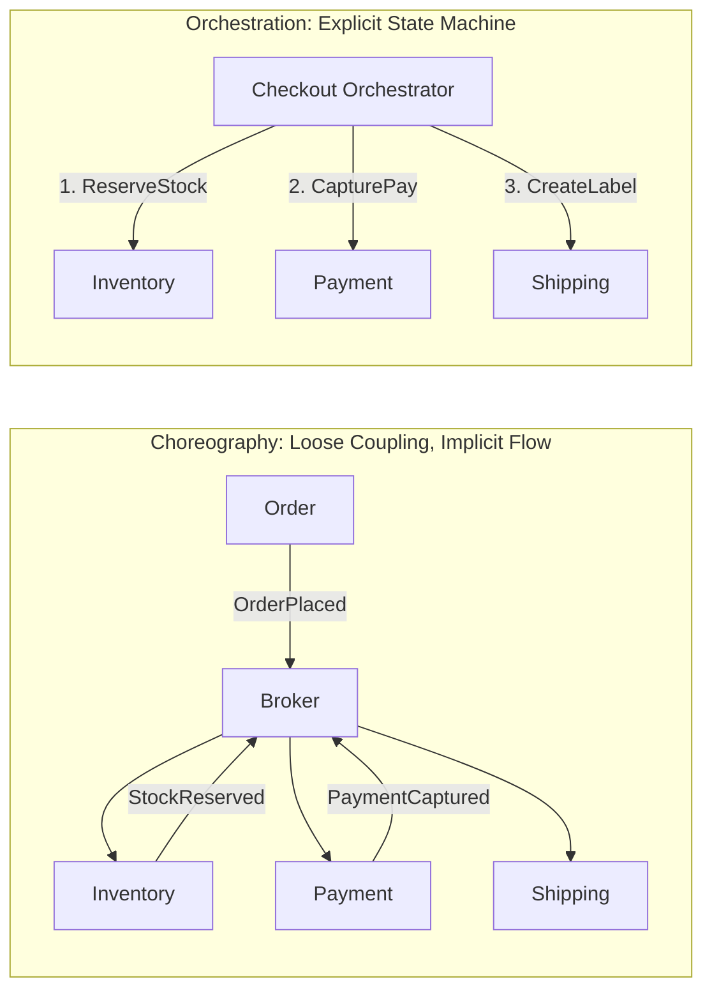
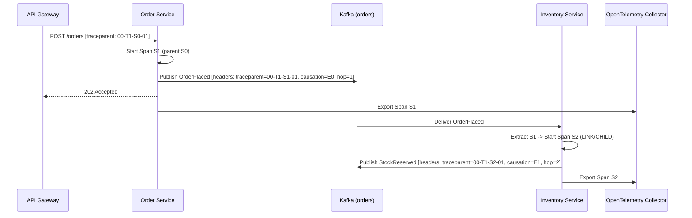
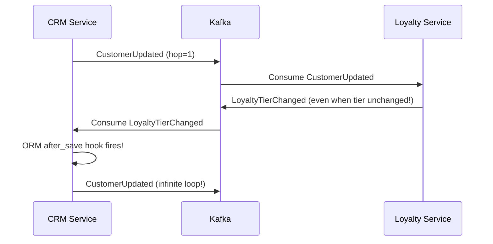

# Event-Driven Microservices: Choreography, Event Spaghetti & Tracing

> **Prerequisites:** [Lesson 17: Schema Evolution & Schema Registry](../17-schema-evolution-schema-registry/README.md) · [Lesson 15: Transactional Outbox & CDC](../15-transactional-outbox-pattern/README.md).  
> **Estimated Reading Time:** 24–28 minutes  
> **Target Audience:** Backend architects designing multi-service workflows, and candidates asked "when should you use choreography vs. orchestration, and how do you debug event-driven systems?"  
> **Free PDF Notes:** [Download SD-I-018.pdf](https://backendroadmap.com/notes/system-design/SD-I-018.pdf)

> [!NOTE]
> **In one line:** **Event-driven microservices** coordinate via asynchronous domain events rather than synchronous RPCs—giving you loose coupling and independent scaling, at the risk of **"event spaghetti"** (implicit, untraceable control flow) unless you enforce **W3C distributed tracing**, **domain boundaries**, and **hybrid orchestration** for complex multi-step workflows.

> [!TIP]
> **The Golden Rule:** Use **choreography** (events) for decoupled side effects *across* bounded contexts (`OrderPlaced` $\to$ Email, Analytics, Loyalty), and **orchestration** (a workflow engine or coordinator) for multi-step business transactions with complex branching, timeouts, and compensations *within* a process (Saga).

---

## 1. What Event-Driven Microservices Are, and What They Aren't

A startup splits its monolith into 12 microservices communicating via Kafka events. Six months later, an engineer is asked: *"What happens after a customer clicks Pay?"* Nobody knows. Checkout emits `OrderPlaced`, Inventory emits `StockReserved` or `StockFailed`, Fraud emits `RiskScored`, Billing emits `PaymentCaptured`, and Loyalty emits `PointsAwarded`—plus three undocumented services listening to `PaymentCaptured` and emitting events back to Order. A single bug triggers an infinite event loop between Billing and Loyalty.

| Term | Precise Meaning | Example |
| :--- | :--- | :--- |
| **Event notification** | Thin signal that something happened; consumers fetch details if needed | `OrderPlaced { orderId }` |
| **Event-carried state transfer** | Event embeds full snapshot so consumers need no callback | `OrderPlaced { orderId, items, total, address }` |
| **Choreography** | Services react to events independently with no central coordinator | Email & Analytics react to `OrderPlaced` |
| **Orchestration** | A central coordinator/workflow commands each step and handles retries/sagas | Temporal/Step Functions driving Checkout |
| **Event spaghetti** | Undocumented web of implicit event chains where no single place shows the flow | 15 services chaining 8 hops of events |
| **W3C `traceparent`** | Standard distributed trace header propagated inside message headers | `00-4bf92f3577b34da6...-01` |
| **Correlation ID vs. Causation ID** | `correlation_id` = root request; `causation_id` = immediate parent event | Root `req-1` $\to$ `evt-A` $\to$ `evt-B` (causation=`evt-A`) |
| **Not** | A free pass to avoid designing state machines or SLAs | Async workflows still need timeouts and compensations |

### Why It Matters
1. **Choreography scales teams, but hides control flow:** As services grow, "who listens to what?" becomes invisible without an event catalog and distributed tracing.
2. **Debugging async chains is impossible without context propagation:** Logs without `trace_id`, `correlation_id`, and `causation_id` turn a 2-minute bug into a 4-hour grep marathon.
3. **Hybrid architectures win in production:** Pure choreography collapses under complex Saga compensations; pure orchestration creates a "god orchestrator" bottleneck.

---

## 2. Anatomy: Choreography vs. Orchestration (and Event Spaghetti)



| Dimension | Choreography | Orchestration |
| :--- | :--- | :--- |
| **Coupling** | Very low (publishers know nothing of subscribers) | Coordinator knows all participating services |
| **Visibility of workflow** | Spread across $N$ codebases (hard to read) | Single place (workflow definition / state machine) |
| **Adding a new side effect** | Zero change to existing services (subscribe to event) | Update the orchestrator's workflow definition |
| **Error handling & Sagas** | Complex (distributed compensating events) | Clean (explicit `try/catch` + timeout + compensate) |
| **Failure risk** | **Event spaghetti**, cyclic loops, silent drops | Orchestrator becomes a single point of complexity/coupling |
| **Best suited for** | Notifications, analytics, search indexing, cache invalidation | Payments, order fulfillment, onboarding, multi-step Sagas |

> [!WARNING]
> **The #1 Trap: Turning Choreography into Distributed Monolith Spaghetti.**
> When Service A emits `Step1Done`, Service B emits `Step2Done`, Service C emits `Step3Done`, and Service A waits for `Step3Done` to finish its request, you have built a **synchronous-in-disguise distributed state machine** with none of the visibility of an orchestrator and all of the failure modes of async messaging.

---

## 3. Mathematical Model: End-to-End Latency, Fan-Out & Trace Completeness

**1. Multi-Hop Event Chain Latency.**
Suppose a choreographed workflow spans $H$ sequential event hops (Order $\to$ Inventory $\to$ Payment $\to$ Shipping). Each hop $i$ incurs producer outbox/publish latency $t_{\text{pub}, i}$, broker transit $t_{\text{broker}, i}$, and consumer processing $t_{\text{proc}, i}$:

$$T_{\text{e2e}} = \sum_{i=1}^{H} \left(t_{\text{pub}, i} + t_{\text{broker}, i} + t_{\text{proc}, i}\right)$$

Notice that tail latencies compound: if each of $H = 5$ hops has $p_{99} = 250\text{ ms}$, the $p_{99}$ of the chain is **not** $250\text{ ms}$—it approaches $5 \times 250 = 1{,}250\text{ ms}$ (plus any queue backlog).

**2. Tail-Based Sampling vs. Head-Based Sampling in Tracing.**
If you sample $p = 1\%$ of traces at the API gateway (head-based sampling) and a rare bug affects $0.2\%$ of async messages 4 hops later:

$$P(\text{captured}) = p \times P(\text{bug}) = 0.01 \times 0.002 = 0.00002 \quad (\text{1 in 50,000 bugs traced!})$$

With **tail-based sampling** (buffer spans for 30s and keep 100% of traces where `error=true` or `latency > SLO`), $P(\text{captured} \mid \text{error}) \approx 100\%$.

**3. Event Amplification Factor ($A_{\text{evt}}$).**
If one root user action triggers $k$ downstream services, and each emits an average of $r$ follow-up events over $H$ hops:

$$N_{\text{events}} = 1 + k + k r + k r^2 + \dots = \sum_{d=0}^{H} k r^d$$

If $r \ge 1$ (e.g., a cyclic loop where `A -> B -> A`), $N_{\text{events}} \to \infty$ (an **event storm**).

### Worked Numerical Example
- A checkout flow has $H = 4$ hops (`Order -> Inventory -> Payment -> Shipping`).
- Average hop: $t_{\text{pub}} = 5\text{ ms}$, $t_{\text{broker}} = 12\text{ ms}$, $t_{\text{proc}} = 35\text{ ms}$ $\implies 52\text{ ms/hop} \implies T_{\text{e2e, avg}} = 208\text{ ms}$.
- Under a 10x burst where broker queue wait hits $t_{\text{broker}, p99} = 400\text{ ms}$ per hop: $T_{\text{e2e}, p99} \approx 4 \times (5 + 400 + 35) = 1{,}760\text{ ms}$.
- If an accidental cycle occurs ($r = 1.0$) at $500\text{ req/s}$, each request spawns infinite events unless bounded by a `max_hops` / TTL header or cycle detection.

---

## 4. Metrics & Percentiles

| Metric | Meaning | Alert When |
| :--- | :--- | :--- |
| **End-to-end saga/workflow duration ($p_{95}, p_{99}$)** | Time from root command to terminal event | Exceeds product SLA (e.g., $> 10\text{ s}$ for checkout) |
| **Trace propagation coverage** | % of consumed messages with valid `traceparent` header | $< 99\%$ (indicates a service dropping trace context) |
| **Orphaned / timed-out workflows** | Workflows started (`OrderPlaced`) without terminal event within SLA | $> 0.1\%$ (indicates lost event or dead consumer) |
| **Event amplification ratio** | Total downstream events per root ingress request | Sudden jump (e.g., $4\times \to 25\times$ signals a feedback loop) |
| **DLQ rate by event type** | Failed events per topic/consumer group | $> 0$ sustained |
| **Hop count ($H$)** | `causation` depth of an event chain | $> 6$ (strong signal of event spaghetti) |

### Worked Example (`traceparent` + `correlation_id` + `causation_id`)
1. Client sends `POST /orders` (`trace_id = T1`).
2. Order Service saves order and publishes `OrderPlaced` (`event_id = E1`, `correlation_id = T1`, `causation_id = T1`, `traceparent = 00-T1-S1-01`).
3. Inventory Service consumes `E1`, extracts `traceparent` to create child span `S2`, reserves stock, and publishes `StockReserved` (`event_id = E2`, `correlation_id = T1`, `causation_id = E1`, `traceparent = 00-T1-S2-01`).
4. In Jaeger/Tempo, searching `T1` renders the complete async waterfall across all 4 services, even across Kafka queue delays.

---

## 5. Compounding & Failure Modes

| Failure Mode | Mechanism | Impact |
| :--- | :--- | :--- |
| **Cyclic Event Loop (Event Storm)** | Service A updates DB on `UserUpdated` and emits `ProfileSynced`; Service B updates DB on `ProfileSynced` and emits `UserUpdated` | Infinite loop saturates Kafka partitions, DB CPU hits 100%, cloud bill spikes |
| **Broken Trace Context** | A consumer creates a *new* root trace instead of extracting `traceparent` from Kafka headers | Waterfall splits into disconnected fragments; impossible to debug prod latency |
| **Dual-Write Lost Event** | Service commits DB transaction, crashes before publishing event to broker | Workflow hangs forever in `PENDING` state ("zombie order") |
| **Thin Event Callback Storm** | 12 consumers receive thin `OrderPlaced { id }` and all immediately `GET /orders/{id}` at once | 12x read amplification hammers the Order DB during traffic spikes |
| **Implicit Coupling via Domain Events** | Producer changes internal state machine and stops emitting `OrderVerified`; 3 undocumented consumers silently break | Silent data loss with zero compiler or API-gateway warning |

---

## 6. Numbers Every Engineer Must Know

| Item | Typical | Implication |
| :--- | :--- | :--- |
| **Async hop overhead (Kafka/PubSub)** | 5–25 ms (unloaded) | Fine for async; don't chain 10 hops for a synchronous UX |
| **W3C `traceparent` header size** | 55 bytes | Negligible; always inject into message headers/attributes |
| **Max healthy choreography depth** | 1–3 hops | Beyond 3–4 hops, switch to an explicit Orchestrator (Temporal/Step Functions) |
| **Head-based trace sampling rate** | 1%–5% (high traffic) | Misses rare async bugs; combine with tail-based sampling on errors |
| **Event-carried state payload size** | 1–10 KB | Eliminates callback storms, but watch out for stale snapshots & PII |
| **Saga timeout / orphan sweep interval** | 30s – 15m | Every async workflow needs a deadline sweeper or orchestrator timer |

---

## 7. Protocol / Mechanism Deep Dive: Trace Context & Causality Propagation



Notice the distinction in OpenTelemetry for messaging:
- **Producer span** (`kind=PRODUCER`) injects `traceparent` into message headers.
- **Consumer span** (`kind=CONSUMER`) extracts `traceparent`. For single-message processing, it uses a **parent-child** relationship; for batch polling (reading 500 Kafka messages at once), it uses **Span Links** so one batch span links to 500 distinct producer traces.

### When NOT to Use Choreography
- **Multi-step financial/fulfillment Sagas** requiring strict ordering, timeouts, and compensating rollbacks (use an orchestrator like Temporal, AWS Step Functions, or Conductor).
- **Direct request-reply** where the caller blocks waiting for an answer (just use gRPC/HTTP).
- **Tightly coupled internal steps** within the *same* bounded context (keep them in one service/transaction).

---

## 8. Hierarchical Budgets & Design Rules

| Slice | Rule | Control |
| :--- | :--- | :--- |
| **Architecture Boundary** | Choreography *between* domains; Orchestration *within* complex workflows | Architecture Decision Record (ADR) per workflow > 3 steps |
| **Context Propagation** | Every message MUST carry `traceparent`, `correlation_id`, `causation_id`, `hop_count` | Enforce in shared producer/consumer SDK middleware |
| **Loop Prevention** | Reject or alert when `hop_count > MAX_HOPS` (e.g., `10`) | Consumer middleware checks `hop_count` header before dispatch |
| **Event Payload Design** | Prefer Event-Carried State Transfer for read-heavy consumers; keep PII out or encrypted | Avoid thin-event callback storms against the producer's OLTP DB |
| **Discoverability** | Document every producer, topic, schema, and consumer in an Event Catalog | AsyncAPI specs generated in CI/CD from code/schemas |
| **Reliability** | Always pair event publishing with Transactional Outbox + Idempotent Inbox | Never dual-write DB + broker directly |

---

## 9. Top Mitigations

1. **Standardize a Messaging Envelope & Middleware:** Wrap your Kafka/SQS/PubSub client so every message automatically injects `traceparent`, `correlation_id`, `causation_id`, `event_id`, and `hop_count`—developers shouldn't wire headers by hand.
2. **Enforce a `hop_count` circuit breaker:** Increment `hop_count` on every derived event; if `hop_count > 10`, route to a DLQ and page on-call to stop infinite event storms before they melt the cluster.
3. **Adopt Hybrid Orchestration:** Use an orchestrator (Temporal, Step Functions) for the core Order $\to$ Payment $\to$ Inventory Saga, and have the orchestrator emit *one* clean domain event (`OrderCompleted`) for choreographed side effects (Email, Analytics, Loyalty).
4. **Maintain an AsyncAPI Event Catalog:** Require every service to declare `publishes` and `subscribes` in an `asyncapi.yaml` file in its repo so dependency graphs are auto-generated in CI.
5. **Use Tail-Based Sampling for Async Traces:** Sample 100% of traces that hit a DLQ, throw an exception, or exceed the workflow SLO, while keeping 1% of healthy traces.
6. **Prevent Callback Storms with Fat Events (Carefully):** Include immutable snapshot fields (`total_cents`, `currency`, `items`) in `OrderPlaced` so Analytics and Email don't DDoS the Order API on every event.
7. **Implement Workflow Watchdogs:** For any critical business process without an orchestrator, run a periodic sweeper querying for orders stuck in `PENDING` beyond `T_max` (e.g., 5 minutes).

---

## 10. Production Reference / War Story

**Incident (SEV-1): The Infinite `CustomerUpdated` Event Storm**
An e-commerce platform had two independent teams: **CRM Service** and **Loyalty Service**.
- **CRM** subscribed to `LoyaltyTierChanged` to update the customer's VIP flag in PostgreSQL—and its ORM hook emitted `CustomerUpdated` on every DB save.
- **Loyalty** subscribed to `CustomerUpdated` to recalculate the customer's tier—and emitted `LoyaltyTierChanged` even when the tier didn't change.
- **The Outage:** One customer update triggered an infinite ping-pong loop: `CustomerUpdated` $\to$ `LoyaltyTierChanged` $\to$ `CustomerUpdated`. Within 4 minutes, 2.4 million redundant events flooded Kafka, saturating both PostgreSQL primaries at 100% CPU and taking down checkout.



**Root Cause:** (1) No `hop_count` guard, (2) emitting events on no-op state changes, (3) no `source_service` / `causation` deduplication.
**Fix:** Added `hop_count` (hard cap at `8`) in shared messaging middleware, made state transitions idempotent (only emit `LoyaltyTierChanged` if `old_tier != new_tier`), and separated internal sync events from public domain events.

---

## 11. Multi-Language Production Code Tabs

````carousel
```go
// Go: Event envelope with W3C traceparent, causation_id, and hop_count loop guard.
package main

import (
	"context"
	"crypto/rand"
	"encoding/hex"
	"errors"
	"fmt"
)

const MaxEventHops = 10

type EventEnvelope struct {
	EventID       string
	EventType     string
	CorrelationID string
	CausationID   string
	TraceParent   string
	HopCount      int
	Payload       []byte
}

var ErrMaxHopsExceeded = errors.New("event hop_count exceeded max limit (possible cycle)")

func newHexID(bytes int) string {
	b := make([]byte, bytes)
	_, _ = rand.Read(b)
	return hex.EncodeToString(b)
}

// DeriveEvent creates a child event preserving correlation_id and trace_id while advancing causation & hop_count.
func DeriveEvent(parent *EventEnvelope, eventType string, payload []byte) (EventEnvelope, error) {
	if parent != nil && parent.HopCount >= MaxEventHops {
		return EventEnvelope{}, fmt.Errorf("%w: hops=%d correlation=%s", ErrMaxHopsExceeded, parent.HopCount, parent.CorrelationID)
	}
	evtID := newHexID(16)
	spanID := newHexID(8)
	if parent == nil {
		traceID := newHexID(16)
		return EventEnvelope{
			EventID:       evtID,
			EventType:     eventType,
			CorrelationID: evtID,
			CausationID:   evtID,
			TraceParent:   fmt.Sprintf("00-%s-%s-01", traceID, spanID),
			HopCount:      1,
			Payload:       payload,
		}, nil
	}
	// Preserve 32-char trace-id from parent traceparent: 00-<trace-id>-<span-id>-01
	traceID := parent.TraceParent[3:35]
	return EventEnvelope{
		EventID:       evtID,
		EventType:     eventType,
		CorrelationID: parent.CorrelationID,
		CausationID:   parent.EventID,
		TraceParent:   fmt.Sprintf("00-%s-%s-01", traceID, spanID),
		HopCount:      parent.HopCount + 1,
		Payload:       payload,
	}, nil
}

func HandleMessage(ctx context.Context, env EventEnvelope, fn func(context.Context, EventEnvelope) error) error {
	if env.HopCount > MaxEventHops {
		return ErrMaxHopsExceeded // Route to DLQ immediately
	}
	return fn(ctx, env)
}
```
<!-- slide -->
```typescript
// TypeScript: Messaging middleware propagating W3C traceparent, correlation, causation, and hop guard.
import { randomBytes } from "crypto";

export const MAX_EVENT_HOPS = 10;

export interface EventEnvelope<T = unknown> {
  eventId: string;
  eventType: string;
  correlationId: string;
  causationId: string;
  traceparent: string;
  hopCount: number;
  payload: T;
}

export function deriveEvent<T>(
  eventType: string,
  payload: T,
  parent?: EventEnvelope<unknown>
): EventEnvelope<T> {
  if (parent && parent.hopCount >= MAX_EVENT_HOPS) {
    throw new Error(`Hop limit exceeded (${parent.hopCount}) for correlation ${parent.correlationId}`);
  }
  const eventId = randomBytes(16).toString("hex");
  const spanId = randomBytes(8).toString("hex");

  if (!parent) {
    const traceId = randomBytes(16).toString("hex");
    return {
      eventId,
      eventType,
      correlationId: eventId,
      causationId: eventId,
      traceparent: `00-${traceId}-${spanId}-01`,
      hopCount: 1,
      payload,
    };
  }

  const traceId = parent.traceparent.split("-")[1];
  return {
    eventId,
    eventType,
    correlationId: parent.correlationId,
    causationId: parent.eventId,
    traceparent: `00-${traceId}-${spanId}-01`,
    hopCount: parent.hopCount + 1,
    payload,
  };
}
```
<!-- slide -->
```python
# Python: Event envelope with W3C traceparent, causation chain, and cycle protection (stdlib only).
import secrets
from dataclasses import dataclass

MAX_HOPS = 10


class EventLoopError(RuntimeError):
    pass


@dataclass(frozen=True)
class EventEnvelope:
    event_id: str
    event_type: str
    correlation_id: str
    causation_id: str
    traceparent: str
    hop_count: int
    payload: dict


def derive_event(event_type: str, payload: dict, parent: EventEnvelope | None = None) -> EventEnvelope:
    if parent and parent.hop_count >= MAX_HOPS:
        raise EventLoopError(f"Cycle detected: hop_count={parent.hop_count}, correlation={parent.correlation_id}")

    event_id = secrets.token_hex(16)
    span_id = secrets.token_hex(8)
    if parent is None:
        trace_id = secrets.token_hex(16)
        return EventEnvelope(
            event_id=event_id,
            event_type=event_type,
            correlation_id=event_id,
            causation_id=event_id,
            traceparent=f"00-{trace_id}-{span_id}-01",
            hop_count=1,
            payload=payload,
        )

    trace_id = parent.traceparent.split("-")[1]
    return EventEnvelope(
        event_id=event_id,
        event_type=event_type,
        correlation_id=parent.correlation_id,
        causation_id=parent.event_id,
        traceparent=f"00-{trace_id}-{span_id}-01",
        hop_count=parent.hop_count + 1,
        payload=payload,
    )
```
<!-- slide -->
```csharp
// C#: Event envelope with W3C traceparent, causation ID, and hop_count cycle guard.
using System.Security.Cryptography;

public sealed record EventEnvelope<T>(
    string EventId,
    string EventType,
    string CorrelationId,
    string CausationId,
    string TraceParent,
    int HopCount,
    T Payload)
{
    public const int MaxHops = 10;

    public static EventEnvelope<T> Derive(string eventType, T payload, EventEnvelope<object>? parent = null)
    {
        if (parent is not null && parent.HopCount >= MaxHops)
            throw new InvalidOperationException($"Max hops ({MaxHops}) exceeded for {parent.CorrelationId}");

        string eventId = Convert.ToHexString(RandomNumberGenerator.GetBytes(16)).ToLowerInvariant();
        string spanId = Convert.ToHexString(RandomNumberGenerator.GetBytes(8)).ToLowerInvariant();

        if (parent is null)
        {
            string traceId = Convert.ToHexString(RandomNumberGenerator.GetBytes(16)).ToLowerInvariant();
            return new(eventId, eventType, eventId, eventId, $"00-{traceId}-{spanId}-01", 1, payload);
        }

        string parentTraceId = parent.TraceParent.Split('-')[1];
        return new(eventId, eventType, parent.CorrelationId, parent.EventId,
            $"00-{parentTraceId}-{spanId}-01", parent.HopCount + 1, payload);
    }
}
```
````

---

## 12. Hands-On CLI Verification Workflows

Test trace propagation and cycle detection locally with Python:

```bash
python3 -c '
import secrets
# Simulate 3-hop chain and verify trace_id preservation
def make(hop, trace=None):
    t = trace or secrets.token_hex(16)
    return {"hop": hop, "traceparent": f"00-{t}-{secrets.token_hex(8)}-01"}
e1 = make(1)
e2 = make(2, e1["traceparent"].split("-")[1])
print("Root:", e1)
print("Child:", e2)
assert e1["traceparent"].split("-")[1] == e2["traceparent"].split("-")[1]
'
```

Inspect Kafka message headers (including `traceparent` and `correlation_id`) in a live cluster:

```bash
# Print message headers alongside key and value using kcat (kafkacat)
kcat -b localhost:9092 -t orders -C -c 5 -f 'Headers: %h\nKey: %k\nPayload: %s\n---\n'

# Validate an AsyncAPI event catalog spec
npx @asyncapi/cli validate asyncapi.yaml
```

---

## 13. Common Mistakes to Avoid

1. **Pure choreography for complex Sagas:** Trying to coordinate 6-step compensations via scattered events creates untraceable failure states; use an orchestrator instead.
2. **Omitting `traceparent` from message headers:** Creating a new trace per consumer breaks distributed waterfalls across async boundaries.
3. **No `hop_count` or cycle guard:** A single accidental feedback loop between two services can trigger an infinite event storm.
4. **Confusing `correlation_id` with `causation_id`:** `correlation_id` ties the whole user request together; `causation_id` builds the parent-child DAG of *which* event triggered *which* event.
5. **Thin events causing callback DDoS:** Publishing only `{ orderId }` forces 10 downstream consumers to simultaneously query the Order DB during spikes.
6. **Using head-based 1% sampling alone:** Rare async failures 4 hops deep will almost never be captured without tail-based sampling on errors.
7. **No event catalog (AsyncAPI):** Without a central registry of who publishes and subscribes to what, teams accidentally break undocumented consumers.

---

## 14. Key Terms Glossary

| Key Term | Definition |
| :--- | :--- |
| **Choreography** | Decentralized coordination where services react to domain events without a central controller. |
| **Orchestration** | Centralized coordination where a workflow engine commands each step and handles retries/rollbacks. |
| **Event Spaghetti** | An undocumented, tangled web of multi-hop event chains with hidden dependencies. |
| **Event Notification** | Minimal event (`{ id }`) signaling a state change; consumers fetch details via API if needed. |
| **Event-Carried State Transfer** | Event carrying full entity state so consumers can act locally without calling back. |
| **W3C `traceparent`** | Standard header (`00-<trace-id>-<span-id>-<flags>`) linking distributed spans across services. |
| **Correlation ID** | Identifier shared by all commands, logs, and events belonging to one root business flow. |
| **Causation ID** | Identifier of the immediate parent event or command that caused the current event. |
| **Span Link** | OpenTelemetry construct linking a batch consumer span to multiple independent producer traces. |
| **Event Storm** | Runaway feedback loop where services infinitely trigger each other's events. |
| **AsyncAPI** | Machine-readable specification (like OpenAPI) for documenting event-driven channels and schemas. |

---

## 15. System Design Interview Questions & Answers

### Basic Conceptual Questions

<details>
<summary><strong>Q1: What is the difference between choreography and orchestration? [BASIC]</strong></summary>

**Answer:**
In **choreography**, there is no central coordinator: services publish events and react independently (like dancers). In **orchestration**, a central workflow service explicitly commands each step, tracks state, and manages retries and compensations (like a conductor).
</details>

<details>
<summary><strong>Q2: What is "event spaghetti" and how do you prevent it? [BASIC]</strong></summary>

**Answer:**
Event spaghetti occurs when too many services chain multi-hop events with no central visibility, making it impossible to trace what happens after a user action. Prevent it by capping choreography depth (1–3 hops), using an orchestrator for complex workflows, enforcing distributed tracing (`traceparent`), and maintaining an AsyncAPI event catalog.
</details>

<details>
<summary><strong>Q3: What is the difference between `correlation_id` and `causation_id`? [BASIC]</strong></summary>

**Answer:**
`correlation_id` is the root ID of the entire business transaction (shared by every event in the flow). `causation_id` is the ID of the *immediate* parent event that triggered the current event, allowing you to reconstruct the exact causal tree.
</details>

<details>
<summary><strong>Q4: Event notification vs. event-carried state transfer? [BASIC]</strong></summary>

**Answer:**
Event notification sends only an ID (`OrderPlaced { orderId }`), keeping payloads tiny and fresh, but forces consumers to call back to the producer. Event-carried state transfer embeds the full snapshot (`items`, `total`), eliminating callback storms and coupling, at the cost of larger messages and potential staleness.
</details>

### Scenario-Based Architecture Questions

<details>
<summary><strong>Q5: You are designing an e-commerce checkout (Reserve Inventory -> Charge Card -> Arrange Shipping -> Send Email & Analytics). Choreography or Orchestration? [SCENARIO]</strong></summary>

**Answer:**
Use a **hybrid approach**: an **Orchestrator** (e.g., Temporal or Step Functions) manages the core Saga (`Reserve Inventory -> Charge Card -> Arrange Shipping`) because it requires strict ordering, timeouts, and compensating rollbacks (`Refund`, `ReleaseStock`) if shipping fails. Once complete, the orchestrator emits one `OrderCompleted` domain event for **choreographed** side effects (Email, Analytics, Loyalty).
</details>

<details>
<summary><strong>Q6: A customer's order failed 4 hops into an async workflow, and you need to find out why in under 2 minutes. What must be in place? [SCENARIO]</strong></summary>

**Answer:**
Every message must carry W3C `traceparent`, `correlation_id`, and `causation_id` in its headers, extracted and injected by shared messaging middleware. Combined with OpenTelemetry tail-based sampling (which retains 100% of error traces), searching the `order_id` or `correlation_id` immediately renders the full cross-service waterfall and pinpoints the failing span.
</details>

<details>
<summary><strong>Q7: Two microservices accidentally entered an infinite event loop in production. How do you stop it and prevent recurrence? [SCENARIO]</strong></summary>

**Answer:**
Immediately pause the consumer group or drop the offending topic/subscription. To prevent recurrence: (1) add a `hop_count` header in shared middleware that dead-letters any event exceeding a threshold (e.g., `10`), (2) make state updates idempotent so no-op updates never emit events, and (3) distinguish internal sync events from public domain events.
</details>

<details>
<summary><strong>Q8: When we switched to thin events (`OrderPlaced { orderId }`), our Order DB CPU spiked to 100% during a flash sale. Why? [SCENARIO]</strong></summary>

**Answer:**
Every downstream consumer (Email, Fraud, Analytics, Warehouse, Loyalty) received the thin event and simultaneously called `GET /orders/{id}`—creating a **5x synchronous read amplification** storm on the Order DB. Fix it by embedding the needed fields in the event (Event-Carried State Transfer) or serving reads from a read replica/cache.
</details>

### Advanced & Tricky Interview Questions

<details>
<summary><strong>Q9: How does OpenTelemetry model a consumer that polls a batch of 500 Kafka messages at once? [TRICKY]</strong></summary>

**Answer:**
A single span cannot have 500 parents in standard parent-child modeling. Instead, the batch-processing span uses **Span Links**: it extracts the `traceparent` from each of the 500 messages and attaches them as links, preserving causal traceability without merging 500 independent user traces into one giant unreadable trace.
</details>

<details>
<summary><strong>Q10: Why can tail-based sampling be hard to operate in an event-driven architecture? [TRICKY]</strong></summary>

**Answer:**
Tail-based sampling requires holding all spans for a `trace_id` in a collector's memory until the trace finishes. In async messaging, a message can sit in a queue for minutes or hours during a backlog—far longer than the collector's 30–60s memory buffer—causing the trace decision to be made before the error span arrives. Mitigate with consistent trace-ID routing across collectors and error-triggered debug flags.
</details>

<details>
<summary><strong>Q11: How do you avoid an "anemic" or "god" orchestrator when using orchestration? [TRICKY]</strong></summary>

**Answer:**
Keep **business logic inside the domain services** and keep **only workflow state, retries, timeouts, and compensation sequencing** inside the orchestrator. The orchestrator should invoke `PaymentService.Capture()` rather than calculating tax or validating card rules itself.
</details>

<details>
<summary><strong>Q12: How do you test and validate that a choreographed architecture doesn't break when a team changes an event? [TRICKY]</strong></summary>

**Answer:**
Combine three layers: (1) **Schema Registry** (`FULL_TRANSITIVE`) for structural contracts, (2) **Consumer-Driven Contract Tests** (e.g., Pact) in CI so producers verify they still satisfy consumer expectations, and (3) **AsyncAPI** catalogs in CI to track all active subscribers before deprecating an event.
</details>

---

## 16. One-Page Master Cheat Sheet

```
+---------------------------------------------------------------------------------------------------------+
|              EVENT-DRIVEN MICROSERVICES & TRACING — MASTER CHEAT SHEET                                  |
+---------------------------------------------------------------------------------------------------------+
| 1. HYBRID RULE: Orchestration (Temporal/Step Functions) for complex Sagas & compensations;              |
|                 Choreography (domain events) for decoupled side effects (Email, Analytics, Loyalty).    |
+---------------------------------------------------------------------------------------------------------+
| 2. EVENT SPAGHETTI: Keep choreography <= 3 hops. Beyond that, implicit control flow becomes untraceable.|
+---------------------------------------------------------------------------------------------------------+
| 3. TRACING HEADERS: Every message MUST carry `traceparent` (W3C), `correlation_id`, `causation_id`,     |
|    and `hop_count`. Use Span Links for batch consumers; tail-based sampling for rare async errors.      |
+---------------------------------------------------------------------------------------------------------+
| 4. LOOP GUARD: Increment `hop_count` in middleware; dead-letter + alert if hop_count > MAX_HOPS (10).   |
+---------------------------------------------------------------------------------------------------------+
| 5. PAYLOADS: Thin events risk callback DDoS; Event-Carried State Transfer avoids callbacks (watch PII). |
+---------------------------------------------------------------------------------------------------------+
```

---

## Further Reading & Sources

- Martin Fowler, [What do you mean by "Event-Driven"?](https://martinfowler.com/articles/201701-event-driven.html)
- Sam Newman, *Building Microservices* (2nd ed.), Chapters 4 & 6 (Choreography vs. Orchestration).
- OpenTelemetry Specification, [Semantic Conventions for Messaging Spans](https://opentelemetry.io/docs/specs/semconv/messaging/messaging-spans/).
- Gregor Hohpe, *Enterprise Integration Patterns* (Correlation Identifier & Saga patterns).

---

## Free PDF Notes

[SD-I-018.pdf](https://backendroadmap.com/notes/system-design/SD-I-018.pdf)

---

## Next

Continue with [Lesson 19: Cloud Messaging: SQS, SNS, Service Bus, Event Hubs, Pub/Sub vs Kafka](../19-cloud-messaging/README.md).
