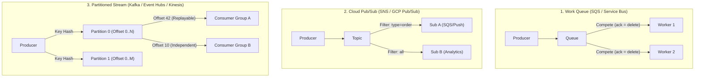
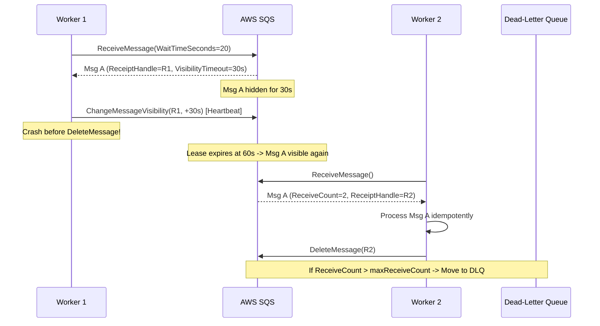
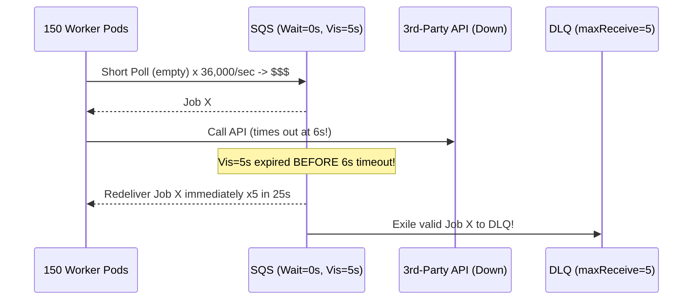

# Cloud Messaging: SQS, SNS, Service Bus, Event Hubs, Pub/Sub vs Kafka

> **Prerequisites:** [Lesson 18: Event-Driven Microservices](../18-event-driven-microservices/README.md) · [Lesson 02: Message Queues vs Event Streams](../02-message-queues-vs-event-streams/README.md).  
> **Estimated Reading Time:** 24–28 minutes  
> **Target Audience:** Backend and cloud architects choosing managed messaging primitives on AWS, Azure, and GCP, and candidates asked "why pick SQS/SNS or Google Pub/Sub instead of running Kafka?"  
> **Free PDF Notes:** [Download SD-I-019.pdf](https://backendroadmap.com/notes/system-design/SD-I-019.pdf)

> [!NOTE]
> **In one line:** Managed cloud messaging splits into three distinct families—**serverless queues** (SQS, Service Bus Queues), **push/fan-out pub-sub** (SNS, GCP Pub/Sub), and **partitioned event streams** (Kinesis, Azure Event Hubs, Managed Kafka)—each trading off **replayability, strict ordering, operational overhead, and per-message vs. provisioned-shard billing**.

> [!TIP]
> **The Golden Rule:** Don't deploy Kafka just to pass background jobs between two services. Use **SQS** (or Service Bus / Pub/Sub) when you want zero cluster ops, per-message billing, and competing consumers; choose **Kafka / Event Hubs / Kinesis** only when you need **log replay**, **strict partition ordering at high throughput**, or **stream processing** (Flink/ksqlDB).

---

## 1. What Cloud Messaging Is, and What It Isn't

A team building a new AWS backend spins up a 3-broker self-managed Kafka cluster on EC2 to process 400 image-resize jobs per minute. Six months later, they've spent more engineering hours tuning ZooKeeper/KRaft, EBS disk alerts, and consumer rebalancing than building product features—all for a workload that never replays old messages and has no ordering requirement. Meanwhile, another team uses **SQS Standard** for a financial ledger expecting strict FIFO ordering and replayability, and gets burned by out-of-order deliveries and vanished messages after `DeleteMessage`.

| Term | Precise Meaning | Example |
| :--- | :--- | :--- |
| **Managed Work Queue** | Serverless buffer; message deleted on ack; scales automatically | AWS SQS, Azure Service Bus Queue |
| **Cloud Pub/Sub (Push/Pull)** | Topic-based fan-out to many independent subscriptions | AWS SNS, Google Cloud Pub/Sub |
| **Partitioned Event Stream** | Append-only distributed log with offsets, retention, and replay | Apache Kafka (MSK), Azure Event Hubs, AWS Kinesis |
| **Visibility timeout** | Lease window hiding an SQS/PubSub message while a worker processes it | 30s default in SQS; extendable via heartbeat |
| **Message Group ID** | Key guaranteeing strict FIFO ordering for a subset of messages | `order_id` in SQS FIFO / `SessionId` in Service Bus |
| **Throughput Unit / Shard** | Provisioned capacity slice in streams (e.g., 1 MB/s in, 2 MB/s out) | Kinesis Shard, Event Hubs TU |
| **Not** | Interchangeable drop-ins | SQS cannot replay 7 days of history; Kinesis cannot fan out to 500 filtered webhooks natively |

### Why It Matters
1. **Ops vs. Control:** Serverless queues (SQS, Pub/Sub) eliminate broker patching, disk sizing, and partition rebalancing.
2. **Billing cliffs:** Pay-per-request (SQS/SNS/Pub/Sub) is near-free at low/bursty traffic; provisioned streams (MSK/Kinesis) can be **5x–10x cheaper** at sustained 50k+ msg/sec.
3. **Architecture fit:** Interviewers test whether you match the primitive to the requirement (replay? ordering? fan-out? enterprise AMQP? multi-region?).

---

## 2. Anatomy: The Three Cloud Messaging Families



### Cloud Provider Comparison Matrix

| Feature | AWS SQS (Std / FIFO) | AWS SNS | Azure Service Bus | Azure Event Hubs | GCP Pub/Sub | Apache Kafka / MSK |
| :--- | :--- | :--- | :--- | :--- | :--- | :--- |
| **Model** | Pull Queue | Push Pub/Sub | Enterprise Queue/Topic | Partitioned Log | Global Push/Pull Pub/Sub | Partitioned Log |
| **Ordering** | Best-effort (Std) / Strict per Group (FIFO) | Best-effort / FIFO (to SQS FIFO) | Strict via Sessions | Strict per Partition | Ordering Key (per region) | Strict per Partition |
| **Replayability** | No (deleted on ack) | No | No (except Peek-Lock) | **Yes** (1–90d retention) | **Yes** (Snapshot/Seek up to 7–31d) | **Yes** (Days to Infinite) |
| **Max Payload** | 256 KB (2 GB w/ S3) | 256 KB | 256 KB (Std) / 100 MB (Prem) | 1 MB | 10 MB | 1 MB default (configurable) |
| **Throughput Limit** | Unlimited (Std) / 3k–70k msg/s (FIFO) | Very high | ~1k–10k+ msg/s | Scales by TUs/PUs | Scales seamlessly (GB/s) | Scales by Brokers/Partitions |
| **Billing Model** | Per 1M requests | Per 1M publishes + deliveries | Per ops (Std) / Hourly MU (Prem) | Hourly TU/PU + ingress | Per GB ($40/TB) | Hourly broker + EBS storage |

> [!WARNING]
> **The #1 Trap: SQS FIFO Throughput & Partitioning Misconceptions.**
> Standard SQS scales nearly infinitely, but does **not** guarantee order. Switching to SQS FIFO gives strict ordering per `MessageGroupId`—but caps a single queue at **300 msg/s** (3,000/s with batching, or up to 70,000/s with high-throughput FIFO enabled). Worse, if all messages share one `MessageGroupId`, throughput collapses to a single sequential consumer!

---

## 3. Mathematical Model: Cost Crossover & Capacity Sizing

**1. Serverless Per-Request Cost vs. Provisioned Stream Cost.**
Let $\lambda$ be sustained message rate (msg/s), $S_{\text{kb}}$ be average payload size in KB, and $T_{\text{month}} = 2{,}592{,}000$ seconds (30 days):

$$N_{\text{month}} = \lambda \cdot 2{,}592{,}000$$

- **SQS Standard Cost** (approx. $\$0.40$ per 1M requests; each message = 1 Send + 1 Receive + 1 Delete = **3 requests**, or $0.3$ requests/msg with `MaxNumberOfMessages=10` batching):

$$C_{\text{SQS}} = \frac{N_{\text{month}}}{10^6} \times R_{\text{per\_msg}} \times \$0.40$$

- **GCP Pub/Sub Cost** (approx. $\$40$ per TiB of ingress + egress; minimum 1 KB billed per message):

$$C_{\text{PubSub}} = \frac{N_{\text{month}} \cdot \max(S_{\text{kb}}, 1) \cdot (1 + N_{\text{subs}})}{1024^3} \times \$40$$

- **Managed Kafka (MSK) Cost:** Fixed cluster cost (e.g., 3 $\times$ `kafka.m5.large` $\approx \$450$/mo + EBS storage + cross-AZ transfer), independent of $\lambda$ up to cluster saturation.

**2. Stream Shard / Partition Count ($P$).**
For Kinesis (1 MB/s or 1,000 records/s per shard) or Event Hubs (1 MB/s or 1,000 events/s per TU):

$$P = \max\left(\left\lceil \frac{\lambda_{\text{peak}}}{R_{\text{shard}}} \right\rceil,\; \left\lceil \frac{\lambda_{\text{peak}} \cdot S_{\text{bytes}}}{B_{\text{shard}}} \right\rceil\right)$$

### Worked Numerical Example
Compare **100 msg/s** (startup) vs **50,000 msg/s** (high scale) with $S = 2\text{ KB}$ payload and batch size 10 ($R_{\text{per\_msg}} \approx 0.3$ requests/msg? Wait: Send=1, ReceiveBatch(10)=0.1, DeleteBatch(10)=0.1 $\implies 1.2$ requests/msg, or $0.3$ if producer also batches 10):
- **At $\lambda = 100$ msg/s** ($259.2\text{M}$ msg/month), unbatched send + batched receive/delete ($1.2$ req/msg):
  - **SQS:** $259.2 \times 1.2 \times \$0.40 = \mathbf{\$124.42/\text{month}}$ (zero ops!).
  - **MSK (3 brokers):** $\mathbf{\sim\$550/\text{month}}$ (4.4x more expensive + ops overhead).
- **At $\lambda = 50{,}000$ msg/s** ($129.6\text{B}$ msg/month):
  - **SQS (1.2 req/msg):** $129{,}600 \times 1.2 \times \$0.40 = \mathbf{\$62{,}208/\text{month}}$ (with batching of 10 on send too: $\$15{,}552/\text{mo}$).
  - **MSK (6 $\times$ `m5.2xlarge` + EBS):** $\mathbf{\sim\$3{,}200/\text{month}}$ (**5x–19x cheaper** than SQS at sustained 50k msg/s).

---

## 4. Metrics & Percentiles

| Metric | Meaning | Alert When |
| :--- | :--- | :--- |
| **`ApproximateAgeOfOldestMessage` (SQS) / `oldest_unacked_message_age` (Pub/Sub)** | Freshness lag at head of queue | Exceeds processing SLO (e.g., $> 60\text{ s}$) |
| **`NumberOfMessagesDeleted` vs `Sent`** | Throughput balance (drain vs ingress) | `Sent > Deleted` for $> 5$ mins |
| **Kinesis `WriteProvisionedThroughputExceeded` / Event Hubs `ServerBusy`** | Shard/TU throttling (HTTP 429) | $> 0$ (hot partition key or under-provisioned shards) |
| **SQS `ApproximateNumberOfMessagesNotVisible`** | In-flight messages leased by workers | Near max in-flight limit (`120,000` Std / `20,000` FIFO) |
| **Consumer `IteratorAgeMilliseconds` (Kinesis/Streams)** | How far behind the stream tip consumers are | Rising toward retention limit (risk of data loss!) |
| **DLQ `ApproximateNumberOfMessagesVisible`** | Poison messages exhausting `maxReceiveCount` | $> 0$ |

### Worked Example (SQS Visibility Timeout vs. Processing Time)
A worker polls an SQS queue with `VisibilityTimeout = 30s` and `maxReceiveCount = 3`.
- Suddenly, a downstream PDF renderer slows down to `45s` per job.
- At `t = 30s`, SQS assumes Worker 1 crashed and **redelivers** the same message to Worker 2.
- At `t = 45s`, Worker 1 finishes and calls `DeleteMessage`—which succeeds, even though Worker 2 is still running!
- Worse, if it takes 45s three times in a row before `DeleteMessage`, `ReceiveCount` hits `3` and the valid message is prematurely exiled to the DLQ. **Fix:** Set `VisibilityTimeout` $\ge 6 \times p_{99}$ processing time, or extend the lease dynamically via `ChangeMessageVisibility` heartbeats.

---

## 5. Compounding & Failure Modes

| Failure Mode | Cloud Service | Mechanism & Impact |
| :--- | :--- | :--- |
| **SQS FIFO Head-of-Line Blocking** | AWS SQS FIFO | One poison message in `MessageGroupId = "tenant-A"` blocks *all* subsequent messages for `tenant-A` until `maxReceiveCount` moves it to the DLQ |
| **Hot Shard Throttling** | Kinesis / Event Hubs | Choosing a skewed partition key (`country = "US"`) sends 80% of traffic to 1 shard (1 MB/s cap), throwing `ProvisionedThroughputExceededException` while 99 other shards sit 99% idle |
| **256 KB Payload Limit Exceeded** | SQS / SNS / Service Bus Std | Large order JSON (400 KB) fails `SendMessage` with `InvalidParameterValue` |
| **Stream Retention Expiry Outage** | Kinesis (24h default) / Kafka | Consumer outage lasts 26 hours on a 24h-retention Kinesis stream $\implies$ **permanent data loss** as oldest records age out |
| **Cross-AZ / Cross-Region Egress Shock** | MSK / Kafka / Pub/Sub | Multi-AZ consumers pulling 500 MB/s across AZ boundaries incur $\$0.01\text{–}\$0.02/\text{GB}$ transfer fees—often exceeding broker compute cost |

---

## 6. Numbers Every Engineer Must Know

| Item | Typical / Limit | Implication |
| :--- | :--- | :--- |
| **SQS Standard in-flight limit** | 120,000 messages | Exceeding throws `OverLimit`; scale workers or split queues |
| **SQS FIFO in-flight limit** | 20,000 messages | Tighter bound; monitor `NotVisible` count closely |
| **SQS / SNS / Service Bus Std max payload** | 256 KB | Use Extended Client Library (claim-check to S3/Blob) for larger payloads |
| **GCP Pub/Sub max payload** | 10 MB | Can carry larger state snapshots natively without S3 claim-check |
| **SQS batch API max** | 10 messages or 256 KB | Batching cuts SQS bill by up to **10x** |
| **Kinesis shard capacity** | 1 MB/s or 1,000 rec/s write; 2 MB/s read | Fan-out to $>2$ consumers requires Enhanced Fan-Out (2 MB/s per consumer) |
| **GCP Pub/Sub Seek/Snapshot retention** | Up to 7–31 days | Bridges the gap between traditional queues and Kafka replay |

---

## 7. Protocol / Mechanism Deep Dive: SQS Long Polling & Visibility Lease vs. Kafka Offsets



| Question | SQS / Service Bus | Kafka / Event Hubs / Kinesis |
| :--- | :--- | :--- |
| **Who tracks progress?** | **Broker** tracks per-message state (visible, leased, deleted) | **Consumer** tracks sequential integer offset per partition |
| **Can 2 services read the same queue?** | **No** (first to delete removes it for everyone—use SNS $\to$ SQS) | **Yes** (each Consumer Group maintains its own independent offset) |
| **How does scaling work?** | Add more workers freely (no partition limit on Standard) | Max active consumers per group = **Partition count** |
| **Ordering** | None (Std) or per `MessageGroupId` (FIFO) | Strict per partition |

### When NOT to Use Managed Queues vs. Streams
- **Don't use SQS** when multiple independent services need to read and **replay** historical events (use Kafka, Event Hubs, or Pub/Sub with Seek).
- **Don't use Kafka/MSK** for simple background job queues under 1,000 msg/s with no replay requirement (use SQS/Service Bus/Pub/Sub and save months of ops).
- **Don't use Kinesis** if you have $> 5$ independent consumers reading the same stream without Enhanced Fan-Out (they will contend on the 2 MB/s/shard read limit).

---

## 8. Hierarchical Budgets & Design Rules

| Slice | Rule | Control |
| :--- | :--- | :--- |
| **Queue vs. Stream Selection** | Default to Serverless Queue/PubSub; justify Streams with Replay or $>10\text{k}$ msg/s | Architecture checklist: Replay needed? Ordering? Throughput? |
| **Cost Optimization** | Always batch SQS (`SendMessageBatch`, `DeleteMessageBatch` of 10) + Long Polling (`WaitTimeSeconds=20`) | Eliminates empty-poll charges and cuts request count up to 10x |
| **Payload Sizing** | Keep broker messages $< 256\text{ KB}$; use Claim-Check (S3/Blob) for large blobs | Enforce size guard in producer SDK |
| **Visibility & Leases** | Set `VisibilityTimeout` $\ge 6 \times p_{99}$ handler time or use heartbeats | Prevents duplicate execution during slow downstream calls |
| **Stream Retention** | Set Kinesis/Kafka retention $\ge 7\times$ max expected consumer outage (e.g., 7 days) | Prevents silent data expiration over a holiday weekend |
| **Partition Key Design** | High-cardinality key (e.g., `order_id`, `user_id + shard_suffix`) | Prevents hot-shard 429 throttling on Kinesis/Event Hubs/Kafka |

---

## 9. Top Mitigations

1. **Enable SQS Long Polling (`WaitTimeSeconds = 20`):** Short polling (`0s`) returns empty responses immediately and bills you millions of wasted `ReceiveMessage` calls when queues are idle.
2. **Use `SendMessageBatch` / `DeleteMessageBatch`:** Grouping 10 messages per API call reduces SQS request costs by up to **90%** and boosts FIFO throughput from 300 to 3,000+ msg/s.
3. **Implement the Claim-Check Pattern for payloads $> 200\text{ KB}$:** Store the large JSON/PDF in S3/GCS/Azure Blob and publish only the object URI + SHA-256 checksum on the queue.
4. **Salt hot partition keys on streams:** If one enterprise tenant generates 40% of traffic, suffix their key (`tenantA#0`..`tenantA#15`) so load spreads across 16 shards/partitions.
5. **Pair every queue with a DLQ + Redrive Alarm:** Set `maxReceiveCount = 3..5` (never infinite retries) and alert whenever `DLQ > 0`.
6. **Use GCP Pub/Sub Seek/Snapshots or Kafka for replay:** If your product requires "re-run last 7 days of events into a new microservice," don't hack it on SQS—use a replayable log or archive to S3 + replay.
7. **Evaluate total TCO (Ops + Egress + Requests):** Revisit SQS vs. MSK when sustained traffic crosses ~10,000–20,000 msg/s.

---

## 10. Production Reference / War Story

**Incident (SEV-1): The $18,000 Empty-Polling & Retry Loop Weekend**
A SaaS team deployed 150 Kubernetes worker pods polling 12 AWS SQS queues using a custom SDK wrapper with **short polling (`WaitTimeSeconds = 0`)** and `VisibilityTimeout = 5s`.
- **Friday Night:** A third-party webhook API went down for 6 hours. Workers popped messages, failed after 6s (longer than the 5s visibility timeout!), and never deleted them—while idle queues were polled 20 times/sec per pod.
- **The Damage:**
  1. Empty short-polling generated $150 \times 12 \times 20 \times 86{,}400 \approx 3.1\text{B}$ wasted `ReceiveMessage` calls over the weekend.
  2. Messages bounced between workers every 5s, burning DB connections and hitting `maxReceiveCount` in 25 seconds—dumping 400,000 valid customer jobs into the DLQ before the third-party API recovered.



**Root Cause:** `WaitTimeSeconds=0` (short polling) + `VisibilityTimeout` shorter than HTTP client timeout + no exponential backoff.
**Fix:** Switched to `WaitTimeSeconds=20`, set `VisibilityTimeout=60s` with HTTP timeout `10s`, added jittered backoff before retry, and configured a CloudWatch alarm on DLQ depth.

---

## 11. Multi-Language Production Code Tabs

````carousel
```go
// Go: Cloud-agnostic Queue/Stream router with Claim-Check threshold and batching (stdlib only).
package main

import (
	"crypto/sha256"
	"encoding/hex"
	"fmt"
)

const MaxInlineBytes = 256 * 1024 // 256 KB (SQS / SNS / Service Bus Std limit)

type CloudMessage struct {
	Key          string
	InlineBody   []byte
	ClaimCheckS3 string // Set when payload exceeds MaxInlineBytes
	SHA256       string
}

type BlobStore interface {
	Put(key string, data []byte) (uri string, err error)
}

func PrepareMessage(key string, payload []byte, store BlobStore) (CloudMessage, error) {
	sum := sha256.Sum256(payload)
	digest := hex.EncodeToString(sum[:])

	if len(payload) <= MaxInlineBytes {
		return CloudMessage{Key: key, InlineBody: payload, SHA256: digest}, nil
	}
	// Claim-Check pattern: offload large payload to object storage; send pointer on broker.
	uri, err := store.Put(fmt.Sprintf("claims/%s/%s", key, digest), payload)
	if err != nil {
		return CloudMessage{}, err
	}
	return CloudMessage{Key: key, ClaimCheckS3: uri, SHA256: digest}, nil
}

// BatchChunks splits messages into cloud-compliant batches of max 10 items (SQS SendMessageBatch limit).
func BatchChunks(msgs []CloudMessage, maxBatch int) [][]CloudMessage {
	if maxBatch <= 0 {
		maxBatch = 10
	}
	var batches [][]CloudMessage
	for i := 0; i < len(msgs); i += maxBatch {
		end := i + maxBatch
		if end > len(msgs) {
			end = len(msgs)
		}
		batches = append(batches, msgs[i:end])
	}
	return batches
}
```
<!-- slide -->
```typescript
// TypeScript: SQS-style Visibility Lease Heartbeat + Batch Sender abstraction.
export interface QueueMessage<T> {
  id: string;
  receiptHandle: string;
  body: T;
}

export interface QueueClient<T> {
  extendVisibility(receiptHandle: string, seconds: number): Promise<void>;
  deleteMessage(receiptHandle: string): Promise<void>;
}

/**
 * Runs a handler while periodically extending the message visibility lease
 * so slow jobs aren't redelivered prematurely to another worker.
 */
export async function processWithHeartbeat<T>(
  client: QueueClient<T>,
  msg: QueueMessage<T>,
  leaseSeconds: number,
  handler: (body: T) => Promise<void>
): Promise<void> {
  const intervalMs = Math.max(1000, Math.floor((leaseSeconds * 1000) / 2));
  const timer = setInterval(() => {
    void client.extendVisibility(msg.receiptHandle, leaseSeconds).catch(() => {
      // Best-effort heartbeat; handler completion will still attempt delete
    });
  }, intervalMs);

  try {
    await handler(msg.body);
    await client.deleteMessage(msg.receiptHandle);
  } finally {
    clearInterval(timer);
  }
}
```
<!-- slide -->
```python
# Python: Cloud messaging cost & shard sizing calculator (stdlib only).
import math

SECONDS_PER_MONTH = 30 * 86_400


def monthly_sqs_cost(rate_per_s: float, batch_size: int = 1, price_per_million: float = 0.40) -> float:
    """SQS cost: 1 Send + 1 Receive + 1 Delete = 3 requests unbatched; 3/batch_size batched."""
    total_msgs = rate_per_s * SECONDS_PER_MONTH
    reqs_per_msg = 3.0 / max(1, min(batch_size, 10))
    return round((total_msgs * reqs_per_msg / 1_000_000) * price_per_million, 2)


def monthly_pubsub_cost(rate_per_s: float, payload_kb: float = 2.0, subscribers: int = 1,
                        price_per_tib: float = 40.0) -> float:
    """GCP Pub/Sub bills $40/TiB for ingress + egress (min 1 KB per message)."""
    total_msgs = rate_per_s * SECONDS_PER_MONTH
    billed_kb = max(1.0, payload_kb) * (1 + subscribers)
    total_tib = (total_msgs * billed_kb) / (1024 ** 3)
    return round(total_tib * price_per_tib, 2)


def required_stream_shards(peak_rate_s: float, payload_bytes: int,
                           max_rec_s: int = 1000, max_bytes_s: int = 1_048_576) -> int:
    """Kinesis / Event Hubs shard/TU count bounded by record rate or byte throughput."""
    by_rate = math.ceil(peak_rate_s / max_rec_s)
    by_bytes = math.ceil((peak_rate_s * payload_bytes) / max_bytes_s)
    return max(1, by_rate, by_bytes)
```
<!-- slide -->
```csharp
// C#: Hot-key salting for Kinesis/Event Hubs/Kafka + Claim-Check guard.
using System.Security.Cryptography;
using System.Text;

public static class PartitionKeyHelper
{
    public const int MaxInlinePayloadBytes = 256 * 1024;

    /// <summary>
    /// Salts a high-volume tenant key across N virtual shards to prevent hot-partition throttling.
    /// </summary>
    public static string SaltKey(string tenantId, string entityId, int saltBuckets = 16)
    {
        byte[] hash = SHA256.HashData(Encoding.UTF8.GetBytes(entityId));
        int bucket = BitConverter.ToUInt16(hash, 0) % saltBuckets;
        return $"{tenantId}#{bucket}";
    }

    public static bool RequiresClaimCheck(ReadOnlySpan<byte> payload) =>
        payload.Length > MaxInlinePayloadBytes;
}
```
````

---

## 12. Hands-On CLI Verification Workflows

Run the cloud cost & shard sizing math in Python:

```bash
python3 -c '
import math
secs = 30 * 86_400
for rps in [100, 5_000, 50_000]:
    msgs = rps * secs
    sqs_unbatched = (msgs * 3 / 1e6) * 0.40
    sqs_batched = (msgs * 0.3 / 1e6) * 0.40
    pubsub_1sub = (msgs * 2.0 * 2 / (1024**3)) * 40.0
    shards = max(math.ceil(rps/1000), math.ceil(rps*2048/1048576))
    print(f"rps={rps:6d} | SQS(1)={sqs_unbatched:8.1f}$ | SQS(10)={sqs_batched:7.1f}$ | PubSub={pubsub_1sub:8.1f}$ | Shards={shards}")
'
```

Inspect real cloud queues and streams via vendor CLIs:

```bash
# AWS SQS: inspect queue depth, in-flight count, and visibility timeout
aws sqs get-queue-attributes --queue-url "$SQS_URL" \
  --attribute-names ApproximateNumberOfMessages ApproximateNumberOfMessagesNotVisible VisibilityTimeout

# GCP Pub/Sub: create a snapshot and seek back 1 hour to replay messages
gcloud pubsub snapshots create orders-replay-snap --subscription=orders-sub
gcloud pubsub subscriptions seek orders-sub --time="$(date -u -d '1 hour ago' +%Y-%m-%dT%H:%M:%SZ)"

# Azure Event Hubs: inspect partition IDs and offsets
az eventhubs eventhub show --resource-group my-rg --namespace-name my-ns --name orders
```

---

## 13. Common Mistakes to Avoid

1. **Deploying Kafka for simple low-volume work queues:** Managing brokers, partitions, and consumer rebalances for 100 msg/s wastes months of engineering time when SQS/PubSub works out of the box.
2. **Using SQS short polling (`WaitTimeSeconds=0`):** Burns millions of empty `ReceiveMessage` API calls and inflates your AWS bill.
3. **Setting `VisibilityTimeout` shorter than handler timeout:** Causes premature redeliveries, duplicate processing, and valid jobs being exiled to the DLQ.
4. **Using one `MessageGroupId` in SQS FIFO:** Serializes the entire queue to a single consumer thread, destroying throughput.
5. **Picking a low-cardinality partition key in Kinesis/Event Hubs:** Causes hot-shard throttling (`429`) while the rest of your shards sit idle.
6. **Ignoring the 256 KB payload limit:** Passing raw PDFs or huge JSON blobs directly into SQS/SNS instead of using the Claim-Check pattern (S3/Blob).
7. **Forgetting stream retention limits:** Leaving Kinesis at its 24-hour default means a weekend consumer outage permanently deletes unconsumed events.

---

## 14. Key Terms Glossary

| Key Term | Definition |
| :--- | :--- |
| **AWS SQS (Standard / FIFO)** | Fully managed serverless pull queue; Standard offers unlimited scale, FIFO offers strict per-group ordering. |
| **AWS SNS** | Managed pub/sub topic service pushing events to SQS, Lambda, HTTP, or email with filter policies. |
| **Azure Service Bus** | Enterprise cloud broker supporting queues, pub/sub topics, sessions (FIFO), and AMQP 1.0. |
| **Azure Event Hubs** | Partitioned, replayable cloud event stream (Kafka-protocol compatible) sized in Throughput Units. |
| **Google Cloud Pub/Sub** | Global, serverless pub/sub with independent pull/push subscriptions and Seek/Snapshot replay. |
| **AWS Kinesis Data Streams** | Partitioned append-only stream sized in Shards (1 MB/s write, 2 MB/s read per shard). |
| **Visibility Timeout** | Lease duration hiding a leased queue message from other consumers while it is being processed. |
| **MessageGroupId** | Ordering key in SQS FIFO; messages with the same group ID are processed strictly one at a time. |
| **Claim-Check Pattern** | Storing large payloads in object storage (S3/Blob) and sending only a reference URI on the broker. |
| **Enhanced Fan-Out** | Kinesis feature giving each registered consumer its own dedicated 2 MB/s/shard read pipe. |
| **Long Polling** | `ReceiveMessage` holding the connection open (up to 20s) until a message arrives, avoiding empty polls. |

---

## 15. System Design Interview Questions & Answers

### Basic Conceptual Questions

<details>
<summary><strong>Q1: When should you choose SQS over Kafka? [BASIC]</strong></summary>

**Answer:**
Choose **SQS** when you need a simple, zero-ops work queue with competing consumers, no requirement to replay historical messages, and low-to-moderate or spiky traffic where pay-per-request is cheap. Choose **Kafka** when multiple independent consumer groups need to read and replay the same immutable log, or when sustained throughput is tens of thousands of messages per second.
</details>

<details>
<summary><strong>Q2: What is the difference between SQS Standard and SQS FIFO? [BASIC]</strong></summary>

**Answer:**
**SQS Standard** provides best-effort ordering, at-least-once delivery (occasional duplicates), and nearly unlimited throughput. **SQS FIFO** guarantees strict ordering per `MessageGroupId` and exactly-once processing (5-minute deduplication window), but caps throughput (300 msg/s unbatched, 3,000/s batched, up to 70,000/s with high-throughput mode).
</details>

<details>
<summary><strong>Q3: How does Google Cloud Pub/Sub differ from AWS SQS + SNS? [BASIC]</strong></summary>

**Answer:**
On AWS, you combine **SNS** (topic/fan-out) + **SQS** (durable per-service queue). **GCP Pub/Sub** combines both into one global service: publishers write to a Topic, and each independent Subscription gets its own durable copy—plus Pub/Sub supports **Seek/Snapshots** to replay up to 7–31 days of acknowledged messages.
</details>

<details>
<summary><strong>Q4: What is a Visibility Timeout in SQS? [BASIC]</strong></summary>

**Answer:**
It is the lease duration during which SQS hides a received message from other consumers so they don't process it simultaneously. If the worker finishes and calls `DeleteMessage` before the timeout expires, the message is removed; if it crashes or takes too long, the message becomes visible again for another worker.
</details>

### Scenario-Based Architecture Questions

<details>
<summary><strong>Q5: Your Kinesis stream has 10 shards, average traffic is only 2 MB/s, yet you are getting `ProvisionedThroughputExceededException`. Why? [SCENARIO]</strong></summary>

**Answer:**
You have a **hot shard**. Even though total stream capacity is $10 \times 1\text{ MB/s} = 10\text{ MB/s}$, a single shard is hard-capped at 1 MB/s (or 1,000 records/s). If your partition key is skewed (e.g., `region="us-east"`), one shard gets >1 MB/s and throttles. Fix by switching to a high-cardinality partition key (`order_id`) or salting hot keys (`tenant#0..N`).
</details>

<details>
<summary><strong>Q6: You need to send 5 MB PDF invoices through AWS SQS. How do you design it? [SCENARIO]</strong></summary>

**Answer:**
SQS has a hard 256 KB message limit. Use the **Claim-Check pattern** (e.g., AWS SQS Extended Client Library): upload the 5 MB PDF to S3, compute its SHA-256 checksum, and send a small JSON pointer (`{ "bucket": "...", "key": "...", "sha256": "..." }`) over SQS. Consumers download from S3 and delete the S3 object (or rely on S3 lifecycle rules) after processing.
</details>

<details>
<summary><strong>Q7: Five microservices need to react to `OrderPlaced` independently, and a new Analytics service might need to backfill the last 3 days of events. What cloud stack fits best? [SCENARIO]</strong></summary>

**Answer:**
On AWS, **SQS + SNS** cannot backfill 3 days of deleted messages. Either use **Kafka (MSK)** / **Kinesis** (with $\ge 7$-day retention and Enhanced Fan-Out for 5 consumers), or use **EventBridge / SNS $\to$ S3 Firehose** archive + replay alongside SNS $\to$ SQS. On GCP, **Cloud Pub/Sub** with a 7-day retention topic + Seek/Snapshot handles both fan-out and backfill natively.
</details>

<details>
<summary><strong>Q8: Your startup's SQS bill jumped 10x after scaling to 100 workers, even though message volume barely changed. What happened? [SCENARIO]</strong></summary>

**Answer:**
The workers are likely using **short polling (`WaitTimeSeconds=0`)** on mostly empty queues, or polling in tight loops without batching (`MaxNumberOfMessages=1`). Enable **Long Polling (`WaitTimeSeconds=20`)** and batch receives/deletes up to 10 messages per API call.
</details>

### Advanced & Tricky Interview Questions

<details>
<summary><strong>Q9: Why does adding more partitions to Kinesis/Event Hubs/Kafka fix consumer lag, whereas adding more workers to SQS Standard doesn't require repartitioning? [TRICKY]</strong></summary>

**Answer:**
In partitioned logs (Kafka/Kinesis/Event Hubs), at most **one consumer per consumer group** can read a given partition at a time to preserve offset ordering—so consumer parallelism is bounded by partition count $P$. SQS Standard has no partitions or strict ordering; any number of stateless workers can pull concurrently from the same queue.
</details>

<details>
<summary><strong>Q10: What happens when a message in SQS FIFO fails repeatedly? [TRICKY]</strong></summary>

**Answer:**
Because SQS FIFO enforces strict per-`MessageGroupId` ordering, a single failing message **head-of-line blocks** every subsequent message with the same `MessageGroupId`—other consumers cannot skip it! You must configure a `maxReceiveCount` (e.g., 3–5) with a **FIFO DLQ** so poison pills are evicted quickly and the group unblocks.
</details>

<details>
<summary><strong>Q11: At what scale does Managed Kafka (MSK) become cheaper than SQS? [TRICKY]</strong></summary>

**Answer:**
SQS bills per request ($\sim\$0.40/\text{M}$). At 100 msg/s, SQS costs $\sim\$30\text{–}\$125/\text{month}$ vs. $\sim\$500/\text{month}$ for a 3-node MSK cluster. Around **5,000–15,000+ sustained msg/s** (depending on batching and cross-AZ egress), per-request billing overtakes provisioned broker compute, making Kafka/MSK significantly cheaper at 50k+ msg/s.
</details>

<details>
<summary><strong>Q12: How does Azure Service Bus differ from Azure Event Hubs? [TRICKY]</strong></summary>

**Answer:**
**Service Bus** is an enterprise message broker (queues + pub/sub topics, AMQP, dead-lettering, scheduled delivery, sessions for FIFO, transactions)—analogous to RabbitMQ/SQS+SNS. **Event Hubs** is a high-throughput, partitioned, replayable append-only event stream—analogous to Apache Kafka/Kinesis.
</details>

---

## 16. One-Page Master Cheat Sheet

```
+---------------------------------------------------------------------------------------------------------+
|                    CLOUD MESSAGING (AWS / AZURE / GCP vs KAFKA) — MASTER CHEAT SHEET                    |
+---------------------------------------------------------------------------------------------------------+
| 1. THREE FAMILIES:                                                                                      |
|    - Work Queues (SQS, Service Bus): Zero ops, ack=delete, scale workers freely (no replay).            |
|    - Cloud Pub/Sub (SNS, GCP Pub/Sub): Topic fan-out + filters (GCP Pub/Sub adds Seek/Snapshot replay). |
|    - Event Streams (Kafka/MSK, Event Hubs, Kinesis): Partitioned log, offsets, replay, stream analytics.|
+---------------------------------------------------------------------------------------------------------+
| 2. COST CROSSOVER: Serverless (SQS/PubSub) wins < 5k msg/s (near $0 idle);                              |
|    Provisioned Streams (Kafka/MSK) win > 20k-50k sustained msg/s (5x-15x cheaper).                      |
+---------------------------------------------------------------------------------------------------------+
| 3. CLOUD GOTCHAS:                                                                                       |
|    - SQS: Always use Long Polling (WaitTime=20s), Batch(10), and VisibilityTimeout >= 6x p99 handler.   |
|    - SQS FIFO: One poison pill blocks its entire MessageGroupId -> always attach a FIFO DLQ.             |
|    - Streams: 1 shard = 1 MB/s (Kinesis/EH). Avoid hot keys; keep retention >= 7x max outage.           |
|    - Payloads > 256 KB: Use Claim-Check (S3/Blob) on SQS/SNS/Service Bus Std.                           |
+---------------------------------------------------------------------------------------------------------+
```

---

## Further Reading & Sources

- AWS Architecture Center, [Choosing Between AWS Messaging Services (SQS, SNS, EventBridge, Kinesis, MSK)](https://docs.aws.amazon.com/prescriptive-guidance/latest/modernization-integrating-microservices/choosing-messaging-service.html).
- Microsoft Azure Architecture Center, [Choose between Azure messaging services (Service Bus vs Event Hubs vs Event Grid)](https://learn.microsoft.com/en-us/azure/service-bus-messaging/service-bus-azure-and-service-bus-queues-compared-with-service-bus).
- Google Cloud Documentation, [Pub/Sub Architecture & Seek/Replay Overview](https://cloud.google.com/pubsub/docs/architecture).
- Martin Kleppmann, *Designing Data-Intensive Applications*, Chapter 11, "Stream Processing".

---

## Free PDF Notes

[SD-I-019.pdf](https://backendroadmap.com/notes/system-design/SD-I-019.pdf)

---

## Next

Continue with [Lesson 20: Pub/Sub & Fan-Out: One Event, Many Services (SNS → SQS, Filters, Redis)](../20-pub-sub-fan-out/README.md).
