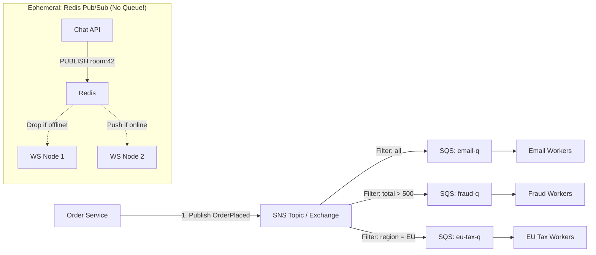
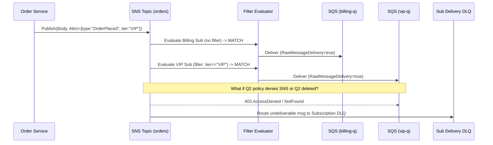
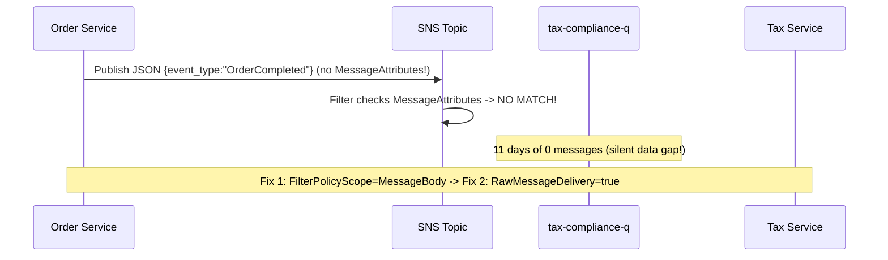

# Pub/Sub & Fan-Out: One Event, Many Services (SNS → SQS, Filters, Redis)

> **Prerequisites:** [Lesson 19: Cloud Messaging](../19-cloud-messaging/README.md) · [Lesson 01: Why Use a Message Broker?](../01-why-use-a-message-broker-decoupling-load-levelling-the-costs/README.md).  
> **Estimated Reading Time:** 24–28 minutes  
> **Target Audience:** Backend engineers building one-to-many event distribution pipelines, and candidates asked "how do you fan out one event to 10 services reliably without wasting compute or coupling them?"  
> **Free PDF Notes:** [Download SD-I-020.pdf](https://backendroadmap.com/notes/system-design/SD-I-020.pdf)

> [!NOTE]
> **In one line:** **Pub/Sub Fan-Out** delivers a single published event to $N$ independent subscribers simultaneously—using **durable Topic-to-Queue wiring** (SNS $\to$ SQS, RabbitMQ Fanout/Topic Exchange, Kafka Consumer Groups) for reliable background work, **broker-side filter policies** to avoid waking irrelevant consumers, and **ephemeral Pub/Sub** (Redis) *only* for real-time fire-and-forget signals like WebSocket broadcasts.

> [!TIP]
> **The Golden Rule:** Never fan out directly to HTTP endpoints or use Redis Pub/Sub for business-critical work—if a subscriber is down or restarting, messages vanish. Always buffer each durable subscriber behind its own **dedicated queue** (the **SNS $\to$ SQS** pattern) so one slow or crashed service never blocks or drops events for the others.

---

## 1. What Pub/Sub & Fan-Out Is, and What It Isn't

When a user completes a purchase, **five** different systems care: Email sends a receipt, Fraud scores the transaction, Warehouse reserves stock, Analytics updates dashboards, and Loyalty awards points. If Checkout loops over 5 queues, adding a 6th subscriber requires editing Checkout. If all 5 share *one* queue, whichever worker grabs the message deletes it—so the other 4 never see it! You need **Publish-Subscribe Fan-Out**: publish once to a topic, and let the broker copy/route the event to every interested subscriber independently.

| Term | Precise Meaning | Example |
| :--- | :--- | :--- |
| **Pub/Sub** | Messaging pattern where publishers emit to a topic without knowing subscribers | SNS Topic, Kafka Topic, Redis Channel |
| **Fan-out** | Replicating one published event to $N$ independent downstream consumers | `1 OrderPlaced` $\to$ 5 subscriber queues |
| **SNS $\to$ SQS (Topic-Queue)** | Durable fan-out: Topic pushes copies into per-service SQS queues | SNS pushes to `email-q`, `fraud-q`, `warehouse-q` |
| **Message Filter Policy** | Broker-side attribute predicate dropping non-matching messages before delivery | Deliver only if `country == "US" && total > 100` |
| **Ephemeral Pub/Sub (Redis)** | In-memory fire-and-forget broadcast; zero persistence if subscriber is offline | Redis `PUBLISH` for live chat / WebSocket invalidation |
| **Celebrity Fan-Out (Write vs Read)** | Fan-out-on-write (push to 10M timelines) vs. fan-out-on-read (query at read time) | Twitter/X feed architecture |
| **Not** | A competing-consumers work queue | In a work queue, 1 message goes to 1 worker; in fan-out, 1 message goes to $N$ groups |

### Why It Matters
1. **True decoupling in space:** New services subscribe to existing topics with zero code changes to the publisher.
2. **Fault & backpressure isolation:** Giving each subscriber its own queue means a 2-hour outage in Analytics does not slow down Email or Fraud.
3. **Cost & CPU savings via filtering:** Filtering at the broker stops 90% of irrelevant events from ever waking up downstream Lambdas or worker pods.

---

## 2. Anatomy: Durable Fan-Out (SNS → SQS) vs. Ephemeral Pub/Sub (Redis)



| Pattern | Delivery Guarantee | Offline Subscriber Behavior | Best Use Case |
| :--- | :--- | :--- | :--- |
| **SNS $\to$ SQS** | Durable, At-least-once | Messages wait safely in that service's SQS queue | Microservice domain events, async workflows |
| **Kafka (Multiple Consumer Groups)** | Durable, Replayable | Offsets pause; messages retained for days/weeks | High-throughput event streams, backfill/replay |
| **SNS $\to$ HTTP / Lambda** | Push w/ limited retries | Dropped or sent to subscription DLQ after retry exhaustion | Webhooks, lightweight serverless triggers |
| **Redis Pub/Sub** | **At-most-once** (fire & forget) | **Permanently lost** if socket is disconnected | Live WebSocket chat, cache invalidation hints, typing indicators |
| **Redis Streams (`XADD`)** | Durable in-memory/AOF log | Consumer group retains unacknowledged entries | Lightweight Redis-native durable fan-out |

> [!WARNING]
> **The #1 Trap: Using Redis Pub/Sub for Durable Events.**
> Redis `PUBLISH` does not store messages. If a subscriber pod restarts for 3 seconds during a Kubernetes rolling deploy, **every message published during those 3 seconds is silently lost forever**. Never use Redis Pub/Sub for orders, payments, or emails—use SNS $\to$ SQS, Kafka, or Redis Streams (`XADD`).

---

## 3. Mathematical Model: Fan-Out Amplification, Filter Savings & Celebrity Feeds

**1. Fan-Out Amplification ($M_{\text{total}}$).**
If publishers emit $\lambda$ events/sec to a topic with $N$ subscribers, and subscriber $i$ has a filter selectivity $f_i \in (0, 1]$ (fraction of events matching its filter):

$$M_{\text{delivered}} = \lambda \sum_{i=1}^{N} f_i$$

Without filter policies ($f_i = 1$ for all $i$), total downstream deliveries and consumer compute scale as $\lambda \cdot N$.

**2. Filter Policy Cost Savings.**
Suppose a topic receives $\lambda = 10{,}000$ events/sec ($25.92\text{B}$/month), and 8 of 10 subscribers only care about `event_type = "REFUND"` ($f_i = 0.05$).
- **Without broker filtering:** $10{,}000 \times 10 = 100{,}000$ SQS deliveries/sec (consumers burn CPU deserializing and discarding 95% of messages).
- **With broker filtering:** $10{,}000 \times (2 \times 1.0 + 8 \times 0.05) = 24{,}000$ deliveries/sec (**76% reduction** in SQS deliveries, consumer CPU, and Lambda invocations).

**3. Social Feed Fan-Out: Push (Write) vs. Pull (Read).**
For a user with $F$ followers posting at rate $\lambda_{\text{post}}$:
- **Fan-out-on-write (Push):** $W = \lambda_{\text{post}} \cdot F$ timeline writes/sec. Fast reads ($O(1)$), catastrophic writes for celebrities ($F = 50{,}000{,}000$).
- **Fan-out-on-read (Pull):** $W = \lambda_{\text{post}}$ write/sec; readers merge $K$ followed timelines at read time.
- **Hybrid threshold:** Push for normal users ($F \le F_{\text{thresh}}$, e.g., $10{,}000$), Pull for celebrities ($F > F_{\text{thresh}}$).

### Worked Numerical Example
A social platform has 10M users. A celebrity with $F = 20{,}000{,}000$ followers posts 1 photo:
- **Pure Fan-out-on-write:** Triggers **20,000,000** queue messages and Redis/DB timeline writes from a single HTTP POST. At 100,000 writes/sec, it takes $20{,}000{,}000 / 100{,}000 = \mathbf{200\text{ seconds}}$ (3.3 minutes) of backlog for one post, delaying everyone else's feed!
- **Hybrid Fan-out ($F_{\text{thresh}} = 10{,}000$):** The celebrity's post writes **1** record to their own outbox; followers merge celebrity posts at read time. Zero fan-out storm.

---

## 4. Metrics & Percentiles

| Metric | Meaning | Alert When |
| :--- | :--- | :--- |
| **`NumberOfNotificationsFailed` (SNS)** | Failed deliveries to an endpoint/queue | $> 0$ (permissions broken or queue deleted) |
| **`NumberOfNotificationsFilteredOut` (SNS)** | Events dropped by filter policies | Unexpected drop to 0 or 100% (bad filter deploy!) |
| **Per-subscriber queue depth & age** | Lag of *each* independent fan-out target | Any single subscriber queue exceeds freshness SLO |
| **Fan-out end-to-end latency $p_{99}$** | Time from Topic publish to *slowest* critical subscriber ack | Exceeds SLA |
| **Redis `pubsub_channels` & client output buffer** | Connected subscribers and slow-client memory buffer | Output buffer hitting `client-output-buffer-limit pubsub` (Redis disconnects slow clients!) |
| **Subscription DLQ depth** | Events failing delivery to an HTTP/Lambda subscriber | $> 0$ |

### Worked Example (SNS $\to$ SQS Filter Policy Bug)
An engineer deploys an SNS filter policy `{"country": ["US", "CA"]}` on `eu-fraud-q`—except the producer sends `"country"` inside the JSON **body** rather than in **MessageAttributes** (SNS filters *only* inspect `MessageAttributes` by default unless `FilterPolicyScope: MessageBody` is explicitly set).
- `NumberOfNotificationsFilteredOut` jumps to **100%**.
- `eu-fraud-q` drops to 0 messages/sec—not because traffic stopped, but because every single message was silently filtered out! Always alert when `FilteredOut == Published` for a subscriber.

---

## 5. Compounding & Failure Modes

| Failure Mode | Mechanism | Impact |
| :--- | :--- | :--- |
| **Redis Slow-Consumer Disconnect** | A WebSocket server stalls on GC; Redis buffers Pub/Sub bytes in memory until hitting `client-output-buffer-limit` (default 32 MB hard / 8 MB soft) | Redis forcefully **kills the subscriber connection**, silently dropping all real-time updates during reconnect |
| **Direct Topic $\to$ HTTP Fan-Out Outage** | SNS pushes directly to a service's HTTP endpoint; service goes down for 2 hours | Retries exhaust; events drop unless a Subscription DLQ is attached, and replaying requires manual DLQ redrive |
| **Shared Queue Anti-Pattern** | Two distinct services (`email`, `analytics`) accidentally subscribe to the *same* SQS queue | Each service gets only ~50% of events (competing consumers instead of fan-out!) |
| **Celebrity Fan-Out Stampede** | Pushing a 50M-follower post into the same topic/queue as normal users | Head-of-line queue congestion delays normal users' messages by minutes |
| **SNS Raw Message Delivery Mismatch** | Enabling `RawMessageDelivery=true` on one SQS subscription and `false` on another | Consumers expecting SNS JSON envelope crash when receiving raw JSON (or vice versa) |

---

## 6. Numbers Every Engineer Must Know

| Item | Typical | Implication |
| :--- | :--- | :--- |
| **SNS subscriptions per topic (soft limit)** | 12,500,000 (100 for FIFO) | Virtually unlimited fan-out on Standard topics |
| **SNS filter policy max combinations** | 150 per policy (default) | Keep filters simple (`event_type`, `region`, `tier`); avoid huge `IN` lists |
| **Redis Pub/Sub latency** | $< 1\text{ ms}$ (in-VPC) | Unbeatable for ephemeral WebSocket/SSE fan-out across app nodes |
| **Redis `client-output-buffer-limit pubsub`** | 32 MB hard / 8 MB for 60s | Slow subscribers get disconnected automatically to protect Redis RAM |
| **SNS $\to$ SQS delivery latency** | 10–40 ms | Fast enough for async microservices; not for sub-millisecond trading |
| **Hybrid celebrity fan-out threshold** | ~5,000–50,000 followers | Above threshold, switch from fan-out-on-write to fan-out-on-read |

---

## 7. Protocol / Mechanism Deep Dive: SNS → SQS Wiring & Filter Evaluation



Notice the two distinct DLQs in an SNS $\to$ SQS architecture:
1. **SNS Subscription DLQ:** Catches messages that SNS *failed to deliver to SQS* (e.g., IAM policy misconfiguration or deleted queue).
2. **SQS Queue DLQ (`maxReceiveCount`):** Catches messages that SQS delivered to the consumer, but the *consumer crashed* processing them.

### When NOT to Use Pub/Sub Fan-Out
- **1-to-1 work distribution:** If only *one* service processes a job (e.g., video transcoding), publish directly to an SQS queue—adding SNS adds extra hops and cost for zero benefit.
- **Request-reply RPC:** Don't abuse Pub/Sub topics with temporary reply channels for synchronous calls; use HTTP/gRPC.
- **Strict global ordering across 20 services:** Fan-out decouples consumers so each progresses at its own speed; you cannot enforce a global barrier across 20 independent queues.

---

## 8. Hierarchical Budgets & Design Rules

| Slice | Rule | Control |
| :--- | :--- | :--- |
| **Subscriber Isolation** | One dedicated queue per logical consumer service (`1 service = 1 SQS queue`) | Never share an SQS queue between two different microservices |
| **Filtering** | Filter at the broker (SNS `FilterPolicy` / RabbitMQ Topic Exchange) | Drop non-matching events before enqueueing to save SQS + worker cost |
| **Raw Delivery** | Set `RawMessageDelivery = true` on SNS $\to$ SQS subscriptions | Avoids double-wrapped JSON envelopes (`Message` string inside JSON) |
| **Ephemeral vs. Durable** | Redis Pub/Sub ONLY for replaceable UI hints; SNS $\to$ SQS / Kafka for state | Code review gate on any `redis.Publish()` call |
| **DLQ Coverage** | Attach DLQs to *both* the SNS subscription and each downstream SQS queue | Terraform module enforces both DLQs by default |
| **Celebrity Protection** | Separate high-fan-out/bulk jobs onto low-priority topics/queues | Prevents batch jobs from starving real-time user events |

---

## 9. Top Mitigations

1. **Always use the Topic-Queue (SNS $\to$ SQS) pattern for durable fan-out:** Never point SNS directly at an HTTP service for business-critical events; put an SQS queue in front of every subscriber.
2. **Enable `RawMessageDelivery = true`:** Eliminates the annoying SNS envelope wrapper so consumers receive the clean domain JSON/Avro payload directly.
3. **Push filtering to the broker:** Use SNS `FilterPolicy` (on `MessageAttributes` or `MessageBody`) so services only wake up for events they actually handle.
4. **Alert on `NumberOfNotificationsFilteredOut == 100%`:** Catches silent filter typos (like filtering on `eventType` when the producer sends `event_type`) before data silently disappears.
5. **Isolate Redis Pub/Sub for WebSocket fan-out:** Use Redis Pub/Sub to broadcast `new_message` to connected WebSocket gateway pods, backed by a durable DB/stream so reconnecting clients fetch missed messages via `since_id`.
6. **Use Hybrid Fan-Out for social/notification feeds:** Push to followers below $F_{\text{thresh}}$ (e.g., 10k); pull at read time for celebrities to prevent 50M-message write storms.
7. **Automate IAM + DLQ wiring via IaC:** Most SNS $\to$ SQS silent drops happen because someone forgot the SQS `QueuePolicy` allowing `sns:SendMessage` from the topic ARN.

---

## 10. Production Reference / War Story

**Incident (SEV-1): The Silent `FilterPolicy` Typo & Double-Wrapped Envelope**
A marketplace launched a new **Tax Compliance Service** subscribed to the production `orders` SNS topic.
- **Mistake 1:** The engineer added a filter policy `{"event_type": ["OrderCompleted"]}` in Terraform, but the Order Service published `event_type` inside the JSON body without setting `MessageAttributes` (and `FilterPolicyScope` defaulted to `MessageAttributes`).
- **Result:** For 11 days, **100%** of `OrderCompleted` events were silently filtered out by SNS—zero messages ever reached `tax-compliance-q`, and nobody noticed because there was no alert on `NumberOfNotificationsFilteredOut`.
- **Mistake 2:** When they fixed `FilterPolicyScope = "MessageBody"`, messages arrived—and immediately crashed the Tax Service consumer into the DLQ because `RawMessageDelivery` was `false`, wrapping the JSON inside SNS's `{"Type":"Notification","Message":"\"{...}\""}` envelope.



**Root Cause:** Missing `FilterPolicyScope: MessageBody`, missing `RawMessageDelivery: true`, and zero monitoring on `FilteredOut` / `Visible` counts.
**Fix:** Standardized a Terraform `sns_sqs_subscription` module with `RawMessageDelivery = true`, mandatory SNS+SQS DLQs, and a CloudWatch anomaly alarm if a production queue receives 0 messages for >15 minutes.

---

## 11. Multi-Language Production Code Tabs

````carousel
```go
// Go: Thread-safe in-memory Pub/Sub Fan-Out broker with attribute filter policies (stdlib only).
package main

import (
	"sync"
)

type Event struct {
	Attributes map[string]string
	Payload    []byte
}

type FilterPolicy map[string][]string // key -> allowed values (OR within key, AND across keys)

type Subscription struct {
	Name   string
	Filter FilterPolicy
	Queue  chan Event // Dedicated buffered queue per subscriber
}

type FanOutTopic struct {
	mu   sync.RWMutex
	subs []*Subscription
}

func (t *FanOutTopic) Subscribe(name string, bufSize int, filter FilterPolicy) *Subscription {
	t.mu.Lock()
	defer t.mu.Unlock()
	sub := &Subscription{Name: name, Filter: filter, Queue: make(chan Event, bufSize)}
	t.subs = append(t.subs, sub)
	return sub
}

func matchesFilter(attrs map[string]string, policy FilterPolicy) bool {
	for k, allowed := range policy {
		val, ok := attrs[k]
		if !ok {
			return false
		}
		matched := false
		for _, a := range allowed {
			if val == a {
				matched = true
				break
			}
		}
		if !matched {
			return false
		}
	}
	return true
}

// Publish fans out to every matching subscriber's dedicated queue without blocking on slow consumers.
func (t *FanOutTopic) Publish(evt Event) (delivered, filtered, dropped int) {
	t.mu.RLock()
	defer t.mu.RUnlock()
	for _, s := range t.subs {
		if !matchesFilter(evt.Attributes, s.Filter) {
			filtered++
			continue
		}
		select {
		case s.Queue <- evt:
			delivered++
		default:
			dropped++ // Queue full -> backpressure / DLQ in production
		}
	}
	return delivered, filtered, dropped
}
```
<!-- slide -->
```typescript
// TypeScript: Topic -> Per-Subscriber Queue Fan-Out with broker-side FilterPolicy.
export type FilterPolicy = Record<string, string[]>;

export interface FanOutEvent<T = unknown> {
  attributes: Record<string, string>;
  payload: T;
}

export class SubscriberQueue<T> {
  public readonly messages: FanOutEvent<T>[] = [];
  constructor(public readonly name: string, public readonly filter: FilterPolicy = {}) {}

  matches(attrs: Record<string, string>): boolean {
    for (const [key, allowed] of Object.entries(this.filter)) {
      if (!allowed.includes(attrs[key])) return false;
    }
    return true;
  }
}

export class FanOutTopic<T = unknown> {
  private subscribers: SubscriberQueue<T>[] = [];

  subscribe(name: string, filter: FilterPolicy = {}): SubscriberQueue<T> {
    const q = new SubscriberQueue<T>(name, filter);
    this.subscribers.push(q);
    return q;
  }

  publish(event: FanOutEvent<T>): { delivered: number; filteredOut: number } {
    let delivered = 0;
    let filteredOut = 0;
    for (const sub of this.subscribers) {
      if (sub.matches(event.attributes)) {
        sub.messages.push(event); // Isolated per-subscriber queue
        delivered++;
      } else {
        filteredOut++;
      }
    }
    return { delivered, filteredOut };
  }
}
```
<!-- slide -->
```python
# Python: Durable Topic->Queue Fan-Out with Filter Policies & Celebrity Threshold (stdlib only).
from collections import deque
from dataclasses import dataclass, field


@dataclass
class Event:
    attributes: dict[str, str]
    payload: dict


@dataclass
class SubscriberQueue:
    name: str
    filter_policy: dict[str, set[str]] = field(default_factory=dict)
    queue: deque[Event] = field(default_factory=deque)

    def matches(self, attrs: dict[str, str]) -> bool:
        return all(attrs.get(k) in allowed for k, allowed in self.filter_policy.items())


class FanOutTopic:
    def __init__(self) -> None:
        self._subs: list[SubscriberQueue] = []

    def subscribe(self, name: str, filter_policy: dict[str, set[str]] | None = None) -> SubscriberQueue:
        sub = SubscriberQueue(name=name, filter_policy=filter_policy or {})
        self._subs.append(sub)
        return sub

    def publish(self, event: Event) -> tuple[int, int]:
        delivered = filtered_out = 0
        for sub in self._subs:
            if sub.matches(event.attributes):
                sub.queue.append(event)
                delivered += 1
            else:
                filtered_out += 1
        return delivered, filtered_out


def fanout_strategy(follower_count: int, threshold: int = 10_000) -> str:
    """Hybrid social feed strategy: push for normal users, pull for celebrities."""
    return "FANOUT_ON_READ (PULL)" if follower_count > threshold else "FANOUT_ON_WRITE (PUSH)"
```
<!-- slide -->
```csharp
// C#: Topic-to-Queue Fan-Out with FilterPolicy evaluation and isolated Channel<T> queues.
using System.Threading.Channels;

public sealed record FanOutEvent(Dictionary<string, string> Attributes, string Payload);

public sealed class SubscriberQueue
{
    public string Name { get; }
    public Dictionary<string, HashSet<string>> Filter { get; }
    public Channel<FanOutEvent> Channel { get; } = System.Threading.Channels.Channel.CreateUnbounded<FanOutEvent>();

    public SubscriberQueue(string name, Dictionary<string, HashSet<string>>? filter = null)
    {
        Name = name;
        Filter = filter ?? new();
    }

    public bool Matches(Dictionary<string, string> attrs) =>
        Filter.All(kv => attrs.TryGetValue(kv.Key, out var v) && kv.Value.Contains(v));
}

public sealed class FanOutTopic
{
    private readonly List<SubscriberQueue> _subs = new();

    public SubscriberQueue Subscribe(string name, Dictionary<string, HashSet<string>>? filter = null)
    {
        var sub = new SubscriberQueue(name, filter);
        _subs.Add(sub);
        return sub;
    }

    public (int Delivered, int FilteredOut) Publish(FanOutEvent evt)
    {
        int delivered = 0, filteredOut = 0;
        foreach (var sub in _subs)
        {
            if (sub.Matches(evt.Attributes))
            {
                sub.Channel.Writer.TryWrite(evt);
                delivered++;
            }
            else
            {
                filteredOut++;
            }
        }
        return (delivered, filteredOut);
    }
}
```
````

---

## 12. Hands-On CLI Verification Workflows

Verify filter savings and celebrity fan-out math in Python:

```bash
python3 -c '
# 10,000 events/s, 10 subscribers: 2 get 100%, 8 get 5% (refunds only)
rate = 10_000
no_filter = rate * 10
with_filter = rate * (2 * 1.0 + 8 * 0.05)
print(f"No filter: {no_filter}/s | With filter: {int(with_filter)}/s | Saved: {100*(1-with_filter/no_filter):.1f}%")
'
```

Wire and test SNS $\to$ SQS with a filter policy via AWS CLI, or test Redis Pub/Sub locally:

```bash
# AWS SNS -> SQS subscription with RawMessageDelivery & FilterPolicy
aws sns subscribe \
  --topic-arn "$TOPIC_ARN" \
  --protocol sqs \
  --notification-endpoint "$QUEUE_ARN" \
  --attributes '{"RawMessageDelivery":"true","FilterPolicy":"{\"event_type\":[\"OrderPlaced\"]}"}'

# Redis Pub/Sub: inspect active channels and subscriber count (ephemeral only!)
redis-cli PUBSUB CHANNELS "room:*"
redis-cli PUBSUB NUMSUB "room:42"
```

---

## 13. Common Mistakes to Avoid

1. **Subscribing two different microservices to the same SQS queue:** Turns fan-out into competing consumers—each service only sees half the events.
2. **Using Redis Pub/Sub for durable business events:** Any subscriber restart or slow-client disconnect permanently drops messages.
3. **Forgetting `RawMessageDelivery = true` on SNS $\to$ SQS:** Forces every consumer to unwrap SNS's outer JSON metadata envelope.
4. **Filtering on body fields without `FilterPolicyScope = MessageBody`:** SNS silently filters out 100% of messages because it checks `MessageAttributes` by default.
5. **Omitting the SNS Subscription DLQ:** If an SQS queue's IAM policy breaks or an HTTP endpoint fails, SNS drops events unless a Subscription DLQ is configured.
6. **Pure fan-out-on-write for celebrity accounts:** Pushing 1 post to 20M timelines saturates queues and delays normal users' feeds.
7. **Unbounded HTTP/Lambda fan-out without concurrency limits:** A 10x event burst fans out to 10 services simultaneously, DDoSing shared downstream databases.

---

## 14. Key Terms Glossary

| Key Term | Definition |
| :--- | :--- |
| **Pub/Sub** | Publish-Subscribe pattern decoupling publishers from an unknown number of independent subscribers. |
| **Fan-Out** | Delivering a copy of one published message to $N$ independent downstream queues or consumers. |
| **SNS $\to$ SQS Pattern** | Durable cloud fan-out wiring one SNS topic to dedicated per-service SQS queues. |
| **Filter Policy** | Declarative predicate evaluated by the broker to route only matching events to a subscriber. |
| **Raw Message Delivery** | SNS setting that delivers the original payload directly to SQS without wrapping it in an SNS JSON envelope. |
| **Subscription DLQ** | Dead-letter queue capturing events that SNS failed to deliver to a target subscription. |
| **Redis Pub/Sub** | Ephemeral, in-memory at-most-once broadcast channel; drops messages when subscribers are offline. |
| **Redis Streams** | Persistent, offset-tracked append-only log in Redis (`XADD`/`XREADGROUP`) supporting consumer groups. |
| **Fan-Out-on-Write (Push)** | Pre-computing and pushing a post into every follower's timeline queue at write time. |
| **Fan-Out-on-Read (Pull)** | Merging followed accounts' posts dynamically when a user loads their feed (used for celebrities). |

---

## 15. System Design Interview Questions & Answers

### Basic Conceptual Questions

<details>
<summary><strong>Q1: What is the difference between a work queue and pub/sub fan-out? [BASIC]</strong></summary>

**Answer:**
In a **work queue**, each message is processed by **one** competing worker and deleted. In **pub/sub fan-out**, each published message is copied and delivered to **every** subscribed service independently so Email, Analytics, and Fraud all receive the same event.
</details>

<details>
<summary><strong>Q2: Why put an SQS queue in front of every SNS subscriber instead of having SNS call each service's HTTP endpoint directly? [BASIC]</strong></summary>

**Answer:**
With **SNS $\to$ SQS**, each service gets durable buffering, independent retry/DLQ control, and load levelling. If the Analytics service is down for an hour or deploying, events queue up safely in `analytics-q` without affecting Email or Checkout, and without exhausting SNS's HTTP retry window.
</details>

<details>
<summary><strong>Q3: When should you use Redis Pub/Sub vs. SNS → SQS or Kafka? [BASIC]</strong></summary>

**Answer:**
Use **Redis Pub/Sub** *only* for ephemeral, sub-millisecond broadcasts where occasional dropped messages on reconnect are acceptable (e.g., WebSocket chat, live cursor updates, cache invalidation hints). Use **SNS $\to$ SQS** or **Kafka** whenever losing a message is unacceptable.
</details>

<details>
<summary><strong>Q4: What do broker-side filter policies do? [BASIC]</strong></summary>

**Answer:**
Filter policies evaluate message attributes (or body fields) at the broker *before* delivery, dropping non-matching messages. This saves network bandwidth, SQS request charges, and downstream worker/Lambda compute that would otherwise deserialize and discard irrelevant events.
</details>

### Scenario-Based Architecture Questions

<details>
<summary><strong>Q5: You are designing a real-time chat app with 200 WebSocket gateway servers behind a load balancer. How do you route a message from User A (on Server 1) to User B (on Server 73)? [SCENARIO]</strong></summary>

**Answer:**
First, persist the message durably to the database (or Kafka) so history is never lost. Then, publish a lightweight notification to **Redis Pub/Sub** (channel `user:B` or `room:42`) so Server 73 receives it in $<1\text{ ms}$ and pushes it down User B's WebSocket. If User B was briefly offline and missed the Redis push, their client fetches missed messages from the DB using `since_message_id` on reconnect.
</details>

<details>
<summary><strong>Q6: Design a social media feed where normal users have 200 followers and celebrities have 30 million. How do you handle fan-out? [SCENARIO]</strong></summary>

**Answer:**
Use **hybrid fan-out**. For normal users ($< 10{,}000$ followers), use **fan-out-on-write**: publish `PostCreated` and asynchronously push the `post_id` into all 200 followers' Redis timeline caches ($O(1)$ fast reads). For celebrities ($\ge 10{,}000$ followers), skip the 30M-write push storm and use **fan-out-on-read**: merge the celebrity's recent posts dynamically when a follower opens their feed.
</details>

<details>
<summary><strong>Q7: You added a new microservice subscribed to an existing SNS topic, and it's receiving zero messages while other subscribers work fine. How do you debug? [SCENARIO]</strong></summary>

**Answer:**
Check in order: (1) Does the new SQS queue's **IAM QueuePolicy** allow `sns:SendMessage` from that Topic ARN? (2) Check `NumberOfNotificationsFilteredOut`—is there a typo in `FilterPolicy` or missing `FilterPolicyScope: MessageBody`? (3) Is the subscription still `PendingConfirmation`? (4) Check the SNS Subscription DLQ.
</details>

<details>
<summary><strong>Q8: Your `OrderPlaced` topic fans out to 8 microservices, and a flash sale causes 8x concurrent database load on a shared read DB. How do you protect it? [SCENARIO]</strong></summary>

**Answer:**
Because each service has its own SQS queue, configure **per-service worker concurrency limits** (e.g., Lambda `ReservedConcurrentExecutions` or bounded worker pools) to cap aggregate DB connections, and embed the needed order fields in `OrderPlaced` (Event-Carried State Transfer) so consumers don't query the shared DB at all.
</details>

### Advanced & Tricky Interview Questions

<details>
<summary><strong>Q9: Why does Redis disconnect slow Pub/Sub subscribers, and how does Redis Streams fix this? [TRICKY]</strong></summary>

**Answer:**
Redis Pub/Sub holds unread messages in the server's per-client output buffer in RAM. If a subscriber stalls, the buffer grows until it hits `client-output-buffer-limit pubsub` (e.g., 32 MB), forcing Redis to kill the socket to avoid OOM. **Redis Streams (`XADD`/`XREADGROUP`)** stores messages in a bounded radix-tree log on the server and tracks consumer group offsets, letting slow consumers catch up safely without being disconnected.
</details>

<details>
<summary><strong>Q10: Can you get strict global ordering across 5 services in an SNS → SQS FIFO fan-out? [TRICKY]</strong></summary>

**Answer:**
SNS FIFO $\to$ SQS FIFO preserves **per-`MessageGroupId` ordering inside each individual queue**, so Service A sees `evt1` before `evt2`, and Service B sees `evt1` before `evt2`. However, Service A and Service B are decoupled and consume at different speeds—so there is **no cross-service synchronization barrier** (Service B might process `evt2` before Service A finishes `evt1`).
</details>

<details>
<summary><strong>Q11: What happens if you enable `RawMessageDelivery = true` vs `false` on SNS → SQS? [TRICKY]</strong></summary>

**Answer:**
With `false` (default), SNS wraps your payload inside an outer JSON object (`{"Type":"Notification","Message":"<escaped-json>","TopicArn":...}`), forcing consumers to parse JSON twice and coupling them to SNS. With `true`, SQS receives the exact raw payload bytes published to SNS, keeping consumers broker-agnostic.
</details>

<details>
<summary><strong>Q12: How do you test and safely roll out a new SNS filter policy in production? [TRICKY]</strong></summary>

**Answer:**
Never edit a live production filter policy blindly. Create a shadow/canary SQS queue subscribed with the candidate filter policy, compare its `NumberOfMessagesReceived` against expected production ratios, and configure a CloudWatch alarm on `NumberOfNotificationsFilteredOut` anomalies before updating the production subscription.
</details>

---

## 16. One-Page Master Cheat Sheet

```
+---------------------------------------------------------------------------------------------------------+
|                    PUB/SUB & FAN-OUT (SNS -> SQS, FILTERS, REDIS) — MASTER CHEAT SHEET                  |
+---------------------------------------------------------------------------------------------------------+
| 1. DURABLE FAN-OUT (SNS -> SQS / Kafka Consumer Groups):                                                |
|    1 Topic -> N dedicated per-service queues. Fault isolation + independent scaling + zero coupling.    |
|    NEVER share 1 SQS queue across 2 different services (that makes them competing consumers!).           |
+---------------------------------------------------------------------------------------------------------+
| 2. FILTER POLICIES: Filter at the broker (SNS FilterPolicy) to drop irrelevant events before delivery.  |
|    Watch `FilterPolicyScope` (MessageAttributes vs MessageBody) and alert on 100% FilteredOut!          |
+---------------------------------------------------------------------------------------------------------+
| 3. REDIS PUB/SUB: Ephemeral, <1 ms, at-most-once. Drops msgs on disconnect/slow-client OOM protection.  |
|    Use ONLY for live WebSocket/UI hints backed by DB; use Redis Streams or SNS->SQS for durable work.   |
+---------------------------------------------------------------------------------------------------------+
| 4. CELEBRITY FAN-OUT: Hybrid threshold (e.g., 10k followers). Push for normal users; Pull at read time  |
|    for celebrities to avoid 20M-write queue storms.                                                     |
+---------------------------------------------------------------------------------------------------------+
```

---

## Further Reading & Sources

- AWS Documentation, [Fanout to Amazon SQS Queues with Amazon SNS](https://docs.aws.amazon.com/sns/latest/dg/sns-sqs-as-subscriber.html) and [SNS Message Filtering](https://docs.aws.amazon.com/sns/latest/dg/sns-message-filtering.html).
- Redis Documentation, [Redis Pub/Sub vs. Redis Streams](https://redis.io/docs/latest/develop/interact/pubsub/).
- Martin Kleppmann, *Designing Data-Intensive Applications*, Chapter 1, "Describing Load (Twitter Fan-Out Case Study)".
- Gregor Hohpe & Bobby Woolf, *Enterprise Integration Patterns*, "Publish-Subscribe Channel".

---

## Free PDF Notes

[SD-I-020.pdf](https://backendroadmap.com/notes/system-design/SD-I-020.pdf)

---

## Next

You have completed **Track 10: Messaging & Event-Driven Systems**! Continue with [Track 11, Lesson 01: Availability Math: 99.9% vs 99.999%, Series vs Parallel](../../11-reliability-and-sre/01-availability-math/README.md).
