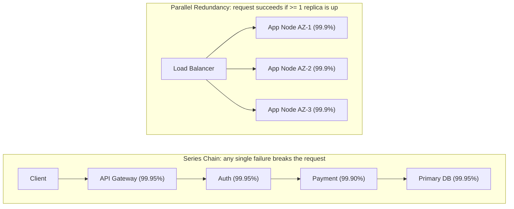
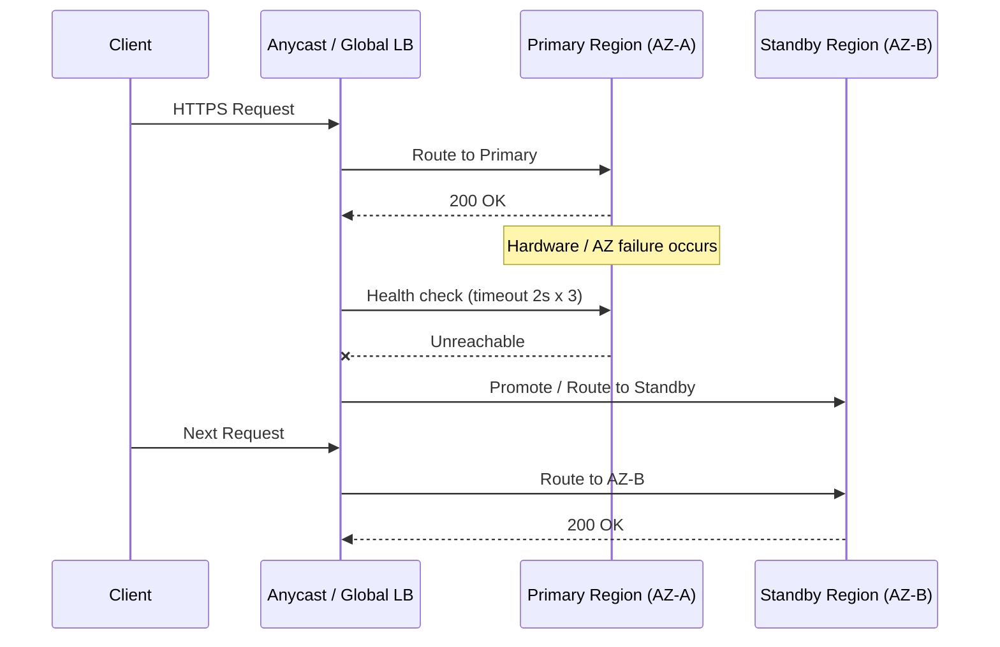
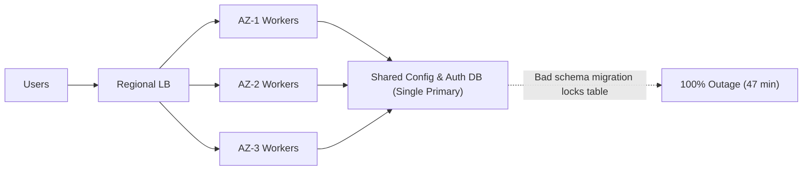

# Availability Math: Series vs Parallel, Nines & Redundancy

> **Prerequisites:** [Lesson 20: Pub/Sub Fan-Out](../../10-messaging/20-pub-sub-fan-out/README.md).  
> **Estimated Reading Time:** 24–28 minutes  
> **Target Audience:** Backend and platform engineers designing multi-service architectures, and candidates asked "what is the end-to-end availability of this system?"  
> **Free PDF Notes:** [Download SD-K-001.pdf](https://backendroadmap.com/notes/system-design/SD-K-001.pdf)

> [!NOTE]
> **In one line:** **Availability** is the fraction of time (or requests) a system is healthy and serving traffic. Dependencies placed in **series** *multiply* their availabilities—meaning every mandatory hop drags your uptime down—while **parallel** redundancy *multiplies* their failure probabilities, pushing uptime toward 100% until a **common-mode failure** breaks independence.

> [!TIP]
> **The Golden Rule:** Adding another synchronous dependency in series *always* lowers availability, even if the dependency has 99.9% uptime. To reach "four nines" (99.99%), you cannot rely on a single 99.9% component in the critical path—you must either **remove** it from the synchronous path, **cache/degrade** gracefully, or **replicate** it in parallel across independent failure domains.

---

## 1. What Availability Math Is, and What It Isn't

A product manager asks for **99.99% ("four nines")** uptime for checkout. Your checkout service depends synchronously on four internal microservices: Auth (99.95%), Cart (99.95%), Pricing (99.95%), and Payment Gateway (99.9%). Each team proudly meets its own SLA, yet checkout suffers 15+ minutes of downtime every month and misses its target by 25x. Why? Because serial dependencies compound failure, not success.

| Term | Precise Meaning | Example |
| :--- | :--- | :--- |
| **Time-based availability** | $\text{MTBF} / (\text{MTBF} + \text{MTTR})$ over a measurement window | 43.2 minutes down in 30 days = 99.9% |
| **Request-based availability** | $\text{Good requests} / \text{Total valid requests}$ | 9,990 / 10,000 HTTP requests = 99.9% |
| **Nines** | Shorthand for $\lfloor -\log_{10}(1 - A) \rfloor$ | 99.9% = three nines; 99.99% = four nines |
| **Series dependency** | System fails if *any* component in the chain fails | API Gateway $\to$ Auth $\to$ DB |
| **Parallel redundancy** | System works as long as *at least one* replica works | Active-active DB replicas or multi-AZ LB |
| **k-of-n quorum** | System works if at least $k$ of $n$ nodes are healthy | 3-node Raft cluster needs $k=2$ |
| **Common-mode failure** | One shared fault knocks out "redundant" replicas together | Shared DNS, bad config push, same AZ power |
| **Not** | A guarantee that $0.999 \times 0.999$ holds when failures are correlated | One bad deploy can drop availability to 0% |

### Why It Matters
1. Every system design interview eventually asks: *"You need 99.99% availability—how do your database, cache, and downstream calls get you there?"*
2. Misunderstanding series vs. parallel math leads to impossible SLAs (promising 99.99% on top of a single 99.9% third-party API).
3. Understanding **MTTR** (Mean Time to Recovery) vs. **MTBF** (Mean Time Between Failures) shows why fast automated failover beats trying to build hardware that never fails.

---

## 2. Anatomy: Series Chain vs Parallel Redundancy



In a **series** topology, every component is a single point of failure (SPOF). If the Payment Gateway drops to 99.90%, the entire chain can *never* exceed 99.90%—and in fact drops to $0.9995^3 \times 0.9990 = 99.75\%$. In a **parallel** topology, three 99.9% nodes across independent Availability Zones fail simultaneously only if all three fail at the exact same time: $1 - (0.001)^3 = 99.9999999\%$ (nine nines) *in theory*—though in practice, the load balancer, DNS, or shared database in series caps the real number.

| Dimension | Series Composition | Parallel Composition |
| :--- | :--- | :--- |
| **Failure rule** | Fails if **any** component fails | Fails only if **all** replicas fail |
| **Math** | $A_{\text{total}} = \prod_{i=1}^n A_i$ | $A_{\text{total}} = 1 - \prod_{i=1}^n (1 - A_i)$ |
| **Adding a 99.9% node** | **Lowers** total availability by ~0.1% | **Raises** total availability by orders of magnitude |
| **Typical bottleneck** | Slowest / least-reliable synchronous call | Shared state, control plane, or common-mode bugs |

> [!WARNING]
> **Independence is an assumption, not a law of physics.** Parallel math $1 - (1-A)^n$ assumes failures are statistically independent. If all three replicas share a single database, read the same broken feature flag, or receive the same poisoned request ("query of death"), their failures are **correlated** ($P(\text{all fail}) \approx P(\text{one fails})$), and your nine nines collapse to three nines overnight.

---

## 3. Mathematical Model: Series, Parallel, Quorum & MTTR

**Time-Based Availability (Renewal Theory).** If a component operates on average for $\text{MTBF}$ before failing and takes $\text{MTTR}$ to recover:

$$A = \frac{\text{MTBF}}{\text{MTBF} + \text{MTTR}}, \qquad U = 1 - A = \frac{\text{MTTR}}{\text{MTBF} + \text{MTTR}}$$

where $U$ is **unavailability**. Notice that cutting $\text{MTTR}$ in half (e.g., from 30 minutes to 15 minutes via automated failover) cuts unavailability $U$ roughly in half—often 10x cheaper than doubling $\text{MTBF}$.

**Series vs. Parallel Systems.** For $n$ independent components with availabilities $A_1, \dots, A_n$ and unavailabilities $U_i = 1 - A_i$:

$$A_{\text{series}} = \prod_{i=1}^{n} A_i \approx 1 - \sum_{i=1}^{n} U_i \quad (\text{for small } U_i)$$

$$A_{\text{parallel}} = 1 - \prod_{i=1}^{n} (1 - A_i) = 1 - \prod_{i=1}^{n} U_i$$

**k-of-n Quorum Availability.** A cluster of $n$ identical independent nodes that stays available when at least $k$ nodes are up (e.g., Raft/Paxos where $k = \lfloor n/2 \rfloor + 1$):

$$A_{k\text{-of-}n} = \sum_{j=k}^{n} \binom{n}{j} A^j (1 - A)^{n-j}$$

**Worked Numerical Example.**
Suppose you run a checkout pipeline with 3 serial services: Auth ($A_1 = 0.9995$), Cart ($A_2 = 0.9995$), and Payment ($A_3 = 0.9990$):
1. **Serial availability:** $A_{\text{series}} = 0.9995 \times 0.9995 \times 0.9990 = 0.998001 \approx \mathbf{99.80\%}$ (downtime $\approx 86.4\text{ min/month}$).
2. **Parallel Payment Proxy:** If you route across 2 independent payment providers ($A = 0.9990$ each) in active-active failover:
   $$A_{\text{pay, parallel}} = 1 - (1 - 0.9990)^2 = 1 - 10^{-6} = \mathbf{99.9999\%}$$
3. **New pipeline availability:** $0.9995 \times 0.9995 \times 0.999999 = 0.999000 \approx \mathbf{99.90\%}$ (downtime halved to $43.2\text{ min/month}$).
4. **3-node Raft DB ($k=2, n=3, A=0.999$):**
   $$A_{2\text{-of-}3} = \binom{3}{2}(0.999)^2(0.001) + (0.999)^3 = 0.002994 + 0.997003 = \mathbf{99.9997\%}$$

---

## 4. Metrics & Percentiles

| Metric | Meaning | Alert when |
| :--- | :--- | :--- |
| **Time-based uptime** | Fraction of 1-minute probes returning HTTP 200 | Falls below target in rolling 24h/7d window |
| **Goodput / Request SLI** | $\text{Successful requests} / \text{Total requests}$ | Error rate exceeds $1 - \text{SLO}$ |
| **MTTR** | Median & $p_{95}$ time from incident start to recovery | Rising trend; automated failover failed |
| **MTBF** | Mean time between severity-1/2 outages | Shrinking; indicates brittle deploys or tech debt |
| **Dependency availability** | Per-downstream success rate | Downstream drops below its contracted SLA |
| **Common-mode blast radius** | % of replicas affected by a single AZ/region event | $> 1$ failure domain impacted simultaneously |

### Worked Example (Monthly Downtime Budget)
Consider a 30-day month ($30 \times 24 \times 60 = 43{,}200$ minutes, or $2{,}592{,}000$ seconds):
- At **99.9% (3 nines)**, allowed downtime is $43{,}200 \times 0.001 = \mathbf{43.2\text{ minutes/month}}$.
- If your team deploys manually and $\text{MTTR} = 30\text{ minutes}$ per outage, you can afford **at most 1.4 outages per month** before breaching 99.9%.
- At **99.99% (4 nines)**, allowed downtime is $43{,}200 \times 0.0001 = \mathbf{4.32\text{ minutes/month}}$. No human can wake up from a pager, SSH in, diagnose, and roll back in 4 minutes—**automated failover** is mathematically mandatory for four nines.

---

## 5. Compounding: Series Chains & Correlated Failures

Let's quantify how fast serial chains degrade and how quickly correlated failures erase theoretical redundancy (verified in Python 3.13):

| Topology | Component Availability | Theoretical System Availability | Monthly Downtime (30d) |
| :--- | :---: | :---: | :---: |
| **1 service** | 99.9% | 99.9000% | 43.20 min |
| **5 services in series** | 99.9% each | 99.5010% | 215.57 min (3.6 hr) |
| **10 services in series** | 99.9% each | 99.0045% | 430.06 min (7.2 hr) |
| **20 services in series** | 99.9% each | 98.0189% | 855.84 min (14.3 hr) |
| **2 replicas in parallel** | 99.9% each (independent) | 99.9999% | 2.59 sec |
| **2 replicas + 20% common-mode fault** | 99.9% each ($p_{\text{shared}} = 0.0002$) | 99.9799% | 8.68 min |

Notice the last two rows: adding just a **0.02% common-mode failure** (e.g., a shared config push or DNS outage that kills both replicas together) drops a 2-replica parallel system from **99.9999% (2.6 seconds/month)** down to **99.9799% (8.7 minutes/month)**—a **200x increase in downtime**!

---

## 6. Numbers Every Engineer Must Know

| Item | Typical | Implication |
| :--- | :---: | :--- |
| **99% (2 nines)** | 3.65 days / year (7.2 hr / month) | Internal tools, batch jobs |
| **99.9% (3 nines)** | 8.77 hours / year (43.2 min / month) | Standard B2B SaaS, single-region |
| **99.95% (3.5 nines)** | 4.38 hours / year (21.6 min / month) | Typical AWS single-region managed DB SLA |
| **99.99% (4 nines)** | 52.6 minutes / year (4.32 min / month) | E-commerce, fintech; requires auto-failover |
| **99.999% (5 nines)** | 5.26 minutes / year (25.9 sec / month) | Telecom, global auth, multi-region active-active |
| **Human pager response + rollback** | 15–45 minutes | Human-in-the-loop cannot achieve $\ge 99.99\%$ |
| **DNS TTL failover** | 30–300 seconds | Too slow alone for 5 nines; use Anycast/LB |
| **Cost per extra nine** | ~3x–10x infrastructure & ops cost | Never over-engineer nines the business won't pay for |

---

## 7. Protocol / Mechanism Deep Dive: Active-Passive vs Active-Active Failover



| Question | Answer |
| :--- | :--- |
| **How does active-active differ from active-passive?** | Active-active serves traffic from all replicas continuously (near-zero failover time, higher complexity); active-passive keeps standby idle or read-only until health checks fail. |
| **Why can't I just put 3 replicas in the same AZ?** | Power, cooling, top-of-rack switch, and AZ-level control plane faults are common-mode within one AZ. |
| **What happens to MTTR during DNS failover?** | Clients and resolvers cache DNS records up to TTL (and sometimes ignore short TTLs), extending effective MTTR. |
| **Does adding a cache in front of a DB raise availability?** | Only if the cache can serve stale data when the DB is down (graceful degradation); otherwise it's another series dependency. |

**When NOT to chase extra nines:** If your clients' mobile networks have 98% connectivity, spending $2M/year to move your backend from 99.95% to 99.999% yields zero user-visible improvement. Match your nines to the weakest link the user actually perceives.

---

## 8. Hierarchical Budgets & Design Rules

| Slice | Rule | Control |
| :--- | :--- | :--- |
| **Critical path** | Keep synchronous series hops $\le 3$ | Move non-essential work (email, analytics) to async queues |
| **Redundancy** | Every critical tier has $N \ge 2$ across independent AZs | Multi-AZ load balancers, Multi-AZ DBs |
| **Quorum state** | Use odd cluster sizes ($N=3, 5$) for consensus | Raft/ZooKeeper/etcd tolerate $(N-1)/2$ failures |
| **Degradation** | Non-critical dependencies must fail open or return cached/default values | Feature flags, fallback responses |
| **Deployments** | Never deploy to all replicas/regions simultaneously | Canary $\to$ 1 AZ $\to$ staggered rollout |
| **MTTR** | Automate health checks and failover; keep MTTR $< 60\text{ s}$ for 4 nines | Load balancer health probes, circuit breakers |

---

## 9. Top Mitigations

1. **Eliminate synchronous series dependencies:** Push audit logging, emails, notifications, and analytics onto a message broker so they don't multiply into your request availability.
2. **Design graceful degradation (fail-open / stale-while-error):** If the recommendations engine (99.5%) is down, return top-10 popular items from local cache so the storefront stays at 99.99%.
3. **Spread replicas across independent failure domains:** Separate Availability Zones, separate power/network racks, and—for 99.99%+—separate regions.
4. **Automate failover to crush MTTR:** Replace manual runbooks with automated health-check ejection and pre-warmed standbys.
5. **Eliminate common-mode failures:** Stagger config pushes, isolate control planes from data planes, and test chaos scenarios (e.g., killing an entire AZ).
6. **Cap your target nines realistically:** Compute your theoretical ceiling from the least-available mandatory dependency before committing to an SLA.

---

## 10. Production Reference / War Story: Single-Region Control Plane Common-Mode Outage

A major SaaS platform ran **active-active compute across 3 Availability Zones** inside `us-east-1` and advertised **99.99% availability** ($4.32\text{ min/month}$ budget). On paper, 3 AZs with 99.95% each gave $1 - (0.0005)^3 = 99.9999999\%$.



- **Root Cause:** All three "redundant" AZs depended synchronously on a single primary Config/Auth database. A routine schema migration acquired an `ACCESS EXCLUSIVE` lock on a hot table, blocking all auth lookups across all 3 AZs simultaneously.
- **Impact:** 47 minutes of complete downtime—burning **10.9 months** of their 99.99% availability budget in a single afternoon.
- **Fix:** (1) Moved auth token verification to stateless JWTs with local public-key caching (decoupling the data plane from the Config DB during reads); (2) added read replicas + circuit breakers; (3) enforced online non-blocking migrations (`CREATE INDEX CONCURRENTLY`) with automated lock-timeout aborts (`lock_timeout = '2s'`).

---

## 11. Multi-Language Production Code Tabs

An availability calculator supporting series chains, parallel redundancy, $k$-of-$n$ quorums, and MTBF/MTTR conversion.

````carousel
```go
// Go: availability math for series, parallel, k-of-n quorum, and MTBF/MTTR.
package main

import (
	"fmt"
	"math"
)

func SeriesAvailability(avails []float64) float64 {
	total := 1.0
	for _, a := range avails {
		total *= a
	}
	return total
}

func ParallelAvailability(avails []float64) float64 {
	unavail := 1.0
	for _, a := range avails {
		unavail *= (1.0 - a)
	}
	return 1.0 - unavail
}

func FromMTBF(mtbfHours, mttrHours float64) float64 {
	return mtbfHours / (mtbfHours + mttrHours)
}

func MonthlyDowntimeMinutes(avail float64) float64 {
	return (1.0 - avail) * 30.0 * 24.0 * 60.0
}

func main() {
	s := SeriesAvailability([]float64{0.9995, 0.9995, 0.9990})
	p := ParallelAvailability([]float64{0.9990, 0.9990})
	fmt.Printf("Series: %.6f (%.2f min/mo)\n", s, MonthlyDowntimeMinutes(s))
	fmt.Printf("Parallel (2x 99.9%%): %.6f (%.4f min/mo)\n", p, MonthlyDowntimeMinutes(p))
	fmt.Printf("MTBF=720h, MTTR=0.5h: %.6f (nines=%.2f)\n",
		FromMTBF(720, 0.5), -math.Log10(1-FromMTBF(720, 0.5)))
}
```
<!-- slide -->
```typescript
// TypeScript: availability math for series, parallel, and k-of-n quorum.
export function seriesAvailability(avails: number[]): number {
  return avails.reduce((acc, a) => acc * a, 1.0);
}

export function parallelAvailability(avails: number[]): number {
  const unavail = avails.reduce((acc, a) => acc * (1 - a), 1.0);
  return 1 - unavail;
}

function comb(n: number, k: number): number {
  let res = 1;
  for (let i = 1; i <= k; i++) res = (res * (n - i + 1)) / i;
  return res;
}

export function quorumAvailability(n: number, k: number, a: number): number {
  let total = 0;
  for (let j = k; j <= n; j++) {
    total += comb(n, j) * Math.pow(a, j) * Math.pow(1 - a, n - j);
  }
  return total;
}

export function downtimePerMonthMinutes(avail: number): number {
  return (1 - avail) * 30 * 24 * 60;
}

const s = seriesAvailability([0.9995, 0.9995, 0.999]);
console.log(`Series: ${(s * 100).toFixed(4)}% (${downtimePerMonthMinutes(s).toFixed(2)} min/mo)`);
console.log(`Quorum 2-of-3 @ 99.9%: ${(quorumAvailability(3, 2, 0.999) * 100).toFixed(5)}%`);
```
<!-- slide -->
```python
# Python: availability math + common-mode failure model (stdlib only).
import math

def series(avails: list[float]) -> float:
    res = 1.0
    for a in avails:
        res *= a
    return res

def parallel(avails: list[float], common_mode_unavail: float = 0.0) -> float:
    """Parallel availability accounting for an optional common-mode failure."""
    indep_unavail = 1.0
    for a in avails:
        indep_unavail *= (1.0 - a)
    return 1.0 - (common_mode_unavail + (1.0 - common_mode_unavail) * indep_unavail)

def quorum(n: int, k: int, a: float) -> float:
    return sum(math.comb(n, j) * (a ** j) * ((1.0 - a) ** (n - j)) for j in range(k, n + 1))

def downtime_minutes_30d(avail: float) -> float:
    return (1.0 - avail) * 30 * 24 * 60

if __name__ == "__main__":
    for n in (1, 5, 10, 20):
        a = series([0.999] * n)
        print(f"Series {n:2d}x 99.9%: {a*100:.4f}% -> {downtime_minutes_30d(a):.2f} min/mo")
    p_clean = parallel([0.999, 0.999])
    p_cm = parallel([0.999, 0.999], common_mode_unavail=0.0002)
    print(f"Parallel 2x clean: {p_clean*100:.6f}% -> {downtime_minutes_30d(p_clean)*60:.2f} sec/mo")
    print(f"Parallel 2x w/ 0.02% common-mode: {p_cm*100:.4f}% -> {downtime_minutes_30d(p_cm):.2f} min/mo")
```
<!-- slide -->
```csharp
// C#: availability math for series, parallel, and MTBF/MTTR.
using System;
using System.Linq;

public static class AvailabilityMath
{
    public static double Series(params double[] avails) =>
        avails.Aggregate(1.0, (acc, a) => acc * a);

    public static double Parallel(params double[] avails) =>
        1.0 - avails.Aggregate(1.0, (acc, a) => acc * (1.0 - a));

    public static double FromMtbf(double mtbfHours, double mttrHours) =>
        mtbfHours / (mtbfHours + mttrHours);

    public static double MonthlyDowntimeMinutes(double avail) =>
        (1.0 - avail) * 30.0 * 24.0 * 60.0;

    public static void Main()
    {
        var s = Series(0.9995, 0.9995, 0.9990);
        var p = Parallel(0.9990, 0.9990);
        Console.WriteLine($"Series: {s:P4} ({MonthlyDowntimeMinutes(s):F2} min/mo)");
        Console.WriteLine($"Parallel: {p:P6} ({MonthlyDowntimeMinutes(p):F4} min/mo)");
    }
}
```
````

---

## 12. Hands-On CLI Verification Workflows

Verify the compounding and common-mode math directly in your terminal:

```bash
# 1. Verify series compounding & common-mode impact in Python
python3 -c "
series = lambda xs: __import__('functools').reduce(lambda a, b: a*b, xs, 1.0)
for n in [1, 3, 5, 10, 20]:
    a = series([0.999]*n)
    print(f'{n:2d} hops @ 99.9% -> {a*100:.4f}% ({(1-a)*43200:.2f} min/mo)')
"

# 2. Check multi-AZ pod/node distribution in Kubernetes (avoiding common-mode AZ loss)
kubectl get pods -l app=checkout -o wide --sort-by=.spec.nodeName

# 3. Inspect AWS RDS Multi-AZ standby status
aws rds describe-db-instances --db-instance-identifier prod-db \
  --query "DBInstances[0].{MultiAZ:MultiAZ,AZ:AvailabilityZone,SecondaryAZ:SecondaryAvailabilityZone}"
```

---

## 13. Common Mistakes to Avoid

1. **Averaging dependency availabilities instead of multiplying them** in a series chain.
2. **Promising 99.99% uptime** while having a single non-redundant 99.9% dependency in the critical path.
3. **Assuming replicas in the same AZ or sharing one DB are "independent."**
4. **Ignoring MTTR** and focusing only on preventing failures rather than recovering in seconds.
5. **Forgetting the load balancer, DNS, or NAT gateway** when calculating end-to-end availability.
6. **Putting non-critical services (analytics, emails) in the synchronous request path.**
7. **Deploying configuration or schema changes to all regions at once**, creating a 100% common-mode outage.

---

## 14. Key Terms Glossary

| Key Term | Definition |
| :--- | :--- |
| **Availability** | Probability or fraction of time/requests a system functions correctly. |
| **Nines** | Logarithmic measure of uptime: $99.9\%$ = 3 nines, $99.99\%$ = 4 nines. |
| **MTBF** | Mean Time Between Failures; average operational duration before a fault. |
| **MTTR** | Mean Time to Recovery; average duration from failure detection to full restoration. |
| **Series system** | Architecture where all components must work for the request to succeed. |
| **Parallel system** | Architecture where at least one redundant component must work. |
| **k-of-n quorum** | Distributed system that remains available when $\ge k$ of $n$ nodes are healthy. |
| **Common-mode failure** | Single root cause that simultaneously disables multiple redundant components. |
| **SPOF** | Single Point of Failure; any component whose failure stops the entire system. |
| **Graceful degradation** | Returning partial/cached results when a non-critical dependency fails. |

---

## 15. System Design Interview Questions & Answers

### Basic Conceptual Questions

<details>
<summary><strong>Q1: What is the difference between 99.9% and 99.99% availability in real downtime? [BASIC]</strong></summary>

**Answer:**
In a 30-day month (43,200 minutes), 99.9% allows **43.2 minutes** of downtime (8.77 hours/year), whereas 99.99% allows only **4.32 minutes** (52.6 minutes/year)—a 10x reduction in error budget. Reaching 99.99% generally requires automated failover because human intervention takes longer than 4 minutes.
</details>

<details>
<summary><strong>Q2: How do you calculate availability for components in series vs. in parallel? [BASIC]</strong></summary>

**Answer:**
For independent components in **series**, multiply their availabilities: $A = \prod A_i$. For independent components in **parallel**, multiply their *unavailabilities* and subtract from 1: $A = 1 - \prod (1 - A_i)$.
</details>

<details>
<summary><strong>Q3: What is MTBF vs. MTTR, and which is easier to improve? [BASIC]</strong></summary>

**Answer:**
MTBF is Mean Time Between Failures; MTTR is Mean Time to Recovery. Availability is $\text{MTBF} / (\text{MTBF} + \text{MTTR})$. Improving MTTR (automated health checks, instant rollbacks, multi-AZ failover) is usually much cheaper and more reliable than trying to build components that never fail.
</details>

<details>
<summary><strong>Q4: Why is an odd number of nodes (3 or 5) used in consensus clusters? [BASIC]</strong></summary>

**Answer:**
Quorum requires $\lfloor N/2 \rfloor + 1$ nodes. A 3-node cluster tolerates 1 failure; a 4-node cluster *also* tolerates only 1 failure (quorum is 3) while having more nodes that can fail. Odd numbers maximize fault tolerance per node.
</details>

### Scenario-Based Architecture Questions

<details>
<summary><strong>Q5: Your checkout calls Auth (99.95%), Inventory (99.9%), and Tax (99.9%) synchronously. Can checkout meet a 99.9% SLA? [SCENARIO]</strong></summary>

**Answer:**
No. In series, $0.9995 \times 0.999 \times 0.999 \approx 99.75\%$, which is ~108 minutes of downtime per month—more than double the 43.2-minute budget for 99.9%. To fix this, replicate or cache Auth/Tax locally (e.g., stateless JWTs, cached tax tables) or remove non-critical calls from the synchronous path.
</details>

<details>
<summary><strong>Q6: You need 99.99% availability, but your payment provider only offers a 99.9% SLA. What do you do? [SCENARIO]</strong></summary>

**Answer:**
Integrate a second independent payment provider in parallel (active-active or automatic failover). Two independent 99.9% providers in parallel yield $1 - 0.001^2 = 99.9999\%$ theoretical availability for the payment step, removing the third-party SLA bottleneck.
</details>

<details>
<summary><strong>Q7: Your service runs on 3 pods in Kubernetes, yet a node maintenance reboot caused a 2-minute outage. Why? [SCENARIO]</strong></summary>

**Answer:**
Either all 3 pods were scheduled onto the same physical node/AZ (common-mode failure), or the Deployment lacked a `PodDisruptionBudget` and `topologySpreadConstraints` across zones, allowing Kubernetes to drain them simultaneously.
</details>

<details>
<summary><strong>Q8: How do you design a product page that depends on a 99.5% Recommendations service without breaking a 99.99% page SLA? [SCENARIO]</strong></summary>

**Answer:**
Take Recommendations off the mandatory critical path using **graceful degradation**. Wrap the call in a short timeout (e.g., 50 ms) and a circuit breaker; on failure or timeout, fall back to a cached "trending items" list or omit the widget. The page stays at 99.99%.
</details>

### Advanced & Tricky Interview Questions

<details>
<summary><strong>Q9: Why does adding a second active-active region sometimes *reduce* availability? [TRICKY]</strong></summary>

**Answer:**
Multi-region active-active introduces distributed consensus, cross-region replication lag, split-brain risk, and complex global traffic routing. If the complexity causes human misconfiguration or split-brain corruption, MTTR spikes and overall availability drops compared to a clean single-region Multi-AZ setup.
</details>

<details>
<summary><strong>Q10: Your parallel system has $1 - (0.001)^2 = 99.9999\%$ theoretical uptime, but real uptime is 99.95%. What is the gap? [TRICKY]</strong></summary>

**Answer:**
Correlated (common-mode) failures and serial bottlenecks: a shared database, a bad deployment pushed to both replicas at once, a shared DNS provider, or a load balancer in series. Any shared component with 99.95% uptime caps the entire system at $\le 99.95\%$.
</details>

<details>
<summary><strong>Q11: Time-based availability is 99.99%, yet 5% of peak-hour requests fail. How is that possible? [TRICKY]</strong></summary>

**Answer:**
Time-based availability weights every minute equally, so a 2-minute outage during peak Black Friday traffic looks tiny in minutes (99.995% time-based) while failing 5% of total daily requests. Always measure **request-based availability** (good requests / total requests) for user-facing APIs.
</details>

<details>
<summary><strong>Q12: How does an asynchronous queue affect availability math? [TRICKY]</strong></summary>

**Answer:**
A durable queue decouples the producer's availability from the consumer's availability. Instead of $A_{\text{producer}} \times A_{\text{consumer}}$, the synchronous request availability becomes $A_{\text{producer}} \times A_{\text{broker}}$, allowing the consumer to be restarted or deployed without failing user requests.
</details>

---

## 16. One-Page Master Cheat Sheet

```
+---------------------------------------------------------------------------------------------------------+
|                        AVAILABILITY MATH — MASTER CHEAT SHEET                                           |
+---------------------------------------------------------------------------------------------------------+
| 1. FUNDAMENTAL: A = MTBF / (MTBF + MTTR). Cut MTTR (auto-failover) to slash downtime cheaply.           |
+---------------------------------------------------------------------------------------------------------+
| 2. SERIES (AND): A = prod(A_i). Every sync hop lowers uptime. 5 x 99.9% = 99.50% (3.6 hr down/mo).      |
+---------------------------------------------------------------------------------------------------------+
| 3. PARALLEL (OR): A = 1 - prod(1 - A_i). 2 x 99.9% = 99.9999% (only if independent!).                   |
+---------------------------------------------------------------------------------------------------------+
| 4. NINES BUDGET (30-day month = 43,200 min):                                                            |
|    99% = 7.2 hr | 99.9% = 43.2 min | 99.95% = 21.6 min | 99.99% = 4.32 min | 99.999% = 25.9 sec         |
+---------------------------------------------------------------------------------------------------------+
| 5. ENEMY #1: Common-mode failure (shared DB, bad config push, same AZ) destroys parallel math.          |
+---------------------------------------------------------------------------------------------------------+
| 6. PLAYBOOK: Remove non-critical sync calls · Degrade gracefully · Multi-AZ/Region · Auto-failover.     |
+---------------------------------------------------------------------------------------------------------+
```

---

## Further Reading & Sources

- Betsy Beyer, Chris Jones, Jennifer Petoff, Niall Richard Murphy, *Site Reliability Engineering* (Google SRE Book), Chapter 3: "Embracing Risk".
- AWS Well-Architected Framework, [Reliability Pillar — Availability Goals and Calculations](https://docs.aws.amazon.com/wellarchitected/latest/reliability-pillar/welcome.html).
- Martin Kleppmann, *Designing Data-Intensive Applications*, Chapter 1: "Reliable, Scalable, and Maintainable Applications".
- Microsoft Azure Architecture Center, [Resiliency and Availability Patterns](https://learn.microsoft.com/en-us/azure/architecture/framework/resiliency/).

---

## Free PDF Notes

[SD-K-001.pdf](https://backendroadmap.com/notes/system-design/SD-K-001.pdf)

---

## Next

Continue with [Lesson 02: SLI vs SLO vs SLA Explained (and How to Pick Good SLIs)](../02-sli-vs-slo-vs-sla-explained/README.md): turning availability math into measurable engineering targets.
