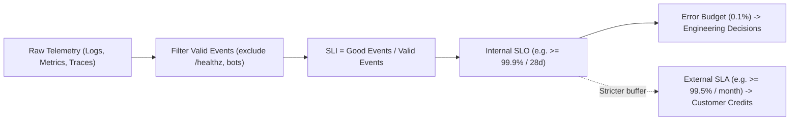
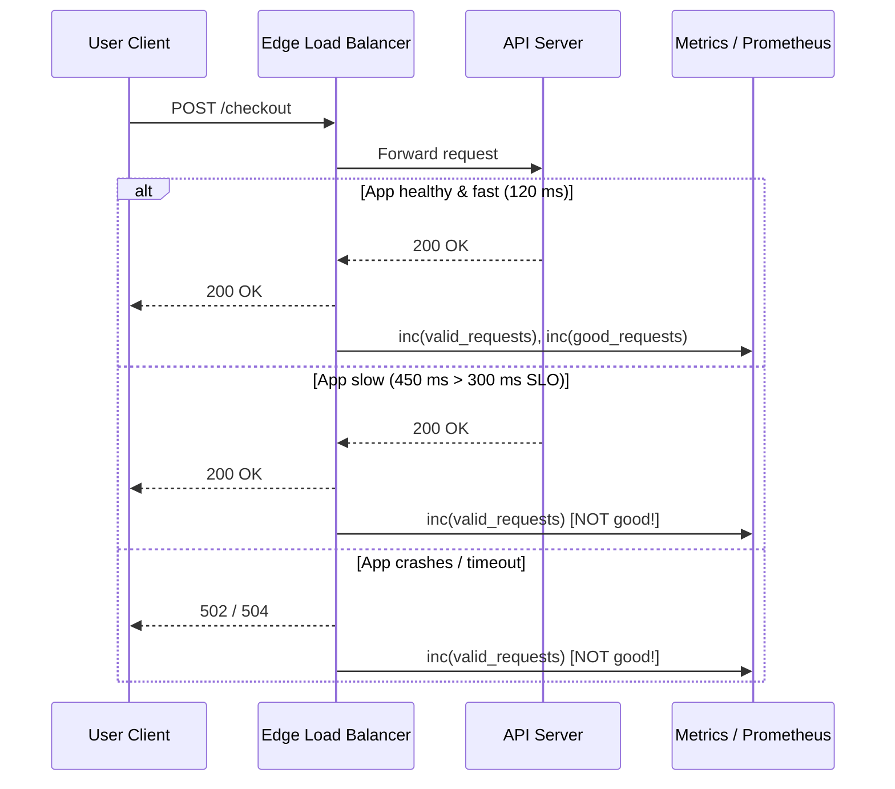
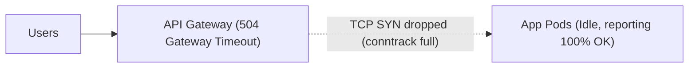

# SLI vs SLO vs SLA Explained (and How to Pick Good SLIs)

> **Prerequisites:** [Lesson 01: Availability Math: Series vs Parallel, Nines & Redundancy](../01-availability-math/README.md).  
> **Estimated Reading Time:** 23–27 minutes  
> **Target Audience:** Backend engineers defining reliability targets, on-call leads tuning dashboards, and candidates asked "how would you measure and guarantee reliability for this service?"  
> **Free PDF Notes:** [Download SD-K-002.pdf](https://backendroadmap.com/notes/system-design/SD-K-002.pdf)

> [!NOTE]
> **In one line:** An **SLI** (Service Level Indicator) is the *measurement* ($\text{good events} / \text{valid events}$), an **SLO** (Service Level Objective) is the internal *target* for that measurement (e.g., $\ge 99.9\%$ over 28 days), and an **SLA** (Service Level Agreement) is the external *legal contract* with financial or service-credit penalties if you miss a looser threshold.

> [!TIP]
> **The Golden Rule:** Measure SLIs as close to the user as possible (load balancer / client edge, not just CPU), express every SLI as a **ratio of good events to valid events**, and always set your **internal SLO tighter than your external SLA** so you have time to react before owing customers money.

---

## 1. What SLIs, SLOs, and SLAs Are, and What They Aren't

A team proudly reports 100% uptime because their Kubernetes liveness probe (`/healthz`) returned `200 OK` all month—while 18% of checkout requests timed out at the API gateway due to a database connection-pool exhaustion. They measured an **infrastructure metric**, not a user-facing **SLI**. Without clear SLIs, SLOs, and SLAs, engineering and product argue endlessly over whether the system is "reliable enough."

| Term | Precise Meaning | Example |
| :--- | :--- | :--- |
| **SLI (Indicator)** | Quantitative ratio measuring user-perceived behavior | $\text{HTTP 2xx/3xx/4xx} / \text{Total valid requests}$ |
| **SLO (Objective)** | Internal reliability target + measurement window | $\text{SLI} \ge 99.9\%$ over a rolling 28-day window |
| **SLA (Agreement)** | External contract with consequences if breached | $< 99.5\%$ monthly uptime $\to 10\%$ bill credit |
| **Good event** | A valid request that meets the quality bar | Completed in $< 300\text{ ms}$ without `5xx` |
| **Valid event** | An in-scope event (excludes health checks, client abuse) | Authenticated API traffic, excluding `/healthz` |
| **Composite SLI** | Combined availability + latency quality gate | Non-`5xx` **AND** latency $\le 300\text{ ms}$ |
| **Not** | A raw resource metric like CPU %, RAM %, or pod count | 80% CPU is fine if latency and errors meet SLO |

### Why It Matters
1. **Common language:** SLIs and SLOs replace subjective debates ("the site feels slow") with objective numbers shared by SRE, Backend, and Product.
2. **Focus on user pain:** Good SLIs filter out noise (synthetic bots, `/healthz` pings) and focus on what users actually experience.
3. **Contract protection:** Keeping your SLO stricter than your SLA creates an early-warning buffer before legal or financial penalties trigger.

---

## 2. Anatomy: From Raw Telemetry to SLA



Notice the strict hierarchy:
- **SLI** answers *"What happened?"* (a number between 0% and 100%).
- **SLO** answers *"Are we happy with it?"* (a target threshold over a time window).
- **SLA** answers *"What happens if we fail our customers?"* (a legal/commercial promise, usually owned by Product & Legal, with a looser threshold than the SLO).

| Dimension | SLI | SLO | SLA |
| :--- | :--- | :--- | :--- |
| **Owner** | Engineering / SRE | Engineering + Product | Legal / Business + Product |
| **Audience** | Dashboards & alerts | Roadmap & release gates | Customers & contracts |
| **Example** | 99.94% requests $< 300\text{ ms}$ | $\ge 99.90\%$ over 28 days | $\ge 99.50\%$ calendar month |
| **Breach consequence** | None (it's just a metric) | Freeze features, fix reliability | Service credits / contract termination |

> [!WARNING]
> **Never use your SLA as your SLO.** If your customer SLA is 99.9% and your internal SLO is also 99.9%, the moment your internal alert fires you have *already* breached your legal contract. Always leave headroom (e.g., 99.95% SLO for a 99.9% SLA, or 99.9% SLO for a 99.5% SLA).

---

## 3. Mathematical Model: Good/Valid Ratio & Windowed Compliance

Google's SRE workbook standardizes every SLI into a single canonical ratio:

$$\text{SLI} = \frac{\text{Good Events}}{\text{Valid Events}} \times 100\%$$

**Why ratios beat averages.** Averaging latencies hides tail pain: if 99% of requests take 10 ms and 1% take 10,000 ms, the average is 109 ms (looks great!), while 1 in 100 users waits 10 seconds. Using a **thresholded ratio**—e.g., *"fraction of valid requests served in $\le 300\text{ ms}$"*—captures tail behavior cleanly and aggregates accurately across services and regions.

**Composite Availability + Latency SLI.** A request that returns `200 OK` after 45 seconds is effectively a failure to the user. Combine them:

$$\text{SLI}_{\text{composite}} = \frac{\text{Count}(\text{status} \neq 5\text{xx} \;\land\; \text{latency} \le T_{\text{max}})}{\text{Count}(\text{valid requests})}$$

**Worked Numerical Example.**
Over a 28-day window, an API receives $100{,}000{,}000$ total HTTP hits:
- $2{,}000{,}000$ are `/healthz` probes (excluded from valid events).
- $1{,}000{,}000$ are `429 Too Many Requests` / `401 Unauthorized` from a misbehaving scraper (valid client rejections, **not** server failures).
- Valid events $= 100{,}000{,}000 - 2{,}000{,}000 = 98{,}000{,}000$.
- Of those $98{,}000{,}000$ valid events, $45{,}000$ return `5xx` and $35{,}000$ return `200` but take $> 300\text{ ms}$ (assume zero overlap for worst-case).
- $\text{Good events} = 98{,}000{,}000 - 45{,}000 - 35{,}000 = 97{,}920{,}000$.
- $\text{SLI} = \frac{97{,}920{,}000}{98{,}000{,}000} = \mathbf{99.9184\%}$.
- Against an SLO of **99.9%**, the service is **passing** (0.0184% above target).

---

## 4. Metrics & Percentiles: Picking the Right SLI by System Type

| System Type | Primary SLIs | Typical SLO Target | Pitfall to Avoid |
| :--- | :--- | :--- | :--- |
| **Request-driven API** | Availability (`non-5xx`), Latency ($\le T\text{ ms}$) | 99.9% avail, 99% $\le 300\text{ ms}$ | Counting `4xx` user errors as server failures |
| **Data pipeline / ETL** | Freshness (age of newest data), Completeness | 99% of batches $< 15\text{ min}$ old | Measuring only job exit code, ignoring empty outputs |
| **Storage / Database** | Durability, Read/Write availability, Latency | 99.999999999% durability | Ignoring tail write latency during compaction |
| **Async queue / Broker** | End-to-end delivery latency, Drop rate | 99.9% delivered $< 5\text{ s}$ | Measuring enqueue success while consumers are stalled |

### Worked Example (Choosing Latency Thresholds)
Suppose your checkout API has $p_{50} = 45\text{ ms}$, $p_{95} = 180\text{ ms}$, $p_{99} = 320\text{ ms}$.
- Setting an SLO of *"99% of requests $\le 100\text{ ms}$"* is unrealistic—your steady-state $p_{99}$ is already 320 ms.
- Setting an SLO of *"99% of requests $\le 500\text{ ms}$"* gives realistic headroom above normal $p_{99}$ while catching real regressions before users abandon checkout.

---

## 5. Compounding: Why Mean Aggregation Lies & Window Selection

1. **Averaging across percentiles is mathematically invalid:** You cannot average $p_{99}$ across 10 servers to get global $p_{99}$. Instead, sum the raw **good counts** and **valid counts** from every server/region, then divide once at the end.
2. **Rolling 28-day vs. Calendar-month windows:**
   - A **28-day rolling window** always spans 4 weekends and smooths out month-end cliff effects.
   - A **calendar month** resets abruptly on the 1st—allowing a team to break reliability on the 31st and start "fresh" the next morning. Use **rolling 28 days** for SLOs; reserve calendar months only for customer-facing SLAs if billing requires it.

---

## 6. Numbers Every Engineer Must Know

| Item | Typical | Implication |
| :--- | :---: | :--- |
| **SLIs per user journey** | 2–4 (Availability, Latency, Freshness/Correctness) | Too many SLIs dilute focus |
| **SLO measurement window** | 28 days (rolling) | Covers 4 full weekly traffic cycles |
| **SLO vs SLA gap** | 0.05%–0.5% stricter SLO | Prevents contract penalties on minor blips |
| **Telemetry vantage point** | Load balancer / API Gateway (or synthetic client) | App-pod metrics miss TLS, DNS, and LB drops |
| **4xx handling** | Excluded from server errors (except `429` if caused by under-provisioning) | Don't page SREs when a user types a wrong password |

---

## 7. Protocol / Mechanism Deep Dive: The SLI Measurement Pipeline



| Question | Answer |
| :--- | :--- |
| **Why measure at the Load Balancer instead of inside the App?** | If the app crashes, hangs, or OOMs before reaching middleware, the app emits *zero* error metrics—making availability look like 100% during a total outage. |
| **Should `4xx` errors count against the SLI?** | Usually no (`400`, `401`, `404` are client mistakes). Exception: sudden spikes in `400`/`401` can indicate a broken client deploy or auth bug—track them separately. |
| **What about low-traffic endpoints (10 req/hour)?** | One failed health check or single user retry drops availability to 90%. Aggregate low-traffic endpoints or use longer windows / synthetic probes. |

**When NOT to set an aggressive SLO:** Never set a 99.99% SLO for an internal batch job or an MVP prototype. Higher SLOs freeze feature velocity and force expensive multi-AZ/multi-region architecture.

---

## 8. Hierarchical Budgets & Design Rules

| Slice | Rule | Control |
| :--- | :--- | :--- |
| **User journeys** | Define SLIs per critical user journey, not per microservice | Start with Login, Search, Checkout |
| **Formulation** | Always express as $\text{good} / \text{valid}$ | Avoid raw averages or unnormalized counts |
| **Vantage point** | Measure at the LB / Gateway; supplement with client RUM | Never rely solely on `/healthz` |
| **Headroom** | $\text{SLO} > \text{SLA}$ | Document both in the service catalog |
| **Review cadence** | Review SLOs quarterly with Product | Adjust if users are happy or if targets are unrealistic |

---

## 9. Top Mitigations

1. **Write an SLO specification table** for every Tier-1 service: Journey, SLI formula, Vantage point, Target, Window.
2. **Use histogram buckets aligned to your latency SLO** (e.g., `le="0.3"` for a 300 ms target) so Prometheus/OTel computes exact ratios without percentile averaging bugs.
3. **Exclude `/healthz`, `/metrics`, and known scanner traffic** from `valid_events` so they don't artificially inflate or deflate your SLI.
4. **Separate Availability SLIs from Latency SLIs** (or use a clear composite) so you know *why* the budget burned.
5. **Never promise an SLA without 3–6 months of historical SLI data** proving the system can actually sustain it.
6. **Alert on SLO burn rate**, not on single-minute CPU or pod restarts (covered in Lesson 03).

---

## 10. Production Reference / War Story: The "100% Healthy" Outage

An e-commerce API's internal dashboard showed **99.99% availability** all morning because its SLI was computed from Spring Boot actuator metrics inside the application pods. Meanwhile, customer support was flooded with complaints.



- **Root Cause:** The Linux `nf_conntrack` table on the ingress nodes filled up, silently dropping incoming packets before they ever reached the application pods. Because the SLI was measured *inside* the app, the app saw low traffic and zero errors—reporting 100% availability.
- **Impact:** 22 minutes of total checkout failure before manual customer escalation triggered an investigation.
- **Fix:** Moved the primary SLI measurement point to the **Edge Load Balancer / CDN**, added synthetic end-to-end canary probes every 15 seconds from external regions, and defined a composite SLI (`status < 500 AND latency <= 500ms`).

---

## 11. Multi-Language Production Code Tabs

An SLI/SLO evaluator computing availability, latency, and composite SLIs from request events, with automatic `valid` filtering.

````carousel
```go
// Go: SLI/SLO evaluator tracking good, valid, and composite events.
package main

import "fmt"

type RequestEvent struct {
	Path       string
	StatusCode int
	LatencyMs  float64
}

type SLICalculator struct {
	LatencyThresholdMs float64
	ValidCount         int64
	GoodAvailCount     int64
	GoodCompositeCount int64
}

func (s *SLICalculator) Record(ev RequestEvent) {
	if ev.Path == "/healthz" || ev.Path == "/metrics" {
		return // exclude internal probes from valid events
	}
	s.ValidCount++
	isAvailGood := ev.StatusCode < 500
	if isAvailGood {
		s.GoodAvailCount++
	}
	if isAvailGood && ev.LatencyMs <= s.LatencyThresholdMs {
		s.GoodCompositeCount++
	}
}

func (s *SLICalculator) Report(sloTarget float64) {
	availSLI := float64(s.GoodAvailCount) / float64(s.ValidCount)
	compSLI := float64(s.GoodCompositeCount) / float64(s.ValidCount)
	fmt.Printf("Valid=%d | AvailSLI=%.4f%% | CompositeSLI=%.4f%% | MeetsSLO=%v\n",
		s.ValidCount, availSLI*100, compSLI*100, compSLI >= sloTarget)
}

func main() {
	calc := &SLICalculator{LatencyThresholdMs: 300}
	events := []RequestEvent{
		{"/healthz", 200, 2},
		{"/checkout", 200, 120},
		{"/checkout", 400, 40},  // client error: valid & available
		{"/checkout", 200, 450}, // too slow: fails composite SLI
		{"/checkout", 503, 15},  // server error: fails both
	}
	for _, e := range events {
		calc.Record(e)
	}
	calc.Report(0.999)
}
```
<!-- slide -->
```typescript
// TypeScript: SLI/SLO evaluator for request streams.
export interface RequestEvent {
  path: string;
  statusCode: number;
  latencyMs: number;
}

export class SLICalculator {
  private valid = 0;
  private goodAvail = 0;
  private goodComposite = 0;

  constructor(private readonly maxLatencyMs: number) {}

  record(ev: RequestEvent): void {
    if (ev.path === "/healthz" || ev.path === "/metrics") return;
    this.valid++;
    const availOk = ev.statusCode < 500;
    if (availOk) this.goodAvail++;
    if (availOk && ev.latencyMs <= this.maxLatencyMs) this.goodComposite++;
  }

  summary(sloTarget: number) {
    const availSli = this.valid === 0 ? 1 : this.goodAvail / this.valid;
    const compositeSli = this.valid === 0 ? 1 : this.goodComposite / this.valid;
    return {
      valid: this.valid,
      availPct: +(availSli * 100).toFixed(4),
      compositePct: +(compositeSli * 100).toFixed(4),
      sloMet: compositeSli >= sloTarget,
    };
  }
}
```
<!-- slide -->
```python
# Python: SLI/SLO evaluator with Prometheus-style histogram bucket math (stdlib only).
from dataclasses import dataclass

@dataclass
class RequestEvent:
    path: str
    status: int
    latency_ms: float

def compute_sli(events: list[RequestEvent], max_latency_ms: float = 300.0) -> dict:
    valid = good_avail = good_composite = 0
    for ev in events:
        if ev.path in ("/healthz", "/metrics"):
            continue
        valid += 1
        avail_ok = ev.status < 500
        if avail_ok:
            good_avail += 1
        if avail_ok and ev.latency_ms <= max_latency_ms:
            good_composite += 1
    return {
        "valid": valid,
        "avail_sli": good_avail / valid if valid else 1.0,
        "composite_sli": good_composite / valid if valid else 1.0,
    }

if __name__ == "__main__":
    sample = [
        RequestEvent("/healthz", 200, 1.5),
        RequestEvent("/checkout", 200, 110),
        RequestEvent("/checkout", 404, 25),
        RequestEvent("/checkout", 200, 420),
        RequestEvent("/checkout", 500, 12),
    ]
    print(compute_sli(sample))
```
<!-- slide -->
```csharp
// C#: SLI/SLO evaluator for HTTP request telemetry.
using System;

public sealed record RequestEvent(string Path, int StatusCode, double LatencyMs);

public sealed class SliCalculator
{
    private readonly double _maxLatencyMs;
    private long _valid, _goodAvail, _goodComposite;

    public SliCalculator(double maxLatencyMs) => _maxLatencyMs = maxLatencyMs;

    public void Record(RequestEvent ev)
    {
        if (ev.Path is "/healthz" or "/metrics") return;
        _valid++;
        var availOk = ev.StatusCode < 500;
        if (availOk) _goodAvail++;
        if (availOk && ev.LatencyMs <= _maxLatencyMs) _goodComposite++;
    }

    public (double AvailSli, double CompositeSli) Evaluate() =>
        _valid == 0 ? (1.0, 1.0) : ((double)_goodAvail / _valid, (double)_goodComposite / _valid);
}
```
````

---

## 12. Hands-On CLI Verification Workflows

Query PromQL-style SLI ratios and verify your latency buckets:

```bash
# 1. Example PromQL query for 28-day Availability SLI (non-5xx / total)
# sum(rate(http_requests_total{status!~"5.."}[28d])) / sum(rate(http_requests_total[28d]))

# 2. Example PromQL query for Latency SLI (requests <= 300ms / total)
# sum(rate(http_request_duration_seconds_bucket{le="0.3"}[28d])) / sum(rate(http_request_duration_seconds_count[28d]))

# 3. Quick local verification of SLI ratio math
python3 -c "
valid = 98_000_000
bad_5xx = 45_000
slow = 35_000
sli = (valid - bad_5xx - slow) / valid
print(f'Composite SLI: {sli*100:.4f}% (SLO 99.9% met: {sli >= 0.999})')
"
```

---

## 13. Common Mistakes to Avoid

1. **Setting the internal SLO equal to the external SLA**, leaving zero margin before penalties trigger.
2. **Measuring SLIs inside the app pod** instead of at the load balancer or client edge.
3. **Using average latency** instead of a thresholded ratio (e.g., `% <= 300ms`).
4. **Counting `4xx` user errors** (bad passwords, 404s) against server availability.
5. **Including `/healthz` probes** in `valid_events`, which dilutes real traffic error rates.
6. **Setting a 99.99% SLO without historical baseline data** or executive buy-in for the required cost.
7. **Creating 20+ SLIs per service**, causing dashboard fatigue where nothing is prioritized.

---

## 14. Key Terms Glossary

| Key Term | Definition |
| :--- | :--- |
| **SLI** | Service Level Indicator: quantitative measure of service behavior ($\text{good}/\text{valid}$). |
| **SLO** | Service Level Objective: internal target value and time window for an SLI. |
| **SLA** | Service Level Agreement: external contract with explicit penalties if breached. |
| **Good event** | Valid event that satisfies the quality threshold (status + latency). |
| **Valid event** | In-scope request/event, excluding internal health probes and abusive traffic. |
| **Composite SLI** | Single SLI combining availability and latency requirements. |
| **Rolling window** | Continuous lookback period (e.g., last 28 days) avoiding month-end resets. |
| **Vantage point** | Where the SLI is measured (client, CDN, load balancer, or app). |
| **Tail latency** | High-percentile response times ($p_{95}$, $p_{99}$) experienced by the slowest requests. |
| **Service credits** | Financial/billing rebates owed to customers upon SLA breach. |

---

## 15. System Design Interview Questions & Answers

### Basic Conceptual Questions

<details>
<summary><strong>Q1: What is the difference between SLI, SLO, and SLA? [BASIC]</strong></summary>

**Answer:**
An **SLI** is the metric ($\text{good events} / \text{valid events}$), an **SLO** is the internal target for that metric (e.g., 99.9% over 28 days), and an **SLA** is the external legal contract with penalties (e.g., 99.5% monthly or 10% credit).
</details>

<details>
<summary><strong>Q2: Why should an internal SLO always be stricter than an external SLA? [BASIC]</strong></summary>

**Answer:**
The gap between SLO and SLA acts as an operational buffer. If your SLO breaches first, engineering gets alerted and fixes the issue before the looser SLA is violated and the company owes customer credits.
</details>

<details>
<summary><strong>Q3: Why express SLIs as ratios ($\text{good}/\text{valid}$) instead of averages? [BASIC]</strong></summary>

**Answer:**
Averages hide tail latency and scale badly across hosts. A thresholded ratio (e.g., `% of requests <= 300ms`) accurately captures tail pain, normalizes naturally between 0% and 100%, and aggregates cleanly by summing numerators and denominators across clusters.
</details>

<details>
<summary><strong>Q4: Should HTTP 4xx errors count as failures in an availability SLI? [BASIC]</strong></summary>

**Answer:**
Usually no—`400`, `401`, and `404` indicate client mistakes, not server outages. However, you should monitor `4xx` spikes separately to catch broken client releases or auth misconfigurations.
</details>

### Scenario-Based Architecture Questions

<details>
<summary><strong>Q5: How would you define SLIs for an asynchronous video-transcoding pipeline? [SCENARIO]</strong></summary>

**Answer:**
HTTP response time of the upload endpoint isn't enough. Define: (1) **Upload Availability SLI** (valid uploads returning `202 Accepted`), (2) **Freshness / End-to-End Latency SLI** (`% of videos transcoded within 2 minutes of upload`), and (3) **Correctness SLI** (`% of jobs completing without corruption or DLQ`).
</details>

<details>
<summary><strong>Q6: Your app metrics show 99.99% availability, but users report timeouts. Where is your SLI broken? [SCENARIO]</strong></summary>

**Answer:**
Your vantage point is too deep (inside the app). Network drops, TLS handshake failures, DNS issues, or load balancer 504s never reach app middleware. Move the SLI measurement to the edge load balancer and add external synthetic probes.
</details>

<details>
<summary><strong>Q7: A product manager asks for a 99.999% SLA on a new service. How do you respond? [SCENARIO]</strong></summary>

**Answer:**
Explain the cost and math: 5 nines allows only 26 seconds of downtime per month, requiring multi-region active-active architecture and automated failover. Ask what downtime actually costs the business, check the availability of underlying dependencies (Lesson 01), and propose starting with a 99.9% SLO.
</details>

<details>
<summary><strong>Q8: How do you handle `/healthz` probes and bot traffic in your SLI? [SCENARIO]</strong></summary>

**Answer:**
Exclude `/healthz` and `/metrics` from `valid_events` so high-frequency probes don't mask real user error rates. For authenticated APIs, also filter or tag unauthenticated DDoS/scanner traffic separately.
</details>

### Advanced & Tricky Interview Questions

<details>
<summary><strong>Q9: Can you average the $p_{99}$ latencies of 10 microservices or 10 pods to get an overall $p_{99}$? [TRICKY]</strong></summary>

**Answer:**
No—averaging percentiles is mathematically invalid (Simpson's paradox / weighting error). Instead, export histogram buckets from each pod, sum the bucket counts across all pods, and compute the ratio or quantile from the merged histogram.
</details>

<details>
<summary><strong>Q10: Why does a 28-day rolling window beat a calendar-month window for SLOs? [TRICKY]</strong></summary>

**Answer:**
A 28-day rolling window always includes exactly 4 Mondays, 4 Tuesdays, ..., 4 Sundays, eliminating weekend/weekday skew, and prevents the "end-of-month cliff" where an outage on the 31st is forgotten on the 1st.
</details>

<details>
<summary><strong>Q11: What happens when a low-traffic B2B API gets only 50 requests/day? [TRICKY]</strong></summary>

**Answer:**
A single failed request equals a 2% error rate for the day, triggering false alarms. Mitigate by using longer evaluation windows, combining synthetic probes with real traffic, or alerting only when a minimum request volume threshold is met.
</details>

<details>
<summary><strong>Q12: How do you tie an SLO to an engineering team's daily workflow? [TRICKY]</strong></summary>

**Answer:**
Convert $1 - \text{SLO}$ into an **Error Budget** (Lesson 03). While budget remains, ship features fast; when the budget is exhausted, freeze non-reliability launches and invest engineering sprints into reliability until the budget recovers.
</details>

---

## 16. One-Page Master Cheat Sheet

```
+---------------------------------------------------------------------------------------------------------+
|                       SLI vs SLO vs SLA — MASTER CHEAT SHEET                                            |
+---------------------------------------------------------------------------------------------------------+
| 1. DEFINITIONS: SLI = measurement | SLO = internal target | SLA = external legal contract + penalty.    |
+---------------------------------------------------------------------------------------------------------+
| 2. FORMULA: SLI = (Good Events / Valid Events) * 100%. Exclude /healthz; don't penalize user 4xx.       |
+---------------------------------------------------------------------------------------------------------+
| 3. VANTAGE POINT: Measure at the Load Balancer / Edge, never solely inside app pods.                    |
+---------------------------------------------------------------------------------------------------------+
| 4. THRESHOLDS OVER AVERAGES: Use "% <= 300ms" instead of "mean latency" to capture tail pain.           |
+---------------------------------------------------------------------------------------------------------+
| 5. BUFFER RULE: Always set internal SLO > external SLA (e.g., 99.95% SLO for a 99.9% SLA).              |
+---------------------------------------------------------------------------------------------------------+
| 6. WINDOWS: Use rolling 28-day windows for SLOs; never average percentiles across pods.                 |
+---------------------------------------------------------------------------------------------------------+
```

---

## Further Reading & Sources

- Betsy Beyer et al., *Site Reliability Engineering* (Google SRE Book), Chapter 4: "Service Level Objectives".
- Alex Hidalgo, *Implementing Service Level Objectives* (O'Reilly), Chapters 2–4: "Developing SLIs and SLOs".
- Google Cloud SRE Workbook, [Implementing SLOs](https://sre.google/workbook/implementing-slos/).
- OpenTelemetry Documentation, [Metrics & Histogram Aggregation](https://opentelemetry.io/docs/specs/otel/metrics/data-model/).

---

## Free PDF Notes

[SD-K-002.pdf](https://backendroadmap.com/notes/system-design/SD-K-002.pdf)

---

## Next

Continue with [Lesson 03: Error Budgets & Burn-Rate Alerts: Ship Fast Without Breaking SLOs](../03-error-budgets-burn-rate-alerts/README.md): turning SLOs into release gates and low-noise paging.
