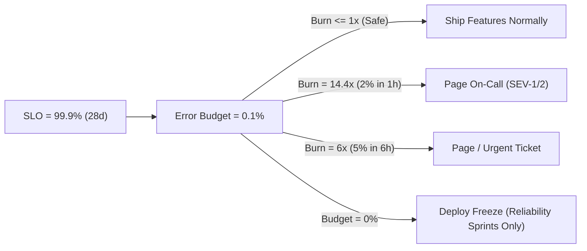
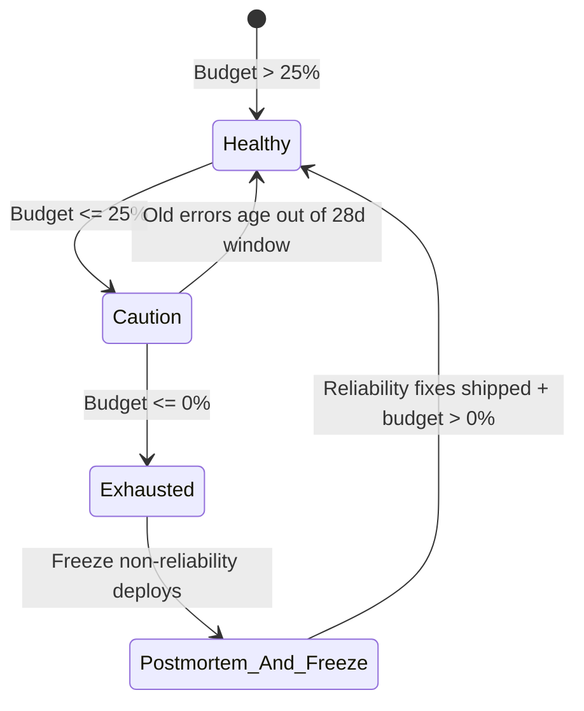
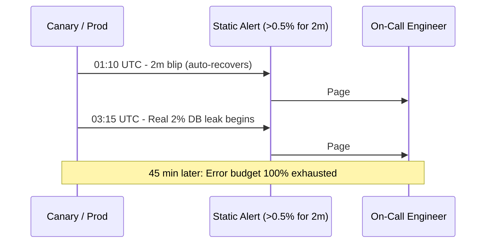

# Error Budgets & Burn-Rate Alerts: Ship Fast Without Breaking SLOs

> **Prerequisites:** [Lesson 02: SLI vs SLO vs SLA Explained (and How to Pick Good SLIs)](../02-sli-vs-slo-vs-sla-explained/README.md).  
> **Estimated Reading Time:** 24–28 minutes  
> **Target Audience:** Backend/SRE engineers tired of noisy 3 AM false-positive pages, and candidates asked "how do you balance feature velocity with reliability?"  
> **Free PDF Notes:** [Download SD-K-003.pdf](https://backendroadmap.com/notes/system-design/SD-K-003.pdf)

> [!NOTE]
> **In one line:** An **Error Budget** is $1 - \text{SLO}$—the exact amount of unreliability your users tolerate in a window—which turns reliability from "never break anything" into a spendable resource for shipping features, while **Multi-Window Burn-Rate Alerts** page you only when you are consuming that budget fast enough to threaten the SLO.

> [!TIP]
> **The Golden Rule:** Don't page on static error-rate thresholds (like "error rate > 1% for 5 minutes"). Page on **burn rate** using **multi-window, multi-burn-rate alerts** (e.g., 14.4x burn over 1h AND 5m) so severe outages wake you in minutes while brief harmless blips never wake anyone.

---

## 1. What Error Budgets & Burn-Rate Alerts Are, and What They Aren't

Without an error budget, Product wants to ship daily and SRE wants to freeze deploys forever. Both teams are right until they agree on a shared number. Conversely, if an on-call engineer gets paged every time error rate briefly ticks above 0.5% for two minutes during a cache warm-up, they suffer **alert fatigue** and start ignoring real incidents.

| Term | Precise Meaning | Example |
| :--- | :--- | :--- |
| **Error budget** | $1 - \text{SLO}$ over the compliance window | $99.9\%$ SLO over 28d $\to 0.1\%$ allowed errors |
| **Burn rate** | Speed of budget consumption relative to steady-state | $1\times$ = exhausts budget in 28d; $14.4\times$ = in 46.7h |
| **Multi-window alert** | Requires *both* a long window and a short window to fire | 1h burn $> 14.4\times$ **AND** 5m burn $> 14.4\times$ |
| **Budget exhaustion** | Remaining budget hits 0% for the window | Freeze risky deploys; focus on reliability work |
| **Reset / recovery** | Old failures age out of the rolling 28-day window | Budget replenishes as clean traffic replaces old errors |
| **Not** | A license to deliberately break production | It funds *controlled* risk: deploys, experiments, failovers |

### Why It Matters
1. **Ends the Product vs. SRE tug-of-war:** If 60% of the error budget remains, ship features; if 0% remains, freeze non-reliability work.
2. **Eliminates alert fatigue:** Burn-rate alerts directly tie paging to **user-impacting SLO risk**, cutting false-positive pages by 80–95%.
3. **Rapid reset after recovery:** Because both short (5m) and long (1h) windows must breach, the moment a rollback fixes the bug, the 5m window drops and the alert resolves automatically.

---

## 2. Anatomy: Error Budget Governance & Multi-Window Burn Rates



Why does a **single-window** alert fail?
- If you alert on a **5-minute window only**, a brief 3-minute network hiccup that consumes 0.1% of your monthly budget pages someone at 3 AM—even though the SLO is completely safe.
- If you alert on a **1-hour window only**, a 100% outage that is fixed in 4 minutes keeps the 1-hour average elevated for the next 56 minutes, causing slow alert resolution and confusion.
- Requiring **BOTH** `long_window > threshold AND short_window > threshold` (typically `short = long / 12`) gives you **high precision** (no blip pages) and **fast recovery** (clears in minutes).

| Alert Tier | Burn Rate | Budget Consumed | Time to Exhaust 28d Budget | Long / Short Windows | Action |
| :--- | :---: | :---: | :---: | :---: | :--- |
| **Critical (Page)** | $14.4\times$ | $2\%$ in 1 hour | 46.7 hours (~2 days) | 1h **AND** 5m | Immediate Page |
| **High (Page)** | $6\times$ | $5\%$ in 6 hours | 4.67 days | 6h **AND** 30m | Immediate Page |
| **Elevated (Ticket)** | $3\times$ | $10\%$ in 1 day | 9.33 days | 1d **AND** 2h | Slack / Ticket |
| **Slow Burn (Ticket)** | $1\times$ | $100\%$ in 28 days | 28 days | 3d **AND** 6h | Sprint planning |

> [!WARNING]
> **Never rely solely on a slow-burn ticket without a fast-burn page.** At $14.4\times$ burn, a 99.9% SLO burns 2% of its entire 28-day budget every single hour; waiting for a 24-hour window means losing nearly half your monthly budget before anyone looks.

---

## 3. Mathematical Model: Budget, Burn Rate & Time-to-Exhaustion

Let $S$ be the SLO (e.g., $0.999$) over window $W$ (e.g., $28\text{ days} = 672\text{ hours}$).

**Total Error Budget (requests or time):**

$$B = 1 - S$$

If your service handles $N$ valid requests over window $W$, your allowed failed requests are:

$$E_{\text{budget}} = N \times (1 - S)$$

**Burn Rate ($r$):** If the observed error rate over a sub-window is $e$, the burn rate is:

$$r = \frac{e}{1 - S}$$

- $r = 1$: You will exhaust 100% of your error budget in exactly $W$ (28 days).
- $r > 1$: You are burning budget faster than sustainable; time to exhaustion is $T_{\text{exhaust}} = \frac{W}{r}$.

**Fraction of Total Budget Consumed in Duration $t$:**

$$f_{\text{consumed}} = \frac{r \cdot t}{W} = \frac{e \cdot t}{(1 - S) \cdot W}$$

**Worked Numerical Example.**
Suppose your API has a **99.9% SLO** ($1 - S = 0.001$) over $W = 28\text{ days} = 672\text{ hours}$ and serves $50{,}000{,}000$ valid requests per 28 days:
1. **Allowed bad requests:** $E_{\text{budget}} = 50{,}000{,}000 \times 0.001 = \mathbf{50{,}000\text{ bad requests}}$.
2. **Incident:** A bad deploy causes a $1.44\%$ error rate ($e = 0.0144$).
3. **Burn rate:** $r = \frac{0.0144}{0.001} = \mathbf{14.4\times}$.
4. **Budget consumed in 1 hour:** $f_{\text{consumed}} = \frac{14.4 \times 1\text{ h}}{672\text{ h}} = 0.0214 \approx \mathbf{2.14\%}$ of the entire 28-day budget in a single hour!
5. **Time to total exhaustion:** $T_{\text{exhaust}} = \frac{672\text{ h}}{14.4} = \mathbf{46.67\text{ hours}}$.

---

## 4. Metrics & Percentiles

| Metric | Meaning | Alert when |
| :--- | :--- | :--- |
| **Remaining error budget (%)** | $100\% \times (1 - \text{errors} / E_{\text{budget}})$ | $< 25\%$ (warning), $\le 0\%$ (freeze) |
| **Short-window burn rate (5m / 30m)** | Instantaneous burn rate | Paired with long window $> 14.4\times$ or $6\times$ |
| **Long-window burn rate (1h / 6h)** | Sustained burn rate | $> 14.4\times$ (1h) or $> 6\times$ (6h) |
| **Error budget reset rate** | Rate at which old errors roll out of 28d window | Tracked on executive reliability dashboard |
| **Alert precision** | % of pages that resulted in real action | $< 70\%$ indicates thresholds are too tight |

### Worked Example (Multi-Window Reset Behavior)
Suppose at 02:00 UTC a 3-minute DNS blip causes 5% errors ($50\times$ burn), then recovers completely at 02:03:
- **At 02:03:** 5m burn rate $= \frac{3}{5} \times 50 = 30\times$, 1h burn rate $= \frac{3}{60} \times 50 = 2.5\times$. Because $2.5\times < 14.4\times$, **no page fires**.
- **Contrast with a real outage** starting at 02:00 at $1.5\%$ errors ($15\times$ burn): by 02:60 (or earlier if error rate is higher, e.g. 5% errors hits $14.4\times$ on the 1h window in just **17 minutes**!), both 5m and 1h exceed $14.4\times$ and **page on-call immediately**.

---

## 5. Compounding: Detection Time vs Error Rate

How quickly does a `1h >= 14.4x AND 5m >= 14.4x` rule detect an outage of various severities on a 99.9% SLO? (Simulated in Python 3.13):

| Outage Error Rate ($e$) | Burn Rate ($r$) | Time for 1h Window to Reach $14.4\times$ | Budget Lost Before Page |
| :---: | :---: | :---: | :---: |
| **100% (total outage)** | $1000\times$ | **1 minute** (Wait: $\frac{100\%}{60} = 1.67\% > 1.44\%$) | **0.15%** |
| **20%** | $200\times$ | **5 minutes** (limited by 5m window) | **0.25%** |
| **5%** | $50\times$ | **18 minutes** | **1.34%** |
| **1.44%** | $14.4\times$ | **60 minutes** | **2.14%** |
| **0.6%** | $6\times$ | Never on 1h; caught by **6h / 30m @ $6\times$** in **6 hours** | **5.36%** |

Notice the elegance: a total outage pages in **1 minute**; a 20% outage pages in **5 minutes**; a subtle 0.6% leak is caught within **6 hours**—all without ever paging on a 3-minute blip.

---

## 6. Numbers Every Engineer Must Know

| Item | Typical | Implication |
| :--- | :---: | :--- |
| **99.9% SLO over 28d** | 0.1% error budget (40.3 min / 50k per 50M reqs) | Standard baseline for web APIs |
| **99.99% SLO over 28d** | 0.01% error budget (4.03 min / 5k per 50M reqs) | Requires automated canary rollbacks |
| **Google SRE fast-burn threshold** | $14.4\times$ (consumes 2% of 30d budget in 1h) | Standard Tier-1 paging threshold |
| **Short-to-long window ratio** | $1:12$ (e.g., 5m for 1h, 30m for 6h) | Balances fast reset with noise suppression |
| **Error budget policy threshold** | 0% remaining $\to$ feature deploy freeze | Must have executive sign-off *before* an outage |

---

## 7. Protocol / Mechanism Deep Dive: Error Budget Policy Lifecycle



| Question | Answer |
| :--- | :--- |
| **Who enforces a deploy freeze when budget hits 0%?** | Engineering + Product leadership agreed to the **Error Budget Policy** *beforehand*; CI/CD can even gate non-fix deploys automatically. |
| **What IS allowed during a freeze?** | Bug fixes, P0 security patches, reliability/observability improvements, and automated rollbacks. |
| **What if a single giant outage wipes out 100% of the budget?** | Freeze non-reliability features, run a blameless postmortem, ship the top action items (e.g., circuit breakers, canary rollback), and wait for the rolling window to recover. |

**When NOT to use burn-rate alerts:** On extremely low-traffic endpoints (e.g., 1 request every 10 minutes), a single failed request yields a 100% error rate ($1000\times$ burn). Add a minimum request-rate guard (e.g., `valid_requests_rate > 1 req/s`) or use synthetic probes.

---

## 8. Hierarchical Budgets & Design Rules

| Slice | Rule | Control |
| :--- | :--- | :--- |
| **Policy** | Written Error Budget Policy signed by Eng + Product | Pre-agreed freeze & escalation rules |
| **Alerting** | Multi-window, multi-burn-rate (`1h/5m @ 14.4x`, `6h/30m @ 6x`) | Zero static CPU/error-rate paging |
| **Noise guard** | Short window = $1/12$ of long window | Prevents stale alerts after rollback |
| **Low-traffic guard** | Require minimum request count in window | Avoids 1-request false pages |
| **Automation** | Canary deploys auto-abort if canary burn rate $> 10\times$ | Catches bad releases before full rollout |

---

## 9. Top Mitigations

1. **Adopt Google SRE's standard 2-tier paging thresholds:** `(1h & 5m) >= 14.4x` and `(6h & 30m) >= 6x` for every Tier-1 SLO.
2. **Pre-sign an Error Budget Policy** with Product Management so deploy freezes aren't political battles during an outage.
3. **Wire burn-rate checks into Canary / Argo Rollouts** to auto-rollback bad deploys in under 5 minutes.
4. **Spend surplus budget intentionally:** If you end the month with 95% budget left, run controlled chaos tests or increase deploy frequency—don't hoard unused budget.
5. **Protect low-traffic routes** with minimum-sample guards or synthetic probes.
6. **Review alert precision monthly:** Delete or tune any page that didn't require human action.

---

## 10. Production Reference / War Story: Alert Fatigue Masked a Real Outage

A fintech platform configured PagerDuty to alert whenever `5xx_rate > 0.5% for 2 minutes`. Because third-party webhook retries and occasional pod autoscaling caused 2-minute blips 4–5 times a week, on-call engineers received ~20 pages/month—90% of which self-resolved before they opened their laptops.



- **Root Cause:** Single-window static threshold alerting trained engineers to ignore pages.
- **Impact:** A 2% error leak ran unchecked for 45 minutes, exhausting the entire monthly error budget and triggering SLA credits.
- **Fix:** Replaced all static error-rate alerts with **multi-window burn-rate alerts** (`1h & 5m @ 14.4x`, `6h & 30m @ 6x`). Monthly pages dropped from 20 to 2, and 100% of remaining pages were real incidents.

---

## 11. Multi-Language Production Code Tabs

A multi-window burn-rate evaluator checking whether an error stream should page or ticket.

````carousel
```go
// Go: multi-window burn-rate evaluator for SLO alerting.
package main

import "fmt"

type BurnRule struct {
	Name      string
	Threshold float64
	Severity  string
}

func BurnRate(bad, valid int64, slo float64) float64 {
	if valid == 0 {
		return 0
	}
	errRate := float64(bad) / float64(valid)
	return errRate / (1.0 - slo)
}

func ShouldFire(longBad, longValid, shortBad, shortValid int64, slo, threshold float64) bool {
	if longValid < 100 || shortValid < 10 { // low-traffic guard
		return false
	}
	return BurnRate(longBad, longValid, slo) >= threshold &&
		BurnRate(shortBad, shortValid, slo) >= threshold
}

func main() {
	slo := 0.999
	// 1h window: 1,500 bad / 100,000 valid (1.5% -> 15x); 5m window: 150 / 10,000 (1.5% -> 15x)
	page := ShouldFire(1500, 100000, 150, 10000, slo, 14.4)
	fmt.Printf("1h/5m @ 14.4x fire=%v\n", page)
}
```
<!-- slide -->
```typescript
// TypeScript: multi-window error budget & burn-rate evaluator.
export interface WindowCounts {
  bad: number;
  valid: number;
}

export function burnRate(w: WindowCounts, slo: number): number {
  if (w.valid === 0) return 0;
  const errorRate = w.bad / w.valid;
  return errorRate / (1 - slo);
}

export function evaluateMultiWindowAlert(
  longWin: WindowCounts,
  shortWin: WindowCounts,
  slo: number,
  threshold: number,
  minSamples = 100
): boolean {
  if (longWin.valid < minSamples) return false;
  return burnRate(longWin, slo) >= threshold && burnRate(shortWin, slo) >= threshold;
}

const fire = evaluateMultiWindowAlert({ bad: 1500, valid: 100000 }, { bad: 150, valid: 10000 }, 0.999, 14.4);
console.log({ fire });
```
<!-- slide -->
```python
# Python: multi-window burn-rate detector & time-to-exhaustion calculator (stdlib only).
def burn_rate(bad: int, valid: int, slo: float) -> float:
    if valid == 0:
        return 0.0
    return (bad / valid) / (1.0 - slo)

def should_page(long_bad: int, long_valid: int, short_bad: int, short_valid: int,
                slo: float = 0.999, threshold: float = 14.4, min_valid: int = 100) -> bool:
    if long_valid < min_valid:
        return False
    return (burn_rate(long_bad, long_valid, slo) >= threshold and
            burn_rate(short_bad, short_valid, slo) >= threshold)

def detection_minutes(outage_err_rate: float, slo: float = 0.999,
                      long_min: int = 60, short_min: int = 5, threshold: float = 14.4) -> int:
    """Minutes until a steady outage triggers (1h AND 5m) >= threshold."""
    target_err = threshold * (1.0 - slo)
    # In `t` minutes, long window error rate = outage_err_rate * min(t, long_min) / long_min
    for t in range(1, long_min + 1):
        long_err = outage_err_rate * min(t, long_min) / long_min
        short_err = outage_err_rate * min(t, short_min) / short_min
        if long_err >= target_err and short_err >= target_err:
            return t
    return -1

if __name__ == "__main__":
    for e in (1.0, 0.20, 0.05, 0.0144):
        print(f"Outage {e*100:5.2f}% -> pages in {detection_minutes(e)} min")
```
<!-- slide -->
```csharp
// C#: multi-window burn-rate evaluator.
using System;

public static class BurnRateAlert
{
    public static double ComputeBurnRate(long bad, long valid, double slo) =>
        valid == 0 ? 0.0 : ((double)bad / valid) / (1.0 - slo);

    public static bool ShouldFire(
        long longBad, long longValid,
        long shortBad, long shortValid,
        double slo = 0.999, double threshold = 14.4)
    {
        if (longValid < 100) return false;
        return ComputeBurnRate(longBad, longValid, slo) >= threshold &&
               ComputeBurnRate(shortBad, shortValid, slo) >= threshold;
    }

    public static void Main() =>
        Console.WriteLine($"Page: {ShouldFire(1500, 100_000, 150, 10_000)}");
}
```
````

---

## 12. Hands-On CLI Verification Workflows

Test burn-rate detection math and Prometheus alert expressions:

```bash
# 1. Verify detection speed across outage severities (99.9% SLO, 1h & 5m @ 14.4x)
python3 -c "
slo, thresh = 0.999, 14.4
target = thresh * (1 - slo)
for err in [1.0, 0.20, 0.05, 0.0144]:
    t = next((m for m in range(1, 61) if err*m/60 >= target and err*min(m,5)/5 >= target), None)
    print(f'Error {err*100:5.2f}% (burn {err/(1-slo):6.1f}x) -> pages in {t} min')
"

# 2. Example Prometheus Alerting Rule (1h & 5m @ 14.4x for 99.9% SLO)
# expr: |
#   (job:slo_errors:ratio_rate1h > (14.4 * 0.001))
#   and
#   (job:slo_errors:ratio_rate5m > (14.4 * 0.001))
```

---

## 13. Common Mistakes to Avoid

1. **Paging on static error rates** (e.g., `> 1% for 2m`) instead of multi-window burn rates.
2. **Using only a single long window**, which stays firing long after a bug is rolled back.
3. **Never enforcing the Error Budget Policy** when budget hits 0% (making the SLO purely decorative).
4. **Hoarding 100% of your error budget**—zero errors often means you're shipping too slowly or over-spending.
5. **Forgetting a minimum-traffic guard**, causing 1 failed request at 3 AM to page on-call.
6. **Alerting on latency + availability without separating them** in dashboards, making root cause harder.
7. **Treating a budget freeze as punishment** rather than a shared engineering investment in reliability.

---

## 14. Key Terms Glossary

| Key Term | Definition |
| :--- | :--- |
| **Error budget** | $1 - \text{SLO}$; the allowed volume of bad events in a compliance window. |
| **Burn rate** | Multiplier showing how fast budget is consumed relative to steady-state ($1\times$). |
| **Multi-window alert** | Alert requiring both a long and short lookback window to exceed threshold. |
| **Fast burn** | High burn rate (e.g., $14.4\times$) requiring immediate human paging. |
| **Slow burn** | Low burn rate (e.g., $1\times$–$3\times$) tracked via tickets rather than pages. |
| **Error budget policy** | Pre-agreed rules governing what happens when budget reaches 0%. |
| **Alert fatigue** | Desensitization of on-call engineers caused by frequent non-actionable pages. |
| **Alert precision** | Fraction of alerts that correspond to real, actionable incidents. |
| **Canary rollback** | Automated abort of a partial deploy when canary burn rate spikes. |
| **Time to exhaustion** | Estimated time until error budget hits 0% at the current burn rate ($W / r$). |

---

## 15. System Design Interview Questions & Answers

### Basic Conceptual Questions

<details>
<summary><strong>Q1: What is an error budget and how is it calculated? [BASIC]</strong></summary>

**Answer:**
An error budget is $1 - \text{SLO}$ over the measurement window. For a 99.9% SLO over 28 days with 50M requests, the error budget is $0.1\%$, or 50,000 failed requests.
</details>

<details>
<summary><strong>Q2: What does a burn rate of 1x vs 14.4x mean? [BASIC]</strong></summary>

**Answer:**
A $1\times$ burn rate consumes 100% of your error budget over the full window (e.g., 28 days). A $14.4\times$ burn rate consumes budget 14.4 times faster—meaning you will exhaust the entire 28-day budget in $28 / 14.4 \approx 1.94\text{ days}$ (and consume 2% of it in just 1 hour).
</details>

<details>
<summary><strong>Q3: Why is 100% reliability usually the wrong target? [BASIC]</strong></summary>

**Answer:**
100% reliability leaves zero error budget for deployments, experiments, or hardware maintenance, and costs exponentially more infrastructure. The error budget intentionally trades unneeded nines for faster product velocity.
</details>

<details>
<summary><strong>Q4: What happens when an error budget reaches 0%? [BASIC]</strong></summary>

**Answer:**
Per a pre-agreed Error Budget Policy, non-reliability feature launches are paused and engineering sprints focus on reliability fixes, automation, and postmortem action items until the rolling window recovers above 0%.
</details>

### Scenario-Based Architecture Questions

<details>
<summary><strong>Q5: Your on-call team gets paged 30 times a month for 2-minute blips that self-heal. How do you fix it? [SCENARIO]</strong></summary>

**Answer:**
Replace static single-window alerts with **multi-window burn-rate alerts** (e.g., `1h >= 14.4x AND 5m >= 14.4x`, plus `6h >= 6x AND 30m >= 6x`). Short blips won't trip the 1h window, eliminating false pages while keeping total-outage detection at ~1–5 minutes.
</details>

<details>
<summary><strong>Q6: Product insists on launching a risky feature even though the error budget is at -20%. How do you handle it? [SCENARIO]</strong></summary>

**Answer:**
Refer to the pre-signed Error Budget Policy. Explain the exact remaining risk to the external SLA (and potential customer credits). Offer safe mitigations—such as shipping behind a feature flag to 1% canary traffic with automated rollback—or escalating to the executive sponsor who owns the SLA risk.
</details>

<details>
<summary><strong>Q7: How do you integrate error budgets into a CI/CD deployment pipeline? [SCENARIO]</strong></summary>

**Answer:**
Query the SLO service before promoting a deploy: (1) block non-reliability deploys if remaining budget $\le 0\%$; (2) during canary rollout, compute the canary's 5-minute burn rate and auto-rollback if it exceeds $10\times$.
</details>

<details>
<summary><strong>Q8: A 100% outage lasts 2 minutes and then recovers. Will a 1h & 5m @ 14.4x alert fire? [SCENARIO]</strong></summary>

**Answer:**
Yes, at minute 1: $100\% / 60 \approx 1.67\% > 1.44\%$ ($16.7\times$ burn) on the 1h window, and $100\% / 5 = 20\%$ on the 5m window. And crucially, 5 minutes after recovery, the 5m window drops to 0% and the alert auto-resolves!
</details>

### Advanced & Tricky Interview Questions

<details>
<summary><strong>Q9: Why does Google SRE recommend a 1:12 ratio between the short and long alert windows? [TRICKY]</strong></summary>

**Answer:**
A $1:12$ ratio (e.g., 5m for 1h, 30m for 6h) ensures the short window is long enough to avoid single-second jitter, yet short enough that once an outage is mitigated, the alert resolves within 5–30 minutes instead of lingering for the entire 1h or 6h long window.
</details>

<details>
<summary><strong>Q10: What is the danger of using a calendar month for error budgets? [TRICKY]</strong></summary>

**Answer:**
A calendar month creates an artificial reset on the 1st: a massive outage on the 30th is wiped clean two days later, hiding chronic instability, whereas an outage on the 2nd forces a 28-day freeze. Rolling 28-day windows give smooth, continuous accountability.
</details>

<details>
<summary><strong>Q11: How do you handle error budgets for a microservice called by multiple teams with different SLOs? [TRICKY]</strong></summary>

**Answer:**
Either tier your endpoints/clients (e.g., Tier-1 Checkout gets a 99.95% SLO; Tier-2 Internal Reports gets 99.5%) with separate SLIs/budgets, or set the shared service's SLO strict enough to satisfy its most demanding caller.
</details>

<details>
<summary><strong>Q12: Why might a burn-rate alert fail to fire during a slow memory leak? [TRICKY]</strong></summary>

**Answer:**
A slow leak might cause a $2\times$ burn rate (0.2% errors)—below the $14.4\times$ and $6\times$ paging thresholds. That's why you pair fast-burn **pages** with a slow-burn **ticket** (`3d & 6h @ 1x` or `1d & 2h @ 3x`) so gradual degradation is caught in business hours.
</details>

---

## 16. One-Page Master Cheat Sheet

```
+---------------------------------------------------------------------------------------------------------+
|                    ERROR BUDGETS & BURN-RATE ALERTS — MASTER CHEAT SHEET                                |
+---------------------------------------------------------------------------------------------------------+
| 1. ERROR BUDGET: B = 1 - SLO. Fuels feature velocity, chaos tests, and safe risk-taking.                |
+---------------------------------------------------------------------------------------------------------+
| 2. BURN RATE: r = observed_error_rate / (1 - SLO). Time to exhaustion = Window / r.                     |
+---------------------------------------------------------------------------------------------------------+
| 3. MULTI-WINDOW ALERTING (99.9% SLO / 28d):                                                             |
|    Page:   (1h & 5m) >= 14.4x  [2% budget/hr]  |  (6h & 30m) >= 6x  [5% budget/6h]                      |
|    Ticket: (1d & 2h) >= 3x     [10% budget/d]  |  (3d & 6h)  >= 1x  [100% in 28d]                       |
+---------------------------------------------------------------------------------------------------------+
| 4. SHORT = LONG / 12: Suppresses blips on entry AND auto-resolves fast after rollback.                  |
+---------------------------------------------------------------------------------------------------------+
| 5. BUDGET = 0%: Enforce pre-signed Error Budget Policy -> freeze non-reliability deploys.               |
+---------------------------------------------------------------------------------------------------------+
```

---

## Further Reading & Sources

- Betsy Beyer, Niall Richard Murphy, David K. Rensin, Kent Kawahara, Stephen Thorne, *The Site Reliability Workbook* (Google), Chapter 5: "Alerting on SLOs".
- Google SRE Book, Chapter 3: "Embracing Risk" & "Motivation for Error Budgets".
- Sloth / Pyrra / Prometheus SLO Generators, [Multi-Window Burn Rate Alerting Specs](https://sre.google/workbook/alerting-on-slos/).

---

## Free PDF Notes

[SD-K-003.pdf](https://backendroadmap.com/notes/system-design/SD-K-003.pdf)

---

## Next

Continue with [Lesson 04: Timeouts: Why One Missing Timeout Takes Down Your Whole Service](../04-timeouts/README.md): bounding wait time before threads and connection pools exhaust.
