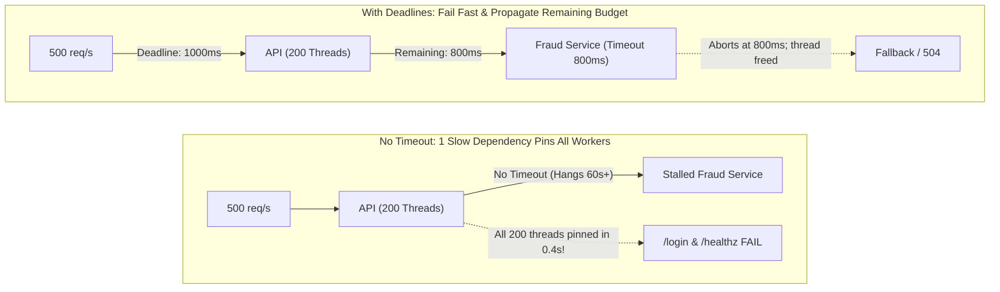
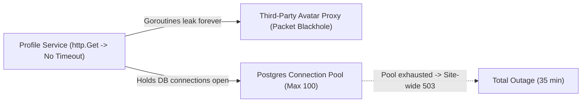

# Timeouts: Why One Missing Timeout Takes Down Your Whole Service

> **Prerequisites:** [Lesson 03: Error Budgets & Burn-Rate Alerts: Ship Fast Without Breaking SLOs](../03-error-budgets-burn-rate-alerts/README.md).  
> **Estimated Reading Time:** 23–27 minutes  
> **Target Audience:** Backend engineers writing HTTP/RPC/DB clients, and candidates asked "how does one slow downstream service cause a cascading outage?"  
> **Free PDF Notes:** [Download SD-K-004.pdf](https://backendroadmap.com/notes/system-design/SD-K-004.pdf)

> [!NOTE]
> **In one line:** A **timeout** puts a hard upper bound on how long a caller waits for a response. Without one, a stalled downstream dependency pins your threads, goroutines, or database connections indefinitely—turning a localized slowdown into **total thread-pool exhaustion** across your entire service via Little's Law ($L = \lambda W$).

> [!TIP]
> **The Golden Rule:** **Every** network call (HTTP, gRPC, SQL, Redis, DNS) must have an explicit **connect timeout**, **read/request timeout**, and **end-to-end deadline** propagated across hops—never rely on language defaults (which in Go's `http.DefaultClient`, Python's `requests`, and Node's `http` are often *infinite*).

---

## 1. What a Timeout Is, and What It Isn't

Your checkout service handles 500 req/s with 200 worker threads and a 10-ms average response time. A non-critical Fraud Check service stalls—not crashing with `500`, just hanging TCP connections open silently. Because your HTTP client has **no timeout**, every worker thread blocks forever waiting for Fraud Check. Within **0.4 seconds**, all 200 threads are pinned, and even `/healthz` and `/login` stop responding.

| Term | Precise Meaning | Example |
| :--- | :--- | :--- |
| **Connect timeout** | Max time to complete TCP + TLS handshake | `200 ms`–`1,000 ms` |
| **Read / Request timeout** | Max time to receive response bytes after connecting | `1,000 ms`–`3,000 ms` |
| **End-to-end deadline** | Absolute wall-clock timestamp by which the entire request must finish | `ctx.WithTimeout(2s)` propagated via gRPC/HTTP |
| **Idle / Keep-alive timeout** | Max time an unused pooled connection stays open | `60 s` (must be $<$ LB idle timeout) |
| **Socket /TCP half-open** | Downstream crashed without sending `FIN`/`RST`; caller waits forever | Caught only by read timeout or TCP keepalive |
| **Not** | A cancellation guarantee on the downstream server | The server may keep running unless it checks `ctx.Done()` |

### Why It Matters
1. **Slowness is deadlier than failure:** A fast `500` frees resources in 2 ms; a hanging connection holds a thread, memory buffer, and socket for minutes.
2. **Default clients are traps:** Go's `http.DefaultClient` and Python's `requests.get(url)` have **no timeout (`0` / `None`)** by default.
3. **Deadline propagation prevents wasted work:** If the user's browser gave up at 2s, your database shouldn't start a 10s query at 2.1s.

---

## 2. Anatomy: Cascading Thread Exhaustion vs Deadline Propagation



Notice two distinct mechanisms:
- **Local client timeout:** Bounds how long Service A waits on Service B.
- **Deadline propagation:** Service A passes its *remaining* time budget (e.g., `Grpc-Timeout: 800m` or `X-Request-Deadline`) to Service B, which passes remaining budget to Service C.

| Timeout Type | What It Protects Against | Typical Value |
| :--- | :--- | :---: |
| **Connect timeout** | Dropped SYN packets, dead hosts, blackholed IPs | 200 ms – 1 s |
| **Read / Per-try timeout** | Hung server, GC pauses, deadlocks | $2\times$–$3\times$ dependency $p_{99}$ |
| **Overall request deadline** | Retries + multi-hop chains exceeding user patience | 1 s – 5 s (API), 30 s (batch) |
| **Lock / Query timeout (DB)** | Unindexed query or lock contention piling up | 500 ms – 3 s (`statement_timeout`) |

> [!WARNING]
> **A client timeout does NOT automatically stop the server.** When the client closes the socket at `t = 1s`, the downstream server's SQL query or CPU loop keeps running unless the server actively listens for **cancellation signals** (`context.Context` in Go, `CancellationToken` in C#, `AbortSignal` in JS) and aborts its own work.

---

## 3. Mathematical Model: Little's Law & Saturation

**Little's Law** governs concurrency in any queueing system:

$$L = \lambda \times W$$

where:
- $L$ = average number of concurrent in-flight requests (threads/goroutines/connections needed)
- $\lambda$ = arrival rate (requests/second)
- $W$ = average response time (seconds)

**Why missing timeouts cause instant collapse:**
Suppose a service has $C = 200$ worker threads and receives $\lambda = 500\text{ req/s}$:
1. **Normal state ($W = 0.02\text{ s}$):**
   $$L = 500 \times 0.02 = \mathbf{10\text{ threads active}}$$
   (5% utilization—plenty of headroom).
2. **Downstream stalls ($W = 30\text{ s}$ OS/default TCP timeout):**
   $$L = 500 \times 30 = \mathbf{15{,}000\text{ threads needed}}$$
   Since you only have $C = 200$ threads, **100% saturation** is reached in:
   $$T_{\text{exhaust}} = \frac{C}{\lambda} = \frac{200}{500} = \mathbf{0.4\text{ seconds}}$$
3. **With a 500 ms timeout ($W_{\max} = 0.5\text{ s}$):**
   $$L_{\max} = 500 \times 0.5 = \mathbf{250\text{ threads}}$$
   Still tight, but paired with a **200 ms timeout** or load shedding, $L_{\max} = 500 \times 0.2 = 100 < 200$—keeping `/login` and `/healthz` alive!

**Hierarchical Timeout Budget:** For a serial chain $A \to B \to C$ with retries:

$$T_{\text{total}} \ge \sum_{i} (1 + R_i) \cdot T_{\text{try}, i} + \text{overhead}$$

Always ensure the outer deadline is **strictly greater** than the inner call's timeout (or propagate the outer deadline so inner calls shrink to fit).

---

## 4. Metrics & Percentiles

| Metric | Meaning | Alert when |
| :--- | :--- | :--- |
| **Upstream timeout rate** | % of outbound calls aborted by client timeout | $> 0.5\%$ sustained |
| **Worker pool / Connection pool saturation** | $\text{Active} / \text{Max}$ threads or DB connections | $> 80\%$ (approaching Little's Law cliff) |
| **Wait-queue depth** | Requests waiting for a free worker/connection | $> 0$ for $> 10\text{ s}$ |
| **Deadline exceeded (`504` / `DEADLINE_EXCEEDED`)** | Requests aborted due to end-to-end budget | Rising alongside downstream $p_{99}$ |
| **Cancelled work ratio** | Server requests aborted mid-flight by client disconnect | Spike indicates upstream timeouts too tight |

### Worked Example (Choosing a Timeout from $p_{99}$)
Your Payment Service has normal latency $p_{50} = 40\text{ ms}$, $p_{99} = 180\text{ ms}$, $p_{99.9} = 450\text{ ms}$.
- Setting timeout $= 100\text{ ms}$ is **too tight**: you will abort $> 1\%$ of healthy requests (and if retried, cause a retry storm!).
- Setting timeout $= 600\text{ ms}$ (just above $p_{99.9}$) aborts $< 0.1\%$ of healthy traffic while capping worst-case thread hold time to $0.6\text{ s}$.

---

## 5. Compounding: Timeout Mismatch & Zombie Work

What happens when **Client Timeout < Server Timeout** without cancellation propagation?
1. Client times out at **1s** and retries twice.
2. Server has a **10s** DB query timeout and ignores client disconnect.
3. Result: **3x duplicate expensive queries** run simultaneously on the database for a single user click—amplifying CPU/lock contention by 300% while the user already saw an error!

| Configuration | Client Wait | Server Work | Outcome |
| :--- | :---: | :---: | :--- |
| **No timeout** | Forever / OS TCP (~15m) | Forever | Total worker exhaustion in $< 1\text{ s}$ |
| **Client 1s, Server 30s (no propagation)** | 1s | 30s (x retries) | Zombie work exhausts DB |
| **Propagated Deadline (1s total)** | 1s | $\le 1\text{ s}$ (aborts on cancel) | Clean fast-fail, resources freed |

---

## 6. Numbers Every Engineer Must Know

| Item | Typical | Implication |
| :--- | :---: | :--- |
| **Go `http.DefaultClient` timeout** | **Infinite (`0`)** | Must always construct custom `&http.Client{Timeout: ...}` |
| **Python `requests` default timeout** | **Infinite (`None`)** | Always pass `timeout=(connect, read)` |
| **TCP SYN retransmission timeout (Linux)** | **~127 seconds** | Unreachable IP hangs for 2 minutes without connect timeout |
| **TCP read stall (no `SO_TIMEOUT`)** | **15+ minutes** | Dead peer without FIN/RST pins sockets indefinitely |
| **Connect timeout** | **200 ms – 1,000 ms** | TCP+TLS takes ~1–3 RTTs; $> 1\text{ s}$ means host is dead |
| **DB `statement_timeout` (OLTP)** | **1,000 ms – 5,000 ms** | Prevents one bad query from locking tables for hours |

---

## 7. Protocol / Mechanism Deep Dive: Deadline Propagation (gRPC / HTTP)

```mermaid
sequenceDiagram
    participant C as Mobile Client
    participant GW as API Gateway (Deadline: 2000ms)
    participant Ord as Order Service
    participant DB as Postgres (statement_timeout)
    C->>GW: POST /order
    GW->>Ord: POST /internal/order (X-Deadline: +1950ms)
    Note over Ord: Local work takes 150ms -> 1800ms left
    Ord->>DB: SET LOCAL statement_timeout = '1800ms'; INSERT...
    alt DB responds in 40ms
        DB-->>Ord: OK
        Ord-->>GW: 200 OK
        GW-->>C: 200 OK
    else DB stalls > 1800ms
        DB--xOrd: ERROR: canceling statement due to statement timeout
        Ord-->>GW: 504 Gateway Timeout
        GW-->>C: 504 Gateway Timeout
    end
```

| Question | Answer |
| :--- | :--- |
| **Why propagate *remaining duration* (`1800ms`) instead of an absolute timestamp?** | Clock skew between servers can be 100s of milliseconds; relative remaining duration (minus small network RTT) avoids clock-skew bugs. |
| **Should connect timeout equal read timeout?** | No! Connect timeout should be much shorter (e.g., 300 ms) since TCP/TLS handshake is fast, whereas read timeout covers actual server processing (e.g., 2,000 ms). |
| **Why must LB idle timeout > App keep-alive timeout (or vice versa)?** | If the app closes an idle pooled connection while the LB/server is simultaneously writing to it, you get intermittent `502 Bad Gateway` / `Connection reset` errors. Keep server idle timeout slightly *longer* than client pool idle timeout. |

**When NOT to use a short timeout:** Long-running batch jobs, large file uploads/downloads, or LLM streaming responses. For those, use **async job queues** (`202 Accepted` + polling/webhooks) or **idle-read timeouts** (reset timer on each received chunk) rather than a short total request timeout.

---

## 8. Hierarchical Budgets & Design Rules

| Slice | Rule | Control |
| :--- | :--- | :--- |
| **Every client** | Explicit connect + read + total timeout | Linter / CI check banning `http.DefaultClient` or `timeout=None` |
| **Propagation** | Pass remaining deadline in `context` / headers | gRPC `grpc-timeout`, HTTP `X-Request-Deadline` |
| **Database** | Set `statement_timeout` & `lock_timeout` | Prevent zombie queries and lock queues |
| **Sizing** | Set timeout at $2\times$–$3\times$ dependency $p_{99}$ | Avoids premature aborts on normal tail spikes |
| **Cancellation** | Check `ctx.Done()` / `CancellationToken` before heavy work | Stop zombie processing when caller leaves |

---

## 9. Top Mitigations

1. **Ban default HTTP/DB clients** via static analysis/linters; require explicit `ConnectTimeout`, `ReadTimeout`, and `TotalTimeout`.
2. **Propagate deadlines** across every RPC/HTTP hop and into SQL `statement_timeout`.
3. **Configure DB `lock_timeout` (e.g., 2s)** separately from `statement_timeout` so migrations or contended rows fail fast instead of piling up connections.
4. **Use streaming/chunk timeouts** for large payloads instead of giant total-request timeouts.
5. **Pair timeouts with Bulkheads** (Lesson 07) so even if a dependency hits its timeout, it only saturates *its* isolated pool, not the whole process.
6. **Test timeout behavior in staging** using chaos proxies (`toxiproxy`) that inject 30-second blackhole delays.

---

## 10. Production Reference / War Story: The Default `http.DefaultClient` Meltdown

A Go microservice handled user profile reads and optionally fetched avatar metadata from a third-party S3-backed proxy using `http.Get(url)` (which uses `http.DefaultClient` with **Timeout = 0 / infinite**).



- **Root Cause:** The third-party proxy suffered a silent routing blackhole (packets dropped, no TCP RST). Every `http.Get` goroutine blocked forever, holding an open DB connection from the shared pool.
- **Impact:** All 100 DB connections were exhausted in under 15 seconds, taking down login, checkout, and profile pages for 35 minutes.
- **Fix:** (1) Replaced `http.DefaultClient` with a custom client (`DialTimeout: 500ms`, `ResponseHeaderTimeout: 1s`, `Timeout: 2s`); (2) added `context.WithTimeout` everywhere; (3) released DB connections *before* making external HTTP calls.

---

## 11. Multi-Language Production Code Tabs

Properly configured HTTP clients with **connect timeout**, **read/total timeout**, and **deadline/cancellation propagation**.

````carousel
```go
// Go: production HTTP client with explicit Dial, TLS, ResponseHeader, and Context timeouts.
package main

import (
	"context"
	"fmt"
	"net"
	"net/http"
	"time"
)

func NewSafeHTTPClient() *http.Client {
	transport := &http.Transport{
		DialContext: (&net.Dialer{
			Timeout:   500 * time.Millisecond, // connect timeout
			KeepAlive: 30 * time.Second,
		}).DialContext,
		TLSHandshakeTimeout:   500 * time.Millisecond,
		ResponseHeaderTimeout: 1500 * time.Millisecond, // time to first byte
		IdleConnTimeout:       60 * time.Second,
	}
	return &http.Client{
		Transport: transport,
		Timeout:   2 * time.Second, // total hard cap (connect + headers + body)
	}
}

func CallDownstream(parentCtx context.Context, client *http.Client, url string) error {
	ctx, cancel := context.WithTimeout(parentCtx, 1200*time.Millisecond)
	defer cancel()

	req, err := http.NewRequestWithContext(ctx, http.MethodGet, url, nil)
	if err != nil {
		return err
	}
	resp, err := client.Do(req)
	if err != nil {
		return fmt.Errorf("downstream failed/timed out: %w", err)
	}
	defer resp.Body.Close()
	return nil
}
```
<!-- slide -->
```typescript
// TypeScript: fetch with AbortSignal.timeout + parent signal composition (Node 20+).
export async function fetchWithDeadline(
  url: string,
  timeoutMs = 1500,
  parentSignal?: AbortSignal
): Promise<Response> {
  const timeoutSignal = AbortSignal.timeout(timeoutMs);
  const combined = parentSignal
    ? AbortSignal.any([parentSignal, timeoutSignal])
    : timeoutSignal;

  try {
    return await fetch(url, { signal: combined });
  } catch (err) {
    if (err instanceof Error && err.name === "TimeoutError") {
      throw new Error(`Request to ${url} timed out after ${timeoutMs}ms`);
    }
    throw err;
  }
}
```
<!-- slide -->
```python
# Python: stdlib urllib with explicit socket timeout + remaining deadline propagation.
import time
import urllib.request
import socket

def fetch_with_deadline(url: str, deadline_epoch: float, connect_max_s: float = 0.5) -> bytes:
    remaining = deadline_epoch - time.monotonic()
    if remaining <= 0:
        raise TimeoutError("Deadline already expired before outbound call")
    timeout = min(remaining, connect_max_s + 1.5)
    try:
        with urllib.request.urlopen(url, timeout=timeout) as resp:
            return resp.read()
    except socket.timeout as exc:
        raise TimeoutError(f"Timed out calling {url} (budget={timeout:.2f}s)") from exc

if __name__ == "__main__":
    deadline = time.monotonic() + 2.0  # 2s end-to-end budget
    print(f"Budget initialized: {deadline - time.monotonic():.2f}s remaining")
```
<!-- slide -->
```csharp
// C#: HttpClient with SocketsHttpHandler connect timeout + CancellationTokenSource deadline.
using System;
using System.Net.Http;
using System.Threading;
using System.Threading.Tasks;

public sealed class SafeDownstreamClient
{
    private static readonly HttpClient Client = new(new SocketsHttpHandler
    {
        ConnectTimeout = TimeSpan.FromMilliseconds(500),
        PooledConnectionIdleTimeout = TimeSpan.FromSeconds(60)
    })
    {
        Timeout = TimeSpan.FromSeconds(5) // hard fallback cap
    };

    public static async Task<string> GetWithDeadlineAsync(string url, TimeSpan budget, CancellationToken ct)
    {
        using var cts = CancellationTokenSource.CreateLinkedTokenSource(ct);
        cts.CancelAfter(budget); // propagates cancellation if caller cancels OR budget expires
        using var resp = await Client.GetAsync(url, cts.Token);
        resp.EnsureSuccessStatusCode();
        return await resp.Content.ReadAsStringAsync(cts.Token);
    }
}
```
````

---

## 12. Hands-On CLI Verification Workflows

Verify Little's Law saturation and test real connect vs. read timeouts with `curl`:

```bash
# 1. Verify Little's Law saturation time in Python
python3 -c "
rps, threads = 500, 200
for w in [0.02, 0.2, 0.5, 30.0]:
    print(f'Latency {w:5.2f}s -> concurrent needed = {rps*w:7.1f} (pool={threads}, OK={rps*w <= threads})')
"

# 2. Test curl with separate connect timeout (1s) and total max-time (2s)
curl --connect-timeout 1 --max-time 2 -i https://httpbin.org/delay/5
# Expected: curl: (28) Operation timed out after 2000 milliseconds

# 3. Check PostgreSQL statement_timeout & lock_timeout settings
# psql -c "SHOW statement_timeout; SHOW lock_timeout;"
```

---

## 13. Common Mistakes to Avoid

1. **Using `http.DefaultClient` (Go) or `requests.get()` (Python) without explicit timeouts.**
2. **Confusing connect timeout with total request timeout** (a 1s connect timeout won't stop a 60s slow-body read).
3. **Setting a timeout shorter than $p_{99}$**, causing healthy tail requests to fail and retry.
4. **Ignoring deadline propagation**, letting the DB run 10s queries after the user disconnected at 2s.
5. **Holding a DB connection or mutex across an external HTTP call.**
6. **Setting `Client Timeout > Server Timeout` or vice versa carelessly** without matching cancellation.
7. **Forgetting DNS lookup timeouts** (some runtimes block on `getaddrinfo` synchronously).

---

## 14. Key Terms Glossary

| Key Term | Definition |
| :--- | :--- |
| **Connect timeout** | Maximum duration allowed to establish a TCP/TLS connection. |
| **Read timeout** | Maximum duration to wait for response bytes once connected. |
| **Deadline** | Absolute point in time by which an entire multi-hop operation must complete. |
| **Deadline propagation** | Forwarding remaining time budget across service boundaries. |
| **Little's Law** | $L = \lambda W$; concurrency equals arrival rate times average wait time. |
| **Thread-pool exhaustion** | Saturation of all worker threads due to blocked downstream calls. |
| **Zombie work** | Server computation continuing after the client has already timed out. |
| **Cancellation signal** | Mechanism (`ctx.Done()`, `AbortSignal`) notifying a server the caller left. |
| **`statement_timeout`** | PostgreSQL setting aborting queries exceeding a max duration. |
| **Half-open connection** | TCP socket where the remote peer vanished without sending `FIN`/`RST`. |

---

## 15. System Design Interview Questions & Answers

### Basic Conceptual Questions

<details>
<summary><strong>Q1: Why is a slow dependency often worse than a crashed dependency? [BASIC]</strong></summary>

**Answer:**
A crashed dependency returns `Connection Refused` or `500` in milliseconds, immediately freeing the caller's thread and socket. A slow or blackholed dependency pins the caller's threads, memory, and DB connections until timeout—exhausting the entire pool via Little's Law ($L = \lambda W$).
</details>

<details>
<summary><strong>Q2: What is the difference between a connect timeout and a read timeout? [BASIC]</strong></summary>

**Answer:**
A **connect timeout** bounds the TCP + TLS handshake (typically 200 ms–1 s). A **read timeout** bounds waiting for response data after the connection is established (typically $2\times$–$3\times$ $p_{99}$). Both are required.
</details>

<details>
<summary><strong>Q3: How does Little's Law explain timeout-induced outages? [BASIC]</strong></summary>

**Answer:**
$L = \lambda W$. At 500 req/s ($\lambda$), if latency ($W$) jumps from 20 ms to 30 s, concurrent threads needed ($L$) jump from 10 to 15,000—instantly saturating a 200-thread server in $200/500 = 0.4\text{ s}$.
</details>

<details>
<summary><strong>Q4: What is deadline propagation? [BASIC]</strong></summary>

**Answer:**
Passing the caller's remaining time budget across every downstream hop (e.g., via `grpc-timeout` or `X-Request-Deadline`), so inner services abort early instead of wasting CPU/DB resources after the outer caller has already timed out.
</details>

### Scenario-Based Architecture Questions

<details>
<summary><strong>Q5: Your service has 100 DB connections and makes an external HTTP call inside a DB transaction. What happens if the HTTP call stalls? [SCENARIO]</strong></summary>

**Answer:**
Every stalled HTTP call holds an open DB connection and row locks. All 100 DB connections exhaust rapidly, blocking unrelated queries and causing a site-wide outage. Fix: never hold DB transactions/connections across network calls, and enforce strict HTTP timeouts.
</details>

<details>
<summary><strong>Q6: How do you choose the right timeout value for a downstream payment API? [SCENARIO]</strong></summary>

**Answer:**
Measure its latency distribution. Set the per-attempt timeout slightly above $p_{99.9}$ (e.g., if $p_{99} = 400\text{ ms}$ and $p_{99.9} = 900\text{ ms}$, set ~1,200 ms) so you don't abort healthy tail traffic, while capping worst-case thread hold time.
</details>

<details>
<summary><strong>Q7: A client times out at 1s and retries twice, yet your database CPU spikes to 100%. Why? [SCENARIO]</strong></summary>

**Answer:**
The server isn't propagating cancellation to the database. Each 1s client timeout leaves the old DB query running as "zombie work," and the 2 retries launch two more identical queries—tripling DB load during an already degraded state.
</details>

<details>
<summary><strong>Q8: How do you handle an operation that legitimately takes 45 seconds (e.g., PDF report generation)? [SCENARIO]</strong></summary>

**Answer:**
Don't raise your API gateway timeout to 60s (which risks thread exhaustion). Instead, switch to an **asynchronous pattern**: accept the request immediately (`202 Accepted` + `job_id`), enqueue it to a worker, and let the client poll or receive a webhook.
</details>

### Advanced & Tricky Interview Questions

<details>
<summary><strong>Q9: Why should you propagate *remaining duration* instead of an *absolute UTC timestamp* for deadlines? [TRICKY]</strong></summary>

**Answer:**
Servers experience NTP clock drift/skew. If Server B's clock is 2 seconds ahead of Server A's, an absolute timestamp sent by A looks already expired to B, causing instant false `504` errors. Relative remaining duration (accounting for ~1–5 ms network RTT) avoids clock-skew bugs.
</details>

<details>
<summary><strong>Q10: Why can `http.Client.Timeout` in Go still allow a goroutine leak if used carelessly? [TRICKY]</strong></summary>

**Answer:**
Even with `Client.Timeout`, if you forget `defer resp.Body.Close()` or fail to drain/cancel the `context`, underlying TCP connections can't be reused and leak file descriptors. Always `defer resp.Body.Close()` and pass `context.WithTimeout`.
</details>

<details>
<summary><strong>Q11: What happens when a Load Balancer's idle timeout is 60s and your App Server's keep-alive timeout is 55s? [TRICKY]</strong></summary>

**Answer:**
Race condition: at 55s the app sends a TCP `FIN` to close the idle socket at the exact millisecond the LB forwards a new request down that socket—producing sporadic `502 Bad Gateway` errors. Always set the backend keep-alive timeout **longer** than the LB's idle timeout (e.g., 65s vs 60s).
</details>

<details>
<summary><strong>Q12: How do timeouts interact with retries and circuit breakers? [TRICKY]</strong></summary>

**Answer:**
Timeouts bound *each attempt* ($T_{\text{try}}$); retries multiply total wait time ($N \times T_{\text{try}}$) and must fit inside the outer deadline; and repeated timeouts count as failures that trip the **circuit breaker** (Lesson 06) to stop sending traffic altogether.
</details>

---

## 16. One-Page Master Cheat Sheet

```
+---------------------------------------------------------------------------------------------------------+
|                           TIMEOUTS — MASTER CHEAT SHEET                                                 |
+---------------------------------------------------------------------------------------------------------+
| 1. LITTLE'S LAW: L = lambda * W. Unbounded W -> L explodes -> 100% pool exhaustion in < 1 second.       |
+---------------------------------------------------------------------------------------------------------+
| 2. NEVER USE DEFAULTS: Go http.DefaultClient & Python requests default to INFINITE timeout.             |
+---------------------------------------------------------------------------------------------------------+
| 3. THREE TIMEOUTS: Connect (200ms-1s) + Read (2-3x p99) + End-to-End Deadline (propagated across hops). |
+---------------------------------------------------------------------------------------------------------+
| 4. STOP ZOMBIE WORK: Check ctx.Done() / CancellationToken and set DB statement_timeout + lock_timeout.  |
+---------------------------------------------------------------------------------------------------------+
| 5. KEEP-ALIVE RULE: Backend keep-alive timeout > Load Balancer idle timeout (prevents 502 races).       |
+---------------------------------------------------------------------------------------------------------+
| 6. LONG WORK (> 5s): Don't raise HTTP timeouts; return 202 Accepted and process via async queue.         |
+---------------------------------------------------------------------------------------------------------+
```

---

## Further Reading & Sources

- Marc Brooker (AWS Builders' Library), [Timeouts, Retries, and Backoff with Jitter](https://aws.amazon.com/builders-library/timeouts-retries-and-backoff-with-jitter/).
- Google SRE Book, Chapter 21: "Handling Overload" & "Client-Side Throttling / Deadlines".
- Michael Nygard, *Release It!* (Pragmatic Bookshelf), Chapter 5: "Timeouts".
- Cloudflare Blog, [The Complete Guide to Go net/http Timeouts](https://blog.cloudflare.com/the-complete-guide-to-golang-net-http-timeouts/).

---

## Free PDF Notes

[SD-K-004.pdf](https://backendroadmap.com/notes/system-design/SD-K-004.pdf)

---

## Next

Continue with [Lesson 05: Retry Storms: Backoff, Jitter, Retry Budgets & the 27x Problem](../05-retry-storms/README.md): preventing well-meaning retries from DDoSing your own backend.
