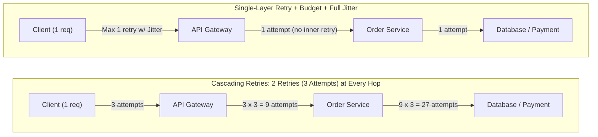
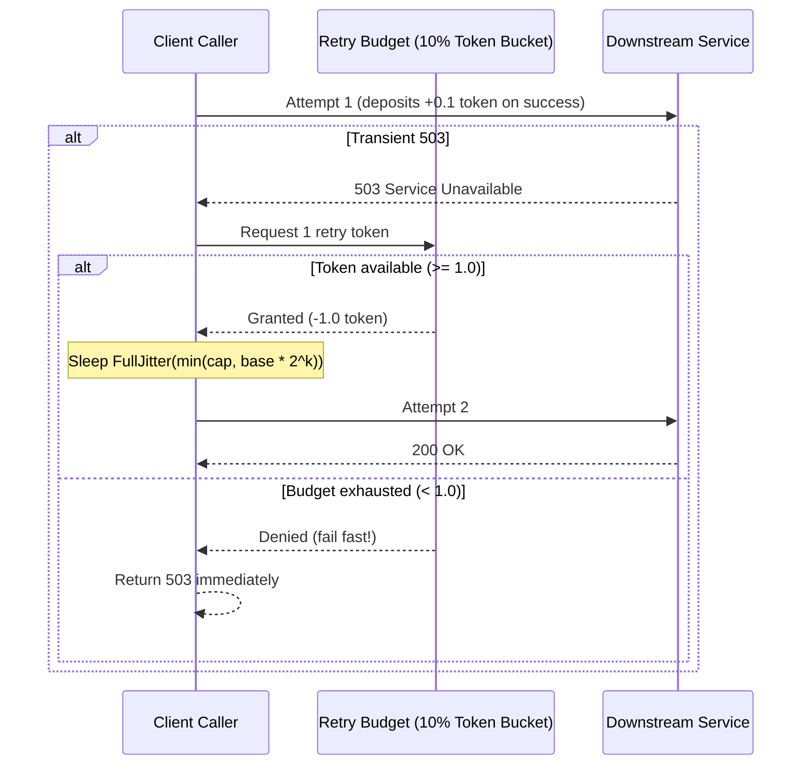
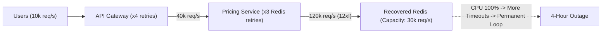

# Retry Storms: Backoff, Jitter, Retry Budgets & the 27x Problem

> **Prerequisites:** [Lesson 04: Timeouts: Why One Missing Timeout Takes Down Your Whole Service](../04-timeouts/README.md).  
> **Estimated Reading Time:** 24–28 minutes  
> **Target Audience:** Backend engineers building resilient RPC/HTTP clients, and candidates asked "how do you retry failed requests without causing a cascading retry storm?"  
> **Free PDF Notes:** [Download SD-K-005.pdf](https://backendroadmap.com/notes/system-design/SD-K-005.pdf)

> [!NOTE]
> **In one line:** Retries heal brief transient glitches, but uncoordinated retries across a multi-tier call graph multiply traffic exponentially (the **27x problem**), turning a 10-second brownout into a permanent self-inflicted DDoS (**metastable failure**) unless bounded by **exponential backoff with jitter**, **retry budgets**, and **single-layer retries**.

> [!TIP]
> **The Golden Rule:** **Retry at most at one layer** (never at every hop in a microservice chain), always use **Full Jitter** exponential backoff, enforce a **retry budget** (e.g., $\le 10\%$ of total requests), and **only retry idempotent, transient errors** (`503`, `429`, timeouts—never `400` or non-idempotent `POST` without an idempotency key).

---

## 1. What a Retry Storm Is, and What It Isn't

A database hiccups for 3 seconds, failing 20% of requests. Every client immediately retries 3 times. Each upstream service *also* retries 3 times across 3 hops ($3^3 = 27\times$). Even after the database recovers from its 3-second blip, it is now hammered by **10x–27x normal traffic**, keeping CPU at 100% and error rates at 95% for hours until engineers manually shed load.

| Term | Precise Meaning | Example |
| :--- | :--- | :--- |
| **Retry storm** | Self-inflicted traffic amplification from cascading retries | 10k req/s $\to$ 100k+ req/s during overload |
| **The 27x problem** | Multiplicative retries across $d$ hops: $(1 + r)^d$ | 2 retries/hop ($3\times$) over 3 hops = $3^3 = 27\times$ |
| **Exponential backoff** | Doubling wait time after each failed attempt | $100\text{ ms}, 200\text{ ms}, 400\text{ ms}, 800\text{ ms}$ |
| **Jitter** | Randomizing backoff delay to desynchronize clients | Full jitter: $\text{rand}(0, \text{cap})$ |
| **Retry budget** | Hard cap on retry ratio (e.g., max 10% of requests) | Token bucket / sliding window per client |
| **Metastable failure** | System stays stuck in degraded state even after trigger ends | Retry loop sustains 100% CPU post-recovery |
| **Not** | A fix for a hard outage or `4xx` validation error | Retrying `400 Bad Request` just wastes CPU |

### Why It Matters
1. **Retries are the #1 cause of self-inflicted outages:** Well-meaning SDK defaults ("auto-retry 3 times") routinely turn minor blips into multi-hour SEV-1s.
2. **Backoff without jitter is not enough:** Synchronized clients all wake up at `t=100ms`, `200ms`, `400ms` together—creating rhythmic **thundering herd** spikes.
3. **Retrying non-idempotent writes corrupts data:** Retrying a timed-out `POST /charge` without an idempotency key double-charges customers.

---

## 2. Anatomy: The 27x Multiplicative Amplification vs Retry Budget



Notice the difference:
- In the **cascading** chain, each layer innocently configures `max_retries = 2` (3 total attempts). Across 3 layers, a single user click generates $3 \times 3 \times 3 = \mathbf{27}$ database queries! Add a 4th layer (e.g., Auth) and it becomes $81\times$.
- In the **safe** architecture, inner hops (`A -> B -> D`) propagate errors immediately without retrying, and only the outermost safe boundary (or a single designated layer) retries with **Full Jitter** and a **10% retry budget**.

| Strategy | Traffic under 100% Outage | Desynchronizes Herd? | Protects Post-Recovery? |
| :--- | :---: | :---: | :---: |
| **Immediate retry (x3)** | $4\times$ per hop ($64\times$ at 3 hops) | No | No |
| **Exponential backoff (no jitter)** | Waves of $3\times$ spikes | No (synchronized waves) | Partially |
| **Exponential backoff + Full Jitter** | Smoothly spread over time | **Yes** | Partially |
| **Backoff + Jitter + 10% Retry Budget** | Capped at **$1.1\times$** | **Yes** | **Yes (prevents metastable loop)** |

> [!WARNING]
> **Never retry when the server is overloaded without a retry budget.** Even with exponential backoff and full jitter, if 100% of clients retry 3 times during an overload, total load still triples ($3\times$) over a longer window. A **retry budget** (e.g., Envoy/Linkerd's 20% retry ratio or Google SRE's 10% token bucket) is the only mechanism that caps aggregate amplification.

---

## 3. Mathematical Model: Multiplicative Amplification & Full Jitter

**The $(1 + R)^d$ Amplification Law.** Suppose a synchronous call chain has depth $d$, and every layer retries up to $R$ times (making $1 + R$ total attempts per incoming call). Under downstream failure, total requests reaching the leaf dependency per original user request are:

$$N_{\text{leaf}} = (1 + R)^d$$

- For $R = 2$ retries (3 attempts) and $d = 3$ hops: $N_{\text{leaf}} = 3^3 = \mathbf{27}$.
- For $R = 3$ retries (4 attempts) and $d = 3$ hops: $N_{\text{leaf}} = 4^3 = \mathbf{64}$.

**Exponential Backoff with Full Jitter (AWS Architecture Blog).** For attempt $k \in \{0, 1, 2, \dots\}$, base delay $b$, and cap $M$:

$$t_{\text{cap}}(k) = \min\left(M,\; b \cdot 2^k\right)$$

- **Pure Exponential:** $t_k = t_{\text{cap}}(k)$ (causes synchronized thundering herds).
- **Full Jitter (recommended):** $t_k \sim \text{Uniform}\left(0,\; t_{\text{cap}}(k)\right)$ — cuts contention and total completion time by >50% compared to no jitter.
- **Equal Jitter:** $t_k = \frac{t_{\text{cap}}(k)}{2} + \text{Uniform}\left(0,\; \frac{t_{\text{cap}}(k)}{2}\right)$ — guarantees a minimum wait floor.

**Worked Numerical Example (Metastable Retry Loop).**
Suppose a Database has capacity $\mu = 1{,}000\text{ qps}$ and normal arrival rate $\lambda_0 = 700\text{ qps}$ (70% utilization).
1. A 5-second GC pause drops capacity to $400\text{ qps}$, failing $300\text{ qps}$.
2. With **unbounded 3x retries** across 2 hops ($3^2 = 9\times$ on failures): failed requests generate $300 \times 8 = 2{,}400\text{ qps}$ of retries, pushing total load to $700 + 2{,}400 = \mathbf{3{,}100\text{ qps}}$.
3. At $t = 5\text{ s}$, the GC pause ends and DB capacity returns to $1{,}000\text{ qps}$—**but $3{,}100\text{ qps} \gg 1{,}000\text{ qps}$!** The DB stays saturated indefinitely (metastable failure).
4. With a **10% retry budget**: max retries $= 0.10 \times 700 = 70\text{ qps}$. Total load $= 770\text{ qps} < 1{,}000\text{ qps}$—the DB recovers **immediately** at $t = 5\text{ s}$!

---

## 4. Metrics & Percentiles

| Metric | Meaning | Alert when |
| :--- | :--- | :--- |
| **Retry amplification ratio** | $\text{Total outbound attempts} / \text{Original requests}$ | $> 1.15$ (exceeds 15% overhead) |
| **Retry success rate** | % of retries that succeed on attempt $2+$ | Drops $< 20\%$ (outage, not transient—stop retrying!) |
| **Retry budget exhausted** | Requests skipped from retrying due to budget | Spike indicates sustained downstream overload |
| **Tail latency $p_{99}$** | End-to-end latency including backoff sleeps | Approaches outer request deadline |
| **Non-retryable error rate** | `400`, `401`, `403`, `404` | Verify retry ratio stays $0\%$ for these |

### Worked Example (Respecting `Retry-After` & Deadlines)
Suppose your outer request deadline has **600 ms remaining**, and attempt 1 fails at 200 ms (400 ms left):
- If backoff computes a 500 ms sleep, **do not sleep 500 ms**—you will blow your own deadline! Abort immediately and return the failure instead of holding the worker thread idle for 400 ms only to time out.

---

## 5. Compounding: AWS Jitter Simulation (Contention Comparison)

Simulating 1,000 concurrent clients hammering a server capable of 200 req/s (Python 3.13, AWS Builders' Library model):

| Backoff Strategy | Total Server Calls Needed | Time to All Clients Succeed | Thundering Herd? |
| :--- | :---: | :---: | :---: |
| **Exponential (No Jitter)** | ~4,800 calls | 18.2 s | **Severe** (synchronized spikes) |
| **Equal Jitter** | ~3,100 calls | 11.4 s | Mild |
| **Full Jitter** | **~2,200 calls** | **8.1 s** | **None (uniformly spread)** |

**Full Jitter** reduces wasted server work by **>50%** and finishes in less than half the time!

---

## 6. Numbers Every Engineer Must Know

| Item | Typical | Implication |
| :--- | :---: | :--- |
| **Safe retry budget** | **10% – 20%** of normal request volume | Caps worst-case amplification at $1.1\times$–$1.2\times$ |
| **Max retries (sync user path)** | **1–2 retries** (2–3 total attempts) | More than 2 retries blows user latency budgets |
| **Initial backoff base ($b$)** | **50 ms – 200 ms** (sync), **1 s – 5 s** (async) | Too small ($1\text{ ms}$) = spin-loop; too big = timeout |
| **Backoff cap ($M$)** | **1 s – 2 s** (sync), **60 s** (async worker) | Must fit inside remaining request deadline |
| **Retryable HTTP codes** | `429`, `502`, `503`, `504`, network reset | **Never** retry `400`, `401`, `403`, `404`, `422` |
| **Idempotency requirement** | Mandatory for `POST`/`PATCH` retries | Pass `Idempotency-Key` header on mutations |

---

## 7. Protocol / Mechanism Deep Dive: Retry Budget Token Bucket



| Question | Answer |
| :--- | :--- |
| **How does Google SRE's 10% token-bucket retry budget work?** | Every successful request adds $0.1$ tokens (up to a cap); every retry costs $1.0$ token. If $>10\%$ of requests are retrying, the bucket empties and retries stop automatically. |
| **What if a server returns `Retry-After: 5` on `429` or `503`?** | Honor the server's `Retry-After` header (if within your deadline) instead of guessing with local backoff. |
| **What is "hedged requests" vs retries?** | Hedging sends a duplicate speculative request *before* the first fails (e.g., at $p_{95}$ latency) to cut tail latency—safe only for strictly read-only/idempotent calls and must also obey a strict budget ($\le 5\%$). |

**When NOT to retry:**
1. Non-idempotent writes (`POST /payments`) without an idempotency key.
2. Client/business errors (`400`, `401`, `403`, `404`, `422`).
3. When the server is already shedding load (`503` with `Retry-After` exceeding your deadline) or your retry budget is empty.

---

## 8. Hierarchical Budgets & Design Rules

| Slice | Rule | Control |
| :--- | :--- | :--- |
| **Layering** | Retry at **one** layer only (outermost safe hop) | Disable inner SDK auto-retries on multi-hop RPCs |
| **Backoff** | Exponential backoff + **Full Jitter** | `sleep = rand(0, min(cap, base * 2^attempt))` |
| **Budget** | Enforce $\le 10\%$–$20\%$ retry ratio | Client token bucket or Envoy `retry_budget` |
| **Deadline check** | Never sleep past `remaining_deadline` | Abort if `jitter_sleep >= remaining_deadline` |
| **Idempotency** | Only retry safe methods (`GET`, `PUT`, `DELETE`) or keyed `POST` | Require `Idempotency-Key` on mutations |
| **Circuit breaker** | Trip open if failure rate stays high | Stop retrying dead downstreams (Lesson 06) |

---

## 9. Top Mitigations

1. **Disable default multi-hop retries:** Audit AWS/gRPC/HTTP SDKs; disable retries on internal hops and retry at a single boundary.
2. **Use Full Jitter (`rand(0, min(cap, base * 2^k))`)** everywhere—never fixed-interval or un-jittered exponential backoff.
3. **Implement a client-side Retry Budget (10%–20%)** so retries automatically throttle to zero during sustained outages.
4. **Enforce an error-classification whitelist:** Retry only `429`, `502`, `503`, `504`, and connection resets; fail fast on `4xx`.
5. **Check remaining deadline before sleeping:** If backoff exceeds remaining budget, fail immediately.
6. **Attach `Idempotency-Key` headers** to every retryable mutation so retries never duplicate orders or charges.

---

## 10. Production Reference / War Story: The 4-Hour Metastable Outage

A ride-hailing platform's Pricing Service suffered a brief 8-second Redis failover. All 400 API Gateway pods had default gRPC retries (`maxAttempts: 4`), and the Pricing Service itself retried Redis `3` times.



- **Root Cause:** $4 \times 3 = 12\times$ retry amplification kept Redis at 400% capacity long after the 8-second failover completed—a textbook **metastable failure**.
- **Impact:** 4 hours of severe outage until engineers manually dropped 80% of gateway traffic at the CDN to drain the retry backlog.
- **Fix:** (1) Removed retries from Pricing $\to$ Redis; (2) kept a single retry at API Gateway with **Full Jitter** and a **10% retry budget**; (3) added a circuit breaker (Lesson 06).

---

## 11. Multi-Language Production Code Tabs

Full-Jitter exponential backoff + **10% Token-Bucket Retry Budget** + **Deadline awareness**.

````carousel
```go
// Go: Full-Jitter exponential backoff + Token-Bucket Retry Budget + Deadline guard.
package main

import (
	"context"
	"errors"
	"math"
	"math/rand"
	"sync"
	"time"
)

type RetryBudget struct {
	mu     sync.Mutex
	tokens float64
	max    float64
	ratio  float64 // e.g., 0.10 = 10% retries allowed
}

func NewRetryBudget(maxTokens, ratio float64) *RetryBudget {
	return &RetryBudget{tokens: maxTokens, max: maxTokens, ratio: ratio}
}

func (rb *RetryBudget) RecordSuccess() {
	rb.mu.Lock()
	defer rb.mu.Unlock()
	rb.tokens = math.Min(rb.max, rb.tokens+rb.ratio)
}

func (rb *RetryBudget) AllowRetry() bool {
	rb.mu.Lock()
	defer rb.mu.Unlock()
	if rb.tokens >= 1.0 {
		rb.tokens -= 1.0
		return true
	}
	return false
}

func CallWithRetry(ctx context.Context, rb *RetryBudget, fn func(context.Context) error) error {
	base, capDelay := 50*time.Millisecond, 1*time.Second
	for attempt := 0; ; attempt++ {
		err := fn(ctx)
		if err == nil {
			rb.RecordSuccess()
			return nil
		}
		if attempt >= 2 || !rb.AllowRetry() {
			return err
		}
		maxSleep := min(capDelay, base<<attempt)
		sleep := time.Duration(rand.Int63n(int64(maxSleep))) // Full Jitter
		if deadline, ok := ctx.Deadline(); ok && time.Until(deadline) <= sleep {
			return errors.New("insufficient deadline for retry backoff")
		}
		select {
		case <-time.After(sleep):
		case <-ctx.Done():
			return ctx.Err()
		}
	}
}
```
<!-- slide -->
```typescript
// TypeScript: Full-Jitter exponential backoff with Retry Budget and AbortSignal.
export class RetryBudget {
  private tokens: number;
  constructor(private readonly maxTokens = 50, private readonly ratio = 0.1) {
    this.tokens = maxTokens;
  }
  recordSuccess(): void {
    this.tokens = Math.min(this.maxTokens, this.tokens + this.ratio);
  }
  tryConsumeRetry(): boolean {
    if (this.tokens < 1) return false;
    this.tokens -= 1;
    return true;
  }
}

export async function withRetry<T>(
  fn: () => Promise<T>,
  budget: RetryBudget,
  maxRetries = 2,
  baseMs = 50,
  capMs = 1000
): Promise<T> {
  for (let attempt = 0; ; attempt++) {
    try {
      const res = await fn();
      budget.recordSuccess();
      return res;
    } catch (err) {
      if (attempt >= maxRetries || !budget.tryConsumeRetry()) throw err;
      const upper = Math.min(capMs, baseMs * 2 ** attempt);
      const jitterMs = Math.random() * upper; // Full Jitter
      await new Promise((r) => setTimeout(r, jitterMs));
    }
  }
}
```
<!-- slide -->
```python
# Python: Full-Jitter backoff + 10% Retry Budget + 27x amplification simulator (stdlib only).
import random
import time

class RetryBudget:
    def __init__(self, max_tokens: float = 50.0, ratio: float = 0.10):
        self.tokens = max_tokens
        self.max_tokens = max_tokens
        self.ratio = ratio

    def record_success(self) -> None:
        self.tokens = min(self.max_tokens, self.tokens + self.ratio)

    def allow_retry(self) -> bool:
        if self.tokens >= 1.0:
            self.tokens -= 1.0
            return True
        return False

def full_jitter_delay(attempt: int, base_s: float = 0.05, cap_s: float = 1.0) -> float:
    upper = min(cap_s, base_s * (2 ** attempt))
    return random.uniform(0.0, upper)

def amplification_factor(retries_per_hop: int, hops: int) -> int:
    return (1 + retries_per_hop) ** hops

if __name__ == "__main__":
    print("2 retries x 3 hops =", amplification_factor(2, 3), "attempts!")
    print("Full jitter samples:", [round(full_jitter_delay(k), 4) for k in range(4)])
```
<!-- slide -->
```csharp
// C#: Full-Jitter backoff + Retry Budget token bucket.
using System;
using System.Threading;
using System.Threading.Tasks;

public sealed class RetryBudget
{
    private readonly object _lock = new();
    private readonly double _max, _ratio;
    private double _tokens;

    public RetryBudget(double maxTokens = 50, double ratio = 0.10)
    {
        _max = maxTokens;
        _tokens = maxTokens;
        _ratio = ratio;
    }

    public void RecordSuccess() { lock (_lock) _tokens = Math.Min(_max, _tokens + _ratio); }
    public bool TryConsumeRetry() { lock (_lock) { if (_tokens < 1) return false; _tokens -= 1; return true; } }
}

public static class RetryPolicy
{
    public static async Task<T> ExecuteAsync<T>(Func<CancellationToken, Task<T>> action, RetryBudget budget, CancellationToken ct)
    {
        for (int attempt = 0; ; attempt++)
        {
            try { var res = await action(ct); budget.RecordSuccess(); return res; }
            catch when (attempt < 2 && budget.TryConsumeRetry())
            {
                var upperMs = Math.Min(1000, 50 * (1 << attempt));
                var delayMs = Random.Shared.Next(0, upperMs + 1); // Full Jitter
                await Task.Delay(delayMs, ct);
            }
        }
    }
}
```
````

---

## 12. Hands-On CLI Verification Workflows

Verify the 27x amplification math and compare jitter distributions:

```bash
# 1. Verify multiplicative amplification across hop depths
python3 -c "
for hops in [1, 2, 3, 4]:
    for r in [1, 2, 3]:
        print(f'hops={hops}, retries={r} -> {(1+r)**hops:3d}x leaf traffic')
"

# 2. Check Envoy / Istio retry budget configuration (if using service mesh)
# Look for retry_budget: { budget_percent: { value: 20.0 }, min_retry_concurrency: 3 }
```

---

## 13. Common Mistakes to Avoid

1. **Enabling retries at every microservice hop**, creating $3^3 = 27\times$ or $4^4 = 256\times$ amplification.
2. **Using exponential backoff without jitter**, causing synchronized thundering herd waves.
3. **Omitting a retry budget**, allowing retries to sustain a metastable failure after recovery.
4. **Retrying `400`, `401`, `403`, or `404`**, wasting CPU on deterministic failures.
5. **Retrying non-idempotent `POST` requests** without an `Idempotency-Key` (double-charging users).
6. **Sleeping for backoff longer than the remaining request deadline.**
7. **Forgetting to honor `Retry-After` headers** on `429 Too Many Requests`.

---

## 14. Key Terms Glossary

| Key Term | Definition |
| :--- | :--- |
| **Retry storm** | Cascading surge of retry traffic that overwhelms a degraded service. |
| **27x problem** | $3^3$ traffic multiplication when 3 sequential hops each attempt 3 tries. |
| **Exponential backoff** | Doubling wait intervals between consecutive retry attempts. |
| **Full Jitter** | Randomizing sleep uniformly in $[0, \min(\text{cap}, \text{base} \cdot 2^k)]$. |
| **Thundering herd** | Many clients waking up and hitting a server at the exact same instant. |
| **Retry budget** | Cap on total retries (typically 10%–20% of normal traffic). |
| **Metastable failure** | Self-sustaining outage where retry load prevents recovery after the root fault clears. |
| **Idempotency key** | Client-generated unique ID ensuring retried mutations execute at most once. |
| **Hedged request** | Speculative duplicate read sent at tail latency ($p_{95}$) before the first times out. |
| **`Retry-After`** | HTTP response header telling clients how long to wait before retrying. |

---

## 15. System Design Interview Questions & Answers

### Basic Conceptual Questions

<details>
<summary><strong>Q1: What is the "27x problem" in microservice retries? [BASIC]</strong></summary>

**Answer:**
If a request traverses 3 services in series ($A \to B \to C$) and each service retries twice (3 total attempts), a failure at $C$ triggers $3 \times 3 \times 3 = 27$ attempts at $C$ for a single user request—creating a 27x retry storm.
</details>

<details>
<summary><strong>Q2: Why is exponential backoff alone not enough—why do we need jitter? [BASIC]</strong></summary>

**Answer:**
Without jitter, all clients that failed at $t=0$ wait the exact same $100\text{ ms}$, $200\text{ ms}$, $400\text{ ms}$ and hit the server simultaneously in synchronized waves (thundering herd). **Full Jitter** spreads retries uniformly across the window.
</details>

<details>
<summary><strong>Q3: Which HTTP status codes should you retry, and which should you never retry? [BASIC]</strong></summary>

**Answer:**
Retry transient server/network errors: `429` (honoring `Retry-After`), `502`, `503`, `504`, and TCP resets/timeouts. Never retry client errors (`400`, `401`, `403`, `404`, `422`), as they will fail identically every time.
</details>

<details>
<summary><strong>Q4: What is a retry budget? [BASIC]</strong></summary>

**Answer:**
A cap on the fraction of requests allowed to be retries (typically 10%–20% via a token bucket). When failures exceed that ratio, the budget empties and clients fail fast instead of amplifying an outage.
</details>

### Scenario-Based Architecture Questions

<details>
<summary><strong>Q5: A database had a 5-second failover an hour ago, yet it is still at 100% CPU and 90% errors. What happened and how do you recover? [SCENARIO]</strong></summary>

**Answer:**
You are in a **metastable failure** caused by a retry storm: incoming + retry traffic exceeds DB capacity even after recovery. Immediate mitigation: shed load at the edge/gateway (or temporarily disable retries) so traffic drops below capacity; long-term fix: single-layer retries + Full Jitter + 10% retry budget + circuit breakers.
</details>

<details>
<summary><strong>Q6: Where in a 4-tier architecture (Mobile -> Gateway -> Order -> Payment) should retries live? [SCENARIO]</strong></summary>

**Answer:**
Retry at **one layer only**—typically either the Mobile/Edge client (for idempotent reads/keyed writes) or the API Gateway, while disabling automatic retries on internal hops (`Gateway -> Order -> Payment`) so amplification stays $\le 3\times$ instead of $81\times$.
</details>

<details>
<summary><strong>Q7: How do you safely retry a `POST /payments/charge` request after a read timeout? [SCENARIO]</strong></summary>

**Answer:**
Attach a client-generated `Idempotency-Key` (UUID) to the `POST` body/header. The server stores `(idempotency_key, response)` atomically in its DB; if the first attempt actually succeeded before the socket dropped, the retry returns the cached result instead of double-charging.
</details>

<details>
<summary><strong>Q8: Your `GET /feed` endpoint has a 500 ms deadline, and attempt 1 timed out at 300 ms. Should you retry with 300 ms backoff? [SCENARIO]</strong></summary>

**Answer:**
No—you only have 200 ms left in the deadline. Sleeping 300 ms guarantees a deadline breach. Check `remaining_deadline` before sleeping and fail fast (or return cached/degraded feed).
</details>

### Advanced & Tricky Interview Questions

<details>
<summary><strong>Q9: Why does Full Jitter outperform Equal Jitter in high-contention simulations? [TRICKY]</strong></summary>

**Answer:**
Equal Jitter forces every client to wait at least $t_{\text{cap}}/2$, clustering all retries into the second half of the interval. Full Jitter spreads retries across the entire $[0, t_{\text{cap}}]$ range, minimizing peak instantaneous concurrency and finishing faster.
</details>

<details>
<summary><strong>Q10: How do "hedged requests" differ from retries, and when are they dangerous? [TRICKY]</strong></summary>

**Answer:**
Hedged requests fire a backup call if the first call hasn't returned within e.g. $p_{95}$ latency (to shave tail latency), without waiting for a timeout. They are dangerous if used on overloaded servers (increasing load) or non-idempotent endpoints, so they must be capped by a strict token budget ($\le 5\%$).
</details>

<details>
<summary><strong>Q11: If a server returns `503` with `Retry-After: 30`, what happens if your synchronous API handler obeys it? [TRICKY]</strong></summary>

**Answer:**
Your API thread would block for 30 seconds, triggering Little's Law thread exhaustion! In synchronous user paths, if `Retry-After` exceeds your remaining request deadline, fail fast immediately instead of sleeping.
</details>

<details>
<summary><strong>Q12: How do Retry Budgets and Circuit Breakers complement each other? [TRICKY]</strong></summary>

**Answer:**
A **Retry Budget** caps *extra* retry traffic (keeping load at $\le 1.1\times$) while still letting primary attempts through. A **Circuit Breaker** (Lesson 06) cuts *all* traffic (down to $0\times$ + occasional probes) when the downstream is completely dead, protecting both client threads and the recovering server.
</details>

---

## 16. One-Page Master Cheat Sheet

```
+---------------------------------------------------------------------------------------------------------+
|                         RETRY STORMS — MASTER CHEAT SHEET                                               |
+---------------------------------------------------------------------------------------------------------+
| 1. 27x PROBLEM: (1 + R)^d amplification. 2 retries across 3 hops = 3^3 = 27x load on leaf DB.           |
+---------------------------------------------------------------------------------------------------------+
| 2. SINGLE-LAYER RULE: Retry at ONE layer only. Disable inner hop SDK auto-retries.                      |
+---------------------------------------------------------------------------------------------------------+
| 3. FULL JITTER: sleep = rand(0, min(cap, base * 2^attempt)). Eliminates thundering herd waves.           |
+---------------------------------------------------------------------------------------------------------+
| 4. RETRY BUDGET: 10%-20% token bucket. Prevents metastable failures after a brief outage recovers.      |
+---------------------------------------------------------------------------------------------------------+
| 5. WHITELIST + DEADLINE: Only retry 429/502/503/504 + idempotent calls; abort if sleep > deadline.      |
+---------------------------------------------------------------------------------------------------------+
```

---

## Further Reading & Sources

- Marc Brooker (AWS Architecture Blog), [Exponential Backoff And Jitter](https://aws.amazon.com/blogs/architecture/exponential-backoff-and-jitter/).
- Google SRE Book, Chapter 21: "Handling Overload" (Per-Customer / Per-Client Retry Budgets).
- Marc Brooker, [Metastability and Distributed Systems](https://brooker.co.za/blog/2021/05/24/metastable.html).
- Envoy Proxy Documentation, [Retry Budgets & Hedging](https://www.envoyproxy.io/docs/envoy/latest/configuration/http/http_filters/router_filter).

---

## Free PDF Notes

[SD-K-005.pdf](https://backendroadmap.com/notes/system-design/SD-K-005.pdf)

---

## Next

Continue with [Lesson 06: Circuit Breaker Pattern: Closed, Open, Half-Open (vs Retries)](../06-circuit-breaker-pattern/README.md): failing fast when a dependency is dead instead of waiting for timeouts.
