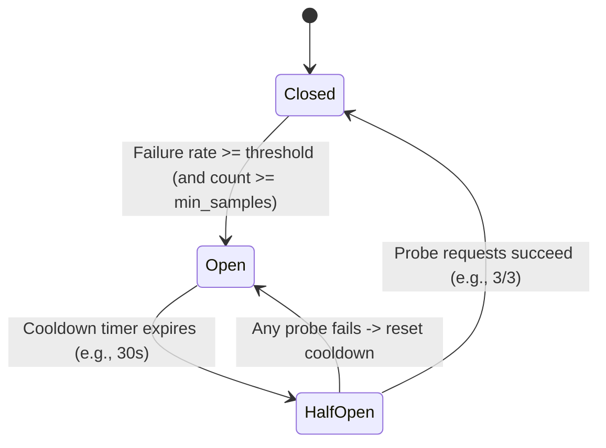
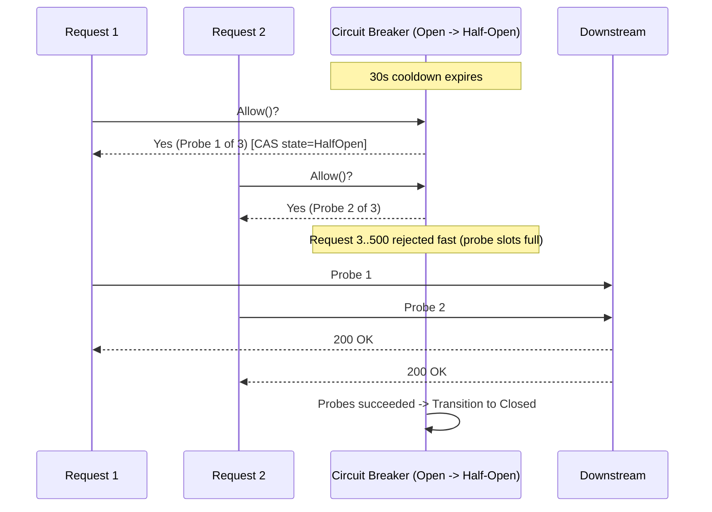

# Circuit Breaker Pattern: Closed, Open, Half-Open (vs Retries)

> **Prerequisites:** [Lesson 05: Retry Storms: Backoff, Jitter, Retry Budgets & the 27x Problem](../05-retry-storms/README.md).  
> **Estimated Reading Time:** 24–28 minutes  
> **Target Audience:** Backend engineers building fault-tolerant service clients, and candidates asked "how does a circuit breaker differ from retries, and when do you use each?"  
> **Free PDF Notes:** [Download SD-K-006.pdf](https://backendroadmap.com/notes/system-design/SD-K-006.pdf)

> [!NOTE]
> **In one line:** A **Circuit Breaker** is a stateful proxy (`Closed` $\to$ `Open` $\to$ `Half-Open`) that monitors failures and **fails fast in < 1 ms** without calling a broken downstream—preserving caller threads and giving the failing dependency breathing room to recover, whereas **retries** are for brief transient blips.

> [!TIP]
> **The Golden Rule:** **Retries** handle *transient* faults ("try again in 100 ms"); **Circuit Breakers** handle *sustained* outages ("stop trying for 30 s and return a fallback"). Never wrap a circuit breaker inside a retry loop in the wrong order—the retry must see the circuit breaker's fast-fail and abort, or the circuit breaker must sit *outside* the retry policy.

---

## 1. What a Circuit Breaker Is, and What It Isn't

When the Recommendations Service dies or slows to a 2-second timeout, retries alone cannot save you: every incoming request still waits 2 seconds to time out before failing, pinning threads via Little's Law ($L = \lambda W$). A **Circuit Breaker** detects that 50% of the last 20 calls failed, **trips Open**, and immediately rejects subsequent calls in **0.05 ms** (returning cached recommendations) until a cooldown timer expires and a few **Half-Open** probe requests confirm recovery.

| Term | Precise Meaning | Example |
| :--- | :--- | :--- |
| **Closed state** | Normal operation; requests flow to downstream | Counts errors/timeouts in a sliding window |
| **Open state** | Tripped; requests fail fast locally in $< 1\text{ ms}$ | Returns `ErrCircuitOpen` or cached fallback |
| **Half-Open state** | Cooldown elapsed; allows $k$ probe requests through | 3 probes succeed $\to$ `Closed`; 1 fails $\to$ `Open` |
| **Sliding window** | Count-based or time-based failure tracker | Last 20 calls, or last 10 seconds |
| **Minimum throughput** | Min calls before error % can trip the breaker | `min_requests = 20` (avoids 1/1 = 100% tripping) |
| **Fallback** | Graceful degraded response while `Open` | Cached data, default value, or `503` |
| **Not** | A substitute for timeouts or bulkheads | Slow calls must still time out to count as failures |

### Why It Matters
1. **Protects caller resources:** Turning a 2,000 ms timeout into a 0.1 ms local rejection drops thread usage $L = \lambda W$ by **20,000x**.
2. **Gives the downstream time to heal:** Cutting traffic from 100% to 0% (plus tiny probes) lets an overloaded DB drain queues, finish GC, or warm caches.
3. **Classic interview distinction:** *"Retries vs. Circuit Breakers"* is one of the most frequent follow-up questions in system design interviews.

---

## 2. Anatomy: State Machine & Retries vs Circuit Breakers



**Retries vs. Circuit Breakers side-by-side:**

| Dimension | Retries (with Backoff + Jitter) | Circuit Breaker |
| :--- | :--- | :--- |
| **Best for** | Transient 1-off blips (packet drop, brief GC) | Sustained outages or severe overload |
| **Effect on latency** | **Increases** latency (waits + sleeps) | **Decreases** latency (fails fast in $< 1\text{ ms}$) |
| **Effect on downstream load** | **Increases** load (even with budget, $> 1\times$) | **Drops** load to near $0\times$ |
| **Statefulness** | Mostly stateless (except retry budget) | **Stateful** (`Closed` / `Open` / `Half-Open`) |

> [!WARNING]
> **Watch out for the "Slow-Call" blind spot.** If a downstream hangs for 1.9 seconds (just under your 2.0-second timeout) and returns `200 OK`, a naive circuit breaker that only counts `5xx` and timeouts will stay `Closed` while your thread pool saturates! Modern breakers (like Resilience4j) also trip on **slow-call rate** (e.g., $> 50\%$ of calls taking $> 1\text{ s}$).

---

## 3. Mathematical Model: Little's Law Relief & Sliding-Window Tripping

**1. Thread-Pool Relief via Fast-Fail.**
Using Little's Law ($L = \lambda W$) at $\lambda = 1{,}000\text{ req/s}$:
- **Closed (Downstream timing out at $W = 2.0\text{ s}$):**
  $$L_{\text{closed, failing}} = 1{,}000 \times 2.0 = \mathbf{2{,}000\text{ threads pinned}}$$
- **Open (Circuit breaker failing fast at $W = 0.0005\text{ s}$):**
  $$L_{\text{open}} = 1{,}000 \times 0.0005 = \mathbf{0.5\text{ threads}}$$
That is a **4,000x reduction** in concurrency pressure—instantly saving the rest of the service!

**2. Tripping Condition (Count-Based Sliding Window).**
Let $N$ be the window size (e.g., $N = 20$), $m$ be the minimum sample count ($m = 20$), and $\theta$ be the failure threshold ($\theta = 0.50$). The breaker trips `Closed` $\to$ `Open` when:

$$\text{samples} \ge m \quad \land \quad \frac{\text{failures} + \text{slow\_calls}}{\text{samples}} \ge \theta$$

**Worked Numerical Example (Resilience Math).**
Suppose your service calls Pricing at $500\text{ req/s}$ with a 2-second timeout and 300 worker threads:
1. Pricing crashes and stops accepting TCP connections (or blackholes packets for 2s).
2. With `window = 20`, `threshold = 50%`, the first **10–20 requests** fail/timeout (~20–40 ms if TCP resets, or 10 threads if 2s timeout), and the breaker **trips `Open`**.
3. For the next **30 seconds** (`open_duration = 30s`), $500 \times 30 = 15{,}000$ requests fail fast in $0.1\text{ ms}$ (using $< 1$ thread) and return cached prices.
4. At $t = 30\text{ s}$, the breaker enters `Half-Open` and admits **3 probes**. If Pricing is back up, all 3 succeed and traffic resumes smoothly.

---

## 4. Metrics & Percentiles

| Metric | Meaning | Alert when |
| :--- | :--- | :--- |
| **Circuit state (`0=Closed, 1=HalfOpen, 2=Open`)** | Current state per dependency | Any Tier-1 breaker stays `Open > 2 min` |
| **State transitions / min** | Frequency of `Closed <-> Open` flaps | Rapid flapping (cooldown too short or threshold too low) |
| **Fast-fail / fallback rate** | Requests short-circuited by `Open` breaker | Rising; track degraded UX impact |
| **Slow-call rate** | % of calls exceeding slow threshold | $> 30\%$ (early warning before timeout) |
| **Half-open probe failure rate** | % of recovery probes failing | Persistent 100% $\to$ downstream still dead |

### Worked Example (Preventing Flapping in Half-Open)
If `Half-Open` allows **only 1 probe** and a flaky server happens to succeed on 1 lucky request, the breaker snaps back to `Closed` and blasts 100% of traffic (500 req/s) onto a half-dead server—causing immediate re-trip (**flapping**). Requiring **3–5 consecutive successful probes** (or `permitted_calls = 10` with $< 20\%$ failure) prevents premature closure.

---

## 5. Compounding: Composition Order (Retry vs Timeout vs Circuit Breaker)

The order in which you wrap middleware matters enormously:

| Wrapper Order (Outer $\to$ Inner) | Behavior on Outage | Verdict |
| :--- | :--- | :--- |
| `Timeout -> Retry -> CircuitBreaker -> HTTP` | Retry calls CB; when CB opens, Retry sees `ErrOpen` and **must abort** (don't retry `ErrOpen`!) | **Recommended** (or put CB outside Retry) |
| `CircuitBreaker -> Retry -> Timeout -> HTTP` | If 1 request retries 3x and fails, CB counts it as 1 logical failure (or 3 if inside) | **Good** when retries shouldn't trip CB prematurely |
| `Retry -> CircuitBreaker` (retrying `ErrOpen`!) | Retry sleeps and bangs against an `Open` breaker 3x for no reason | **Bug!** Wastes latency & threads |

---

## 6. Numbers Every Engineer Must Know

| Item | Typical | Implication |
| :--- | :---: | :--- |
| **Failure rate threshold** | **50%** (in sliding window) | High enough to ignore normal blips; low enough to catch outages |
| **Minimum request volume** | **10 – 20 requests** | Prevents 1 failed request at low QPS from tripping the breaker |
| **Open cooldown duration** | **15 s – 60 s** | Long enough for downstream GC/restart; short enough to recover fast |
| **Half-Open permitted probes** | **3 – 10 requests** | Prevents single-probe luck from causing flapping |
| **Slow-call threshold** | **$50\%$ of timeout** (e.g., 1s if timeout=2s) | Catches brownouts before timeouts exhaust threads |
| **Fast-fail latency** | **$< 0.1\text{ ms}$** | Frees caller threads immediately |

---

## 7. Protocol / Mechanism Deep Dive: Half-Open Probe Race Condition



| Question | Answer |
| :--- | :--- |
| **What happens if 500 concurrent requests arrive the exact millisecond `Open` expires?** | Without a probe concurrency limit, all 500 would rush into `Half-Open` at once (**thundering herd**). Use an atomic counter (`halfOpenInFlight <= maxProbes`) so only $k$ probes pass and the rest still fail fast. |
| **Should circuit breakers be per-pod or distributed (Redis)?** | Almost always **per-pod (in-memory)**. A distributed breaker adds a network hop to every call and creates a Redis SPOF; with $N$ pods, each pod independently trips within seconds at normal traffic. |
| **What if I have 100 pods and low traffic (e.g., 1 req/min per pod)?** | At very low per-pod QPS, each pod may never hit `min_samples = 20`. Use a time-based window or push health state via a service mesh / control plane. |

**When NOT to use a circuit breaker:**
1. **Local in-memory operations** or **non-optional core DB calls** where there is *no* meaningful fallback (failing fast just returns `500`—though it still protects thread pools from hanging!).
2. **Async message consumers** with DLQs/backoff—pausing the consumer or using broker-level backoff is cleaner than throwing away messages.
3. **Client `4xx` errors:** Never count `400`/`404` as circuit-breaker failures, or a single bad user bot will trip the breaker for everyone!

---

## 8. Hierarchical Budgets & Design Rules

| Slice | Rule | Control |
| :--- | :--- | :--- |
| **Placement** | Wrap every external HTTP/RPC dependency | Separate breaker instance *per downstream* (never one global breaker) |
| **Error filter** | Count only `5xx`, timeouts, and network errors | Ignore `4xx` user errors |
| **Slow calls** | Trip on slow-call ratio too | Threshold $\approx 50\%$ of timeout |
| **Half-Open guard** | Cap concurrent probes (`maxProbes = 3–5`) | Atomic CAS / semaphore in `Half-Open` |
| **Fallback** | Serve stale cache, default value, or graceful omit | Test fallback path in CI/chaos tests |
| **Retry interaction** | Never retry `ErrCircuitOpen` | Abort retry loop immediately when breaker is `Open` |

---

## 9. Top Mitigations

1. **Maintain one Circuit Breaker per downstream dependency** (and per critical tenant/endpoint if noisy-neighbor isolation is needed).
2. **Exclude `4xx` errors** from failure counts so bad client inputs cannot trip the breaker for healthy users.
3. **Add slow-call detection** alongside error detection to catch brownouts before thread pools saturate.
4. **Cap `Half-Open` probes atomically** (`maxProbes = 3–5`) to prevent a thundering herd when the cooldown timer expires.
5. **Pair every breaker with a tested fallback** (stale cache, default response, or feature-disabled UI).
6. **Alert on `Open` state duration**—a circuit breaker hides downstream pain from users, so you still need an alert to fix the broken dependency!

---

## 10. Production Reference / War Story: The `404` Bot That Tripped Production

A retail API wrapped its Inventory Service client in a circuit breaker (`threshold = 50%`, `min_requests = 20`) that counted *any* non-`200` HTTP status as a failure.


- **Root Cause:** A misconfigured scraper bot requested 50 nonexistent SKU IDs (`404 Not Found`). The breaker treated `404` as a downstream outage and tripped `Open`.
- **Impact:** Real customers saw "Inventory Unavailable" across the entire storefront for minutes at a time while the Inventory Service was 100% healthy.
- **Fix:** Configured an explicit error predicate (`status >= 500 || timeout || network_error`) so `4xx` responses never increment the circuit breaker's failure counter.

---

## 11. Multi-Language Production Code Tabs

A thread-safe `Closed` / `Open` / `Half-Open` Circuit Breaker with minimum-sample guard and capped `Half-Open` probes.

````carousel
```go
// Go: thread-safe Closed / Open / Half-Open Circuit Breaker with capped probes.
package main

import (
	"errors"
	"sync"
	"time"
)

type State int

const (
	Closed State = iota
	Open
	HalfOpen
)

var ErrCircuitOpen = errors.New("circuit breaker is open")

type CircuitBreaker struct {
	mu           sync.Mutex
	state        State
	failures     int
	successes    int
	openUntil    time.Time
	failThresh   int
	cooldown     time.Duration
	halfOpenMax  int
	halfOpenUsed int
}

func NewCircuitBreaker(failThresh int, cooldown time.Duration, halfOpenMax int) *CircuitBreaker {
	return &CircuitBreaker{state: Closed, failThresh: failThresh, cooldown: cooldown, halfOpenMax: halfOpenMax}
}

func (cb *CircuitBreaker) Execute(fn func() error) error {
	cb.mu.Lock()
	if cb.state == Open {
		if time.Now().Before(cb.openUntil) {
			cb.mu.Unlock()
			return ErrCircuitOpen
		}
		cb.state = HalfOpen
		cb.halfOpenUsed = 0
		cb.successes = 0
	}
	if cb.state == HalfOpen {
		if cb.halfOpenUsed >= cb.halfOpenMax {
			cb.mu.Unlock()
			return ErrCircuitOpen
		}
		cb.halfOpenUsed++
	}
	cb.mu.Unlock()

	err := fn()

	cb.mu.Lock()
	defer cb.mu.Unlock()
	if err != nil {
		if cb.state == HalfOpen {
			cb.tripOpen()
		} else {
			cb.failures++
			if cb.failures >= cb.failThresh {
				cb.tripOpen()
			}
		}
		return err
	}
	if cb.state == HalfOpen {
		cb.successes++
		if cb.successes >= cb.halfOpenMax {
			cb.state = Closed
			cb.failures = 0
		}
	} else {
		cb.failures = 0
	}
	return nil
}

func (cb *CircuitBreaker) tripOpen() {
	cb.state = Open
	cb.openUntil = time.Now().Add(cb.cooldown)
}
```
<!-- slide -->
```typescript
// TypeScript: Closed / Open / Half-Open Circuit Breaker with capped Half-Open probes.
export type BreakerState = "CLOSED" | "OPEN" | "HALF_OPEN";

export class CircuitOpenError extends Error {
  constructor() { super("Circuit breaker is OPEN"); }
}

export class CircuitBreaker {
  private state: BreakerState = "CLOSED";
  private failures = 0;
  private successes = 0;
  private halfOpenInFlight = 0;
  private openUntil = 0;

  constructor(
    private readonly failureThreshold = 5,
    private readonly cooldownMs = 30_000,
    private readonly halfOpenProbes = 3
  ) {}

  async execute<T>(fn: () => Promise<T>): Promise<T> {
    const now = Date.now();
    if (this.state === "OPEN") {
      if (now < this.openUntil) throw new CircuitOpenError();
      this.state = "HALF_OPEN";
      this.successes = 0;
      this.halfOpenInFlight = 0;
    }
    if (this.state === "HALF_OPEN") {
      if (this.halfOpenInFlight >= this.halfOpenProbes) throw new CircuitOpenError();
      this.halfOpenInFlight++;
    }

    try {
      const result = await fn();
      this.onSuccess();
      return result;
    } catch (err) {
      this.onFailure();
      throw err;
    } finally {
      if (this.state === "HALF_OPEN") this.halfOpenInFlight--;
    }
  }

  private onSuccess() {
    if (this.state === "HALF_OPEN" && ++this.successes >= this.halfOpenProbes) {
      this.state = "CLOSED";
      this.failures = 0;
    } else if (this.state === "CLOSED") {
      this.failures = 0;
    }
  }

  private onFailure() {
    if (this.state === "HALF_OPEN" || ++this.failures >= this.failureThreshold) {
      this.state = "OPEN";
      this.openUntil = Date.now() + this.cooldownMs;
    }
  }
}
```
<!-- slide -->
```python
# Python: Closed / Open / Half-Open Circuit Breaker (stdlib only).
import threading
import time

class CircuitOpenError(Exception):
    pass

class CircuitBreaker:
    def __init__(self, fail_threshold: int = 5, cooldown_s: float = 30.0, half_open_probes: int = 3):
        self._lock = threading.Lock()
        self.state = "CLOSED"
        self.failures = 0
        self.successes = 0
        self.half_open_used = 0
        self.open_until = 0.0
        self.fail_threshold = fail_threshold
        self.cooldown_s = cooldown_s
        self.half_open_probes = half_open_probes

    def call(self, fn, *args, **kwargs):
        with self._lock:
            now = time.monotonic()
            if self.state == "OPEN":
                if now < self.open_until:
                    raise CircuitOpenError("Circuit is OPEN")
                self.state = "HALF_OPEN"
                self.half_open_used = 0
                self.successes = 0
            if self.state == "HALF_OPEN":
                if self.half_open_used >= self.half_open_probes:
                    raise CircuitOpenError("Half-Open probe limit reached")
                self.half_open_used += 1
        try:
            res = fn(*args, **kwargs)
        except Exception:
            with self._lock:
                if self.state == "HALF_OPEN" or self.failures + 1 >= self.fail_threshold:
                    self.state = "OPEN"
                    self.open_until = time.monotonic() + self.cooldown_s
                else:
                    self.failures += 1
            raise
        with self._lock:
            if self.state == "HALF_OPEN":
                self.successes += 1
                if self.successes >= self.half_open_probes:
                    self.state = "CLOSED"
                    self.failures = 0
            else:
                self.failures = 0
        return res
```
<!-- slide -->
```csharp
// C#: Thread-safe Closed / Open / Half-Open Circuit Breaker.
using System;
using System.Threading;
using System.Threading.Tasks;

public sealed class CircuitOpenException : Exception { }

public sealed class CircuitBreaker
{
    private readonly object _lock = new();
    private string _state = "CLOSED";
    private int _failures, _successes, _halfOpenUsed;
    private DateTime _openUntil;
    private readonly int _failThreshold, _halfOpenProbes;
    private readonly TimeSpan _cooldown;

    public CircuitBreaker(int failThreshold = 5, int cooldownSeconds = 30, int halfOpenProbes = 3)
    {
        _failThreshold = failThreshold;
        _cooldown = TimeSpan.FromSeconds(cooldownSeconds);
        _halfOpenProbes = halfOpenProbes;
    }

    public async Task<T> ExecuteAsync<T>(Func<Task<T>> action)
    {
        lock (_lock)
        {
            if (_state == "OPEN")
            {
                if (DateTime.UtcNow < _openUntil) throw new CircuitOpenException();
                _state = "HALF_OPEN";
                _halfOpenUsed = _successes = 0;
            }
            if (_state == "HALF_OPEN")
            {
                if (_halfOpenUsed >= _halfOpenProbes) throw new CircuitOpenException();
                _halfOpenUsed++;
            }
        }
        try
        {
            var result = await action();
            lock (_lock)
            {
                if (_state == "HALF_OPEN" && ++_successes >= _halfOpenProbes) { _state = "CLOSED"; _failures = 0; }
                else if (_state == "CLOSED") { _failures = 0; }
            }
            return result;
        }
        catch
        {
            lock (_lock)
            {
                if (_state == "HALF_OPEN" || ++_failures >= _failThreshold)
                { _state = "OPEN"; _openUntil = DateTime.UtcNow + _cooldown; }
            }
            throw;
        }
    }
}
```
````

---

## 12. Hands-On CLI Verification Workflows

Simulate a `Closed -> Open -> Half-Open -> Closed` lifecycle in Python:

```bash
python3 -c "
import time
# Quick state-machine smoke test using the Python CircuitBreaker logic
state, fails, thresh = 'CLOSED', 0, 3
for i, ok in enumerate([False, False, False, True, True]):
    if state == 'OPEN':
        print(f'req {i}: FAST FAIL (OPEN)')
        continue
    if not ok:
        fails += 1
        if fails >= thresh:
            state = 'OPEN'
        print(f'req {i}: FAIL -> state={state}')
    else:
        print(f'req {i}: OK')
"

# Inspect Envoy / Istio outlier detection (service-mesh circuit breaker)
# kubectl get destinationrule -A -o yaml
```

---

## 13. Common Mistakes to Avoid

1. **Counting `4xx` user errors as circuit-breaker failures**, letting bad client traffic trip production.
2. **Retrying `ErrCircuitOpen`**, defeating fast-fail and wasting thread time.
3. **Allowing unlimited concurrent probes in `Half-Open`**, causing a thundering herd on recovery.
4. **Sharing one global circuit breaker across multiple unrelated downstreams.**
5. **Ignoring slow calls** that return `200 OK` just before the timeout.
6. **Having no fallback and no alert when `Open`**, silently degrading UX without notifying engineers.
7. **Omitting a `min_requests` guard**, so 1 failed call at 3 AM trips the breaker.

---

## 14. Key Terms Glossary

| Key Term | Definition |
| :--- | :--- |
| **Circuit Breaker** | Stateful fault-tolerance proxy that short-circuits calls to a failing dependency. |
| **Closed** | Normal operating state; traffic passes through while errors are monitored. |
| **Open** | Tripped state; requests fail fast locally without touching the downstream. |
| **Half-Open** | Recovery-testing state allowing a small number of probe requests through. |
| **Fast-fail** | Rejecting a request immediately ($< 1\text{ ms}$) instead of waiting for a timeout. |
| **Flapping** | Rapidly oscillating between `Open` and `Closed` due to premature recovery. |
| **Slow-call rate** | Percentage of requests exceeding a latency threshold (even if returning `200`). |
| **Fallback** | Alternative response (stale cache, default) returned when the breaker is `Open`. |
| **Minimum throughput** | Minimum sample count required before error percentage can trip the breaker. |
| **Outlier detection** | Load-balancer/mesh pattern ejecting unhealthy individual backend hosts. |

---

## 15. System Design Interview Questions & Answers

### Basic Conceptual Questions

<details>
<summary><strong>Q1: What are the three states of a Circuit Breaker and how does it transition between them? [BASIC]</strong></summary>

**Answer:**
`Closed` (normal traffic, counting errors) $\to$ `Open` (when failure/slow-call threshold is breached, fails fast for a cooldown period) $\to$ `Half-Open` (after cooldown, lets a few probes through; if they succeed $\to$ `Closed`, if any fails $\to$ `Open`).
</details>

<details>
<summary><strong>Q2: When should you use Retries vs. a Circuit Breaker? [BASIC]</strong></summary>

**Answer:**
Use **retries** (with backoff + jitter) for brief, transient faults where trying again in 100 ms is likely to succeed. Use a **circuit breaker** for sustained outages or overload, where retrying only wastes threads and worsens downstream load.
</details>

<details>
<summary><strong>Q3: What is the difference between a Circuit Breaker and a Timeout? [BASIC]</strong></summary>

**Answer:**
A **timeout** bounds how long *each individual call* waits (e.g., 2s). A **circuit breaker** tracks failures *across many calls* and stops making the call altogether for 30s so you don't even wait 2s per request.
</details>

<details>
<summary><strong>Q4: Why do we need a `min_requests` threshold before tripping a Circuit Breaker? [BASIC]</strong></summary>

**Answer:**
Without a minimum sample size (e.g., 20 requests), a single random network blip when traffic is 1 req/min equals a 100% failure rate and trips the breaker unnecessarily.
</details>

### Scenario-Based Architecture Questions

<details>
<summary><strong>Q5: Your Recommendations Service is down. How does a Circuit Breaker protect your Checkout page? [SCENARIO]</strong></summary>

**Answer:**
After 50% of the last 20 calls to Recommendations fail/timeout, the Checkout service's circuit breaker trips `Open`. Subsequent Checkout requests skip Recommendations in $< 1\text{ ms}$ and render a cached "Popular Items" fallback—keeping Checkout threads free and Checkout availability at 99.99%.
</details>

<details>
<summary><strong>Q6: You wrapped a Retry policy around a Circuit Breaker, and now retries are failing even faster. Why? [SCENARIO]</strong></summary>

**Answer:**
If your Retry loop doesn't exclude `ErrCircuitOpen`, it retries against an `Open` breaker 3 times in a row for no reason. Either configure the Retry policy to abort immediately on `ErrCircuitOpen`, or place the Circuit Breaker *outside* the Retry policy.
</details>

<details>
<summary><strong>Q7: A downstream service returns `200 OK` in 1.9s (just under your 2s timeout), yet your app threads are exhausted. Why didn't the Circuit Breaker trip? [SCENARIO]</strong></summary>

**Answer:**
Because the breaker only tracked exceptions/`5xx` errors, not **slow calls**. Configure a slow-call threshold (e.g., trip if $> 50\%$ of calls exceed 1.0s) so brownouts trip the breaker before threads saturate.
</details>

<details>
<summary><strong>Q8: Your Circuit Breaker keeps oscillating between `Open` and `Closed` every 15 seconds. How do you stop it from flapping? [SCENARIO]</strong></summary>

**Answer:**
Increase the `Open` cooldown duration (e.g., 15s $\to$ 60s) so the downstream has time to recover, and require multiple consecutive successful probes in `Half-Open` (e.g., 5–10 probes instead of 1) before closing.
</details>

### Advanced & Tricky Interview Questions

<details>
<summary><strong>Q9: Should Circuit Breaker state be local (in-memory per pod) or shared in Redis? [TRICKY]</strong></summary>

**Answer:**
Local (in-memory per pod) is almost always preferred. Putting Redis in the critical path of every RPC adds network latency and makes Redis a single point of failure for every service. Per-pod breakers trip independently within seconds at normal traffic.
</details>

<details>
<summary><strong>Q10: How do you prevent a thundering herd when a Circuit Breaker transitions from `Open` to `Half-Open`? [TRICKY]</strong></summary>

**Answer:**
Use an atomic in-flight counter or semaphore in `Half-Open` that permits *only* $k$ concurrent probe requests (e.g., 3) while continuing to fast-fail all other concurrent callers until those probes complete.
</details>

<details>
<summary><strong>Q11: What is the difference between a client-side Circuit Breaker and load-balancer Outlier Detection? [TRICKY]</strong></summary>

**Answer:**
Outlier detection (e.g., Envoy/NGINX) ejects *one unhealthy backend instance* out of a pool of 10 healthy instances. A circuit breaker protects against *the entire downstream service* being dead and triggers application-level fallbacks.
</details>

<details>
<summary><strong>Q12: Why should you never put a Circuit Breaker on a non-retryable, non-degradable primary database write without careful thought? [TRICKY]</strong></summary>

**Answer:**
If there is no fallback for a primary DB write, an `Open` breaker still returns `503` to users—though it *does* still protect your app's thread pool from hanging on DB timeouts and gives the DB breathing room to recover from a deadlock or failover. Just ensure the cooldown is short enough to recover promptly.
</details>

---

## 16. One-Page Master Cheat Sheet

```
+---------------------------------------------------------------------------------------------------------+
|                       CIRCUIT BREAKER PATTERN — MASTER CHEAT SHEET                                      |
+---------------------------------------------------------------------------------------------------------+
| 1. STATES: CLOSED (monitor) -> OPEN (fast fail < 1ms) -> HALF-OPEN (k probes) -> CLOSED or OPEN.        |
+---------------------------------------------------------------------------------------------------------+
| 2. VS RETRIES: Retries = transient blips (adds latency/load). Breaker = sustained outage (0x load).     |
+---------------------------------------------------------------------------------------------------------+
| 3. TRIPPING RULES: min_samples >= 20 · count 5xx/timeouts/slow-calls · NEVER count 4xx user errors!     |
+---------------------------------------------------------------------------------------------------------+
| 4. HALF-OPEN GUARD: Cap concurrent probes atomically (e.g. 3-5) to prevent recovery thundering herd.    |
+---------------------------------------------------------------------------------------------------------+
| 5. COMPOSITION: Never retry ErrCircuitOpen. Pair with timeouts (inner) and bulkheads (Lesson 07).       |
+---------------------------------------------------------------------------------------------------------+
```

---

## Further Reading & Sources

- Martin Fowler, [CircuitBreaker](https://martinfowler.com/bliki/CircuitBreaker.html).
- Michael Nygard, *Release It!* (Pragmatic Bookshelf), Chapter 5: "Circuit Breaker".
- Resilience4j Documentation, [CircuitBreaker — Count-based & Time-based Sliding Windows](https://resilience4j.readme.io/docs/circuitbreaker).
- Microsoft Azure Architecture Center, [Circuit Breaker Pattern](https://learn.microsoft.com/en-us/azure/architecture/patterns/circuit-breaker).

---

## Free PDF Notes

[SD-K-006.pdf](https://backendroadmap.com/notes/system-design/SD-K-006.pdf)

---

## Next

Continue with [Lesson 07: Bulkhead Pattern: Isolate Pools So One Failure Can't Sink Everything](../07-bulkhead-pattern/README.md): isolating thread pools and connection pools to contain blast radius.
