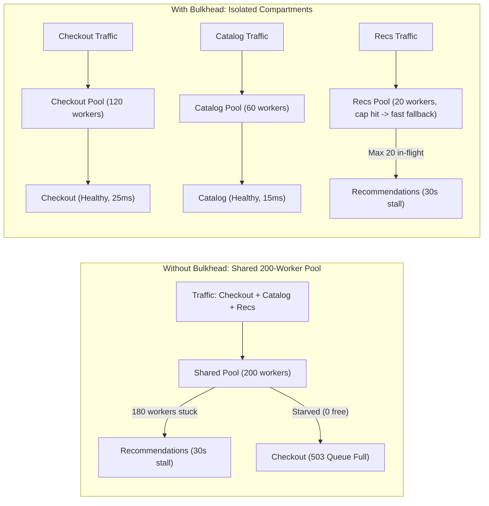
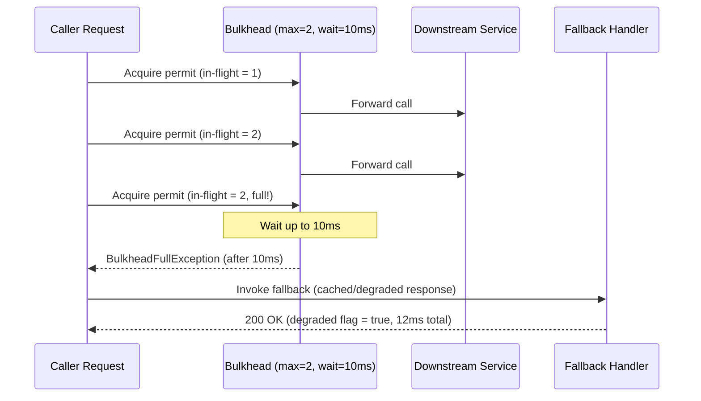
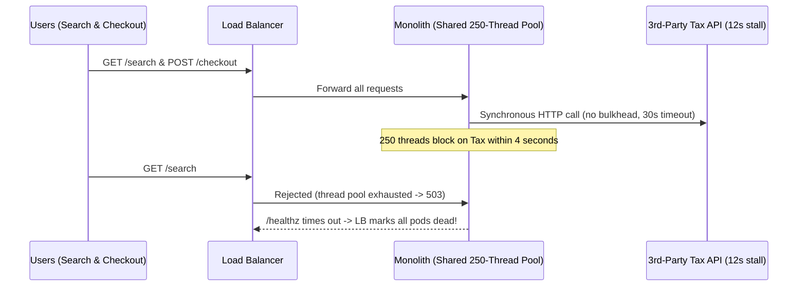

# Bulkhead Pattern: Isolate Pools So One Failure Can't Sink Everything

> **Prerequisites:** [Lesson 06: Circuit Breaker Pattern](../06-circuit-breaker-pattern/README.md).  
> **Estimated Reading Time:** 24–28 minutes  
> **Target Audience:** Backend and SRE engineers designing multi-dependency microservices, and candidates asked "how do you prevent one slow downstream service from exhausting all threads or connections in your API?"  
> **Free PDF Notes:** [Download SD-K-007.pdf](https://backendroadmap.com/notes/system-design/SD-K-007.pdf)

> [!NOTE]
> **In one line:** The **Bulkhead Pattern** partitions shared resources—thread pools, semaphore permits, connection pools, worker processes, or tenants—into isolated compartments so that a slowdown or failure in one dependency or tenant cannot exhaust capacity and sink the rest of the application.

> [!TIP]
> **The Golden Rule:** Never share a single unbounded thread pool, HTTP client connection pool, or database pool across dependencies with different latency profiles or criticality. Give critical paths their own dedicated pool, and cap non-critical paths with a tight semaphore or thread pool so they fail fast instead of starving core traffic.

---

## 1. What the Bulkhead Pattern Is, and What It Isn't

A ship's hull is divided into watertight compartments called *bulkheads*. If a reef tears open compartment 3, water floods compartment 3 alone—the rest of the ship stays afloat. Without bulkheads, a single breach floods the entire hull and sinks the vessel.

In a backend service, the shared "hull" is your finite pool of OS threads, goroutines/async workers, DB connections, or memory. Suppose an e-commerce API server has a single 200-thread pool serving `/checkout`, `/catalog`, and `/recommendations`. If the Recommendations ML service stalls (latency jumps from 20 ms to 30 s), every request to `/recommendations` holds a thread for 30 seconds. Within seconds, all 200 threads are blocked waiting on Recommendations, and `/checkout`—which doesn't even call Recommendations—returns HTTP 503.

| Term | Precise Meaning | Example |
| :--- | :--- | :--- |
| **Bulkhead** | Resource partitioning that bounds the blast radius of a dependency or tenant failure | Separate pools: 100 threads for Checkout, 20 for Recommendations |
| **Thread-pool bulkhead** | Dedicated worker pool + bounded queue per downstream dependency | Resilience4j `ThreadPoolBulkhead`, separate Go worker pools |
| **Semaphore bulkhead** | In-process concurrency counter (`maxConcurrentCalls`) on the caller thread | Resilience4j `SemaphoreBulkhead`, `tokio::sync::Semaphore` |
| **Connection-pool bulkhead** | Dedicated TCP/DB connection pool per workload or tenant | Separate HikariCP/pgxpool for OLTP writes vs reporting reads |
| **Tenant / cellular bulkhead** | Sharding compute/storage by customer tier or cell | VIP customers on Cell A, free-tier noisy neighbors on Cell B |
| **Circuit breaker (contrast)** | Stops calling a failing dependency based on error/timeout rate | Opens after 50% failures; bulkhead limits *concurrency* even before errors |
| **Rate limiter (contrast)** | Caps *arrival rate* (requests/sec) | 1,000 req/s cap; bulkhead caps *in-flight concurrency* |
| **Not** | A way to speed up a slow dependency or eliminate timeouts | You still need timeouts and circuit breakers inside each compartment |

### Why It Matters
1. **Little's Law turns slowness into thread exhaustion:** Even a dependency returning `200 OK` slowly (a "gray failure") will exhaust a shared pool—circuit breakers based on 5xx errors won't trip in time, while a bulkhead caps the damage immediately.
2. **Noisy neighbors are inevitable in multi-tenant systems:** One tenant running an expensive export or experiencing a bot surge will starve every other tenant unless compute and DB pools are compartmentalized.
3. **Interviewers test defense-in-depth:** Timeouts, retries, circuit breakers, and bulkheads solve four distinct failure axes; confusing a bulkhead with a circuit breaker is a common red flag.

---

## 2. Anatomy: Shared Pool vs. Partitioned Bulkheads



When Recommendations stalls in the isolated design, at most 20 workers are tied up. The 21st concurrent `/recommendations` call hits the bulkhead limit immediately (`0 ms` wait if queue = 0) and triggers a fallback (e.g., cached popular items), while Checkout and Catalog continue serving at 100% SLO.

| Dimension | Semaphore Bulkhead | Thread-Pool Bulkhead |
| :--- | :--- | :--- |
| **Execution thread** | Runs on the caller's thread (async or sync) | Offloads to a dedicated worker pool |
| **Context-switch overhead** | Near zero (atomic counter / `tryAcquire`) | Higher (thread/goroutine handoff + queue) |
| **Interruptibility / hard timeout** | Cannot forcibly interrupt blocking I/O on caller thread unless async/ctx-aware | Dedicated pool + Future/timeout can abandon hung sync I/O |
| **Queueing** | Usually none (`maxWaitDuration = 0` or small) | Configurable bounded queue (`queueCapacity`) |
| **Best for** | Non-blocking async I/O (Go, Node, Tokio, WebFlux) or fast in-memory checks | Blocking/legacy JDBC/HTTP clients where I/O can hang |

> [!WARNING]
> **The #1 Bulkhead Trap: Oversized Queues.** Giving a thread-pool bulkhead a queue of 10,000 items defeats the entire purpose of failing fast. Requests sit in the queue past the client's timeout, consuming heap memory and causing "ghost work" on the downstream long after the caller hung up. Keep bulkhead queues tiny (`0` to `2x` pool size) and pair them with `maxWaitDuration <= 50 ms`.

---

## 3. Mathematical Model: Little's Law & Concurrency Sizing

By **Little's Law**, the average number of in-flight concurrent requests $L$ held in a compartment equals the arrival rate $\lambda$ multiplied by the average service latency $W$:

$$L = \lambda \cdot W$$

Suppose a service handles $\lambda = 500\text{ req/s}$ total:
- **Checkout:** $\lambda_c = 200\text{ req/s}$, healthy latency $W_c = 0.05\text{ s}$ (50 ms) $\implies L_c = 200 \times 0.05 = 10\text{ concurrent slots}$.
- **Recommendations:** $\lambda_r = 300\text{ req/s}$, healthy latency $W_r = 0.02\text{ s}$ (20 ms) $\implies L_r = 300 \times 0.02 = 6\text{ concurrent slots}$.

Now suppose Recommendations degrades to $W_r' = 5.0\text{ s}$ (5,000 ms) while traffic stays at $\lambda_r = 300\text{ req/s}$:

$$L_r' = \lambda_r \cdot W_r' = 300 \times 5.0 = 1{,}500\text{ concurrent slots required}$$

If your server only has $N_{\text{total}} = 200$ worker slots in a shared pool:
- **Without a bulkhead:** Recommendations consumes all 200 slots within $\frac{200}{300} = 0.67\text{ s}$. Checkout's effective capacity drops to $0$, driving Checkout availability from $99.99\%$ to $0\%$.
- **With a bulkhead sized for Recommendations** at $N_r = 24$ slots (4x healthy peak headroom): Recommendations caps at 24 in-flight requests, yielding a bounded throughput of $\mu_r' = \frac{24}{5.0} = 4.8\text{ req/s}$ and shedding the remaining $295.2\text{ req/s}$ in $< 1\text{ ms}$ via fallback. Checkout keeps $200 - 24 = 176$ slots (17.6x its healthy concurrency), remaining completely unaffected.

**Sizing Formula with Headroom ($k$):**

$$N_{\text{bulkhead}} = \lceil \lambda_{\text{peak}} \cdot W_{p99} \cdot k \rceil \quad \text{where } k \in [1.5, 2.5]$$

And the **Global Conservation Constraint** across all $m$ compartments on a node with $N_{\text{max}}$ total workers or DB connections:

$$\sum_{i=1}^{m} N_i \le N_{\text{max}} - N_{\text{reserve}}$$

where $N_{\text{reserve}}$ is headroom for health checks, metrics scraping, and admin endpoints so an overloaded pod never fails its own liveness probe.

---

## 4. Metrics & Percentiles

| Metric | Meaning | Alert When |
| :--- | :--- | :--- |
| `bulkhead_available_concurrent_calls` | Remaining free permits in a compartment | Drops to `0` for $> 5\text{ s}$ on a critical pool |
| `bulkhead_rejected_total` | Calls rejected because pool + queue were full | Sustained $> 1\%$ of compartment traffic |
| `bulkhead_wait_duration_p99` | Time spent waiting to acquire a permit | Exceeds $20\text{ ms}$ (indicates queue is masking saturation) |
| `bulkhead_active_execution_p99` | Time a permit is held by the downstream call | Jumps $> 3\times$ baseline (gray failure / slowloris downstream) |
| `pool_utilization_ratio` | $\text{active} / N_{\text{bulkhead}}$ | $> 80\%$ sustained (risk of rejecting normal bursts) |

### Worked Example (Checkout vs. Loyalty Points)
An API gateway pod has `N_max = 100` DB connections to Postgres. Three endpoints share the pod:
1. `POST /pay` ($\lambda = 150\text{ req/s}$, $W_{p99} = 40\text{ ms}$): $150 \times 0.04 \times 2.0 = 12 \to$ allocate **30 connections** (critical path).
2. `GET /orders` ($\lambda = 200\text{ req/s}$, $W_{p99} = 30\text{ ms}$): $200 \times 0.03 \times 2.0 = 12 \to$ allocate **25 connections**.
3. `POST /loyalty-audit` (heavy batch query, $\lambda = 10\text{ req/s}$, $W_{p99} = 800\text{ ms}$): $10 \times 0.8 \times 1.5 = 12 \to$ allocate **15 connections**.
4. **Admin / Health reserve:** **10 connections**; **Unallocated safety margin:** **20 connections**.

Total = $30 + 25 + 15 + 10 = 80 \le 100$. When a bad deployment makes `/loyalty-audit` queries take 15 seconds, `/loyalty-audit` saturates its 15 connections and rejects excess calls, while `/pay` and `/orders` never drop a single query.

---

## 5. Compounding & Failure Modes

Consider a multi-dependency fan-out service where each request calls **Core DB** (critical) and **3 optional enrichers** (Recommendations, Reviews, Loyalty).

| Failure Scenario | Shared Pool (200 threads) | Partitioned Bulkheads (110 Core, 30 each Optional) |
| :--- | :--- | :--- |
| **1. Slow downstream (30s stall on Reviews)** | All 200 threads block in $< 2\text{ s}$; **100% total outage** | Reviews caps at 30 threads; **0% Core outage**, 100% fallback on Reviews |
| **2. Thread-pool starvation via health check** | `/health` waits in shared queue, times out; K8s kills healthy pods (crash loop) | Dedicated `admin` pool (10 threads) keeps `/health` at $< 1\text{ ms}$ |
| **3. Noisy tenant (1 tenant sends 50x spike)** | All tenants experience 10s+ tail latency | Tenant-tier bulkhead sheds/throttles noisy tenant; other tiers stay at $p_{99} = 30\text{ ms}$ |
| **4. Over-partitioning (100 micro-pools of size 2)** | N/A | **False rejections**: one pool sits 95% idle while another rejects burst traffic |

The fourth row highlights the **utilization vs. isolation trade-off**: partitioning reduces statistical multiplexing. If you split 100 threads into 50 pools of 2 threads each, any tiny 3-request burst to one endpoint fails even though 98 threads are idle. Group dependencies into **3–5 coarse-grained criticality tiers** (e.g., Critical, Standard, Best-Effort, Admin) rather than creating a separate pool for every minor endpoint.

---

## 6. Numbers Every Engineer Must Know

| Item | Typical | Implication |
| :--- | :---: | :--- |
| Semaphore `TryAcquire` latency | $10\text{–}50\text{ ns}$ | Virtually free; safe on every hot-path RPC |
| Thread-pool handoff latency | $5\text{–}50\text{ }\mu\text{s}$ | Negligible vs. network I/O, measurable for in-memory caches |
| `maxWaitDuration` for fast-fail | $0\text{–}25\text{ ms}$ | Fail fast instead of queueing past caller deadline |
| OS thread memory footprint | $1\text{–}2\text{ MB}$ stack (JVM/C++) | 1,000 threads $\approx 1\text{–}2\text{ GB}$ RAM just for stacks |
| Goroutine / async task footprint | $2\text{–}8\text{ KB}$ | Use semaphores to bound downstream concurrency even if goroutines are cheap |
| Headroom multiplier $k$ | $1.5\text{–}2.5\times$ peak concurrency | Absorbs micro-bursts without over-committing downstream |

---

## 7. Mechanism Deep Dive: Semaphore vs. Thread-Pool Bulkhead



| Question | Answer |
| :--- | :--- |
| **Why use a bulkhead if goroutines/async tasks are cheap?** | Memory isn't the only bottleneck—downstream DB connections, sockets, CPU, and file descriptors are still finite. |
| **How does a bulkhead interact with a Circuit Breaker?** | Put the **Bulkhead outside or inside?** Usually `Retry -> CircuitBreaker -> Bulkhead -> Timeout -> Call` (or `Bulkhead` outside `CircuitBreaker` so rejected bulkhead calls don't trip the breaker if the downstream is actually healthy, just busy). |
| **What if `maxWaitDuration` is too high?** | Callers pile up waiting for a permit, consuming upstream threads and memory—defeating isolation. |
| **When NOT to use a bulkhead?** | In a single-dependency worker (e.g., a dedicated Kafka consumer reading one topic and writing to one DB) where backpressure is already handled by consumer poll batch size. |

---

## 8. Hierarchical Budgets & Design Rules

| Slice | Rule | Control |
| :--- | :--- | :--- |
| **Criticality tiers** | Group endpoints into Critical, Standard, Best-Effort, Admin | Separate pool/semaphore per tier |
| **Pool sum** | $\sum N_i \le 0.85 \times N_{\text{node\_max}}$ | Reserve 15% for health checks & OS/GC |
| **Queue depth** | `queueCapacity` $\le 2 \times N_i$ (or `0` for latency-sensitive) | Reject early; never unbounded `LinkedBlockingQueue` |
| **Acquire timeout** | `maxWaitDuration <= 25 ms` | Fast-fail to fallback instead of blocking |
| **Downstream alignment** | $\sum_{\text{pods}} N_{\text{pod}, i} \le \text{Downstream max connections}$ | Prevent pod autoscaling from DDoSing Postgres |
| **Per-tenant cap** | Cap any single tenant to $\le 30\%$ of a shared pool | Prevent noisy-neighbor starvation |
| **Fallback path** | Every non-critical bulkhead must have a cheap fallback | Cached data, empty list, or feature-disabled flag |

---

## 9. Top Mitigations

1. **Isolate HTTP client connection pools per downstream host**—never use a single global `http.Client` with a tiny `MaxIdleConns` or shared `MaxConnsPerHost` across critical and non-critical services.
2. **Carve out a dedicated Admin/Health pool** so `/healthz`, `/readyz`, and `/metrics` respond in $< 5\text{ ms}$ even under 100% traffic saturation.
3. **Use non-blocking `TryAcquire` with zero or tiny wait times** (`0–25 ms`) so overloaded compartments shed load instantaneously.
4. **Bound database pools by tier** (e.g., separate read-replica pool for analytics/search vs. primary pool for checkout writes).
5. **Apply cellular/tenant isolation** for multi-tenant SaaS: route enterprise tenants to dedicated worker pools or cells, and cap free-tier concurrency.
6. **Pair every bulkhead with a timeout** inside the compartment—a bulkhead without a timeout will stay permanently wedged if a TCP socket hangs forever.
7. **Alert on `bulkhead_rejected_total` and `pool_utilization_ratio`** so you tune pool sizes before peak events rather than discovering undersized pools in production.

---

## 10. Production Reference / War Story: The Slow Tax-API Blackout

**Incident (SEV-1):** During a flash sale, an e-commerce monolith's third-party Tax Calculation API degraded from `80 ms` to `12 s` due to a regional ISP issue. Even though Tax Calculation was only needed at the final checkout step, the entire site—homepage, product search, and login—went down with HTTP 503s for 42 minutes.



**Root Cause:**
1. All HTTP handlers shared a single 250-thread servlet pool.
2. The Tax API client had a 30-second timeout and no bulkhead, so $\lambda = 80\text{ req/s} \times 12\text{ s} = 960$ needed threads—instantly consuming all 250 threads.
3. Kubernetes readiness probes hit the same exhausted thread pool, timed out, and caused the Load Balancer to pull every healthy pod out of rotation.

**Fix:**
1. Placed Tax API calls behind a **Semaphore Bulkhead** capped at `30` concurrent calls per pod (`maxWait = 10 ms`) and lowered the socket timeout to `1.5 s`.
2. Added a **Graceful Fallback** using cached state-level tax estimates when the bulkhead is full, reconciled asynchronously after payment.
3. Moved `/healthz` and `/readyz` to a dedicated management port/pool. In the next Chaos GameDay with a simulated 30s Tax API blackhole, `/search` stayed at $99.99\%$ availability and $p_{99} = 18\text{ ms}$.

---

## 11. Multi-Language Production Code Tabs

A production-grade **Semaphore Bulkhead** with optional short wait timeout, zero-allocation fast-fail, and per-compartment metrics tracking.

````carousel
```go
// Go: Semaphore-based Bulkhead using buffered channel + context timeout.
package main

import (
	"context"
	"errors"
	"fmt"
	"sync/atomic"
	"time"
)

var ErrBulkheadFull = errors.New("bulkhead full: fast-failing request")

type Bulkhead struct {
	name     string
	sem      chan struct{}
	waitTime time.Duration
	active   atomic.Int64
	rejected atomic.Int64
}

func NewBulkhead(name string, maxConcurrent int, waitTime time.Duration) *Bulkhead {
	return &Bulkhead{
		name:     name,
		sem:      make(chan struct{}, maxConcurrent),
		waitTime: waitTime,
	}
}

func (b *Bulkhead) Execute(ctx context.Context, fn func(context.Context) error) error {
	// Fast path: try non-blocking acquire first
	select {
	case b.sem <- struct{}{}:
		defer func() { <-b.sem }()
	default:
		if b.waitTime <= 0 {
			b.rejected.Add(1)
			return fmt.Errorf("%s: %w", b.name, ErrBulkheadFull)
		}
		timer := time.NewTimer(b.waitTime)
		defer timer.Stop()
		select {
		case b.sem <- struct{}{}:
			defer func() { <-b.sem }()
		case <-timer.C:
			b.rejected.Add(1)
			return fmt.Errorf("%s: %w", b.name, ErrBulkheadFull)
		case <-ctx.Done():
			b.rejected.Add(1)
			return ctx.Err()
		}
	}

	b.active.Add(1)
	defer b.active.Add(-1)
	return fn(ctx)
}

func main() {
	recsPool := NewBulkhead("recommendations", 2, 10*time.Millisecond)
	for i := 0; i < 4; i++ {
		go func(id int) {
			err := recsPool.Execute(context.Background(), func(ctx context.Context) error {
				time.Sleep(100 * time.Millisecond)
				return nil
			})
			fmt.Printf("call=%d err=%v\n", id, err)
		}(i)
	}
	time.Sleep(200 * time.Millisecond)
	fmt.Printf("rejected=%d\n", recsPool.rejected.Load())
}
```
<!-- slide -->
```typescript
// TypeScript: Async Semaphore Bulkhead with bounded wait queue and fast-fail.
export class BulkheadFullError extends Error {
  constructor(compartment: string) {
    super(`Bulkhead "${compartment}" is full`);
    this.name = "BulkheadFullError";
  }
}

export class Bulkhead {
  private inFlight = 0;
  private waitQueue: Array<() => void> = [];
  public rejectedCount = 0;

  constructor(
    private readonly name: string,
    private readonly maxConcurrent: number,
    private readonly maxWaitMs: number = 0
  ) {}

  async execute<T>(fn: () => Promise<T>): Promise<T> {
    await this.acquire();
    try {
      return await fn();
    } finally {
      this.release();
    }
  }

  private acquire(): Promise<void> {
    if (this.inFlight < this.maxConcurrent) {
      this.inFlight++;
      return Promise.resolve();
    }
    if (this.maxWaitMs <= 0) {
      this.rejectedCount++;
      return Promise.reject(new BulkheadFullError(this.name));
    }

    return new Promise((resolve, reject) => {
      const timer = setTimeout(() => {
        const idx = this.waitQueue.indexOf(grant);
        if (idx !== -1) this.waitQueue.splice(idx, 1);
        this.rejectedCount++;
        reject(new BulkheadFullError(this.name));
      }, this.maxWaitMs);

      const grant = () => {
        clearTimeout(timer);
        this.inFlight++;
        resolve();
      };
      this.waitQueue.push(grant);
    });
  }

  private release(): void {
    this.inFlight--;
    const next = this.waitQueue.shift();
    if (next) next();
  }
}
```
<!-- slide -->
```python
# Python: Thread-safe Semaphore Bulkhead with fast-fail and Little's Law simulator (stdlib only).
import threading
import time
from concurrent.futures import ThreadPoolExecutor


class BulkheadFullError(Exception):
    pass


class Bulkhead:
    def __init__(self, name: str, max_concurrent: int, wait_timeout_s: float = 0.0):
        self.name = name
        self._sem = threading.BoundedSemaphore(max_concurrent)
        self._wait_timeout_s = wait_timeout_s
        self._lock = threading.Lock()
        self.rejected = 0
        self.succeeded = 0

    def execute(self, fn, *args, **kwargs):
        acquired = self._sem.acquire(blocking=self._wait_timeout_s > 0, timeout=self._wait_timeout_s)
        if not acquired:
            with self._lock:
                self.rejected += 1
            raise BulkheadFullError(f"{self.name}: concurrency limit reached")
        try:
            result = fn(*args, **kwargs)
            with self._lock:
                self.succeeded += 1
            return result
        finally:
            self._sem.release()


def simulate_isolation():
    core_bh = Bulkhead("checkout", max_concurrent=10, wait_timeout_s=0.01)
    recs_bh = Bulkhead("recommendations", max_concurrent=3, wait_timeout_s=0.01)

    def slow_recs():
        time.sleep(0.25)
        return "recs"

    def fast_checkout():
        time.sleep(0.01)
        return "ok"

    with ThreadPoolExecutor(max_workers=20) as pool:
        rec_futs = [pool.submit(lambda: _safe(recs_bh, slow_recs)) for _ in range(10)]
        chk_futs = [pool.submit(lambda: _safe(core_bh, fast_checkout)) for _ in range(10)]
        for f in rec_futs + chk_futs:
            f.result()

    return {
        "checkout": {"ok": core_bh.succeeded, "rejected": core_bh.rejected},
        "recs": {"ok": recs_bh.succeeded, "rejected": recs_bh.rejected},
    }


def _safe(bh: Bulkhead, fn):
    try:
        return bh.execute(fn)
    except BulkheadFullError:
        return "fallback"


if __name__ == "__main__":
    print(simulate_isolation())
```
<!-- slide -->
```csharp
// C#: Async SemaphoreSlim Bulkhead with configurable wait timeout and metrics.
using System;
using System.Threading;
using System.Threading.Tasks;

public sealed class BulkheadFullException(string name)
    : Exception($"Bulkhead '{name}' concurrency limit reached.");

public sealed class Bulkhead(string name, int maxConcurrent, TimeSpan waitTimeout)
{
    private readonly SemaphoreSlim _semaphore = new(maxConcurrent, maxConcurrent);
    private long _rejected;

    public long RejectedCount => Interlocked.Read(ref _rejected);

    public async Task<T> ExecuteAsync<T>(Func<CancellationToken, Task<T>> action, CancellationToken ct = default)
    {
        if (!await _semaphore.WaitAsync(waitTimeout, ct).ConfigureAwait(false))
        {
            Interlocked.Increment(ref _rejected);
            throw new BulkheadFullException(name);
        }

        try
        {
            return await action(ct).ConfigureAwait(false);
        }
        finally
        {
            _semaphore.Release();
        }
    }
}
```
````

---

## 12. Hands-On CLI Verification Workflows

Run the Python bulkhead isolation simulation locally:

```bash
python -c "import bulkhead_demo; print(bulkhead_demo.simulate_isolation())"
# Expected: {'checkout': {'ok': 10, 'rejected': 0}, 'recs': {'ok': 3, 'rejected': 7}}
```

Inspect real-world bulkhead & pool saturation in Kubernetes / Envoy / PostgreSQL:

```bash
# 1. Envoy circuit-breaker/bulkhead limits (max_requests, max_pending_requests)
kubectl exec deploy/api-gateway -c istio-proxy -- \
  curl -s localhost:15000/stats | grep -E "upstream_rq_pending_overflow|upstream_cx_overflow"

# 2. Linux / container thread & socket exhaustion check per compartment
ps -eLf | awk '{print $2}' | sort | uniq -c | sort -nr | head -10

# 3. PostgreSQL: inspect active connections grouped by application_name (pool bulkhead)
psql "$DATABASE_URL" -c "
  SELECT application_name, state, count(*)
  FROM pg_stat_activity
  GROUP BY application_name, state
  ORDER BY count DESC;"
```

---

## 13. Common Mistakes to Avoid

1. **Sharing one global HTTP client or DB pool** across critical writes and slow analytics/third-party calls.
2. **Putting an unbounded or huge queue in front of a bulkhead**, turning fast-fail into multi-second tail latency and OOMs.
3. **Forgetting to isolate `/healthz` and `/metrics`**, causing orchestrators to kill pods that are merely shedding non-critical load.
4. **Over-partitioning into dozens of tiny pools**, which destroys statistical multiplexing and causes false rejections.
5. **Omitting timeouts inside the bulkhead**, leaving permits leaked indefinitely on hung TCP connections.
6. **Ignoring aggregate pod scaling**: 50 pods $\times$ 20 DB connections each = 1,000 connections, which still overwhelms Postgres.
7. **No fallback on bulkhead rejection**, turning a graceful compartment cap into a user-facing HTTP 500.

---

## 14. Key Terms Glossary

| Key Term | Definition |
| :--- | :--- |
| **Bulkhead Pattern** | Partitioning finite resources into isolated pools so one failure cannot sink the whole system. |
| **Blast Radius** | The maximum scope of users, endpoints, or dependencies affected by a single failure. |
| **Semaphore Bulkhead** | Concurrency limiter using an atomic permit counter on the caller's thread. |
| **Thread-Pool Bulkhead** | Dedicated worker threads and bounded queue per downstream dependency. |
| **Little's Law** | $L = \lambda W$: average concurrency equals arrival rate times average latency. |
| **Gray Failure** | A dependency that stays up (no 5xx) but becomes severely slow, exhausting shared pools. |
| **Noisy Neighbor** | One tenant or workload consuming disproportionate shared resources and starving others. |
| **Statistical Multiplexing** | Efficiency gained by sharing a larger pool across uncorrelated bursts; traded off against isolation. |
| **Fast-Fail** | Rejecting excess work in $< 1\text{ ms}$ instead of queueing it past the caller's deadline. |
| **Cellular Architecture** | Infrastructure-level bulkhead dividing users into independent, isolated deployment cells. |

---

## 15. System Design Interview Questions & Answers

### Basic Conceptual Questions

<details>
<summary><strong>Q1: What is the Bulkhead Pattern and where does the name come from? [BASIC]</strong></summary>

**Answer:**
It is named after watertight compartments (bulkheads) in a ship's hull: if one compartment floods, the rest of the ship stays afloat. In software, it means partitioning threads, semaphores, connection pools, or compute cells per dependency or tenant so a slowdown or failure in one area cannot exhaust shared resources and take down unrelated features.
</details>

<details>
<summary><strong>Q2: How is a Bulkhead different from a Circuit Breaker? [BASIC]</strong></summary>

**Answer:**
A **Circuit Breaker** stops calling a dependency *after* its error or timeout rate crosses a threshold (reacting to failure). A **Bulkhead** bounds *in-flight concurrency* at all times so even a slow-but-succeeding dependency (gray failure) or a sudden burst can only consume its allocated slice of resources. They complement each other.
</details>

<details>
<summary><strong>Q3: Semaphore Bulkhead vs. Thread-Pool Bulkhead—when do you choose each? [BASIC]</strong></summary>

**Answer:**
Use a **Semaphore Bulkhead** for async/non-blocking code (Go, Node, Tokio, WebFlux) or when you want near-zero overhead (`tryAcquire` in nanoseconds). Use a **Thread-Pool Bulkhead** when calling blocking legacy I/O (e.g., blocking JDBC drivers) where you need the ability to time out on the caller thread while a separate worker thread finishes or abandons the hung call.
</details>

<details>
<summary><strong>Q4: Why isn't a single timeout enough without a bulkhead? [BASIC]</strong></summary>

**Answer:**
Suppose your timeout is `2 s` and traffic is `500 req/s`. During a hang, $500 \times 2 = 1{,}000$ threads are continuously tied up waiting for timeouts to fire—still exhausting a 200-thread shared pool and killing unrelated endpoints. A bulkhead caps that dependency to e.g. 20 slots immediately.
</details>

### Scenario-Based Architecture Questions

<details>
<summary><strong>Q5: Your monolith's `/checkout` and `/search` share a 100-connection Postgres pool. A new `/reports` endpoint runs 10-second queries and takes down `/checkout`. How do you fix it? [SCENARIO]</strong></summary>

**Answer:**
Create separate connection pools (and ideally route `/reports` to a read replica): e.g., 50 connections for `/checkout`, 30 for `/search`, and 10 for `/reports` (leaving 10 for admin/migrations). Even if `/reports` saturates all 10 of its connections, `/checkout` never waits for a connection.
</details>

<details>
<summary><strong>Q6: Using Little's Law, how do you size a bulkhead for a service receiving 400 req/s with p99 latency of 25 ms? [SCENARIO]</strong></summary>

**Answer:**
Average concurrency is $L = \lambda \cdot W = 400 \times 0.025 = 10$ slots. Applying a $2\times$ burst headroom multiplier gives $10 \times 2 = 20$ concurrent permits. Set `maxWaitDuration` to `0–15 ms` so requests beyond 20 fail fast to a fallback.
</details>

<details>
<summary><strong>Q7: One enterprise tenant runs a bulk import and causes 503s for all other customers. How do you apply bulkheads? [SCENARIO]</strong></summary>

**Answer:**
Apply **tenant-level bulkheads**: (1) cap per-tenant in-flight concurrency (e.g., no single tenant can hold $> 25\%$ of worker slots), (2) move bulk imports to an asynchronous queue with dedicated worker pools, or (3) adopt a **cellular architecture** where large enterprise tenants live in isolated cells.
</details>

<details>
<summary><strong>Q8: Your service calls 12 microservices. Should you create 12 separate thread pools? [SCENARIO]</strong></summary>

**Answer:**
Usually no—over-partitioning into 12 tiny pools destroys statistical multiplexing and causes false rejections during minor bursts. Instead, group them into **3–4 criticality tiers** (e.g., Core Payments, Standard Reads, Best-Effort Enrichments, Admin) or use lightweight per-dependency **semaphores** rather than 12 OS thread pools.
</details>

### Advanced & Tricky Interview Questions

<details>
<summary><strong>Q9: In what order should you compose Retry, Circuit Breaker, Bulkhead, and Timeout? [TRICKY]</strong></summary>

**Answer:**
A standard order (outermost to innermost) is: `RateLimiter -> Retry -> CircuitBreaker -> Bulkhead -> Timeout -> Downstream Call` (or `Bulkhead` outside `CircuitBreaker` depending on whether you want bulkhead rejections to count toward breaker failure rates—usually you do *not* want local saturation to trip a downstream circuit breaker, so `CircuitBreaker` inside `Bulkhead` or excluding `BulkheadFullException` from breaker metrics is cleaner).
</details>

<details>
<summary><strong>Q10: How can Kubernetes readiness probes fail because of a missing bulkhead? [TRICKY]</strong></summary>

**Answer:**
If `/readyz` shares the same worker pool or DB pool as user traffic, a traffic spike or slow dependency saturates the pool, `/readyz` times out, and Kubernetes removes the pod from the Service endpoints—concentrating the same traffic onto fewer remaining pods and triggering a **cascading fleet collapse**. Always isolate `/healthz` and `/readyz` on a dedicated pool/port.
</details>

<details>
<summary><strong>Q11: How does Horizontal Pod Autoscaling (HPA) break a per-pod DB bulkhead? [TRICKY]</strong></summary>

**Answer:**
If each pod has a bulkhead of 20 DB connections and HPA scales from 10 pods to 100 pods during a spike, total connections jump from 200 to 2,000—crashing the database. You must cap `maxReplicas * poolSize <= DB max_connections`, or place a centralized connection pooler (PgBouncer / RDS Proxy) in front of the DB.
</details>

<details>
<summary><strong>Q12: Can a bulkhead cause a cascading failure itself? [TRICKY]</strong></summary>

**Answer:**
Yes, if configured with a large queue and no fast-fail timeout, or if a critical path's bulkhead is sized too small (causing unnecessary rejections during normal traffic shifts). Always size from Little's Law with $1.5\text{–}2.5\times$ headroom and monitor `bulkhead_rejected_total`.
</details>

---

## 16. One-Page Master Cheat Sheet

```
+---------------------------------------------------------------------------------------------------------+
|                        BULKHEAD PATTERN — MASTER CHEAT SHEET                                            |
+---------------------------------------------------------------------------------------------------------+
| 1. CORE IDEA: Partition threads, semaphores, DB pools, or cells so one slow/failed dependency           |
|    cannot exhaust shared capacity and sink unrelated endpoints.                                         |
+---------------------------------------------------------------------------------------------------------+
| 2. SIZING (Little's Law):  L = lambda * W   ->   N_bulkhead = ceil(lambda_peak * W_p99 * 2.0)           |
|    Global constraint: sum(N_i) <= 0.85 * N_max  (reserve 15% for /healthz, /metrics, OS).               |
+---------------------------------------------------------------------------------------------------------+
| 3. SEMAPHORE vs THREAD POOL:                                                                            |
|    - Semaphore: ~20 ns overhead, great for async/non-blocking (Go, Node, WebFlux).                      |
|    - Thread Pool: isolates blocking I/O, supports caller-side timeout; keep queueCapacity tiny (0..2N). |
+---------------------------------------------------------------------------------------------------------+
| 4. WATCH OUT FOR: Oversized queues (ghost work), over-partitioning (loss of multiplexing),              |
|    shared /healthz pools (cascading pod eviction), and HPA multiplying DB connections.                   |
+---------------------------------------------------------------------------------------------------------+
| 5. STACK POSITION: RateLimiter -> Retry -> Bulkhead -> CircuitBreaker -> Timeout -> Call (+ Fallback).  |
+---------------------------------------------------------------------------------------------------------+
```

---

## Further Reading & Sources

- Michael T. Nygard, *Release It! Design and Deploy Production-Ready Software* (2nd ed.), Chapter 5 ("Bulkheads").
- Microsoft Azure Architecture Center, [Bulkhead pattern](https://learn.microsoft.com/en-us/azure/architecture/patterns/bulkhead).
- Resilience4j Documentation, [Bulkhead Pattern (Semaphore & ThreadPool)](https://resilience4j.readme.io/docs/bulkhead).
- AWS Builders' Library, [Avoiding insurmountable queue backlogs](https://aws.amazon.com/builders-library/avoiding-insurmountable-queue-backlogs/).

---

## Free PDF Notes

[SD-K-007.pdf](https://backendroadmap.com/notes/system-design/SD-K-007.pdf)

---

## Next

Continue with [Lesson 08: Graceful Degradation & Fallbacks](../08-graceful-degradation-fallbacks/README.md): What If the Cache Cluster Dies?
