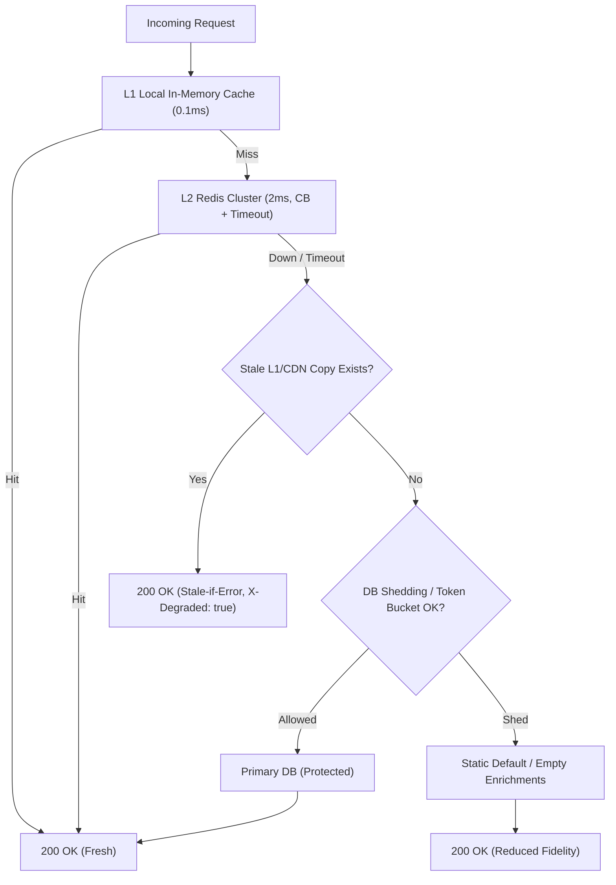
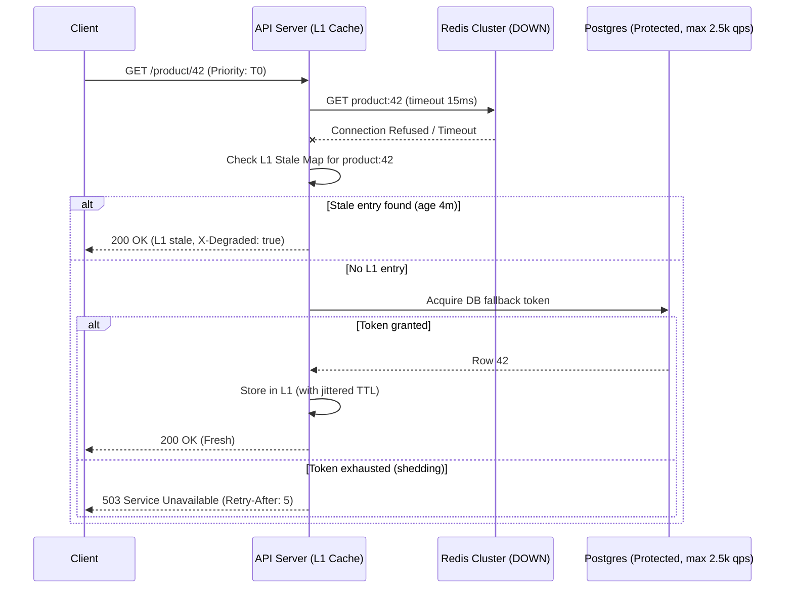
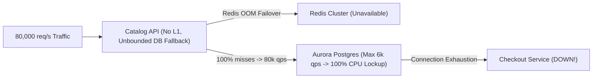

# Graceful Degradation & Fallbacks: What If the Cache Cluster Dies?

> **Prerequisites:** [Lesson 07: Bulkhead Pattern](../07-bulkhead-pattern/README.md).  
> **Estimated Reading Time:** 24–28 minutes  
> **Target Audience:** Backend and SRE engineers designing resilient user experiences, and candidates asked "what happens to your system when Redis, the recommendation engine, or a third-party API goes completely dark?"  
> **Free PDF Notes:** [Download SD-K-008.pdf](https://backendroadmap.com/notes/system-design/SD-K-008.pdf)

> [!NOTE]
> **In one line:** **Graceful degradation** keeps core functionality alive at reduced fidelity when dependencies fail or load spikes, while **fallbacks** provide a safe, bounded alternative response (stale cache, static defaults, or simplified logic) instead of a hard HTTP 500.

> [!TIP]
> **The Golden Rule:** Never let a non-critical dependency's failure fail a critical user journey—and never implement a fallback that hits the primary database with uncached peak traffic, or your fallback will become the outage.

---

## 1. What Graceful Degradation & Fallbacks Are, and What They Aren't

Imagine your Redis cluster—which normally serves 100,000 reads/s at 99% cache hit rate—suddenly dies. If every cache miss falls straight through to PostgreSQL, Postgres traffic jumps from 1,000 queries/s to 100,000 queries/s (a 100x stampede) and the database collapses within seconds.

Instead, a well-designed system **degrades gracefully**: it sheds expensive personalization, serves slightly stale data from a local in-memory L1 cache or CDN, switches to a lightweight default response, and protects the database with rate limits and load shedding so users can still browse and check out.

| Term | Precise Meaning | Example |
| :--- | :--- | :--- |
| **Graceful degradation** | Intentionally reducing feature richness or freshness to preserve core availability | Showing generic "Top Sellers" instead of personalized ML recommendations |
| **Fallback** | A pre-defined alternative execution path when a primary call fails or times out | Returning stale L1 cache or static JSON on Redis/API failure |
| **Stale-while-revalidate / Stale-if-error** | Serving expired cached data while refreshing asynchronously or during upstream outages | `Cache-Control: max-age=60, stale-if-error=3600` |
| **Fail-open vs. Fail-closed** | Choosing whether an unreachable check allows or blocks the request | Fraud/rate-limit check may fail-open; auth/payment must fail-closed |
| **Load shedding** | Dropping low-priority requests (e.g., analytics, bots) to protect high-priority traffic | Returning HTTP 503 for `/export` so `/checkout` stays at 200 OK |
| **Feature flag kill-switch** | Dynamically disabling a heavy subsystem via config without redeploying | Toggling `enable_live_inventory_badge = false` during Black Friday |
| **Not** | Silently swallowing errors on critical writes (like payments) | You cannot "fall back" to pretending a payment succeeded |

### Why It Matters
1. **Dependencies will fail:** In a system with 10 microservices at 99.9% availability each, the chance that *at least one* is degraded at any moment is $1 - 0.999^{10} \approx 1\%$ (over 7 hours/month).
2. **Naive fallbacks cause cascading failures:** Falling back from Redis to Postgres, or from a fast microservice to a heavy monolith endpoint, often amplifies load by 10–100x.
3. **Product & SRE alignment:** Designing degradation tiers turns catastrophic SEV-1 outages into minor, barely noticeable UX compromises.

---

## 2. Anatomy: Degradation Ladder & Fallback Hierarchy



Notice the **fallback ladder**:
1. **Fresh L1/L2** (full experience).
2. **Stale-if-error** (slightly old data, zero extra load on DB).
3. **Rate-limited DB fallback** (protects Postgres from a 100x stampede).
4. **Static / degraded response** (safe default, e.g., empty recommendations widget, "stock available" estimate).

| Failure Type | Fail-Open Appropriate? | Fail-Closed Required? |
| :--- | :--- | :--- |
| **Recommendations / Reviews / Avatar** | Yes (hide widget or show static defaults) | No |
| **Feature Flag Service** | Yes (use last-known-good local snapshot) | Only for compliance/billing gates |
| **Rate Limiter (Redis down)** | Usually yes (fall back to local per-pod token bucket) | Only for strict DDoS/abuse endpoints |
| **Authentication / Authorization** | **Never** | Yes (401/403/503) |
| **Payment Authorization / Ledger** | **Never** | Yes (fail or queue explicitly with user notice) |

> [!WARNING]
> **The #1 Fallback Trap: The "Cache-Miss Stampede" Fallback.** Never treat the primary database as an unthrottled fallback for a dead cache cluster. If Redis absorbs 99% of reads, a Redis outage sends $100\times$ traffic to Postgres, taking down both reads *and* writes. Always gate DB fallbacks with a **concurrency limiter / token bucket** and serve **stale L1/CDN data** first.

---

## 3. Mathematical Model: Availability Amplification & Cache-Failure Load

**1. Availability Without vs. With Degradation.**
Suppose a product page calls **Core Catalog** ($A_c = 0.9999$) and **3 optional services**: Reviews ($A_r = 0.999$), Recommendations ($A_m = 0.995$), and Loyalty ($A_l = 0.998$).
- **Strict synchronous dependency (no fallback):**

$$A_{\text{strict}} = 0.9999 \times 0.999 \times 0.995 \times 0.998 = 0.99192 \quad (99.19\% \approx 5.8\text{ hours/month downtime})$$

- **With graceful degradation (optional services fail to fallback):**

$$A_{\text{degraded}} = A_c = 0.9999 \quad (99.99\% \approx 4.3\text{ minutes/month downtime})$$

**2. Cache-Failure Amplification Factor ($M_{\text{amp}}$).**
If a cache has hit rate $h$ (e.g., $h = 0.99$) and total read rate $\lambda$:
- Normal DB read rate: $\lambda_{\text{DB,normal}} = \lambda (1 - h)$.
- When the cache dies ($h \to 0$): $\lambda_{\text{DB,outage}} = \lambda$.
- Load amplification factor on the DB:

$$M_{\text{amp}} = \frac{\lambda}{\lambda (1 - h)} = \frac{1}{1 - h}$$

For $h = 0.99$, $M_{\text{amp}} = \frac{1}{0.01} = 100\times$!
If Postgres is provisioned for $2\times$ normal DB load ($\mu_{\text{DB}} = 2 \cdot \lambda(1-h)$), **98% of the resulting traffic must be absorbed by L1 stale cache or shed** to keep Postgres alive.

---

## 4. Metrics & Percentiles

| Metric | Meaning | Alert When |
| :--- | :--- | :--- |
| `fallback_invocations_total` | Rate of fallback executions by dependency & reason | $> 0.5\%$ of requests for $> 2\text{ min}$ |
| `degraded_response_ratio` | Percentage of responses served with `X-Degraded: true` | $> 1\%$ sustained (SLO burn check) |
| `l1_stale_hit_ratio` | Percentage of requests served from expired L1 cache | Rising rapidly (signals L2 cache outage) |
| `load_shed_total` | Requests dropped by priority shedding | Any shedding on Tier-1/Core endpoints |
| `db_fallback_rejected_total` | Cache-miss fallbacks blocked by DB protection limiter | Rising (confirms DB is being protected from stampede) |

### Worked Example (Redis Cluster Outage)
An API serves $\lambda = 50{,}000\text{ req/s}$ with Redis hit rate $h = 0.98$ ($\lambda_{\text{DB,normal}} = 1{,}000\text{ qps}$). Postgres max capacity is $\mu_{\text{DB}} = 3{,}000\text{ qps}$.
1. **Without degradation:** Redis dies $\implies 50{,}000\text{ qps}$ hit Postgres ($50\times$ normal, $16.7\times$ max capacity). Postgres locks up in 3 seconds; 100% of users see 500s.
2. **With L1 Stale Cache (90% coverage) + DB Token Bucket (capped at $2{,}500\text{ qps}$):**
   - $45{,}000\text{ req/s}$ are served from L1 stale cache ($< 1\text{ ms}$).
   - $2{,}500\text{ req/s}$ pass the DB token bucket and populate fresh L1 entries.
   - $2{,}500\text{ req/s}$ (5% uncached cold keys) receive a fast degraded response or HTTP 503 `Retry-After: 5`.
   - **Result:** 95% of traffic succeeds at $< 5\text{ ms}$, and Postgres stays healthy at 83% capacity.

---

## 5. Compounding & Failure Modes

| Degradation Pattern | Failure Mode if Poorly Designed | Mitigation |
| :--- | :--- | :--- |
| **Unbounded DB fallback** | $100\times$ stampede crashes primary database | Gate DB fallback with semaphore/token bucket + singleflight |
| **Heavy fallback computation** | Fallback itself does expensive DB joins or external calls | Fallbacks must be $O(1)$, local, and dependency-free |
| **Untested fallback code** | Fallback throws `NullPointerException` in production (never run in tests) | Run regular Chaos / GameDay tests that trigger fallbacks |
| **Silent data corruption** | Failing open on auth/inventory oversells stock or leaks PII | Explicitly classify every endpoint as fail-open vs. fail-closed |
| **Thundering herd on recovery** | Cache comes back empty; all pods stampede simultaneously | Use `singleflight` coalescing + jittered TTLs + gradual warm-up |

---

## 6. Numbers Every Engineer Must Know

| Item | Typical | Implication |
| :--- | :---: | :--- |
| L1 in-memory cache lookup | $50\text{–}200\text{ ns}$ | Safe to serve 100k+ RPS per node during L2 outage |
| Cache-miss amplification at $99\%$ hit rate | $100\times$ DB load | Direct DB fallback without shedding is fatal |
| `stale-if-error` CDN window | $300\text{–}3600\text{ s}$ | Buys ops team 5–60 minutes to recover origin |
| Fallback latency budget | $< 5\text{ ms}$ | Must never block on network I/O |
| Criticality tiers | 3–4 tiers (T0 Core, T1 Standard, T2 Optional) | Shed T2 $\to$ T1 to preserve T0 at 100% |

---

## 7. Mechanism Deep Dive: Priority Load Shedding & Stale-If-Error



| Question | Answer |
| :--- | :--- |
| **Why keep expired entries in L1 memory?** | Memory is cheap; keeping expired entries for an extra `stale_ttl` (e.g., 1 hour) lets you serve `stale-if-error` when Redis or the DB is unreachable. |
| **How does `singleflight` help during degradation?** | If 500 concurrent requests miss L1 for the same hot key, `singleflight` sends only **1** query to the DB and shares the result across all 500 callers. |
| **What should a client do on `X-Degraded: true`?** | UI clients can hide optional badges ("Reviews temporarily unavailable") and avoid caching the degraded payload permanently. |
| **When NOT to use graceful degradation?** | Never degrade financial ledger writes, authentication checks, or idempotency validations—fail closed and return an explicit, retryable error. |

---

## 8. Hierarchical Budgets & Design Rules

| Slice | Rule | Control |
| :--- | :--- | :--- |
| **Criticality classification** | Tag every RPC/widget as `T0` (Core), `T1` (Important), `T2` (Optional) | Shed `T2` first, then `T1` |
| **Fallback purity** | Fallbacks must have **zero** external network dependencies | Local memory, static constants, or precomputed defaults |
| **DB protection** | Cap cache-miss DB fallbacks at $\le 70\%$ of DB max QPS | Token bucket + `singleflight` |
| **Stale bounds** | Bound `stale-if-error` window (e.g., 15m for prices, 24h for catalog) | Avoid serving dangerously stale pricing |
| **Kill switches** | Every expensive feature has a dynamic feature flag | Propagates in $< 10\text{ s}$ via local polling/push |
| **Error visibility** | Emit `fallback_invocations_total` + `X-Degraded` header | Never hide degradation from monitoring |

---

## 9. Top Mitigations

1. **Maintain a small L1 in-memory cache with a stale-if-error window** on every stateless pod for hot read paths.
2. **Coalesce concurrent misses with `singleflight`** so 1,000 requests for a hot key trigger 1 DB query, not 1,000.
3. **Gate every DB fallback with a rate limiter or semaphore** sized to what Postgres can safely handle.
4. **Implement priority-based load shedding** (T2 $\to$ T1 $\to$ T0) at the API gateway and service mesh.
5. **Add dynamic feature-flag kill switches** for non-essential, high-cost features (live inventory counts, ML recommendations, real-time analytics).
6. **Design static/lightweight UI fallbacks** (e.g., hide the "People also bought" carousel instead of crashing the whole product page).
7. **Test fallbacks continuously in staging and GameDays**—an untested fallback is worse than no fallback because it gives false confidence.

---

## 10. Production Reference / War Story: The Black Friday Redis Eviction Cascade

**Incident (SEV-1):** During peak Black Friday traffic, an e-commerce platform's Redis cluster hit 100% memory and triggered an OOM failover. Because the product-catalog service had no L1 cache and fell straight back to Aurora PostgreSQL on any Redis error, Aurora CPU spiked from 22% to 100% in 15 seconds, locking out even `/checkout` writes.



**Root Cause:**
1. Hit rate was $99.2\%$ ($M_{\text{amp}} = 125\times$), so Redis failure instantly sent $125\times$ read load to Aurora.
2. Catalog reads shared the primary Aurora writer/reader pool with Checkout, starving Checkout transactions.

**Fix:**
1. Added a per-pod **L1 LRU cache** (512 MB) storing fresh (30s) + stale-if-error (30m) catalog items.
2. Wrapped the DB fallback in **`singleflight` + a 2,000 QPS token bucket**; excess cold misses degraded to a minimal product skeleton.
3. Added a **feature-flag kill switch** to disable real-time personalized pricing badges under load. During the next Redis chaos test, Checkout stayed at $100\%$ availability and $p_{99} = 42\text{ ms}$.

---

## 11. Multi-Language Production Code Tabs

A production **Stale-If-Error L1/L2 Cache with Protected DB Fallback**: tries L1 $\to$ L2 (with circuit/timeout) $\to$ Stale L1 $\to$ Rate-Limited DB $\to$ Static Default.

````carousel
```go
// Go: Graceful Degradation Cache (L1 fresh -> L2 Redis -> L1 stale -> Token-bucket DB -> Static default).
package main

import (
	"context"
	"errors"
	"fmt"
	"sync"
	"time"
)

type CacheEntry struct {
	Value     string
	FreshAt   time.Time
	StaleAt   time.Time
}

type DegradingCatalog struct {
	mu       sync.RWMutex
	l1       map[string]CacheEntry
	dbTokens chan struct{} // simple token bucket / concurrency cap for DB fallback
}

func NewDegradingCatalog(maxDBConcurrent int) *DegradingCatalog {
	return &DegradingCatalog{
		l1:       make(map[string]CacheEntry),
		dbTokens: make(chan struct{}, maxDBConcurrent),
	}
}

func (c *DegradingCatalog) GetProduct(ctx context.Context, id string, l2Down bool) (val string, degraded bool) {
	now := time.Now()
	c.mu.RLock()
	entry, ok := c.l1[id]
	c.mu.RUnlock()

	if ok && now.Before(entry.FreshAt) {
		return entry.Value, false
	}

	// Simulate L2 cache lookup
	if !l2Down {
		// In production: query Redis with short timeout (e.g., 15ms)
		val = fmt.Sprintf("product-%s-from-l2", id)
		c.putL1(id, val)
		return val, false
	}

	// L2 failed: 1st fallback -> Stale L1
	if ok && now.Before(entry.StaleAt) {
		return entry.Value, true
	}

	// 2nd fallback -> Protected DB call (non-blocking token acquire)
	select {
	case c.dbTokens <- struct{}{}:
		defer func() { <-c.dbTokens }()
		val = fmt.Sprintf("product-%s-from-db", id)
		c.putL1(id, val)
		return val, false
	default:
		// 3rd fallback -> Safe static default (protects DB from stampede)
		return fmt.Sprintf("product-%s-basic-skeleton", id), true
	}
}

func (c *DegradingCatalog) putL1(id, val string) {
	now := time.Now()
	c.mu.Lock()
	c.l1[id] = CacheEntry{
		Value:   val,
		FreshAt: now.Add(30 * time.Second),
		StaleAt: now.Add(30 * time.Minute),
	}
	c.mu.Unlock()
}

var _ = errors.New
```
<!-- slide -->
```typescript
// TypeScript: Graceful Degradation pipeline with L1 stale-if-error & DB concurrency cap.
interface L1Entry<T> {
  value: T;
  freshUntil: number;
  staleUntil: number;
}

export class DegradingService<T> {
  private l1 = new Map<string, L1Entry<T>>();
  private activeDbFallbacks = 0;

  constructor(
    private readonly maxDbFallbacks: number,
    private readonly staticDefault: (key: string) => T
  ) {}

  async get(
    key: string,
    fetchL2: (k: string) => Promise<T>,
    fetchDb: (k: string) => Promise<T>
  ): Promise<{ data: T; degraded: boolean }> {
    const now = Date.now();
    const cached = this.l1.get(key);
    if (cached && now < cached.freshUntil) {
      return { data: cached.value, degraded: false };
    }

    try {
      const l2Val = await fetchL2(key);
      this.setL1(key, l2Val);
      return { data: l2Val, degraded: false };
    } catch {
      // L2 failed: serve stale L1 if within stale-if-error window
      if (cached && now < cached.staleUntil) {
        return { data: cached.value, degraded: true };
      }
      // Protect DB with concurrency cap
      if (this.activeDbFallbacks < this.maxDbFallbacks) {
        this.activeDbFallbacks++;
        try {
          const dbVal = await fetchDb(key);
          this.setL1(key, dbVal);
          return { data: dbVal, degraded: false };
        } finally {
          this.activeDbFallbacks--;
        }
      }
      // Final fallback: static default
      return { data: this.staticDefault(key), degraded: true };
    }
  }

  private setL1(key: string, value: T): void {
    const now = Date.now();
    this.l1.set(key, { value, freshUntil: now + 30_000, staleUntil: now + 1_800_000 });
  }
}
```
<!-- slide -->
```python
# Python: Stale-if-error L1 + protected DB fallback + cache-stampede simulation (stdlib only).
import threading
import time


class DegradingCache:
    def __init__(self, max_db_qps: int = 5):
        self.l1 = {}  # key -> (value, fresh_until, stale_until)
        self._lock = threading.Lock()
        self._db_sem = threading.BoundedSemaphore(max_db_qps)
        self.stats = {"l1_fresh": 0, "l2_ok": 0, "l1_stale": 0, "db_ok": 0, "static_fallback": 0}

    def get(self, key: str, l2_up: bool = True):
        now = time.monotonic()
        with self._lock:
            entry = self.l1.get(key)
        if entry and now < entry[1]:
            self.stats["l1_fresh"] += 1
            return entry[0], False

        if l2_up:
            val = f"{key}:l2"
            self._put(key, val, now)
            self.stats["l2_ok"] += 1
            return val, False

        if entry and now < entry[2]:
            self.stats["l1_stale"] += 1
            return entry[0], True

        if self._db_sem.acquire(blocking=False):
            try:
                val = f"{key}:db"
                self._put(key, val, now)
                self.stats["db_ok"] += 1
                return val, False
            finally:
                self._db_sem.release()

        self.stats["static_fallback"] += 1
        return f"{key}:static_default", True

    def _put(self, key: str, val: str, now: float):
        with self._lock:
            self.l1[key] = (val, now + 30.0, now + 1800.0)


if __name__ == "__main__":
    cache = DegradingCache(max_db_qps=2)
    cache.get("item:1", l2_up=True)                  # warm L1
    cache.l1["item:1"] = ("item:1:l2", 0.0, 9999999) # expire fresh, keep stale
    print(cache.get("item:1", l2_up=False))          # ('item:1:l2', True) -> stale L1
    print(cache.get("item:cold", l2_up=False))       # ('item:cold:db', False) -> protected DB
    print(cache.stats)
```
<!-- slide -->
```csharp
// C#: Graceful Degradation with L1 stale-if-error and SemaphoreSlim DB protection.
using System;
using System.Collections.Concurrent;
using System.Threading;
using System.Threading.Tasks;

public sealed record CacheEntry<T>(T Value, DateTimeOffset FreshUntil, DateTimeOffset StaleUntil);

public sealed class DegradingCatalog<T>(int maxDbFallbacks, Func<string, T> staticDefault)
{
    private readonly ConcurrentDictionary<string, CacheEntry<T>> _l1 = new();
    private readonly SemaphoreSlim _dbGuard = new(maxDbFallbacks, maxDbFallbacks);

    public async Task<(T Data, bool Degraded)> GetAsync(
        string key,
        Func<string, Task<T>> fetchL2,
        Func<string, Task<T>> fetchDb)
    {
        var now = DateTimeOffset.UtcNow;
        if (_l1.TryGetValue(key, out var entry) && now < entry.FreshUntil)
            return (entry.Value, false);

        try
        {
            var val = await fetchL2(key).ConfigureAwait(false);
            _l1[key] = new(val, now.AddSeconds(30), now.AddMinutes(30));
            return (val, false);
        }
        catch
        {
            if (entry is not null && now < entry.StaleUntil)
                return (entry.Value, true);

            if (await _dbGuard.WaitAsync(0).ConfigureAwait(false))
            {
                try
                {
                    var dbVal = await fetchDb(key).ConfigureAwait(false);
                    _l1[key] = new(dbVal, now.AddSeconds(30), now.AddMinutes(30));
                    return (dbVal, false);
                }
                finally { _dbGuard.Release(); }
            }

            return (staticDefault(key), true);
        }
    }
}
```
````

---

## 12. Hands-On CLI Verification Workflows

Verify HTTP `stale-if-error` and degraded header behavior with `curl` and Nginx/Redis chaos testing:

```bash
# 1. Inspect Cache-Control stale-if-error headers from CDN/API
curl -sI https://api.example.com/v1/catalog/42 | grep -iE "cache-control|x-degraded|age"
# Expected: Cache-Control: public, max-age=60, stale-while-revalidate=30, stale-if-error=3600

# 2. Simulate Redis outage locally (pause container) and verify API still returns 200 OK
docker pause local-redis
curl -i http://localhost:8080/v1/products/42
# Expected: HTTP/1.1 200 OK, X-Degraded: true (served from L1 stale/static fallback)
docker unpause local-redis

# 3. Run Python degradation check
python -c "from degrade_demo import DegradingCache; c = DegradingCache(); print(c.get('k1', l2_up=False))"
```

---

## 13. Common Mistakes to Avoid

1. **Unbounded DB fallback when Redis dies**, causing a $100\times$ load amplification stampede.
2. **Fallbacks that make network calls** to another fragile service instead of returning local/static data.
3. **Failing open on security or financial endpoints** (auth, permissions, payment authorization).
4. **Never testing fallbacks in staging**, leading to unhandled exceptions when the fallback finally runs in production.
5. **Caching degraded/empty fallback responses with a long TTL**, poisoning the cache long after the outage ends.
6. **Hiding degradation from observability**, so on-call engineers don't know 40% of users are seeing stale data.
7. **Shedding Tier-0 traffic equally with Tier-2 traffic**, instead of dropping low-priority features first.

---

## 14. Key Terms Glossary

| Key Term | Definition |
| :--- | :--- |
| **Graceful Degradation** | Preserving core functionality at reduced richness or freshness during failures or overload. |
| **Fallback** | Safe alternative response or execution path used when a primary dependency fails. |
| **Stale-If-Error** | Serving expired cached data when the origin or upstream cache is unreachable. |
| **Fail-Open** | Allowing a request to proceed (often with reduced checks) when a dependency is down. |
| **Fail-Closed** | Rejecting a request when a critical dependency (auth, ledger) is unreachable. |
| **Load Shedding** | Intentionally dropping low-priority requests to keep core traffic healthy. |
| **Cache-Miss Stampede** | Sudden surge of database queries triggered when a cache cluster fails or expires simultaneously. |
| **Kill Switch** | Dynamic feature flag that disables a heavy or broken subsystem without a code deploy. |
| **Singleflight** | Request coalescing so concurrent misses for the same key share one upstream fetch. |
| **Criticality Tiering** | Classifying endpoints (T0/T1/T2) to determine shedding and degradation order. |

---

## 15. System Design Interview Questions & Answers

### Basic Conceptual Questions

<details>
<summary><strong>Q1: What is the difference between graceful degradation and a fallback? [BASIC]</strong></summary>

**Answer:**
**Graceful degradation** is the system-level property of keeping core features working at reduced fidelity when dependencies fail or load spikes. A **fallback** is the specific mechanism (e.g., returning stale cache, static defaults, or a simplified calculation) used by a component to degrade gracefully instead of throwing a 500.
</details>

<details>
<summary><strong>Q2: What happens if Redis dies and your service simply falls back to querying Postgres? [BASIC]</strong></summary>

**Answer:**
If Redis had a $99\%$ hit rate, Postgres suddenly receives $1/(1-0.99) = 100\times$ its normal read load. Unless Postgres is 100x over-provisioned, it will immediately saturate CPU/connections and crash—turning a cache outage into a total database outage.
</details>

<details>
<summary><strong>Q3: Give an example of when to fail-open vs. fail-closed. [BASIC]</strong></summary>

**Answer:**
**Fail-open:** Recommendation engine, product reviews, or non-critical feature flags (serve default/empty). **Fail-closed:** Authentication/RBAC checks, payment authorization, or inventory deduction during checkout (reject safely rather than risking unauthorized access or double-selling).
</details>

<details>
<summary><strong>Q4: Why should a fallback never depend on another external network call? [BASIC]</strong></summary>

**Answer:**
During a partial outage or network partition, calling another remote service risks cascading latency or failing a second time. Fallbacks should be $O(1)$, in-process (L1 stale cache, static defaults, or local computation).
</details>

### Scenario-Based Architecture Questions

<details>
<summary><strong>Q5: Design a product page that survives a total Redis cluster outage at 50,000 RPS. [SCENARIO]</strong></summary>

**Answer:**
Use a 4-step ladder: (1) Small in-memory **L1 cache** on each pod with fresh TTL (30s) and `stale-if-error` TTL (30m); (2) **`singleflight`** to coalesce misses; (3) **Token bucket / semaphore** capping DB fallback QPS to safe Postgres limits; (4) **Static skeleton fallback** + CDN `stale-if-error` for any remaining uncached cold misses.
</details>

<details>
<summary><strong>Q6: Your ML personalization service is timing out under Black Friday load. How do you protect checkout? [SCENARIO]</strong></summary>

**Answer:**
Wrap the ML call in a short timeout (e.g., 50 ms), a bulkhead, and a circuit breaker; on failure, fall back to a precomputed daily "Top Sellers" list stored in L1/CDN. Also expose a **feature-flag kill switch** to disable personalization calls completely during peak events.
</details>

<details>
<summary><strong>Q7: How do you handle rate-limiting if the centralized Redis rate-limiter goes down? [SCENARIO]</strong></summary>

**Answer:**
Fall back to a **local per-pod in-memory token bucket** (fail-open for the global limit, enforcing an approximate `global_limit / num_pods` local limit). This prevents a Redis outage from blocking all legitimate users while still protecting the backend from a single-client flood.
</details>

<details>
<summary><strong>Q8: How do you prevent a "thundering herd" when the cache cluster comes back online? [SCENARIO]</strong></summary>

**Answer:**
Use **jittered TTLs** so keys don't expire simultaneously, **probabilistic early expiration**, **`singleflight`** per key, and a **gradual warm-up / token-bucketed fill** so pods don't all hammer Postgres to repopulate Redis at the exact same second.
</details>

### Advanced & Tricky Interview Questions

<details>
<summary><strong>Q9: Why do fallbacks frequently fail in real production incidents? [TRICKY]</strong></summary>

**Answer:**
Because they are **rarely exercised in normal traffic** (code rot, NPEs, missing permissions), they **amplify load** (e.g., falling back to an uncached DB), or they **poison caches** by storing the degraded response under a normal TTL. Continuous Chaos testing and separate `X-Degraded` cache-bypass rules prevent this.
</details>

<details>
<summary><strong>Q10: How does `stale-while-revalidate` differ from `stale-if-error`? [TRICKY]</strong></summary>

**Answer:**
`stale-while-revalidate` optimizes *normal latency* by serving an expired response immediately while refreshing asynchronously in the background. `stale-if-error` is a *resilience* directive that serves expired content only when the origin returns 5xx or times out.
</details>

<details>
<summary><strong>Q11: If a service degrades gracefully and still returns HTTP 200, how do you avoid masking an outage? [TRICKY]</strong></summary>

**Answer:**
Emit explicit **degradation metrics** (`fallback_invocations_total`, `degraded_response_ratio`), attach an `X-Degraded: true` header for tracing, and alert on degradation SLOs (e.g., page on-call if $> 2\%$ of responses are degraded for $> 5\text{ minutes}$).
</details>

<details>
<summary><strong>Q12: How do you test graceful degradation safely in production? [TRICKY]</strong></summary>

**Answer:**
Run **GameDays / fault injection** during low-traffic windows using a canary pod or synthetic header (`X-Inject-Fault: redis-timeout`) in a service mesh (Envoy/Istio) to verify L1 stale hits, DB token-bucket capping, and UI rendering before Black Friday.
</details>

---

## 16. One-Page Master Cheat Sheet

```
+---------------------------------------------------------------------------------------------------------+
|                    GRACEFUL DEGRADATION & FALLBACKS — MASTER CHEAT SHEET                                |
+---------------------------------------------------------------------------------------------------------+
| 1. GOAL: Keep Tier-0 (core) journeys alive at reduced fidelity when dependencies fail or load spikes.   |
+---------------------------------------------------------------------------------------------------------+
| 2. CACHE FAILURE MATH: Load amplification M_amp = 1 / (1 - hit_rate).                                   |
|    At 99% hit rate, dead Redis = 100x DB load -> NEVER fall back straight to an unthrottled DB!         |
+---------------------------------------------------------------------------------------------------------+
| 3. FALLBACK LADDER: L1 Fresh -> L2 Redis -> L1 Stale-if-Error -> Token-Bucketed DB -> Static Default.   |
+---------------------------------------------------------------------------------------------------------+
| 4. FAIL-OPEN vs FAIL-CLOSED:                                                                            |
|    - Fail-open: Recs, reviews, avatars, non-critical flags.                                             |
|    - Fail-closed: Auth/RBAC, payments, inventory deduction.                                             |
+---------------------------------------------------------------------------------------------------------+
| 5. GOLDEN RULES: Fallbacks must be O(1) & network-free; never cache degraded data as fresh;             |
|    emit X-Degraded + metrics; test fallbacks in Chaos GameDays.                                         |
+---------------------------------------------------------------------------------------------------------+
```

---

## Further Reading & Sources

- AWS Builders' Library, [Using load shedding to avoid overload](https://aws.amazon.com/builders-library/using-load-shedding-to-avoid-overload/).
- RFC 5861, [HTTP Cache-Control Extensions for Stale Content (`stale-while-revalidate`, `stale-if-error`)](https://datatracker.ietf.org/doc/html/rfc5861).
- Google SRE Book, [Handling Overload](https://sre.google/sre-book/handling-overload/).
- Netflix Tech Blog, *Making the Netflix API More Resilient* (fallback strategies & Hystrix).

---

## Free PDF Notes

[SD-K-008.pdf](https://backendroadmap.com/notes/system-design/SD-K-008.pdf)

---

## Next

Continue with [Lesson 09: Health Checks & Self-Healing](../09-health-checks-self-healing/README.md): Liveness vs Readiness vs Startup Probes.
