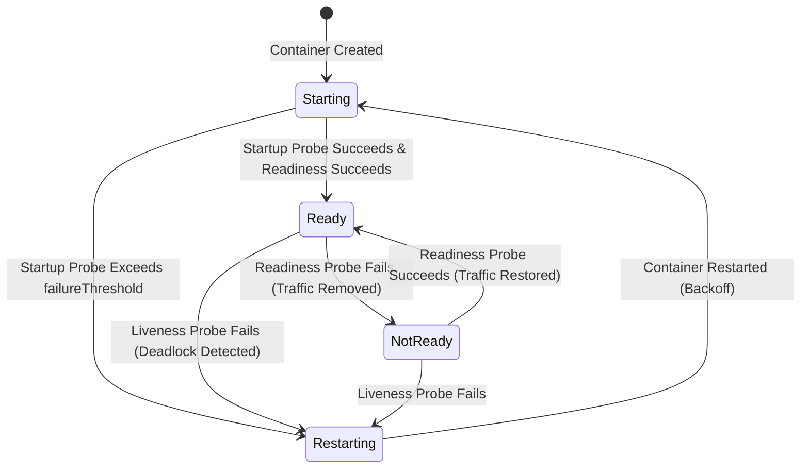
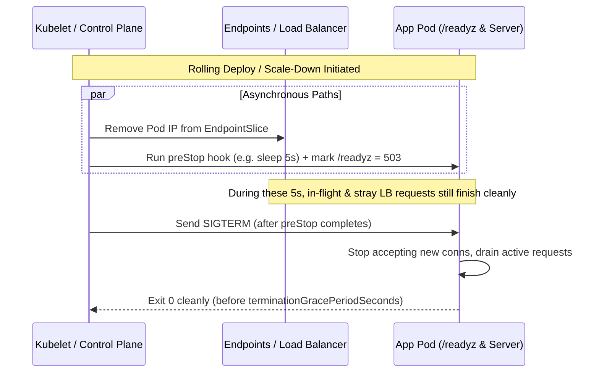
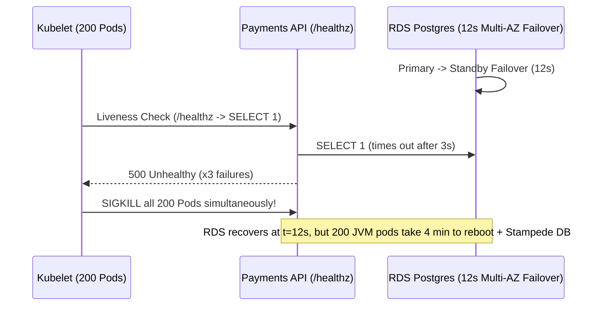

# Health Checks & Self-Healing: Liveness vs Readiness vs Startup Probes

> **Prerequisites:** [Lesson 08: Graceful Degradation & Fallbacks](../08-graceful-degradation-fallbacks/README.md).  
> **Estimated Reading Time:** 24–28 minutes  
> **Target Audience:** Backend and platform engineers running services on Kubernetes, ECS, or load balancers, and candidates asked "what is the difference between liveness, readiness, and startup probes, and how can a bad health check cause a full outage?"  
> **Free PDF Notes:** [Download SD-K-009.pdf](https://backendroadmap.com/notes/system-design/SD-K-009.pdf)

> [!NOTE]
> **In one line:** **Startup probes** protect slow-booting apps during initialization; **readiness probes** control whether a load balancer sends traffic to a pod; and **liveness probes** tell the orchestrator when a wedged process must be restarted to self-heal.

> [!TIP]
> **The Golden Rule:** **Never check external dependencies (Postgres, Redis, downstream APIs) inside a Liveness probe.** If Postgres blips for 10 seconds, a dependency-checking liveness probe will restart every pod in your fleet simultaneously—turning a brief DB hiccup into a full-cluster crash loop.

---

## 1. What Health Checks & Self-Healing Are, and What They Aren't

Orchestrators like Kubernetes and AWS ECS automate self-healing: they remove overloaded instances from load balancers and restart wedged processes. To do this safely, they rely on three distinct signals—**Startup**, **Readiness**, and **Liveness**—each triggering a completely different action.

Confusing them is one of the most common causes of self-inflicted production outages. If you make Liveness too sensitive or tie it to a database check, a single downstream slowdown causes Kubernetes to kill healthy application pods in a synchronized storm.

| Term | Precise Meaning | Action on Failure |
| :--- | :--- | :--- |
| **Startup Probe** | Runs once during boot; disables liveness/readiness until app initializes | Kills container only if `failureThreshold * periodSeconds` expires |
| **Readiness Probe** | Checks if the pod can currently serve traffic | **Removes pod IP** from Service/LB endpoints (does *not* restart) |
| **Liveness Probe** | Checks if the process itself is alive (not deadlocked/event-loop wedged) | **Kills and restarts** the container (`SIGKILL` / restart) |
| **Shallow health check** | Fast in-process check (HTTP 200, event loop responsive, memory OK) | Used for **Liveness** |
| **Deep health check** | Verifies critical local state or immediate dependencies (DB pool, cache) | Used cautiously for **Readiness** (with timeouts) |
| **Graceful shutdown (`preStop`)** | Drains in-flight requests after readiness fails / `SIGTERM` arrives | Prevents 502s during rolling deploys |
| **Not** | A replacement for application metrics or distributed tracing | Probes are binary control-plane signals, not observability |

### Why It Matters
1. **Different failures require different remedies:** A deadlocked process needs a *restart* (Liveness); a pod warming a 5 GB ML model or waiting on a DB migration needs *patience* (Startup); a pod shedding load or waiting on a local cache needs *traffic removal* (Readiness).
2. **Bad liveness probes cause cascading outages:** Restarting pods clears warm caches, drops active connections, and spikes CPU on reboot—amplifying load on the exact dependency that blipped.
3. **Zero-downtime deploys depend on Readiness + `SIGTERM`:** Without proper readiness drainage, rolling deployments drop in-flight requests and return HTTP 502 Bad Gateway.

---

## 2. Anatomy: The Three Probes & Pod Lifecycle



- **Startup Probe** runs first. While it is running, Liveness and Readiness are paused. This prevents slow-starting JVM/ML containers from being killed mid-boot.
- **Readiness Probe** runs continuously after startup. If it fails `failureThreshold` times, Kubernetes removes the pod from `Endpoints` / `EndpointSlice` (and Envoy/ALB stops routing to it), giving the pod breathing room to recover without killing in-flight work.
- **Liveness Probe** runs continuously after startup. It should only fail when the process is **unrecoverably wedged** (deadlocked threads, event loop blocked for > 15s, corrupted internal state) where only a restart can fix it.

| Probe | What Should It Check? | What Should It NEVER Check? |
| :--- | :--- | :--- |
| **Startup** | Local port open, config loaded, local cache/model warmed | Remote optional services |
| **Readiness** | Local workers/pools initialized, critical local state ready, graceful shutdown not started | Non-critical dependencies (recommendations, analytics) |
| **Liveness** | Process responsive (HTTP 200 + event-loop/deadlock ping) | **External DBs, Redis, downstream HTTP APIs** |

> [!WARNING]
> **The #1 Health Check Trap: Dependency Checks in Liveness Probes.** If `/livez` runs `SELECT 1` on Postgres and Postgres experiences a 15-second failover, every pod's liveness probe fails simultaneously. Kubernetes kills all pods, wipes their warm caches, and hammers Postgres with cold-boot connection storms when they restart.

---

## 3. Mathematical Model: Detection Time, Restart Storm & Availability

**1. Probe Detection Time ($T_{\text{detect}}$).**
With probe interval $P$ (`periodSeconds`), probe timeout $T_{\text{to}}$ (`timeoutSeconds`), and failure threshold $F$ (`failureThreshold`), worst-case time to detect a failure is:

$$T_{\text{detect,worst}} \approx (F - 1) \cdot P + T_{\text{to}} + T_{\text{sync}}$$

where $T_{\text{sync}}$ is endpoint propagation delay (e.g., 1–3 s for `kube-proxy` / Envoy `EndpointSlice` updates).
- Example: $P = 5\text{ s}$, $F = 3$, $T_{\text{to}} = 2\text{ s}$, $T_{\text{sync}} = 2\text{ s}$:

$$T_{\text{detect,worst}} = (3 - 1) \times 5 + 2 + 2 = 14\text{ seconds}$$

**2. Graceful Shutdown Window ($T_{\text{drain}}$).**
During a rolling update, Kubernetes sends `SIGTERM` and removes the pod from Endpoints **asynchronously**. If `kube-proxy` takes $T_{\text{sync}} = 3\text{ s}$ to update iptables/IPVS across all nodes, and your app exits immediately on `SIGTERM`, new requests arriving in those 3 seconds get `Connection Refused` (502).
Therefore, `terminationGracePeriodSeconds` must satisfy:

$$T_{\text{grace}} \ge T_{\text{preStop}} + T_{\text{inflight\_max}} + T_{\text{buffer}}$$

Example: $T_{\text{preStop}} = 5\text{ s}$ (wait for LB drain) $+ 25\text{ s}$ (max in-flight request) $+ 5\text{ s}$ buffer $= 35\text{ s}$ (`terminationGracePeriodSeconds: 45`).

**3. Fleet Capacity Under Readiness Shedding.**
If $N = 10$ pods handle $10{,}000\text{ req/s}$ ($1{,}000\text{ req/s}$ each, max capacity $1{,}200\text{ req/s}$ each) and 3 pods fail readiness due to overload:

$$\text{Remaining Load/Pod} = \frac{10{,}000}{10 - 3} = 1{,}429\text{ req/s} > 1{,}200\text{ req/s}$$

The remaining 7 pods immediately overload, fail *their* readiness checks, and trigger a **cascading fleet collapse**. Readiness probes must be paired with **load shedding** (HTTP 503) rather than marking overloaded pods unready!

---

## 4. Metrics & Percentiles

| Metric | Meaning | Alert When |
| :--- | :--- | :--- |
| `kube_pod_container_status_restarts_total` | Container restarts (often triggered by Liveness/OOM) | $> 2$ restarts in 15 min across fleet |
| `kube_endpoint_address_available` | Ready pods serving traffic in Service | Drops below `minReplicas` or $< 70\%$ of desired |
| `healthcheck_duration_seconds_p99` | Latency of `/healthz` and `/readyz` | $> 100\text{ ms}$ (indicates pool starvation) |
| `probe_failure_total` | Failed probe attempts by pod & probe type | Any sustained spike in Readiness/Liveness failures |
| `http_502_bad_gateway_total` | Requests sent to terminating/dead pods | Spikes during rolling deployments |

### Worked Example (Slow-Starting JVM Service)
A Spring Boot service takes `45 s` to load caches on boot (up to `75 s` under CPU contention).
- **Broken config:** No Startup Probe; Liveness has `initialDelaySeconds: 30, periodSeconds: 10, failureThreshold: 3`. Worst-case boot allowance = $30 + 2 \times 10 = 50\text{ s}$. Under CPU load, boot takes `65 s` $\implies$ Kubernetes kills the pod mid-boot and enters `CrashLoopBackOff` forever.
- **Fixed config:**
  - **Startup Probe:** `periodSeconds: 5, failureThreshold: 24` (allows up to $24 \times 5 = 120\text{ s}$ to boot, while ready pods pass in 45s).
  - **Readiness Probe:** `periodSeconds: 5, timeoutSeconds: 2, failureThreshold: 2`.
  - **Liveness Probe:** `periodSeconds: 10, timeoutSeconds: 2, failureThreshold: 3` (only checks process/event-loop health).

---

## 5. Compounding & Failure Modes

| Failure Mode | Mechanism | Impact |
| :--- | :--- | :--- |
| **Dependency in Liveness** | DB hiccup fails `/livez` on all pods | Synchronized fleet restart + cold-cache stampede |
| **Overload in Readiness** | High CPU causes `/readyz` timeout | Remaining pods get more traffic $\to$ cascading collapse |
| **Missing `preStop` sleep** | App closes socket on `SIGTERM` before LB updates | HTTP 502 errors on every rolling deploy |
| **Shared thread pool for `/healthz`** | Traffic spike starves `/healthz` | Healthy pods killed for "unresponsiveness" |
| **No Startup Probe** | Static `initialDelaySeconds` too short for slow boots | Infinite `CrashLoopBackOff` on new deploys |

---

## 6. Numbers Every Engineer Must Know

| Item | Typical | Implication |
| :--- | :---: | :--- |
| Liveness probe latency | $< 5\text{ ms}$ | Must be shallow, local, and non-blocking |
| `kube-proxy` / ALB drain propagation | $2\text{–}10\text{ s}$ | `preStop: sleep 5-10` prevents deploy-time 502s |
| Default K8s `terminationGracePeriodSeconds` | $30\text{ s}$ | Increase if max request/stream takes longer |
| Startup probe budget | $60\text{–}180\text{ s}$ | `periodSeconds: 5` $\times$ `failureThreshold: 24` |
| Readiness failure threshold | $2\text{–}3$ checks | Fast enough to isolate broken pods, avoids flapping |
| Liveness failure threshold | $3\text{–}5$ checks | Never kill on a single transient GC pause |

---

## 7. Mechanism Deep Dive: Graceful Shutdown & Zero-Downtime Drain



| Question | Answer |
| :--- | :--- |
| **Why does `SIGTERM` race with Load Balancer updates?** | Kubelet sends `SIGTERM` to the container and tells the API server to remove the pod from `Endpoints` **in parallel**. `kube-proxy` or AWS ALB takes 2–5s to reprogram rules, so packets still arrive after `SIGTERM`. |
| **What should `/readyz` return during `preStop`?** | Immediately flip an atomic `draining = true` flag so `/readyz` returns `503 Service Unavailable`, while keeping the HTTP server alive for `5–10 s` to finish stray requests. |
| **Should `/readyz` fail when a pod is at 95% CPU?** | **No!** Failing readiness shifts traffic to the remaining pods, overloading them too. Return `200 OK` on `/readyz` and shed excess work with HTTP `503`/`429` at the application layer. |
| **When NOT to use a Liveness probe?** | For short-lived batch `Job` pods or single-shot workers where restarting mid-task is undesirable, or when a crash already exits the process cleanly (exit code $\ne 0$). |

---

## 8. Hierarchical Budgets & Design Rules

| Slice | Rule | Control |
| :--- | :--- | :--- |
| **Three endpoints** | Separate `/startupz`, `/readyz`, `/livez` | Never alias all three to `/health` |
| **Liveness purity** | Zero external I/O in `/livez` | Only check process deadlock / event-loop lag |
| **Startup patience** | Use `startupProbe` instead of huge `initialDelaySeconds` | Fast boot when healthy, safe margin when slow |
| **Dedicated admin listener** | Serve probes on a separate port/goroutine/pool | Prevent user traffic from starving `/livez` |
| **Shutdown drain** | `preStop` sleep ($5\text{–}10\text{ s}$) + `SIGTERM` drain | Zero 502s during rolling deploys |
| **Overload behavior** | Shed load at app layer; keep `/readyz` returning 200 | Prevent cascading fleet eviction |

---

## 9. Top Mitigations

1. **Keep `/livez` strictly local and shallow** (check event-loop responsiveness or deadlock watchdog, never Postgres/Redis).
2. **Always configure a `startupProbe`** for apps with cache warming, DB migrations, or large model loads.
3. **Add a `preStop` sleep (`5–10 s`) + `SIGTERM` graceful drain** so Load Balancers stop routing before the server closes its listening socket.
4. **Run health endpoints on an isolated thread pool or management port** so request saturation never triggers false liveness kills.
5. **Never mark a pod Unready due to high load**—shed excess requests with `429`/`503` instead of pushing load onto surviving pods.
6. **Bound deep readiness timeouts** (e.g., `timeoutSeconds: 2` with a `500 ms` internal check timeout) so probes never hang.
7. **Alert on `kube_pod_container_status_restarts_total`** to catch silent liveness-induced restart loops early.

---

## 10. Production Reference / War Story: The 12-Second Postgres Failover That Killed 200 Pods

**Incident (SEV-1):** A fintech payments API ran 200 pods behind an ALB. During a planned RDS Multi-AZ failover (which took 12 seconds), all 200 pods simultaneously failed their Kubernetes Liveness probes and restarted, causing a 9-minute total outage even after RDS had already recovered.



**Root Cause:**
1. Both `livenessProbe` and `readinessProbe` pointed to `/healthz`, which executed `SELECT 1` against RDS.
2. When RDS paused for 12s, all 200 pods failed 3 liveness checks ($P = 4\text{ s}, F = 3$) and were killed by Kubelet.
3. Booting 200 JVM pods concurrently saturated CPU and hammered RDS with 200 connection-pool warmups, delaying full recovery to 9 minutes.

**Fix:**
1. Split `/healthz` into `/livez` (in-memory event-loop & deadlock check only, $< 1\text{ ms}$) and `/readyz` (startup DB check + graceful shutdown flag).
2. Added `startupProbe` with `120 s` budget and `preStop: sleep 5`.
3. In the next RDS failover test, **0 pods restarted**; traffic paused briefly for the 12s DB switchover and resumed at $100\%$ capacity immediately.

---

## 11. Multi-Language Production Code Tabs

Production-ready HTTP server exposing **Startup**, **Readiness**, and **Liveness** (with event-loop/watchdog check) plus **graceful `SIGTERM` drain**.

````carousel
```go
// Go: Separate /startupz, /readyz, /livez + graceful SIGTERM drain.
package main

import (
	"context"
	"log"
	"net/http"
	"os"
	"os/signal"
	"sync/atomic"
	"syscall"
	"time"
)

type HealthState struct {
	started  atomic.Bool
	draining atomic.Bool
}

func main() {
	state := &HealthState{}

	// Simulate async startup warmup (e.g. loading local cache)
	go func() {
		time.Sleep(500 * time.Millisecond)
		state.started.Store(true)
	}()

	mux := http.NewServeMux()
	mux.HandleFunc("/startupz", func(w http.ResponseWriter, r *http.Request) {
		if !state.started.Load() {
			http.Error(w, "starting", http.StatusServiceUnavailable)
			return
		}
		w.WriteHeader(http.StatusOK)
		_, _ = w.Write([]byte("started"))
	})

	mux.HandleFunc("/readyz", func(w http.ResponseWriter, r *http.Request) {
		if !state.started.Load() || state.draining.Load() {
			http.Error(w, "not ready", http.StatusServiceUnavailable)
			return
		}
		w.WriteHeader(http.StatusOK)
		_, _ = w.Write([]byte("ready"))
	})

	// Shallow liveness: NO external DB/Redis calls!
	mux.HandleFunc("/livez", func(w http.ResponseWriter, r *http.Request) {
		w.WriteHeader(http.StatusOK)
		_, _ = w.Write([]byte("alive"))
	})

	srv := &http.Server{Addr: ":8080", Handler: mux}
	go func() {
		if err := srv.ListenAndServe(); err != nil && err != http.ErrServerClosed {
			log.Fatalf("listen: %v", err)
		}
	}()

	stop := make(chan os.Signal, 1)
	signal.Notify(stop, syscall.SIGTERM, syscall.SIGINT)
	<-stop

	// 1. Fail /readyz immediately while allowing LB EndpointSlice propagation
	state.draining.Store(true)
	time.Sleep(5 * time.Second)

	// 2. Drain in-flight requests cleanly
	ctx, cancel := context.WithTimeout(context.Background(), 20*time.Second)
	defer cancel()
	_ = srv.Shutdown(ctx)
}
```
<!-- slide -->
```typescript
// TypeScript (Node HTTP): Startup, Readiness, Liveness + Event-loop lag check + Graceful Drain.
import http from "node:http";

let started = false;
let draining = false;
let lastLoopTick = Date.now();

// Detect event-loop starvation (if blocked > 5s, liveness fails)
setInterval(() => {
  lastLoopTick = Date.now();
}, 1000).unref();

setTimeout(() => {
  started = true;
}, 500);

const server = http.createServer((req, res) => {
  if (req.url === "/startupz") {
    res.writeHead(started ? 200 : 503).end(started ? "started" : "starting");
    return;
  }
  if (req.url === "/readyz") {
    const ready = started && !draining;
    res.writeHead(ready ? 200 : 503).end(ready ? "ready" : "not ready");
    return;
  }
  if (req.url === "/livez") {
    const lagMs = Date.now() - lastLoopTick;
    const alive = lagMs < 5000;
    res.writeHead(alive ? 200 : 503).end(alive ? "alive" : "event loop wedged");
    return;
  }
  res.writeHead(200).end("ok");
});

process.on("SIGTERM", () => {
  draining = true; // Stop receiving new LB traffic
  setTimeout(() => {
    server.close(() => process.exit(0));
  }, 5000); // Wait for LB Endpoint propagation before closing socket
});

server.listen(8080);
```
<!-- slide -->
```python
# Python: Stdlib HTTP server with /startupz, /readyz, /livez and graceful SIGTERM drain.
from http.server import BaseHTTPRequestHandler, ThreadingHTTPServer
import signal
import threading
import time

state = {"started": False, "draining": False}


class ProbeHandler(BaseHTTPRequestHandler):
    def do_GET(self):
        if self.path == "/startupz":
            code = 200 if state["started"] else 503
        elif self.path == "/readyz":
            code = 200 if (state["started"] and not state["draining"]) else 503
        elif self.path == "/livez":
            code = 200  # Shallow process check only; never query external DBs here
        else:
            code = 200
        self.send_response(code)
        self.end_headers()
        self.wfile.write(b"ok\n" if code == 200 else b"unavailable\n")

    def log_message(self, format, *args):
        pass  # Suppress noisy probe logs


def run():
    server = ThreadingHTTPServer(("127.0.0.1", 8080), ProbeHandler)
    threading.Timer(0.5, lambda: state.__setitem__("started", True)).start()

    def handle_sigterm(_signum, _frame):
        state["draining"] = True
        threading.Timer(5.0, server.shutdown).start()

    signal.signal(signal.SIGTERM, handle_sigterm)
    server.serve_forever()


if __name__ == "__main__":
    run()
```
<!-- slide -->
```csharp
// C# (ASP.NET Core Minimal API): Separate Startup, Readiness, and Liveness health checks.
using Microsoft.AspNetCore.Builder;
using Microsoft.AspNetCore.Diagnostics.HealthChecks;
using Microsoft.Extensions.DependencyInjection;
using Microsoft.Extensions.Diagnostics.HealthChecks;

var builder = WebApplication.CreateBuilder(args);
var state = new AppHealthState();

builder.Services.AddSingleton(state);
builder.Services.AddHealthChecks()
    .AddCheck("startup", () => state.Started ? HealthCheckResult.Healthy() : HealthCheckResult.Unhealthy(), tags: ["startup"])
    .AddCheck("ready", () => state.Started && !state.Draining ? HealthCheckResult.Healthy() : HealthCheckResult.Unhealthy(), tags: ["ready"])
    .AddCheck("live", () => HealthCheckResult.Healthy("Process alive"), tags: ["live"]);

var app = builder.Build();
app.Lifetime.ApplicationStopping.Register(() =>
{
    state.Draining = true;
    Thread.Sleep(TimeSpan.FromSeconds(5)); // Allow LB drain before Kestrel closes sockets
});

app.MapHealthChecks("/startupz", new HealthCheckOptions { Predicate = r => r.Tags.Contains("startup") });
app.MapHealthChecks("/readyz", new HealthCheckOptions { Predicate = r => r.Tags.Contains("ready") });
app.MapHealthChecks("/livez", new HealthCheckOptions { Predicate = r => r.Tags.Contains("live") });

_ = Task.Run(async () => { await Task.Delay(500); state.Started = true; });
app.Run();

public sealed class AppHealthState
{
    public volatile bool Started;
    public volatile bool Draining;
}
```
````

---

## 12. Hands-On CLI Verification Workflows

Inspect and verify Kubernetes probes and endpoint drainage in a live cluster:

```bash
# 1. Inspect configured Startup, Readiness, and Liveness probes on a Deployment
kubectl get deploy payments-api -o jsonpath='{.spec.template.spec.containers[0].livenessProbe}' | jq .
kubectl get deploy payments-api -o jsonpath='{.spec.template.spec.containers[0].readinessProbe}' | jq .

# 2. Watch Endpoints / EndpointSlices drain in real time during a rolling restart
kubectl get endpointslices -l kubernetes.io/service-name=payments-api -w

# 3. Check recent probe failure events across the namespace
kubectl get events --field-selector reason=Unhealthy --sort-by='.lastTimestamp'

# 4. Verify local probe endpoints return expected codes
curl -s -o /dev/null -w "startup:%{http_code}\n" http://localhost:8080/startupz
curl -s -o /dev/null -w "ready:%{http_code}\n"   http://localhost:8080/readyz
curl -s -o /dev/null -w "live:%{http_code}\n"    http://localhost:8080/livez
```

---

## 13. Common Mistakes to Avoid

1. **Checking Postgres, Redis, or downstream APIs in `/livez`**, causing synchronized fleet restarts during brief DB failovers.
2. **Pointing all three probes to the same `/health` endpoint**, mixing startup patience, traffic routing, and process restarts.
3. **Failing `/readyz` when CPU or memory is high**, shifting load onto surviving pods and triggering a cascading collapse.
4. **Skipping `preStop` sleep / graceful `SIGTERM` drain**, causing HTTP 502s during every rolling deployment.
5. **Serving `/livez` on the same saturated worker pool** as heavy user requests.
6. **Using a tiny `initialDelaySeconds` without a `startupProbe`**, trapping slow-booting apps in `CrashLoopBackOff`.
7. **Logging every probe hit at `INFO` level**, flooding log pipelines with millions of `/livez 200 OK` lines.

---

## 14. Key Terms Glossary

| Key Term | Definition |
| :--- | :--- |
| **Startup Probe** | One-time boot check that pauses readiness/liveness until initialization finishes. |
| **Readiness Probe** | Continuous check controlling whether a pod receives load-balancer traffic. |
| **Liveness Probe** | Continuous check determining whether a wedged container must be killed and restarted. |
| **Self-Healing** | Automated orchestrator recovery (restarting crashed/deadlocked pods, replacing failed nodes). |
| **Shallow Health Check** | Fast, local, dependency-free check verifying process/event-loop responsiveness. |
| **Deep Health Check** | Check that verifies downstream dependencies; dangerous in liveness probes. |
| **Graceful Shutdown** | Draining active requests after `SIGTERM` and failing readiness before exiting. |
| **preStop Hook** | Lifecycle hook run before `SIGTERM` to allow LB endpoint removal to propagate. |
| **CrashLoopBackOff** | Exponential restart delay when a container repeatedly crashes or fails startup/liveness probes. |
| **EndpointSlice** | Kubernetes object tracking ready pod IPs for a Service's load balancing. |

---

## 15. System Design Interview Questions & Answers

### Basic Conceptual Questions

<details>
<summary><strong>Q1: What is the difference between Liveness, Readiness, and Startup probes? [BASIC]</strong></summary>

**Answer:**
- **Startup:** Runs at boot and pauses the other two probes until the app finishes initializing.
- **Readiness:** Determines if the pod can receive traffic; failure removes the pod from the Load Balancer/Service without restarting it.
- **Liveness:** Determines if the process is alive; failure kills and restarts the container.
</details>

<details>
<summary><strong>Q2: Why should you never put a database check inside a Liveness probe? [BASIC]</strong></summary>

**Answer:**
If the database goes down or pauses for a 10-second failover, every pod's liveness probe will fail simultaneously. The orchestrator will kill and restart the entire fleet—wiping warm caches and creating a massive cold-boot connection storm against the recovering database.
</details>

<details>
<summary><strong>Q3: When is a Readiness probe useful even if the process is healthy? [BASIC]</strong></summary>

**Answer:**
During **graceful shutdown** (fail `/readyz` while draining in-flight requests), during **cache warming** or **index loading**, or when a pod needs a critical local resource (like an ML model file or local sidecar) before it can serve valid responses.
</details>

<details>
<summary><strong>Q4: What happens if you omit a Startup probe on a slow-starting service? [BASIC]</strong></summary>

**Answer:**
You are forced to either set a huge `initialDelaySeconds` on Liveness (delaying real deadlock detection) or risk Kubernetes killing the container before it finishes booting, trapping it in `CrashLoopBackOff`.
</details>

### Scenario-Based Architecture Questions

<details>
<summary><strong>Q5: Every rolling deployment causes a 5-second spike of HTTP 502 errors. How do you fix it? [SCENARIO]</strong></summary>

**Answer:**
Kubelet sends `SIGTERM` in parallel with removing the pod from `EndpointSlice`s, so the Load Balancer still routes requests to the terminating pod for 2–5 seconds. Fix it by adding a `preStop: sleep 5-10` hook, immediately failing `/readyz` on shutdown signal, and draining active connections before exiting.
</details>

<details>
<summary><strong>Q6: A service experiences a traffic spike; pods hit 90% CPU, start failing `/readyz`, and the entire cluster collapses. Why? [SCENARIO]</strong></summary>

**Answer:**
Failing `/readyz` on overload removes pods from the Load Balancer, concentrating the same traffic onto fewer remaining pods—which then hit 100% CPU and fail `/readyz` too (cascading fleet collapse). Keep `/readyz` returning `200 OK` under high load and use **application-level load shedding** (`429`/`503`) instead.
</details>

<details>
<summary><strong>Q7: How do you design a `/livez` check that actually catches deadlocks without external I/O? [SCENARIO]</strong></summary>

**Answer:**
Run a lightweight background watchdog/heartbeat in the same event loop or worker runtime that updates an atomic timestamp every `1 s`. `/livez` checks `now - last_tick < 5 s` (or verifies a small internal goroutine/thread-pool ping completes within `100 ms`).
</details>

<details>
<summary><strong>Q8: Your service depends on Kafka to process requests. Should `/readyz` check Kafka connectivity? [SCENARIO]</strong></summary>

**Answer:**
Only if *no* endpoint on that pod can function without Kafka *and* removing the pod from the LB actually helps (e.g., a partial network partition affecting only this pod). If Kafka itself is down globally, failing `/readyz` removes *all* pods from the LB, causing 503s at the ingress instead of graceful app-level errors.
</details>

### Advanced & Tricky Interview Questions

<details>
<summary><strong>Q9: How can a shared thread pool turn a traffic spike into a Liveness-probe restart storm? [TRICKY]</strong></summary>

**Answer:**
If `/livez` is served on the same thread/worker pool as user traffic, a sudden burst saturates the pool, `/livez` requests queue past `timeoutSeconds`, and Kubelet kills the pods—right when you need capacity most. Always serve `/livez` on a dedicated listener or non-blocking goroutine/pool.
</details>

<details>
<summary><strong>Q10: What is "probe flapping" and how do you prevent it? [TRICKY]</strong></summary>

**Answer:**
When a pod alternates rapidly between Ready and NotReady (e.g., due to GC pauses), causing constant EndpointSlice churn across all nodes. Prevent it with hysteresis (`failureThreshold: 3`, `successThreshold: 2`) and reasonable `timeoutSeconds`.
</details>

<details>
<summary><strong>Q11: What is the difference between a Kubernetes `ReadinessGate` and a `readinessProbe`? [TRICKY]</strong></summary>

**Answer:**
A `readinessProbe` is executed locally by Kubelet against the container. A `ReadinessGate` allows *external controllers* (such as an AWS ALB TargetGroupHealth controller) to inject an extra condition that must be `True` before the pod is considered ready for traffic.
</details>

<details>
<summary><strong>Q12: Why might `kill -9` (SIGKILL) happen even if you implemented graceful `SIGTERM` handling? [TRICKY]</strong></summary>

**Answer:**
If `preStop` duration + in-flight request drain exceeds `terminationGracePeriodSeconds` (default 30s), Kubelet sends `SIGKILL`, terminating active requests mid-flight. Always set `terminationGracePeriodSeconds` larger than `preStop + max_request_timeout`.
</details>

---

## 16. One-Page Master Cheat Sheet

```
+---------------------------------------------------------------------------------------------------------+
|                 HEALTH CHECKS & SELF-HEALING — MASTER CHEAT SHEET                                       |
+---------------------------------------------------------------------------------------------------------+
| 1. THREE PROBES:                                                                                        |
|    - Startup (/startupz):   Pauses others during boot. Failure -> restart after boot budget.            |
|    - Readiness (/readyz):   Controls LB traffic. Failure -> remove IP from Endpoints (NO restart).      |
|    - Liveness (/livez):     Detects wedged process. Failure -> SIGKILL + restart.                       |
+---------------------------------------------------------------------------------------------------------+
| 2. GOLDEN RULE: NEVER check external DBs/Redis/APIs in /livez (causes synchronized restart storms).     |
+---------------------------------------------------------------------------------------------------------+
| 3. NEVER FAIL READINESS ON OVERLOAD: Shed load (429/503) in-app; removing pods cascades onto survivors. |
+---------------------------------------------------------------------------------------------------------+
| 4. ZERO-DOWNTIME DEPLOY: preStop sleep (5-10s) + fail /readyz + SIGTERM drain < terminationGracePeriod. |
+---------------------------------------------------------------------------------------------------------+
| 5. ISOLATE PROBES: Serve /livez & /readyz on a dedicated pool/port so traffic spikes can't starve them. |
+---------------------------------------------------------------------------------------------------------+
```

---

## Further Reading & Sources

- Kubernetes Documentation, [Configure Liveness, Readiness and Startup Probes](https://kubernetes.io/docs/tasks/configure-pod-container/configure-liveness-readiness-startup-probes/).
- Kubernetes Documentation, [Pod Lifecycle & Termination](https://kubernetes.io/docs/concepts/workloads/pods/pod-lifecycle/#pod-termination).
- Google SRE Book, [Automating Failure Recovery & Health Checking](https://sre.google/sre-book/table-of-contents/).
- AWS Builders' Library, [Implementing health checks](https://aws.amazon.com/builders-library/implementing-health-checks/).

---

## Free PDF Notes

[SD-K-009.pdf](https://backendroadmap.com/notes/system-design/SD-K-009.pdf)

---

## Next

Continue with [Lesson 10: Redundancy for Availability](../10-redundancy-for-availability/README.md): Failure Domains, N+2 & Multi-AZ.
