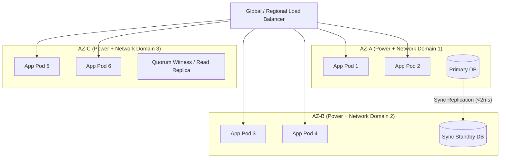
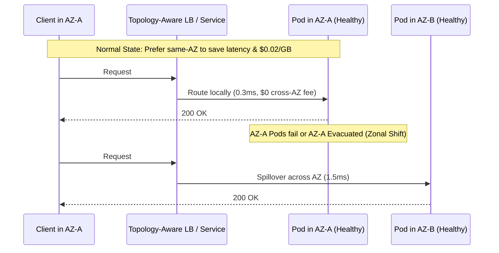
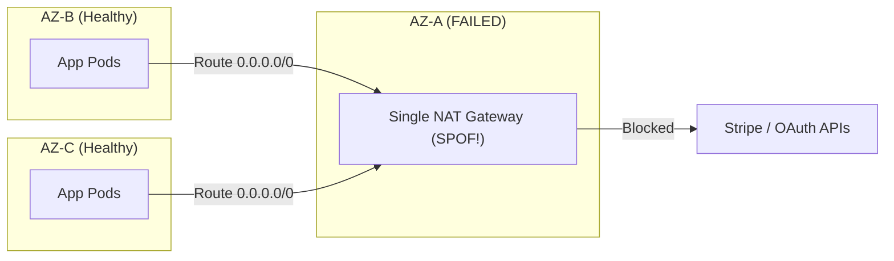

# Redundancy for Availability: Failure Domains, N+2 & Multi-AZ

> **Prerequisites:** [Lesson 09: Health Checks & Self-Healing](../09-health-checks-self-healing/README.md).  
> **Estimated Reading Time:** 24–28 minutes  
> **Target Audience:** Backend, SRE, and cloud architects designing high-availability infrastructure, and candidates asked "why is N+1 redundancy not enough, how do failure domains work, and how do you size a Multi-AZ deployment?"  
> **Free PDF Notes:** [Download SD-K-010.pdf](https://backendroadmap.com/notes/system-design/SD-K-010.pdf)

> [!NOTE]
> **In one line:** **Redundancy** eliminates single points of failure by running spare capacity across independent **failure domains** (racks, Availability Zones, regions); **N+2** ensures your system survives both a planned maintenance event and an unexpected failure at the same time.

> [!TIP]
> **The Golden Rule:** Redundancy inside the *same* failure domain is an illusion. Two database replicas on the same physical host, rack, or Availability Zone share correlated failures—and **N+1** leaves zero margin if a node crashes while another is down for patching.

---

## 1. What Redundancy & Failure Domains Are, and What They Aren't

Suppose your service needs `N = 6` instances to handle peak traffic. You deploy `7` instances (`N+1`)—all in `us-east-1a`—and feel safe. Then two things happen: on Tuesday morning, your CI/CD pipeline drains 1 instance for a rolling deploy; at that exact moment, a rack switch in `us-east-1a` reboots, taking out 2 more instances. You now have `4` instances left for `6` instances' worth of load, and your cluster collapses.

True high availability requires two things together: **sufficient capacity margin** ($N+2$ or Multi-AZ headroom) and **failure-domain isolation** (spreading replicas so no single power, network, or cooling fault takes out more than one slice).

| Term | Precise Meaning | Example |
| :--- | :--- | :--- |
| **Failure domain** | A physical or logical boundary whose components fail together | Physical server, ToR switch/rack, Availability Zone (AZ), Region |
| **Single Point of Failure (SPOF)** | Any component whose loss brings down the entire system | Single NAT Gateway, single primary DB without standby |
| **N+1 redundancy** | Minimum capacity $N$ plus 1 spare unit | 4 nodes when 3 can carry peak load |
| **N+2 redundancy** | Survives 1 planned maintenance + 1 unplanned failure simultaneously | 5 nodes when 3 carry peak load (or 3 AZs where 2 carry peak) |
| **2N (Active-Active / Mirrored)** | Full $100\%$ duplicate capacity | 2 independent 3-node clusters; each can handle $100\%$ load |
| **Availability Zone (AZ)** | Isolated data center(s) within a region with independent power, cooling, and networking | `us-east-1a`, `us-east-1b`, `us-east-1c` ($< 2\text{ ms}$ RTT) |
| **Correlated failure** | Multiple replicas failing from the same root cause | Shared power PDU, bad config push, simultaneous OS kernel bug |
| **Not** | Just spinning up more replicas in one place or without load-balanced routing | 10 pods on 1 EC2 node is still 1 SPOF |

### Why It Matters
1. **Maintenance + Failure overlap:** In large fleets, planned maintenance (kernel patching, deploys, autoscaling) happens constantly—meaning you are frequently operating at $N$ if you only provisioned $N+1$.
2. **Multi-AZ is the baseline for 99.99%:** A single AZ typically targets ~99.9%–99.95% availability; achieving 99.99% ("four nines") requires surviving an entire AZ outage without capacity starvation.
3. **Correlated failures break naive math:** Redundancy math assumes *independent* failures; shared control planes, shared NAT gateways, or bad deployments violate independence.

---

## 2. Anatomy: Failure Domains & Multi-AZ Capacity Sizing



Notice the **3-AZ pattern** for both stateless compute and stateful quorum:
- **Stateless compute (6 pods across 3 AZs):** If `AZ-A` goes completely dark, `4` pods remain in `AZ-B` and `AZ-C`. If peak load requires `4` pods, the fleet survives a full AZ loss with zero degradation.
- **Stateful quorum (3 nodes across 3 AZs):** Consensus systems (Raft, etcd, ZooKeeper, MongoDB Replica Sets) need a strict majority $\lfloor M/2 \rfloor + 1 = 2$ of $3$ nodes. Across 2 AZs, losing the AZ with 2 nodes loses quorum; across **3 AZs**, losing any single AZ leaves 2 of 3 nodes alive—preserving quorum.

| Topology | Min Nodes for Peak $N$ | Survives 1 Node Loss | Survives Deploy + 1 Node Loss | Survives Full AZ Loss | Cost Overhead |
| :--- | :---: | :---: | :---: | :---: | :---: |
| **N** | $N$ | No | No | No | $0\%$ |
| **N+1** | $N + 1$ | Yes | **No** | Only if spread across $\ge N+1$ AZs | $+1/N$ |
| **N+2** | $N + 2$ | Yes | **Yes** | If spread across $\ge 3$ AZs with margin | $+2/N$ |
| **3-AZ ($1.5\times N$)** | $\lceil 1.5 N \rceil$ | Yes | Yes | **Yes (at 100% peak)** | $+50\%$ |
| **2N (2-AZ Active-Active)** | $2N$ | Yes | Yes | **Yes (at 100% peak)** | $+100\%$ |

> [!WARNING]
> **The #1 Redundancy Trap: Under-Provisioned Multi-AZ.** Deploying 3 pods across 3 AZs (1 per AZ) when peak traffic requires 3 pods means you have **availability redundancy without capacity redundancy**. When 1 AZ dies, the remaining 2 pods receive $150\%$ of normal traffic and crash from overload. Always size each surviving subset of AZs to carry $100\%$ of peak load!

---

## 3. Mathematical Model: Parallel Availability & Multi-AZ Sizing

**1. Parallel Redundancy Availability.**
If a single independent replica has availability $a$ (so unavailability $u = 1 - a$), then $k$ independent replicas in parallel (where the system works as long as *at least one* is up) have combined availability:

$$A_{\text{parallel}} = 1 - (1 - a)^k$$

Example: One server has $a = 0.99$ ($1\%$ downtime $\approx 3.65\text{ days/year}$).
- $k = 2$ independent replicas: $A = 1 - (0.01)^2 = 1 - 0.0001 = 99.99\%$ ($52.6\text{ min/year}$).
- $k = 3$ independent replicas: $A = 1 - (0.01)^3 = 99.9999\%$ ($31.5\text{ sec/year}$).

**2. $m$-of-$n$ Capacity Availability (Binomial Model).**
If peak load requires at least $N$ healthy nodes out of $M$ total independent nodes (each with availability $a$), system availability is:

$$A_{N\text{-of-}M} = \sum_{i=N}^{M} \binom{M}{i} a^i (1 - a)^{M - i}$$

Suppose $N = 4$ nodes are required for peak load, and each node has $a = 0.99$:
- **$N$ ($M=4$):** $0.99^4 = 96.06\%$
- **$N+1$ ($M=5$):** $0.99^5 + 5(0.99)^4(0.01) = 99.90\%$
- **$N+2$ ($M=6$):** $99.998\%$

**3. Multi-AZ Capacity Formula.**
To survive the complete loss of any **1** out of $Z$ Availability Zones while still serving peak load $N$ (with per-AZ capacity $C_{\text{AZ}}$):

$$(Z - 1) \cdot C_{\text{AZ}} \ge N \implies C_{\text{AZ}} \ge \frac{N}{Z - 1}, \qquad M_{\text{total}} = Z \cdot \left\lceil \frac{N}{Z - 1} \right\rceil$$

- For **$Z = 2$ AZs** (Active-Active): $C_{\text{AZ}} = N \implies M_{\text{total}} = 2N$ ($100\%$ overhead).
- For **$Z = 3$ AZs**: $C_{\text{AZ}} = \lceil N / 2 \rceil \implies M_{\text{total}} \approx 1.5N$ ($50\%$ overhead!).

This is why **3 AZs** is the industry sweet spot: it cuts idle standby capacity overhead in half compared to 2 AZs while also enabling 3-way consensus quorum.

---

## 4. Metrics & Percentiles

| Metric | Meaning | Alert When |
| :--- | :--- | :--- |
| `az_capacity_headroom_ratio` | $(M_{\text{total}} - \max_{\text{AZ}} C_{\text{AZ}}) / N_{\text{peak}}$ | $< 1.0$ (losing largest AZ would overload survivors) |
| `pod_topology_skew` | Max difference in pod count between any two AZs | $> 1$ pod skew (violates spread constraints) |
| `cross_az_traffic_bytes` | Inter-AZ network bandwidth (costs $\$0.01\text{–}\$0.02/\text{GB}$ in cloud) | Unexpected spike (e.g. missing topology-aware routing) |
| `quorum_healthy_voters` | Active voting members in Raft/etcd/DB cluster | Drops below $M$ (warn) or $\lfloor M/2 \rfloor + 1$ (critical) |
| `n_plus_k_margin` | Current healthy nodes minus $N_{\text{peak}}$ | $< 2$ (below $N+2$ safety margin) |

### Worked Example (Sizing a 12,000 RPS Stateless Tier)
Each pod handles `1,000 RPS` at safe 70% CPU utilization $\implies N_{\text{peak}} = 12\text{ pods}$.
- **Bad (2 AZs, 6 pods each):** Total = 12 pods. If 1 AZ fails, 6 pods remain for 12,000 RPS ($200\%$ load) $\implies$ **total outage**.
- **2-AZ $N+100\%$ (12 pods per AZ):** Total = **24 pods**. Survives 1 AZ loss, but costs $2\times$.
- **3-AZ $N/2$ per AZ (6 pods per AZ):** Total = **18 pods** ($6$ in AZ-A, $6$ in AZ-B, $6$ in AZ-C). If AZ-A fails, $6 + 6 = 12$ pods remain—handling $100\%$ of peak load while saving $25\%$ compute cost vs. 2-AZ! Add $+1$ pod per AZ ($21$ total) for **$N+2$ during deploys + AZ loss**.

---

## 5. Compounding & Failure Modes

| Failure Mode | Why It Breaks Redundancy | Mitigation |
| :--- | :--- | :--- |
| **Shared control plane / SPOF** | Multi-AZ pods all route through 1 NAT Gateway in AZ-A | Deploy 1 NAT Gateway per AZ; use zonal endpoints |
| **Quorum split across 2 AZs** | 2 nodes in AZ-A, 1 in AZ-B $\to$ losing AZ-A kills quorum | Always place consensus voters across $\ge 3$ AZs (1 per AZ) |
| **No `topologySpreadConstraints`** | Scheduler packs all 6 pods onto nodes in AZ-A | Enforce `maxSkew: 1` across `topology.kubernetes.io/zone` |
| **Correlated software bug** | Simultaneous global deploy pushes bad config to all 3 AZs | Canary / zonal staged rollouts (AZ-A $\to$ bake $\to$ AZ-B $\to$ AZ-C) |
| **Gray AZ failure (packet loss)** | AZ-A isn't dead, just dropping 30% of packets | Automated zonal shift / outlier ejection |

---

## 6. Numbers Every Engineer Must Know

| Item | Typical | Implication |
| :--- | :---: | :--- |
| Inter-AZ round-trip latency | $0.5\text{–}2.0\text{ ms}$ | Fast enough for synchronous DB replication |
| Cross-AZ data transfer cost (AWS) | $\$0.01\text{/GB}$ each way ($\$0.02\text{/GB}$ total) | Use Topology Aware Routing for chatty internal RPCs |
| 3-AZ capacity overhead | $50\%$ ($1.5N$ total) | Half the standby cost of 2-AZ ($2N$) |
| Consensus quorum size | $3$ or $5$ nodes across $3$ AZs | 3 survives 1 failure; 5 survives 2 failures |
| Correlated failure factor | $10\text{–}100\times$ higher than independent math | Never assume $99.9999\%$ just from $1-(0.01)^3$ |

---

## 7. Mechanism Deep Dive: Topology-Aware Routing & Zonal Isolation



| Question | Answer |
| :--- | :--- |
| **When should you use 3 AZs vs. 2 AZs?** | Always prefer **3 AZs** for production services: you need only $1.5N$ total capacity (vs. $2N$ in 2 AZs) and 3 AZs support Raft/Paxos quorum without an external witness. |
| **How does Kubernetes enforce Multi-AZ placement?** | Use `topologySpreadConstraints` with `topologyKey: topology.kubernetes.io/zone` and `whenUnsatisfiable: DoNotSchedule` (or `ScheduleAnyway` for soft preference). |
| **What is "Zonal Shift"?** | A cloud/LB feature (e.g., AWS Route 53 ARC Zonal Shift) that shifts 100% of traffic out of a degraded AZ in seconds during gray failures (packet loss, power brownouts). |
| **When NOT to use synchronous Multi-AZ replication?** | When write latency budget is $< 1\text{ ms}$ (e.g., ultra-low-frequency trading) or across geographically distant *regions* ($> 50\text{ ms}$ RTT)—use asynchronous replication across regions instead. |

---

## 8. Hierarchical Budgets & Design Rules

| Slice | Rule | Control |
| :--- | :--- | :--- |
| **Compute capacity** | Surviving $(Z - 1)$ AZs must handle $100\%$ of peak load | $M = Z \cdot \lceil N_{\text{peak}} / (Z-1) \rceil$ |
| **Maintenance margin** | Provision $N+2$ (or $+1$ per AZ) for rolling deploys | `PodDisruptionBudget` (`minAvailable` / `maxUnavailable`) |
| **Failure domain spread** | Distribute pods across $\ge 3$ AZs and distinct hosts | `topologySpreadConstraints` (`maxSkew: 1`) |
| **Network SPOFs** | No cross-AZ dependency for AZ-local traffic | 1 NAT Gateway / Transit attachment per AZ |
| **Consensus quorum** | Odd number of voters ($3$ or $5$) spread across $\ge 3$ AZs | Never put majority of voters in 1 AZ |
| **Rollout isolation** | Deploy one AZ / cell at a time with bake window | Prevents correlated bug from killing all AZs |

---

## 9. Top Mitigations

1. **Spread stateless and stateful workloads across at least 3 AZs** using hard `topologySpreadConstraints` and host anti-affinity.
2. **Size for $(Z-1)$ AZ survival at peak load** ($1.5N$ across 3 AZs) plus `PodDisruptionBudget` headroom ($N+2$) so deploys + failures don't starve capacity.
3. **Eliminate hidden zonal SPOFs**—provision per-AZ NAT Gateways, per-AZ load balancer nodes, and per-AZ ingress.
4. **Use Topology-Aware Routing** in normal operation to cut cross-AZ egress costs and tail latency, while allowing automatic spillover on AZ degradation.
5. **Stage deployments across AZs/cells** (Canary $\to$ AZ-A $\to$ AZ-B $\to$ AZ-C) so a bad binary or config never breaks all failure domains at once.
6. **Practice Zonal Evacuation (GameDays)** quarterly to prove your remaining $(Z-1)$ AZs actually hold peak traffic without hitting hidden limits (DB connections, IOPS, autoscaler quotas).

---

## 10. Production Reference / War Story: The Single-NAT-Gateway Multi-AZ Illusion

**Incident (SEV-1):** A SaaS company proudly advertised a "Multi-AZ High-Availability" architecture across 3 AZs (`us-east-1a`, `1b`, `1c`). When `us-east-1a` suffered a 35-minute power and networking event, **every pod in `1b` and `1c` also lost outbound connectivity** to Stripe, Twilio, and OAuth providers—causing a 100% outage.



**Root Cause:**
1. To save $\$32\text{/month}$, the Terraform VPC module created only **one** NAT Gateway in `us-east-1a` and pointed all private subnet route tables (`1a`, `1b`, `1c`) to it.
2. When `us-east-1a` failed, `1b` and `1c` could not reach the internet, breaking all payment and login flows.

**Fix:**
1. Deployed **one NAT Gateway per AZ** (`1a`, `1b`, `1c`) with each private subnet routing strictly to its local-AZ NAT Gateway.
2. Verified zero cross-AZ route dependencies via automated VPC audit scripts and ran a quarterly AZ-blackhole test.

---

## 11. Multi-Language Production Code Tabs

A **Multi-AZ Capacity & Binomial Availability Calculator** to size $N+1$, $N+2$, and $3$-AZ deployments and verify survival under simultaneous deploy + AZ loss.

````carousel
```go
// Go: Multi-AZ Capacity & N+k Redundancy Sizer.
package main

import (
	"fmt"
	"math"
)

func multiAZTotal(peakPods, azCount, deployMargin int) (perAZ, total, surviving int) {
	if azCount < 2 {
		return peakPods + deployMargin, peakPods + deployMargin, 0
	}
	// Surviving (azCount - 1) AZs must handle peakPods + deployMargin
	needed := peakPods + deployMargin
	perAZ = int(math.Ceil(float64(needed) / float64(azCount-1)))
	total = perAZ * azCount
	surviving = total - perAZ
	return perAZ, total, surviving
}

func parallelAvailability(singleReplicaAvail float64, replicas int) float64 {
	return 1.0 - math.Pow(1.0-singleReplicaAvail, float64(replicas))
}

func main() {
	for _, az := range []int{2, 3} {
		perAZ, total, surv := multiAZTotal(12, az, 2)
		fmt.Printf("AZs=%d -> perAZ=%d, total=%d, survivingAfter1AZLoss=%d\n", az, perAZ, total, surv)
	}
	fmt.Printf("3 parallel 99%% replicas avail = %.6f%%\n", parallelAvailability(0.99, 3)*100)
}
```
<!-- slide -->
```typescript
// TypeScript: Multi-AZ Redundancy Sizer & Binomial m-of-n Availability Calculator.
export function multiAZSizing(peakNodes: number, azCount: number, maintenanceSpare = 1) {
  const requiredSurviving = peakNodes + maintenanceSpare;
  const perAz = Math.ceil(requiredSurviving / (azCount - 1));
  const total = perAz * azCount;
  return {
    azCount,
    perAz,
    total,
    survivingAfterAzLoss: total - perAz,
    overheadPct: Math.round(((total - peakNodes) / peakNodes) * 100),
  };
}

function comb(n: number, k: number): number {
  let res = 1;
  for (let i = 1; i <= k; i++) res = (res * (n - i + 1)) / i;
  return res;
}

export function mOfNAvailability(required: number, total: number, nodeAvail: number): number {
  let sum = 0;
  for (let i = required; i <= total; i++) {
    sum += comb(total, i) * Math.pow(nodeAvail, i) * Math.pow(1 - nodeAvail, total - i);
  }
  return sum;
}

console.log(multiAZSizing(12, 2, 2)); // total: 28
console.log(multiAZSizing(12, 3, 2)); // total: 21 (25% cheaper!)
console.log("4-of-6 @ 99%:", (mOfNAvailability(4, 6, 0.99) * 100).toFixed(4) + "%");
```
<!-- slide -->
```python
# Python: Multi-AZ capacity planner & binomial m-of-n availability verifier (stdlib only).
import math


def multi_az_sizing(peak_nodes: int, az_count: int, deploy_margin: int = 2) -> dict:
    needed = peak_nodes + deploy_margin
    per_az = math.ceil(needed / (az_count - 1))
    total = per_az * az_count
    return {
        "azs": az_count,
        "per_az": per_az,
        "total": total,
        "surviving_1_az_loss": total - per_az,
        "overhead_pct": round((total - peak_nodes) / peak_nodes * 100, 1),
    }


def m_of_n_availability(required_n: int, total_m: int, single_avail: float) -> float:
    return sum(
        math.comb(total_m, i) * (single_avail ** i) * ((1 - single_avail) ** (total_m - i))
        for i in range(required_n, total_m + 1)
    )


if __name__ == "__main__":
    print("2-AZ:", multi_az_sizing(12, 2))
    print("3-AZ:", multi_az_sizing(12, 3))
    for m in (4, 5, 6):
        print(f"4-of-{m} (a=0.99): {m_of_n_availability(4, m, 0.99) * 100:.4f}%")
```
<!-- slide -->
```csharp
// C#: Multi-AZ Sizing & Parallel Availability Calculator.
using System;

public static class RedundancyMath
{
    public static (int PerAz, int Total, int Surviving) SizeMultiAz(int peakNodes, int azCount, int deployMargin = 2)
    {
        int needed = peakNodes + deployMargin;
        int perAz = (int)Math.Ceiling((double)needed / (azCount - 1));
        int total = perAz * azCount;
        return (perAz, total, total - perAz);
    }

    public static double ParallelAvailability(double singleAvail, int replicas)
        => 1.0 - Math.Pow(1.0 - singleAvail, replicas);

    public static void Main()
    {
        Console.WriteLine($"2-AZ: {SizeMultiAz(12, 2)}");
        Console.WriteLine($"3-AZ: {SizeMultiAz(12, 3)}");
        Console.WriteLine($"Parallel 3x 99%: {ParallelAvailability(0.99, 3) * 100:F6}%");
    }
}
```
````

---

## 12. Hands-On CLI Verification Workflows

Verify Multi-AZ pod spread, PodDisruptionBudgets, and zonal network independence:

```bash
# 1. Check pod distribution across Availability Zones in Kubernetes
kubectl get pods -l app=checkout-api -o wide --no-headers | \
  awk '{print $7}' | xargs -I{} kubectl get node {} -o jsonpath='{.metadata.labels.topology\.kubernetes\.io/zone}{"\n"}' | \
  sort | uniq -c

# 2. Verify PodDisruptionBudget allows maintenance without violating N+2
kubectl get pdb checkout-api-pdb -o yaml

# 3. Audit AWS VPC route tables to ensure no cross-AZ NAT Gateway SPOF
aws ec2 describe-route-tables --filters "Name=vpc-id,Values=$VPC_ID" \
  --query 'RouteTables[].{RT:RouteTableId,Subnets:Associations[].SubnetId,NAT:Routes[?NatGatewayId!=`null`].NatGatewayId}'

# 4. Run Python Multi-AZ sizing check
python -c "import redundancy_math as r; print(r.multi_az_sizing(12, 3))"
```

---

## 13. Common Mistakes to Avoid

1. **Deploying multiple replicas in the same failure domain** (same host, rack, or AZ).
2. **Sizing Multi-AZ for normal load instead of $(Z-1)$ survival**, causing surviving AZs to collapse under 150–200% load.
3. **Using $N+1$ in fleets with continuous deployments**, leaving zero margin when a node fails mid-deploy.
4. **Hiding a single-AZ SPOF** (one NAT Gateway, one Redis primary without replica, one DNS forwarder).
5. **Placing a 3-node consensus quorum across only 2 AZs** (losing the 2-node AZ kills quorum).
6. **Assuming independent failure math** when all replicas share the same binary, config push, or control plane.
7. **Forgetting `PodDisruptionBudget` (`PDB`)**, allowing cluster upgrades to drain all replicas simultaneously.

---

## 14. Key Terms Glossary

| Key Term | Definition |
| :--- | :--- |
| **Failure Domain** | Boundary of components that share a common risk of failing together (host, rack, AZ, region). |
| **SPOF** | Single Point of Failure: any component whose failure halts the entire system. |
| **N+1 Redundancy** | Minimum capacity $N$ plus 1 spare; survives 1 failure if no maintenance is occurring. |
| **N+2 Redundancy** | Minimum capacity $N$ plus 2 spares; survives simultaneous planned maintenance and unplanned failure. |
| **2N Redundancy** | Full $100\%$ mirrored capacity; either half can serve $100\%$ of peak load. |
| **Availability Zone (AZ)** | Physically isolated data center(s) within a region with independent power, cooling, and network. |
| **Correlated Failure** | Multiple replicas failing together due to a shared dependency, bug, or physical fault. |
| **Quorum** | Strict majority ($\lfloor M/2 \rfloor + 1$) required for distributed consensus (Raft/etcd/DB). |
| **Topology Spread** | Scheduler constraint forcing pods to distribute evenly across failure domains. |
| **PodDisruptionBudget** | Kubernetes policy limiting how many pods can be voluntarily evicted at once. |

---

## 15. System Design Interview Questions & Answers

### Basic Conceptual Questions

<details>
<summary><strong>Q1: What is a failure domain and why does it matter for redundancy? [BASIC]</strong></summary>

**Answer:**
A failure domain is a set of resources that fail together (e.g., a physical server, rack switch, Availability Zone, or cloud region). Putting 10 replicas inside the same failure domain doesn't provide true redundancy because one power outage or switch failure kills all 10 simultaneously.
</details>

<details>
<summary><strong>Q2: Why is N+2 preferred over N+1 in production? [BASIC]</strong></summary>

**Answer:**
$N+1$ only tolerates a single fault. In real production systems, planned maintenance (rolling deploys, kernel patching, node drains) constantly consumes 1 unit of capacity—leaving you at $N$ with zero margin. $N+2$ ensures you survive a planned drain *and* an unexpected crash at the same time.
</details>

<details>
<summary><strong>Q3: Why is a 3-AZ deployment more cost-effective than a 2-AZ deployment? [BASIC]</strong></summary>

**Answer:**
To survive losing 1 AZ at peak load $N$, 2 AZs require $N$ capacity in each AZ ($2N$ total, $100\%$ overhead). With 3 AZs, you only need $N/2$ in each AZ ($1.5N$ total, $50\%$ overhead), because the two surviving AZs combine to provide $N$.
</details>

<details>
<summary><strong>Q4: What is the difference between availability redundancy and capacity redundancy? [BASIC]</strong></summary>

**Answer:**
Putting 1 pod in each of 3 AZs gives *availability* redundancy (an instance still exists if 1 AZ dies), but if peak traffic requires all 3 pods, losing 1 AZ leaves only $67\%$ capacity and crashes the survivors. *Capacity* redundancy means the remaining AZs can carry $100\%$ of peak load.
</details>

### Scenario-Based Architecture Questions

<details>
<summary><strong>Q5: You need 20 pods for peak load across 3 AZs and want to survive 1 AZ loss plus 2 pods draining for a deploy. How many pods do you run? [SCENARIO]</strong></summary>

**Answer:**
Surviving $(3 - 1) = 2$ AZs must provide $20 + 2 = 22$ pods $\implies \lceil 22 / 2 \rceil = 11$ pods per AZ $\implies \mathbf{33\text{ pods total}}$ ($11$ in each AZ). If 1 AZ dies and 2 pods are draining, $22 - 2 = 20$ healthy pods remain.
</details>

<details>
<summary><strong>Q6: How do you deploy a 3-node etcd / Raft cluster across Availability Zones? [SCENARIO]</strong></summary>

**Answer:**
Place **1 voter in each of 3 distinct AZs**. Quorum requires 2 of 3 voters. If any single AZ goes down, 2 voters remain in the other two AZs and the cluster continues accepting writes. Never put 2 voters in AZ-A and 1 in AZ-B, or losing AZ-A kills quorum.
</details>

<details>
<summary><strong>Q7: Your Multi-AZ cluster is healthy, but cross-AZ data transfer bills are huge. How do you optimize without losing redundancy? [SCENARIO]</strong></summary>

**Answer:**
Enable **Topology-Aware Routing** (e.g., Kubernetes `TopologyAwareHints` / Envoy locality-weighted load balancing) so pods talk to same-AZ endpoints during normal operation ($0$ cross-AZ cost, lower latency), while automatically spilling over to other AZs if local capacity degrades.
</details>

<details>
<summary><strong>Q8: How do you prevent a buggy deployment from taking down all 3 AZs simultaneously? [SCENARIO]</strong></summary>

**Answer:**
Treat deployments as a correlated failure risk: use **zonal/cellular staged rollouts** (Canary $\to$ AZ-A $\to$ bake 15 min $\to$ AZ-B $\to$ AZ-C) with automated error-rate rollback gates.
</details>

### Advanced & Tricky Interview Questions

<details>
<summary><strong>Q9: Why does the formula $1 - (1 - a)^k$ often overestimate real-world availability? [TRICKY]</strong></summary>

**Answer:**
Because it assumes failures are **statistically independent**. In reality, replicas share correlated failure modes: bad code deploys, shared control planes, shared DNS/NAT gateways, or thundering-herd restarts. A single correlated bug affects all $k$ replicas at once.
</details>

<details>
<summary><strong>Q10: What happens to a 2-AZ database cluster with synchronous replication when one AZ suffers a network partition? [TRICKY]</strong></summary>

**Answer:**
With only 2 nodes (Primary in AZ-A, Standby in AZ-B) and no 3rd witness/arbiter, neither node can safely determine if the other is dead or just partitioned. Either writes stall (to avoid split-brain) or automated failover risks **split-brain** data divergence. Always use a **3rd AZ witness/quorum**.
</details>

<details>
<summary><strong>Q11: Can autoscaling (HPA) replace pre-provisioned Multi-AZ headroom? [TRICKY]</strong></summary>

**Answer:**
Only if your workload tolerates a **2–10 minute brownout** while new nodes/pods provision, pull images, and warm caches—and only if the cloud provider has spare EC2/VM capacity in the surviving AZs during a major AZ outage (when everyone else is autoscaling too!). Critical Tier-0 services pre-provision surviving capacity.
</details>

<details>
<summary><strong>Q12: How do you test Multi-AZ redundancy without breaking production? [TRICKY]</strong></summary>

**Answer:**
Use **Zonal Shift / Chaos GameDays**: shift traffic away from 1 AZ at the load balancer or DNS layer during business hours with engineers on standby, verifying that surviving AZs absorb $100\%$ of traffic, DB connections don't exhaust, and latency stays within SLO.
</details>

---

## 16. One-Page Master Cheat Sheet

```
+---------------------------------------------------------------------------------------------------------+
|                   REDUNDANCY FOR AVAILABILITY — MASTER CHEAT SHEET                                      |
+---------------------------------------------------------------------------------------------------------+
| 1. FAILURE DOMAINS: Host < Rack < Availability Zone (AZ) < Region.                                      |
|    Replicas in the same failure domain share correlated failures (not real redundancy).                 |
+---------------------------------------------------------------------------------------------------------+
| 2. N+1 vs N+2: N+1 fails if a crash overlaps with a rolling deploy. N+2 survives both simultaneously.    |
+---------------------------------------------------------------------------------------------------------+
| 3. MULTI-AZ MATH: Surviving (Z - 1) AZs must handle 100% of peak load N:                                |
|    - 2 AZs -> N per AZ = 2N total (100% overhead).                                                      |
|    - 3 AZs -> N/2 per AZ = 1.5N total (50% overhead + supports 3-way Raft quorum!).                      |
+---------------------------------------------------------------------------------------------------------+
| 4. PARALLEL AVAILABILITY: A = 1 - (1 - a)^k  (only holds if failures are independent!).                 |
+---------------------------------------------------------------------------------------------------------+
| 5. HIDDEN SPOFs: Per-AZ NAT Gateways, per-AZ LB nodes, PodDisruptionBudgets, zonal staged rollouts.     |
+---------------------------------------------------------------------------------------------------------+
```

---

## Further Reading & Sources

- AWS Well-Architected Framework, [Reliability Pillar — Failure Management & Multi-AZ](https://docs.aws.amazon.com/wellarchitected/latest/reliability-pillar/welcome.html).
- AWS Builders' Library, [Static stability using Availability Zones](https://aws.amazon.com/builders-library/static-stability-using-availability-zones/).
- Kubernetes Documentation, [Pod Topology Spread Constraints](https://kubernetes.io/docs/concepts/scheduling-eviction/topology-spread-constraints/).
- Google SRE Book, [Managing Critical State & Consensus](https://sre.google/sre-book/managing-critical-state/).

---

## Free PDF Notes

[SD-K-010.pdf](https://backendroadmap.com/notes/system-design/SD-K-010.pdf)

---

## Next

Continue with [Lesson 11: Failover Mechanisms](../11-failover-mechanisms/README.md): How Long It Takes & What You Lose.
