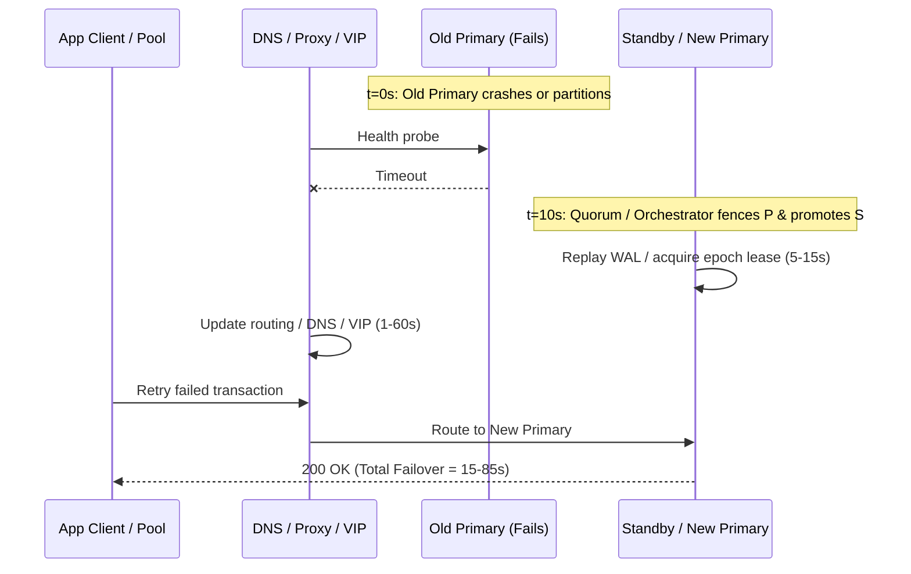
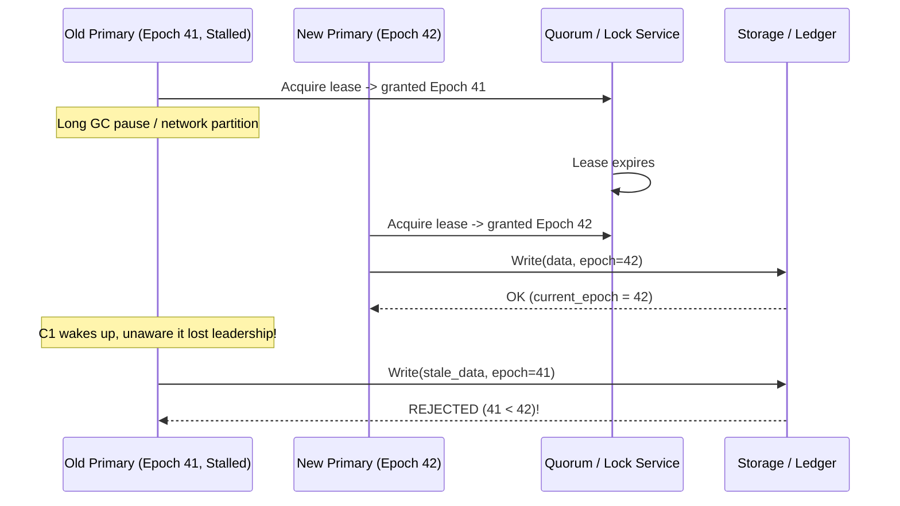
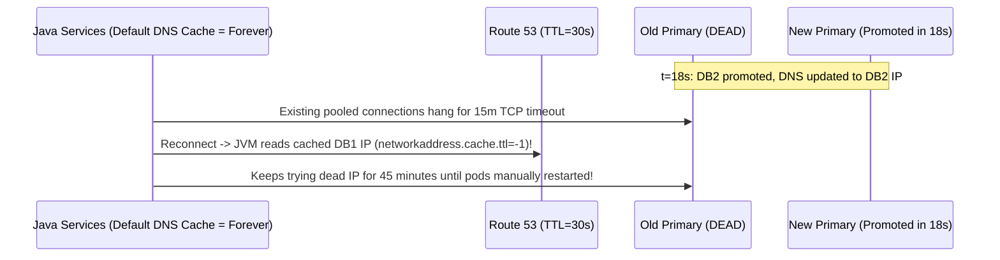

# Failover Mechanisms: How Long It Takes & What You Lose

> **Prerequisites:** [Lesson 10: Redundancy for Availability](../10-redundancy-for-availability/README.md).  
> **Estimated Reading Time:** 24–28 minutes  
> **Target Audience:** Backend, database, and SRE engineers designing high-availability state and routing, and candidates asked "walk me through what happens step-by-step during a database or regional failover—how long does it take and what can go wrong?"  
> **Free PDF Notes:** [Download SD-K-011.pdf](https://backendroadmap.com/notes/system-design/SD-K-011.pdf)

> [!NOTE]
> **In one line:** **Failover** is the process of detecting a failed primary component and shifting traffic or leadership to a standby; its real-world duration is the sum of **detection time, consensus/promotion time, and routing/DNS propagation**, and its risk is **data loss (async lag) or split-brain**.

> [!TIP]
> **The Golden Rule:** Failover is never instantaneous, and **DNS-based failover is always slower than your TTL suggests** due to client/OS resolver caching. For sub-second to few-second failover, use **VIP/Anycast/Load-Balancer health checks** or **smart topology-aware drivers**—and always use **fencing tokens** to prevent split-brain.

---

## 1. What Failover Mechanisms Are, and What They Aren't

In Lesson 10 we built redundant replicas across failure domains. **Failover** is the runtime mechanism that *activates* that redundancy when a primary node, database, or region dies.

Every failover has three phases: **Detect** (confirm the primary is actually dead, not just experiencing a 1-second GC pause), **Promote / Fence** (elect a new primary and ensure the old primary cannot accept stray writes), and **Reroute** (point clients to the new primary). Each phase takes measurable time—and cutting corners on any phase trades downtime for **data corruption (split-brain)**.

| Term | Precise Meaning | Example |
| :--- | :--- | :--- |
| **Active-Passive failover** | Standby sits idle (or read-only) and takes over only when primary fails | RDS Multi-AZ primary $\to$ synchronous standby |
| **Active-Active failover** | Multiple primaries serve traffic; surviving nodes absorb the failed node's load | Multi-region DynamoDB Global Tables / CockroachDB |
| **DNS failover** | Updating a DNS record (`A`/`CNAME`) to point to a healthy endpoint | Route 53 health-checked failover (`TTL = 60s`) |
| **VIP / BGP Anycast failover** | Re-announcing a virtual IP or BGP route to a healthy host/PoP | Keepalived/VRRP, Cloudflare Anycast, NLB |
| **Split-brain** | Two nodes both believe they are the primary and accept conflicting writes | Network partition without quorum or STONITH fencing |
| **Fencing (STONITH)** | Forcibly isolating or powering off the old primary so it cannot write stale data | "Shoot The Other Node In The Head", lease expiration, epoch tokens |
| **Replication lag** | Delay between a write committing on primary and arriving at standby | Asynchronous cross-region lag ($100\text{ ms–}5\text{ s}$) $\to$ data loss on failover |
| **Not** | Magic zero-downtime switching for stateful databases | In-flight transactions on the old primary still abort and must be retried |

### Why It Matters
1. **Interviewers ask for concrete timelines:** Saying "we fail over to the standby" is vague; explaining *detection (10s) + promotion (5s) + DNS/pool refresh (15s) = 30s* shows production mastery.
2. **Untested failovers fail:** Cold standbys with uncached indexes, stale connection pools, or missing firewall rules often double or triple expected downtime.
3. **Split-brain is worse than downtime:** A 30-second outage is recoverable; two primaries accepting divergent writes for 5 minutes causes permanent data corruption.

---

## 2. Anatomy: The Three Phases of Failover



| Mechanism | Typical Failover Time | Data Loss Risk | Split-Brain Risk | Best For |
| :--- | :---: | :---: | :---: | :--- |
| **Smart Driver / Topology Refresh** (e.g. Aurora, Raft client) | $1\text{–}5\text{ s}$ | $0$ (if sync) | Low (epoch/quorum) | Database clusters with cluster-aware clients |
| **L4/L7 Load Balancer / Proxy** (PgBouncer, RDS Proxy, ALB) | $5\text{–}20\text{ s}$ | $0$ (if sync) | Low | Centralizing connection drain & fast reroute |
| **VIP / BGP Anycast** (Keepalived, Cloud Anycast) | $1\text{–}10\text{ s}$ | $0$ | Medium (needs fencing) | Same-subnet L2/L3 HA or edge PoP failover |
| **DNS Failover** (Route 53 `TTL=60s`) | $60\text{–}300\text{ s}+$ | Depends on repl | Low | Cross-region DR (not fast intra-region failover) |

> [!WARNING]
> **The #1 Failover Trap: Client & JVM DNS Caching.** Even if you set DNS `TTL = 5s`, many OS resolvers, Node.js, and older JVM configurations cache DNS lookups indefinitely or ignore short TTLs, and persistent HTTP/DB connection pools keep trying the dead IP! Always use **short connection max-lifetime**, **explicit TCP/socket timeouts**, and **cluster-aware proxies or drivers**.

---

## 3. Mathematical Model: Total Failover Time ($T_{\text{failover}}$) & Data Loss

**1. Total Failover Time.**

$$T_{\text{failover}} = T_{\text{detect}} + T_{\text{promote}} + T_{\text{reroute}} + T_{\text{warmup}}$$

Where:
- $T_{\text{detect}} = (F - 1) \cdot P + T_{\text{to}}$ (probe interval $P$, failure threshold $F$, timeout $T_{\text{to}}$).
- $T_{\text{promote}}$ = time for consensus/fencing + WAL replay on standby.
- $T_{\text{reroute}}$ = DNS TTL / proxy reload / client pool eviction.
- $T_{\text{warmup}}$ = time for cold buffer pool / caches to warm up (often overlooked!).

**Example (RDS Multi-AZ vs. Cross-Region DNS):**
- **RDS Multi-AZ (Sync Standby + Proxy):** $T_{\text{detect}} = 10\text{ s}$, $T_{\text{promote}} = 8\text{ s}$, $T_{\text{reroute}} = 3\text{ s}$ (RDS Proxy) $\implies T_{\text{failover}} \approx \mathbf{21\text{ s}}$ (with `0` data loss).
- **Cross-Region Async Read Replica + DNS:** $T_{\text{detect}} = 30\text{ s}$, $T_{\text{promote}} = 45\text{ s}$, $T_{\text{reroute}} = 120\text{ s}$ (DNS propagation + client cache) $\implies T_{\text{failover}} \approx \mathbf{195\text{ s}}$ ($3.25\text{ min}$).

**2. Expected Data Loss under Asynchronous Replication.**
If the primary processes $\lambda_{\text{write}}$ writes/sec and asynchronous replication lags by $L_{\text{repl}}$ seconds:

$$\text{Lost Transactions} = \lambda_{\text{write}} \cdot L_{\text{repl}}$$

At $\lambda_{\text{write}} = 2{,}000\text{ tx/s}$ and $L_{\text{repl}} = 1.5\text{ s}$ cross-region lag, an abrupt primary failure loses **$3{,}000$ committed transactions** ($\text{RPO} = 1.5\text{ s}$).

**3. Availability Impact of Failover Duration.**
If a primary fails twice a year ($M = 2$) and each failover takes $T_{\text{failover}} = 30\text{ s}$:

$$\text{Annual Downtime} = 2 \times 30\text{ s} = 60\text{ s/year} \implies A = 1 - \frac{60}{31{,}536{,}000} = \mathbf{99.9998\%}$$

If failover takes $15\text{ minutes}$ ($900\text{ s}$) twice a year, downtime jumps to $1{,}800\text{ s/year}$ ($A = 99.994\%$, blowing a $99.999\%$ SLO).

---

## 4. Metrics & Percentiles

| Metric | Meaning | Alert When |
| :--- | :--- | :--- |
| `replication_lag_seconds` | Time behind primary on standby/replica | $> 1\text{ s}$ (intra-region) or $> 10\text{ s}$ (cross-region) |
| `failover_duration_seconds` | End-to-end time from primary loss to first healthy write | Exceeds RTO SLO (e.g., $> 30\text{ s}$) |
| `fencing_epoch_mismatch_total` | Rejected writes from a stale/zombie primary | Any $> 0$ (proves fencing prevented split-brain!) |
| `dns_cache_hit_stale_total` | Client connections still hitting old primary IP post-failover | Sustained $> 10\text{ s}$ after promotion |
| `standby_buffer_hit_ratio` | Cache hit rate of newly promoted primary | $< 80\%$ (indicates cold-cache slowdown risk) |

### Worked Example (Fencing Token / Epoch Guard)
1. Primary A holds `epoch = 41` and pauses for 20 seconds due to a JVM stop-the-world GC or network blip.
2. Quorum detects timeout, increments epoch to `42`, and promotes Standby B.
3. Primary A wakes up and tries to flush a buffered write with `epoch = 41` to shared storage / quorum.
4. Storage rejects the write (`41 < 42`), preventing silent split-brain corruption.

---

## 5. Compounding & Failure Modes

| Failure Mode | Mechanism | Impact |
| :--- | :--- | :--- |
| **Split-brain (no fencing)** | Both old and new primary accept writes during partition | Permanent divergent state requiring manual merge |
| **Cold-cache stampede** | Promoted standby has empty RAM buffer pool | $p_{99}$ latency spikes $10\times$, causing client timeouts & secondary collapse |
| **Stale connection pool** | App pools hold TCP connections to old primary IP | App continues throwing errors minutes after DB promoted |
| **Failover flapping** | Aggressive 1s health check triggers constant flip-flops | Cluster spends all its time promoting instead of serving |
| **Unreplicated local state** | Sessions/files stored on primary's local disk | Users logged out or uploads lost post-failover |

---

## 6. Numbers Every Engineer Must Know

| Item | Typical | Implication |
| :--- | :---: | :--- |
| Raft / Paxos leader election | $0.5\text{–}3\text{ s}$ | Fast, quorum-safe automatic promotion |
| Managed RDS Multi-AZ failover | $15\text{–}60\text{ s}$ | Use RDS Proxy to cut client reconnect time to $< 5\text{ s}$ |
| Aurora DB failover | $5\text{–}30\text{ s}$ | Shared storage avoids WAL replay delay |
| DNS TTL floor in practice | $30\text{–}60\text{ s}$ (real convergence $60\text{–}300\text{ s}$) | Never rely on DNS alone for sub-minute failover |
| BGP Anycast convergence | $1\text{–}10\text{ s}$ | Standard for global edge PoP failover |
| Client DB `maxConnLifetime` | $30\text{–}120\text{ s}$ | Forces periodic DNS re-resolution on pooled connections |

---

## 7. Mechanism Deep Dive: Split-Brain Prevention with Fencing Tokens



| Question | Answer |
| :--- | :--- |
| **Why aren't timeouts alone enough to prevent split-brain?** | Distributed systems are asynchronous: a node can pause (GC, CPU steal, packet delay) *after* checking its local clock and *before* its packet hits storage. Only a **monotonic fencing token** checked at the storage/receiver layer prevents stale writes. |
| **How does a database avoid cold-cache shock on failover?** | Keep the standby **warm** by routing read-only traffic to it (or using a shared/replicated buffer-pool warmer) so hot pages are already in RAM before promotion. |
| **What is the difference between Automated vs. Manual Failover?** | **Automated** (intra-region, quorum-backed) triggers in seconds without human intervention. **Manual (or human-in-the-loop)** is often preferred for *cross-region* async DB failover so a transient network blip doesn't trigger a painful multi-region split with data loss. |
| **When NOT to use automatic failover?** | In 2-node async clusters without a 3rd witness/arbiter—automatic failover there risks frequent split-brain on transient network blips. |

---

## 8. Hierarchical Budgets & Design Rules

| Slice | Rule | Control |
| :--- | :--- | :--- |
| **Detection** | Use $F \ge 3$ probes with hysteresis to avoid flapping | $T_{\text{detect}} = 5\text{–}15\text{ s}$ |
| **Fencing** | Every active-passive promotion must fence the old primary | Monotonic epoch/term ID + STONITH |
| **Routing** | Never rely on DNS alone for $< 60\text{ s}$ failover | Use LB/Proxy/Smart Driver + short `maxConnLifetime` |
| **Replication** | Sync replication within region; async across regions | Explicitly document RPO for async tiers |
| **Warm standby** | Pre-warm standby caches / connection pools | Avoid $10\times$ latency spike post-failover |
| **Client retries** | Idempotent writes + jittered backoff during failover | Absorbs the $5\text{–}20\text{ s}$ switchover window |

---

## 9. Top Mitigations

1. **Enforce monotonic fencing tokens (epochs/terms)** on all leader-elected or active-passive storage writes to eliminate split-brain.
2. **Put a connection proxy (RDS Proxy / PgBouncer) or cluster-aware driver** between apps and databases so failover doesn't wait on stale DNS caches.
3. **Set explicit `maxConnLifetime` (`60 s`) and short TCP timeouts (`2–5 s`)** in all HTTP and DB pools so dead sockets are evicted immediately.
4. **Never rely on 2-node failover without a 3rd witness/quorum**—always use an odd number of voters ($3$ or $5$) across 3 failure domains.
5. **Pre-warm standby caches** (or use shared-storage architectures like Aurora) so promoted standbys don't collapse under cold-disk I/O.
6. **Require human confirmation for cross-region async DB promotion** (or strict multi-signal quorum) to avoid accidental data-loss failovers on brief WAN blips.
7. **Run automated failover drills regularly** in staging and production GameDays, measuring actual $T_{\text{detect}} + T_{\text{promote}} + T_{\text{reroute}}$.

---

## 10. Production Reference / War Story: The 45-Minute "30-Second" Failover

**Incident (SEV-1):** A healthcare SaaS ran PostgreSQL Primary in AZ-A and Standby in AZ-B with a `TTL = 30s` Route 53 DNS record. When AZ-A's primary suffered a hardware failure, Postgres promoted the Standby in **18 seconds**—yet the Java/Node microservices failed to reconnect for **45 minutes**.



**Root Cause:**
1. The JVM's default `networkaddress.cache.ttl` (when a security manager or certain flags were set) cached the old primary's IP **forever** until pod restart.
2. HikariCP connection pools had no `maxLifetime` short enough and TCP `connectTimeout` was `30 s`, stalling worker threads.

**Fix:**
1. Set `-Dnetworkaddress.cache.ttl=5` in JVM args and `maxLifetime = 60000 ms` in HikariCP.
2. Placed **RDS Proxy** in front of Postgres so the app connects to a stable proxy endpoint that drains and repoints in $< 4\text{ s}$. Subsequent failover drills completed in **19 seconds end-to-end**.

---

## 11. Multi-Language Production Code Tabs

A **Fencing-Token Storage Guard & Failover Timeline Simulator** demonstrating how epoch tokens block stale primaries from causing split-brain.

````carousel
```go
// Go: Monotonic Fencing Token Guard preventing split-brain writes.
package main

import (
	"errors"
	"fmt"
	"sync"
)

var ErrStaleEpoch = errors.New("fencing error: stale primary epoch rejected")

type FencedStorage struct {
	mu           sync.Mutex
	currentEpoch uint64
	data         map[string]string
}

func NewFencedStorage() *FencedStorage {
	return &FencedStorage{data: make(map[string]string)}
}

func (s *FencedStorage) Write(epoch uint64, key, val string) error {
	s.mu.Lock()
	defer s.mu.Unlock()
	if epoch < s.currentEpoch {
		return fmt.Errorf("%w (got %d, current %d)", ErrStaleEpoch, epoch, s.currentEpoch)
	}
	s.currentEpoch = epoch
	s.data[key] = val
	return nil
}

func main() {
	store := NewFencedStorage()
	_ = store.Write(42, "balance:1", "500") // New primary writes with epoch 42
	err := store.Write(41, "balance:1", "0") // Zombie old primary wakes up with epoch 41
	fmt.Println("Zombie write result:", err)
}
```
<!-- slide -->
```typescript
// TypeScript: Fenced Storage Guard & Failover Timeline Calculator.
export class StaleEpochError extends Error {
  constructor(got: number, current: number) {
    super(`Rejected stale epoch ${got}; current fencing epoch is ${current}`);
  }
}

export class FencedStore {
  private currentEpoch = 0;
  private kv = new Map<string, string>();

  write(epoch: number, key: string, value: string): void {
    if (epoch < this.currentEpoch) {
      throw new StaleEpochError(epoch, this.currentEpoch);
    }
    this.currentEpoch = epoch;
    this.kv.set(key, value);
  }
}

export function estimateFailoverSeconds(
  probeIntervalS: number,
  threshold: number,
  probeTimeoutS: number,
  promoteS: number,
  rerouteS: number
): number {
  const detectS = (threshold - 1) * probeIntervalS + probeTimeoutS;
  return detectS + promoteS + rerouteS;
}
```
<!-- slide -->
```python
# Python: Fencing token guard & failover data-loss / timeline model (stdlib only).
class StaleEpochError(Exception):
    pass


class FencedStorage:
    def __init__(self):
        self.current_epoch = 0
        self.data = {}

    def write(self, epoch: int, key: str, value: str) -> None:
        if epoch < self.current_epoch:
            raise StaleEpochError(f"Stale primary epoch {epoch} < {self.current_epoch}")
        self.current_epoch = epoch
        self.data[key] = value


def failover_model(probe_interval_s=5, threshold=3, timeout_s=2, promote_s=8, reroute_s=5,
                   write_tps=2000, async_lag_s=1.5):
    t_detect = (threshold - 1) * probe_interval_s + timeout_s
    t_total = t_detect + promote_s + reroute_s
    lost_tx = int(write_tps * async_lag_s)
    return {"t_detect_s": t_detect, "t_failover_s": t_total, "async_lost_tx": lost_tx}


if __name__ == "__main__":
    store = FencedStorage()
    store.write(42, "order:99", "paid")
    try:
        store.write(41, "order:99", "cancelled")
    except StaleEpochError as e:
        print("Split-brain prevented:", e)
    print("Failover model:", failover_model())
```
<!-- slide -->
```csharp
// C#: Fencing Token Storage Guard preventing split-brain writes.
using System;
using System.Collections.Generic;

public sealed class StaleEpochException(long got, long current)
    : Exception($"Fencing error: epoch {got} < current {current}");

public sealed class FencedStorage
{
    private readonly object _lock = new();
    private long _currentEpoch;
    private readonly Dictionary<string, string> _data = new();

    public void Write(long epoch, string key, string value)
    {
        lock (_lock)
        {
            if (epoch < _currentEpoch)
                throw new StaleEpochException(epoch, _currentEpoch);
            _currentEpoch = epoch;
            _data[key] = value;
        }
    }
}
```
````

---

## 12. Hands-On CLI Verification Workflows

Inspect replication lag, trigger controlled failovers, and verify DNS TTL propagation:

```bash
# 1. PostgreSQL: Check replication lag on standby (in bytes and seconds)
psql "$REPLICA_URL" -c "
  SELECT now() - pg_last_xact_replay_timestamp() AS replication_lag;"

# 2. AWS RDS: Trigger a controlled Multi-AZ failover and time recovery
aws rds reboot-db-instance --db-instance-identifier prod-pg --force-failover

# 3. Verify DNS TTL & actual resolution convergence during failover
dig +nocmd api.example.com A +noall +answer

# 4. Run Python failover & fencing simulation
python -c "import failover_demo; print(failover_demo.failover_model())"
```

---

## 13. Common Mistakes to Avoid

1. **Relying on DNS TTL alone for fast failover**, ignoring OS/JVM/browser DNS caching and persistent connection pools.
2. **Omitting fencing tokens (epochs)**, allowing a stalled zombie primary to corrupt data upon waking up.
3. **Deploying 2-node automatic failover without a 3rd witness**, creating split-brain on every network partition.
4. **Assuming zero data loss on cross-region async failover**—async lag always means non-zero RPO.
5. **Forgetting cold-cache warmup**, causing the newly promoted standby to melt under disk I/O.
6. **Setting overly aggressive health checks** (`1s` timeout, `threshold=1`), causing failover flapping during brief GC pauses.
7. **Never testing failover in production/staging**, discovering broken IAM permissions or stale security groups during a real SEV-1.

---

## 14. Key Terms Glossary

| Key Term | Definition |
| :--- | :--- |
| **Failover** | Automated or manual transition of traffic/leadership from a failed primary to a standby. |
| **Failback** | Returning traffic to the original primary after it has recovered and re-synchronized. |
| **Split-Brain** | Dangerous state where two nodes both act as primary and accept conflicting writes. |
| **Fencing Token** | Monotonically increasing epoch/term ID checked by storage to reject writes from stale primaries. |
| **STONITH** | "Shoot The Other Node In The Head": forcibly powering off/isolating an unresponsive primary. |
| **Replication Lag** | Delay between a primary commit and its replication to a standby. |
| **Active-Passive** | Standby remains idle (or read-only) until primary fails. |
| **Active-Active** | Multiple primaries actively serve writes concurrently. |
| **DNS Failover** | Updating DNS records to route traffic to a healthy endpoint; limited by resolver caching. |
| **BGP Anycast** | Advertising the same IP from multiple edge locations so routers automatically bypass dead PoPs. |

---

## 15. System Design Interview Questions & Answers

### Basic Conceptual Questions

<details>
<summary><strong>Q1: What are the three phases of any failover, and what determines total failover time? [BASIC]</strong></summary>

**Answer:**
1. **Detection:** Health probes timing out ($F \times P$).
2. **Promotion & Fencing:** Electing the standby, replaying WAL, and fencing the old primary.
3. **Rerouting:** Updating DNS, VIP, proxy, or client connection pools. Total failover time is the sum of all three (plus cache warmup).
</details>

<details>
<summary><strong>Q2: What is split-brain and how do you prevent it? [BASIC]</strong></summary>

**Answer:**
Split-brain occurs when a network partition separates two nodes and both believe they are the primary, accepting conflicting writes. Prevent it using **quorum** (odd number of voters, e.g., 3 across 3 AZs) and **monotonic fencing tokens / STONITH** so storage rejects writes from any old epoch.
</details>

<details>
<summary><strong>Q3: Why is DNS failover unsuitable when you need sub-10-second failover? [BASIC]</strong></summary>

**Answer:**
Even with a low DNS TTL (e.g., 30s), OS resolvers, browsers, and application runtimes (like JVM) often cache DNS records longer than the TTL, and existing TCP connection pools stay pinned to the dead IP until they time out.
</details>

<details>
<summary><strong>Q4: What is the difference between Active-Passive and Active-Active failover? [BASIC]</strong></summary>

**Answer:**
In **Active-Passive**, one primary handles writes while the standby waits; failover requires detecting failure and promoting the standby (seconds to minutes). In **Active-Active**, multiple primaries handle traffic simultaneously; if one fails, traffic shifts to survivors with minimal or zero promotion delay, at the cost of conflict resolution or distributed consensus latency.
</details>

### Scenario-Based Architecture Questions

<details>
<summary><strong>Q5: Your Postgres database failed over in 20 seconds, but your microservices kept failing for 20 minutes. Why? [SCENARIO]</strong></summary>

**Answer:**
Likely three causes: (1) App DNS caching (e.g., JVM `networkaddress.cache.ttl`), (2) connection pools holding dead TCP sockets without short `maxLifetime` or TCP keepalives, or (3) the newly promoted standby had a cold buffer pool and stalled on disk I/O. Fix with RDS Proxy/PgBouncer, short `maxLifetime`, and warm standbys.
</details>

<details>
<summary><strong>Q6: When should failover be manual instead of automatic? [SCENARIO]</strong></summary>

**Answer:**
For **cross-region asynchronous database failover**. Because WAN links can blip briefly and async failover involves **permanent data loss** (unreplicated transactions) plus complex failback, many teams prefer human confirmation (or strict multi-signal quorum) before promoting a remote region.
</details>

<details>
<summary><strong>Q7: Your primary DB processes 3,000 writes/sec and cross-region async replication lags by 2 seconds. What happens on abrupt region loss? [SCENARIO]</strong></summary>

**Answer:**
Approximately $3{,}000 \times 2 = 6{,}000$ committed transactions that have not yet shipped to the remote region are lost ($\text{RPO} = 2\text{ s}$). You must either accept this RPO, use synchronous replication (paying cross-region RTT latency), or dual-write to a durable regional queue/log.
</details>

<details>
<summary><strong>Q8: How do you make an application gracefully survive a 20-second database failover? [SCENARIO]</strong></summary>

**Answer:**
Combine: (1) a connection proxy (RDS Proxy / PgBouncer) that buffers/reroutes connections, (2) short query/connect timeouts (`2–3 s`), (3) **idempotent writes** with jittered retries for up to `25 s`, and (4) read fallbacks (L1 stale cache) so read endpoints stay at 200 OK during the switchover.
</details>

### Advanced & Tricky Interview Questions

<details>
<summary><strong>Q9: Why isn't a distributed lock (like Redis Redlock) sufficient to prevent split-brain without fencing tokens? [TRICKY]</strong></summary>

**Answer:**
As Martin Kleppmann showed, a client can acquire a lock, suffer a 15-second GC pause, wake up *thinking* it still holds the lock, and write to storage after the lock expired and another client acquired it. Only if the storage layer validates a **monotonic fencing token** issued by the lock service is split-brain prevented.
</details>

<details>
<summary><strong>Q10: What is "failover flapping" and how do you stop it? [TRICKY]</strong></summary>

**Answer:**
When overly sensitive health checks trigger failover back and forth between two nodes during intermittent network jitter, causing continuous downtime. Prevent it with **hysteresis** (require $F \ge 3$ consecutive failures), cooldown timers between promotions, and manual intervention for repeated failovers.
</details>

<details>
<summary><strong>Q11: Why is "failback" often riskier than the initial failover? [TRICKY]</strong></summary>

**Answer:**
During failover, the new primary accumulates new writes. If you blindly bring the old primary back online and route traffic to it without wiping/resyncing it from the new primary, you lose the failover-era writes or create split-brain. Failback requires re-syncing the old primary as a *replica* first, then doing a controlled switchover.
</details>

<details>
<summary><strong>Q12: How does AWS Aurora achieve ~5–15s failover compared to 60s+ on traditional block-replicated Postgres? [TRICKY]</strong></summary>

**Answer:**
Aurora decouples compute from a shared, multi-AZ distributed storage layer. On failover, the promoted reader already points to the same shared storage volume and only needs to replay recent redo log metadata rather than copying/replaying gigabytes of WAL or promoting an EBS volume.
</details>

---

## 16. One-Page Master Cheat Sheet

```
+---------------------------------------------------------------------------------------------------------+
|                       FAILOVER MECHANISMS — MASTER CHEAT SHEET                                          |
+---------------------------------------------------------------------------------------------------------+
| 1. TIMELINE: T_failover = T_detect + T_promote + T_reroute (+ T_cache_warmup).                          |
|    - Smart Driver / Proxy: 1-20s   |   VIP / BGP Anycast: 1-10s   |   DNS (TTL=60s): 60-300s+.          |
+---------------------------------------------------------------------------------------------------------+
| 2. SPLIT-BRAIN PREVENTION: Quorum (odd voters, 3+ AZs) + Monotonic Fencing Tokens (epoch check at DB).  |
+---------------------------------------------------------------------------------------------------------+
| 3. ASYNC DATA LOSS: Lost_tx = write_rate * replication_lag. Sync = 0 loss, pays RTT latency.            |
+---------------------------------------------------------------------------------------------------------+
| 4. CLIENT GOTCHAS: JVM/OS DNS caching, infinite TCP timeouts, stale connection pools, cold standby RAM. |
|    Fix: RDS Proxy/PgBouncer + maxConnLifetime (60s) + idempotent retries + warm read standbys.          |
+---------------------------------------------------------------------------------------------------------+
| 5. FAILBACK: Never blindly switch back! Resync old primary as replica first, then controlled cutover.   |
+---------------------------------------------------------------------------------------------------------+
```

---

## Further Reading & Sources

- Martin Kleppmann, *Designing Data-Intensive Applications*, Chapter 8 & 9 ("The Trouble with Distributed Systems" & "Fencing Tokens").
- AWS Builders' Library, [Implementing health checks & automatic failover](https://aws.amazon.com/builders-library/implementing-health-checks/).
- Google SRE Book, [Managing Critical State](https://sre.google/sre-book/managing-critical-state/).
- Martin Kleppmann, [How to do distributed locking (Fencing Tokens)](https://martin.kleppmann.com/2016/02/08/how-to-do-distributed-locking.html).

---

## Free PDF Notes

[SD-K-011.pdf](https://backendroadmap.com/notes/system-design/SD-K-011.pdf)

---

## Next

Continue with [Lesson 12: Disaster Recovery](../12-disaster-recovery/README.md): Pilot Light vs Warm Standby vs Active-Active.
