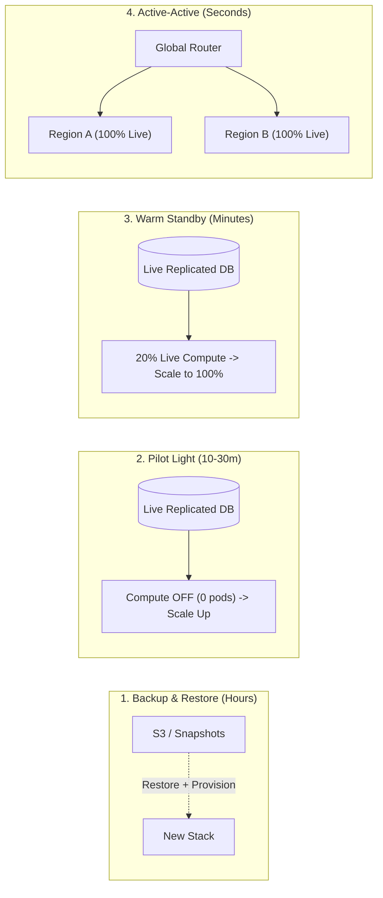
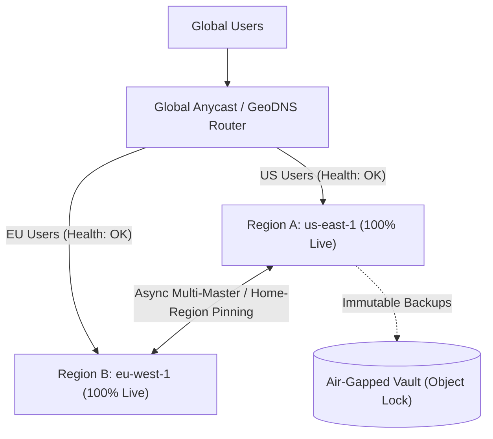
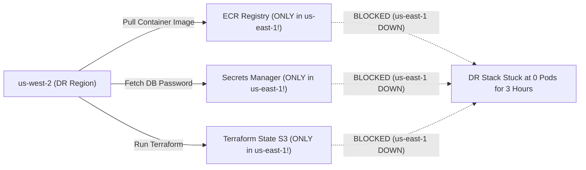

# Disaster Recovery: Pilot Light vs Warm Standby vs Active-Active

> **Prerequisites:** [Lesson 11: Failover Mechanisms](../11-failover-mechanisms/README.md).  
> **Estimated Reading Time:** 24–28 minutes  
> **Target Audience:** Staff/Principal engineers, cloud architects, and candidates asked "how do you design a multi-region Disaster Recovery plan, and how do you choose between Backup & Restore, Pilot Light, Warm Standby, and Active-Active?"  
> **Free PDF Notes:** [Download SD-K-012.pdf](https://backendroadmap.com/notes/system-design/SD-K-012.pdf)

> [!NOTE]
> **In one line:** **Disaster Recovery (DR)** protects against catastrophic regional or facility-wide failures; the four canonical tiers—**Backup & Restore**, **Pilot Light**, **Warm Standby**, and **Active-Active**—trade steadily higher infrastructure cost and operational complexity for lower **RPO** (data loss) and **RTO** (downtime).

> [!TIP]
> **The Golden Rule:** Choose your DR tier strictly from business **RPO** and **RTO** requirements, not engineering ego—and **an untested DR plan is not a DR plan**: if you haven't executed a live regional failover GameDay in the last quarter, assume your RTO is infinite.

---

## 1. What Disaster Recovery Is, and What It Isn't

Multi-AZ redundancy (Lesson 10) protects you when a server, rack, or single data center dies. **Disaster Recovery (DR)** protects you when an *entire cloud region* goes dark—due to a regional control-plane bug, fiber cut, hurricane, or account-wide ransomware/deletion event.

AWS and the Well-Architected Framework classify DR into four strategies along a continuous spectrum of cost vs. recovery speed: **Backup & Restore**, **Pilot Light**, **Warm Standby**, and **Multi-Region Active-Active**.

| Term | Precise Meaning | Example |
| :--- | :--- | :--- |
| **Disaster Recovery (DR)** | Recovering systems and data after a catastrophic regional/site outage | Failing over from `us-east-1` to `us-west-2` |
| **RPO (Recovery Point Objective)** | Maximum acceptable *data loss* measured in time | $\text{RPO} = 5\text{ min}$ (lose at most 5 minutes of writes) |
| **RTO (Recovery Time Objective)** | Maximum acceptable *downtime* to restore service | $\text{RTO} = 15\text{ min}$ (back online within 15 minutes) |
| **Backup & Restore** | Periodic snapshots/backups shipped cross-region; infra provisioned on disaster | Nightly S3/RDS snapshots; Terraform apply on DR |
| **Pilot Light** | Core data replicated live (DB/S3), compute turned *off* (`0` instances) until disaster | Cross-region read replica running; ASGs at `0` |
| **Warm Standby** | Scaled-down, always-on full stack in DR region; scaled up on disaster | 20% capacity running live in DR; scales to 100% |
| **Multi-Region Active-Active** | Full capacity serving live traffic in $\ge 2$ regions simultaneously | Global DNS/Anycast routing to both `us-east` & `eu-west` |
| **Not** | High Availability (HA) within a single region | Multi-AZ is HA; Cross-Region is DR |

### Why It Matters
1. **Cost vs. SLA trade-off is a core Staff-level interview question:** Active-Active costs $2\times+$ and introduces global data consistency headaches; Pilot Light saves 70–80% while still hitting 10–30 minute RTOs.
2. **Cloud regions DO fail:** Control-plane outages (IAM, DynamoDB, S3, EKS) and submarine cable cuts happen every year.
3. **Immutable backups protect against logical disasters:** Replication copies `DROP TABLE` and ransomware instantly—only **immutable, air-gapped backups** survive logical/malicious corruption.

---

## 2. Anatomy: The Four DR Tiers Compared



| Strategy | Typical RPO | Typical RTO | DR Compute Running | Cost Multiplier | Operational Complexity |
| :--- | :---: | :---: | :---: | :---: | :--- |
| **Backup & Restore** | Hours (e.g., 1–24h) | Hours (2–24h) | $0\%$ (provisioned on demand) | $\sim 1.05\times$ | Low |
| **Pilot Light** | Seconds–Minutes | 10–30 minutes | $0\%$ (core data/DB only) | $\sim 1.2\text{–}1.35\times$ | Medium |
| **Warm Standby** | Seconds–Minutes | 1–10 minutes | $10\text{–}30\%$ (scaled-down full stack) | $\sim 1.4\text{–}1.7\times$ | Medium-High |
| **Active-Active** | Seconds (or $0$ with consensus) | Seconds ($< 1\text{ min}$) | $100\%$ in each region (or $50/50$ with headroom) | $\sim 2.0\text{–}2.5\times$ | High (conflict resolution, global state) |

> [!WARNING]
> **The #1 DR Trap: Assuming Replication = Backup.** Cross-region replication faithfully replicates accidental `DELETE FROM users;` or ransomware encryption within milliseconds. You always need **immutable, versioned backups** (e.g., S3 Object Lock / Vault Lock) *in addition to* live replication.

---

## 3. Mathematical Model: Cost of Downtime vs. DR Tier Cost

Let $C_{\text{base}}$ be your primary region's monthly infrastructure cost, $C_{\text{DR}}$ the incremental monthly DR cost, $L_{\text{hr}}$ the business revenue/SLA penalty per hour of outage, and $p_{\text{reg}}$ the annual probability of a regional outage (e.g., $p_{\text{reg}} = 0.25$ for a 1-in-4-year event).

**Expected Annual Total Cost of Risk ($T_{\text{risk}}$):**

$$T_{\text{risk}} = 12 \cdot C_{\text{DR}} + p_{\text{reg}} \cdot \left(\text{RTO}_{\text{hr}} \cdot L_{\text{hr}} + \text{RPO}_{\text{hr}} \cdot D_{\text{loss}}\right)$$

**Worked Comparison:**
Suppose $C_{\text{base}} = \$50{,}000/\text{mo}$, outage cost $L_{\text{hr}} = \$200{,}000/\text{hr}$, and $p_{\text{reg}} = 0.25/\text{yr}$:
1. **Backup & Restore:** $C_{\text{DR}} = \$2{,}500/\text{mo}$ ($+\$30\text{k/yr}$), $\text{RTO} = 6\text{ hr}$.
   $$T_{\text{risk}} = \$30{,}000 + 0.25 \times (6 \times \$200{,}000) = \$30{,}000 + \$300{,}000 = \mathbf{\$330{,}000/\text{yr}}$$
2. **Pilot Light:** $C_{\text{DR}} = \$12{,}500/\text{mo}$ ($+\$150\text{k/yr}$), $\text{RTO} = 0.33\text{ hr}$ (20 min).
   $$T_{\text{risk}} = \$150{,}000 + 0.25 \times (0.33 \times \$200{,}000) = \$150{,}000 + \$16{,}500 = \mathbf{\$166{,}500/\text{yr}}$$
3. **Active-Active:** $C_{\text{DR}} = \$60{,}000/\text{mo}$ ($+\$720\text{k/yr}$), $\text{RTO} = 0.01\text{ hr}$ (36s).
   $$T_{\text{risk}} = \$720{,}000 + 0.25 \times (0.01 \times \$200{,}000) = \$720{,}000 + \$500 = \mathbf{\$720{,}500/\text{yr}}$$

Here, **Pilot Light** minimizes total expected cost unless the business requires sub-minute RTO (e.g., payments, healthcare, trading) where regulatory or brand damage exceeds $\$1\text{M/hr}$.

---

## 4. Metrics & Percentiles

| Metric | Meaning | Alert When |
| :--- | :--- | :--- |
| `dr_replication_lag_seconds` | Cross-region DB/storage replication lag | Exceeds $50\%$ of target **RPO** |
| `backup_last_success_age_hours` | Time since last verified cross-region snapshot | Exceeds backup schedule + 1h |
| `dr_gameday_rto_seconds` | Measured end-to-end recovery time in last drill | Exceeds target **RTO** (or drill $> 90\text{ days}$ old) |
| `dr_config_drift_count` | IaC/schema/secret differences between Primary and DR | Any $> 0$ (will break failover!) |
| `dr_capacity_quota_ratio` | Requested DR instances vs. cloud region vCPU quota | $> 80\%$ (risk of `InsufficientInstanceCapacity` during DR!) |

### Worked Example (Pilot Light Cutover Budget: RTO = 20 min)
1. **0–3 min:** Detect regional outage, verify it isn't a false alarm, trigger DR runbook.
2. **3–8 min:** Promote cross-region DB read replica to standalone Primary; verify writes succeed.
3. **8–15 min:** Scale DR Auto-Scaling Groups / Kubernetes nodes from `0` to `100%` (using pre-baked AMIs/container images mirrored in DR region).
4. **15–18 min:** Flip Route 53 / Global Accelerator / Cloudflare DNS to DR Load Balancers.
5. **18–20 min:** Run synthetic smoke tests; confirm checkout & auth healthy.

---

## 5. Compounding & Failure Modes

| Failure Mode | Why DR Fails During a Real Disaster | Mitigation |
| :--- | :--- | :--- |
| **Control-plane dependency** | DR runbook needs `us-east-1` IAM/Terraform state to spin up `us-west-2` | Replicate IaC state, AMIs, container registries, and secrets to DR region |
| **Cloud capacity exhaustion** | Everyone evacuates `us-east-1` into `us-east-2` at once; `InsufficientInstanceCapacity` | Use **Warm Standby** or **Reserved Capacity** in DR region; pick a less-crowded DR region |
| **Configuration / secret drift** | Primary added 3 env vars & a DB migration; DR never got them | Continuous CI/CD deployment to both Primary and DR; automated drift checks |
| **Active-Active write conflicts** | User updates profile in EU and US concurrently | Partition users by home region, use CRDTs, or use globally distributed consensus (Spanner/CockroachDB) |
| **Untested DNS/TLS certs** | DR Load Balancer missing wildcard TLS cert or WAF rules | Run quarterly live traffic-shift drills |

---

## 6. Numbers Every Engineer Must Know

| Item | Typical | Implication |
| :--- | :---: | :--- |
| Cross-region RTT (US East $\leftrightarrow$ US West) | $60\text{–}80\text{ ms}$ | Synchronous cross-region writes add $60\text{–}80\text{ ms}$ per round trip! |
| Cross-region RTT (US $\leftrightarrow$ EU) | $80\text{–}120\text{ ms}$ | Use async replication or home-region pinning |
| Snapshot restore (1 TB DB) | $30\text{–}90\text{ min}$ | Backup & Restore cannot meet $< 30\text{ min}$ RTO |
| Pilot Light scale-up time | $10\text{–}25\text{ min}$ | Pre-bake AMIs & mirror container images to DR region |
| Warm Standby scale-up time | $1\text{–}5\text{ min}$ | Already warm; handles initial trickle while scaling |
| Active-Active failover time | $5\text{–}60\text{ s}$ | Limited only by health-check & DNS/Anycast convergence |

---

## 7. Mechanism Deep Dive: Active-Active Global Routing & Data Consistency



| Question | Answer |
| :--- | :--- |
| **Why is Active-Active so hard for relational databases?** | Cross-region RTT is $60\text{–}120\text{ ms}$. Either you pay that latency on every write (global Raft/Paxos like Spanner), or you use **asynchronous multi-master** and must handle write conflicts, lost updates, and foreign-key anomalies. |
| **What is "Home-Region Pinning" in Active-Active?** | Each user/tenant is assigned a primary home region (e.g., EU users $\to$ `eu-west-1`). All writes for that user route to their home region (low latency, no conflicts), while read replicas or async DR stand by in the other region. |
| **How does Warm Standby differ from Pilot Light?** | **Pilot Light** keeps compute at `0` (only data replicates live); **Warm Standby** runs a scaled-down *working* copy of the entire stack (e.g., 20% pods + smaller DB) so you can continuously run synthetic tests against DR and absorb traffic immediately on cutover. |
| **When NOT to use Active-Active?** | When your business tolerates a 5–30 minute RTO, when your team is small, or when your data model requires strict global ACID serializability without the budget for Spanner/CockroachDB. |

---

## 8. Hierarchical Budgets & Design Rules

| Slice | Rule | Control |
| :--- | :--- | :--- |
| **Data plane independence** | DR region must run with **zero** runtime calls to Primary region | Replicate secrets, KMS keys, ECR/container images, S3 buckets |
| **Control plane independence** | DR runbooks/Terraform must not depend on Primary region | Store IaC state & CI runners in a 3rd region or multi-region |
| **Immutable backups** | Maintain air-gapped, WORM-locked backups | Protects against ransomware & accidental `DROP TABLE` |
| **Capacity assurance** | Reserve DR vCPU/DB quotas in advance | Prevents `InsufficientInstanceCapacity` during regional panic |
| **Tiered RTO/RPO** | Classify services: Tier-0 (Active-Active/Warm), Tier-2 (Backup) | Don't overpay for Active-Active on internal admin tools |
| **Drill cadence** | Execute live DR failover GameDay every quarter | Measure actual RTO/RPO and update runbooks |

---

## 9. Top Mitigations

1. **Decouple DR completely from the Primary region**—replicate container images, AMIs, Terraform state, KMS keys, and Secrets Manager secrets cross-region.
2. **Keep immutable, WORM-locked backups** (S3 Object Lock / AWS Backup Vault Lock) alongside live replication to survive logical corruption and ransomware.
3. **Pre-verify cloud service quotas and capacity reservations** in the DR region so scaling from Pilot Light / Warm Standby doesn't hit quota walls.
4. **Automate the DR cutover runbook** (one-click pipeline or DNS/ARC script) rather than relying on manual console clicks during a stressful SEV-1.
5. **Use Warm Standby for Tier-1 apps** so synthetic monitors continuously verify the DR stack is healthy, patched, and free of config drift.
6. **Pin users to a home region** in Active-Active architectures to avoid cross-region multi-master write conflicts.
7. **Run quarterly DR GameDays** and treat any missed RTO/RPO target as a P1 engineering bug.

---

## 10. Production Reference / War Story: The "Useless" Pilot Light Dependent on Primary

**Incident (SEV-1):** During a major `us-east-1` regional control-plane outage, a fintech company triggered its Pilot Light DR plan in `us-west-2`. The DB replica promoted cleanly in 4 minutes—and then **0 application pods could start** for 3 hours.



**Root Cause:**
1. Container images were stored only in `us-east-1` ECR.
2. Secrets Manager and Terraform state S3 buckets were not replicated to `us-west-2`.
3. The DR region had a hidden hard dependency on the dead Primary region's control plane.

**Fix:**
1. Enabled cross-region replication for ECR, S3 (Terraform state & assets), and Secrets Manager.
2. Upgraded from Pilot Light to **Warm Standby** (2 pods always running per service in `us-west-2`) with automated synthetic health checks every minute.
3. In the next quarterly regional evacuation drill, full cutover completed in **4 minutes 12 seconds**.

---

## 11. Multi-Language Production Code Tabs

A **DR Strategy Selector & Expected-Cost Optimizer** that evaluates RPO, RTO, downtime cost, and infrastructure overhead across all 4 DR tiers.

````carousel
```go
// Go: DR Tier Evaluator comparing Annual Risk + Infra Cost across the 4 DR strategies.
package main

import "fmt"

type DRTier struct {
	Name          string
	InfraMult     float64 // relative to primary monthly cost
	RTOHours      float64
	RPOMinutes    float64
}

func main() {
	baseMonthly := 50000.0
	downtimeCostPerHr := 200000.0
	annualRegionalProb := 0.25

	tiers := []DRTier{
		{"Backup & Restore", 1.05, 6.0, 1440},
		{"Pilot Light", 1.25, 0.33, 5},
		{"Warm Standby", 1.55, 0.08, 1},
		{"Active-Active", 2.15, 0.01, 0.1},
	}

	for _, t := range tiers {
		annualDRCost := 12 * baseMonthly * (t.InfraMult - 1.0)
		expectedOutageCost := annualRegionalProb * t.RTOHours * downtimeCostPerHr
		fmt.Printf("%-18s | DR Infra: $%9.0f/yr | Expected Outage: $%9.0f/yr | Total: $%9.0f/yr\n",
			t.Name, annualDRCost, expectedOutageCost, annualDRCost+expectedOutageCost)
	}
}
```
<!-- slide -->
```typescript
// TypeScript: DR Strategy Recommender based on RPO/RTO SLA and cost model.
export interface DRRequirement {
  maxRtoMinutes: number;
  maxRpoMinutes: number;
  monthlyPrimaryCost: number;
  hourlyDowntimeCost: number;
}

export function recommendDRTier(req: DRRequirement) {
  const tiers = [
    { name: "Backup & Restore", rtoMin: 360, rpoMin: 1440, mult: 1.05 },
    { name: "Pilot Light", rtoMin: 20, rpoMin: 5, mult: 1.25 },
    { name: "Warm Standby", rtoMin: 5, rpoMin: 1, mult: 1.55 },
    { name: "Active-Active", rtoMin: 0.5, rpoMin: 0.1, mult: 2.15 },
  ];

  const eligible = tiers.filter(
    (t) => t.rtoMin <= req.maxRtoMinutes && t.rpoMin <= req.maxRpoMinutes
  );
  return eligible[0] ?? tiers[tiers.length - 1];
}

console.log(recommendDRTier({ maxRtoMinutes: 15, maxRpoMinutes: 5, monthlyPrimaryCost: 50000, hourlyDowntimeCost: 200000 }));
```
<!-- slide -->
```python
# Python: DR Tier Total Cost of Risk & Readiness Audit (stdlib only).
def evaluate_dr_tiers(
    base_monthly_usd=50_000,
    outage_cost_per_hr=200_000,
    annual_region_outage_prob=0.25,
):
    tiers = [
        ("Backup & Restore", 1.05, 6.0, "1-24h"),
        ("Pilot Light", 1.25, 0.33, "1-5m"),
        ("Warm Standby", 1.55, 0.08, "<1m"),
        ("Active-Active", 2.15, 0.01, "~0-5s"),
    ]
    results = []
    for name, mult, rto_hr, rpo in tiers:
        dr_infra_yr = 12 * base_monthly_usd * (mult - 1.0)
        expected_outage_yr = annual_region_outage_prob * rto_hr * outage_cost_per_hr
        results.append({
            "tier": name,
            "rto_hr": rto_hr,
            "rpo": rpo,
            "dr_infra_yr": round(dr_infra_yr),
            "expected_outage_yr": round(expected_outage_yr),
            "total_risk_cost_yr": round(dr_infra_yr + expected_outage_yr),
        })
    return results


if __name__ == "__main__":
    for row in evaluate_dr_tiers():
        print(row)
```
<!-- slide -->
```csharp
// C#: DR Tier Cost & SLA Evaluator.
using System;

public sealed record DrTier(string Name, double CostMultiplier, double RtoHours, double RpoMinutes);

public static class DrPlanner
{
    public static void Main()
    {
        double baseMonthly = 50_000, hourlyLoss = 200_000, prob = 0.25;
        DrTier[] tiers =
        [
            new("Backup & Restore", 1.05, 6.0, 1440),
            new("Pilot Light", 1.25, 0.33, 5),
            new("Warm Standby", 1.55, 0.08, 1),
            new("Active-Active", 2.15, 0.01, 0.1),
        ];

        foreach (var t in tiers)
        {
            double infraYr = 12 * baseMonthly * (t.CostMultiplier - 1.0);
            double outageYr = prob * t.RtoHours * hourlyLoss;
            Console.WriteLine($"{t.Name,-18} | Total Risk Cost: ${infraYr + outageYr:N0}/yr");
        }
    }
}
```
````

---

## 12. Hands-On CLI Verification Workflows

Verify cross-region replication, immutable backups, and DR readiness:

```bash
# 1. Check AWS RDS cross-region read replica status & lag
aws rds describe-db-instances --region us-west-2 --db-instance-identifier prod-pg-dr \
  --query 'DBInstances[0].{Status:DBInstanceStatus,Lag:StatusInfos}'

# 2. Verify S3 cross-region replication & Object Lock (immutability)
aws s3api get-object-lock-configuration --bucket prod-immutable-backups-us-west-2

# 3. Verify DR region vCPU quotas before a real disaster hits
aws service-quotas get-service-quota --region us-west-2 \
  --service-code ec2 --quota-code L-1216C47A

# 4. Run Python DR risk-cost comparison
python -c "import dr_eval; print('\n'.join(map(str, dr_eval.evaluate_dr_tiers())))"
```

---

## 13. Common Mistakes to Avoid

1. **Treating Multi-AZ as Disaster Recovery**—Multi-AZ does not survive regional control-plane outages, hurricanes, or account-wide deletion.
2. **Assuming replication replaces immutable backups**—replication propagates `DROP TABLE` and ransomware immediately.
3. **Leaving hidden dependencies on the Primary region** (ECR images, Terraform state, Secrets Manager, IAM/IdP).
4. **Over-engineering Active-Active** when Pilot Light or Warm Standby satisfies the business RPO/RTO at a fraction of the cost.
5. **Ignoring cloud capacity quotas** in the DR region until everyone else is evacuating there too.
6. **Allowing config/schema drift** between Primary and DR environments.
7. **Never testing the DR runbook live**, resulting in hours of debugging during an actual SEV-1.

---

## 14. Key Terms Glossary

| Key Term | Definition |
| :--- | :--- |
| **Disaster Recovery (DR)** | Restoring systems and data in a secondary site/region after a catastrophic failure. |
| **RPO** | Recovery Point Objective: maximum acceptable data loss (in time). |
| **RTO** | Recovery Time Objective: maximum acceptable downtime to recover. |
| **Backup & Restore** | Periodic backups copied cross-region; infrastructure spun up after disaster (hours). |
| **Pilot Light** | Core data/DB replicates live in DR; compute is off until disaster (10–30 min RTO). |
| **Warm Standby** | Scaled-down live stack in DR, scaled up on disaster (1–10 min RTO). |
| **Active-Active** | Full live traffic served across $\ge 2$ regions simultaneously (seconds RTO). |
| **Immutable Backup** | Write-Once-Read-Many (WORM) backup that cannot be deleted or encrypted by ransomware. |
| **Home-Region Pinning** | Routing each user's writes to a single assigned region to avoid multi-master conflicts. |
| **GameDay** | Scheduled live exercise simulating a regional failure to validate actual RTO/RPO. |

---

## 15. System Design Interview Questions & Answers

### Basic Conceptual Questions

<details>
<summary><strong>Q1: How is Disaster Recovery (DR) different from High Availability (HA)? [BASIC]</strong></summary>

**Answer:**
**HA** (e.g., Multi-AZ) keeps the system running continuously through common local failures (host, rack, single AZ) with seconds of impact. **DR** recovers the system from catastrophic regional or site-wide disasters (hurricanes, regional control-plane outages, ransomware) across distant regions.
</details>

<details>
<summary><strong>Q2: Compare Pilot Light and Warm Standby. [BASIC]</strong></summary>

**Answer:**
In **Pilot Light**, only core data (DB replicas, S3) runs live in the DR region while compute is turned off (`0` instances) until disaster strikes (RTO 10–30 min, lower cost). In **Warm Standby**, a scaled-down copy of the *entire* stack (e.g., 20% compute + DB) runs live 24/7, allowing continuous synthetic testing and faster scale-up (RTO 1–10 min).
</details>

<details>
<summary><strong>Q3: Why do you still need backups if you have continuous cross-region database replication? [BASIC]</strong></summary>

**Answer:**
Replication copies *every* change—including accidental `DROP TABLE`, bad migrations, and ransomware encryption. Only **immutable, point-in-time backups** let you recover to a clean state before logical corruption occurred.
</details>

<details>
<summary><strong>Q4: What are RPO and RTO? [BASIC]</strong></summary>

**Answer:**
**RPO (Recovery Point Objective)** is the maximum acceptable *data loss* measured in time (e.g., 5 minutes of writes). **RTO (Recovery Time Objective)** is the maximum acceptable *downtime* to restore service (e.g., 15 minutes).
</details>

### Scenario-Based Architecture Questions

<details>
<summary><strong>Q5: A startup has a $10k/mo AWS budget and can tolerate 4 hours of downtime in a regional disaster. Which DR tier do you pick? [SCENARIO]</strong></summary>

**Answer:**
**Backup & Restore**: ship encrypted, immutable hourly/daily DB snapshots and S3 backups to a second region, and maintain tested Terraform/IaC scripts to spin up the stack there. It meets the 4-hour RTO for ~5–10% extra cost.
</details>

<details>
<summary><strong>Q6: A payment processor requires RTO < 2 minutes and RPO < 5 seconds across regions. Which DR tier do you design? [SCENARIO]</strong></summary>

**Answer:**
**Multi-Region Active-Active** (or a very hot **Warm Standby** with pre-provisioned capacity). Use global Anycast/GeoDNS routing, **home-region pinning** (or globally distributed consensus DB like Spanner/CockroachDB), and automated regional health-check evacuation.
</details>

<details>
<summary><strong>Q7: Your Pilot Light DR plan failed during a real `us-east-1` outage because pods couldn't pull Docker images or read secrets. Why? [SCENARIO]</strong></summary>

**Answer:**
The DR region had hidden control-plane dependencies on `us-east-1` (ECR registry, Secrets Manager, Terraform state). Fix by replicating all images, secrets, KMS keys, and IaC state to the DR region and validating in isolated DR drills.
</details>

<details>
<summary><strong>Q8: How do you prevent Active-Active multi-region databases from having write conflicts? [SCENARIO]</strong></summary>

**Answer:**
Three approaches: (1) **Home-region pinning** (each user/tenant writes only to their assigned home region), (2) **Global ACID consensus** (Spanner, CockroachDB—paying cross-region RTT on writes), or (3) **CRDTs / Last-Write-Wins** for conflict-tolerant data like user preferences or shopping carts.
</details>

### Advanced & Tricky Interview Questions

<details>
<summary><strong>Q9: Why can Pilot Light fail even if your Terraform scripts and replicated DB are 100% ready? [TRICKY]</strong></summary>

**Answer:**
**Cloud capacity exhaustion & quotas.** When a major region like `us-east-1` goes down, thousands of companies simultaneously try to scale up in `us-east-2` or `us-west-2`, triggering `InsufficientInstanceCapacity` errors. Mitigation: use Warm Standby, Reserved Capacity, or a less-crowded DR region.
</details>

<details>
<summary><strong>Q10: How do you test Active-Active or Warm Standby DR in production without causing an outage? [TRICKY]</strong></summary>

**Answer:**
Run **progressive traffic-shift GameDays**: shift 5% $\to$ 25% $\to$ 100% of live traffic from Primary to DR during a monitored window (e.g., via Route 53 weighted routing), verify DB replication, latency, and error rates, and keep the Primary ready for instant rollback.
</details>

<details>
<summary><strong>Q11: What happens to in-flight Kafka/SQS messages during a regional DR failover? [TRICKY]</strong></summary>

**Answer:**
Unprocessed messages sitting in the dead Primary region's broker are unreachable until that region recovers. For critical workflows, mirror topics cross-region (e.g., Kafka MirrorMaker 2) and ensure consumers are **idempotent** because offsets may replay slightly behind the latest committed state.
</details>

<details>
<summary><strong>Q12: Why is "failback" after a regional disaster often harder than the initial failover? [TRICKY]</strong></summary>

**Answer:**
During the outage, the DR region became the source of truth for new writes. When the Primary region returns, it has stale data (and possibly divergent writes from just before the crash). You must reverse replication (DR $\to$ Primary), reconcile any RPO-gap transactions, and perform a planned cutover back.
</details>

---

## 16. One-Page Master Cheat Sheet

```
+---------------------------------------------------------------------------------------------------------+
|                        DISASTER RECOVERY — MASTER CHEAT SHEET                                           |
+---------------------------------------------------------------------------------------------------------+
| 1. FOUR DR TIERS (Cost & Complexity UP  |  RPO & RTO DOWN):                                             |
|    - Backup & Restore: Snapshots cross-region; spin up on disaster.  RTO: Hours   | Cost: ~1.05x        |
|    - Pilot Light:      Live DB replica; compute OFF (0 pods).        RTO: 10-30m  | Cost: ~1.25x        |
|    - Warm Standby:     Scaled-down live full stack (10-30%).         RTO: 1-10m   | Cost: ~1.5x         |
|    - Active-Active:    100% live in 2+ regions simultaneously.       RTO: Seconds | Cost: ~2.0-2.5x     |
+---------------------------------------------------------------------------------------------------------+
| 2. INDEPENDENCE RULE: Zero runtime/deploy dependency on Primary (replicate ECR, Secrets, KMS, IaC).     |
+---------------------------------------------------------------------------------------------------------+
| 3. REPLICATION != BACKUP: Replication copies DROP TABLE & ransomware; keep immutable WORM backups.      |
+---------------------------------------------------------------------------------------------------------+
| 4. ACTIVE-ACTIVE DATA: Use Home-Region Pinning, Spanner/CockroachDB, or CRDTs to avoid write conflicts. |
+---------------------------------------------------------------------------------------------------------+
| 5. UNTESTED DR = NO DR: Reserve DR capacity quotas and run quarterly live regional failover GameDays.   |
+---------------------------------------------------------------------------------------------------------+
```

---

## Further Reading & Sources

- AWS Well-Architected Framework, [Disaster Recovery of Workloads on AWS (Backup, Pilot Light, Warm Standby, Active-Active)](https://docs.aws.amazon.com/whitepapers/latest/disaster-recovery-workloads-on-aws/disaster-recovery-options-in-the-cloud.html).
- Google Cloud Architecture Center, [Disaster recovery planning guide](https://cloud.google.com/architecture/dr-scenarios-planning-guide).
- Martin Kleppmann, *Designing Data-Intensive Applications*, Chapter 5 ("Replication" & Multi-Leader Conflicts).
- Google SRE Book, [Testing for Reliability & Disaster Recovery (DiRT)](https://sre.google/sre-book/testing-reliability/).

---

## Free PDF Notes

[SD-K-012.pdf](https://backendroadmap.com/notes/system-design/SD-K-012.pdf)

---

## Next

Continue with [Lesson 13: RTO vs RPO Explained](../13-rto-vs-rpo-explained/README.md): How Long Down vs How Much Data Lost.
