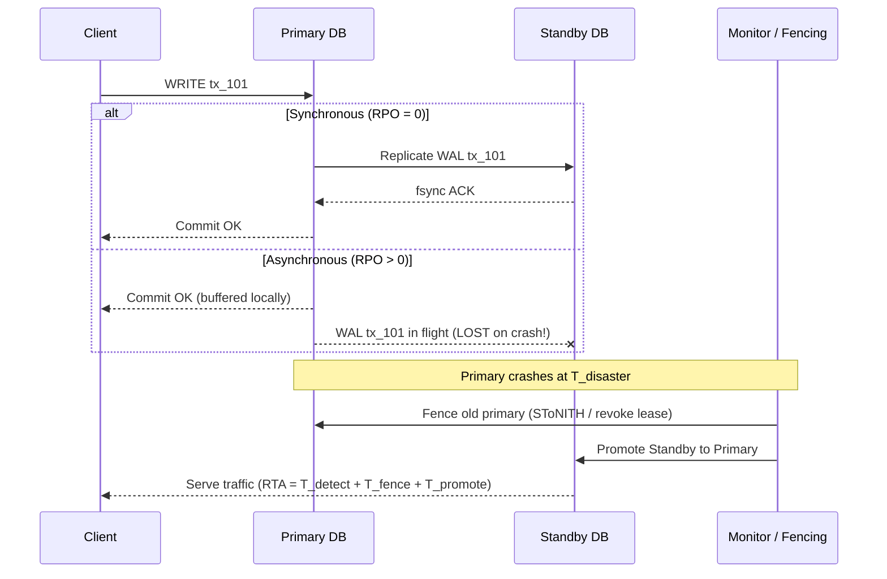
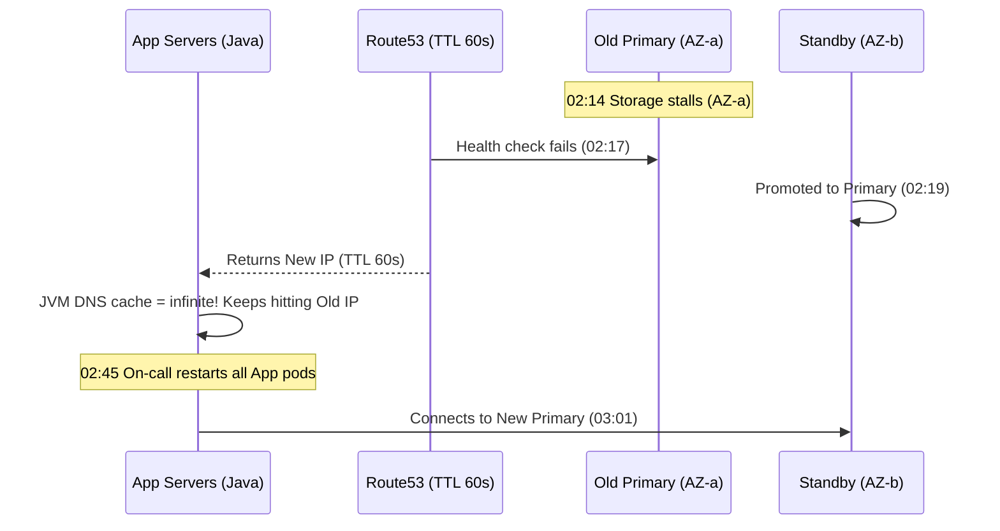

# RTO vs RPO Explained: How Long Down vs How Much Data Lost

> **Prerequisites:** [Lesson 12: Disaster Recovery](../12-disaster-recovery/README.md).  
> **Estimated Reading Time:** 22–26 minutes  
> **Target Audience:** Backend engineers, SREs, and system design candidates asked to justify backup frequency, replication modes, and failover architecture against business SLAs.  
> **Free PDF Notes:** [Download SD-K-013.pdf](https://backendroadmap.com/notes/system-design/SD-K-013.pdf)

> [!NOTE]
> **In one line:** **RPO** (Recovery Point Objective) defines the maximum acceptable **data loss** measured in time backwards from the failure, while **RTO** (Recovery Time Objective) defines the maximum acceptable **downtime** measured in time forwards from the failure until service restoration.

> [!TIP]
> **The Golden Rule:** Never confuse *objectives* (**RPO/RTO**, business contracts) with *actuals* (**RPA/RTA**, measured during real failovers). Your architecture is only as good as the worst-case **RTA** and **RPA** observed in production game days—not the marketing numbers on a cloud provider's SLA page.

---

## 1. What RTO vs RPO Is, and What It Isn't

At 02:14 UTC, a storage volume in `us-east-1` corrupts and the primary database crashes. The last completed snapshot ran at 02:00 UTC, and Write-Ahead Log (WAL) archiving shipped logs every 5 minutes, with the last archive at 02:10 UTC. On-call wakes up at 02:18, declares a disaster at 02:22, provisions a new instance, restores the snapshot, replays WALs, and routes traffic back at 02:49. The business lost **4 minutes** of committed transactions (02:10 to 02:14) and was down for **35 minutes** (02:14 to 02:49).

| Term | Precise Meaning | Example |
| :--- | :--- | :--- |
| **RPO (Recovery Point Objective)** | Maximum tolerable data loss, expressed as a time interval before failure | RPO = 5 min (max 5 min of writes lost) |
| **RTO (Recovery Time Objective)** | Maximum tolerable time to restore service after a failure | RTO = 15 min (service back within 15 min) |
| **RPA (Recovery Point Actual)** | Actual data loss observed during a real recovery or drill | 4 min lost in the 02:14 outage |
| **RTA (Recovery Time Actual)** | Actual downtime observed from incident start to full recovery | 35 min downtime (breached 15 min RTO) |
| **WRT (Work Recovery Time)** | Time after infrastructure is up to verify data integrity and catch up queues | 10 min reconciling payment ledger |
| **MTD (Maximum Tolerable Downtime)** | Absolute ceiling before existential business or regulatory harm ($RTO + WRT \le MTD$) | 4 hours for a retail bank |
| **Not** | Normal high-availability (HA) micro-failovers or single-AZ restarts | RTO/RPO govern catastrophic recovery |

### Why It Matters
1. **RPO dictates data replication:** Zero RPO requires synchronous replication across failure domains; non-zero RPO allows asynchronous replication or periodic snapshots.
2. **RTO dictates compute readiness:** Low RTO requires warm/hot standbys and automated DNS/routing failover; high RTO allows cold provisioning from backups.
3. **Cost scales exponentially as RTO and RPO approach zero:** Moving from 1-hour RTO/RPO to 0-second RTO/RPO often increases infrastructure cost by 5x–20x and adds cross-AZ/cross-region write latency.

---

## 2. Anatomy: The Disaster Recovery Timeline


Notice the asymmetry: **RPO** looks *backward* from $T_{\text{disaster}}$ to the last durable byte; **RTO** looks *forward* from $T_{\text{disaster}}$ to full service restoration. Many teams obsess over database restore speed ($T_{\text{restore}}$) while forgetting $T_{\text{detect}}$, $T_{\text{decide}}$ (human hesitation), and $T_{\text{verify}}$ (cache warming, DNS TTL propagation, queue draining).

| Tier | Pattern | Typical RPO | Typical RTO | Primary Mechanism |
| :--- | :--- | :---: | :---: | :--- |
| **Tier 1: Backup & Restore** | Cold | 1–24 hours | 4–24 hours | Periodic snapshots to object storage; provision on demand |
| **Tier 2: Pilot Light** | Warm-DB | 1–15 min | 15–60 min | Replicated DB always running; app compute scaled from zero |
| **Tier 3: Warm Standby** | Scaled-down | Seconds–5 min | 1–15 min | Scaled-down full stack running; autoscale + DNS flip |
| **Tier 4: Multi-Site Active-Active** | Hot | 0–seconds | < 1 min | Synchronous/quorum writes across regions; instant traffic shift |

> [!WARNING]
> **Human decision time destroys low-RTO targets.** If your RTO is 5 minutes, you cannot have a 10-minute manual approval gate ("wait for the VP of Engineering to sign off on failing over"). Either automate failover with strict fencing tokens (SToNITH) or raise your RTO to match human reality.

---

## 3. Mathematical Model: RPO, RTO, and Cost Curves

**Actual Recovery Point ($RPA$).** For periodic snapshots at interval $I_{\text{snap}}$ with continuous WAL shipping at interval $I_{\text{wal}}$ and asynchronous replication lag $L_{\text{rep}}$:

$$RPA_{\text{worst}} = \min(I_{\text{snap}}, I_{\text{wal}}) + L_{\text{ship}}, \qquad RPA_{\text{async}} = L_{\text{rep}}$$

With a 1-hour snapshot, 5-minute WAL shipping, and 30 seconds of upload/flush latency, worst-case $RPA = 5\text{ min} + 0.5\text{ min} = 5.5\text{ min}$.

**Actual Recovery Time ($RTA$).** Total downtime is the sum of four sequential phases plus Work Recovery Time ($WRT$):

$$RTA = T_{\text{detect}} + T_{\text{decide}} + T_{\text{provision}} + \frac{D_{\text{base}}}{B_{\text{restore}}} + \frac{D_{\text{wal}}}{R_{\text{replay}}} + T_{\text{verify}}$$

**Worked Numerical Example.**
Suppose you have a **2 TB** ($2{,}000\text{ GB}$) database restoring over a **500 MB/s** ($0.5\text{ GB/s}$) network/disk pipe, **60 GB** of WAL accumulated since the last base backup replaying at **150 MB/s**, $T_{\text{detect}} = 2\text{ min}$, $T_{\text{decide}} = 3\text{ min}$, $T_{\text{provision}} = 4\text{ min}$, and $T_{\text{verify}} = 5\text{ min}$:

$$T_{\text{base}} = \frac{2{,}000\text{ GB}}{0.5\text{ GB/s}} = 4{,}000\text{ s} \approx 66.7\text{ min}$$

$$T_{\text{wal}} = \frac{60{,}000\text{ MB}}{150\text{ MB/s}} = 400\text{ s} \approx 6.7\text{ min}$$

$$RTA = 2 + 3 + 4 + 66.7 + 6.7 + 5 = \mathbf{87.4\text{ minutes}}$$

Even with zero human delay, a 2 TB restore cannot meet a 15-minute RTO—you *must* keep a pre-hydrated replica (Pilot Light or Warm Standby) so $T_{\text{base}} = 0$.

---

## 4. Metrics & Percentiles

| Metric | Meaning | Alert when |
| :--- | :--- | :--- |
| **Replication lag ($p_{99}$)** | Time delta between primary commit and standby apply | Exceeds 50% of RPO budget |
| **WAL archive age** | Time since last WAL segment was durably uploaded | Exceeds $I_{\text{wal}} + 60\text{ s}$ |
| **Restore drill RTA ($p_{95}$)** | End-to-end time measured in automated DR drills | Exceeds 80% of RTO target |
| **Backup freshness** | Age of latest verified base snapshot | Exceeds $1.5 \times I_{\text{snap}}$ |
| **Failover false-positive rate** | Unnecessary failovers triggered by transient blips | > 0 per quarter |
| **Queue/backlog drain time** | Time for downstream consumers to catch up post-recovery | Exceeds WRT budget |

### Worked Example (Multi-Tier E-Commerce Platform)
An e-commerce platform splits its state into three recovery classes rather than paying for Tier-4 everywhere:
- **Payment Ledger (Tier 4):** `RPO = 0`, `RTO = 30 s`. Synchronous multi-AZ quorum commit (`synchronous_commit = remote_apply`). Costs 2x compute + 1.5 ms write latency.
- **Order & Inventory DB (Tier 3):** `RPO = 10 s`, `RTO = 5 min`. Async cross-region standby with automated health-gated promotion and DNS TTL = 30 s.
- **Clickstream Analytics Warehouse (Tier 1):** `RPO = 4 hours`, `RTO = 12 hours`. Hourly Parquet dumps to S3; raw events retained in Kafka for 7 days for replay.

---

## 5. Compounding & Failure Modes

What happens when a primary crashes during peak load and you have **async replication** plus **DNS-based failover**?

| Scenario | Replication Mode | Expected RPO/RTO | Real-World Failure Mode | Actual RPA / RTA |
| :--- | :--- | :--- | :--- | :--- |
| **Normal failover** | Async (1 s lag) | RPO 5 s / RTO 2 min | Clean promotion, 30 s DNS TTL | RPA 1 s / RTA 95 s |
| **Replication lag spike** | Async under bulk backfill | RPO 5 s / RTO 2 min | Standby 4 min behind due to `ALTER TABLE` | **RPA 240 s** (48x RPO breach) |
| **Split-brain promotion** | Async, network partition | RPO 5 s / RTO 2 min | Old primary still accepts writes for 90 s | **Data divergence**, manual merge (4 h WRT) |
| **Cold cache stampede** | Warm standby promoted | RPO 5 s / RTO 2 min | Buffer pool cold; DB CPU hits 100% on cutover | **RTA 28 min** (cascading timeouts) |

**Key Insight:** Async replication lag is *non-linear* under load. A single heavy batch job or unindexed migration can push `L_rep` from 200 ms to 10 minutes right before a crash, silently blowing your RPO by orders of magnitude.

---

## 6. Numbers Every Engineer Must Know

| Item | Typical | Implication |
| :--- | :---: | :--- |
| Same-AZ synchronous commit overhead | 0.3–1.0 ms | Negligible for most OLTP workloads |
| Cross-AZ synchronous commit overhead | 1–3 ms | Standard for `RPO = 0` within a region |
| Cross-region synchronous commit overhead | 40–150 ms | Prohibitive for chatty transactions |
| Cloud block storage (EBS/PD) restore throughput | 250–1,000 MB/s | 1 TB takes 17–67 min to hydrate |
| DNS TTL propagation floor (ignoring rogue resolvers) | 30–60 s | Caps minimum DNS-based RTO |
| Automated health-check failover threshold | 30–90 s | Faster risks flapping on transient GC/network pauses |

---

## 7. Protocol Deep Dive: Synchronous vs Asynchronous Failover



### When NOT to Target RPO = 0 / RTO < 1 min
- **Stateless or reconstructible data:** Search indexes, caches, and materialized views can be rebuilt from the source of truth; paying for synchronous replication wastes money.
- **Cross-region active-active without conflict resolution:** Enforcing `RPO = 0` across continents via synchronous Paxos/Raft adds 80–150 ms per write and makes your global availability *worse* if cross-ocean links flap.
- **Early-stage products:** Spending 3 months building Tier-4 multi-region failover when `RTO = 1 hour` and `RPO = 15 minutes` satisfies every customer slows product velocity.

---

## 8. Hierarchical Budgets & Design Rules

| Slice | Rule | Control |
| :--- | :--- | :--- |
| **Detection ($T_{\text{detect}}$)** | Must be < 20% of RTO | Multi-probe synthetic checks every 10 s; 3 consecutive failures |
| **Decision ($T_{\text{decide}}$)** | Eliminate human gates for RTO < 15 min | Automated leader election with lease/fencing tokens |
| **Data Hydration ($T_{\text{restore}}$)** | Must be 0 for RTO < 30 min | Maintain warm/hot standby rather than restoring from object storage |
| **Replication Lag ($L_{\text{rep}}$)** | Keep $p_{99} < 0.5 \times RPO$ | Throttle batch jobs or shed non-critical writes if lag spikes |
| **DNS / Routing ($T_{\text{route}}$)** | TTL $\le 30\text{ s}$ or Anycast/VIP | Use BGP Anycast, ALB/NLB health checks, or connection proxy (PgBouncer/ProxySQL) |
| **Cache Warmup ($T_{\text{verify}}$)** | Prevent post-failover stampede | Pre-warm standby buffer pool (`pg_prewarm`) or rate-limit post-failover ramp |

---

## 9. Top Mitigations

1. **Tier data by business criticality:** Assign explicit `(RPO, RTO)` pairs per datastore rather than applying a blanket company-wide number.
2. **Fence the old primary before promoting:** Always revoke network/storage leases or power off (SToNITH) the failed primary to prevent split-brain writes.
3. **Measure replication lag in bytes AND seconds:** A standby 500 MB behind during low traffic may take 15 minutes to replay even if the timestamp lag looks small.
4. **Pre-warm standby caches:** Periodically replay top read queries or use buffer-pool state snapshots so a newly promoted primary does not immediately collapse under disk I/O.
5. **Automate DNS/proxy cutover with short TTLs:** Put a smart proxy or cloud load balancer in front of the database so clients do not cache stale primary IPs for hours.
6. **Run quarterly GameDays measuring RPA and RTA:** Treat any drill where `RTA > RTO` or `RPA > RPO` as a P1 engineering bug.
7. **Include WRT in your RTO math:** Factor in Kafka consumer catch-up, search re-indexing, and financial reconciliation before declaring the incident resolved.

---

## 10. Production Reference / War Story: The 47-Minute "5-Minute RTO" Outage

A fintech payments service advertised **RTO = 5 minutes, RPO = 1 minute** using a PostgreSQL async cross-AZ replica and Route53 DNS failover.



- **Root Cause:** Although the database promoted in 5 minutes, the Java application pods used the default JVM `networkaddress.cache.ttl` (which cached DNS indefinitely on older runtimes / misconfigured pools), and HikariCP held dead TCP sockets without `socketTimeout`. Additionally, an overnight analytics ETL had pushed async replication lag to **3 minutes 40 seconds** right before the crash.
- **Impact:** **RTA = 47 minutes** (9.4x RTO), **RPA = 3 min 40 s** (3.6x RPO).
- **Fix:** Set JVM DNS TTL to `5s`, configured aggressive TCP keepalives + `socketTimeout=3000ms`, routed DB connections through an internal proxy (RDS Proxy / PgBouncer), and added an alert + ETL circuit breaker whenever replication lag exceeded 15 seconds.

---

## 11. Multi-Language Production Code Tabs

A production-style **DR Readiness & RTO/RPO Compliance Calculator** that models worst-case $RPA$ and $RTA$ from live telemetry (replication lag, WAL interval, DB size, restore bandwidth, and operational timings) and fails CI/health checks if actuals breach SLOs.

````carousel
```go
// Go: RTO/RPO compliance evaluator for DR readiness checks.
package main

import (
	"fmt"
	"time"
)

type DRProfile struct {
	TargetRPO       time.Duration
	TargetRTO       time.Duration
	ReplLag         time.Duration // current p99 replication lag (0 if synchronous)
	WALShipInterval time.Duration // 0 if streaming continuously
	HasWarmStandby  bool
	DBSizeGB        float64
	RestoreGBPerSec float64
	DetectSec       float64
	DecideSec       float64
	VerifySec       float64
}

func EvaluateDR(p DRProfile) (rpa, rta time.Duration, compliant bool) {
	rpa = p.ReplLag
	if p.WALShipInterval > rpa {
		rpa = p.WALShipInterval + p.ReplLag
	}

	restoreSec := 0.0
	if !p.HasWarmStandby && p.RestoreGBPerSec > 0 {
		restoreSec = p.DBSizeGB / p.RestoreGBPerSec
	}
	totalSec := p.DetectSec + p.DecideSec + restoreSec + p.VerifySec
	rta = time.Duration(totalSec * float64(time.Second))
	compliant = rpa <= p.TargetRPO && rta <= p.TargetRTO
	return rpa, rta, compliant
}

func main() {
	orderDB := DRProfile{
		TargetRPO:       15 * time.Second,
		TargetRTO:       5 * time.Minute,
		ReplLag:         2 * time.Second,
		HasWarmStandby:  true,
		DBSizeGB:        2000,
		RestoreGBPerSec: 0.5,
		DetectSec:       30,
		DecideSec:       15,
		VerifySec:       60,
	}
	rpa, rta, ok := EvaluateDR(orderDB)
	fmt.Printf("OrderDB -> RPA: %v, RTA: %v, Compliant: %v\n", rpa, rta, ok)
}
```
<!-- slide -->
```typescript
// TypeScript: RTO/RPO budget evaluator with phase breakdown.
interface DRProfile {
  targetRpoSec: number;
  targetRtoSec: number;
  replLagSec: number;
  walShipIntervalSec: number;
  hasWarmStandby: boolean;
  dbSizeGb: number;
  restoreGbPerSec: number;
  detectSec: number;
  decideSec: number;
  verifySec: number;
}

interface DRReport {
  rpaSec: number;
  rtaSec: number;
  rpoCompliant: boolean;
  rtoCompliant: boolean;
}

export function evaluateDR(p: DRProfile): DRReport {
  const rpaSec = Math.max(p.replLagSec, p.walShipIntervalSec + p.replLagSec);
  const restoreSec = p.hasWarmStandby ? 0 : p.dbSizeGb / p.restoreGbPerSec;
  const rtaSec = p.detectSec + p.decideSec + restoreSec + p.verifySec;

  return {
    rpaSec,
    rtaSec,
    rpoCompliant: rpaSec <= p.targetRpoSec,
    rtoCompliant: rtaSec <= p.targetRtoSec,
  };
}

const coldRestore = evaluateDR({
  targetRpoSec: 300,
  targetRtoSec: 900, // 15 min RTO
  replLagSec: 0,
  walShipIntervalSec: 300,
  hasWarmStandby: false,
  dbSizeGb: 2000,
  restoreGbPerSec: 0.5,
  detectSec: 120,
  decideSec: 180,
  verifySec: 300,
});
console.log(coldRestore); // rtaSec: 4600 (> 900s -> rtoCompliant: false)
```
<!-- slide -->
```python
# Python: RTO/RPO compliance simulator and tier recommender.
from dataclasses import dataclass

@dataclass
class DRProfile:
    target_rpo_s: float
    target_rto_s: float
    repl_lag_s: float
    wal_ship_s: float
    warm_standby: bool
    db_size_gb: float
    restore_gb_s: float = 0.5
    detect_s: float = 60.0
    decide_s: float = 60.0
    verify_s: float = 120.0

def evaluate_dr(p: DRProfile) -> dict:
    rpa_s = p.repl_lag_s if p.wal_ship_s == 0 else p.wal_ship_s + p.repl_lag_s
    restore_s = 0.0 if p.warm_standby else (p.db_size_gb / p.restore_gb_s)
    rta_s = p.detect_s + p.decide_s + restore_s + p.verify_s
    return {
        "rpa_s": round(rpa_s, 1),
        "rta_s": round(rta_s, 1),
        "rpo_ok": rpa_s <= p.target_rpo_s,
        "rto_ok": rta_s <= p.target_rto_s,
    }

if __name__ == "__main__":
    ledger = DRProfile(target_rpo_s=0, target_rto_s=60, repl_lag_s=0, wal_ship_s=0,
                       warm_standby=True, db_size_gb=500, detect_s=15, decide_s=10, verify_s=20)
    print("Ledger:", evaluate_dr(ledger))
```
<!-- slide -->
```csharp
// C#: RTO/RPO compliance gate for SRE deployment pipelines.
using System;

public record DRProfile(
    double TargetRpoSec,
    double TargetRtoSec,
    double ReplLagSec,
    double WalShipIntervalSec,
    bool HasWarmStandby,
    double DbSizeGb,
    double RestoreGbPerSec,
    double DetectSec,
    double DecideSec,
    double VerifySec
);

public static class DRCompliance
{
    public static (double RpaSec, double RtaSec, bool Compliant) Evaluate(DRProfile p)
    {
        double rpa = p.WalShipIntervalSec > 0
            ? p.WalShipIntervalSec + p.ReplLagSec
            : p.ReplLagSec;

        double restore = p.HasWarmStandby ? 0 : p.DbSizeGb / p.RestoreGbPerSec;
        double rta = p.DetectSec + p.DecideSec + restore + p.VerifySec;
        return (rpa, rta, rpa <= p.TargetRpoSec && rta <= p.TargetRtoSec);
    }

    public static void Main()
    {
        var profile = new DRProfile(10, 300, 2.5, 0, true, 1200, 0.5, 30, 15, 45);
        var (rpa, rta, ok) = Evaluate(profile);
        Console.WriteLine($"RPA={rpa}s, RTA={rta}s, Compliant={ok}");
    }
}
```
````

---

## 12. Hands-On CLI Verification Workflows

```bash
# 1. Check PostgreSQL streaming replication lag (bytes & time = live RPA indicator)
psql -h primary-db -U postgres -c "
SELECT client_addr, state, sync_state,
       pg_wal_lsn_diff(pg_current_wal_lsn(), replay_lsn) AS lag_bytes,
       EXTRACT(EPOCH FROM replay_lag) AS lag_seconds
FROM pg_stat_replication;"

# 2. Check AWS RDS automated backup retention & latest restorable time (live RPO check)
aws rds describe-db-instances \
  --db-instance-identifier orders-prod \
  --query "DBInstances[0].{BackupRetention:BackupRetentionPeriod,LatestRestorable:LatestRestorableTime,MultiAZ:MultiAZ}"

# 3. Quick Python calculation of cold restore RTA for a 2 TB DB at 500 MB/s
python3 -c "
db_gb, bw_gbs = 2000, 0.5
detect, decide, verify = 120, 180, 300
rta_min = (detect + decide + (db_gb / bw_gbs) + verify) / 60
print(f'Estimated Cold Restore RTA: {rta_min:.1f} minutes')
"
```

---

## 13. Common Mistakes to Avoid

1. **Treating HA and DR as the same thing:** Multi-AZ HA protects against hardware failure; DR protects against regional outages, bad migrations (`DROP TABLE`), and ransomware.
2. **Quoting RPO = 0 without synchronous replication:** Asynchronous replication *always* has a non-zero RPO equal to the in-flight WAL lag at crash time.
3. **Forgetting DNS TTL and client connection pools:** Your database can fail over in 30 seconds while clients hang for 30 minutes on stale DNS or unclosed sockets.
4. **Ignoring restore bandwidth physics:** A 10 TB database cannot restore from S3 in 15 minutes regardless of how fast your runbook is.
5. **Omitting human decision time from RTO:** Manual "pager -> Slack -> manager approval -> runbook" loops easily consume 15–30 minutes before recovery even starts.
6. **Measuring only timestamp lag instead of byte lag:** A replica 10 seconds behind during a massive batch write may actually be gigabytes behind in WAL replay.
7. **Never testing failover under load:** Failover works in staging with 0 QPS and collapses in production when 50,000 connections reconnect simultaneously.

---

## 14. Key Terms Glossary

| Key Term | Definition |
| :--- | :--- |
| **RPO (Recovery Point Objective)** | Maximum acceptable data loss measured backwards in time from failure. |
| **RTO (Recovery Time Objective)** | Maximum acceptable downtime measured forwards from failure to restoration. |
| **RPA (Recovery Point Actual)** | Actual data loss observed during a real failure or DR test. |
| **RTA (Recovery Time Actual)** | Actual elapsed downtime observed during a real failure or DR test. |
| **WRT (Work Recovery Time)** | Post-infrastructure recovery time spent verifying data and draining backlogs. |
| **MTD (Maximum Tolerable Downtime)** | Upper bound on total outage duration ($RTO + WRT \le MTD$) before severe business harm. |
| **Pilot Light** | DR topology where core data replicates continuously while app compute is scaled from zero on failover. |
| **Warm Standby** | DR topology running a scaled-down, live copy of the full stack ready to scale up on failover. |
| **SToNITH** | "Shoot The Other Node In The Head"—hard fencing of a failed primary to prevent split-brain. |
| **WAL (Write-Ahead Log)** | Append-only durability log used for crash recovery and continuous point-in-time replication. |

---

## 15. System Design Interview Questions & Answers

### Basic Conceptual Questions

<details>
<summary><strong>Q1: What is the difference between RTO and RPO? [BASIC]</strong></summary>

**Answer:**
RPO (Recovery Point Objective) is the maximum acceptable **data loss** measured in time backwards from the disaster (e.g., 5 minutes of writes). RTO (Recovery Time Objective) is the maximum acceptable **downtime** measured in time forwards from the disaster until service restoration (e.g., 15 minutes).
</details>

<details>
<summary><strong>Q2: What is the difference between RPO/RTO and RPA/RTA? [BASIC]</strong></summary>

**Answer:**
RPO and RTO are *business targets* (contracts). RPA (Recovery Point Actual) and RTA (Recovery Time Actual) are the *measured realities* observed during a real outage or DR drill. A system is only compliant if $RPA \le RPO$ and $RTA \le RTO$.
</details>

<details>
<summary><strong>Q3: Can you achieve RPO = 0 with asynchronous replication? [BASIC]</strong></summary>

**Answer:**
No. With asynchronous replication, the primary acknowledges the write to the client before the standby persists it. If the primary suffers an unrecoverable crash before shipping those bytes, committed data is lost ($RPA > 0$). `RPO = 0` requires synchronous replication across failure domains.
</details>

<details>
<summary><strong>Q4: Why does RTO include more than just database restore time? [BASIC]</strong></summary>

**Answer:**
Total downtime is $T_{\text{detect}} + T_{\text{decide}} + T_{\text{provision}} + T_{\text{restore}} + T_{\text{verify}}$. Detection delays, manual approval gates, DNS TTL propagation, and post-restore cache warming often exceed the database recovery time itself.
</details>

### Scenario-Based Architecture Questions

<details>
<summary><strong>Q5: A startup has a 4 TB PostgreSQL database and wants RTO = 10 minutes, RPO = 30 seconds on a tight budget. What do you design? [SCENARIO]</strong></summary>

**Answer:**
Cold backup-and-restore fails immediately because hydrating 4 TB at 500 MB/s takes ~133 minutes. Instead, use a **Pilot Light / Warm Standby** pattern: run a smaller cross-AZ/cross-region async read replica (`RPO <= 30 s`), automate promotion with a connection proxy (RDS Proxy/PgBouncer) to bypass DNS TTL, and scale app compute horizontally on failover.
</details>

<details>
<summary><strong>Q6: Your payment service requires RPO = 0 and RTO < 30 seconds across two regions 3,000 km apart. What happens? [SCENARIO]</strong></summary>

**Answer:**
At 3,000 km, speed of light in fiber (~200 km/ms) imposes a minimum ~30 ms round-trip time (often 45–60 ms in practice). Synchronous cross-region commits add 45–60 ms to *every* write transaction and drop write availability if the WAN link flaps. You should push back on the requirement: keep `RPO = 0` across **Availability Zones** within one region (1–2 ms RTT) and accept `RPO = few seconds` across regions, or use a consensus-based distributed DB (e.g., Spanner) only if the latency budget allows.
</details>

<details>
<summary><strong>Q7: During a failover drill, the DB promoted in 40 seconds, yet users saw errors for 20 minutes. Why? [SCENARIO]</strong></summary>

**Answer:**
Common culprits: (1) long DNS TTLs or language-level DNS caching (e.g., JVM) pointing clients at the dead IP, (2) connection pools holding half-open TCP sockets without `socketTimeout`, (3) cold standby buffer pools causing 100% disk I/O thrashing under production read load, or (4) un-drained downstream queues.
</details>

<details>
<summary><strong>Q8: How do you design RTO/RPO for a multi-service platform without overpaying? [SCENARIO]</strong></summary>

**Answer:**
Classify data into tiers. Tier 1 (payments/auth) gets synchronous multi-AZ + warm cross-region standby (`RPO=0`, `RTO<1m`). Tier 2 (orders/profiles) gets async replicas (`RPO=10s`, `RTO=5m`). Tier 3 (analytics/logs) uses hourly object-storage snapshots and Kafka replay (`RPO=1h`, `RTO=4h`).
</details>

### Advanced & Tricky Interview Questions

<details>
<summary><strong>Q9: How can an asynchronous replica cause data corruption even after a clean failover? [TRICKY]</strong></summary>

**Answer:**
**Split-brain.** If the monitor promotes the standby while the old primary is merely network-partitioned (not dead), both nodes accept writes simultaneously. When connectivity returns, you have divergent histories that cannot be merged automatically. You must fence the old primary (SToNITH / revoke storage or lease) *before* promotion.
</details>

<details>
<summary><strong>Q10: Why is Work Recovery Time (WRT) often the hidden killer of RTO? [TRICKY]</strong></summary>

**Answer:**
Bringing the database online is only half the battle. If 100,000 events queued up in Kafka, caches are empty, and billing/inventory tables are slightly out of sync due to non-zero RPO, the system may take hours to reconcile state and drain backlogs before customers can actually use the product.
</details>

<details>
<summary><strong>Q11: Does Multi-AZ synchronous replication protect against `DROP TABLE users;`? [TRICKY]</strong></summary>

**Answer:**
No! Synchronous replication replicates *every* committed statement—including destructive migrations and ransomware encryption—in milliseconds. You still need immutable point-in-time backups (PITR) and delayed replicas to achieve an acceptable RPO against logical/human corruption.
</details>

<details>
<summary><strong>Q12: How does replication lag behave under sudden write bursts, and how do you protect RPO? [TRICKY]</strong></summary>

**Answer:**
Async replication lag grows super-linearly when write throughput exceeds the standby's single-threaded or disk-apply rate (e.g., during bulk backfills or index builds). Protect RPO by monitoring lag in *bytes and seconds*, rate-limiting batch jobs, and shedding non-critical writes if lag approaches 50% of the RPO budget.
</details>

---

## 16. One-Page Master Cheat Sheet

```
+---------------------------------------------------------------------------------------------------------+
|                           RTO vs RPO — MASTER CHEAT SHEET                                               |
+---------------------------------------------------------------------------------------------------------+
| 1. DEFINITIONS: RPO = max data loss (backward from crash). RTO = max downtime (forward from crash).     |
|    RPA / RTA = actual observed values in real failovers. Always satisfy RPA <= RPO and RTA <= RTO.      |
+---------------------------------------------------------------------------------------------------------+
| 2. TIMELINE:  [Last Backup/Sync] --(RPA)--> [Disaster] --(Detect+Decide+Restore+Verify = RTA)--> [Live] |
+---------------------------------------------------------------------------------------------------------+
| 3. TIERS: Cold Backup (h/h) | Pilot Light (m/m) | Warm Standby (s/m) | Active-Active (0/s).             |
+---------------------------------------------------------------------------------------------------------+
| 4. PHYSICS: Cold restore time = DB_Size / Bandwidth (2 TB @ 500 MB/s = 67 min -> impossible for 15m RTO)|
+---------------------------------------------------------------------------------------------------------+
| 5. TRAPS: Manual approval gates · Stale DNS/JVM cache · Cold buffer pools · Split-brain without fencing |
|           Sync replication does NOT protect against DROP TABLE (need immutable PITR backups).            |
+---------------------------------------------------------------------------------------------------------+
| 6. CONTROLS: Tier datastores · Fence old primary (SToNITH) · Proxy DB connections · Alert on byte lag.  |
+---------------------------------------------------------------------------------------------------------+
```

---

## Further Reading & Sources

- AWS Well-Architected Framework, *Reliability Pillar — Disaster Recovery of Workloads on AWS* (RPO/RTO tiers).
- Google Cloud Architecture Center, *Disaster Recovery Planning Guide*.
- Betsy Beyer et al., *Site Reliability Engineering* (O'Reilly), Chapter 26: "Data Integrity: What You Read Is What You Wrote".
- Martin Kleppmann, *Designing Data-Intensive Applications*, Chapter 5: "Replication" (Synchronous vs Asynchronous & Split-Brain).

---

## Free PDF Notes

[SD-K-013.pdf](https://backendroadmap.com/notes/system-design/SD-K-013.pdf)

---

## Next

Continue with [Backups & Restore Testing: Why a Backup Isn't a Backup Until Restored](../14-backups-restore-testing/README.md).
