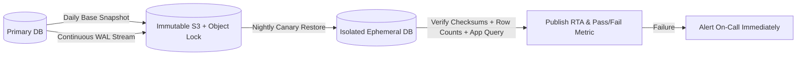
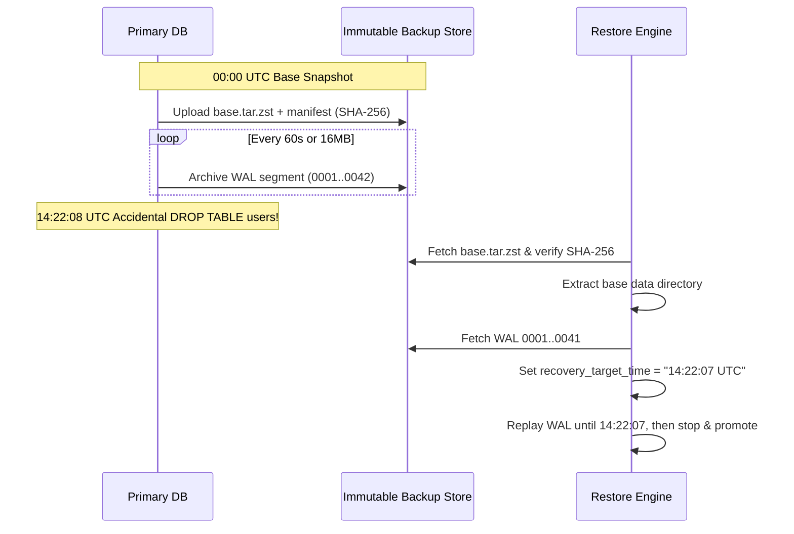
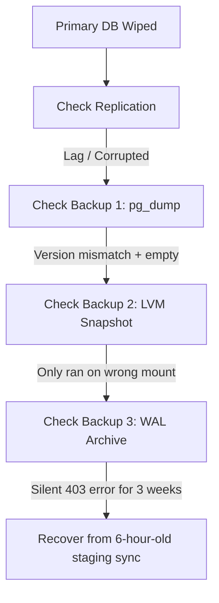

# Backups & Restore Testing: Why a Backup Isn't a Backup Until Restored

> **Prerequisites:** [Lesson 13: RTO vs RPO Explained](../13-rto-vs-rpo-explained/README.md).  
> **Estimated Reading Time:** 22–26 minutes  
> **Target Audience:** Backend engineers, DBAs, and SREs designing durable backup pipelines, ransomware-proof storage, and automated restore verification.  
> **Free PDF Notes:** [Download SD-K-014.pdf](https://backendroadmap.com/notes/system-design/SD-K-014.pdf)

> [!NOTE]
> **In one line:** A backup job returning `exit 0` only proves bytes were written somewhere—**not** that the files are complete, uncorrupted, decryptable, or restorable within your RTO. **An untested backup is Schrödinger's backup: simultaneously valid and useless until restored.**

> [!TIP]
> **The Golden Rule:** Follow the **3-2-1-1-0 rule**: **3** copies of data, on **2** different media/storage classes, **1** copy offsite/cross-region, **1** copy immutable/air-gapped (WORM), and **0** errors on automated restore verification.

---

## 1. What Backups & Restore Testing Are, and What They Aren't

Every night at 01:00 UTC, a cron job runs `pg_dump` and uploads a 400 GB archive to S3, posting a green checkmark in Slack. Six months later, a bad migration drops the `invoices` table. The on-call engineer downloads the dump and runs `pg_restore`—only to discover the dump was truncated at 120 GB due to a silent disk-full error on `/tmp`, and the KMS decryption key was deleted when an engineer left the company.

| Term | Precise Meaning | Example |
| :--- | :--- | :--- |
| **Full Backup** | Complete, self-contained copy of all data at a point in time | Sunday 00:00 `pg_basebackup` |
| **Incremental Backup** | Captures only blocks/files changed since the *last backup of any type* | Daily delta since yesterday's incremental |
| **Differential Backup** | Captures all changes since the *last full backup* | Wednesday delta since Sunday full |
| **PITR (Point-in-Time Recovery)** | Base snapshot + continuous WAL/binlog stream to replay to any exact second | Restore to `14:22:07 UTC` (1 s before `DROP TABLE`) |
| **Logical vs Physical Backup** | SQL statements (`pg_dump`) vs raw data pages/snapshots (`pg_basebackup`, EBS) | Logical is portable; physical is 10x faster to restore |
| **Immutable / WORM Backup** | Write-Once-Read-Many storage that cannot be deleted or overwritten before retention | S3 Object Lock (Compliance mode) |
| **Not** | High availability (RAID or synchronous replicas) | Replicas replicate `DROP TABLE` immediately |

### Why It Matters
1. **Replication is not backup:** Replicas protect against hardware failure; backups protect against human error, bad deployments, software bugs, and ransomware.
2. **Restore is the bottleneck, not backup:** Taking a snapshot is asynchronous and fast; restoring terabytes and replaying WALs under incident pressure is slow and I/O-bound.
3. **Silent failures compound:** Missing WAL segments, expired KMS keys, or schema-incompatible logical dumps remain invisible until you actually run a restore.

---

## 2. Anatomy: Continuous Backup & Automated Restore Verification



Notice the closed loop: backups flow into **immutable storage** (so compromised production credentials cannot `rm -rf` the backups), and an **automated canary restore pipeline** periodically hydrates an isolated sandbox, verifies checksums and invariants, and records the actual **RTA**.

| Backup Type | Backup Speed | Restore Speed | Storage Cost | Best Use Case |
| :--- | :---: | :---: | :---: | :--- |
| **Full** | Slow | Fast (1 step) | High | Weekly anchor / small DBs |
| **Incremental** | Fast | Slow (Full + $N$ deltas) | Low | Daily backups with PITR |
| **Differential** | Medium | Medium (Full + 1 delta) | Medium | Fast restore without full daily cost |
| **Logical (`pg_dump`)** | Slow | Very slow (rebuilds indexes) | Low | Cross-version migration, small tables |
| **Physical / Snapshot** | Very fast (CoW) | Fast (block copy) | Medium | Large OLTP DBs (> 500 GB) |

> [!WARNING]
> **Never store backups under the same IAM role or root account as production.** In modern ransomware and credential-leak incidents, attackers delete backups *first* before encrypting or dropping the primary database. Use cross-account replication with **S3 Object Lock (Compliance Mode)** so not even the root user can shorten retention.

---

## 3. Mathematical Model: Storage Growth, Chain Risk & Restore Time

**Storage Footprint.** For a database of size $S_0$, daily change rate $\Delta$, retention of $N$ days, and full-backup cadence every $K$ days:

$$S_{\text{incremental}} = \frac{N}{K} S_0 + N \cdot \Delta, \qquad S_{\text{differential}} = \frac{N}{K} S_0 + \frac{N}{K} \cdot \frac{K(K-1)}{2} \Delta$$

For $S_0 = 1{,}000\text{ GB}$, $\Delta = 50\text{ GB/day}$, $N = 28\text{ days}$, $K = 7\text{ days}$:
- **Incremental:** $4 \times 1{,}000 + 28 \times 50 = \mathbf{5{,}400\text{ GB}}$.
- **Differential:** $4 \times 1{,}000 + 4 \times \frac{7 \times 6}{2} \times 50 = 4{,}000 + 4{,}200 = \mathbf{8{,}200\text{ GB}}$.

**Incremental Chain Fragility.** If any single link in a chain of $m$ incremental backups has corrupt probability $p$, the probability that the *entire* restore succeeds is:

$$P(\text{restore succeeds}) = (1 - p)^m$$

With $m = 30$ daily incrementals and $p = 0.02$ (2% chance of a missing/corrupt file), $P(\text{succeeds}) = 0.98^{30} = \mathbf{54.5\%}$—nearly a coin flip! This is why you cap incremental chains at $K \le 7$ days.

**PITR Restore Time.**

$$T_{\text{restore}} = \frac{S_0}{B_{\text{net/disk}}} + \frac{T_{\text{since\_full}} \cdot R_{\text{wal\_gen}}}{R_{\text{wal\_replay}}} + T_{\text{index/verify}}$$

---

## 4. Metrics & Percentiles

| Metric | Meaning | Alert when |
| :--- | :--- | :--- |
| **Time since last verified restore** | Age of the last *passing* canary restore | > 7 days (Tier 1) / > 30 days (Tier 2) |
| **Canary restore RTA ($p_{95}$)** | Measured duration of automated restore test | > 80% of RTO target |
| **WAL / binlog gap count** | Missing sequence numbers in archived log stream | > 0 (immediate P1 alert—PITR is broken!) |
| **Backup size anomaly** | Sudden > 20% drop or spike vs 7-day moving avg | Outside $\pm 20\%$ (catches truncated dumps) |
| **Checksum mismatch rate** | SHA-256 verification failures on backup chunks | > 0 |
| **Immutable lock coverage** | % of critical datastores with WORM enabled | < 100% |

### Worked Example (Truncated Logical Dump vs Physical PITR)
A 1.5 TB PostgreSQL database uses `pg_dump` (logical) vs `pg_basebackup` + WAL archiving (physical):
- **Logical (`pg_dump`):** Backup takes 3.5 hours; `pg_restore` must re-execute all `INSERT`/`COPY` statements and rebuild 18 B-tree indexes from scratch, taking **14 hours**—violating a 2-hour RTO.
- **Physical (`pg_basebackup` + WAL):** Base copy restores at 400 MB/s in **62 minutes**; replaying 4 hours of WAL (24 GB at 120 MB/s) takes **3.3 minutes**. Total restore = **65.3 minutes**, comfortably inside the 2-hour RTO.

---

## 5. Compounding & Failure Modes

| Failure Mode | How It Happens Silently | Why Backup Job Still Says "Success" | Caught Only By |
| :--- | :--- | :--- | :--- |
| **Broken WAL chain** | 1 WAL file skipped during network blip | Base backup succeeded; `archive_command` returned 0 on timeout | Automated PITR replay test |
| **Deleted KMS / GPG key** | Key rotated or scheduled for deletion | Ciphertext uploads fine to S3 | Canary restore in clean account |
| **Unbacked-up auxiliary state** | DB restored, but S3 blobs or secrets missing | DB dump only covers SQL tables | End-to-end app smoke test on restore |
| **Lazy EBS hydration cliff** | EBS snapshot restores "instantly", but blocks fetch lazily from S3 | Volume attaches in 30 s; first production reads stall at 50 ms I/O | Load test / `dd` pre-warming in drill |
| **Single-account ransomware** | Attacker gets `AdministratorAccess` | Backups ran yesterday, deleted today | Cross-account WORM / Object Lock |

**The EBS Lazy-Hydration Trap:** Cloud block snapshots (AWS EBS, GCP PD) attach in seconds, tricking teams into thinking `RTO = 1 minute`. In reality, blocks are fetched lazily from object storage on first read, causing **10x–50x I/O latency spikes** until you pre-warm the volume (`fio` / `dd`) or enable Fast Snapshot Restore (FSR).

---

## 6. Numbers Every Engineer Must Know

| Item | Typical | Implication |
| :--- | :---: | :--- |
| Physical restore throughput (NVMe / S3) | 300–1,000 MB/s | ~1 TB takes 17–55 minutes |
| Logical restore (`pg_restore` + indexes) | 20–80 MB/s | 5x–15x slower than physical restore |
| WAL replay rate (single-threaded apply) | 80–200 MB/s | Long gaps between base backups slow PITR |
| Recommended max incremental chain ($K$) | 7 days | Limits $(1-p)^m$ corruption compounding |
| S3 Object Lock minimum for prod DBs | 7–35 days | Prevents attacker or bug from wiping history |
| Canary restore frequency (Tier 1) | Daily or Weekly | Catches silent rot before an outage |

---

## 7. Protocol Deep Dive: Point-in-Time Recovery (PITR)



### When NOT to Use Logical Backups (`pg_dump` / `mysqldump`)
- **Databases > 200 GB** with tight RTOs (< 4 hours): index rebuild time dominates.
- **High-churn OLTP tables** where taking a consistent snapshot locks or bloats MVCC dead tuples.
- **When you need sub-hour RPO:** Logical dumps are point-in-time snapshots only; they cannot replay continuous WALs.

---

## 8. Hierarchical Budgets & Design Rules

| Slice | Rule | Control |
| :--- | :--- | :--- |
| **Immutability** | Zero delete permissions for prod roles | Cross-account S3 Object Lock (Compliance mode) |
| **Encryption Keys** | Separate key lifecycle from DB lifecycle | Multi-region KMS keys with deletion protection (`PendingWindow = 30d`) |
| **Integrity** | Verify every chunk before trusting | Store SHA-256 manifest alongside every snapshot & WAL |
| **Chain Depth** | Max 7 incrementals between fulls | Weekly full + daily incremental + continuous WAL |
| **Restore Testing** | Automated, isolated, end-to-end | Nightly/weekly Ephemeral Restore + `SELECT count(*)` + schema check |
| **Pre-Warming** | Eliminate lazy-hydration latency cliff | Use Fast Snapshot Restore (FSR) or `fio` read-all before cutover |

---

## 9. Top Mitigations

1. **Automate canary restores in CI/cron:** Spin up an ephemeral DB from the latest backup weekly, run application health checks against it, measure RTA, and destroy it.
2. **Enforce the 3-2-1-1-0 rule:** Three copies, two media types, one offsite region, one immutable/air-gapped, zero verification errors.
3. **Alert on WAL archiving gaps immediately:** A single missing WAL file breaks PITR from that point forward—page on-call if `archive_failed_count > 0`.
4. **Monitor backup size deltas:** Alert if a backup shrinks by > 20% compared to the 7-day rolling average (catches silent truncation or empty dumps).
5. **Back up the "forgotten" state:** Include KMS key aliases, IAM policies, Terraform state, Secrets Manager, and object-storage buckets in the DR inventory.
6. **Separate backup credentials from production:** Production DB nodes should only have `PutObject` (append-only) permissions, never `DeleteObject` or `PutObjectRetention`.
7. **Sanitize PII in non-prod restore tests:** If canary restores run in a dev/staging account, run automated PII masking before developers can query the restored instance.

---

## 10. Production Reference / War Story: The 5-Out-of-5 Broken Backups

Inspired by real-world post-mortems (including the famous 2017 GitLab database incident): an engineering team suffered an accidental `rm -rf` / `DROP` on their primary database directory.



- **Root Cause:** Five independent backup mechanisms were configured, *none* of which had an automated restore test: `pg_dump` failed silently due to a client/server version mismatch, cron emails went to an unmonitored `/var/mail/root`, and S3 credentials for WAL archiving had expired 3 weeks earlier.
- **Impact:** 6 hours of permanent data loss (`RPA = 6 hours`) and 18+ hours of downtime (`RTA = 18 hours`).
- **Fix:** Replaced silent cron jobs with a single, observable backup pipeline that emits Prometheus metrics (`backup_last_success_timestamp`, `restore_test_last_pass_timestamp`) and runs an automated weekly restore into an isolated VPC.

---

## 11. Multi-Language Production Code Tabs

A production-pattern **Backup Manifest Verifier & PITR Restore-Time Estimator** that validates SHA-256 integrity across a full + incremental + WAL chain and refuses to mark a backup healthy if any link is missing or corrupt.

````carousel
```go
// Go: backup chain integrity verifier and restore-time estimator.
package main

import (
	"crypto/sha256"
	"encoding/hex"
	"errors"
	"fmt"
)

type BackupArtifact struct {
	ID         string
	Kind       string // "full", "incremental", "wal"
	SizeGB     float64
	Payload    []byte
	ExpectedSHA string
}

func VerifyChain(chain []BackupArtifact, bandwidthGBps float64) (float64, error) {
	if len(chain) == 0 || chain[0].Kind != "full" {
		return 0, errors.New("chain must start with a full backup")
	}
	var totalGB float64
	for _, item := range chain {
		sum := sha256.Sum256(item.Payload)
		if hex.EncodeToString(sum[:]) != item.ExpectedSHA {
			return 0, fmt.Errorf("checksum mismatch on %s (%s)", item.ID, item.Kind)
		}
		totalGB += item.SizeGB
	}
	return totalGB / bandwidthGBps, nil
}

func main() {
	h := func(b []byte) string {
		s := sha256.Sum256(b)
		return hex.EncodeToString(s[:])
	}
	chain := []BackupArtifact{
		{ID: "base-sun", Kind: "full", SizeGB: 800, Payload: []byte("base"), ExpectedSHA: h([]byte("base"))},
		{ID: "inc-mon", Kind: "incremental", SizeGB: 45, Payload: []byte("mon"), ExpectedSHA: h([]byte("mon"))},
		{ID: "wal-001", Kind: "wal", SizeGB: 12, Payload: []byte("wal"), ExpectedSHA: h([]byte("wal"))},
	}
	rtaSec, err := VerifyChain(chain, 0.5)
	fmt.Printf("Verified: err=%v, Estimated Restore=%.1fs\n", err, rtaSec)
}
```
<!-- slide -->
```typescript
// TypeScript: Backup chain verifier with 3-2-1-1-0 policy check.
import { createHash } from "crypto";

interface BackupArtifact {
  id: string;
  kind: "full" | "incremental" | "wal";
  sizeGb: number;
  payload: Buffer;
  expectedSha256: string;
  immutableLock: boolean;
}

export function verifyBackupChain(
  chain: BackupArtifact[],
  bandwidthGbPerSec: number
): { valid: boolean; estimatedRestoreSec: number; reason?: string } {
  if (chain.length === 0 || chain[0].kind !== "full") {
    return { valid: false, estimatedRestoreSec: Infinity, reason: "Missing base full backup" };
  }
  let totalGb = 0;
  for (const item of chain) {
    const actual = createHash("sha256").update(item.payload).digest("hex");
    if (actual !== item.expectedSha256) {
      return { valid: false, estimatedRestoreSec: Infinity, reason: `Corrupt artifact: ${item.id}` };
    }
    if (!item.immutableLock) {
      return { valid: false, estimatedRestoreSec: Infinity, reason: `Not immutable: ${item.id}` };
    }
    totalGb += item.sizeGb;
  }
  return { valid: true, estimatedRestoreSec: totalGb / bandwidthGbPerSec };
}
```
<!-- slide -->
```python
# Python: Backup chain integrity & corruption probability calculator.
import hashlib
from dataclasses import dataclass

@dataclass
class BackupArtifact:
    artifact_id: str
    kind: str  # "full" | "incremental" | "wal"
    size_gb: float
    data: bytes
    expected_sha256: str
    immutable: bool = True

def verify_chain(chain: list[BackupArtifact], bw_gb_s: float = 0.5) -> dict:
    if not chain or chain[0].kind != "full":
        raise ValueError("Restore chain must begin with a full backup")
    total_gb = 0.0
    for item in chain:
        digest = hashlib.sha256(item.data).hexdigest()
        if digest != item.expected_sha256:
            raise RuntimeError(f"Checksum mismatch on {item.artifact_id}")
        if not item.immutable:
            raise RuntimeError(f"Artifact {item.artifact_id} lacks WORM lock")
        total_gb += item.size_gb
    return {"verified_items": len(chain), "total_gb": total_gb, "est_restore_s": total_gb / bw_gb_s}

def chain_success_probability(link_fail_prob: float, chain_len: int) -> float:
    return (1.0 - link_fail_prob) ** chain_len

if __name__ == "__main__":
    print("30-day chain @ 2% fail/link:", round(chain_success_probability(0.02, 30), 3))
```
<!-- slide -->
```csharp
// C#: Backup chain verifier enforcing checksums and immutability.
using System;
using System.Collections.Generic;
using System.Security.Cryptography;
using System.Text;

public record BackupArtifact(string Id, string Kind, double SizeGb, byte[] Payload, string ExpectedSha256, bool Immutable);

public static class BackupVerifier
{
    public static double VerifyAndEstimateSeconds(IReadOnlyList<BackupArtifact> chain, double bandwidthGbPerSec)
    {
        if (chain.Count == 0 || chain[0].Kind != "full")
            throw new InvalidOperationException("Chain must start with a full backup.");

        double totalGb = 0;
        foreach (var item in chain)
        {
            string actual = Convert.ToHexString(SHA256.HashData(item.Payload)).ToLowerInvariant();
            if (actual != item.ExpectedSha256.ToLowerInvariant())
                throw new InvalidOperationException($"Checksum mismatch on {item.Id}");
            if (!item.Immutable)
                throw new InvalidOperationException($"Artifact {item.Id} is not immutable.");
            totalGb += item.SizeGb;
        }
        return totalGb / bandwidthGbPerSec;
    }
}
```
````

---

## 12. Hands-On CLI Verification Workflows

```bash
# 1. Verify S3 Object Lock (WORM immutability) on your backup bucket
aws s3api get-object-lock-configuration --bucket prod-db-backups-immutable

# 2. Verify a physical PostgreSQL backup manifest with pg_verifybackup
pg_verifybackup /var/backups/pg_basebackup_2026_11_25

# 3. Verify restic encrypted repository integrity & read a sample data pack
restic -r s3:s3.amazonaws.com/prod-backups check --read-data-subset=5%

# 4. Pre-warm an EBS-restored volume to avoid the lazy-hydration latency cliff
sudo fio --filename=/dev/nvme1n1 --rw=read --bs=128k --iodepth=32 --ioengine=libaio --direct=1 --name=prewarm
```

---

## 13. Common Mistakes to Avoid

1. **Assuming `exit 0` means a valid backup:** Backup tools frequently exit 0 while skipping locked files or producing empty/truncated dumps.
2. **Never testing the restore path:** Testing only the backup job leaves decryption, IAM permissions, schema compatibility, and RTO completely unverified.
3. **Using `pg_dump` for multi-terabyte databases:** Index rebuilds make logical restores 5x–15x slower than physical snapshots.
4. **Storing backups in the same AWS/GCP account as production:** Compromised admin credentials will wipe both production and backups in seconds.
5. **Forgetting to test WAL continuity:** A single missing WAL file breaks Point-in-Time Recovery after that timestamp.
6. **Ignoring EBS/cloud snapshot lazy hydration:** Attaching a snapshot in 30 seconds is meaningless if production queries stall for 45 minutes waiting on S3 block fetches.
7. **Deleting old KMS keys:** Rotating or scheduling a KMS key for deletion silently renders years of historical backups permanently unreadable.

---

## 14. Key Terms Glossary

| Key Term | Definition |
| :--- | :--- |
| **3-2-1-1-0 Rule** | 3 copies, 2 media types, 1 offsite, 1 immutable/air-gapped, 0 restore verification errors. |
| **Full Backup** | Self-contained snapshot of all data at a specific point in time. |
| **Incremental Backup** | Captures changes since the most recent backup (full or incremental). |
| **Differential Backup** | Captures all changes since the most recent full backup. |
| **PITR** | Point-in-Time Recovery using a base snapshot plus continuous transaction logs (WAL/binlog). |
| **WORM** | Write-Once-Read-Many storage preventing modification or deletion until retention expires. |
| **Logical Backup** | Exporting data as SQL/logical records (`pg_dump`); portable but slow to restore. |
| **Physical Backup** | Copying raw storage blocks or data files (`pg_basebackup`, EBS snapshot); fast to restore. |
| **Canary Restore** | Automated, periodic restore into an isolated environment to verify integrity and measure RTA. |
| **Lazy Hydration** | Cloud snapshot behavior where blocks are fetched on-demand from object storage on first read. |

---

## 15. System Design Interview Questions & Answers

### Basic Conceptual Questions

<details>
<summary><strong>Q1: Why is database replication not a substitute for backups? [BASIC]</strong></summary>

**Answer:**
Replication copies *every* state change—including `DROP TABLE`, bad migrations, and ransomware encryption—to replicas within milliseconds. Backups provide immutable, point-in-time historical copies isolated from production mutations.
</details>

<details>
<summary><strong>Q2: What is the difference between incremental and differential backups? [BASIC]</strong></summary>

**Answer:**
An incremental backup stores changes since the *last backup of any kind* (fast backup, slower restore because you need the full + every incremental). A differential backup stores changes since the *last full backup* (larger daily backup, faster restore because you only need the full + the latest differential).
</details>

<details>
<summary><strong>Q3: What does the 3-2-1-1-0 backup rule mean? [BASIC]</strong></summary>

**Answer:**
Keep **3** copies of your data, on **2** different storage media/classes, with **1** copy offsite (different region), **1** copy immutable or air-gapped (WORM), and **0** errors when running automated restore tests.
</details>

<details>
<summary><strong>Q4: What is Point-in-Time Recovery (PITR)? [BASIC]</strong></summary>

**Answer:**
PITR combines a periodic physical base snapshot with a continuous stream of archived Write-Ahead Logs (WAL/binlogs). During recovery, you restore the base snapshot and replay logs up to the exact second before a destructive event (e.g., 1 second before `DROP TABLE`).
</details>

### Scenario-Based Architecture Questions

<details>
<summary><strong>Q5: Your team takes nightly <code>pg_dump</code> backups of a 2 TB database and has a 1-hour RTO. What happens during a real outage? [SCENARIO]</strong></summary>

**Answer:**
You will miss the 1-hour RTO badly. `pg_restore` on 2 TB of logical SQL must re-insert every row and rebuild every index, often taking 10–16 hours. Switch to physical snapshots (`pg_basebackup` or volume snapshots) + continuous WAL archiving, or maintain a warm standby.
</details>

<details>
<summary><strong>Q6: How do you protect backups from a compromised production admin account or ransomware? [SCENARIO]</strong></summary>

**Answer:**
Replicate backups into a **separate security account** with no production IAM trust, and enable **S3 Object Lock in Compliance mode** (WORM). Production instances only get `PutObject` permissions—never `DeleteObject` or `BypassGovernanceRetention`.
</details>

<details>
<summary><strong>Q7: Design an automated restore-testing pipeline for a 500 GB production database. [SCENARIO]</strong></summary>

**Answer:**
Schedule a weekly CI/CD or Kubernetes CronJob in an isolated VPC: (1) fetch the latest snapshot + WALs, (2) restore into an ephemeral DB instance, (3) run integrity checks (`pg_verifybackup`, table counts, synthetic app queries), (4) emit `restore_test_success` and `restore_duration_seconds` metrics, and (5) tear down the instance.
</details>

<details>
<summary><strong>Q8: You restored a 3 TB EBS snapshot in 45 seconds, but the app is timing out. Why? [SCENARIO]</strong></summary>

**Answer:**
Cloud block snapshots attach instantly via **lazy hydration**: blocks are pulled from S3 only when read for the first time, causing massive I/O latency spikes. Fix this by enabling Fast Snapshot Restore (FSR) or pre-warming the volume with `fio`/`dd` before routing production traffic.
</details>

### Advanced & Tricky Interview Questions

<details>
<summary><strong>Q9: Why should you cap incremental backup chains (e.g., weekly fulls instead of monthly)? [TRICKY]</strong></summary>

**Answer:**
Two reasons: (1) **Compounding failure probability**—if each incremental has a 2% chance of corruption, a 30-day chain succeeds only $0.98^{30} \approx 54.5\%$ of the time; and (2) **Restore time**—replaying 30 deltas or weeks of WALs blows your RTO.
</details>

<details>
<summary><strong>Q10: How do you test backups containing sensitive PII without violating compliance (GDPR/HIPAA)? [TRICKY]</strong></summary>

**Answer:**
Run the automated canary restore inside a **strictly locked-down, ephemeral production-tier enclave** with zero human SSH/SQL access—only automated checksum and row-count assertions run, then the volume is destroyed. If developers need restored copies, run an automated anonymization step inside that enclave before exporting.
</details>

<details>
<summary><strong>Q11: What happens if a single WAL segment is lost in the middle of a PITR archive? [TRICKY]</strong></summary>

**Answer:**
WAL replay halts permanently at the gap; any transactions after that missing segment cannot be recovered from that base backup. This is why you must alert immediately on any `archive_command` failure and take a fresh base snapshot after fixing the gap.
</details>

<details>
<summary><strong>Q12: You need to restore a database to 14:22:07 UTC, but your microservices also emitted Kafka events and S3 objects after 14:22:07. What is the risk? [TRICKY]</strong></summary>

**Answer:**
**Cross-system state divergence.** Rolling the DB back in time creates "phantom" references in Kafka/S3/Stripe that no longer exist in the DB. You must either reconcile downstream systems via compensating events/idempotency checks or include external state markers in your Work Recovery Time (WRT) runbook.
</details>

---

## 16. One-Page Master Cheat Sheet

```
+---------------------------------------------------------------------------------------------------------+
|                      BACKUPS & RESTORE TESTING — MASTER CHEAT SHEET                                     |
+---------------------------------------------------------------------------------------------------------+
| 1. GOLDEN RULE: A backup isn't a backup until restored. Test restores automatically & measure RTA.      |
+---------------------------------------------------------------------------------------------------------+
| 2. 3-2-1-1-0: 3 copies · 2 media · 1 offsite · 1 immutable/WORM (Object Lock) · 0 restore errors.       |
+---------------------------------------------------------------------------------------------------------+
| 3. TYPES: Physical + WAL (PITR) for fast large-DB RTO. Logical (pg_dump) is 5-15x slower on restore.    |
+---------------------------------------------------------------------------------------------------------+
| 4. CHAIN MATH: P(success) = (1 - p)^m. Cap incrementals at <= 7 days to avoid compounding corruption.   |
+---------------------------------------------------------------------------------------------------------+
| 5. TRAPS: Lazy EBS hydration (pre-warm!) · Missing WAL gaps · Deleted KMS keys · Same-account IAM.      |
+---------------------------------------------------------------------------------------------------------+
| 6. ALERTS: Time since last verified restore · WAL gap count > 0 · Backup size delta > +-20%.            |
+---------------------------------------------------------------------------------------------------------+
```

---

## Further Reading & Sources

- AWS Storage Blog, *Protecting Data with Amazon S3 Object Lock* (WORM & Compliance Mode).
- PostgreSQL Documentation, *Continuous Archiving and Point-in-Time Recovery (PITR)* & `pg_verifybackup`.
- Veeam / Industry Standard, *The 3-2-1-1-0 Backup Rule*.
- GitLab Post-Mortem (2017), *Postmortem of database outage of January 31* (classic real-world lesson on untested backups).

---

## Free PDF Notes

[SD-K-014.pdf](https://backendroadmap.com/notes/system-design/SD-K-014.pdf)

---

## Next

Continue with [Multi-Region Architecture: Active-Active, Home Regions & Write Conflicts](../15-multi-region-architecture/README.md).
