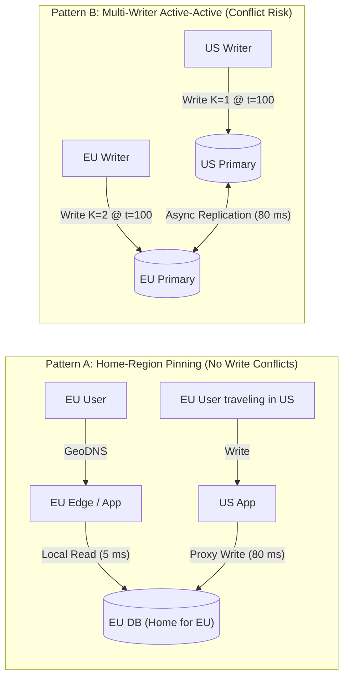
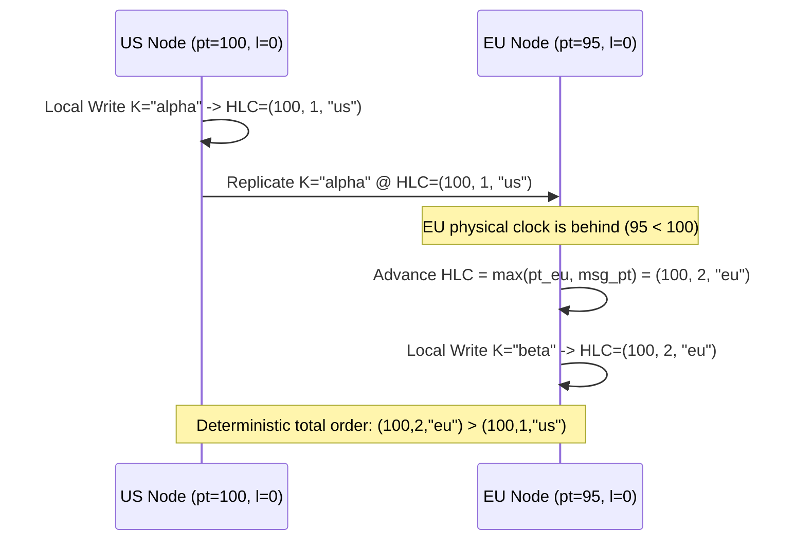
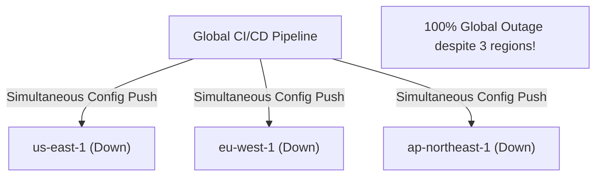

# Multi-Region Architecture: Active-Active, Home Regions & Write Conflicts

> **Prerequisites:** [Lesson 14: Backups & Restore Testing](../14-backups-restore-testing/README.md).  
> **Estimated Reading Time:** 24–28 minutes  
> **Target Audience:** Staff/senior backend engineers and system design candidates asked to scale an application globally for low latency or survive an entire cloud region outage.  
> **Free PDF Notes:** [Download SD-K-015.pdf](https://backendroadmap.com/notes/system-design/SD-K-015.pdf)

> [!NOTE]
> **In one line:** **Multi-region architecture** distributes your compute and data across geographically separated cloud regions to reduce user latency and survive regional outages—forcing a fundamental trade-off between **cross-region write latency** (consensus) and **write conflicts** (asynchronous multi-writer).

> [!TIP]
> **The Golden Rule:** Avoid **unconstrained multi-writer Active-Active** unless your data model is naturally conflict-free (CRDTs) or you can afford global consensus latency. For 90% of global apps, **Active-Active compute with Home-Region write pinning** (read-local, write-home) delivers low read latency without write conflicts.

---

## 1. What Multi-Region Architecture Is, and What It Isn't

A SaaS platform starts in `us-east-1` (Virginia). European users complain about 180 ms TLS+API round-trips, and an enterprise customer demands 99.995% availability that survives a full `us-east-1` outage. Simply spinning up app servers in `eu-west-1` (Ireland) while keeping the database in Virginia actually *makes things worse*: every chatty SQL query now crosses the Atlantic 10 times, turning a 50 ms page load into 1,000 ms. True multi-region architecture must co-locate **data** with **compute**—and decide how writes behave across oceans.

| Term | Precise Meaning | Example |
| :--- | :--- | :--- |
| **Active-Passive (DR)** | One region serves all traffic; secondary region is standby | `us-east-1` active, `us-west-2` warm standby |
| **Active-Active (Read-Local, Write-Home)** | All regions serve reads locally; writes route to a single primary or user's home region | User in EU reads EU replica, writes to US primary |
| **Home-Region Pinning** | Each tenant/user is assigned a single authoritative region for writes | EU tenants live in `eu-west-1`; US tenants in `us-east-1` |
| **Multi-Writer Active-Active** | Any region accepts writes for *any* record simultaneously, replicating asynchronously | DynamoDB Global Tables (LWW), CRDTs |
| **Global Consensus** | Synchronous Paxos/Raft across regions before acknowledging a write | Google Spanner, CockroachDB multi-region |
| **Write Conflict** | Two regions mutate the same key concurrently before replication completes | Two users book the last seat in US & EU simultaneously |
| **Not** | Multi-AZ (Availability Zones within one region, < 2 ms apart) | Multi-AZ is HA; Multi-Region is geo-scale & regional DR |

### Why It Matters
1. **Speed of light is non-negotiable:** Fiber optics cannot beat ~200 km/ms; cross-continental RTTs are 70–150 ms.
2. **Global outages happen:** Control-plane bugs, DNS failures, and fiber cuts take down entire regions—multi-region is the only way past ~99.99% availability.
3. **Data residency (GDPR) & latency:** Home-region architectures solve EU data sovereignty and local latency simultaneously.

---

## 2. Anatomy: Home-Region Routing vs Multi-Writer Active-Active



In **Pattern A (Home-Region)**, every user or tenant has exactly one home region (`home_region = eu-west-1`). Reads are served locally from read replicas; writes for that tenant always route to their home region, guaranteeing linearizability per tenant with zero conflicts. In **Pattern B (Multi-Writer)**, both US and EU accept writes to key `K` locally in 5 ms, then asynchronously reconcile—requiring Last-Write-Wins (LWW), CRDTs, or application-level conflict resolution.

| Topology | Read Latency | Write Latency | Write Conflicts | Regional Failover |
| :--- | :---: | :---: | :---: | :--- |
| **Active-Passive** | Local in 1 region; high elsewhere | Local in 1 region | None | Minutes (promote standby) |
| **Read-Local / Write-Home** | Local everywhere (5–15 ms) | Cross-region if away from home | None | Home region failover needed |
| **Multi-Writer Async** | Local everywhere (5–15 ms) | Local everywhere (5–15 ms) | **Yes (must resolve)** | Automatic (traffic shifts) |
| **Global Consensus (Spanner)** | Local (stale/follower reads) | Global quorum (60–150 ms) | None (serializable) | Automatic (Raft quorum) |

> [!WARNING]
> **Never use Multi-Writer Last-Write-Wins (LWW) for financial balances, inventory counts, or unique seat reservations.** If US and EU both decrement `stock = 1` concurrently, LWW silently overwrites one decrement and oversells your inventory.

---

## 3. Mathematical Model: Speed of Light, Availability & Clock Skew

**Speed of Light in Fiber.** Light travels in vacuum at $c \approx 300\text{ km/ms}$, and in optical fiber (refractive index $\approx 1.5$) at $c_{\text{fiber}} \approx 200\text{ km/ms}$. With routing overhead ($\sim 1.3\times$ great-circle distance $d$):

$$RTT_{\text{min}}(d) \approx 2 \times \frac{1.3 \cdot d}{200\text{ km/ms}} = \frac{d}{76.9\text{ km/ms}}$$

**Worked Numerical Example (Virginia to Frankfurt, $d \approx 6{,}500\text{ km}$):**

$$RTT_{\text{min}} \approx \frac{6{,}500}{76.9} \approx \mathbf{84.5\text{ ms}}$$

If a synchronous checkout makes **3 sequential round-trips** across the Atlantic, network physics alone adds $3 \times 84.5 = \mathbf{253.5\text{ ms}}$ before any SQL execution!

**Multi-Region Availability.** If one region has availability $A_r = 0.9995$ (99.95%, ~4.4 hours/yr downtime) and two regions fail independently:

$$A_{\text{multi}} = 1 - (1 - 0.9995)^2 = 1 - 2.5 \times 10^{-7} = \mathbf{99.999975\%}$$

*(In reality, global control planes, bad config pushes, and shared DNS reduce this to ~99.99%–99.995%.)*

**LWW Silent Data Loss Window.** If two writers rely on physical NTP clocks with max clock skew $\Delta_{\text{skew}}$ (typically 10–100 ms across regions) and async replication lag $L_{\text{rep}}$ (85 ms), any two concurrent writes within $L_{\text{rep}} + \Delta_{\text{skew}}$ risk silent overwrite—and the *earlier* wall-clock write can even overwrite the *later* write if its clock is ahead!

---

## 4. Metrics & Percentiles

| Metric | Meaning | Alert when |
| :--- | :--- | :--- |
| **Cross-region replication lag ($p_{99}$)** | Time for a write in Region A to appear in Region B | > 500 ms (or > SLA freshness) |
| **Write conflict rate** | Concurrent mutations to the same key across regions | Rising trend (indicates bad partitioning) |
| **Cross-region proxy ratio** | % of writes routed across WAN (away from home region) | > 10% (check GeoDNS / routing) |
| **Clock skew / NTP drift** | Offset between regional nodes and atomic/GPS reference | > 50 ms (danger for LWW timestamps) |
| **Regional failover time** | Time for Anycast/GeoDNS to drain a failed region | > 60 seconds |
| **Regional capacity headroom** | Spare CPU/DB headroom to absorb a peer region's traffic | < 50% in a 2-region Active-Active setup |

### Worked Example (Global Ride-Sharing / Booking App)
- **Driver/Rider Matching:** Partitioned by city (`home_region`). New York runs in `us-east-1`; London runs in `eu-west-1`. Zero cross-region writes during normal rides.
- **User Profile & Auth:** Stored in a **multi-region global table** using Hybrid Logical Clocks (HLC) + field-level LWW (rarely updated concurrently).
- **Payments Ledger:** Pinned to the user's `home_region` with synchronous Multi-AZ quorum inside that region (`RPO = 0` locally, `RPO = few seconds` cross-region).

---

## 5. Compounding & Failure Modes

| Failure Mode | Trigger | Compounding Effect | Mitigation |
| :--- | :--- | :--- | :--- |
| **Cascading Regional Overload** | Region A fails; 100% traffic shifts to Region B | Region B was running at 65% CPU; jumps to 130% and crashes too | Keep $\le 45\%$ utilization in 2-region Active-Active (N+1 headroom) |
| **Read-Your-Own-Writes Violation** | User writes in US, reloads page routed to EU replica | User thinks their order/comment disappeared and retries | Session stickiness / read-after-write token (`lsn`) |
| **Clock-Skew Conflict Inversion** | Region B's NTP clock is 200 ms ahead of Region A | Older write from B overwrites newer write from A in LWW | Use Hybrid Logical Clocks (HLC) or TrueTime |
| **Global Control-Plane Blast** | Bad Terraform/config deploy pushed to all regions at once | All regions go down simultaneously (defeats multi-region!) | Wave/canary deployments across regions (1 region at a time) |

**The 50% Utilization Rule:** In a 2-region Active-Active deployment, neither region can exceed **~45% sustained capacity** during normal operation. If you run both at 70% to save money, losing one region guarantees the survivor collapses under 140% load.

---

## 6. Numbers Every Engineer Must Know

| Item | Typical | Implication |
| :--- | :---: | :--- |
| Speed of light in optical fiber | ~200 km/ms | Hard physical floor on cross-region RTT |
| US-East ↔ US-West RTT | 60–75 ms | Synchronous cross-US writes cost ~70 ms |
| US-East ↔ EU-West RTT | 75–95 ms | Chatty protocols (N+1 SQL) die across WAN |
| US-West ↔ AP-Tokyo RTT | 110–130 ms | Requires local read replicas for UX |
| NTP clock drift across VMs | 10–100 ms | Never trust raw wall-clock timestamps for ordering |
| Regional headroom in 2-region Active-Active | $\ge 50\%$ spare | Must survive 2x traffic spike on regional loss |

---

## 7. Protocol Deep Dive: Hybrid Logical Clocks (HLC) & Conflict Handling



An **HLC** combines physical time ($pt$) with a logical counter ($l$) and node tie-breaker. Even if EU's physical clock lags behind US by 5 ms, receiving US's message bumps EU's HLC past US's, preserving causal ordering without needing atomic clocks.

### When NOT to Build Multi-Region Active-Active
- **You haven't mastered Single-Region Multi-AZ:** Most "regional" outages are actually bad code deployments or database migrations that multi-region *replicates everywhere*.
- **Strict global uniqueness/inventory with < 20 ms write latency:** Physics forbids both global serializability and 5 ms writes across oceans.
- **Small team / early product:** Multi-region doubles operational complexity, cross-region data transfer bills ($0.02/GB+), and debugging surface.

---

## 8. Hierarchical Budgets & Design Rules

| Slice | Rule | Control |
| :--- | :--- | :--- |
| **Routing** | Route to nearest healthy region; pin writes to home region | GeoDNS / Anycast + `X-Home-Region` routing header |
| **Capacity** | Survive full loss of 1 region without shedding core load | Max $1 - \frac{1}{N}$ utilization per region ($50\%$ for $N=2$, $66\%$ for $N=3$) |
| **Consistency** | Guarantee Read-Your-Own-Writes | Pin user to write region for $T_{\text{repl}} + \text{buffer}$ (e.g., 5 s) or pass `min_lsn` |
| **Conflicts** | Never silently lose updates on critical state | Use Home-Region pinning for balances; CRDTs/HLC for collaborative/profile state |
| **Deployments** | Never deploy globally at once | Staged regional rollout with 1–24 h bake between regions |
| **Cross-Region Calls** | Avoid chatty RPCs across WAN | Batch requests, push reads to local replicas, cache aggressively |

---

## 9. Top Mitigations

1. **Adopt Home-Region Pinning by default:** Store `home_region` in a global lookup/JWT claim so 99% of a user's reads and writes stay inside one region.
2. **Enforce staged regional rollouts:** Deploy canary -> Region 1 -> bake -> Region 2 so a bad config cannot wipe all regions simultaneously.
3. **Use Hybrid Logical Clocks (HLC) or version vectors:** Never use raw `Date.now()` / `time.Now()` for distributed LWW conflict resolution.
4. **Implement Read-Your-Own-Writes tokens:** After a write, route the user's reads to the home region (or wait for replica `LSN >= write_lsn`) for a few seconds.
5. **Load-test regional evacuation regularly:** Drain 100% of one region's traffic into the remaining regions during off-peak hours to prove headroom and autoscaling.
6. **Pre-position read-only static fallbacks:** If a user's home region is unreachable, allow degraded local reads while queueing or rejecting writes cleanly.

---

## 10. Production Reference / War Story: The Global Deploy That Bypassed Multi-Region

A global SaaS ran Active-Active across `us-east-1`, `eu-west-1`, and `ap-northeast-1` to guarantee 99.99% availability.



- **Root Cause:** A single global feature-flag / routing config push contained a malformed regex that crashed the API gateway worker process. Because the config service pushed to all 3 regions simultaneously within 10 seconds, all 3 regions went down together.
- **Impact:** Complete 38-minute global outage—multi-region provided **zero** protection against a correlated control-plane change.
- **Fix:** Enforced regional blast-radius isolation: separate config planes per region, mandatory 30-minute regional bake times, and **static stability** (gateways continue serving with last-known-good cached config if the config plane fails).

---

## 11. Multi-Language Production Code Tabs

A **Home-Region Router + Hybrid Logical Clock (HLC) Versioned Store** demonstrating how to avoid write conflicts via home-region routing while resolving concurrent metadata updates deterministically with HLCs.

````carousel
```go
// Go: Hybrid Logical Clock (HLC) and Home-Region Router.
package main

import (
	"fmt"
	"sync"
	"time"
)

type HLC struct {
	Physical int64
	Logical  int32
	NodeID   string
}

func (a HLC) After(b HLC) bool {
	if a.Physical != b.Physical {
		return a.Physical > b.Physical
	}
	if a.Logical != b.Logical {
		return a.Logical > b.Logical
	}
	return a.NodeID > b.NodeID
}

type Clock struct {
	mu     sync.Mutex
	nodeID string
	last   HLC
}

func (c *Clock) Tick() HLC {
	c.mu.Lock()
	defer c.mu.Unlock()
	now := time.Now().UnixMilli()
	if now > c.last.Physical {
		c.last = HLC{Physical: now, Logical: 0, NodeID: c.nodeID}
	} else {
		c.last.Logical++
	}
	return c.last
}

func (c *Clock) Receive(remote HLC) HLC {
	c.mu.Lock()
	defer c.mu.Unlock()
	now := time.Now().UnixMilli()
	maxP := max(now, max(c.last.Physical, remote.Physical))
	var l int32
	if maxP == c.last.Physical && maxP == remote.Physical {
		l = max(c.last.Logical, remote.Logical) + 1
	} else if maxP == c.last.Physical {
		l = c.last.Logical + 1
	} else if maxP == remote.Physical {
		l = remote.Logical + 1
	}
	c.last = HLC{Physical: maxP, Logical: l, NodeID: c.nodeID}
	return c.last
}

func main() {
	us := &Clock{nodeID: "us-east"}
	eu := &Clock{nodeID: "eu-west"}
	t1 := us.Tick()
	t2 := eu.Receive(t1)
	fmt.Printf("US: %+v\nEU after sync: %+v (t2 > t1: %v)\n", t1, t2, t2.After(t1))
}
```
<!-- slide -->
```typescript
// TypeScript: Home-Region router + HLC conflict resolver.
export interface HLC {
  physical: number;
  logical: number;
  nodeId: string;
}

export function compareHLC(a: HLC, b: HLC): number {
  if (a.physical !== b.physical) return a.physical - b.physical;
  if (a.logical !== b.logical) return a.logical - b.logical;
  return a.nodeId.localeCompare(b.nodeId);
}

export class HybridClock {
  private last: HLC;
  constructor(private nodeId: string) {
    this.last = { physical: Date.now(), logical: 0, nodeId };
  }

  tick(): HLC {
    const now = Date.now();
    if (now > this.last.physical) {
      this.last = { physical: now, logical: 0, nodeId: this.nodeId };
    } else {
      this.last = { ...this.last, logical: this.last.logical + 1 };
    }
    return this.last;
  }

  merge(remote: HLC): HLC {
    const now = Date.now();
    const maxP = Math.max(now, this.last.physical, remote.physical);
    let logical = 0;
    if (maxP === this.last.physical && maxP === remote.physical) {
      logical = Math.max(this.last.logical, remote.logical) + 1;
    } else if (maxP === this.last.physical) {
      logical = this.last.logical + 1;
    } else if (maxP === remote.physical) {
      logical = remote.logical + 1;
    }
    this.last = { physical: maxP, logical, nodeId: this.nodeId };
    return this.last;
  }
}

export function routeWrite(localRegion: string, tenantHomeRegion: string): string {
  return localRegion === tenantHomeRegion ? "LOCAL_WRITE" : `PROXY_TO_${tenantHomeRegion}`;
}
```
<!-- slide -->
```python
# Python: Home-Region router & HLC deterministic LWW resolver.
from dataclasses import dataclass
import time

@dataclass(order=True)
class HLC:
    physical_ms: int
    logical: int
    node_id: str

class HybridClock:
    def __init__(self, node_id: str):
        self.node_id = node_id
        self.last = HLC(int(time.time() * 1000), 0, node_id)

    def tick(self) -> HLC:
        now = int(time.time() * 1000)
        if now > self.last.physical_ms:
            self.last = HLC(now, 0, self.node_id)
        else:
            self.last = HLC(self.last.physical_ms, self.last.logical + 1, self.node_id)
        return self.last

    def receive(self, remote: HLC) -> HLC:
        now = int(time.time() * 1000)
        max_p = max(now, self.last.physical_ms, remote.physical_ms)
        if max_p == self.last.physical_ms == remote.physical_ms:
            logical = max(self.last.logical, remote.logical) + 1
        elif max_p == self.last.physical_ms:
            logical = self.last.logical + 1
        elif max_p == remote.physical_ms:
            logical = remote.logical + 1
        else:
            logical = 0
        self.last = HLC(max_p, logical, self.node_id)
        return self.last

if __name__ == "__main__":
    us, eu = HybridClock("us-east"), HybridClock("eu-west")
    w1 = us.tick()
    w2 = eu.receive(w1)
    print("Ordered:", w2 > w1, w1, w2)
```
<!-- slide -->
```csharp
// C#: HLC & Multi-Region LWW record merger.
using System;

public record Hlc(long PhysicalMs, int Logical, string NodeId) : IComparable<Hlc>
{
    public int CompareTo(Hlc? other)
    {
        if (other is null) return 1;
        int p = PhysicalMs.CompareTo(other.PhysicalMs);
        if (p != 0) return p;
        int l = Logical.CompareTo(other.Logical);
        return l != 0 ? l : string.CompareOrdinal(NodeId, other.NodeId);
    }
}

public class HybridClock
{
    private Hlc _last;
    public HybridClock(string nodeId) =>
        _last = new Hlc(DateTimeOffset.UtcNow.ToUnixTimeMilliseconds(), 0, nodeId);

    public Hlc Tick()
    {
        long now = DateTimeOffset.UtcNow.ToUnixTimeMilliseconds();
        _last = now > _last.PhysicalMs
            ? _last with { PhysicalMs = now, Logical = 0 }
            : _last with { Logical = _last.Logical + 1 };
        return _last;
    }

    public static (string Key, string Value, Hlc Version) ResolveLww(
        (string Key, string Value, Hlc Version) a,
        (string Key, string Value, Hlc Version) b) =>
        a.Version.CompareTo(b.Version) >= 0 ? a : b;
}
```
````

---

## 12. Hands-On CLI Verification Workflows

```bash
# 1. Inspect GeoDNS / latency-based routing resolution from your terminal
dig +short api.example.com
curl -w "dns:%{time_namelookup}s connect:%{time_connect}s tls:%{time_appconnect}s ttfb:%{time_starttransfer}s\n" -o /dev/null -s https://api.example.com/health

# 2. Check AWS Route53 health checks & regional failover status
aws route53 list-health-checks --query "HealthChecks[*].{Id:Id,FQDN:HealthCheckConfig.FullyQualifiedDomainName,Type:HealthCheckConfig.Type}"

# 3. Check NTP clock drift across Linux hosts (critical for LWW timestamps)
chronyc tracking
```

---

## 13. Common Mistakes to Avoid

1. **Putting app servers in 3 regions while leaving the DB in 1 region:** Turns every N+1 query into a cross-ocean latency disaster.
2. **Running 2-region Active-Active at > 50% capacity:** Guarantees cascading collapse when one region fails and traffic doubles on the survivor.
3. **Using LWW on counters, balances, or inventory:** Concurrent updates silently overwrite each other, causing lost money or oversold stock.
4. **Deploying code or config to all regions simultaneously:** Eliminates the entire availability benefit of multi-region isolation.
5. **Ignoring Read-Your-Own-Writes:** Users routed to an async local replica immediately after a write see stale state and panic-retry.
6. **Trusting raw `Date.now()` for cross-region ordering:** NTP drift of 50–200 ms breaks causality; use HLCs or version vectors.
7. **Forgetting cross-region data transfer costs:** Replicating terabytes of chatty writes across regions adds massive egress bills.

---

## 14. Key Terms Glossary

| Key Term | Definition |
| :--- | :--- |
| **Active-Passive** | One primary region serves traffic; secondary region stays standby for disaster failover. |
| **Active-Active** | Multiple regions serve live traffic simultaneously. |
| **Home-Region Pinning** | Assigning each user/tenant an authoritative region for writes while serving reads locally. |
| **Write Conflict** | Two regions concurrently mutating the same record before asynchronous replication syncs. |
| **LWW (Last-Write-Wins)** | Conflict resolution picking the write with the highest timestamp; risks silent data loss. |
| **CRDT** | Conflict-Free Replicated Data Type; mathematically guaranteed to merge without conflicts. |
| **HLC (Hybrid Logical Clock)** | Clock combining physical time and a logical counter to preserve causal order despite skew. |
| **Read-Your-Own-Writes** | Consistency guarantee that a user immediately sees their own latest mutations. |
| **GeoDNS / Anycast** | Routing techniques directing users to the geographically closest healthy region. |
| **Regional Evacuation** | Shifting 100% of traffic out of a degraded region into healthy peer regions. |

---

## 15. System Design Interview Questions & Answers

### Basic Conceptual Questions

<details>
<summary><strong>Q1: What is the difference between Multi-AZ and Multi-Region? [BASIC]</strong></summary>

**Answer:**
Multi-AZ distributes resources across isolated data centers within a single metropolitan area (< 2 ms RTT), enabling synchronous replication and high availability. Multi-Region distributes across continents (60–150 ms RTT) to lower global user latency, comply with data residency, and survive regional disasters.
</details>

<details>
<summary><strong>Q2: What is Home-Region architecture? [BASIC]</strong></summary>

**Answer:**
Each user or tenant is pinned to a single authoritative "home" region where all their writes occur, while read replicas in other regions can serve local reads. This eliminates multi-writer conflicts while keeping latency low for most interactions.
</details>

<details>
<summary><strong>Q3: Why does cross-region synchronous replication hurt performance? [BASIC]</strong></summary>

**Answer:**
The speed of light in fiber (~200 km/ms) imposes 60–150 ms round-trip times between continents. Synchronous replication must wait for that WAN round-trip before acknowledging every write, and any WAN degradation stalls global writes.
</details>

<details>
<summary><strong>Q4: What is a write conflict in Active-Active systems? [BASIC]</strong></summary>

**Answer:**
When two regions accept writes to the same record concurrently under asynchronous replication before either update reaches the other region, resulting in two divergent versions that must be merged or reconciled.
</details>

### Scenario-Based Architecture Questions

<details>
<summary><strong>Q5: Design a global collaborative document editor (like Google Docs) vs a global banking app. [SCENARIO]</strong></summary>

**Answer:**
For the document editor, use **Multi-Writer Active-Active** with **CRDTs or Operational Transformation (OT)** so users in US and EU can edit the same doc locally in 10 ms and merge cleanly. For the banking app, use **Home-Region Pinning** (or global consensus like Spanner for cross-region transfers) because LWW/CRDTs cannot safely enforce non-negative balance invariants across concurrent withdrawals.
</details>

<details>
<summary><strong>Q6: You run 2-region Active-Active (`us-east` and `eu-west`) at 70% CPU each. `us-east` goes down. What happens? [SCENARIO]</strong></summary>

**Answer:**
`eu-west` suddenly receives 100% of global traffic (140% of its capacity) and suffers a cascading collapse. In a 2-region Active-Active setup, you must keep normal utilization $\le 45\%$ (or have instant pre-warmed capacity + aggressive load shedding) so one region can carry 100% of critical load.
</details>

<details>
<summary><strong>Q7: A user updates their profile in London, refreshes, and sees their old profile. Why and how do you fix it? [SCENARIO]</strong></summary>

**Answer:**
The write went to the home region (`us-east`), but the subsequent read hit an asynchronous local replica (`eu-west`) before the 90 ms replication completed. Fix it by issuing a short-lived **session stickiness cookie** (route reads to the write region for 5 seconds) or passing a monotonic `write_lsn` token so the local replica waits/proxies if it hasn't caught up.
</details>

<details>
<summary><strong>Q8: How do you evacuate a failing region safely? [SCENARIO]</strong></summary>

**Answer:**
Shift traffic at the edge (GeoDNS/Anycast/Global LB) with pre-tested runbooks, verify remaining regions have headroom (shedding non-critical tier-3 traffic if needed), and ensure writes for pinned tenants fail over cleanly to their designated secondary region without split-brain.
</details>

### Advanced & Tricky Interview Questions

<details>
<summary><strong>Q9: Why does Last-Write-Wins (LWW) with physical timestamps lose data even when writes aren't simultaneous? [TRICKY]</strong></summary>

**Answer:**
NTP clock skew between regions (e.g., Region B is 200 ms ahead of Region A) means a write in Region A that happens *100 ms after* Region B's write still gets a lower timestamp and is silently discarded during merge. Hybrid Logical Clocks (HLC) or version vectors are required to preserve causal ordering.
</details>

<details>
<summary><strong>Q10: How can a multi-region Active-Active system still suffer a 100% global outage? [TRICKY]</strong></summary>

**Answer:**
Shared global dependencies: simultaneous CI/CD config pushes, a shared global control plane (IAM, DNS provider, feature-flag service), or a "poison pill" request from a user that crashes every region it fails over to ("query of death").
</details>

<details>
<summary><strong>Q11: What is the PACELC trade-off for DynamoDB Global Tables vs Google Spanner? [TRICKY]</strong></summary>

**Answer:**
DynamoDB Global Tables is **PA/EL** (under partition, chooses Availability; else chooses low Latency via async replication, accepting eventual consistency and LWW conflicts). Google Spanner is **PC/EC** (under partition, sacrifices Availability for Consistency; else chooses Consistency via Paxos + TrueTime, paying cross-region write latency).
</details>

<details>
<summary><strong>Q12: How do you handle GDPR ("EU user data must stay in EU") in a multi-region system? [TRICKY]</strong></summary>

**Answer:**
Use strict **Home-Region Pinning** where EU tenants' databases, backups, logs, and PII caches reside exclusively in `eu-*` regions. Only anonymized/non-PII routing metadata (e.g., `tenant_id -> eu-west-1`) is replicated globally so edge proxies know where to forward the request.
</details>

---

## 16. One-Page Master Cheat Sheet

```
+---------------------------------------------------------------------------------------------------------+
|                       MULTI-REGION ARCHITECTURE — MASTER CHEAT SHEET                                    |
+---------------------------------------------------------------------------------------------------------+
| 1. PHYSICS: Speed of light in fiber ~200 km/ms -> US<->EU RTT ~85 ms. Never run chatty RPCs over WAN.   |
+---------------------------------------------------------------------------------------------------------+
| 2. PATTERNS: Active-Passive (DR) · Read-Local/Write-Home (90% of apps) · Multi-Writer (CRDT/LWW) · Paxos|
+---------------------------------------------------------------------------------------------------------+
| 3. HEADROOM: In N-region Active-Active, max normal utilization <= (N-1)/N (<= 45% for 2 regions).       |
+---------------------------------------------------------------------------------------------------------+
| 4. CONFLICTS: LWW with NTP loses data (use HLC/CRDTs). Never use LWW for money or inventory!            |
+---------------------------------------------------------------------------------------------------------+
| 5. CONSISTENCY: Fix Read-Your-Own-Writes with write-region stickiness (5s) or LSN tokens.               |
+---------------------------------------------------------------------------------------------------------+
| 6. BLAST RADIUS: Staged regional rollouts (never deploy globally at once) + static edge fallbacks.      |
+---------------------------------------------------------------------------------------------------------+
```

---

## Further Reading & Sources

- Martin Kleppmann, *Designing Data-Intensive Applications*, Chapter 5 ("Multi-Leader Replication") & Chapter 9 ("Consistency and Consensus").
- AWS Builders' Library, *Avoiding Fallback in Distributed Systems* & *Multi-Region Architectures*.
- Google Cloud, *Spanner: Becoming a SQL System* & *TrueTime* papers.
- Sandeep Kulkarni et al., *Logical Physical Clocks and Consistent Snapshots in Globally Distributed Databases* (HLC paper).

---

## Free PDF Notes

[SD-K-015.pdf](https://backendroadmap.com/notes/system-design/SD-K-015.pdf)

---

## Next

Continue with [Cell-Based Architecture: Limiting the Blast Radius (+ Shuffle Sharding)](../16-cell-based-architecture/README.md).
