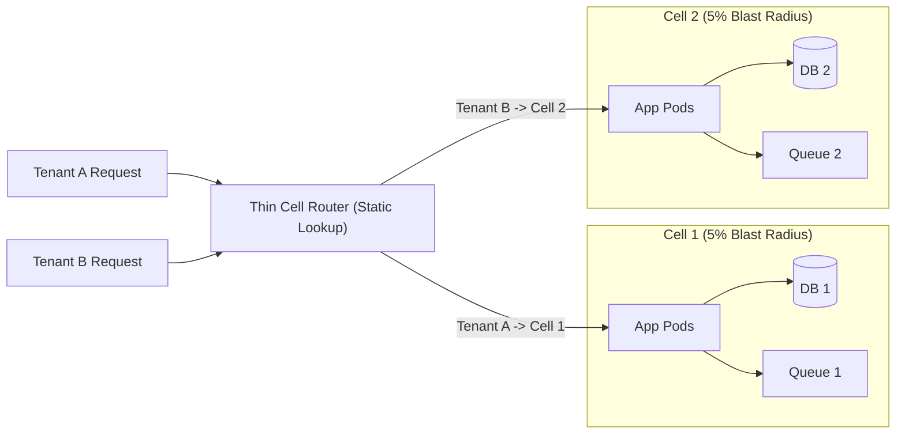
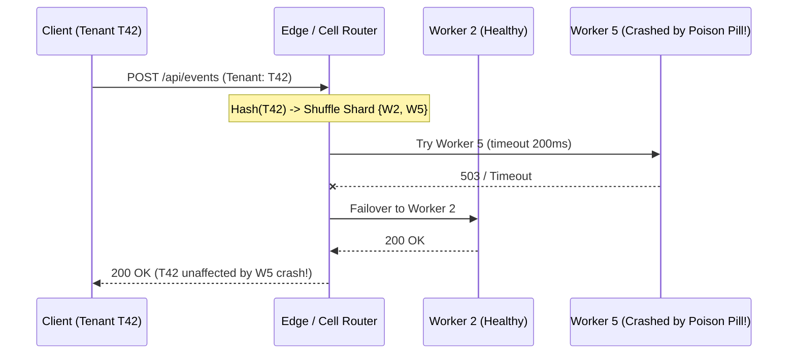
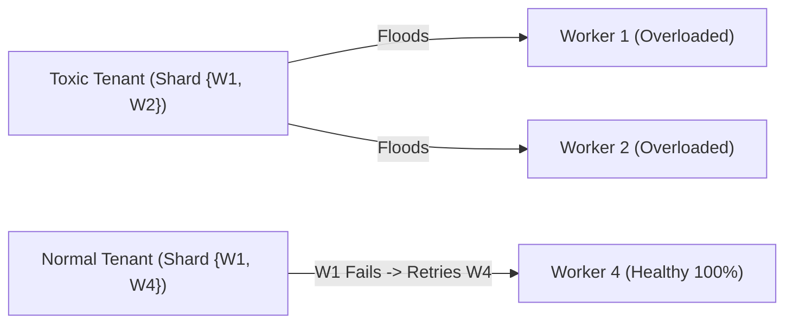

# Cell-Based Architecture: Limiting the Blast Radius (+ Shuffle Sharding)

> **Prerequisites:** [Lesson 15: Multi-Region Architecture](../15-multi-region-architecture/README.md).  
> **Estimated Reading Time:** 24–28 minutes  
> **Target Audience:** Principal/staff engineers and system design candidates asked to bound blast radius in massive multi-tenant SaaS, cloud control planes, or high-scale microservices.  
> **Free PDF Notes:** [Download SD-K-016.pdf](https://backendroadmap.com/notes/system-design/SD-K-016.pdf)

> [!NOTE]
> **In one line:** **Cell-based architecture** partitions a system into completely independent, self-contained instances (**cells**) with a thin, stateless **cell router** in front—capping the blast radius of any bug, noisy neighbor, or outage to $1/N$ of your customers, and **shuffle sharding** reduces overlapping tenant blast radius exponentially.

> [!TIP]
> **The Golden Rule:** A cell must **share nothing** with other cells—separate compute, separate database, separate caches, separate queues, and separate deployment waves. If two cells share a database or a Redis cluster, you do not have cells; you have a single monolith with extra routing hops.

---

## 1. What Cell-Based Architecture Is, and What It Isn't

In a traditional horizontally scaled microservice fleet, 100 stateless API pods talk to one shared database cluster and one shared Redis cluster. When a single enterprise tenant runs a pathological query ("poison pill") or a bad config hits one pod, the shared DB CPU spikes to 100%, and **100% of your customers go down**. Cell-based architecture (used by AWS, Slack, Stripe, and Shopify Pods) solves this by capping the maximum size of any deployment unit: instead of one giant cluster for 10 million users, you run 20 isolated **cells** of 500,000 users each.

| Term | Precise Meaning | Example |
| :--- | :--- | :--- |
| **Cell** | Self-contained, full-stack unit (compute + DB + cache + queue) serving a subset of tenants | Cell-01 serves tenants `T001..T500` |
| **Cell Router (Thin Control Layer)** | Stateless, ultra-simple L7/DNS layer mapping `tenant_id -> cell_id` | Envoy/Cloudflare Worker lookup table |
| **Blast Radius** | Maximum % of users/requests impacted by a single failure | $1/20 = 5\%$ with 20 equal cells |
| **Poison Pill / Noisy Neighbor** | One tenant's malformed request or traffic spike that crashes or starves its host | Tenant runs unbounded regex or 100x burst |
| **Shuffle Sharding** | Assigning each tenant a unique subset of $k$ workers out of $N$ total workers | Tenant A gets `{W1, W4}`, Tenant B gets `{W2, W4}` |
| **Scale Unit** | Standard, repeatable hardware/software footprint for every new cell | "Max 50k RPS or 2 TB DB per cell" |
| **Not** | Database sharding alone | DB sharding shares the API tier, caches, and deployment plane |

### Why It Matters
1. **Hard upper bound on blast radius:** Even a catastrophic DB corruption or bad deploy in Cell-03 affects only $1/N$ of customers.
2. **Eliminates "scale-up" surprises:** Every cell stays at a fixed, well-tested scale unit (e.g., 50k RPS); you scale horizontally by stamping out identical cells.
3. **Zero-downtime canarying:** Deploy to Cell-01 (1% of users), bake for 2 hours, then roll through remaining cells in waves.

---

## 2. Anatomy: Cell Router + Isolated Cells + Shuffle Sharding



Notice the **Cell Router** must be as simple and statically stable as possible (e.g., an in-memory consistent-hash or static routing table)—if the router itself needs a complex database query on every request, it becomes a global single point of failure.

| Isolation Strategy | Shared Resources | Blast Radius (1 Poison Tenant) | Complexity |
| :--- | :--- | :---: | :---: |
| **Monolithic / Shared Pool** | Compute, DB, Cache, Queue | **100%** | Low |
| **Naive Sharding ($N$ cells)** | Only Cell Router | **$1/N$** (e.g., 5% for 20 cells) | Medium |
| **Shuffle Sharding ($k$ of $N$)** | Workers overlap minimally | **Near 0%** (exponentially small overlap) | Medium-High |
| **Single-Tenant Silo** | Control plane only | **1 tenant** | Very High (costly) |

> [!WARNING]
> **Cross-cell calls destroy cell independence.** If Cell 1 synchronously calls Cell 2 during a user request (e.g., cross-tenant sharing), failures cascade across cells. Keep cross-cell interactions strictly asynchronous or route them at the edge.

---

## 3. Mathematical Model: Blast Radius & Shuffle Sharding Combinatorics

**Standard Cell Blast Radius.** With $N$ equal cells, a single cell failure impacts:

$$B_{\text{cell}} = \frac{1}{N}$$

With $N = 25$ cells, a catastrophic cell failure affects at most **4%** of tenants.

**Shuffle Sharding Combinations.** Suppose you have $N$ workers (or micro-cells) and assign each tenant a virtual cell of $k$ workers ($k < N$). The number of distinct tenant combinations is:

$$\binom{N}{k} = \frac{N!}{k!(N - k)!}$$

**Worked Numerical Example (AWS Shuffle Sharding Classic):**
Suppose you have **$N = 8$** workers and assign each tenant **$k = 2$** workers:

$$\binom{8}{2} = \frac{8 \times 7}{2} = \mathbf{28\text{ distinct virtual cells}}$$

Now suppose a noisy-neighbor tenant (assigned `{W1, W2}`) sends a poison pill that crashes *both* `W1` and `W2`. How many other tenants lose *both* of their workers? **Zero** (assuming $\le 28$ tenants)! Any other tenant shares at most *one* worker (e.g., `{W1, W3}` still has `W3` healthy).

More generally, the probability that a random tenant shares *all* $k$ workers with a toxic tenant is:

$$P(\text{total outage}) = \frac{1}{\binom{N}{k}}$$

For **$N = 16, k = 3$**: $\binom{16}{3} = 560$ combinations, so $P(\text{total outage}) = \frac{1}{560} \approx \mathbf{0.18\%}$ (compared to $\frac{1}{8} = 12.5\%$ with 8 fixed cells of 2 workers each!).

---

## 4. Metrics & Percentiles

| Metric | Meaning | Alert when |
| :--- | :--- | :--- |
| **Max cell utilization** | CPU / DB connections / IOPS of the hottest cell | > 70% (triggers tenant rebalance or new cell) |
| **Cell skew ratio** | $\text{Max cell load} / \text{Median cell load}$ | > 2.0 (hotspot tenant needs dedicated cell) |
| **Cell router latency ($p_{99}$)** | Overhead added by the routing layer | > 2 ms |
| **Cross-cell traffic ratio** | % of requests crossing cell boundaries | > 1% (indicates leaky cell abstraction) |
| **Blast radius per deploy wave** | % of total traffic in the canary/wave-1 cell | > 5% |
| **Cell provisioning time** | Time to stamp out a brand-new empty cell via IaC | > 30 minutes |

### Worked Example (Slack / Multi-Tenant SaaS Pods)
A SaaS messaging platform serves 100,000 workspaces:
- **Standard Cells (Cells 1–19):** Hold ~5,000 small/medium workspaces each, capped at **30,000 WebSocket connections** and **1 TB Postgres**.
- **Whale Cell (Cell 20):** A single massive enterprise customer with 40,000 seats gets its own dedicated cell so its Monday-morning login storm cannot degrade 5,000 other companies.
- **Shuffle-Sharded Ingress:** API gateways use $N=16, k=3$ shuffle sharding per tenant so a DDoS or poison payload against one tenant only touches 3 of 16 gateway nodes.

---

## 5. Compounding & Failure Modes

| Failure Mode | Mechanism | Impact | Prevention |
| :--- | :--- | :--- | :--- |
| **Router becomes a SPOF** | Cell router queries a central SQL DB on every request | Central DB dies $\implies$ all 20 cells unreachable | Router uses local static/cached map; zero runtime DB calls |
| **Shared "Global" Dependency** | All cells share 1 Redis rate-limiter or 1 Auth DB | Shared Redis crashes $\implies$ 100% outage | Replicate Auth/Config read-only into every cell |
| **Cell Migration Thundering Herd** | Moving a hot tenant between cells drops connections | Dual-write bugs or downtime during move | Automated live tenant-migration (dual-write + CDC + cutover) |
| **Whale Tenant Skew** | One tenant grows 100x inside a shared cell | Exhausts cell DB connections for 499 neighbors | Auto-detect skew and promote whales to dedicated cells |

---

## 6. Numbers Every Engineer Must Know

| Item | Typical | Implication |
| :--- | :---: | :--- |
| Recommended max blast radius per cell | 1%–5% (20–100 cells) | Keeps SEV-1s bounded to a small slice |
| Cell router hop overhead | 0.5–2 ms | Must be stateless/in-memory |
| Shuffle sharding Sweet Spot ($N=8, k=2$) | 28 virtual shards | 67%–87% reduction in shared-fate probability |
| Shuffle sharding ($N=16, k=3$) | 560 virtual shards | 0.18% total overlap probability |
| Deployment wave progression | 1% -> 5% -> 25% -> 100% | Catches bugs in Cell 1 before touching Cell 2..N |
| Minimum cell count to justify overhead | ~5–10 cells | Below 5 cells, operational cost often outweighs benefit |

---

## 7. Protocol Deep Dive: Tenant-to-Cell Routing & Shuffle Sharding



### When NOT to Use Cell-Based Architecture
- **Small scale / single-region startup:** If you have < 100 RPS and 1 database, building 10 cells and a cell router adds massive IaC and migration complexity for little gain.
- **Heavily interconnected global graph data:** Social networks where every user queries *every* other user's live state cannot be cleanly partitioned into share-nothing cells without excessive cross-cell fan-out.
- **Unavoidable global uniqueness:** If every request requires a single global sequential counter, cells will contend on that central bottleneck.

---

## 8. Hierarchical Budgets & Design Rules

| Slice | Rule | Control |
| :--- | :--- | :--- |
| **Cell Router** | Zero dynamic DB calls on hot path | Static config / consistent hash ring cached in memory |
| **Cell Size Cap** | Fixed maximum RPS, storage, and tenant count | Stamp out new cell at 70% capacity threshold |
| **Shared Nothing** | Zero cross-cell DB/cache/queue dependencies | Separate VPCs/namespaces/DB clusters per cell |
| **Deployment Waves** | Never deploy to > 1 cell in Wave 1 | Canary Cell 1 -> bake -> Wave 2 (10%) -> Wave 3 (100%) |
| **Shuffle Sharding** | $k \ge 2$ workers per tenant ($N \ge 8$) | Client/router retries on healthy worker in tenant's subset |
| **Tenant Mobility** | Support moving a tenant without downtime | Logical `tenant_id` key everywhere + CDC migration tool |

---

## 9. Top Mitigations

1. **Keep the Cell Router ultra-thin and statically stable:** Store the `tenant_id -> cell_id` map in memory / CDN edge KV so the router works even if the control-plane DB is completely down.
2. **Enforce strict cell boundaries in CI/network:** Use security groups or Kubernetes `NetworkPolicy` to physically block Cell A from talking to Cell B's database.
3. **Use Shuffle Sharding for stateless/queue tiers:** Even before full DB cells, shuffle-sharding your API workers and Kafka consumers eliminates noisy-neighbor outages cheaply.
4. **Automate cell creation via Terraform/IaC:** A cell must be a single versioned module (`module "cell" { cell_id = 14 }`)—manual snowflakes break cell parity.
5. **Isolate "whale" tenants early:** Detect tenants consuming > 15% of a cell's IOPS/CPU and migrate them to a dedicated cell.
6. **Deploy in progressive cell waves:** Treat Cell 1 as your production canary; halt global rollout automatically if Cell 1's error budget burns.

---

## 10. Production Reference / War Story: AWS Route53 & Shuffle Sharding

AWS famously documented how **Route53** and **Hyperplane** use **shuffle sharding** to protect millions of customers from DDoS attacks and "query-of-death" bugs.



- **Problem:** In a standard 8-worker fleet split into 4 fixed 2-worker cells, a toxic tenant takes down 25% of all customers sharing its cell.
- **Solution:** Instead of fixed cells, each tenant is assigned a deterministic **shuffle shard** of $k=2$ workers out of $N=8$ ($\binom{8}{2} = 28$ combinations).
- **Result:** When a toxic tenant overwhelms its 2 assigned workers, *every other tenant* sharing 1 of those workers automatically fails over to its *second* healthy worker—reducing multi-tenant collateral damage to nearly zero without buying any extra servers.

---

## 11. Multi-Language Production Code Tabs

A deterministic **Shuffle Sharding & Cell Router** implementation that maps any `tenant_id` to a unique subset of $k$ workers out of $N$ without collisions (using FNV/SHA-256 seeded Fisher-Yates / selection), plus cell-level routing.

````carousel
```go
// Go: deterministic Shuffle Sharding + Cell Router (zero dependencies).
package main

import (
	"crypto/sha256"
	"encoding/binary"
	"fmt"
)

func ShuffleShard(tenantID string, totalWorkers, shardSize int) []int {
	pool := make([]int, totalWorkers)
	for i := range pool {
		pool[i] = i
	}
	// Deterministic seeded partial Fisher-Yates using SHA-256
	h := sha256.Sum256([]byte(tenantID))
	seed := binary.BigEndian.Uint64(h[:8])
	for i := 0; i < shardSize; i++ {
		seed = seed*6364136223846793005 + 1442695040888963407 // LCG step
		j := i + int(seed%uint64(totalWorkers-i))
		pool[i], pool[j] = pool[j], pool[i]
	}
	return pool[:shardSize]
}

func main() {
	for _, t := range []string{"tenant-alpha", "tenant-beta", "tenant-gamma"} {
		fmt.Printf("%s -> workers %v\n", t, ShuffleShard(t, 16, 3))
	}
}
```
<!-- slide -->
```typescript
// TypeScript: deterministic Shuffle Sharding & Cell Router.
import { createHash } from "crypto";

export function shuffleShard(tenantId: string, totalWorkers: number, shardSize: number): number[] {
  const pool = Array.from({ length: totalWorkers }, (_, i) => i);
  const digest = createHash("sha256").update(tenantId).digest();

  for (let i = 0; i < shardSize; i++) {
    const rand = digest.readUInt32BE((i * 4) % 28);
    const j = i + (rand % (totalWorkers - i));
    [pool[i], pool[j]] = [pool[j], pool[i]];
  }
  return pool.slice(0, shardSize);
}

export class CellRouter {
  constructor(private overrides: Map<string, string>, private cellCount: number) {}

  route(tenantId: string): string {
    const pinned = this.overrides.get(tenantId);
    if (pinned) return pinned; // whale tenant pinned to dedicated cell
    const idx = createHash("sha256").update(tenantId).digest().readUInt32BE(0) % this.cellCount;
    return `cell-${String(idx).padStart(2, "0")}`;
  }
}
```
<!-- slide -->
```python
# Python: deterministic Shuffle Sharding + overlap simulator.
import hashlib

def shuffle_shard(tenant_id: str, total_workers: int = 16, k: int = 3) -> tuple[int, ...]:
    pool = list(range(total_workers))
    digest = hashlib.sha256(tenant_id.encode()).digest()
    for i in range(k):
        val = int.from_bytes(digest[i * 4 : (i + 1) * 4], "big")
        j = i + (val % (total_workers - i))
        pool[i], pool[j] = pool[j], pool[i]
    return tuple(sorted(pool[:k]))

if __name__ == "__main__":
    shards = {f"t-{i}": shuffle_shard(f"t-{i}", 16, 3) for i in range(200)}
    toxic = shards["t-0"]
    total_outage = sum(1 for t, s in shards.items() if t != "t-0" and s == toxic)
    print(f"Toxic shard: {toxic}, Tenants losing ALL 3 workers: {total_outage}/199")
```
<!-- slide -->
```csharp
// C#: deterministic Shuffle Sharding selector.
using System;
using System.Security.Cryptography;
using System.Text;

public static class ShuffleSharder
{
    public static int[] AssignShard(string tenantId, int totalWorkers, int shardSize)
    {
        var pool = new int[totalWorkers];
        for (int i = 0; i < totalWorkers; i++) pool[i] = i;

        byte[] hash = SHA256.HashData(Encoding.UTF8.GetBytes(tenantId));
        for (int i = 0; i < shardSize; i++)
        {
            uint val = BitConverter.ToUInt32(hash, (i * 4) % 28);
            int j = i + (int)(val % (uint)(totalWorkers - i));
            (pool[i], pool[j]) = (pool[j], pool[i]);
        }
        return pool[..shardSize];
    }

    public static void Main() =>
        Console.WriteLine("tenant-42 -> " + string.Join(",", AssignShard("tenant-42", 16, 3)));
}
```
````

---

## 12. Hands-On CLI Verification Workflows

```bash
# 1. Simulate shuffle-sharding blast radius reduction in Python (N=16, k=3 across 500 tenants)
python3 -c "
import hashlib, math
print('Distinct combinations C(16,3):', math.comb(16, 3))
"

# 2. Verify Kubernetes NetworkPolicy blocks cross-cell database access
kubectl get networkpolicy -n cell-01 -o yaml

# 3. Test cell router latency & header routing
curl -s -I -H "X-Tenant-ID: tenant-whale-01" https://api.example.com/health | grep -i x-cell-id
```

---

## 13. Common Mistakes to Avoid

1. **Sharing a database or Redis across cells:** Immediately nullifies blast-radius isolation; one bad query still kills everyone.
2. **Making the Cell Router depend on a live DB lookup:** Turns the router into a 100% global SPOF.
3. **Deploying to all cells at once:** Defeats the biggest operational superpower of cells—progressive wave rollouts.
4. **Creating "snowflake" cells manually:** Every cell must be stamped from identical IaC templates; manual drift causes mysterious cell-specific outages.
5. **Ignoring whale tenants:** Letting one massive customer sit in a shared cell degrades hundreds of smaller neighbors.
6. **Forgetting client retry on shuffle-sharded workers:** If the router doesn't retry on the remaining $k-1$ workers when worker 1 fails, shuffle sharding gives zero benefit.
7. **Building cells too early:** At small scale, cell overhead slows engineering down; wait until blast radius or scale unit limits justify it.

---

## 14. Key Terms Glossary

| Key Term | Definition |
| :--- | :--- |
| **Cell** | A complete, self-contained, share-nothing instance of the application stack serving a subset of tenants. |
| **Cell Router** | Thin, stateless routing layer mapping incoming requests (`tenant_id`) to their assigned cell. |
| **Blast Radius** | The maximum percentage of users or workload affected by a single component failure. |
| **Scale Unit** | The fixed maximum capacity (RPS, storage, connections) of a single cell. |
| **Shuffle Sharding** | Assigning each tenant a unique combination of $k$ workers out of $N$ to minimize shared-fate overlap. |
| **Noisy Neighbor** | A tenant whose excessive resource consumption degrades other tenants sharing infrastructure. |
| **Poison Pill** | A malformed request or query that crashes any server processing it. |
| **Whale Tenant** | A disproportionately large customer requiring a dedicated cell to prevent skew. |
| **Wave Deployment** | Rolling out changes progressively across cells (e.g., 1% -> 5% -> 25% -> 100%). |
| **Shared-Nothing** | Architecture where each cell owns independent compute, storage, caches, and queues. |

---

## 15. System Design Interview Questions & Answers

### Basic Conceptual Questions

<details>
<summary><strong>Q1: What is cell-based architecture? [BASIC]</strong></summary>

**Answer:**
Cell-based architecture partitions a system into multiple independent, self-contained instances (**cells**) where each cell has its own compute, database, caches, and queues, serving a subset of users. A thin stateless router directs each request to its assigned cell, capping the blast radius of any failure to $1/N$ of users.
</details>

<details>
<summary><strong>Q2: How is a cell different from database sharding? [BASIC]</strong></summary>

**Answer:**
Database sharding only splits the storage layer—all shards still share the same API fleet, cache cluster, message broker, and deployment pipeline. A cell isolates the **entire stack** (compute + storage + cache + deploy wave), so a bug or noisy neighbor in one cell cannot affect any other cell.
</details>

<details>
<summary><strong>Q3: What is shuffle sharding? [BASIC]</strong></summary>

**Answer:**
Instead of assigning tenants to fixed, disjoint cells, shuffle sharding assigns each tenant a unique subset of $k$ workers out of $N$ total workers. Because there are $\binom{N}{k}$ combinations, two tenants rarely share all $k$ workers, so a toxic tenant crashing its $k$ workers leaves other tenants with healthy fallback workers.
</details>

<details>
<summary><strong>Q4: What is the role of the Cell Router, and what must it NOT do? [BASIC]</strong></summary>

**Answer:**
The Cell Router maps `tenant_id -> cell_id` and forwards requests. It must **not** contain business logic or query a central runtime database on every request, because that would re-introduce a 100% global single point of failure.
</details>

### Scenario-Based Architecture Questions

<details>
<summary><strong>Q5: A single tenant's malformed API request crashes any pod it touches, taking down your whole SaaS. How do you fix it? [SCENARIO]</strong></summary>

**Answer:**
First, fix the bug; architecturally, put **shuffle sharding** ($N=16, k=3$) in front of the API fleet so that tenant's poison pill only crashes 3 of 16 pods. Every other tenant sharing 1 of those 3 pods fails over to its other 2 healthy pods, cutting collateral damage from 100% to < 0.2%.
</details>

<details>
<summary><strong>Q6: You have 20 cells of 500 tenants each. One tenant grows 50x overnight. What do you do? [SCENARIO]</strong></summary>

**Answer:**
Promote that "whale" tenant to a **dedicated cell** using live tenant migration (dual-write or CDC sync to the new cell, verify parity, then flip `tenant_id -> cell_21` in the cell router). This protects the other 499 tenants in the original cell.
</details>

<details>
<summary><strong>Q7: How do you handle global features (like user login or search across tenants) in a cell-based architecture? [SCENARIO]</strong></summary>

**Answer:**
Keep a tiny, ultra-stable **control/directory plane** (replicated read-only into every cell or edge KV) for authentication and `tenant_id -> cell_id` lookup. Avoid cross-cell synchronous fan-out; if cross-tenant analytics are needed, stream events asynchronously from each cell into an offline data warehouse.
</details>

<details>
<summary><strong>Q8: How do you roll out a risky database schema migration in a 25-cell architecture? [SCENARIO]</strong></summary>

**Answer:**
Use **wave deployments**: run the migration on Cell 01 (4% of traffic) and monitor error rates and query latencies for an hour. If healthy, proceed to Wave 2 (Cells 02–05), then Wave 3 (remaining cells). If Cell 01 degrades, halt immediately—96% of customers never see the bug.
</details>

### Advanced & Tricky Interview Questions

<details>
<summary><strong>Q9: Why does shuffle sharding with N=8, k=2 give 28 virtual shards instead of 4 fixed cells? [TRICKY]</strong></summary>

**Answer:**
Fixed cells partition 8 workers into 4 disjoint pairs (`{1,2}, {3,4}, {5,6}, {7,8}`), giving a 25% blast radius. Shuffle sharding allows overlapping pairs ($\binom{8}{2} = 28$). Any two distinct pairs share at most 1 worker, so if a toxic tenant kills both of its workers, every other tenant still has at least 1 healthy worker to fail over to.
</details>

<details>
<summary><strong>Q10: How can a cell-based architecture still suffer a 100% outage? [TRICKY]</strong></summary>

**Answer:**
Through **hidden shared dependencies**: a shared global Redis/Auth cluster, a simultaneous CI/CD config push to all cells, a bug in the Cell Router itself, or a shared cloud IAM/DNS outage.
</details>

<details>
<summary><strong>Q11: What is the trade-off between smaller cells (100 cells) vs larger cells (10 cells)? [TRICKY]</strong></summary>

**Answer:**
More cells shrink blast radius (1% vs 10%) but increase **bin-packing waste** (idle headroom per cell), operational overhead, and minimum baseline cost (every cell needs its own DB primary + standby). Most large systems settle on **10–50 cells** per region.
</details>

<details>
<summary><strong>Q12: How do you migrate a tenant between cells with zero downtime? [TRICKY]</strong></summary>

**Answer:**
(1) Dual-write or stream CDC from Source Cell to Target Cell until caught up; (2) briefly pause writes (milliseconds) or drain in-flight requests for that `tenant_id` at the Cell Router; (3) flip the Cell Router mapping to Target Cell; (4) resume traffic and clean up old tenant rows asynchronously.
</details>

---

## 16. One-Page Master Cheat Sheet

```
+---------------------------------------------------------------------------------------------------------+
|                 CELL-BASED ARCHITECTURE & SHUFFLE SHARDING — MASTER CHEAT SHEET                         |
+---------------------------------------------------------------------------------------------------------+
| 1. CELL: Share-nothing full-stack unit (compute + DB + cache + queue). Blast radius = 1 / N.            |
+---------------------------------------------------------------------------------------------------------+
| 2. ROUTER: Ultra-thin, stateless, zero runtime DB calls. Maps tenant_id -> cell_id in < 2 ms.           |
+---------------------------------------------------------------------------------------------------------+
| 3. SHUFFLE SHARDING: Assign k of N workers per tenant -> C(N, k) virtual shards.                        |
|    N=8, k=2 -> 28 shards; N=16, k=3 -> 560 shards (0.18% total overlap!). Must retry on healthy worker. |
+---------------------------------------------------------------------------------------------------------+
| 4. RULES: No cross-cell sync calls · No shared Redis/DB · Progressive wave deploys · Isolate whales.    |
+---------------------------------------------------------------------------------------------------------+
| 5. WHEN NOT TO USE: Early startups (< 100 RPS) or tightly coupled global graph workloads.               |
+---------------------------------------------------------------------------------------------------------+
```

---

## Further Reading & Sources

- AWS Well-Architected Framework, *Reducing Scope of Impact with Cell-Based Architecture*.
- AWS Builders' Library, *Workload Isolation Using Shuffle Sharding* (Colm MacCárthaigh).
- Slack Engineering, *Cell-Based Architecture at Slack*.
- Shopify Engineering, *Podding Architecture: Scaling to Millions of Merchants*.

---

## Free PDF Notes

[SD-K-016.pdf](https://backendroadmap.com/notes/system-design/SD-K-016.pdf)

---

## Next

Continue with [Chaos Engineering: Breaking Production on Purpose (Safely)](../17-chaos-engineering/README.md).
