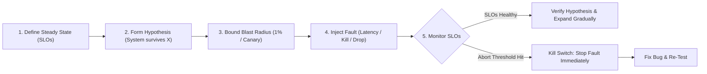
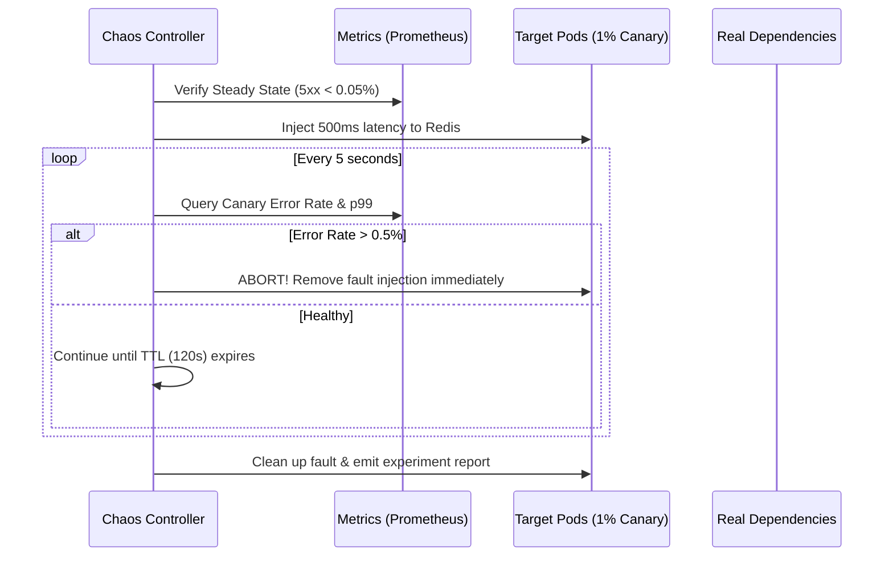
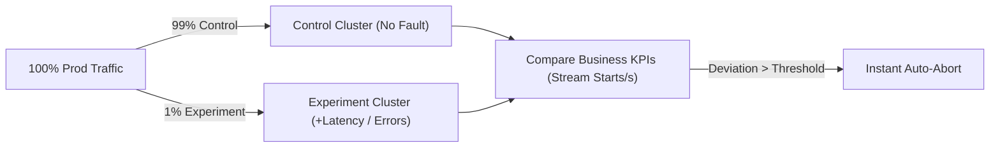

# Chaos Engineering: Breaking Production on Purpose (Safely)

> **Prerequisites:** [Lesson 16: Cell-Based Architecture](../16-cell-based-architecture/README.md).  
> **Estimated Reading Time:** 22–26 minutes  
> **Target Audience:** SREs, platform engineers, and system design candidates asked how to validate resilience, timeouts, circuit breakers, and failover mechanisms before real outages expose them.  
> **Free PDF Notes:** [Download SD-K-017.pdf](https://backendroadmap.com/notes/system-design/SD-K-017.pdf)

> [!NOTE]
> **In one line:** **Chaos Engineering** is the discipline of experimenting on a distributed system in production (or prod-like environments) by injecting controlled faults to **build confidence in the system's capability to withstand turbulent conditions**—not randomly breaking servers for fun.

> [!TIP]
> **The Golden Rule:** Every chaos experiment must start with a **steady-state hypothesis**, target the **smallest possible blast radius** (e.g., 1% of traffic or 1 canary cell), and have an **automated kill-switch (abort condition)** that halts the fault immediately if customer SLOs degrade.

---

## 1. What Chaos Engineering Is, and What It Isn't

A team configures circuit breakers, 500 ms timeouts, and a multi-AZ database failover. Everything passes unit tests and looks spotless in architecture diagrams. Six months later, a single Redis shard suffers 40% packet loss—and the entire checkout service collapses because the Redis client ignored the timeout config and spawned 20,000 blocked threads. **Chaos Engineering** surfaces these hidden fragility bugs *during business hours with engineers watching*, rather than at 03:00 UTC on Black Friday.

| Term | Precise Meaning | Example |
| :--- | :--- | :--- |
| **Chaos Engineering** | Hypothesis-driven fault injection with bounded blast radius and automated abort | Inject 300 ms latency to Redis on 1% of pods; verify p99 stays < 200 ms |
| **Steady State** | Measurable normal business/SLO behavior (throughput, error rate, p99) | Checkout success rate $\ge 99.95\%$, p99 < 250 ms |
| **Blast Radius** | Scope of traffic/users exposed to the injected fault | 1 canary pod or `X-Chaos-Test: true` synthetic user |
| **Abort Condition (Kill Switch)** | Automated threshold that immediately stops the experiment | Error rate > 0.5% for 30 s -> instant rollback |
| **GameDay** | Scheduled team exercise simulating a realistic large-scale failure | Simulating full AZ loss during business hours |
| **Fault Injection** | Deliberately introducing latency, packet loss, CPU burn, DNS failure, or pod kills | `tc netem delay 200ms`, Chaos Mesh, AWS FIS |
| **Not** | Uncontrolled `kill -9` in production without monitoring or rollback | Random destruction without a hypothesis is just an outage |

### Why It Matters
1. **Resilience configs rot silently:** Timeouts, retries, and fallbacks are rarely exercised in normal traffic and often fail when needed most.
2. **Staging lies:** Staging rarely mirrors production scale, connection pools, DNS caching, or noisy-neighbor traffic.
3. **Trains incident muscle memory:** Regular GameDays turn panicked 03:00 UTC firefighting into calm, practiced execution.

---

## 2. Anatomy: The Chaos Experiment Loop



Notice the **Abort Loop**: you never just "inject and wait 10 minutes." A control loop polls your steady-state metrics every 5–10 seconds and **auto-aborts** the experiment if error rates or latencies cross a strict threshold.

| Chaos Maturity Level | Environment | Faults Tested | Blast Radius |
| :--- | :--- | :--- | :--- |
| **Level 1: Pre-Prod / CI** | Staging / Integration | Pod kill, dependency 503, timeout check | 0% prod |
| **Level 2: Synthetic / Shadow** | Production (tagged test traffic) | Latency injection, fallback verification | Synthetic users only |
| **Level 3: Bounded Prod** | Production (1 canary pod / 1% cell) | Network delay, packet loss, Az-blackhole | $\le 1\%$ real traffic |
| **Level 4: Continuous GameDays** | Production (full AZ / region drain) | Full AZ evacuation, Chaos Monkey daily | Controlled full-AZ |

> [!WARNING]
> **Never inject chaos into a system that is already degraded or lacks basic observability.** If you cannot measure steady state (error rate, p99 latency, saturation) in real time with < 10 s granularity, you are flying blind and will turn an experiment into a SEV-1.

---

## 3. Mathematical Model: Blast Radius, Detection & MTTR Improvement

**Expected Customer Impact of an Experiment.** If a fault affects fraction $b$ (blast radius) of requests, and the automated kill switch aborts within $T_{\text{abort}}$ seconds once error rate jumps by $\Delta e$:

$$\text{Max Impacted Requests} = QPS \times b \times T_{\text{abort}} \times \Delta e$$

**Worked Numerical Example.**
Suppose production handles **10,000 QPS**.
- **Unbounded experiment:** $b = 1.0$ (100%), manual abort takes $T_{\text{abort}} = 300\text{ s}$, $\Delta e = 0.20$:
  $$\text{Impacted} = 10{,}000 \times 1.0 \times 300 \times 0.20 = \mathbf{600{,}000\text{ failed requests}}$$
- **Bounded experiment with kill switch:** $b = 0.01$ (1% canary), automated abort in $T_{\text{abort}} = 10\text{ s}$, $\Delta e = 0.20$:
  $$\text{Impacted} = 10{,}000 \times 0.01 \times 10 \times 0.20 = \mathbf{200\text{ failed requests}}$$

Bounding blast radius + automating the kill switch reduces worst-case customer impact by **3,000x**!

**Error Budget Allocation for Chaos.** If your monthly 99.9% SLO gives you $43.2\text{ min}$ of error budget, a bounded chaos experiment risking 1% of traffic for 10 seconds consumes at most $0.01 \times 10\text{ s} = 0.1\text{ s}$ of global error budget (0.004% of monthly budget).

---

## 4. Metrics & Percentiles

| Metric | Meaning | Alert / Abort when |
| :--- | :--- | :--- |
| **Steady-state error rate** | 5xx / failed business transactions | Exceeds baseline + 0.5% (instant abort) |
| **Checkout / Core API $p_{99}$** | Tail latency of critical user path | Exceeds $2 \times$ baseline or SLO ceiling |
| **Circuit breaker state** | Open / Half-Open transitions | Fails to open when dependency is blackholed |
| **Retry amplification factor** | $\text{Downstream QPS} / \text{Upstream QPS}$ | Exceeds $1.5\times$ (indicates missing retry budget) |
| **Kill-switch reaction time** | Time from abort trigger to fault removal | > 10 seconds |
| **Bugs found per GameDay** | Actionable resilience defects uncovered | Tracked as reliability ROI metric |

### Worked Example (Testing a Payment Gateway Timeout)
- **Hypothesis:** "If the secondary fraud-scoring service adds **2,000 ms** of latency, checkout will time out fraud at **250 ms**, fall back to rule-based scoring, and keep checkout $p_{99} < 500\text{ ms}$ with 0% 5xx."
- **Experiment:** Inject 2,000 ms delay on 2% of fraud-service calls via Envoy fault injection.
- **Observation:** Checkout $p_{99}$ spiked to **2,400 ms** and thread pools saturated within 12 seconds, triggering the **auto-abort**.
- **Root Cause Found:** The HTTP client used a 30-second default timeout instead of the 250 ms config key due to a typo (`fraud.timeOutMs` vs `fraud.timeoutMs`). Caught in 12 seconds on 2% traffic instead of during a holiday outage!

---

## 5. Compounding & Failure Modes

| Fault Injected | Common Hidden Bug Exposed | Why Unit Tests Missed It |
| :--- | :--- | :--- |
| **Network packet loss (5%–20%)** | TCP retransmissions stall connections; missing app timeouts | Mocks return instantly; never test half-open sockets |
| **Dependency latency spike (+2 s)** | Retry storm + thread-pool exhaustion across upstream services | Unit tests don't model concurrent thread pool starvation |
| **DNS resolution failure** | App crashes on startup or caches dead IP forever | Localhost tests don't use real DNS TTLs |
| **Clock skew (+60 s)** | JWT tokens rejected prematurely; LWW overwrites newer data | All unit tests share one local system clock |
| **Disk 95% full / IOPS throttle** | WAL/log writes block DB commits, stalling entire API | In-memory DBs / fast SSDs in CI never stall |

---

## 6. Numbers Every Engineer Must Know

| Item | Typical | Implication |
| :--- | :---: | :--- |
| Initial production blast radius | 0.5%–2% | Small enough to protect global error budget |
| Kill-switch poll interval | 5–10 s | Bounds worst-case customer impact |
| Recommended GameDay cadence | Monthly / Quarterly | Keeps runbooks and team reflexes fresh |
| Chaos error budget cap | $\le 5\%$ of monthly budget | Never run chaos if error budget is already exhausted |
| Minimum observability lag | < 10 s | Metrics must update faster than the kill switch |
| Fault injection layer | Network/L7 proxy first | Easier to bound & abort than kernel/VM destruction |

---

## 7. Protocol Deep Dive: Automated Chaos Experiment with Kill Switch



### When NOT to Run Chaos Engineering
- **During an active incident or error-budget freeze:** If the system is already burning error budget, fix stability first.
- **Without automated rollback / kill switches:** Manual SSH-based fault cleanup is too slow when things go wrong.
- **When you already know the system will break:** Don't run a chaos test to "prove" that a single-instance un-replicated database crashes when you kill it—fix the obvious SPOF first!

---

## 8. Hierarchical Budgets & Design Rules

| Slice | Rule | Control |
| :--- | :--- | :--- |
| **Pre-Flight Gate** | Block experiments if error budget is red | Automated check against SLO burn-rate API |
| **Blast Radius** | Cap initial prod fault at $\le 2\%$ | Target 1 canary pod, 1% traffic header, or 1 small cell |
| **TTL Safety** | Every fault must have a hard auto-expiry | Max duration (e.g., 120 s) enforced by the injector itself |
| **Kill Switch** | Auto-abort within 10 s of SLO breach | Automated watcher polling Prometheus/Datadog |
| **Business Hours Only** | Run prod chaos only when owners are awake | Schedule 10:00–15:00 local time; never Fridays/holidays |
| **Progressive Scope** | Staging -> Shadow -> 1% Prod -> AZ | Never jump straight to full-region chaos |

---

## 9. Top Mitigations

1. **Always define steady state and abort thresholds before injecting:** Write the hypothesis down first; if you can't measure steady state, don't run the test.
2. **Start with latency and dependency blackholing, not random `kill -9`:** Latency spikes expose far more real-world bugs (thread exhaustion, retry storms) than instant pod kills.
3. **Enforce a hard TTL on every fault injector:** Even if the chaos controller crashes, the fault (e.g., `tc netem` or Envoy fault) must auto-expire after 60–120 seconds.
4. **Integrate chaos into CI/CD for critical paths:** Automatically test circuit breakers and timeouts in staging on every release.
5. **Run quarterly GameDays with cross-team observers:** Practice AZ evacuation, DB failover, and DNS cutover together.
6. **Turn every SEV-1 post-mortem into a permanent chaos test:** Once you fix a production outage, encode that exact failure mode as a recurring chaos experiment so it never regresses.

---

## 10. Production Reference / War Story: Netflix Chaos Monkey & ChAP

Netflix pioneered Chaos Engineering in production with **Chaos Monkey** (randomly terminating EC2 instances during business hours) and **ChAP** (Chaos Automation Platform) for microservice-level fault injection.



- **Evolution:** Random instance termination (`Chaos Monkey`) was great for ensuring statelessness, but didn't catch subtle microservice timeout or fallback bugs.
- **Solution (ChAP):** Netflix built an automated platform that clones a tiny canary slice (e.g., 0.5%–1% of traffic), injects specific latency or error faults into one downstream dependency, and compares *Stream Starts Per Second* (their ultimate business steady-state metric) against a control group—auto-aborting in seconds if users are affected.

---

## 11. Multi-Language Production Code Tabs

A production-style **Chaos Experiment Runner with Automated Kill-Switch & TTL** that validates steady state before starting, injects a bounded fault, polls health continuously, and aborts immediately if error rate breaches the threshold.

````carousel
```go
// Go: hypothesis-driven chaos runner with automated kill switch and TTL.
package main

import (
	"context"
	"fmt"
	"time"
)

type MetricsSource func() (errorRate float64)

type FaultInjector interface {
	Inject(ctx context.Context) error
	Rollback() error
}

func RunChaosExperiment(
	ctx context.Context,
	ttl time.Duration,
	maxErrorRate float64,
	getMetrics MetricsSource,
	injector FaultInjector,
) (passed bool, reason string) {
	if errRate := getMetrics(); errRate > maxErrorRate {
		return false, fmt.Sprintf("pre-flight failed: baseline error rate %.3f > %.3f", errRate, maxErrorRate)
	}

	expCtx, cancel := context.WithTimeout(ctx, ttl)
	defer cancel()
	defer injector.Rollback() // guarantee cleanup on any exit path

	if err := injector.Inject(expCtx); err != nil {
		return false, fmt.Sprintf("inject failed: %v", err)
	}

	ticker := time.NewTicker(200 * time.Millisecond)
	defer ticker.Stop()
	for {
		select {
		case <-expCtx.Done():
			return true, "steady state maintained for full TTL"
		case <-ticker.C:
			if errRate := getMetrics(); errRate > maxErrorRate {
				return false, fmt.Sprintf("KILL SWITCH triggered: error rate %.3f > %.3f", errRate, maxErrorRate)
			}
		}
	}
}
```
<!-- slide -->
```typescript
// TypeScript: Chaos Experiment Runner with steady-state guard and auto-abort.
interface ChaosConfig {
  ttlMs: number;
  pollIntervalMs: number;
  maxErrorRate: number;
  getErrorRate: () => Promise<number>;
  injectFault: () => Promise<void>;
  removeFault: () => Promise<void>;
}

export async function runChaosExperiment(cfg: ChaosConfig): Promise<{ passed: boolean; reason: string }> {
  const baseline = await cfg.getErrorRate();
  if (baseline > cfg.maxErrorRate) {
    return { passed: false, reason: `Pre-flight aborted: baseline error ${baseline}` };
  }

  await cfg.injectFault();
  const deadline = Date.now() + cfg.ttlMs;

  try {
    while (Date.now() < deadline) {
      await new Promise((r) => setTimeout(r, cfg.pollIntervalMs));
      const current = await cfg.getErrorRate();
      if (current > cfg.maxErrorRate) {
        return { passed: false, reason: `KILL SWITCH: error rate ${current} > ${cfg.maxErrorRate}` };
      }
    }
    return { passed: true, reason: "Hypothesis validated within SLO" };
  } finally {
    await cfg.removeFault(); // always roll back fault
  }
}
```
<!-- slide -->
```python
# Python: Bounded Chaos Experiment Runner with kill switch and blast-radius math.
import time
from typing import Callable

def run_chaos_experiment(
    ttl_s: float,
    poll_s: float,
    max_error_rate: float,
    get_error_rate: Callable[[], float],
    inject_fault: Callable[[], None],
    rollback_fault: Callable[[], None],
) -> tuple[bool, str]:
    if get_error_rate() > max_error_rate:
        return False, "Pre-flight failed: system already unhealthy"

    inject_fault()
    deadline = time.monotonic() + ttl_s
    try:
        while time.monotonic() < deadline:
            time.sleep(poll_s)
            err = get_error_rate()
            if err > max_error_rate:
                return False, f"ABORTED by kill switch: error_rate={err:.3f}"
        return True, "PASSED: steady state maintained"
    finally:
        rollback_fault()

def max_impacted_requests(qps: float, blast_radius: float, abort_s: float, err_delta: float) -> float:
    return qps * blast_radius * abort_s * err_delta
```
<!-- slide -->
```csharp
// C#: Chaos Experiment Runner with guaranteed rollback & kill-switch polling.
using System;
using System.Threading;
using System.Threading.Tasks;

public static class ChaosRunner
{
    public static async Task<(bool Passed, string Reason)> RunAsync(
        TimeSpan ttl,
        double maxErrorRate,
        Func<double> getErrorRate,
        Action injectFault,
        Action rollbackFault)
    {
        if (getErrorRate() > maxErrorRate)
            return (false, "Pre-flight failed: unhealthy baseline.");

        injectFault();
        try
        {
            using var cts = new CancellationTokenSource(ttl);
            while (!cts.Token.IsCancellationRequested)
            {
                await Task.Delay(250, cts.Token).ContinueWith(_ => { });
                double current = getErrorRate();
                if (current > maxErrorRate)
                    return (false, $"Kill switch triggered: {current:P2} > {maxErrorRate:P2}");
            }
            return (true, "Steady state maintained.");
        }
        finally
        {
            rollbackFault();
        }
    }
}
```
````

---

## 12. Hands-On CLI Verification Workflows

```bash
# 1. Inject 300ms network latency with 50ms jitter on eth0 for testing (Linux tc netem)
sudo tc qdisc add dev eth0 root netem delay 300ms 50ms
# Always remove it cleanly when done:
sudo tc qdisc del dev eth0 root

# 2. Run a Chaos Mesh PodKill experiment in Kubernetes (bounded to 1 pod in staging)
kubectl apply -f - <<EOF
apiVersion: chaos-mesh.org/v1alpha1
kind: PodChaos
metadata:
  name: checkout-pod-kill-test
  namespace: staging
spec:
  action: pod-kill
  mode: one
  selector:
    namespaces: [staging]
    labelSelectors:
      app: checkout-api
EOF

# 3. Start an AWS Fault Injection Simulator (FIS) experiment with stop conditions
aws fis start-experiment --experiment-template-id EXT1234567890
```

---

## 13. Common Mistakes to Avoid

1. **Injecting faults without a written hypothesis:** Breaking things without defining expected steady state teaches you nothing.
2. **Skipping the automated kill switch:** Relying on a human to notice a dashboard spike and run a rollback command wastes minutes.
3. **Starting with 100% production traffic:** Always graduate from staging -> shadow -> 1% canary -> larger scopes.
4. **Testing only `kill -9` (pod termination):** Latency injection and partial packet loss expose far more real-world bugs (thread exhaustion, retry storms).
5. **Running chaos during an active incident or error-budget freeze:** Fix known instability before injecting new faults.
6. **Forgetting hard TTLs on fault injectors:** If your chaos controller crashes, a missing TTL leaves `tc netem` latency running permanently.
7. **Failing to fix discovered bugs:** Finding a broken timeout in a GameDay and filing it in a backlog that never gets prioritized wastes the entire exercise.

---

## 14. Key Terms Glossary

| Key Term | Definition |
| :--- | :--- |
| **Chaos Engineering** | Discipline of experimenting on a system to build confidence in its resilience to turbulent conditions. |
| **Steady State** | Measurable normal behavior of a system (e.g., throughput, error rate, p99 latency). |
| **Hypothesis** | Explicit prediction of how steady-state metrics will behave under a specific injected fault. |
| **Blast Radius** | Maximum scope of users, traffic, or infrastructure exposed to a chaos experiment. |
| **Kill Switch (Abort Condition)** | Automated threshold that halts an experiment and rolls back the fault immediately. |
| **GameDay** | Scheduled, collaborative simulation of a major failure to test systems and human runbooks. |
| **Fault Injection** | Deliberate introduction of latency, packet loss, errors, resource exhaustion, or node termination. |
| **Chaos Monkey** | Tool that randomly terminates production instances to enforce stateless, self-healing services. |
| **FIS / Chaos Mesh** | Managed/Kubernetes platforms for orchestrating bounded fault-injection experiments. |
| **Error Budget** | Allowable unreliability ($1 - \text{SLO}$) that bounds how much risk chaos experiments may consume. |

---

## 15. System Design Interview Questions & Answers

### Basic Conceptual Questions

<details>
<summary><strong>Q1: What is Chaos Engineering, and how is it different from random testing? [BASIC]</strong></summary>

**Answer:**
Chaos Engineering is *scientific, hypothesis-driven* fault injection: you define steady-state SLOs, hypothesize that the system survives a specific fault, bound the blast radius, inject the fault, and auto-abort if SLOs degrade. Randomly killing servers without a hypothesis or kill switch is just causing an outage.
</details>

<details>
<summary><strong>Q2: What is a "steady-state hypothesis"? [BASIC]</strong></summary>

**Answer:**
It is a measurable statement of normal business/system health (e.g., "checkout success rate stays $\ge 99.95\%$ and $p_{99} < 300\text{ ms}$") that you expect to hold true *despite* the injected fault.
</details>

<details>
<summary><strong>Q3: Why run chaos experiments in production instead of only in staging? [BASIC]</strong></summary>

**Answer:**
Staging rarely reproduces production scale, real traffic distributions, connection pool sizes, DNS caching, or third-party latency tails. Bounded production experiments (e.g., 1% canary with a kill switch) uncover issues staging never triggers.
</details>

<details>
<summary><strong>Q4: What is an abort condition (kill switch)? [BASIC]</strong></summary>

**Answer:**
An automated metric threshold (e.g., 5xx error rate > 0.5% for 10 seconds) that immediately terminates the fault injection and restores normal state without waiting for human intervention.
</details>

### Scenario-Based Architecture Questions

<details>
<summary><strong>Q5: Design a safe chaos experiment to test if your checkout service survives a slow Redis cache. [SCENARIO]</strong></summary>

**Answer:**
(1) **Steady state:** Checkout $p_{99} < 400\text{ ms}$, error rate < 0.05%. (2) **Hypothesis:** If Redis adds 500 ms latency, checkout times out Redis at 50 ms and falls back to DB/local cache. (3) **Blast radius:** 1% canary pod or synthetic test traffic. (4) **Abort:** Auto-rollback if canary 5xx > 0.5% or $p_{99} > 800\text{ ms}$. (5) **TTL:** 120 s max.
</details>

<details>
<summary><strong>Q6: Your team wants to run Chaos Monkey in production, but you have a single-primary un-replicated database. What do you say? [SCENARIO]</strong></summary>

**Answer:**
**Stop.** Never run chaos to "discover" an obvious single point of failure you already know will cause a 100% outage. First add redundancy/failover, observability, and automated kill switches; *then* use chaos to verify the failover actually works.
</details>

<details>
<summary><strong>Q7: Why is injecting 300 ms of network latency often more revealing than killing a pod? [SCENARIO]</strong></summary>

**Answer:**
Killing a pod closes TCP sockets immediately (`RST`/`FIN`), triggering fast failover. Injecting 300 ms–2,000 ms latency holds connections open, exposing missing timeouts, thread-pool exhaustion, retry storms, and cascading queue backlogs.
</details>

<details>
<summary><strong>Q8: How do you ensure a chaos experiment never gets stuck "on" if the chaos controller crashes? [SCENARIO]</strong></summary>

**Answer:**
Enforce a **local TTL** inside the fault injector itself (e.g., sidecar or cron-reset on the target node) so the fault automatically expires after 60–120 seconds even if the central controller loses connectivity.
</details>

### Advanced & Tricky Interview Questions

<details>
<summary><strong>Q9: How do you test chaos on stateful payment or order flows without corrupting real customer money? [TRICKY]</strong></summary>

**Answer:**
Use **synthetic / shadow test accounts** (`X-Chaos-Test: true`) routed through production infrastructure with mocked/sandboxed payment settlement, or run experiments on idempotent read/cache/failover paths rather than mutating un-reconciled financial ledgers.
</details>

<details>
<summary><strong>Q10: How does Chaos Engineering relate to Error Budgets? [TRICKY]</strong></summary>

**Answer:**
Chaos experiments consume error budget when they uncover real fragility. You should allocate a small fraction (e.g., $\le 5\%$) of monthly error budget to chaos and **freeze** production chaos automatically whenever the remaining error budget drops below a safe threshold.
</details>

<details>
<summary><strong>Q11: What is "grey failure," and why is it the hardest thing to chaos-test? [TRICKY]</strong></summary>

**Answer:**
Grey failure is partial degradation (e.g., 10% packet loss, slow disk I/O, or memory thrashing) where health checks still pass (`200 OK`) but tail latency explodes. Testing grey failure requires injecting subtle packet loss/CPU/I/O contention and verifying that *tail-latency-aware* load balancers or circuit breakers eject the degraded node.
</details>

<details>
<summary><strong>Q12: How do you convert a SEV-1 post-mortem into a long-term Chaos Engineering asset? [TRICKY]</strong></summary>

**Answer:**
Reproduce the exact root-cause trigger (e.g., DNS stall, expired cert, or 2 s dependency delay) as an automated regression test in your chaos suite (staging CI + periodic prod canary), ensuring the fix remains valid across future code and config changes.
</details>

---

## 16. One-Page Master Cheat Sheet

```
+---------------------------------------------------------------------------------------------------------+
|                        CHAOS ENGINEERING — MASTER CHEAT SHEET                                           |
+---------------------------------------------------------------------------------------------------------+
| 1. LOOP: Steady State -> Hypothesis -> Bound Blast Radius (<=1-2%) -> Inject -> Monitor -> Auto-Abort.  |
+---------------------------------------------------------------------------------------------------------+
| 2. SAFETY: Always have (a) real-time metrics (<10s), (b) automated kill switch, (c) hard local TTL.     |
+---------------------------------------------------------------------------------------------------------+
| 3. MATH: Max Impact = QPS * Blast_Radius * Abort_Time * Error_Delta. Bounding cuts impact by 1000x+.    |
+---------------------------------------------------------------------------------------------------------+
| 4. BEST FAULTS: Latency injection & packet loss expose way more bugs than simple pod kills.             |
+---------------------------------------------------------------------------------------------------------+
| 5. NEVER: Run chaos during an active outage, with red error budget, or to "test" an obvious SPOF.       |
+---------------------------------------------------------------------------------------------------------+
```

---

## Further Reading & Sources

- Casey Rosenthal & Nora Jones, *Chaos Engineering: System Resiliency in Practice* (O'Reilly).
- Principles of Chaos Engineering, [principlesofchaos.org](https://principlesofchaos.org/).
- Netflix TechBlog, *ChAP: Chaos Automation Platform*.
- AWS Documentation, *AWS Fault Injection Simulator (FIS)* Best Practices.

---

## Free PDF Notes

[SD-K-017.pdf](https://backendroadmap.com/notes/system-design/SD-K-017.pdf)

---

## Next

Continue with [Static Stability: Surviving Dependency & Control Plane Failures](../18-static-stability/README.md).
