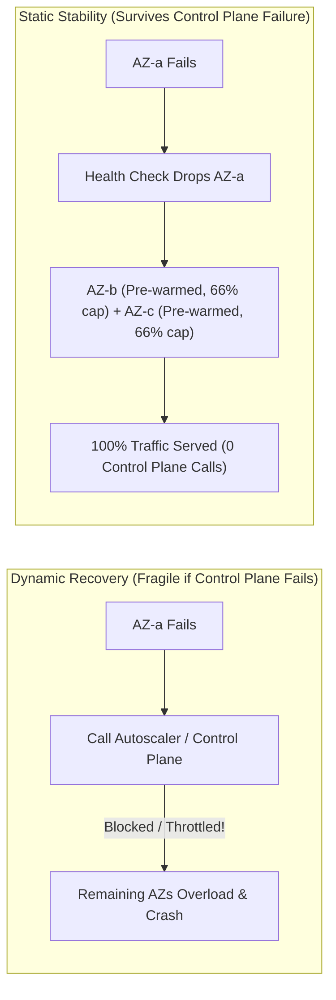
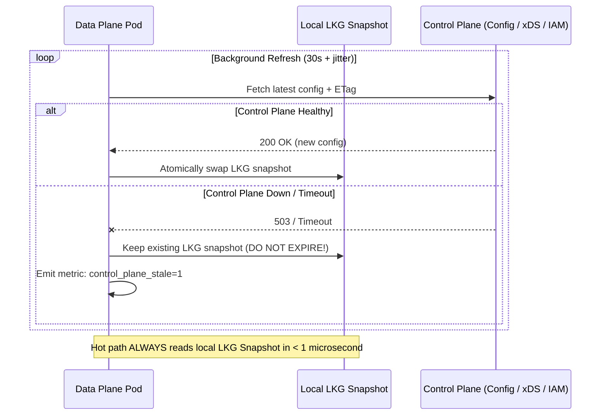
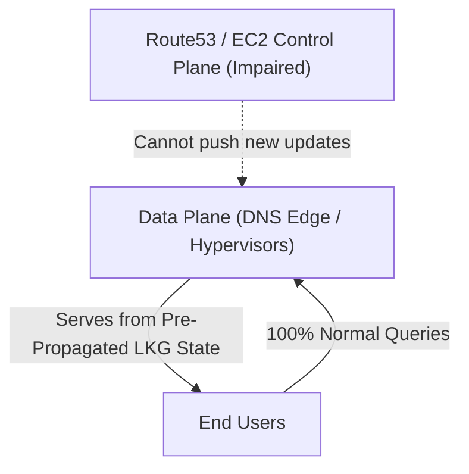

# Static Stability: Surviving Dependency & Control Plane Failures

> **Prerequisites:** [Lesson 17: Chaos Engineering](../17-chaos-engineering/README.md).  
> **Estimated Reading Time:** 24–28 minutes  
> **Target Audience:** Principal/staff engineers, SREs, and system design candidates asked how systems keep serving traffic when control planes, IAM, DNS, or config services go down.  
> **Free PDF Notes:** [Download SD-K-018.pdf](https://backendroadmap.com/notes/system-design/SD-K-018.pdf)

> [!NOTE]
> **In one line:** A system is **statically stable** if its **data plane** continues operating normally using pre-provisioned capacity and cached state even when its **control plane** (autoscaler, config service, service discovery, or IAM) fails completely.

> [!TIP]
> **The Golden Rule:** **Never require the control plane to act in order to survive a failure.** If your recovery plan depends on spinning up new VMs, calling an autoscaler, querying a central config DB, or pushing new DNS records during an outage, you are **not** statically stable—and you will fail when the control plane itself is impaired.

---

## 1. What Static Stability Is, and What It Isn't

During a major cloud outage, an Availability Zone (`us-east-1a`) loses connectivity, taking the regional **EC2/Kubernetes control plane** and **autoscaler** down with it. Team A runs at 85% utilization across 3 AZs and relies on Kubernetes HPA to spin up replacement pods in `1b` and `1c` when `1a` dies—their recovery fails completely because the control plane cannot schedule pods during the outage. Team B runs **statically stable** at 60% capacity per AZ across 3 AZs with pre-warmed pods and local cached config—when `1a` disappears, `1b` and `1c` absorb 100% of traffic with **zero control-plane calls**.

| Term | Precise Meaning | Example |
| :--- | :--- | :--- |
| **Static Stability** | Data plane keeps working with zero dependency on control-plane mutations | Pre-provisioned N+1 capacity; cached routing/IAM state |
| **Control Plane** | Management layer that mutates configuration, schedules compute, or updates routing | K8s API server, AWS EC2 CreateInstance, Consul, Feature-Flag DB |
| **Data Plane** | Hot-path request-serving layer that handles live customer traffic | Load balancers, Envoy proxies, API pods, DB engines |
| **Bi-Modal Behavior** | System behaves completely differently in normal vs failure mode (e.g., cold-cache fallback) | Failing over to an untested emergency code path |
| **Pre-Provisioned Headroom** | Running enough live capacity *before* failure to absorb loss without autoscaling | 3 AZs each at $\le 66\%$ load so 2 AZs handle 100% |
| **Stale-While-Error / Last-Known-Good** | Continuing to use cached config/certs/routes when the control plane is unreachable | Envoy using cached xDS endpoints if Istio control plane dies |
| **Not** | Disabling autoscaling forever | You can still autoscale for organic growth, just not for *failure survival* |

### Why It Matters
1. **Control planes fail more often than data planes:** Control planes are complex, stateful, and shared across tenants; they are frequently the first thing to degrade during a major cloud event.
2. **Avoids bimodal recovery:** Static stability means the system runs in *one* steady mode—no frantic emergency scaling or cold-start storms.
3. **Eliminates circular dependencies:** You cannot use a broken control plane to fix the infrastructure that hosts the control plane.

---

## 2. Anatomy: Dynamic Recovery vs Static Stability



In **Dynamic Recovery**, surviving a 1-AZ outage requires the control plane to launch new instances, attach volumes, register targets, and push new configs—all while thousands of other customers are hammering the same control plane. In **Static Stability**, every remaining AZ already has the compute, warmed caches, and cached routing state needed to carry 100% of traffic immediately.

| Dimension | Dynamic / Reactive Recovery | Static Stability |
| :--- | :--- | :--- |
| **Capacity on failure** | Spins up new nodes via autoscaler | Pre-provisioned $N+1$ capacity already running |
| **Config / Feature flags** | Polls central service; fails closed if down | Local cached last-known-good (infinite stale-if-error) |
| **Service discovery** | Fails if Consul/etcd/DNS control plane stalls | Uses cached healthy endpoints; only drops failed IPs |
| **Cost** | Lower idle compute | Slightly higher idle compute (e.g., 33%–50% headroom) |
| **Resilience to control-plane outage** | **Fails** | **Survives** |

> [!WARNING]
> **Watch out for TTL expiration on cached config/tokens!** Many teams cache IAM policies, TLS certs, or service-discovery lists with a hard 5-minute TTL that *deletes* the cache entry on expiry. If the control plane goes down for 6 minutes, every pod simultaneously purges its cache and crashes. Always use **stale-while-error** (keep last-known-good indefinitely on fetch failure).

---

## 3. Mathematical Model: Pre-Provisioned Capacity & Availability

**Static Stability Capacity Rule ($N$ Failure Domains).** To survive the loss of $f$ failure domains (e.g., $f = 1$ AZ out of $N$ AZs) with **zero autoscaling**, the maximum normal-state utilization $U_{\text{max}}$ per domain must satisfy:

$$U_{\text{max}} \le \frac{N - f}{N}$$

**Worked Numerical Example (3 AZs vs 2 AZs, $f = 1$):**
- **2 AZs ($N=2, f=1$):** $U_{\text{max}} \le \frac{2 - 1}{2} = \mathbf{50\%}$. You pay for **2x** normal capacity (100% overhead) to be statically stable.
- **3 AZs ($N=3, f=1$):** $U_{\text{max}} \le \frac{3 - 1}{3} = \mathbf{66.7\%}$. You pay for only **1.5x** capacity (50% overhead) to survive a full AZ loss with zero control-plane calls!
- **4 AZs ($N=4, f=1$):** $U_{\text{max}} \le \frac{4 - 1}{4} = \mathbf{75\%}$ (only 33% overhead).

**Control-Plane Coupled Availability.** Suppose your data plane has availability $A_d = 0.9999$ and your control plane has $A_c = 0.999$.
- **Tightly coupled** (data plane fails whenever control plane fails or during TTL expiry):
  $$A_{\text{coupled}} = A_d \times A_c = 0.9999 \times 0.999 = \mathbf{99.89\%}\text{ (~9.6 hours/yr downtime)}$$
- **Statically stable** (data plane only needs control plane for rare deployments, not steady-state serving):
  $$A_{\text{static}} \approx A_d = \mathbf{99.99\%}\text{ (~52 minutes/yr downtime)}$$

Static stability improves availability by **10x** without changing a single line of business logic!

---

## 4. Metrics & Percentiles

| Metric | Meaning | Alert when |
| :--- | :--- | :--- |
| **Per-AZ peak utilization** | CPU/Memory/Conn load in each AZ | Exceeds $\frac{N-1}{N} \times 90\%$ (loses static stability) |
| **Control-plane call rate on hot path** | Requests hitting config/IAM/discovery DBs per user request | > 0 (must be 0; cache locally!) |
| **Config/Discovery cache age** | Time since last successful refresh from control plane | > $3 \times$ refresh interval (warn, do NOT purge!) |
| **Stale-while-error fallback count** | Times data plane served using cached LKG state | > 0 (control plane is degraded; data plane is surviving!) |
| **Cold-start / Scale-out dependency** | % of recovery capacity relying on new VM/pod launches | > 0% for single-AZ loss |

### Worked Example (AWS-Style Load Balancer & EC2 Data Plane)
An API gateway runs across **3 AZs** (`us-east-1a/b/c`) with 30 pods total (10 per AZ), handling 15,000 RPS (5,000 RPS per AZ, max 8,000 RPS per AZ = 62.5% normal utilization).
- **Control Plane:** Kubernetes API server + AWS IAM + Feature Flag DB.
- **Data Plane:** Envoy + Go API pods.
- Every pod pulls feature flags and routing tables every 30 s into an in-memory atomic pointer, **retaining the last-known-good snapshot forever** if the fetch fails.
- When `us-east-1a` AND the K8s API server go down simultaneously, `1b` and `1c` absorb all 15,000 RPS (7,500 RPS each < 8,000 max) using cached flags—**0% error rate, 0 control-plane calls**.

---

## 5. Compounding & Failure Modes

| Anti-Pattern | What Happens During Control-Plane Outage | Why It Breaks Static Stability |
| :--- | :--- | :--- |
| **Hard cache TTL expiry** | Cache entries expire after 5 min; refresh fails; app throws `NullPointerException` or `503` | Turns a control-plane blip into a 100% data-plane outage |
| **Dynamic autoscaling for HA** | AZ fails; HPA tries to launch 20 pods; EC2/K8s API is throttled or down | Surviving AZs hit 100% CPU and crash |
| **On-the-fly IAM/Auth introspection** | Every API call hits central Auth/IAM DB synchronously | Central DB overload stops 100% of authenticated traffic |
| **Bimodal emergency fallback** | App switches to a rarely tested "maintenance mode" code path | Untested fallback path has a bug and crashes |
| **Thundering-herd cache refresh** | 5,000 pods expire their config cache at the exact same second | DDoSes the control plane right as it tries to recover |

---

## 6. Numbers Every Engineer Must Know

| Item | Typical | Implication |
| :--- | :---: | :--- |
| Static headroom in 3-AZ deployment | $\ge 33\%$ spare (run $\le 66\%$) | Survives 1 AZ loss with 0 autoscaling |
| Static headroom in 2-AZ deployment | $\ge 50\%$ spare (run $\le 50\%$) | 3 AZs is 25% cheaper for static stability than 2 AZs! |
| Control-plane hot-path calls | **0** per request | All routing, flags, and public keys cached in-process |
| Config refresh jitter | $\pm 20\%$ random jitter | Prevents synchronized thundering herds on control plane |
| Stale-while-error TTL | Infinite (until replaced) | Never delete valid cached state because upstream is unreachable |
| AWS EC2 / K8s pod launch time | 30–180 s (plus cold JIT/cache) | Too slow to save an overloaded surviving AZ |

---

## 7. Protocol Deep Dive: Stale-While-Error Control-Plane Decoupling



### When NOT to Optimize for Full Static Stability
- **Non-critical batch/analytics jobs:** Offline ETL pipelines can safely pause if the scheduler/control plane is down; paying 50% idle compute headroom for batch workers wastes money.
- **Highly dynamic, un-cacheable authorization (e.g., instant revocation of compromised banking sessions):** If security policy strictly requires sub-second global revocation, you must choose between failing closed (sacrificing static stability) or short-lived tokens (e.g., 5-min JWTs).

---

## 8. Hierarchical Budgets & Design Rules

| Slice | Rule | Control |
| :--- | :--- | :--- |
| **Compute Headroom** | Survive 1-AZ loss without scaling | Cap normal load at $\le 60\%$ across $\ge 3$ AZs |
| **Control-Plane Isolation** | Zero synchronous control-plane calls on data path | Background async sync + in-memory atomic LKG snapshot |
| **Cache Expiration** | Never evict LKG state on upstream error | Stale-while-error = infinite; alert on staleness instead |
| **Refresh Traffic** | Prevent thundering herd on recovery | Add $\pm 20\%$ jitter + exponential backoff on CP errors |
| **Failover Path** | Avoid bimodal emergency code | Use the same code path in normal and degraded modes |
| **Testing** | Prove data plane works with CP blackholed | Chaos test: block control-plane egress for 10 min in staging/canary |

---

## 9. Top Mitigations

1. **Spread across $\ge 3$ AZs and cap normal utilization at $\le 60\%$:** 3 AZs requires only 50% extra headroom (vs 100% in 2 AZs) to absorb a full AZ loss statically.
2. **Decouple data plane from control plane with atomic LKG snapshots:** Push or poll configs into local memory/disk and *never* delete them when the control plane is unreachable.
3. **Eliminate synchronous auth/flag lookups on the hot path:** Use locally verified JWTs (cached JWKS public keys) and local SDK rule evaluation for feature flags.
4. **Add jitter to every background refresh loop:** Prevent 10,000 pods from hammering the control plane at `:00` seconds.
5. **Pre-warm connection pools and caches in all AZs:** Keep standby AZs actively serving a share of traffic (Active-Active across AZs) so there is no cold-start shock on failover.
6. **Chaos-test "control plane blackhole":** Periodically block access to your config server, feature-flag service, and K8s API in a canary cell to prove the data plane doesn't flinch.

---

## 10. Production Reference / War Story: AWS EC2 Control Plane vs Data Plane

AWS's *Builders' Library* highlights static stability as a core pillar of how EC2, EBS, and Route53 survive massive regional turbulence:



- **Design Principle:** Route53's data plane (DNS edge servers worldwide) is **completely decoupled** from its control plane (the API where customers edit DNS records).
- **During Control-Plane Impairment:** Customers may temporarily be unable to *modify* DNS records via the API, but **100% of existing DNS queries continue resolving** at full speed from pre-propagated, locally stored snapshots on the edge nodes.
- **Takeaway:** Separating "ability to mutate state" (control plane) from "ability to serve existing state" (data plane) is the single highest-leverage reliability pattern in distributed systems.

---

## 11. Multi-Language Production Code Tabs

A production-ready **Statically Stable Config / Routing Cache** that refreshes asynchronously in the background with jitter, atomically swaps the Last-Known-Good (LKG) snapshot, and **never expires** the cached state when the control plane fails.

````carousel
```go
// Go: Statically stable Last-Known-Good (LKG) config cache.
package main

import (
	"context"
	"fmt"
	"sync/atomic"
	"time"
)

type ConfigSnapshot struct {
	FeatureFlags map[string]bool
	FetchedAt    time.Time
}

type StaticConfigStore struct {
	current atomic.Pointer[ConfigSnapshot]
}

func NewStaticConfigStore(initial ConfigSnapshot) *StaticConfigStore {
	s := &StaticConfigStore{}
	s.current.Store(&initial)
	return s
}

// Get ALWAYS succeeds in nanoseconds, even if control plane is dead.
func (s *StaticConfigStore) Get() ConfigSnapshot {
	return *s.current.Load()
}

func (s *StaticConfigStore) RefreshLoop(ctx context.Context, fetch func() (ConfigSnapshot, error), interval time.Duration) {
	ticker := time.NewTicker(interval)
	defer ticker.Stop()
	for {
		select {
		case <-ctx.Done():
			return
		case <-ticker.C:
			snap, err := fetch()
			if err != nil {
				// Critical: keep serving LKG snapshot! Only log/metric staleness.
				fmt.Printf("control plane unreachable (%v); retaining LKG from %v\n", err, s.Get().FetchedAt)
				continue
			}
			s.current.Store(&snap)
		}
	}
}
```
<!-- slide -->
```typescript
// TypeScript: Statically stable LKG store (never expires on control-plane failure).
export interface ConfigSnapshot {
  flags: Record<string, boolean>;
  fetchedAt: number;
}

export class StaticConfigStore {
  private lkg: ConfigSnapshot;

  constructor(seedConfig: ConfigSnapshot) {
    this.lkg = seedConfig; // always start with a valid baked-in seed
  }

  get(): ConfigSnapshot {
    return this.lkg; // hot path: zero network calls, zero throws
  }

  async refresh(fetcher: () => Promise<ConfigSnapshot>): Promise<void> {
    try {
      const fresh = await fetcher();
      this.lkg = fresh;
    } catch {
      // Stale-while-error: retain LKG indefinitely; emit staleness metric
    }
  }
}
```
<!-- slide -->
```python
# Python: Statically stable LKG config & capacity headroom calculator.
from dataclasses import dataclass
import time

@dataclass(frozen=True)
class ConfigSnapshot:
    flags: dict[str, bool]
    fetched_at: float

class StaticConfigStore:
    def __init__(self, baked_seed: ConfigSnapshot):
        self._lkg = baked_seed

    def get(self) -> ConfigSnapshot:
        return self._lkg  # never blocks, never fails

    def try_refresh(self, fetcher) -> bool:
        try:
            self._lkg = fetcher()
            return True
        except Exception:
            # Retain LKG indefinitely; never evict on upstream failure
            return False

def max_static_utilization(num_azs: int, tolerated_az_losses: int = 1) -> float:
    return (num_azs - tolerated_az_losses) / num_azs

if __name__ == "__main__":
    print(f"3-AZ max utilization: {max_static_utilization(3, 1):.1%}")
```
<!-- slide -->
```csharp
// C#: Statically stable LKG store with atomic reference swap.
using System;
using System.Collections.Generic;
using System.Threading;
using System.Threading.Tasks;

public sealed record ConfigSnapshot(IReadOnlyDictionary<string, bool> Flags, DateTimeOffset FetchedAt);

public sealed class StaticConfigStore
{
    private ConfigSnapshot _lkg;

    public StaticConfigStore(ConfigSnapshot bakedSeed) => _lkg = bakedSeed;

    public ConfigSnapshot Get() => Volatile.Read(ref _lkg);

    public async Task TryRefreshAsync(Func<Task<ConfigSnapshot>> fetcher)
    {
        try
        {
            var fresh = await fetcher();
            Interlocked.Exchange(ref _lkg, fresh);
        }
        catch
        {
            // Keep serving LKG indefinitely when control plane is impaired
        }
    }
}
```
````

---

## 12. Hands-On CLI Verification Workflows

```bash
# 1. Verify Kubernetes PodDisruptionBudgets & multi-AZ spread (ensuring static headroom)
kubectl get pdb -A
kubectl get pods -o wide -l app=checkout-api | awk '{print $7}' | sort | uniq -c

# 2. Simulate a control-plane blackhole in staging via NetworkPolicy / iptables
#    and verify data plane continues returning 200 OK
curl -s -o /dev/null -w "HTTP %{http_code} in %{time_total}s\n" https://staging.example.com/api/health

# 3. Calculate static-stability headroom across 2, 3, and 4 AZs
python3 -c "
for n in (2, 3, 4):
    print(f'{n} AZs (survive 1 loss): max normal util = {(n-1)/n:.1%}, overhead = {n/(n-1)-1:.1%}')
"
```

---

## 13. Common Mistakes to Avoid

1. **Relying on autoscaling to survive an AZ outage:** When an AZ dies, the cloud control plane is often degraded or overwhelmed by everyone else autoscaling simultaneously.
2. **Setting a hard TTL that deletes cached config on failure:** Turning a 6-minute control-plane outage into a 100% data-plane outage when caches expire.
3. **Deploying across only 2 AZs for static stability:** Forces you to run at $\le 50\%$ utilization (100% idle overhead) instead of $\le 66.7\%$ with 3 AZs (50% overhead).
4. **Calling central Auth/Feature-Flag/Config DBs on the hot path:** Any synchronous control-plane dependency on the request path breaks static stability.
5. **Untested bimodal emergency modes:** Switching to a special "degraded mode" code path only during outages guarantees hidden bugs will fire at the worst moment.
6. **Synchronized cache refresh intervals:** Without jitter, thousands of pods refresh simultaneously and DDoS the recovering control plane.
7. **Forgetting baked-in seed configs at startup:** If a pod restarts during a control-plane outage, it needs a local/S3-baked seed config to boot cleanly.

---

## 14. Key Terms Glossary

| Key Term | Definition |
| :--- | :--- |
| **Static Stability** | Property where a data plane continues operating normally without needing control-plane actions. |
| **Control Plane** | Management layer that provisions resources, mutates config, or updates routing state. |
| **Data Plane** | Hot-path layer that processes live customer requests using current state. |
| **Last-Known-Good (LKG)** | Most recent valid configuration/routing snapshot retained in local cache. |
| **Stale-While-Error** | Caching policy that serves expired LKG data indefinitely whenever upstream refresh fails. |
| **Bi-Modal Behavior** | System having radically different normal vs failure execution paths (fragile under stress). |
| **Pre-Provisioned Headroom** | Spare live capacity running before an outage so surviving domains absorb load without scaling. |
| **AZ (Availability Zone)** | Isolated data center cluster within a cloud region with independent power and networking. |
| **JWKS Caching** | Caching public cryptographic keys locally so JWT auth works without calling the Auth server. |
| **Seed Config** | Baked-in baseline configuration shipped with the binary/container so cold starts survive CP outages. |

---

## 15. System Design Interview Questions & Answers

### Basic Conceptual Questions

<details>
<summary><strong>Q1: What is Static Stability? [BASIC]</strong></summary>

**Answer:**
Static stability means a system's **data plane** keeps serving traffic normally using pre-provisioned capacity and cached last-known-good state even when its **control plane** (autoscaler, config server, service discovery, or IAM) is completely down.
</details>

<details>
<summary><strong>Q2: What is the difference between the Control Plane and the Data Plane? [BASIC]</strong></summary>

**Answer:**
The **data plane** handles every live customer request on the hot path (load balancers, API pods, DB queries). The **control plane** manages, configures, and mutates the system (Kubernetes API, autoscaling, DNS updates, feature-flag admin). Static stability ensures control-plane failures don't break the data plane.
</details>

<details>
<summary><strong>Q3: Why is relying on autoscaling to survive an Availability Zone outage dangerous? [BASIC]</strong></summary>

**Answer:**
When an AZ fails, the regional control plane may be impaired or heavily throttled as thousands of customers simultaneously try to launch replacement instances—and spinning up + warming new instances takes minutes, during which surviving AZs overload and crash.
</details>

<details>
<summary><strong>Q4: Why is 3 AZs better than 2 AZs for static stability? [BASIC]</strong></summary>

**Answer:**
To survive 1 AZ loss without scaling, 2 AZs can run at most **50%** normal utilization (100% extra capacity cost), whereas 3 AZs can run at **66.7%** normal utilization (only 50% extra capacity cost).
</details>

### Scenario-Based Architecture Questions

<details>
<summary><strong>Q5: Your API calls a central Feature Flag service on every HTTP request. How do you make it statically stable? [SCENARIO]</strong></summary>

**Answer:**
Remove the synchronous RPC from the hot path. Embed an SDK that polls/streams flag rules asynchronously in the background (with jitter) into an in-memory atomic snapshot, ship a baked-in seed config with the container, and configure **stale-while-error = infinite** so the app never fails if the flag service goes down.
</details>

<details>
<summary><strong>Q6: A service caches IAM public keys (JWKS) with a strict 10-minute TTL. The Auth server goes down for 15 minutes. What happens? [SCENARIO]</strong></summary>

**Answer:**
For the first 10 minutes, everything works. At minute 10, the strict TTL evicts the cached keys, the refresh fails, and **100% of authenticated traffic crashes** simultaneously. Fix it by retaining the last-known-good JWKS indefinitely on fetch failure (`stale-while-error`).
</details>

<details>
<summary><strong>Q7: How do you test that your system is actually statically stable? [SCENARIO]</strong></summary>

**Answer:**
Run a **Chaos Engineering** experiment in staging/canary that completely blackholes egress to the control plane (config server, feature flags, K8s API, autoscaler) and kills 1 AZ's worth of pods—then verify that remaining pods serve 100% of traffic within SLOs.
</details>

<details>
<summary><strong>Q8: How do you avoid "bi-modal" failure modes in a load balancer or API gateway? [SCENARIO]</strong></summary>

**Answer:**
Avoid maintaining a separate, rarely executed "emergency fallback" path. Instead, keep all AZs continuously Active-Active with pre-warmed capacity and serve from the same LKG local cache in both normal and degraded states.
</details>

### Advanced & Tricky Interview Questions

<details>
<summary><strong>Q9: How does a newly booted pod survive if it starts up *during* a control-plane outage? [TRICKY]</strong></summary>

**Answer:**
If a pod only fetches config from the control plane on startup, a crash-looping pod cannot boot during a control-plane outage. Solve this by bundling a **baked-in seed config** in the container image (or reading from a highly durable, statically stable local/S3 mirror) so the pod boots into a valid baseline immediately.
</details>

<details>
<summary><strong>Q10: What is the hidden risk of "stale-while-error = infinite" for security or routing? [TRICKY]</strong></summary>

**Answer:**
If a control plane is silently unreachable for days, pods run with stale firewall rules, stale revoked tokens, or stale dead-node IPs. Pair infinite stale-while-error with **loud staleness alerts** (e.g., page on-call if config age > 10 minutes) and active data-plane health checks that still drop dead backend IPs locally.
</details>

<details>
<summary><strong>Q11: Why did AWS's Builders' Library warn against "active-passive" across AZs even with spare capacity? [TRICKY]</strong></summary>

**Answer:**
Because cold caches, cold connection pools, and unexercised routing paths create **bimodal behavior**: when traffic suddenly shifts to the passive AZ, it suffers a cold-start latency cliff. Running Active-Active across all 3 AZs keeps every AZ warm at all times.
</details>

<details>
<summary><strong>Q12: How do static stability and cell-based architecture complement each other? [TRICKY]</strong></summary>

**Answer:**
Cell-based architecture limits the blast radius of a failure to $1/N$ of tenants, while static stability ensures that the **Cell Router** and each **Cell's data plane** continue serving traffic even if the global control plane (tenant directory, deployment pipeline, or autoscaler) fails.
</details>

---

## 16. One-Page Master Cheat Sheet

```
+---------------------------------------------------------------------------------------------------------+
|                           STATIC STABILITY — MASTER CHEAT SHEET                                         |
+---------------------------------------------------------------------------------------------------------+
| 1. DEFINITION: Data plane keeps serving with ZERO control-plane calls during failures.                  |
+---------------------------------------------------------------------------------------------------------+
| 2. CAPACITY MATH: Survive f AZ losses across N AZs -> max normal util <= (N - f) / N.                   |
|    2 AZs -> <= 50% (2x cost) | 3 AZs -> <= 66.7% (1.5x cost) | 4 AZs -> <= 75% (1.33x cost).            |
+---------------------------------------------------------------------------------------------------------+
| 3. CACHE RULE: Background async refresh + jitter + atomic LKG swap + STALE-WHILE-ERROR = INFINITE.      |
+---------------------------------------------------------------------------------------------------------+
| 4. ANTI-PATTERNS: Relying on autoscaling for HA · Hard cache TTL expiry · Hot-path control-plane RPCs.  |
+---------------------------------------------------------------------------------------------------------+
| 5. VERIFY: Chaos test by blackholing control-plane egress + draining 1 AZ with autoscaling disabled.    |
+---------------------------------------------------------------------------------------------------------+
```

---

## Further Reading & Sources

- AWS Builders' Library, *Static Stability Using Availability Zones* (Becky Weiss & Mike Furr).
- AWS Builders' Library, *Avoiding Fallback in Distributed Systems* (Jacob Gabrielson).
- Google SRE Book, *Handling Overload* & *Addressing Cascading Failures*.
- Martin Kleppmann, *Designing Data-Intensive Applications*, Chapter 8 ("The Trouble with Distributed Systems").

---

## Free PDF Notes

[SD-K-018.pdf](https://backendroadmap.com/notes/system-design/SD-K-018.pdf)

---

## Next

Continue to Track 12: [Monolith vs Microservices: Modular Monoliths & Extraction Triggers](../../12-architecture-patterns/01-monolith-vs-microservices/README.md).
