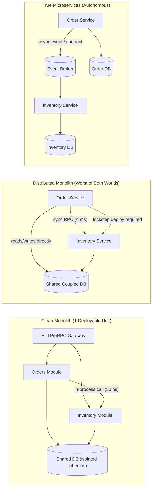
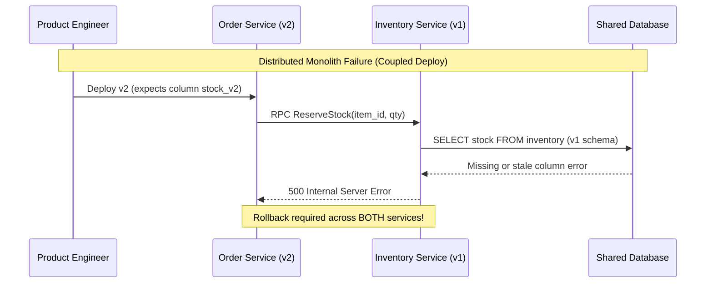
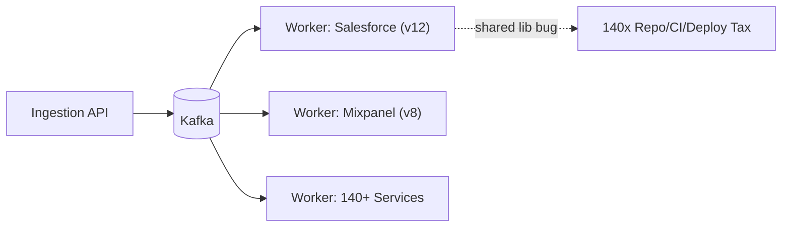

# Monolith vs Microservices: When NOT to Split (Distributed Monolith Trap)

> **Prerequisites:** [Static Stability](../../11-reliability-and-sre/18-static-stability/README.md).  
> **Estimated Reading Time:** 24–28 minutes  
> **Target Audience:** Backend engineers, tech leads, and system design candidates asked "Should we use a monolith or microservices?" or "How do you avoid building a distributed monolith?"  
> **Free PDF Notes:** [Download SD-L-001.pdf](https://backendroadmap.com/notes/system-design/SD-L-001.pdf)

> [!NOTE]
> **In one line:** A **monolith** is a single deployable unit; **microservices** are independently deployable services aligned to business capabilities. Splitting too early—before domain boundaries stabilize—creates a **distributed monolith**: you keep all the tight coupling of a monolith while paying the network latency, partial failure, and operational tax of distributed systems.

> [!TIP]
> **The Golden Rule:** Start with a well-structured monolith until **organizational scaling** (independent teams stepping on each other's deploys) or **radical scaling asymmetry** (one hot path needs 50x the CPU/GPU of the rest) forces a split. Never split purely for "clean code"—architecture is a deployment and team-topology decision, not a folder-structure decision.

---

## 1. What Monolith vs Microservices Is, and What It Isn't

A 12-person startup builds an e-commerce backend. Someone reads a blog post about Netflix and splits the codebase into 14 services: `user-service`, `auth-service`, `order-service`, `cart-service`, `inventory-service`, `pricing-service`, and more. Six months later, adding a single coupon field requires coordinated pull requests across 5 repositories, a lockstep deployment order, and 45 minutes of local Docker Compose startup just to run an integration test. They didn't build microservices—they built a **distributed monolith**.

| Term | Precise Meaning | Example |
| :--- | :--- | :--- |
| **Monolith** | A single deployable artifact (one binary, container, or WAR) containing all modules | One Go/JVM/Node API serving orders, billing, and catalog |
| **Big Ball of Mud** | A monolith with no internal module boundaries and tangled dependencies | `orders` directly mutating `users` tables and globals |
| **Microservices** | Small, autonomous services deployed independently, each owning its data | `Billing` deploys 10x/day without touching `Catalog` |
| **Distributed Monolith** | Multiple network-separated services that are still tightly coupled in deployment or data | Service A and B must deploy together or share a DB schema |
| **Conway's Law** | System architecture mirrors the communication structure of the organization | 3 teams sharing 1 repo fight merge conflicts; 1 team with 10 services drowns in ops |
| **Monolith-First** | Building a modular monolith first and extracting services only along proven seams | Shopify, Stack Overflow, early Amazon |
| **Not** | "Monolith = legacy/bad, Microservices = modern/good" | A clean monolith beats a distributed monolith every day |

### Why It Matters
1. **Interviewers test judgment, not buzzwords:** Answering "use microservices" for a 10k DAU app is an immediate red flag for over-engineering.
2. **Every network boundary has a physics tax:** Function calls take nanoseconds; RPCs take milliseconds, serialize payloads, and fail partially.
3. **The Distributed Monolith is the #1 industry failure mode:** Getting the worst of both worlds (coupling + network overhead) stalls product velocity for years.

---

## 2. Anatomy: Clean Monolith vs Microservices vs Distributed Monolith



| Dimension | Monolith | Distributed Monolith | True Microservices |
| :--- | :--- | :--- | :--- |
| **Call Latency** | ~50 nanoseconds (stack frame) | 2–15 ms per hop (serialization + TCP) | 2–15 ms (only at coarse seams) |
| **Deployment** | 1 pipeline, atomic rollback | Coordinated multi-repo lockstep deploys | Independent per-service CI/CD |
| **Data Consistency** | Local ACID transactions | Distributed 2PC or broken partial writes | Eventual consistency + Sagas |
| **Failure Mode** | Process crash (all or nothing) | Cascading timeouts, retry storms | Isolated degradation via bulkheads |
| **Team Sweet Spot** | 1–30 engineers | Nobody (anti-pattern) | 30–500+ engineers (stream-aligned teams) |
| **Debugging** | Single stack trace & profiler | Distributed tracing required, often broken | OpenTelemetry + correlation IDs |

> [!WARNING]
> **The Distributed Monolith Trap:** If Service A cannot deploy without Service B deploying in the same release window, or if Service A breaks when Service B alters a database column, you have **zero** of the autonomy benefits of microservices and **100%** of the distributed systems complexity.

---

## 3. Mathematical Model: Latency Tax, Availability Compounding & Coordination Cost

**1. Call Latency Tax.** In a monolith, calling a helper across $k$ module boundaries takes nanoseconds ($t_{\text{mem}} \approx 50\text{ ns}$). Across $k$ synchronous microservices over HTTP/gRPC, each hop pays serialization ($t_{\text{ser}}$), network RTT ($t_{\text{net}}$), and deserialization ($t_{\text{deser}}$):

$$T_{\text{mono}}(k) \approx T_{\text{compute}} + k \cdot t_{\text{mem}}, \qquad T_{\text{micro}}(k) \approx T_{\text{compute}} + \sum_{i=1}^{k} \left(t_{\text{ser}, i} + t_{\text{net}, i} + t_{\text{deser}, i}\right)$$

With $k = 5$ sequential hops at $t_{\text{hop}} = 3\text{ ms}$ average ($p_{99} = 15\text{ ms}$), the network alone adds $15\text{ ms}$ to $p_{50}$ and up to $75\text{ ms}$ to $p_{99}$—compared to $0.00025\text{ ms}$ in a monolith ($60{,}000\times$ slower per call).

**2. Synchronous Availability Compounding.** If a request synchronously depends on $n$ microservices, each with availability $a$, end-to-end availability is:

$$A_{\text{chain}} = \prod_{i=1}^{n} a_i = a^n$$

For $n = 8$ services each at $99.9\%$ ($0.999$) availability:

$$A_{\text{chain}} = 0.999^8 \approx 0.992028 = 99.20\%$$

That turns "three nines" per service into **58.2 hours of downtime per year** (nearly $7\times$ worse than a single $99.9\%$ monolith's $8.76\text{ hours/year}$).

**3. Organizational Coordination Cost (Brooks's Law).** For $M$ engineers, communication channels scale quadratically:

$$C(M) = \frac{M(M-1)}{2}$$

In a single monolith with $M = 10$ engineers, $C(10) = 45$ channels (manageable). At $M = 100$, $C(100) = 4{,}950$ channels—deploy queues jam and merge conflicts dominate. Splitting into $S = 10$ autonomous teams of $10$ reduces intra-team coordination to $10 \times 45 = 450$ channels (an $11\times$ reduction), **provided** the services are genuinely decoupled.

---

## 4. Metrics & Percentiles

| Metric | Meaning | Alert / Action Threshold |
| :--- | :--- | :--- |
| **Deployment Coupling Rate** | % of releases requiring 2+ services to deploy together | $> 10\%$ signals a distributed monolith |
| **Cross-Service Call Fan-Out** | Average RPCs triggered per incoming user request | $> 5$ sync hops harms $p_{99}$ and availability |
| **Change Failure Rate (CFR)** | % of deployments causing an incident or rollback | $> 15\%$ indicates brittle boundaries or missing tests |
| **Lead Time for Changes** | Commit-to-production duration | Rising monotonically as repo count grows |
| **CI/CD Queue Wait Time** | Time PRs wait to merge/deploy on a shared pipeline | $> 20\text{ min}$ in a monolith $\rightarrow$ split candidate |
| **Tail Latency Amplification ($p_{99} / p_{50}$)** | Ratio of tail to median request latency | $> 5\times$ across RPC chains $\rightarrow$ collapse or go async |

### Worked Example (Checkout Flow)
Suppose an e-commerce checkout path requires 6 logical steps: Auth, Cart, Pricing, Inventory, Payment, and Notification.
- **In a Monolith:** 1 HTTP request enters, executes 6 in-process calls ($\approx 0.3\text{ }\mu\text{s}$ total call overhead), runs 1 local DB transaction ($12\text{ ms}$), and returns. Total $p_{50} = 14\text{ ms}$, $p_{99} = 35\text{ ms}$.
- **In a Naive Microservice Split (6 sync RPCs):** Each RPC adds $3\text{ ms}$ at $p_{50}$ and $18\text{ ms}$ at $p_{99}$. Call overhead jumps to $18\text{ ms}$ ($p_{50}$) and $108\text{ ms}$ ($p_{99}$), and if each service is $99.9\%$ available, chain availability drops from $99.9\%$ to $0.999^6 = 99.40\%$ ($52.5\text{ hours}$ of downtime/year).

---

## 5. Compounding & Failure Modes: The "Chatty Microservices" Simulation

Consider a request that fans out to $k$ downstream services in parallel vs sequentially, where each service has $p_{50} = 5\text{ ms}$ and $p_{99} = 40\text{ ms}$:

| Architecture | $k=1$ (Monolith) | $k=5$ (Parallel) | $k=5$ (Sequential) | $k=15$ (Parallel) |
| :--- | :---: | :---: | :---: | :---: |
| **Expected $p_{50}$ Latency** | $5\text{ ms}$ | $\sim 12\text{ ms}$ | $25\text{ ms}$ | $\sim 22\text{ ms}$ |
| **Expected $p_{99}$ Latency** | $40\text{ ms}$ | $\sim 75\text{ ms}$ | $200\text{ ms}$ | $\sim 135\text{ ms}$ |
| **Prob. at least 1 service hits $p_{99}$** | $1.0\%$ | $1 - 0.99^5 = 4.9\%$ | $4.9\%$ | $1 - 0.99^{15} = 14.0\%$ |
| **Availability ($a = 0.999$ each)** | $99.90\%$ | $99.50\%$ | $99.50\%$ | $98.51\%$ |

**Tail at Scale:** Even with *parallel* fan-out across 15 microservices, **14% of all user requests** hit at least one slow $p_{99}$ node! In a monolith, that same 15-module call graph shares one memory space and never hits network tail latency.

---

## 6. Numbers Every Engineer Must Know

| Item | Typical | Implication |
| :--- | :---: | :--- |
| In-process function call | ~1–50 ns | Practically free; refactor freely inside a monolith |
| Same-AZ gRPC / HTTP RPC ($p_{50}$) | 1–5 ms | $100{,}000\times$ slower than a function call |
| Cross-AZ RPC ($p_{50}$ / $p_{99}$) | 2–10 ms / 25–80 ms | Chatty cross-AZ services destroy latency budgets |
| JSON serialize + parse (10 KB) | 0.2–1.0 ms CPU | Adds up to 15–30% CPU overhead in service-heavy fleets |
| Microservice baseline ops tax | ~1–2 eng-weeks/service/yr | CI/CD, alerts, dashboards, upgrades, on-call |
| Team size inflection point | ~25–40 engineers | Below this, microservices usually slow teams down |
| Minimum service granularity | 1–2 pizza team (5–9 devs) | Never build "nano-services" (1 dev owning 4 services) |

---

## 7. Protocol & Mechanism Deep Dive: Lockstep Coupling vs Autonomous Seams



| Question | Answer |
| :--- | :--- |
| **Why do teams accidentally build a distributed monolith?** | They split code into separate repos/containers along technical layers (API, Auth, DB-proxy) instead of business capabilities, while keeping shared DBs or synchronous lockstep contracts. |
| **What is the "Monolith-First" rule?** | Martin Fowler observed that almost all successful microservice architectures started as a monolith that got too big and was broken up—while almost all systems built as microservices from day one ended up in trouble. |
| **When IS a split justified on day one?** | Extreme compliance isolation (PCI-DSS cardholder vault), radical runtime mismatch (Python ML inference GPU fleet vs Go/Node web API), or an already-large org (100+ engineers) with well-understood domain boundaries. |
| **Can a monolith scale horizontally?** | Yes. A stateless monolith behind a load balancer scales horizontally to tens of thousands of RPS; only the database needs read replicas or sharding. |

**When NOT to use Microservices:**
- Your team has fewer than ~25 engineers or 1–2 product squads.
- Your domain model is still changing weekly (product-market fit phase).
- You lack automated CI/CD, centralized logging, distributed tracing, and container orchestration.

---

## 8. Hierarchical Budgets & Design Rules

| Slice | Rule | Control |
| :--- | :--- | :--- |
| **Team Ratio** | Max 1.5 microservices per stream-aligned team | Platform/architecture review |
| **Deployment Independence** | Every service deploys and rolls back solo | Zero-downtime backward-compatible APIs |
| **Sync Depth** | Max 3 synchronous RPC hops from edge to leaf | Distributed trace span-depth alerts |
| **Data Ownership** | 1 service = 1 logical database/schema | Separate DB credentials per service |
| **Contract Versioning** | Expand-and-contract (additive changes first) | Schema registry / contract tests |
| **Latency Budget** | Reserve 15–20% of $p_{99}$ SLO for network overhead | Per-hop RPC deadlines & circuit breakers |
| **Monolith Exit Criteria** | Split only for team contention, scaling asymmetry, or isolation | Written ADR (Architecture Decision Record) |

---

## 9. Top Mitigations (Avoiding & Escaping the Distributed Monolith)

1. **Default to a Modular Monolith** on day one; enforce module boundaries via compiler/linter rules before adding network boundaries.
2. **Wait for Domain Stability**—never extract a service while you are still renaming its core entities every sprint.
3. **Align Services to Business Capabilities, Not Technical Layers** (e.g., `Billing`, `Fulfillment`, not `ValidationService` + `DBService`).
4. **Enforce Expand-and-Contract APIs** so a consumer and provider never need to deploy in lockstep.
5. **Convert Non-Critical Sync Chains to Async Events** (e.g., `OrderPlaced` $\rightarrow$ email/analytics) to stop availability compounding ($a^n$).
6. **Merge Back Over-Split Nano-Services**—if two services always deploy together and share data, consolidating them into one service is a feature, not a failure.
7. **Require an ADR for Every New Service** proving why a module inside an existing service cannot solve the problem.

---

## 10. Production Reference / War Story: Segment's Microservices-to-Monolith Consolidation

In 2017, Segment (a customer data platform) split its ingestion pipeline into over 140 microservices—one per destination integration—hoping for isolation and independent scaling.



- **What Happened (Root Cause):** Whenever a shared internal library (rate limiting, retry logic, metrics) needed a bug fix or security patch, engineers had to test, version-bump, and deploy **140+ separate repositories and pipelines**. Queue backlogs in one destination required manual scaling across dozens of tiny services, and operational overhead consumed the engineering team.
- **The Fix:** Segment consolidated the 140+ destination microservices back into a single unified service ("Centrifuge") with isolated internal worker pools. Deployment time for shared fixes dropped from **days to minutes**, resource utilization improved dramatically, and reliability increased.
- **Lesson:** Isolation of failure and scaling does not always require separate network services—process-level or worker-pool isolation inside a well-structured monolith often delivers 90% of the benefit at 10% of the operational cost.

---

## 11. Multi-Language Production Code Tabs

Below is an architectural **Deployment & Availability Impact Calculator** in all four languages, quantifying the latency tax and $a^n$ availability drop before splitting a monolith into $n$ synchronous services.

````carousel
```go
// Go: quantify sync microservice chain availability, tail-hit probability, and RPC tax.
package main

import (
	"fmt"
	"math"
)

type ArchReport struct {
	Services         int
	ChainAvailPct    float64
	DowntimeHoursYr  float64
	SyncLatencyP50Ms float64
	TailHitProbPct   float64
}

func EvaluateSyncChain(services int, singleAvail, rpcP50Ms, computeMs float64) ArchReport {
	chainAvail := math.Pow(singleAvail, float64(services))
	downtimeHrs := (1.0 - chainAvail) * 8760.0
	// Probability at least one service hits its p99 (1% tail) on a fan-out
	tailHit := (1.0 - math.Pow(0.99, float64(services))) * 100.0
	return ArchReport{
		Services:         services,
		ChainAvailPct:    chainAvail * 100.0,
		DowntimeHoursYr:  downtimeHrs,
		SyncLatencyP50Ms: computeMs + float64(services)*rpcP50Ms,
		TailHitProbPct:   tailHit,
	}
}

func main() {
	mono := EvaluateSyncChain(1, 0.999, 0.0, 12.0)
	micro := EvaluateSyncChain(8, 0.999, 3.5, 12.0)
	fmt.Printf("Monolith: avail=%.3f%% downtime=%.2fh/yr p50=%.1fms tailHit=%.1f%%\n",
		mono.ChainAvailPct, mono.DowntimeHoursYr, mono.SyncLatencyP50Ms, mono.TailHitProbPct)
	fmt.Printf("8-Hop Micro: avail=%.3f%% downtime=%.2fh/yr p50=%.1fms tailHit=%.1f%%\n",
		micro.ChainAvailPct, micro.DowntimeHoursYr, micro.SyncLatencyP50Ms, micro.TailHitProbPct)
}
```
<!-- slide -->
```typescript
// TypeScript: evaluate monolith vs sync microservice chain trade-offs.
export interface ArchReport {
  services: number;
  chainAvailabilityPct: number;
  downtimeHoursPerYear: number;
  syncLatencyP50Ms: number;
  tailHitProbabilityPct: number;
}

export function evaluateSyncChain(
  services: number,
  singleAvailability = 0.999,
  rpcP50Ms = 3.5,
  computeMs = 12.0
): ArchReport {
  const chainAvail = Math.pow(singleAvailability, services);
  const downtimeHoursPerYear = (1 - chainAvail) * 8760;
  const tailHitProbabilityPct = (1 - Math.pow(0.99, services)) * 100;
  return {
    services,
    chainAvailabilityPct: Number((chainAvail * 100).toFixed(3)),
    downtimeHoursPerYear: Number(downtimeHoursPerYear.toFixed(2)),
    syncLatencyP50Ms: computeMs + services * rpcP50Ms,
    tailHitProbabilityPct: Number(tailHitProbabilityPct.toFixed(2)),
  };
}

console.log("Monolith:", evaluateSyncChain(1, 0.999, 0));
console.log("8-Hop Micro:", evaluateSyncChain(8, 0.999, 3.5));
```
<!-- slide -->
```python
# Python: evaluate monolith vs microservice chain availability, latency, and Brooks's channels.
def evaluate_architecture(services: int, single_avail: float = 0.999,
                          rpc_p50_ms: float = 3.5, compute_ms: float = 12.0,
                          team_size: int = 12) -> dict:
    chain_avail = single_avail ** services
    downtime_hrs = (1.0 - chain_avail) * 8760.0
    tail_hit_pct = (1.0 - (0.99 ** services)) * 100.0
    comm_channels = team_size * (team_size - 1) // 2
    return {
        "services": services,
        "chain_avail_pct": round(chain_avail * 100, 3),
        "downtime_hrs_yr": round(downtime_hrs, 2),
        "p50_ms": round(compute_ms + services * rpc_p50_ms, 1),
        "tail_hit_pct": round(tail_hit_pct, 2),
        "team_channels": comm_channels,
    }


if __name__ == "__main__":
    print("Monolith:   ", evaluate_architecture(1, rpc_p50_ms=0.0, team_size=12))
    print("8-Hop Micro:", evaluate_architecture(8, rpc_p50_ms=3.5, team_size=12))
```
<!-- slide -->
```csharp
// C#: evaluate monolith vs sync microservice chain availability and latency impact.
using System;

public sealed record ArchReport(
    int Services,
    double ChainAvailPct,
    double DowntimeHoursYr,
    double SyncLatencyP50Ms,
    double TailHitProbPct);

public static class ArchitectureEvaluator
{
    public static ArchReport EvaluateSyncChain(
        int services, double singleAvail = 0.999, double rpcP50Ms = 3.5, double computeMs = 12.0)
    {
        double chainAvail = Math.Pow(singleAvail, services);
        double downtimeHrs = (1.0 - chainAvail) * 8760.0;
        double tailHitPct = (1.0 - Math.Pow(0.99, services)) * 100.0;
        return new ArchReport(
            services,
            Math.Round(chainAvail * 100.0, 3),
            Math.Round(downtimeHrs, 2),
            computeMs + services * rpcP50Ms,
            Math.Round(tailHitPct, 2));
    }

    public static void Main()
    {
        Console.WriteLine($"Monolith:    {EvaluateSyncChain(1, 0.999, 0)}");
        Console.WriteLine($"8-Hop Micro: {EvaluateSyncChain(8, 0.999, 3.5)}");
    }
}
```
````

---

## 12. Hands-On CLI Verification Workflows

Run the Python availability and latency model directly from your terminal:

```bash
python -c "
def eval_arch(n, a=0.999, rpc=3.5, base=12.0):
    ca = a ** n
    return dict(n=n, avail_pct=round(ca*100, 3), down_hrs=round((1-ca)*8760, 2), p50_ms=base+n*rpc)
print('Monolith:   ', eval_arch(1, rpc=0))
print('8-Hop Micro:', eval_arch(8))
"
```

Audit an existing multi-service repository or Kubernetes cluster for **distributed monolith symptoms** (shared databases, high pod-to-engineer ratio, or excessive sync fan-out):

```bash
# 1. Check service-to-team ratio in Kubernetes (count Deployments per namespace)
kubectl get deployments --all-namespaces -o jsonpath='{range .items[*]}{.metadata.namespace}{"\t"}{.metadata.name}{"\n"}{end}' | sort

# 2. Check if multiple services connect to the exact same database host/schema
grep -rn "DATABASE_URL\|POSTGRES_DB" ./services/

# 3. Inspect git history for lockstep commits across multiple service directories
git log --since="30 days ago" --name-only --pretty=format:"%h %s" | grep -E "services/" | sort | uniq -c | sort -nr
```

---

## 13. Common Mistakes to Avoid

1. **Splitting by technical layer** (`api-service`, `logic-service`, `db-service`) instead of business capability.
2. **Sharing a single database** across microservices—this guarantees schema coupling and lockstep deploys.
3. **Using microservices to fix messy code**—bad module boundaries become bad network boundaries.
4. **Ignoring tail-latency amplification** across deep synchronous RPC fan-out trees.
5. **Creating nano-services** where a single engineer owns 5+ separate repos and pipelines.
6. **Deploying microservices without observability** (no distributed tracing, no correlation IDs).
7. **Prematurely splitting before product-market fit**, when domain concepts still change weekly.
8. **Treating consolidation as defeat**—merging two coupled services back into one is good engineering.

---

## 14. Key Terms Glossary

| Key Term | Definition |
| :--- | :--- |
| **Monolith** | A single deployable software unit containing all application modules. |
| **Microservices** | Independently deployable services organized around business capabilities, each owning its data. |
| **Distributed Monolith** | Network-separated services that remain tightly coupled in deployment, runtime, or database schema. |
| **Conway's Law** | Organizations design systems that mirror their internal communication structures. |
| **Brooks's Law / $C(M)$** | Coordination overhead grows quadratically as $M(M-1)/2$ with team size $M$. |
| **Availability Compounding** | End-to-end availability of $n$ synchronous dependencies drops as $\prod a_i = a^n$. |
| **Tail at Scale** | Probability that at least one of $k$ parallel RPCs hits $p_{99}$ grows as $1 - 0.99^k$. |
| **Lockstep Deployment** | Requiring two or more services to be deployed together to avoid breaking changes. |
| **Expand-and-Contract** | Backward-compatible schema/API evolution: add new field, migrate callers, then remove old field. |
| **Monolith-First** | Strategy of starting with a modular monolith and extracting services only along proven seams. |

---

## 15. System Design Interview Questions & Answers

### Basic Conceptual Questions

<details>
<summary><strong>Q1: What is the core difference between a monolith and microservices? [BASIC]</strong></summary>

**Answer:**
The difference is **unit of deployment and data ownership**, not code quality. A monolith packages all modules into one deployable artifact with in-process function calls. Microservices split capabilities into independently deployable processes communicating over the network, each owning its own data store.
</details>

<details>
<summary><strong>Q2: What is a distributed monolith, and why is it worse than a regular monolith? [BASIC]</strong></summary>

**Answer:**
A distributed monolith consists of multiple network-separated services that are still tightly coupled (via shared databases or synchronous lockstep contracts). It is worse because you lose local ACID transactions, in-process speed, and simple debugging, while gaining none of microservices' independent deployment or fault isolation.
</details>

<details>
<summary><strong>Q3: How does Conway's Law influence monolith vs microservices? [BASIC]</strong></summary>

**Answer:**
Conway's Law states that system architecture mirrors team communication structures. A single 10-person team building 12 microservices will drown in coordination and ops overhead; conversely, 100 engineers committing to one tightly coupled monolith will constantly block each other on merge conflicts and release queues.
</details>

<details>
<summary><strong>Q4: Can a monolith scale horizontally? [BASIC]</strong></summary>

**Answer:**
Yes. A stateless monolith can be replicated behind a load balancer just like any microservice. Scaling bottlenecks in early systems are almost always the **database** (solved via read replicas, caching, or partitioning), not the application binary being a monolith.
</details>

### Scenario-Based Architecture Questions

<details>
<summary><strong>Q5: A 12-person startup asks you to design their new B2B SaaS platform. Monolith or microservices? [SCENARIO]</strong></summary>

**Answer:**
A **Modular Monolith**. With 12 engineers, domain boundaries are still shifting weekly. A monolith gives nanosecond in-process calls, local ACID transactions, single-command local testing, and $99.9\%$ single-process availability without paying the $a^n$ availability drop or multi-repo CI/CD tax. We keep internal modules strictly separated so future extraction is easy if the team grows past 30–40 engineers.
</details>

<details>
<summary><strong>Q6: When WOULD you split a single component out of a healthy monolith? [SCENARIO]</strong></summary>

**Answer:**
Three concrete triggers: (1) **Radical scaling or hardware asymmetry**—e.g., an ML video-transcoding or PDF-rendering worker needing GPUs/heavy RAM while the API is lightweight I/O; (2) **Organizational contention**—two distinct teams blocking each other's release cadence; (3) **Security/compliance isolation**—e.g., isolating PCI-DSS payment vaulting from general app servers.
</details>

<details>
<summary><strong>Q7: Your checkout endpoint calls 8 microservices synchronously (99.9% each) and latency/reliability is failing. What do you do? [SCENARIO]</strong></summary>

**Answer:**
First, calculate the math: $0.999^8 = 99.20\%$ availability ($70\text{ hours/year}$ downtime) and 8x RPC latency. Fix it by: (1) moving non-immediate work (emails, analytics, loyalty points) to **async events** via a broker; (2) co-locating or merging tightly coupled services that always change together; (3) caching read-heavy lookups (like catalog/pricing) locally.
</details>

<details>
<summary><strong>Q8: How do you safely migrate a monolith feature into a microservice without downtime? [SCENARIO]</strong></summary>

**Answer:**
Use the **Strangler Fig pattern**: (1) decouple the module's code and database tables inside the monolith first; (2) stand up the new service and replicate/dual-write data or use CDC; (3) route a small percentage of traffic at the API gateway/proxy to the new service while comparing responses (shadowing/canary); (4) once stable, shift 100% of traffic and delete the old monolith code.
</details>

### Advanced & Tricky Interview Questions

<details>
<summary><strong>Q9: Why does parallel fan-out across 15 microservices still hurt p99 latency? [TRICKY]</strong></summary>

**Answer:**
Because of **Tail at Scale** (Jeff Dean & Luiz Barroso): if each service has a $1\%$ chance of a slow $p_{99}$ response ($40\text{ ms}$ instead of $5\text{ ms}$), a request that waits for all 15 in parallel has a $1 - 0.99^{15} \approx 14.0\%$ chance of waiting on at least one slow outlier. In a monolith, there are no network hops to trigger per-node GC/network jitter.
</details>

<details>
<summary><strong>Q10: If microservices are "too small," what happens mathematically and operationally? [TRICKY]</strong></summary>

**Answer:**
Each service carries a fixed operational floor (CI/CD, container orchestration, TLS/mTLS, monitoring, dependency patching). Below ~1 team per service, engineers spend more time maintaining pipelines and debugging distributed traces than shipping features, while cross-service RPCs multiply latency and $a^n$ failure surface.
</details>

<details>
<summary><strong>Q11: How do you change an API contract between two microservices without a lockstep deployment? [TRICKY]</strong></summary>

**Answer:**
Use **Expand-and-Contract**: (1) Provider deploys an additive change supporting both `v1` and `v2` fields; (2) All consumers migrate to `v2` independently; (3) Provider removes `v1` only after telemetry confirms zero `v1` traffic. Never require two services to deploy in the same maintenance window.
</details>

<details>
<summary><strong>Q12: Doesn't a monolith create a single point of failure (SPOF)? [TRICKY]</strong></summary>

**Answer:**
A *process* is not a single point of failure if you run multiple stateless replicas behind a load balancer across Availability Zones. A **code bug** (like a memory leak or panic) can crash the whole monolith replica, which is mitigated by automated health checks, canary rollouts, and circuit breakers—whereas a microservice architecture trades that risk for partial failures, network partitions, and cascading timeouts.
</details>

---

## 16. One-Page Master Cheat Sheet

```
+---------------------------------------------------------------------------------------------------------+
|                  MONOLITH VS MICROSERVICES — MASTER CHEAT SHEET                                         |
+---------------------------------------------------------------------------------------------------------+
| 1. DEFINITIONS: Monolith = 1 deployable unit. Microservices = autonomous services + own DBs.            |
|    Distributed Monolith = network calls + tight coupling (WORST OF BOTH WORLDS).                        |
+---------------------------------------------------------------------------------------------------------+
| 2. PHYSICS & MATH:                                                                                      |
|    - Latency: in-process ~50 ns vs RPC ~3 ms p50 / ~25 ms p99 (60,000x slower per hop).                 |
|    - Availability: A_chain = a^n. 8 sync services at 99.9% = 99.20% (58.2 hrs downtime/yr).             |
|    - Tail at Scale: 15 parallel RPCs -> 1 - 0.99^15 = 14% of requests hit a p99 outlier.                |
+---------------------------------------------------------------------------------------------------------+
| 3. WHEN TO STAY MONOLITH: Team < 25-40 devs, shifting domain, need local ACID, low ops budget.          |
+---------------------------------------------------------------------------------------------------------+
| 4. WHEN TO SPLIT: Team contention (Brooks's Law), radical scaling asymmetry (GPU vs I/O), compliance.   |
+---------------------------------------------------------------------------------------------------------+
| 5. ESCAPE THE TRAP: Own DB per service, expand-and-contract APIs, async events for non-critical work.   |
+---------------------------------------------------------------------------------------------------------+
```

---

## Further Reading & Sources

- Martin Fowler, [MonolithFirst](https://martinfowler.com/bliki/MonolithFirst.html) and [Microservices](https://martinfowler.com/articles/microservices.html).
- Sam Newman, *Building Microservices* (2nd ed.), Chapters 1–3 ("How to Model Services", "Splitting the Monolith").
- Jeffrey Dean and Luiz André Barroso, [The Tail at Scale](https://research.google/pubs/the-tail-at-scale/), *Communications of the ACM* (2013).
- Segment Engineering Blog, *Goodbye Microservices: From 100s of problem children to 1 superstar* (2018).

---

## Free PDF Notes

[SD-L-001.pdf](https://backendroadmap.com/notes/system-design/SD-L-001.pdf)

---

## Next

Continue with [Modular Monolith: Why Startups Should Start Here (Not Microservices)](../02-modular-monolith/README.md).
