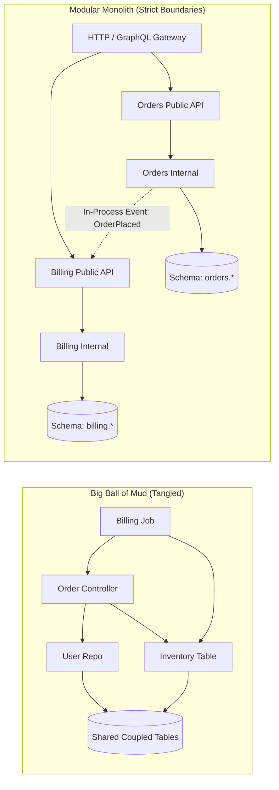
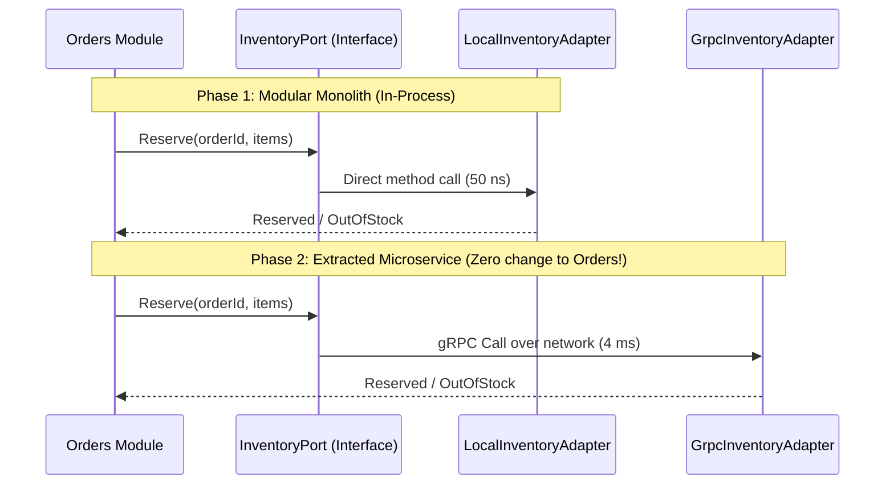

# Modular Monolith: Why Startups Should Start Here (Not Microservices)

> **Prerequisites:** [Monolith vs Microservices](../01-monolith-vs-microservices/README.md).  
> **Estimated Reading Time:** 23–27 minutes  
> **Target Audience:** Startup founding engineers, backend architects, and system design candidates asked "How do you structure a monolith so it doesn't become a Big Ball of Mud?"  
> **Free PDF Notes:** [Download SD-L-002.pdf](https://backendroadmap.com/notes/system-design/SD-L-002.pdf)

> [!NOTE]
> **In one line:** A **Modular Monolith** packages the entire application into a **single deployable unit** while enforcing **strict internal module boundaries**—separate code namespaces, public-only APIs/facades, and isolated database schemas. You get microservices-grade modularity and future extractability with monolith-grade speed, ACID transactions, and zero network tax.

> [!TIP]
> **The Golden Rule:** **Logical boundaries first, physical boundaries later.** If you cannot keep two modules decoupled inside a single process where the compiler can check your rules, putting a network cable between them will only make the mess slower and harder to debug.

---

## 1. What a Modular Monolith Is, and What It Isn't

Consider two monoliths built by 15-person startups. Startup A puts all models in `models/`, all controllers in `controllers/`, and lets `OrderController` directly `JOIN` the `users`, `inventory`, and `payments` tables. Within a year, touching `users` breaks `billing`, and nobody dares refactor. Startup B organizes code by business module (`orders/`, `inventory/`, `billing/`), bans cross-module imports except through explicit `api` interfaces, and gives each module its own PostgreSQL schema (`orders.*`, `inventory.*`). Startup B deploys in 90 seconds, runs local ACID transactions, and can extract `billing` into a microservice in a single sprint if it ever needs to.

| Term | Precise Meaning | Example |
| :--- | :--- | :--- |
| **Modular Monolith** | Single deployable binary/container divided into isolated, cohesive business modules | Shopify's Rails monolith, Gusto's modularized core |
| **Big Ball of Mud** | Unstructured monolith with global cross-cutting imports and shared tables | `OrderService` directly querying `user_sessions` |
| **Package / Module Boundary** | Compiler- or linter-enforced visibility rules hiding internal types | `internal/` packages in Go; ArchUnit in Java; ESLint boundaries in TS |
| **Schema-per-Module** | Logical DB isolation inside one database instance (no cross-module `JOIN`s) | `orders.orders` and `billing.invoices` in one Postgres cluster |
| **In-Process Event Bus** | Modules communicate via domain events inside the same process (or outbox) | `OrderPlaced` handled in-memory by `Notifications` |
| **Extractability Seam** | An explicit interface that can later swap from in-process call to gRPC/HTTP | `InventoryPort.Reserve()` $\rightarrow$ local call today, RPC tomorrow |
| **Not** | "Just organizing folders by feature without enforcement" | Folders without import rules decay into a Big Ball of Mud |

### Why It Matters
1. **Startups live or die on iteration speed:** Refactoring across modules in one IDE takes seconds; refactoring across 10 repos takes weeks.
2. **Enables the "Monolith-First" path:** You defer distributed systems complexity (Sagas, network retries, service mesh) until revenue and team size justify it.
3. **Extraction becomes mechanical:** When a module genuinely needs independent scaling, its data and API seams are already clean.

---

## 2. Anatomy: Big Ball of Mud vs Modular Monolith



| Dimension | Big Ball of Mud | Modular Monolith | Microservices |
| :--- | :--- | :--- | :--- |
| **Deployment Units** | 1 | 1 | $N$ (1 per service) |
| **Module Isolation** | None (any file imports any file) | Enforced by compiler/CI lint | Enforced by process/network |
| **Database Access** | Free-for-all `JOIN`s across tables | Schema-per-module; no cross-`JOIN`s | Physical DB per service |
| **Cross-Module Calls** | Direct arbitrary method calls | Public facade / in-process events | HTTP / gRPC / Broker |
| **Transaction Model** | Local ACID (tangled) | Local ACID (clean) or Outbox | Sagas / Eventual consistency |
| **Extraction Cost** | Months of untangling | Days (swap adapter to RPC) | Already extracted |

> [!WARNING]
> **Folder structure is NOT architecture.** If `orders/` can import `billing/internal/InvoiceRepository` without a build failure, your "modular monolith" will rot into a Big Ball of Mud within two quarters under deadline pressure. Enforcement must be **automated in CI**.

---

## 3. Mathematical Model: Coupling Density, Instability & Extraction Cost

**1. Afferent & Efferent Coupling (Robert C. Martin's Package Metrics).** For any module $M$:
- $C_a$ (**Afferent Coupling**): number of external classes/modules that depend *on* $M$.
- $C_e$ (**Efferent Coupling**): number of external modules that $M$ depends *on*.
- **Instability Index ($I$):**

$$I(M) = \frac{C_e}{C_a + C_e}, \qquad I \in [0, 1]$$

A module with $I = 0$ is maximally stable (many depend on it, it depends on nothing); $I = 1$ is maximally unstable. In a Modular Monolith, **core domain modules** should have low $I$ (e.g., $I \le 0.25$), and **circular dependencies** ($A \rightarrow B \rightarrow A$) must be $0$.

**2. Extraction Cost Model.** The engineering effort $E_{\text{extract}}$ to split module $M$ into a standalone microservice is proportional to its cross-module code edges ($E_{\text{code}}$) plus its shared database foreign keys/joins ($E_{\text{db}}$):

$$E_{\text{extract}}(M) = \alpha \cdot E_{\text{code}}(M) + \beta \cdot E_{\text{db}}(M), \qquad \text{where } \beta \gg \alpha$$

In a Big Ball of Mud with $E_{\text{code}} = 45$ direct imports and $E_{\text{db}} = 12$ cross-table `JOIN`s (assuming $\alpha = 0.5\text{ dev-days}$, $\beta = 4\text{ dev-days}$):

$$E_{\text{extract}} = 0.5(45) + 4(12) = 22.5 + 48 = 70.5\text{ dev-days}$$

In a Modular Monolith where $E_{\text{code}} = 1$ (one public port/event) and $E_{\text{db}} = 0$ (zero cross-schema `JOIN`s):

$$E_{\text{extract}} = 0.5(1) + 4(0) = 0.5\text{ dev-days}$$

Removing database coupling ($\beta \cdot E_{\text{db}}$) reduces extraction cost by over **$140\times$**.

---

## 4. Metrics & Percentiles

| Metric | Meaning | Alert / Target |
| :--- | :--- | :--- |
| **Circular Module Dependencies** | Cycles in module import graph ($A \rightarrow B \rightarrow A$) | **Must be 0** (fail CI build) |
| **Cross-Schema SQL Queries** | Queries referencing tables outside module's own schema | **Must be 0** (fail CI/linter) |
| **Public API Surface Ratio** | Exported types vs internal types per module | Keep $< 15\%$ of module files public |
| **Build & Test Time ($p_{95}$)** | Full unit + module integration suite duration | Alert if $> 8\text{ min}$ (use affected-module tests) |
| **Mean Time to Extract (MTTE)** | Estimated days to lift a module to a standalone service | Target $< 1\text{ sprint}$ |
| **In-Process Event Lag** | Time for synchronous/async in-memory handlers to complete | Alert if $> 50\text{ ms}$ on request path |

### Worked Example (Order-to-Cash Flow)
In a Modular Monolith with `Orders`, `Inventory`, and `Billing` modules:
1. `Orders` receives `POST /orders`, validates the request, and calls `InventoryAPI.Reserve(sku, qty)` via an **in-process Go/TS interface** ($\approx 50\text{ ns}$ overhead).
2. Both `Orders` and `Inventory` share one PostgreSQL cluster, using schemas `orders.orders` and `inventory.stock`—still inside **one local ACID transaction** if needed, or decoupled via an in-process outbox.
3. Once committed, `Orders` publishes `OrderPlaced` to the in-process event bus. `Billing` subscribes and generates `billing.invoices`.
4. **Total request latency:** $11\text{ ms}$ ($p_{50}$), $28\text{ ms}$ ($p_{99}$). Zero network retries, zero distributed tracing headaches.

---

## 5. Compounding & Failure Modes: Modularity Decay Over Time

Without automated architectural fitness functions, every "quick hotfix" adds cross-module coupling. Look at how a 4-module monolith degrades over 12 months with vs without CI boundary checks:

| Metric | Month 1 | Month 6 (No CI Checks) | Month 12 (No CI Checks) | Month 12 (With CI Checks) |
| :--- | :---: | :---: | :---: | :---: |
| **Cross-Module Internal Imports** | 0 | 18 | 67 | **0** |
| **Cross-Schema DB `JOIN`s** | 0 | 7 | 24 | **0** |
| **Circular Dependencies** | 0 | 3 | 11 | **0** |
| **Test Suite Runtime** | 12 s | 3.5 min | 14 min (monolithic DB setup) | **45 s** (isolated module tests) |
| **Estimated Extraction Effort** | 1 day | 18 days | 65+ days | **1–2 days** |

**Key Insight:** Modularity does not fail all at once; it erodes one shortcut import at a time. Automated fitness functions (ArchUnit, `depguard`, `eslint-plugin-boundaries`) turn architectural rules from "wiki suggestions" into **compiler errors**.

---

## 6. Numbers Every Engineer Must Know

| Item | Typical | Implication |
| :--- | :---: | :--- |
| In-process module call | ~50 ns | Zero serialization/network penalty |
| Local ACID transaction (Postgres) | 2–10 ms | Strong consistency without Sagas |
| CI boundary check runtime | 1–5 seconds | Negligible cost to prevent Big Ball of Mud |
| Single-binary deploy time | 30–120 seconds | Fast rollback, zero version skew |
| Max healthy modular monolith size | ~200K–1M+ LOC | Shopify runs 2.8M+ lines of modularized Ruby |
| Schema-per-module overhead | ~0 ms | Postgres schemas are pure logical namespaces |

---

## 7. Mechanism Deep Dive: Enforcing Boundaries & Swapping Adapters



| Question | Answer |
| :--- | :--- |
| **How do two modules share data if cross-schema `JOIN`s are banned?** | Either query via the owning module's **public API/facade** (read-only DTO), or maintain a local **read-model projection** updated via domain events. |
| **Can two modules share a single database transaction?** | Yes, *within* a modular monolith during early stages—**provided** each module still only mutates its own tables (e.g., via a shared Unit of Work). However, if you plan to extract a module soon, prefer **domain events + outbox** so you don't rely on cross-module ACID rollbacks. |
| **How do you enforce boundaries in different languages?** | **Go:** `internal/` packages + `depguard`. **Java/C#:** `ArchUnit` / `NetArchTest`. **TypeScript:** `eslint-plugin-boundaries` or Nx module boundaries. **Python:** `import-linter`. |
| **What about shared utilities (logging, auth, money)?** | Put pure technical primitives in a `shared-kernel/` or `platform/` layer that all modules may import, but **never** put business entities (like `Order` or `User`) in `shared/`. |

**When NOT to use a Modular Monolith:**
- You already have **50+ engineers** across 8+ independent squads whose release schedules constantly block each other.
- One specific subsystem has **radically different runtime/hardware needs** (e.g., GPU-bound ML inference or untrusted user-code sandboxing).
- Strict regulatory compliance (e.g., PCI-DSS) mandates **physical network and process isolation** for a payment vault.

---

## 8. Hierarchical Budgets & Design Rules

| Slice | Rule | Control |
| :--- | :--- | :--- |
| **Module Encapsulation** | Only `api/` or `facade/` types are exported; domain/repos are `internal` | Compiler visibility + CI import linter |
| **Dependency Direction** | Acyclic DAG only; zero circular module dependencies | `import-linter` / `ArchUnit` / `depguard` in CI |
| **Database Isolation** | 1 PostgreSQL schema per module; zero cross-schema `JOIN`s or FKs | Separate DB roles per module or SQL linter |
| **Communication** | Commands via Public Port interface; side effects via Domain Events | Code review + interface-first design |
| **Shared Kernel** | Only stateless technical utils (IDs, Money, Clock, Logger) | Strict PR approval on `shared/` |
| **Testing** | Each module runs unit + schema tests independently | Per-module test targets in Makefile/CI |
| **Extraction Readiness** | No shared mutable globals or cross-module ORM entity references | Pass DTOs/IDs only across module boundaries |

---

## 9. Top Mitigations (Keeping a Modular Monolith Clean)

1. **Enforce import rules in CI from commit #1**—never rely on developer discipline alone.
2. **Pass IDs and DTOs across module boundaries**, never ORM/database entities (prevents lazy-loading leaks across modules).
3. **Give every module its own DB schema** (e.g., `orders.*`, `billing.*`) and block cross-schema `JOIN`s.
4. **Use an explicit Port/Adapter interface** for cross-module calls so swapping in-process for gRPC is a 1-file change.
5. **Decouple side effects with an In-Process Event Bus** (backed by a transactional outbox if durability is needed).
6. **Keep `shared/` tiny**—if `shared/` starts accumulating business logic, it becomes a backdoor Big Ball of Mud.
7. **Run per-module CI test suites** so the monolith's test feedback loop stays under 2 minutes.

---

## 10. Production Reference / War Story: Shopify's 2.8M-Line Modular Monolith

By 2017, Shopify's core Ruby on Rails monolith had grown to millions of lines of code with thousands of engineers committing daily. Merge conflicts, tangled dependencies, and 45-minute test runs threatened to halt velocity. Instead of shattering the app into 500 microservices (which would have destroyed checkout latency and operational simplicity), Shopify chose **modularization inside the monolith**.


- **What Happened (Root Cause):** Unbounded cross-model references (`Order` directly calling `Shop.billing_plan.tax_rate`) created a massive web of implicit coupling.
- **The Fix:** Shopify built **Packwerk**, a static analysis tool that groups code into isolated **Components** (modules) with explicit public APIs and tracks every boundary violation. Teams systematically burned down cross-component violations, isolated database access, and turned the Big Ball of Mud into a strict **Modular Monolith**.
- **Lesson:** You can scale to **thousands of engineers and millions of lines of code** inside a single deployable monolith if you invest in automated boundary enforcement.

---

## 11. Multi-Language Production Code Tabs

A clean **Modular Monolith Boundary & Port Pattern**: `Orders` calls `InventoryPort` (an interface), unaware whether the implementation is an in-process module call today or a gRPC client tomorrow, plus an in-process domain event bus.

````carousel
```go
// Go: Modular Monolith with Port interface + In-Process Event Bus (zero network tax).
package main

import "fmt"

// --- Public Contract (extractable seam) ---
type InventoryPort interface {
	Reserve(orderID, sku string, qty int) error
}

type OrderPlaced struct{ OrderID string }

// --- In-Process Event Bus ---
type EventBus struct{ handlers []func(OrderPlaced) }

func (b *EventBus) Subscribe(h func(OrderPlaced)) { b.handlers = append(b.handlers, h) }
func (b *EventBus) Publish(e OrderPlaced) {
	for _, h := range b.handlers {
		h(e)
	}
}

// --- Orders Module (depends ONLY on InventoryPort, never Inventory internal DB) ---
type OrdersModule struct {
	inv InventoryPort
	bus *EventBus
}

func (o *OrdersModule) PlaceOrder(orderID, sku string, qty int) error {
	if err := o.inv.Reserve(orderID, sku, qty); err != nil {
		return err
	}
	o.bus.Publish(OrderPlaced{OrderID: orderID})
	return nil
}

// --- Inventory Module (internal state hidden behind interface) ---
type LocalInventory struct{ stock map[string]int }

func (l *LocalInventory) Reserve(orderID, sku string, qty int) error {
	if l.stock[sku] < qty {
		return fmt.Errorf("insufficient stock for %s", sku)
	}
	l.stock[sku] -= qty
	return nil
}

func main() {
	bus := &EventBus{}
	bus.Subscribe(func(e OrderPlaced) { fmt.Println("Billing received OrderPlaced:", e.OrderID) })
	inv := &LocalInventory{stock: map[string]int{"SKU-1": 10}}
	orders := &OrdersModule{inv: inv, bus: bus}
	_ = orders.PlaceOrder("ORD-100", "SKU-1", 2)
	fmt.Println("Remaining SKU-1:", inv.stock["SKU-1"])
}
```
<!-- slide -->
```typescript
// TypeScript: Modular Monolith using explicit Port interfaces and In-Process Event Bus.
export interface InventoryPort {
  reserve(orderId: string, sku: string, qty: number): Promise<void>;
}

export interface OrderPlaced {
  orderId: string;
}

export class InProcessEventBus {
  private handlers: Array<(e: OrderPlaced) => void> = [];
  subscribe(handler: (e: OrderPlaced) => void): void {
    this.handlers.push(handler);
  }
  publish(event: OrderPlaced): void {
    for (const h of this.handlers) h(event);
  }
}

// Orders Module: depends only on InventoryPort (swappable for HTTP/gRPC later)
export class OrdersModule {
  constructor(private inventory: InventoryPort, private bus: InProcessEventBus) {}

  async placeOrder(orderId: string, sku: string, qty: number): Promise<void> {
    await this.inventory.reserve(orderId, sku, qty);
    this.bus.publish({ orderId });
  }
}

// Inventory Module: private stock map, exposed only via InventoryPort
export class LocalInventoryModule implements InventoryPort {
  private stock = new Map<string, number>([["SKU-1", 10]]);
  async reserve(_orderId: string, sku: string, qty: number): Promise<void> {
    const avail = this.stock.get(sku) ?? 0;
    if (avail < qty) throw new Error(`Insufficient stock for ${sku}`);
    this.stock.set(sku, avail - qty);
  }
}
```
<!-- slide -->
```python
# Python: Modular Monolith with Protocol (structural Port) and In-Process Event Bus.
from dataclasses import dataclass
from typing import Callable, Protocol


class InventoryPort(Protocol):
    def reserve(self, order_id: str, sku: str, qty: int) -> None: ...


@dataclass(frozen=True)
class OrderPlaced:
    order_id: str


class EventBus:
    def __init__(self) -> None:
        self._handlers: list[Callable[[OrderPlaced], None]] = []

    def subscribe(self, fn: Callable[[OrderPlaced], None]) -> None:
        self._handlers.append(fn)

    def publish(self, event: OrderPlaced) -> None:
        for fn in self._handlers:
            fn(event)


class OrdersModule:
    def __init__(self, inventory: InventoryPort, bus: EventBus) -> None:
        self._inventory = inventory
        self._bus = bus

    def place_order(self, order_id: str, sku: str, qty: int) -> None:
        self._inventory.reserve(order_id, sku, qty)
        self._bus.publish(OrderPlaced(order_id=order_id))


class LocalInventoryModule:
    def __init__(self) -> None:
        self._stock: dict[str, int] = {"SKU-1": 10}

    def reserve(self, order_id: str, sku: str, qty: int) -> None:
        if self._stock.get(sku, 0) < qty:
            raise ValueError(f"Insufficient stock for {sku}")
        self._stock[sku] -= qty
```
<!-- slide -->
```csharp
// C#: Modular Monolith with internal module encapsulation and public IInventoryPort.
using System;
using System.Collections.Generic;

public interface IInventoryPort
{
    void Reserve(string orderId, string sku, int qty);
}

public sealed record OrderPlaced(string OrderId);

public sealed class EventBus
{
    private readonly List<Action<OrderPlaced>> _handlers = new();
    public void Subscribe(Action<OrderPlaced> handler) => _handlers.Add(handler);
    public void Publish(OrderPlaced evt)
    {
        foreach (var h in _handlers) h(evt);
    }
}

public sealed class OrdersModule
{
    private readonly IInventoryPort _inventory;
    private readonly EventBus _bus;

    public OrdersModule(IInventoryPort inventory, EventBus bus)
    {
        _inventory = inventory;
        _bus = bus;
    }

    public void PlaceOrder(string orderId, string sku, int qty)
    {
        _inventory.Reserve(orderId, sku, qty);
        _bus.Publish(new OrderPlaced(orderId));
    }
}

internal sealed class LocalInventoryModule : IInventoryPort
{
    private readonly Dictionary<string, int> _stock = new() { ["SKU-1"] = 10 };
    public void Reserve(string orderId, string sku, int qty)
    {
        if (!_stock.TryGetValue(sku, out var avail) || avail < qty)
            throw new InvalidOperationException($"Insufficient stock for {sku}");
        _stock[sku] = avail - qty;
    }
}
```
````

---

## 12. Hands-On CLI Verification Workflows

Verify extraction cost and coupling metrics using Python, and run real boundary-enforcement tools in CI:

```bash
# 1. Calculate Robert Martin's Instability Index & Extraction Cost
python -c "
def metrics(ca, ce, e_code, e_db, alpha=0.5, beta=4.0):
    instability = round(ce / (ca + ce), 2) if (ca + ce) else 0.0
    cost_days = alpha * e_code + beta * e_db
    return dict(instability=instability, extract_dev_days=cost_days)
print('Big Ball of Mud:', metrics(ca=2, ce=12, e_code=45, e_db=12))
print('Modular Monolith:', metrics(ca=4, ce=1, e_code=1, e_db=0))
"

# 2. Python: enforce module import boundaries with import-linter
# pip install import-linter
lint-imports --config .importlinter

# 3. Go: check for forbidden cross-module imports using go list
go list -f '{{.ImportPath}} -> {{.Imports}}' ./... | grep "internal"

# 4. PostgreSQL: verify no cross-schema foreign keys exist between modules
psql "$DATABASE_URL" -c "
SELECT tc.table_schema, tc.table_name, ccu.table_schema AS foreign_schema
FROM information_schema.table_constraints tc
JOIN information_schema.constraint_column_usage ccu ON tc.constraint_name = ccu.constraint_name
WHERE tc.constraint_type = 'FOREIGN KEY' AND tc.table_schema <> ccu.table_schema;"
```

---

## 13. Common Mistakes to Avoid

1. **Organizing folders by feature without CI import enforcement**—boundaries will decay in weeks.
2. **Allowing cross-module SQL `JOIN`s**—even if code is separated, shared tables lock you into a Big Ball of Mud.
3. **Passing ORM/ActiveRecord entities across module boundaries**—lazy-loading leaks internal DB structure.
4. **Creating a bloated `shared/` or `common/` module** that turns into a dumping ground for business logic.
5. **Introducing circular dependencies** (`Orders` $\rightarrow$ `Billing` $\rightarrow$ `Orders`).
6. **Over-engineering an async message broker inside a tiny monolith** when a simple in-process interface or outbox suffices.
7. **Building a "distributed monolith" by extracting modules before their DB schemas are separated.**

---

## 14. Key Terms Glossary

| Key Term | Definition |
| :--- | :--- |
| **Modular Monolith** | A single deployable application divided into strictly encapsulated business modules. |
| **Big Ball of Mud** | An unstructured monolith lacking clear module boundaries or dependency rules. |
| **Schema-per-Module** | Isolating each module's tables into its own logical DB schema with zero cross-schema `JOIN`s. |
| **Afferent Coupling ($C_a$)** | Number of external modules depending on a given module. |
| **Efferent Coupling ($C_e$)** | Number of external modules a given module depends on. |
| **Instability Index ($I$)** | $C_e / (C_a + C_e)$, measuring how sensitive a module is to external changes. |
| **Fitness Function** | An automated CI check (e.g., ArchUnit, `import-linter`) that fails builds on architectural violations. |
| **Port / Adapter** | An interface defining how modules talk, allowing local calls to swap to RPCs later. |
| **Shared Kernel** | Minimal stateless utilities shared across modules (never domain entities). |
| **In-Process Event Bus** | Synchronous or async event dispatcher inside one process decoupling module side effects. |

---

## 15. System Design Interview Questions & Answers

### Basic Conceptual Questions

<details>
<summary><strong>Q1: What is a Modular Monolith and how does it differ from a traditional monolith? [BASIC]</strong></summary>

**Answer:**
Both deploy as a single unit, but a traditional monolith often organizes code by technical layer (`controllers/`, `models/`) with unrestricted cross-table `JOIN`s and imports. A Modular Monolith organizes code by business capability, enforces strict import/visibility rules in CI, and isolates each module's database schema.
</details>

<details>
<summary><strong>Q2: Why should startups start with a Modular Monolith instead of microservices? [BASIC]</strong></summary>

**Answer:**
Startups need maximum iteration speed while discovering product-market fit. A Modular Monolith avoids network latency, partial failures, distributed transactions (Sagas), and multi-repo CI/CD overhead—while preserving clean module seams so high-growth components can be extracted later if needed.
</details>

<details>
<summary><strong>Q3: How do you prevent a Modular Monolith from becoming a Big Ball of Mud? [BASIC]</strong></summary>

**Answer:**
Enforce boundaries automatically in CI using tools like Go `internal/` packages, `ArchUnit` (Java), `NetArchTest` (C#), `import-linter` (Python), or `eslint-plugin-boundaries` (TS), combined with schema-per-module database isolation and banning cross-schema foreign keys.
</details>

<details>
<summary><strong>Q4: How do modules communicate inside a Modular Monolith? [BASIC]</strong></summary>

**Answer:**
Via explicit **Public APIs / Port interfaces** (passing DTOs or IDs, never ORM entities) for synchronous queries/commands, and via an **in-process domain event bus** (optionally backed by an outbox) for decoupled side effects.
</details>

### Scenario-Based Architecture Questions

<details>
<summary><strong>Q5: Two modules in your Modular Monolith need to join `orders` and `customers` for a dashboard. How do you handle it? [SCENARIO]</strong></summary>

**Answer:**
Do **not** allow `Orders` to `JOIN` `customers.users` directly, as that breaks schema isolation. Instead: (1) have `Orders` call `CustomersAPI.GetSummaries(customerIds)` in-process and stitch the DTOs in memory; or (2) maintain a denormalized `orders.customer_read_model` updated via `CustomerUpdated` domain events.
</details>

<details>
<summary><strong>Q6: A single module (`VideoTranscoder`) in your Modular Monolith is saturating CPU and crashing the API. What do you do? [SCENARIO]</strong></summary>

**Answer:**
This is a textbook **scaling asymmetry** trigger. Because `VideoTranscoder` is already isolated behind a Port/Event interface with its own schema, extract **only** `VideoTranscoder` into an independent worker service on GPU/high-CPU nodes, leaving the rest of the Modular Monolith intact.
</details>

<details>
<summary><strong>Q7: You have 40 engineers working in one Modular Monolith and CI builds take 35 minutes. How do you fix it without rewriting everything? [SCENARIO]</strong></summary>

**Answer:**
Use **path-filtered / affected-module CI** (e.g., Bazel, Nx, or Git path filters) so changing `billing/` only runs `billing/` tests plus contract tests, and deploy via a fast merge queue. Only split a module into a separate repo/service if two teams still conflict on release cadence.
</details>

<details>
<summary><strong>Q8: How do you handle transactions that span two modules in a Modular Monolith? [SCENARIO]</strong></summary>

**Answer:**
You have two options: (1) If both modules share the same database cluster and aren't slated for immediate extraction, wrap the facade calls in a single local ACID transaction; (2) If you want strict microservice readiness, commit the primary module's change + an **Outbox event** locally, and let the second module react asynchronously.
</details>

### Advanced & Tricky Interview Questions

<details>
<summary><strong>Q9: Why is passing an ORM entity across a module boundary an anti-pattern? [TRICKY]</strong></summary>

**Answer:**
ORM entities carry database session proxies, lazy-loaded relationships, and mutable state. Passing an `OrderEntity` to `Billing` lets `Billing` accidentally trigger lazy SQL queries against `orders.*` tables, silently re-creating cross-schema coupling that breaks extraction. Always pass immutable DTOs or primitive IDs.
</details>

<details>
<summary><strong>Q10: How does database isolation work if both modules share one PostgreSQL instance? [TRICKY]</strong></summary>

**Answer:**
Create separate PostgreSQL schemas (`CREATE SCHEMA orders; CREATE SCHEMA billing;`) and separate DB roles (`orders_role`, `billing_role`) with `GRANT` permissions restricted to their own schema. Even inside one DB server, PostgreSQL will reject any accidental cross-schema query with a permission error!
</details>

<details>
<summary><strong>Q11: What is the "Distributed Monolith" risk when extracting a module from a Modular Monolith? [TRICKY]</strong></summary>

**Answer:**
If you extract the compute process into a microservice but leave its tables in the monolith's database (or keep synchronous bidirectional RPC callbacks between them), you've created a distributed monolith. Always extract the **data ownership** together with the **service**.
</details>

<details>
<summary><strong>Q12: How do you decide what belongs in a `shared/` kernel vs a business module? [TRICKY]</strong></summary>

**Answer:**
Only **stateless technical primitives** (`Money`, `UUID`, `Clock`, `Logger`, `Result` types) belong in `shared/`. The moment a type has business lifecycle or persistence (like `User`, `Order`, or `Address`), it belongs to a single owning module—never `shared/`.
</details>

---

## 16. One-Page Master Cheat Sheet

```
+---------------------------------------------------------------------------------------------------------+
|                    MODULAR MONOLITH — MASTER CHEAT SHEET                                                |
+---------------------------------------------------------------------------------------------------------+
| 1. CORE IDEA: Single deployable unit + strict internal module boundaries + schema-per-module DB.        |
|    Rule: Logical boundaries first, physical network boundaries later.                                   |
+---------------------------------------------------------------------------------------------------------+
| 2. ENFORCEMENT: Compiler visibility (internal/) + CI fitness functions (ArchUnit, import-linter).       |
|    Zero circular dependencies (A -> B -> A = 0). Zero cross-schema SQL JOINs.                           |
+---------------------------------------------------------------------------------------------------------+
| 3. COMMUNICATION: Public Port interfaces (DTOs/IDs only, no ORM entities) + In-Process Event Bus.       |
+---------------------------------------------------------------------------------------------------------+
| 4. MATH: Extraction Cost E = alpha * E_code + beta * E_db (beta >> alpha).                              |
|    Eliminating DB coupling drops extraction effort from ~70 dev-days to < 1 dev-day.                    |
+---------------------------------------------------------------------------------------------------------+
| 5. WHEN TO EXTRACT: Only when a module needs independent scaling (GPU/CPU), team autonomy, or security. |
+---------------------------------------------------------------------------------------------------------+
```

---

## Further Reading & Sources

- Martin Fowler, [MonolithFirst](https://martinfowler.com/bliki/MonolithFirst.html).
- Shopify Engineering, [Deconstructing the Monolith: Designing Software that Maximizes Developer Productivity](https://shopify.engineering/deconstructing-monolith-designing-software-maximizes-developer-productivity).
- Kamil Grzybek, *Modular Monolith with DDD* (architectural patterns & enforcement).
- Robert C. Martin, *Clean Architecture* (Chapter 14: Component Coupling, $C_a, C_e, I$).

---

## Free PDF Notes

[SD-L-002.pdf](https://backendroadmap.com/notes/system-design/SD-L-002.pdf)

---

## Next

Continue with [Domain-Driven Design Basics: Aggregates, Entities & Value Objects](../03-domain-driven-design-basics/README.md).
