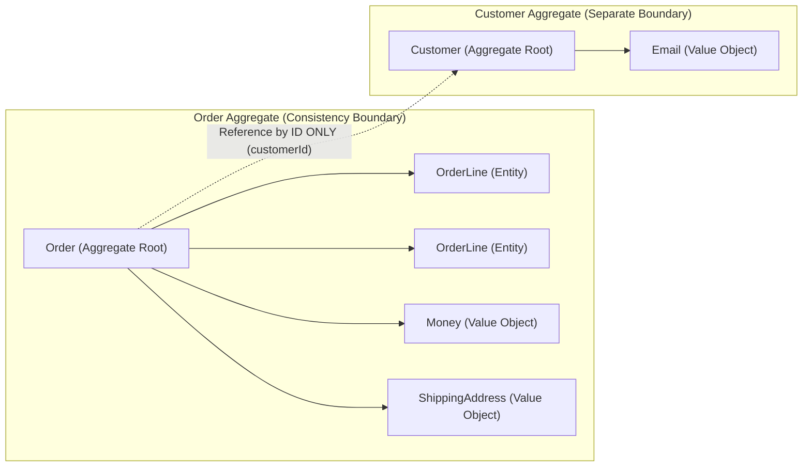
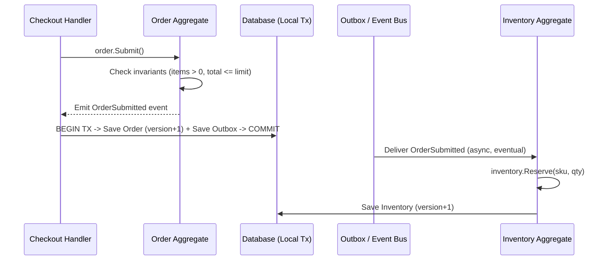
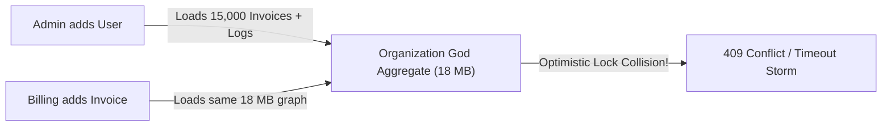

# Domain-Driven Design Basics: Aggregates, Entities & Value Objects

> **Prerequisites:** [Modular Monolith](../02-modular-monolith/README.md).  
> **Estimated Reading Time:** 24–28 minutes  
> **Target Audience:** Backend engineers modeling complex business rules, and system design candidates asked "How do you enforce invariants without locking the whole database?"  
> **Free PDF Notes:** [Download SD-L-003.pdf](https://backendroadmap.com/notes/system-design/SD-L-003.pdf)

> [!NOTE]
> **In one line:** **Domain-Driven Design (DDD)** structures code around the business domain using **Value Objects** (immutable attributes defined by value), **Entities** (objects with persistent identity), and **Aggregates** (transactional consistency boundaries guarded by an **Aggregate Root** that enforces invariants atomically).

> [!TIP]
> **The Golden Rule:** **Design Aggregates as small as possible around true transactional invariants.** An Aggregate is a *consistency boundary*, not a convenient object graph for UI queries. Never reference another Aggregate by direct object pointer—reference it by **ID only**.

---

## 1. What DDD Tactical Modeling Is, and What It Isn't

Consider an e-commerce `Order` with `OrderLine` items and a business rule: *"An order's total value cannot exceed the customer's $5,000 credit limit, and items cannot be added after checkout."* If developers mutate `order_lines` directly in a `LineItemController` while another request concurrently adds a coupon or submits the order, two separate transactions race and violate the $5,000 invariant. By making `Order` an **Aggregate Root** that owns `OrderLine` entities and `Money` value objects, **all** mutations go through `Order.AddItem(...)` inside one atomic transaction with optimistic locking.

| Term | Precise Meaning | Example |
| :--- | :--- | :--- |
| **Ubiquitous Language** | Shared vocabulary used identically by domain experts, code, and tests | `ReserveStock`, `Backorder`, `CreditLimit` (not `UpdateFlag`) |
| **Value Object** | Immutable object with no identity; equal if all attributes match | `Money(100, "USD")`, `Address`, `DateRange` |
| **Entity** | Mutable object defined by a unique, persistent identity over time | `Order(id=ORD-42)`, `Customer(id=CUST-9)` |
| **Aggregate** | Cluster of Entities & Value Objects treated as a single unit for data changes | `Order` + its `OrderLine` items |
| **Aggregate Root** | The single entry-point Entity guarding the Aggregate's invariants | `Order` (external code never mutates `OrderLine` directly) |
| **Domain Event** | Immutable record of a business fact that happened in the past | `OrderPlaced`, `PaymentCaptured` |
| **Repository** | Abstraction that loads and saves **whole Aggregates**, not raw tables | `OrderRepository.FindByID(id)` / `Save(order)` |
| **Not** | "Anemic getters/setters over database tables" or "giant object graphs" | A `Customer` aggregate containing 10,000 `Order`s is an anti-pattern |

### Why It Matters
1. **Concurrency & Locking:** Aggregates define the exact unit of optimistic/pessimistic locking in your database.
2. **Microservice Readiness:** Every microservice boundary must respect Aggregate boundaries—you never split a single Aggregate across two services.
3. **Eliminates Anemic Domain Models:** Business invariants live inside domain objects where they are unit-testable in milliseconds without a database.

---

## 2. Anatomy: Aggregate Boundary & ID-Only References



| Building Block | Identity? | Mutability | Equality | Can Hold Reference to |
| :--- | :---: | :---: | :--- | :--- |
| **Value Object** | No | **Immutable** (replace, don't mutate) | Structural (all fields equal) | Other Value Objects |
| **Entity** | Yes (`ID`) | Mutable via behavior methods | Identity (`a.ID == b.ID`) | Value Objects, child Entities |
| **Aggregate Root** | Yes (`ID`) | Mutable via invariant-checking methods | Identity (`a.ID == b.ID`) | Internal Entities/VOs + **IDs** of other Aggregates |

> [!WARNING]
> **The "God Aggregate" Trap:** Modeling `Customer` as an Aggregate Root that holds a `List<Order>` means adding a single order loads and locks the entire customer and all historical orders! Keep Aggregates small: `Order` references `CustomerID` (a Value Object), never the `Customer` object.

---

## 3. Mathematical Model: Contention Probability & Aggregate Size

**1. Optimistic Concurrency Collision Rate.** Suppose an Aggregate has $k$ independent mutable sub-entities/fields, each updated at rate $\lambda$ requests/sec, and each database read-modify-write transaction takes duration $T_{\text{tx}}$. Using a Poisson arrival approximation, the probability that two concurrent transactions collide on the same Aggregate version is:

$$P_{\text{collision}} \approx 1 - e^{-k \cdot \lambda \cdot T_{\text{tx}}}$$

Compare two designs for a `Warehouse` system handling $\lambda = 20\text{ updates/sec}$ per SKU with $T_{\text{tx}} = 15\text{ ms} = 0.015\text{ s}$:
- **Coarse "God Aggregate" (`Warehouse` holding $k = 50$ SKUs):**

$$P_{\text{collision}} \approx 1 - e^{-50 \cdot 20 \cdot 0.015} = 1 - e^{-15} \approx 99.99997\% \quad (\text{constant retry storms!})$$

- **Fine-Grained Aggregate (`InventoryItem` = 1 SKU, $k = 1$):**

$$P_{\text{collision}} \approx 1 - e^{-1 \cdot 20 \cdot 0.015} = 1 - e^{-0.3} \approx 25.9\%$$

And if we shard/partition hot SKUs or reduce $T_{\text{tx}}$ to $3\text{ ms}$, $P_{\text{collision}} = 1 - e^{-0.06} \approx 5.8\%$.

**2. Memory & I/O Amplification.** Loading an Aggregate with $N$ child rows per request costs $O(N)$ serialization and memory. If `Customer` has $N = 5{,}000$ historical orders ($1\text{ KB}$ each), every profile edit reads/deserializes **$5\text{ MB}$** instead of **$1\text{ KB}$** ($5{,}000\times$ I/O amplification).

---

## 4. Metrics & Percentiles

| Metric | Meaning | Alert / Target |
| :--- | :--- | :--- |
| **Optimistic Lock Retry Rate** | `%` of transactions failing `version` check (`OptimisticLockException`) | Alert if $> 5\%$ (Aggregate is too coarse) |
| **Aggregate Hydration Size ($p_{99}$)** | Rows or KB loaded per `Repository.FindByID()` | Alert if $> 100$ child rows or $> 256\text{ KB}$ |
| **Transaction Hold Duration ($p_{99}$)** | Time DB row/version lock is held during Aggregate save | Keep $< 20\text{ ms}$; never make external RPCs inside tx |
| **Invariant Violation Rate** | Domain rule rejections (`InsufficientFunds`, `OrderLocked`) | Track as business metric, not 500 errors |
| **Cross-Aggregate Consistency Lag** | Delay for eventual consistency between two Aggregates | Alert if $> \text{UX freshness SLO}$ (e.g., $> 2\text{ s}$) |

### Worked Example (`Order` Aggregate with Optimistic Locking)
An `Order` Aggregate has `status`, `items[]`, `totalMoney`, and `version = 3`.
1. Request A loads `Order(ORD-1, version=3)`, calls `order.AddItem("SKU-9", 2, Money(25, "USD"))`, which verifies `order.Status == Draft` and `newTotal <= 5000`, recalculates `totalMoney`, and increments `version` to `4`.
2. Concurrently, Request B loads `Order(ORD-1, version=3)` and calls `order.Submit()`.
3. Request A executes `UPDATE orders SET ..., version = 4 WHERE id = 'ORD-1' AND version = 3` $\rightarrow$ **1 row updated (Success)**.
4. Request B executes `UPDATE orders SET ..., version = 4 WHERE id = 'ORD-1' AND version = 3` $\rightarrow$ **0 rows updated (`ConcurrentModificationError`)**. The invariant ("cannot add items to a submitted order") is **100% preserved** without distributed locks.

---

## 5. Compounding & Failure Modes: What Happens When Rules Are Violated

| Anti-Pattern | Immediate Symptom | Compounding Failure at Scale |
| :--- | :--- | :--- |
| **God Aggregate** (`Customer` $\rightarrow$ all `Orders`) | Slow `FindByID` queries | OOM crashes, $99\%$ lock contention on active accounts |
| **Direct Child Mutation** (bypassing Root) | `OrderLine` edited without updating `Order.Total` | Silent financial corruption (subtotal $\neq$ sum of lines) |
| **External RPC Inside Aggregate Tx** | Tx held open for $200\text{ ms}$ during payment call | DB connection pool exhaustion under mild traffic spikes |
| **Anemic Domain Model** (all logic in Services) | Duplicated `if` checks across 6 endpoints | Invariants bypassed by new endpoints or batch jobs |
| **Mutable Value Objects** | `Money` mutated in-place by one method | Action-at-a-distance bugs across shared references |

---

## 6. Numbers Every Engineer Must Know

| Item | Typical | Implication |
| :--- | :---: | :--- |
| Value Object allocation | Nanoseconds (stack/short-lived) | Make them immutable; don't fear creating new instances |
| Domain unit test speed | < 1 ms per test (no DB/IO) | 1,000+ invariant tests run in under 1 second |
| Healthy Aggregate child count | 1–50 items (bounded) | Unbounded lists (`comments`, `orders`) must be separate Aggregates |
| Optimistic lock retry overhead | 1 extra DB round-trip (~2 ms) | Cheap when collisions $< 5\%$; use pessimistic/queueing if $> 20\%$ |
| External RPC inside DB tx | 50–500 ms lock hold | **Forbidden**—use Outbox or Sagas instead |

---

## 7. Mechanism Deep Dive: Rule of One Aggregate per Transaction



| Question | Answer |
| :--- | :--- |
| **Why modify only ONE Aggregate per transaction?** | Because Aggregates are the unit of distribution. If your code relies on updating two Aggregates in one ACID transaction, you can never move them to separate databases or microservices later without a rewrite. |
| **How do you update a second Aggregate when the first changes?** | Emit a **Domain Event** (`OrderSubmitted`), persist it atomically via an Outbox (or in-process handler if same DB), and update the second Aggregate (`Inventory`) in its own transaction—accepting brief **eventual consistency**. |
| **When is a Value Object better than a primitive (`string`, `int`, `float`)?** | Whenever a primitive has validation or behavior: `Email` (validates format), `Money` (prevents adding `USD` to `EUR`, avoids float rounding), `Percentage` ($0$–$100$). This eliminates "Primitive Obsession." |
| **Where do cross-Aggregate business rules go (e.g., unique email across all Users)?** | Set-based uniqueness or cross-Aggregate calculations belong in a **Domain Service** or a **Database Unique Constraint**, not inside a single Aggregate. |

**When NOT to use full DDD Tactical Patterns:**
- Simple **CRUD** services (e.g., a CMS, admin config table, or lookup catalog) with zero complex invariants—DDD boilerplate adds ceremony without value.
- Pure **read/reporting** pipelines (CQRS read side)—query DTOs directly with SQL instead of hydrating full Aggregates.

---

## 8. Hierarchical Budgets & Design Rules

| Slice | Rule | Control |
| :--- | :--- | :--- |
| **Aggregate Size** | Max 1 Root + bounded children (never unbounded lists) | Code review + hydration row-count metric |
| **Cross-Aggregate Links** | Reference other Aggregates by **ID Value Object only** | Ban nested Aggregate object references |
| **Transaction Scope** | 1 Transaction = 1 Aggregate (plus Outbox) | Unit-of-work / repository enforcement |
| **Value Objects** | 100% immutable; validate invariants in constructor | No public setters; equality by value |
| **Encapsulation** | Child collections exposed as read-only; mutate via Root methods | Private setters / unexported fields |
| **Concurrency** | Every Aggregate Root carries a `version` column | Optimistic concurrency check on `Save()` |
| **Side Effects** | Zero network/IO calls inside Aggregate methods | Pure domain logic; return Domain Events |

---

## 9. Top Mitigations (Modeling Aggregates Safely)

1. **Start with Value Objects** (`Money`, `Email`, `OrderID`) to eliminate primitive obsession and centralize validation.
2. **Enforce invariants inside Aggregate Root methods**, never in controllers or anemic service scripts.
3. **Reference external Aggregates by ID only** to keep object graphs small and extractable.
4. **Never hold a database transaction open across an HTTP/gRPC call**—emit a Domain Event instead.
5. **Add a `version` field to every Aggregate Root** for optimistic concurrency control.
6. **Split unbounded 1-to-many relationships** (e.g., `BlogPost` $\rightarrow$ `Comment`) into separate Aggregates (`Comment` holds `PostID`).
7. **Bypass Aggregates for read-only queries**—use lightweight SQL projections/DTOs (CQRS) for dashboards.

---

## 10. Production Reference / War Story: The "Customer God Aggregate" Outage

A B2B marketplace modeled `Organization` as an Aggregate Root containing `List<User>`, `List<Invoice>`, and `List<AuditLog>`—serialized as a single JSON document/ORM graph loaded on every request.



- **What Happened (Root Cause):** As enterprise customers grew to 10,000+ invoices and 50,000+ audit logs, every user login or settings update hydrated an **18 MB Aggregate**, exhausting API memory and causing constant optimistic lock collisions whenever billing and user-admin actions overlapped.
- **The Fix:** The team decomposed `Organization` into three independent Aggregates: `Organization` (core settings), `User` (referencing `OrganizationID`), and `Invoice` (referencing `OrganizationID`), and moved `AuditLog` to an append-only event stream. P99 latency dropped from **2.4 seconds to 18 ms**, and lock collisions dropped to near zero.
- **Lesson:** Just because two concepts have a "has-a" relationship in English ("an Organization has Invoices") does **not** mean they belong in the same Aggregate.

---

## 11. Multi-Language Production Code Tabs

A complete, idiomatic **Order Aggregate** with a `Money` Value Object, `OrderLine` internal Entity, invariant enforcement (`MaxTotal` + `Draft` status check), and optimistic `Version` tracking.

````carousel
```go
// Go: Value Object (Money), Aggregate Root (Order), and invariant enforcement.
package main

import (
	"errors"
	"fmt"
)

// Money is an immutable Value Object.
type Money struct {
	Cents    int64
	Currency string
}

func NewMoney(cents int64, currency string) (Money, error) {
	if cents < 0 || currency == "" {
		return Money{}, errors.New("invalid money")
	}
	return Money{Cents: cents, Currency: currency}, nil
}

func (m Money) Add(other Money) (Money, error) {
	if m.Currency != other.Currency {
		return Money{}, errors.New("currency mismatch")
	}
	return Money{Cents: m.Cents + other.Cents, Currency: m.Currency}, nil
}

type OrderLine struct {
	SKU   string
	Qty   int
	Price Money
}

// Order is the Aggregate Root guarding invariants and optimistic Version.
type Order struct {
	ID         string
	CustomerID string // ID-only reference to Customer Aggregate
	Status     string
	Version    int
	lines      []OrderLine
	Total      Money
}

func NewOrder(id, customerID, currency string) *Order {
	return &Order{ID: id, CustomerID: customerID, Status: "DRAFT", Version: 1, Total: Money{0, currency}}
}

func (o *Order) AddItem(sku string, qty int, unitPrice Money, limitCents int64) error {
	if o.Status != "DRAFT" {
		return errors.New("cannot modify submitted order")
	}
	lineTotal, err := NewMoney(unitPrice.Cents*int64(qty), unitPrice.Currency)
	if err != nil {
		return err
	}
	newTotal, err := o.Total.Add(lineTotal)
	if err != nil {
		return err
	}
	if newTotal.Cents > limitCents {
		return errors.New("credit limit exceeded")
	}
	o.lines = append(o.lines, OrderLine{SKU: sku, Qty: qty, Price: unitPrice})
	o.Total = newTotal
	return nil
}

func (o *Order) Submit() error {
	if len(o.lines) == 0 {
		return errors.New("cannot submit empty order")
	}
	o.Status = "SUBMITTED"
	o.Version++
	return nil
}

func main() {
	ord := NewOrder("ORD-1", "CUST-9", "USD")
	p, _ := NewMoney(1500, "USD")
	_ = ord.AddItem("SKU-A", 2, p, 500000)
	_ = ord.Submit()
	fmt.Printf("Order %s status=%s total=%d cents v=%d\n", ord.ID, ord.Status, ord.Total.Cents, ord.Version)
}
```
<!-- slide -->
```typescript
// TypeScript: Immutable Money Value Object + Order Aggregate Root.
export class Money {
  private constructor(public readonly cents: number, public readonly currency: string) {}

  static of(cents: number, currency: string): Money {
    if (cents < 0 || !Number.isInteger(cents)) throw new Error("Invalid cents");
    return new Money(cents, currency);
  }

  add(other: Money): Money {
    if (this.currency !== other.currency) throw new Error("Currency mismatch");
    return Money.of(this.cents + other.cents, this.currency);
  }
}

interface OrderLine {
  readonly sku: string;
  readonly qty: number;
  readonly unitPrice: Money;
}

export class Order {
  private lines: OrderLine[] = [];
  private _status: "DRAFT" | "SUBMITTED" = "DRAFT";
  private _total: Money;
  public version = 1;

  constructor(
    public readonly id: string,
    public readonly customerId: string, // Reference by ID only
    currency = "USD"
  ) {
    this._total = Money.of(0, currency);
  }

  addItem(sku: string, qty: number, unitPrice: Money, creditLimitCents: number): void {
    if (this._status !== "DRAFT") throw new Error("Cannot modify submitted order");
    const lineCost = Money.of(unitPrice.cents * qty, unitPrice.currency);
    const nextTotal = this._total.add(lineCost);
    if (nextTotal.cents > creditLimitCents) throw new Error("Credit limit exceeded");
    this.lines.push({ sku, qty, unitPrice });
    this._total = nextTotal;
  }

  submit(): void {
    if (this.lines.length === 0) throw new Error("Cannot submit empty order");
    this._status = "SUBMITTED";
    this.version += 1;
  }

  get total(): Money {
    return this._total;
  }
}
```
<!-- slide -->
```python
# Python: Immutable Money Value Object + Order Aggregate Root with invariant checks.
from dataclasses import dataclass, field


@dataclass(frozen=True)
class Money:
    cents: int
    currency: str

    def __post_init__(self) -> None:
        if self.cents < 0:
            raise ValueError("Money cannot be negative")

    def add(self, other: "Money") -> "Money":
        if self.currency != other.currency:
            raise ValueError("Currency mismatch")
        return Money(self.cents + other.cents, self.currency)


@dataclass(frozen=True)
class OrderLine:
    sku: str
    qty: int
    unit_price: Money


@dataclass
class Order:
    id: str
    customer_id: str  # ID-only reference to Customer Aggregate
    currency: str = "USD"
    status: str = "DRAFT"
    version: int = 1
    _lines: list[OrderLine] = field(default_factory=list)
    _total: Money = field(init=False)

    def __post_init__(self) -> None:
        self._total = Money(0, self.currency)

    def add_item(self, sku: str, qty: int, unit_price: Money, limit_cents: int) -> None:
        if self.status != "DRAFT":
            raise ValueError("Cannot modify submitted order")
        line_cost = Money(unit_price.cents * qty, unit_price.currency)
        next_total = self._total.add(line_cost)
        if next_total.cents > limit_cents:
            raise ValueError("Credit limit exceeded")
        self._lines.append(OrderLine(sku, qty, unit_price))
        self._total = next_total

    def submit(self) -> None:
        if not self._lines:
            raise ValueError("Cannot submit empty order")
        self.status = "SUBMITTED"
        self.version += 1
```
<!-- slide -->
```csharp
// C#: Immutable Money Value Object (record) + Order Aggregate Root.
using System;
using System.Collections.Generic;

public sealed record Money(long Cents, string Currency)
{
    public Money Add(Money other) =>
        Currency == other.Currency
            ? new Money(Cents + other.Cents, Currency)
            : throw new InvalidOperationException("Currency mismatch");
}

public sealed record OrderLine(string Sku, int Qty, Money UnitPrice);

public sealed class Order
{
    private readonly List<OrderLine> _lines = new();
    public string Id { get; }
    public string CustomerId { get; } // ID-only reference
    public string Status { get; private set; } = "DRAFT";
    public int Version { get; private set; } = 1;
    public Money Total { get; private set; }
    public IReadOnlyList<OrderLine> Lines => _lines.AsReadOnly();

    public Order(string id, string customerId, string currency = "USD")
    {
        Id = id;
        CustomerId = customerId;
        Total = new Money(0, currency);
    }

    public void AddItem(string sku, int qty, Money unitPrice, long limitCents)
    {
        if (Status != "DRAFT") throw new InvalidOperationException("Order is locked");
        var nextTotal = Total.Add(new Money(unitPrice.Cents * qty, unitPrice.Currency));
        if (nextTotal.Cents > limitCents) throw new InvalidOperationException("Credit limit exceeded");
        _lines.Add(new OrderLine(sku, qty, unitPrice));
        Total = nextTotal;
    }

    public void Submit()
    {
        if (_lines.Count == 0) throw new InvalidOperationException("Empty order");
        Status = "SUBMITTED";
        Version++;
    }
}
```
````

---

## 12. Hands-On CLI Verification Workflows

Simulate the **Aggregate Contention Formula** ($P_{\text{collision}} = 1 - e^{-k \lambda T_{\text{tx}}}$) and verify optimistic locking SQL behavior:

```bash
# 1. Compare collision probability for God Aggregate (k=50) vs Fine-Grained Aggregate (k=1)
python -c "
import math
for name, k, lam, t_tx in [('God Aggregate (50 SKUs)', 50, 20, 0.015), ('Fine Aggregate (1 SKU)', 1, 20, 0.015), ('Fine + Fast Tx (3ms)', 1, 20, 0.003)]:
    p = 1 - math.exp(-k * lam * t_tx)
    print(f'{name:26s} -> collision_prob = {p*100:.2f}%')
"

# 2. PostgreSQL: verify optimistic concurrency control (version check)
psql "$DATABASE_URL" -c "
UPDATE orders
SET status = 'SUBMITTED', version = version + 1
WHERE id = 'ORD-1' AND version = 1
RETURNING id, status, version;"
```

---

## 13. Common Mistakes to Avoid

1. **Building "God Aggregates"** that hold unbounded child collections (`Customer` $\rightarrow$ all `Orders`).
2. **Bypassing the Aggregate Root** by letting controllers or other services directly update child tables (`order_lines`).
3. **Making Value Objects mutable**—mutating a shared `Money` or `Address` causes silent bugs.
4. **Calling external HTTP/gRPC APIs inside an Aggregate's database transaction.**
5. **Omitting optimistic concurrency (`version`)**, allowing lost updates to violate invariants.
6. **Using DDD tactical patterns on simple CRUD tables** where there are no real invariants.
7. **Hydrating heavy Aggregates for read-only UI queries** instead of using lightweight SQL projections.

---

## 14. Key Terms Glossary

| Key Term | Definition |
| :--- | :--- |
| **Ubiquitous Language** | Shared, unambiguous terminology used by both domain experts and code. |
| **Value Object** | Immutable object without identity, compared by its attribute values. |
| **Entity** | Object with a unique identity that persists across state changes. |
| **Aggregate** | Cluster of Entities and Value Objects forming a single transactional consistency boundary. |
| **Aggregate Root** | The sole entry-point Entity of an Aggregate that enforces all invariants. |
| **Invariant** | A business rule that must always hold true after every transaction. |
| **Optimistic Locking** | Concurrency control using a `version` column to detect conflicting writes without long locks. |
| **Domain Event** | Immutable record of a meaningful state transition emitted by an Aggregate. |
| **Repository** | Persistence abstraction that loads and saves entire Aggregates atomically. |
| **Anemic Domain Model** | Anti-pattern where Entities are pure data bags and all logic lives in procedural services. |

---

## 15. System Design Interview Questions & Answers

### Basic Conceptual Questions

<details>
<summary><strong>Q1: What is the difference between an Entity and a Value Object? [BASIC]</strong></summary>

**Answer:**
An **Entity** has a unique, persistent identity (`OrderID`) and is mutable over its lifecycle; two entities with different IDs are distinct even if their fields match. A **Value Object** (`Money`, `Address`) has no identity, is **immutable**, and is equal if all its attributes are equal.
</details>

<details>
<summary><strong>Q2: What is an Aggregate and an Aggregate Root? [BASIC]</strong></summary>

**Answer:**
An **Aggregate** is a cluster of Entities and Value Objects treated as a single unit for transactional consistency. The **Aggregate Root** is the single outer Entity through which all external mutations must pass, ensuring business invariants are never bypassed.
</details>

<details>
<summary><strong>Q3: Why should Aggregates reference other Aggregates by ID only? [BASIC]</strong></summary>

**Answer:**
Holding direct object references between Aggregates encourages loading massive object graphs into memory and tempts developers to mutate two Aggregates in one transaction. Referencing by ID keeps each Aggregate small, fast to load, and ready to live in a separate database or microservice.
</details>

<details>
<summary><strong>Q4: What is Ubiquitous Language? [BASIC]</strong></summary>

**Answer:**
A shared vocabulary agreed upon by product/domain experts and engineers, reflected verbatim in class names, method names, events, and database schemas (e.g., `Backorder` instead of `StatusFlag = 3`), eliminating translation errors.
</details>

### Scenario-Based Architecture Questions

<details>
<summary><strong>Q5: How do you model a `BlogPost` that can have 50,000 `Comments`? Should `Comment` be inside the `BlogPost` Aggregate? [SCENARIO]</strong></summary>

**Answer:**
**No.** A `BlogPost` with 50,000 `Comments` is an unbounded God Aggregate—adding one comment would hydrate 50,000 rows and cause massive lock contention. Make `Comment` its own Aggregate Root holding a `postId` Value Object, and enforce any rules (like max comments or post-locked) via a lightweight check or eventual consistency.
</details>

<details>
<summary><strong>Q6: When an `Order` is submitted, `Inventory` must be decremented and `LoyaltyPoints` added. How do you coordinate this? [SCENARIO]</strong></summary>

**Answer:**
Update **only** the `Order` Aggregate in the local transaction, persisting an `OrderSubmitted` Domain Event to an Outbox table atomically. Asynchronous consumers then update the `Inventory` and `LoyaltyPoints` Aggregates in their own separate transactions (or use a Saga if inventory reservation must happen synchronously before confirmation).
</details>

<details>
<summary><strong>Q7: Two users edit the same `Order` concurrently—one adds an item, one submits it. How do you prevent an invalid state? [SCENARIO]</strong></summary>

**Answer:**
Attach a `version` column to the `Order` Aggregate Root and use **optimistic locking** (`WHERE id = ? AND version = ?`). Whichever transaction commits first increments `version`; the second fails with 0 rows affected and either retries (re-evaluating the `Status == DRAFT` invariant) or returns `409 Conflict`.
</details>

<details>
<summary><strong>Q8: Your `Order` Aggregate is fast for writes, but the admin dashboard needs to filter orders joined with customer names and product titles. How do you handle reads? [SCENARIO]</strong></summary>

**Answer:**
Do **not** load full Aggregates for reporting. Use **CQRS (Command Query Responsibility Segregation)** on the read path: query a read-only SQL view or denormalized read model directly into lightweight DTOs, keeping Aggregates strictly for write-side invariant enforcement.
</details>

### Advanced & Tricky Interview Questions

<details>
<summary><strong>Q9: Why does Vaughn Vernon recommend "small Aggregates" over "conceptual parent-child Aggregates"? [TRICKY]</strong></summary>

**Answer:**
Because an Aggregate is a **transactional lock boundary**, not a domain taxonomy. Larger Aggregates increase $k \cdot \lambda \cdot T_{\text{tx}}$, driving optimistic lock collision probabilities toward $100\%$ under concurrency and amplifying memory/I/O per request.
</details>

<details>
<summary><strong>Q10: Can a Value Object be stored in its own database table, or must it be embedded? [TRICKY]</strong></summary>

**Answer:**
In DDD, Value Objects are conceptually embedded inside their owning Entity (as columns like `total_cents, total_currency` or JSONB). Even if a relational schema normalizes a collection of Value Objects into a child table, it has no independent lifecycle or repository—it is still saved and deleted solely through its Aggregate Root.
</details>

<details>
<summary><strong>Q11: How do you enforce a global uniqueness invariant (e.g., unique email across all `User` Aggregates)? [TRICKY]</strong></summary>

**Answer:**
A single `User` Aggregate cannot enforce set-based uniqueness across all users in memory. Rely on a **unique index in the database** (`UNIQUE(email)`) as the authoritative invariant guard, optionally paired with a fast read check in a Domain Service for friendly UX errors.
</details>

<details>
<summary><strong>Q12: Why is making an HTTP call inside an Aggregate method or transaction dangerous? [TRICKY]</strong></summary>

**Answer:**
Network calls have unbounded tail latency ($50\text{ ms}$ to $30\text{ s}$ timeouts). Holding a database transaction and row lock open across an RPC exhausts DB connection pools and triggers cascading lock timeouts. Always keep Aggregate methods pure and in-memory, and trigger external calls *after* commit via Domain Events.
</details>

---

## 16. One-Page Master Cheat Sheet

```
+---------------------------------------------------------------------------------------------------------+
|                DDD TACTICAL PATTERNS — MASTER CHEAT SHEET                                               |
+---------------------------------------------------------------------------------------------------------+
| 1. VALUE OBJECT: Immutable, no ID, equality by value (Money, Email, Address). Replace, never mutate.    |
| 2. ENTITY: Has persistent ID, mutable via behavior methods, equality by ID.                             |
| 3. AGGREGATE: Transactional consistency boundary guarded by an AGGREGATE ROOT.                          |
+---------------------------------------------------------------------------------------------------------+
| 4. GOLDEN RULES (Vaughn Vernon):                                                                        |
|    - Model true invariants in consistency boundaries (keep Aggregates SMALL).                           |
|    - Reference other Aggregates by ID ONLY (never object pointers).                                     |
|    - Update ONE Aggregate per transaction; update others via Domain Events (eventual consistency).      |
+---------------------------------------------------------------------------------------------------------+
| 5. CONCURRENCY MATH: P(collision) ~ 1 - exp(-k * lambda * T_tx).                                        |
|    Smaller Aggregates (k=1) + fast transactions (no RPCs inside tx) = near-zero lock contention.        |
+---------------------------------------------------------------------------------------------------------+
```

---

## Further Reading & Sources

- Eric Evans, *Domain-Driven Design: Tackling Complexity in the Heart of Software* (2003).
- Vaughn Vernon, *Implementing Domain-Driven Design* (2013) & *Effective Aggregate Design* (3-part essay).
- Martin Fowler, [DDD Aggregate](https://martinfowler.com/bliki/DDD_Aggregate.html) and [Value Object](https://martinfowler.com/bliki/ValueObject.html).
- Microsoft Architecture Guide, [Domain model design (Aggregates & Entities)](https://learn.microsoft.com/en-us/dotnet/architecture/microservices/microservice-ddd-cqrs-patterns/microservice-domain-model).

---

## Free PDF Notes

[SD-L-003.pdf](https://backendroadmap.com/notes/system-design/SD-L-003.pdf)

---

## Next

Continue with [Bounded Contexts: How to Find Microservice Boundaries (DDD)](../04-bounded-contexts/README.md).
