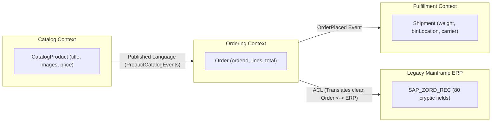
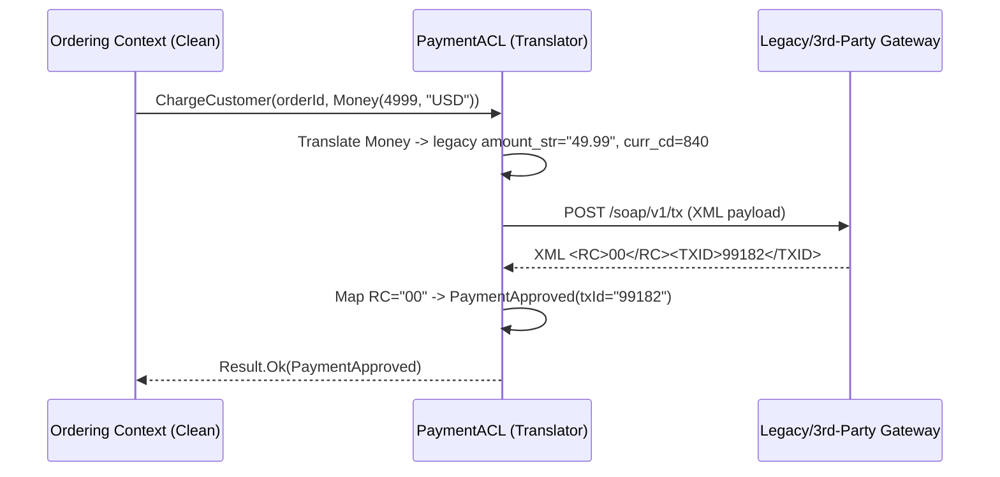

# Bounded Contexts: How to Find Microservice Boundaries (DDD)

> **Prerequisites:** [Domain-Driven Design Basics](../03-domain-driven-design-basics/README.md).  
> **Estimated Reading Time:** 24–28 minutes  
> **Target Audience:** Staff/principal engineers, architects, and system design candidates asked "How do you decide where to draw microservice boundaries?"  
> **Free PDF Notes:** [Download SD-L-004.pdf](https://backendroadmap.com/notes/system-design/SD-L-004.pdf)

> [!NOTE]
> **In one line:** A **Bounded Context** is an explicit linguistic and architectural boundary within which a domain model (and its Ubiquitous Language) has a single, unambiguous meaning. Trying to force one giant "Canonical Enterprise Model" (e.g., one `Product` or `Order` table shared by Sales, Shipping, and Billing) creates catastrophic coupling—**Bounded Contexts are the true blueprint for microservice boundaries**.

> [!TIP]
> **The Golden Rule:** **Don't share a single `User`, `Product`, or `Order` model across the whole company.** Let Sales have its `CatalogItem` (price, photos), Shipping have its `ParcelItem` (weight, dimensions), and Billing have its `LineItem` (tax code, ledger account)—and translate between them explicitly at context boundaries using an **Anti-Corruption Layer (ACL)**.

---

## 1. What a Bounded Context Is, and What It Isn't

In an e-commerce company, everyone says the word **"Product"**. To the **Catalog team**, a Product has descriptions, SEO tags, images, and variants. To the **Inventory/Warehouse team**, a Product has a SKU, bin location, weight, and dimensions. To the **Billing team**, a Product is a tax category and revenue recognition rule. When engineers try to put all 65 columns into one `products` table and one `Product` class used by every service, any team altering a column breaks three other teams. **Bounded Contexts** solve this by giving each domain sub-area its *own* tailored model and explicit translation boundary.

| Term | Precise Meaning | Example |
| :--- | :--- | :--- |
| **Bounded Context** | Explicit boundary where a specific Ubiquitous Language and model apply | `Catalog Context`, `Fulfillment Context`, `Billing Context` |
| **Context Map** | Diagram showing all Bounded Contexts and how they integrate | Upstream `Orders` $\rightarrow$ Downstream `Fulfillment` |
| **Anti-Corruption Layer (ACL)** | Translator adapter protecting a context from an external/legacy model | `LegacyErpAdapter` translating ERP XML into clean `Order` DTOs |
| **Published Language** | Well-documented, versioned schema used at a boundary | OpenAPI, Protobuf, or AsyncAPI event schema |
| **Customer / Supplier** | Downstream team negotiates schema needs with Upstream team | `Billing` requests `tax_region` in `OrderPlaced` v2 |
| **Conformist** | Downstream accepts Upstream's model as-is (no power to negotiate) | Wrapping a third-party Stripe or TaxJar API |
| **Shared Kernel** | Small subset of domain model explicitly shared by two tightly allied teams | `Money` + `Currency` library (requires dual-team sign-off) |
| **Not** | "1 Bounded Context = 1 Database Table" or "1 Entity = 1 Microservice" | A Bounded Context contains *multiple* cohesive Aggregates |

### Why It Matters
1. **Answers the #1 Architecture Question:** "How do you split a system into services?" $\rightarrow$ *Along Bounded Contexts discovered via Event Storming, not database tables.*
2. **Prevents God Models:** Splitting a 70-column `Product` entity into 3 focused 10-column context models eliminates 90% of cross-team merge conflicts.
3. **Protects Legacy Migrations:** An Anti-Corruption Layer lets you build clean modern services without being infected by a 15-year-old legacy ERP schema.

---

## 2. Anatomy: Polysemy ("Order" Means Different Things) & Context Mapping



| Context Relationship | Power Dynamic | Coupling Risk | When to Use |
| :--- | :--- | :---: | :--- |
| **Published Language + Open Host** | Upstream defines clean public schema | Low | Public APIs, Kafka event contracts |
| **Anti-Corruption Layer (ACL)** | Downstream isolates itself via translator | Very Low | Integrating legacy monoliths or messy 3rd-party APIs |
| **Customer-Supplier** | Collaborative upstream/downstream | Medium | Two internal teams in the same org |
| **Conformist** | Downstream adopts upstream model | High | External SaaS where you have zero leverage |
| **Shared Kernel** | Both teams co-own a shared module | Very High | Only for tiny, stable primitives; avoid for core entities |

> [!WARNING]
> **The "Entity-per-Service" Trap:** Never create a `ProductService`, `OrderService`, and `CustomerService` just because those are nouns in your database. A Bounded Context is a **behavioral boundary** (e.g., `Checkout`, `Fulfillment`, `Billing`), not a CRUD wrapper around a single table.

---

## 3. Mathematical Model: Coupling Blast Radius & Translation Overhead

**1. Schema Blast Radius (Shared God Model vs Bounded Contexts).** Suppose a company has $N$ teams sharing a single canonical `Product` model of $F$ fields, where each team actively evolves $f_i$ fields per quarter.
- **With 1 Shared Canonical Model:** Every schema change has a blast radius across all $N-1$ other teams. Expected cross-team coordination events per quarter:

$$B_{\text{shared}} = (N - 1) \sum_{i=1}^{N} f_i$$

For $N = 5$ teams each making $f_i = 4$ schema changes/quarter: $B_{\text{shared}} = 4 \times 20 = 80\text{ cross-team coordination events/quarter}$.

- **With $N$ Bounded Contexts (Public Contract of $c$ stable fields):** Internal changes ($f_i - c_{\text{pub}}$) have **zero** external blast radius. Only changes to the $c_{\text{pub}}$ boundary contract fields propagate:

$$B_{\text{bounded}} = \sum_{i=1}^{N} d_i \cdot c_{\text{change}, i}$$

If only $1$ boundary contract change occurs per team per quarter affecting $1$ downstream consumer ($d_i = 1$), $B_{\text{bounded}} = 5\text{ events/quarter}$—a **$16\times$ reduction** in cross-team friction.

**2. Anti-Corruption Layer (ACL) Latency Budget.** An ACL adds a pure in-memory mapping step ($t_{\text{map}} \approx 0.05\text{ ms}$) plus the external call ($t_{\text{ext}}$):

$$T_{\text{total}} = t_{\text{map, req}} + t_{\text{ext}} + t_{\text{map, resp}} \approx t_{\text{ext}} + 0.1\text{ ms}$$

The mapping CPU cost is negligible ($< 0.5\%$ of an RPC), while the architectural isolation payoff is massive.

---

## 4. Metrics & Percentiles

| Metric | Meaning | Alert / Target |
| :--- | :--- | :--- |
| **Context Boundary Leakage** | Internal domain types appearing in public APIs/events | **0** (always map to Published Language DTOs) |
| **Cross-Context Sync Calls** | Synchronous RPCs required to complete a single command | Keep $\le 1\text{–}2$; prefer async domain events |
| **Contract Breaking Changes** | Consumer failures caused by upstream schema edits | **0** (enforced via Schema Registry / Pact tests) |
| **ACL Translation Latency ($p_{99}$)** | Overhead of mapping external models to internal domain | $< 1\text{ ms}$ |
| **Team-to-Context Ratio** | Number of Bounded Contexts owned by one team | 1–2 contexts per stream-aligned team |

### Worked Example (Finding Contexts via Event Storming)
A team runs an **Event Storming** workshop for an e-commerce platform and lists all domain events on sticky notes:
1. `ProductListed`, `PriceUpdated` $\rightarrow$ **Catalog Context** (optimizes for search, SEO, read-heavy caching).
2. `CartItemAdded`, `OrderPlaced`, `OrderCancelled` $\rightarrow$ **Ordering Context** (optimizes for ACID checkout invariants).
3. `PaymentAuthorized`, `InvoiceIssued`, `RefundProcessed` $\rightarrow$ **Billing Context** (optimizes for ledger immutability & PCI compliance).
4. `StockReserved`, `LabelPrinted`, `ParcelShipped` $\rightarrow$ **Fulfillment Context** (optimizes for physical warehouse workflows).

Notice that **"Product"** exists in Catalog (title/price), Ordering (snapshot price at checkout), and Fulfillment (weight/dimensions)—three **distinct models** connected only by `ProductID` and domain events.

---

## 5. Compounding & Failure Modes: What Happens When Contexts Blur

| Failure Mode | Mechanism | Compounding Impact |
| :--- | :--- | :--- |
| **Canonical Data Model** | One shared `models` package imported by 8 services | A single column rename forces 8-repo lockstep deploys |
| **Missing ACL on Legacy System** | New microservice adopts legacy `ERR_CD_99` / `CUST_FLAG_2` | Legacy technical debt infects every new service |
| **Microservice-per-Aggregate** | Splitting `Order` and `OrderLine` into two services | Chatty network calls, broken invariants, distributed monolith |
| **Leaky Published Language** | Exposing internal DB schema directly as Kafka events | Impossible to refactor internal tables without breaking consumers |

---

## 6. Numbers Every Engineer Must Know

| Item | Typical | Implication |
| :--- | :---: | :--- |
| Ideal Bounded Contexts per team | 1–2 | Matches Conway's Law (1 stream-aligned team = 1–2 contexts) |
| ACL mapping overhead | 0.05–0.2 ms | Practically free compared to 2–20 ms network RPCs |
| Event Storming discovery session | 2–4 hours | Uncovers 80%+ of true Bounded Contexts before writing code |
| Healthy context public contract size | 5–15% of internal model | Hide 85%+ of internal complexity behind the boundary |
| Max Shared Kernel size | < 5% of codebase | Keep shared code limited to pure primitives (`Money`, `UUID`) |

---

## 7. Mechanism Deep Dive: The Anti-Corruption Layer (ACL) in Action



| Question | Answer |
| :--- | :--- |
| **How does a Bounded Context relate to a Microservice?** | A Bounded Context is the **logical** boundary; a Microservice is a **physical** deployment boundary. A Modular Monolith can host 4 Bounded Contexts in one process; in microservices, **1 Bounded Context $\ge$ 1 Microservice** (never split 1 Aggregate across services, and rarely put 2 unrelated contexts in 1 microservice once scaled). |
| **How do you discover Bounded Contexts in a greenfield system?** | Run **Event Storming**: map all domain events chronologically, group events around shared state/invariants, identify where the meaning of a noun changes (linguistic seams), and draw boundaries there. |
| **Is data duplication across Bounded Contexts okay?** | **Yes—it is intentional!** `Ordering` stores a snapshot of `ProductName` and `UnitPrice` at checkout time so `Catalog` changing a price tomorrow doesn't rewrite historical orders. |
| **When do you use an ACL vs Open Host / Published Language?** | Use **Published Language** when you own the upstream service and design a clean public event/API. Use an **ACL** on the downstream side when integrating a messy legacy monolith or third-party vendor you don't control. |

**When NOT to split into separate Bounded Contexts:**
- Two concepts always change together in the same transaction and share the exact same Ubiquitous Language (keep them in one context).
- Your application is a small single-team CRUD app where one simple model has no linguistic ambiguity.

---

## 8. Hierarchical Budgets & Design Rules

| Slice | Rule | Control |
| :--- | :--- | :--- |
| **Linguistic Purity** | Each term has 1 unambiguous meaning inside a context | Ubiquitous Language glossary per context |
| **Model Isolation** | Zero shared domain entities across context boundaries | Separate packages/repos; DTOs only at boundary |
| **Boundary Translation** | Always wrap external/legacy APIs in an ACL | Adapter pattern isolating external DTOs |
| **Contract Stability** | Expose a minimal Published Language (Protobuf/JSON Schema) | Backward-compatible schema registry checks |
| **Team Alignment** | 1 Bounded Context owned by 1 team (never shared ownership) | Clear CODEOWNERS & Conway's Law alignment |
| **Data Snapshots** | Store point-in-time copies of external attributes when needed | Event-carried state transfer (`ProductPriceUpdated`) |

---

## 9. Top Mitigations (Drawing & Maintaining Clean Context Boundaries)

1. **Run Event Storming** before drawing service boxes on a whiteboard—let domain events reveal natural seams.
2. **Watch for polysemy** (the same word meaning different things to different teams—like `User`, `Product`, `Account`) as the #1 signal of a context boundary.
3. **Never share ORM/domain classes across services** via a common npm/NuGet/Go package—duplicate the small boundary DTO instead.
4. **Place an Anti-Corruption Layer (ACL)** in front of every legacy monolith or third-party vendor API.
5. **Use Event-Carried State Transfer** (or read-model projections) so contexts don't make synchronous RPCs just to read each other's nouns.
6. **Version your Published Language** explicitly (`OrderPlaced.v1` $\rightarrow$ `v2`) and enforce compatibility in CI.
7. **Keep Context Maps up to date** in your architecture repo so every engineer knows upstream/downstream dependencies.

---

## 10. Production Reference / War Story: Splitting a Legacy Monolith with an ACL

A fintech company needed to replace a 10-year-old core banking monolith (`CoreBank`) whose schema used 4-letter column names (`ACCT_STAT_CD = '04'`, `TX_AMT` as signed strings) and suffered frequent lock contention.


- **What Happened (Root Cause):** An earlier attempt to build a new `Lending` service imported `CoreBank`'s raw DTOs directly. Within months, `Lending` was littered with `if acctStatCd == "04"` checks, and a minor `CoreBank` upgrade broke `Lending` in production.
- **The Fix:** The team introduced a strict **Anti-Corruption Layer (`CoreBankACL`)** at the boundary of the new `Ledger` and `Lending` Bounded Contexts. All legacy codes and string amounts were translated into clean `AccountStatus.Suspended` enums and `Money` Value Objects inside the ACL. When `CoreBank` was later retired, only the ACL adapter was swapped—zero domain logic changed.
- **Lesson:** An ACL is the cheapest insurance policy in distributed systems: it stops legacy entropy from leaking into new Bounded Contexts.

---

## 11. Multi-Language Production Code Tabs

An **Anti-Corruption Layer (ACL)** protecting a clean `Billing` Bounded Context from a messy legacy `ExternalOrderPayload` (cryptic status codes, float/string prices, nested legacy structure).

````carousel
```go
// Go: Anti-Corruption Layer translating a messy legacy payload into a clean Billing domain model.
package main

import (
	"errors"
	"fmt"
	"strconv"
)

// --- External / Legacy Model (never leaks past the ACL) ---
type LegacyERPOrder struct {
	ORD_ID   string
	STAT_CD  string // "01"=Confirmed, "99"=Cancelled
	AMT_STR  string // e.g., "149.95"
	CURR_ISO string
}

// --- Clean Billing Bounded Context Model ---
type InvoiceCommand struct {
	OrderID     string
	AmountCents int64
	Currency    string
}

// --- Anti-Corruption Layer (Translator) ---
type BillingOrderACL struct{}

func (BillingOrderACL) Translate(raw LegacyERPOrder) (InvoiceCommand, error) {
	if raw.STAT_CD != "01" {
		return InvoiceCommand{}, fmt.Errorf("ignoring non-billable legacy status %q", raw.STAT_CD)
	}
	dollars, err := strconv.ParseFloat(raw.AMT_STR, 64)
	if err != nil || dollars < 0 {
		return InvoiceCommand{}, errors.New("corrupt legacy amount")
	}
	return InvoiceCommand{
		OrderID:     raw.ORD_ID,
		AmountCents: int64(dollars*100 + 0.5),
		Currency:    raw.CURR_ISO,
	}, nil
}

func main() {
	acl := BillingOrderACL{}
	cmd, err := acl.Translate(LegacyERPOrder{ORD_ID: "ERP-77", STAT_CD: "01", AMT_STR: "149.95", CURR_ISO: "USD"})
	fmt.Printf("Translated: %+v err=%v\n", cmd, err)
}
```
<!-- slide -->
```typescript
// TypeScript: Anti-Corruption Layer isolating Billing Context from Legacy ERP schema.
export interface LegacyErpOrder {
  ORD_ID: string;
  STAT_CD: "01" | "99" | string;
  AMT_STR: string;
  CURR_ISO: string;
}

export interface InvoiceCommand {
  readonly orderId: string;
  readonly amountCents: number;
  readonly currency: string;
}

export class LegacyOrderAcl {
  static toInvoiceCommand(raw: LegacyErpOrder): InvoiceCommand {
    if (raw.STAT_CD !== "01") {
      throw new Error(`Non-billable legacy status: ${raw.STAT_CD}`);
    }
    const parsed = Number(raw.AMT_STR);
    if (!Number.isFinite(parsed) || parsed < 0) {
      throw new Error(`Invalid legacy amount: ${raw.AMT_STR}`);
    }
    return {
      orderId: raw.ORD_ID,
      amountCents: Math.round(parsed * 100),
      currency: raw.CURR_ISO,
    };
  }
}
```
<!-- slide -->
```python
# Python: Anti-Corruption Layer protecting Billing Bounded Context from Legacy ERP data.
from dataclasses import dataclass
from decimal import Decimal, InvalidOperation


@dataclass(frozen=True)
class LegacyErpOrder:
    ORD_ID: str
    STAT_CD: str
    AMT_STR: str
    CURR_ISO: str


@dataclass(frozen=True)
class InvoiceCommand:
    order_id: str
    amount_cents: int
    currency: str


class BillingOrderACL:
    @staticmethod
    def translate(raw: LegacyErpOrder) -> InvoiceCommand:
        if raw.STAT_CD != "01":
            raise ValueError(f"Non-billable legacy status: {raw.STAT_CD}")
        try:
            amount = Decimal(raw.AMT_STR)
        except InvalidOperation as exc:
            raise ValueError(f"Corrupt legacy amount: {raw.AMT_STR}") from exc
        if amount < 0:
            raise ValueError("Negative amount")
        return InvoiceCommand(
            order_id=raw.ORD_ID,
            amount_cents=int((amount * 100).to_integral_value()),
            currency=raw.CURR_ISO,
        )
```
<!-- slide -->
```csharp
// C#: Anti-Corruption Layer translating legacy ERP records into clean Billing commands.
using System;
using System.Globalization;

public sealed record LegacyErpOrder(string ORD_ID, string STAT_CD, string AMT_STR, string CURR_ISO);
public sealed record InvoiceCommand(string OrderId, long AmountCents, string Currency);

public static class BillingOrderAcl
{
    public static InvoiceCommand Translate(LegacyErpOrder raw)
    {
        if (raw.STAT_CD != "01")
            throw new InvalidOperationException($"Non-billable legacy status: {raw.STAT_CD}");
        if (!decimal.TryParse(raw.AMT_STR, NumberStyles.Number, CultureInfo.InvariantCulture, out var amt) || amt < 0)
            throw new FormatException($"Invalid legacy amount: {raw.AMT_STR}");
        return new InvoiceCommand(raw.ORD_ID, (long)Math.Round(amt * 100m), raw.CURR_ISO);
    }
}
```
````

---

## 12. Hands-On CLI Verification Workflows

Simulate the **Context Blast Radius Formula** and validate Published Language schema compatibility in CI:

```bash
# 1. Compare cross-team coordination events: Shared Canonical Model vs Bounded Contexts
python -c "
def blast_radius(n_teams=5, changes_per_team=4, boundary_changes=1, downstream_consumers=1):
    shared = (n_teams - 1) * (n_teams * changes_per_team)
    bounded = n_teams * boundary_changes * downstream_consumers
    print(f'Shared Model: {shared} cross-team events/qtr | Bounded Contexts: {bounded} events/qtr ({shared/bounded:.1f}x reduction)')
blast_radius()
"

# 2. Check Protobuf / OpenAPI backward compatibility across Bounded Contexts using buf
# Ensures upstream Published Language never breaks downstream consumers
buf breaking --against '.git#branch=main'
```

---

## 13. Common Mistakes to Avoid

1. **Building a "Canonical Data Model"** shared across all services—this guarantees distributed monolith coupling.
2. **Drawing microservice boundaries around database nouns** (`UserService`, `ProductService`) instead of behavioral Bounded Contexts.
3. **Letting legacy or 3rd-party schemas leak** directly into your domain layer without an Anti-Corruption Layer.
4. **Creating a bloated Shared Kernel** containing mutable entities rather than tiny stateless primitives.
5. **Splitting a single Aggregate across two Bounded Contexts**, which breaks transactional invariants.
6. **Making synchronous RPC chains across 4+ contexts** just to stitch read data instead of caching/projecting via events.
7. **Skipping Ubiquitous Language**—allowing two teams to use the same word for different concepts without documenting the boundary.

---

## 14. Key Terms Glossary

| Key Term | Definition |
| :--- | :--- |
| **Bounded Context** | Explicit boundary within which a domain model and Ubiquitous Language are unambiguous. |
| **Context Map** | Architectural diagram of Bounded Contexts and their upstream/downstream integration patterns. |
| **Anti-Corruption Layer (ACL)** | Translation layer isolating a clean Bounded Context from a legacy or external model. |
| **Published Language** | Shared, versioned contract format (Protobuf, JSON Schema, OpenAPI) used between contexts. |
| **Open Host Service** | Protocol/API exposing a context's capabilities cleanly to multiple downstream consumers. |
| **Customer-Supplier** | Integration where downstream needs are prioritized in upstream's backlog. |
| **Conformist** | Downstream adopts upstream's model verbatim when upstream won't customize (e.g., 3rd-party SaaS). |
| **Shared Kernel** | Small, explicitly shared subset of code/model co-owned by two closely aligned teams. |
| **Polysemy** | One word (e.g., `Product`, `Account`) having different meanings in different Bounded Contexts. |
| **Event Storming** | Collaborative workshop mapping domain events to discover Bounded Contexts. |

---

## 15. System Design Interview Questions & Answers

### Basic Conceptual Questions

<details>
<summary><strong>Q1: What is a Bounded Context in Domain-Driven Design? [BASIC]</strong></summary>

**Answer:**
A Bounded Context is an explicit boundary—in code, data, and team ownership—within which a particular domain model and Ubiquitous Language have a single, consistent meaning. Inside `Catalog`, `Product` means marketing info and price; inside `Fulfillment`, `Product` means weight, dimensions, and warehouse bin.
</details>

<details>
<summary><strong>Q2: How do Bounded Contexts help you find microservice boundaries? [BASIC]</strong></summary>

**Answer:**
Microservices should align with **Bounded Contexts** (cohesive business capabilities and linguistic boundaries), not individual database tables or technical layers. Each Bounded Context becomes a candidate for an autonomous service (or a module in a Modular Monolith) with its own data model and team owner.
</details>

<details>
<summary><strong>Q3: What is an Anti-Corruption Layer (ACL)? [BASIC]</strong></summary>

**Answer:**
An ACL is a translation adapter placed at the boundary of a Bounded Context to convert incoming/outgoing external or legacy models into the context's own clean domain types, preventing external schema quirks or breaking changes from polluting internal business logic.
</details>

<details>
<summary><strong>Q4: Why is a company-wide "Canonical Data Model" an anti-pattern in microservices? [BASIC]</strong></summary>

**Answer:**
A single shared `Product` or `Order` schema forces every team to coordinate changes across all consumers ($B = (N-1)\sum f_i$), leading to bloated 80-column tables, lockstep deployments, and a distributed monolith. Bounded Contexts embrace localized models instead.
</details>

### Scenario-Based Architecture Questions

<details>
<summary><strong>Q5: You are designing an e-commerce platform. How do you split it into services using Bounded Contexts? [SCENARIO]</strong></summary>

**Answer:**
Use Event Storming to group workflows by invariants and language: **Catalog** (browsing, search, pricing), **Ordering** (cart, checkout, order lifecycle), **Payment/Billing** (authorizations, refunds, ledger), and **Fulfillment** (inventory reservation, packing, shipping). Each owns its own database and communicates via Published Language events (`OrderPlaced`, `PaymentCaptured`).
</details>

<details>
<summary><strong>Q6: Your new `Billing` service must integrate with a 15-year-old legacy ERP that uses cryptic status codes (`STAT_CD=01`). How do you protect `Billing`? [SCENARIO]</strong></summary>

**Answer:**
Put an **Anti-Corruption Layer (ACL)** inside `Billing`'s infrastructure layer. The ACL consumes the ERP's payload, validates/translates `STAT_CD` and string amounts into clean `InvoiceCommand` / `Money` domain objects, and shields `Billing`'s core domain so the ERP can later be swapped out by changing only the ACL.
</details>

<details>
<summary><strong>Q7: If `Ordering` and `Catalog` don't share a database, what happens if `Catalog` changes a product's price after an order is placed? [SCENARIO]</strong></summary>

**Answer:**
Each Bounded Context owns its own view of the data. When an order is placed, `Ordering` stores a **point-in-time snapshot** of `product_id`, `title`, and `unit_price` inside its `OrderLine`. That way, `Catalog` updating a price tomorrow does not corrupt historical order totals.
</details>

<details>
<summary><strong>Q8: Two teams want to share a `Customer` entity library on npm/PyPI so they don't duplicate fields. Should you allow it? [SCENARIO]</strong></summary>

**Answer:**
**No.** Sharing a business entity package creates a tight **Shared Kernel** that couples both teams' release cycles. Instead, let each Bounded Context define its own minimal representation of the customer fields it actually needs, and communicate via versioned DTOs/events (Published Language).
</details>

### Advanced & Tricky Interview Questions

<details>
<summary><strong>Q9: Is 1 Bounded Context always equal to 1 Microservice? [TRICKY]</strong></summary>

**Answer:**
Not necessarily. A Bounded Context is a **logical/linguistic** boundary; a Microservice is a **physical** deployment boundary. Early on, 4 Bounded Contexts can live inside one Modular Monolith. Conversely, a single large Bounded Context might split into two services if one sub-part has extreme scaling asymmetry (e.g., a read-heavy search projection vs a write-heavy core), **provided** they don't split a single Aggregate's transactional invariants.
</details>

<details>
<summary><strong>Q10: How do you decide between an ACL and a Conformist relationship? [TRICKY]</strong></summary>

**Answer:**
Use **Conformist** only when the upstream model is already clean, well-aligned with your domain, or the service is a simple CRUD adapter where translation adds zero value. Use an **ACL** whenever the upstream model is legacy, unstable, overly complex, or uses a different Ubiquitous Language (e.g., third-party payment/tax APIs).
</details>

<details>
<summary><strong>Q11: What is Event-Carried State Transfer, and how does it reduce coupling between Bounded Contexts? [TRICKY]</strong></summary>

**Answer:**
Instead of publishing a thin event (`OrderUpdated(id)`) that forces downstream contexts to call back synchronously via REST/gRPC for details, the upstream context publishes the changed state (`OrderPlaced(id, customerId, total, items)`). Downstream contexts store a local read projection, achieving runtime decoupling and high availability.
</details>

<details>
<summary><strong>Q12: How do you know you drew a Bounded Context boundary in the wrong place? [TRICKY]</strong></summary>

**Answer:**
Three unmistakable symptoms: (1) Two services constantly require **lockstep deployments** for every feature; (2) Completing one user action requires **chatty bidirectional RPCs** back and forth between the two services; (3) You need distributed 2PC or complex compensating Sagas for what feels like a single atomic business invariant.
</details>

---

## 16. One-Page Master Cheat Sheet

```
+---------------------------------------------------------------------------------------------------------+
|                    BOUNDED CONTEXTS — MASTER CHEAT SHEET                                                |
+---------------------------------------------------------------------------------------------------------+
| 1. DEFINITION: Explicit boundary where a domain model & Ubiquitous Language have 1 unambiguous meaning. |
|    Same word, different model: "Product" in Catalog (SEO/price) != Fulfillment (weight/bin) != Billing. |
+---------------------------------------------------------------------------------------------------------+
| 2. CONTEXT MAPPING PATTERNS:                                                                            |
|    - Published Language + Open Host: clean versioned events/APIs at boundaries (low coupling).          |
|    - Anti-Corruption Layer (ACL): translator isolating clean domain from messy legacy/3rd-party models. |
|    - Customer-Supplier / Conformist / Shared Kernel (keep Shared Kernel tiny: Money, UUID only).        |
+---------------------------------------------------------------------------------------------------------+
| 3. BLAST RADIUS MATH: Shared model = (N-1) * sum(f_i) cross-team disruptions.                           |
|    Bounded contexts isolate internal edits, cutting cross-team coordination by ~10-16x.                 |
+---------------------------------------------------------------------------------------------------------+
| 4. GOLDEN RULE: Align microservices to Bounded Contexts (behavioral seams), NEVER database nouns/tables.|
+---------------------------------------------------------------------------------------------------------+
```

---

## Further Reading & Sources

- Eric Evans, *Domain-Driven Design* (Chapter 14: "Maintaining Model Integrity — Bounded Contexts & Context Maps").
- Martin Fowler, [BoundedContext](https://martinfowler.com/bliki/BoundedContext.html).
- Sam Newman, *Building Microservices* (2nd ed.), Chapter 2 ("How to Model Services").
- Alberto Brandolini, *Introducing EventStorming* (discovering Bounded Contexts).

---

## Free PDF Notes

[SD-L-004.pdf](https://backendroadmap.com/notes/system-design/SD-L-004.pdf)

---

## Next

Continue with [Database per Service: Why Microservices Shouldn't Share a Database](../05-database-per-service/README.md).
