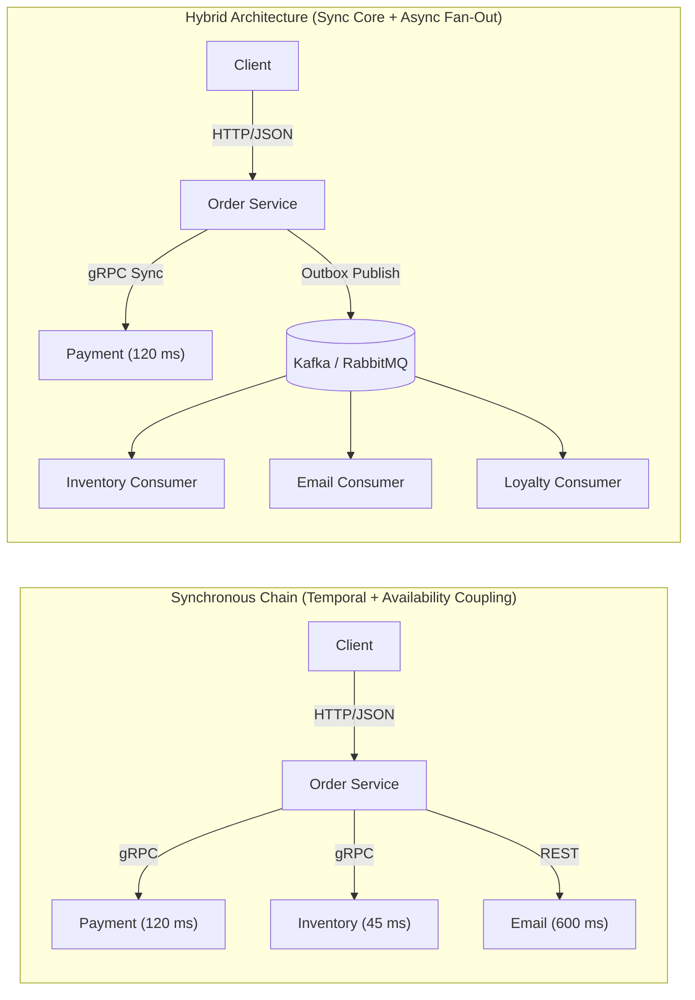
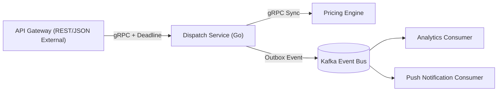

# Sync vs Async Communication in Microservices (REST, gRPC, Events)

> **Prerequisites:** [Lesson 05: Database per Service](../05-database-per-service/README.md) · [Track: Messaging](../../10-messaging/01-why-use-a-message-broker-decoupling-load-levelling-the-costs/README.md).  
> **Estimated Reading Time:** 24–28 minutes  
> **Target Audience:** Backend engineers designing service-to-service APIs, and candidates asked "should these microservices talk via REST, gRPC, or events?"  
> **Free PDF Notes:** [Download SD-L-006.pdf](https://backendroadmap.com/notes/system-design/SD-L-006.pdf)

> [!NOTE]
> **In one line:** Synchronous communication (**REST/HTTP, gRPC**) blocks the caller until a response arrives—ideal for immediate reads and strict commands, but couples availability and tail latency. Asynchronous communication (**events/queues via a broker**) decouples services in time and space, trading immediate answers for resilience, load levelling, and eventual consistency.

> [!TIP]
> **The Golden Rule:** Use **gRPC** for high-throughput internal sync calls, **REST/JSON** at external or polyglot boundaries, and **events** whenever the caller does not need the downstream result to complete the current user request. Never build a distributed monolith out of synchronous chains.

---

## 1. What Sync vs Async Communication Is, and What It Isn't

Consider an e-commerce checkout flow. When a user clicks **Pay Now**, the Order Service must validate the cart, authorize the credit card, reserve warehouse inventory, send a receipt email, update loyalty points, and notify the fraud-training pipeline. If Order Service makes synchronous HTTP calls to all six services sequentially, a 2-second hiccup in the email provider stalls checkout, and an outage in Loyalty Service fails a $500 purchase.

| Term | Precise Meaning | Example |
| :--- | :--- | :--- |
| **Synchronous (Sync)** | Caller sends a request and waits (blocks or awaits) for the reply before proceeding | Checkout calling Payment Service via REST or gRPC |
| **Asynchronous (Async)** | Caller emits a command/event to a broker and proceeds without waiting for processing | Order Service publishing `OrderPlaced` to Kafka |
| **REST (HTTP/1.1 or HTTP/2)** | Resource-oriented, text/JSON over HTTP; human-readable, universal tooling | Public APIs, CRUD gateways, partner webhooks |
| **gRPC (HTTP/2 + Protobuf)** | Binary RPC with strict schemas, multiplexed streams, code-generated stubs | Internal low-latency microservice-to-microservice calls |
| **Event-Driven (Pub/Sub)** | Producer broadcasts immutable facts; unknown consumers react independently | `PaymentCaptured` consumed by Receipt, Analytics, Fraud |
| **Non-blocking I/O ≠ Async Architecture** | Using `async/await` in Node/Go/Python still has *architectural* sync coupling if the caller waits for the downstream HTTP response | `await fetch("http://inventory/reserve")` is still sync coupling |

### Why It Matters
1. **Tail latency amplification:** A synchronous fan-out of 10 services turns a 1% slow tail on each service into a near-certain slow response for the user.
2. **Availability multiplication:** Chaining synchronous dependencies multiplies failure rates—four 99.9% services in series yield only 99.6% availability.
3. **Protocol vs architecture:** Interviewers frequently test whether you confuse *non-blocking code* (`async/await`) with *temporal decoupling* (message brokers), and whether you know when gRPC's binary framing beats REST's JSON overhead.

---

## 2. Anatomy: REST vs gRPC vs Event-Driven Flow



In the hybrid architecture, **only** the Payment authorization remains synchronous because the user cannot be shown "Order Confirmed" if the card is declined. Inventory, Email, and Loyalty consume `OrderPlaced` asynchronously.

| Dimension | REST (HTTP/1.1 + JSON) | gRPC (HTTP/2 + Protobuf) | Events (Kafka / RabbitMQ) |
| :--- | :--- | :--- | :--- |
| **Coupling** | Temporal + Spatial (URL) | Temporal + Spatial (Service) | Decoupled in time and space |
| **Payload format** | Text (JSON), self-describing | Binary (Protobuf), compact | Binary/JSON/Avro + Schema Registry |
| **Typical serialization + wire overhead** | 1x baseline (verbose keys) | 3x–10x smaller & faster | Depends on serializer (Avro/Protobuf) |
| **Streaming support** | Limited (SSE / WebSockets) | Native bidirectional HTTP/2 streams | Native continuous event log |
| **Browser / external support** | Universal (curl, browsers) | Needs gRPC-Web proxy | Needs WebSocket/SSE bridge |
| **Failure handling** | Retries, timeouts, circuit breakers | Deadlines, retries, status codes | Consumer retries, DLQ, idempotency |

> [!WARNING]
> **The #1 Trap — Distributed Monolith:** Turning a monolith's in-memory method calls 1:1 into synchronous REST or gRPC calls across 15 microservices gives you the worst of both worlds: network latency, partial failures, and tight deployment coupling, with none of the independence.

---

## 3. Mathematical Model: Latency, Availability & Tail Amplification

### 3.1 Sequential vs Parallel Latency & Tail Amplification
For $n$ sequential synchronous calls with individual latencies $t_i$, total latency is additive:

$$T_{\text{seq}} = \sum_{i=1}^{n} t_i$$

If the $n$ calls are independent and issued in **parallel** (scatter-gather), total latency is governed by the **maximum** (slowest) call:

$$T_{\text{par}} = \max_{i=1..n} t_i$$

However, parallel fan-out amplifies tail latency. If each service has probability $p$ of exceeding its $p_{99}$ latency ($p = 0.01$), the probability that *at least one* of $n$ parallel calls hits its $p_{99}$ tail is:

$$P(\text{at least one slow}) = 1 - (1 - p)^n$$

**Worked Example:** Suppose Checkout fans out in parallel to $n = 10$ microservices, each with $p_{50} = 15\text{ ms}$ and $p_{99} = 250\text{ ms}$ ($p = 0.01$):

$$P(\text{slow response}) = 1 - (1 - 0.01)^{10} = 1 - 0.9044 = 9.56\%$$

Nearly **1 in 10 users** experiences the 250 ms tail even though every individual service meets its 99% SLO!

### 3.2 Compound Availability
If a request requires $n$ synchronous dependencies in series, each with availability $a_i$:

$$A_{\text{chain}} = \prod_{i=1}^{n} a_i$$

**Worked Example:** With 5 synchronous services at $a_i = 99.9\%$ ($0.999$) each:

$$A_{\text{chain}} = 0.999^5 = 0.99501 \approx 99.50\%$$

Monthly downtime budget jumps from **43.2 minutes** (single 99.9% service) to **3.6 hours** ($5\times$ worse). Moving 3 of those 5 services behind an async broker restores synchronous availability to $0.999^2 = 99.80\%$.

### 3.3 Serialization & Bandwidth Savings (JSON vs Protobuf)
Let $S_{\text{JSON}}$ be JSON payload size and $S_{\text{PB}}$ be Protobuf size (typically $S_{\text{PB}} \approx 0.25\,S_{\text{JSON}}$). At $\lambda = 50{,}000\text{ RPS}$ with $S_{\text{JSON}} = 2\text{ KB}$:

$$\text{BW}_{\text{JSON}} = 50{,}000 \times 2\text{ KB} \times 8 = 800\text{ Mbps} \qquad \text{BW}_{\text{PB}} \approx 200\text{ Mbps}$$

Switching internal hot paths from REST/JSON to gRPC/Protobuf saves **600 Mbps** of NIC bandwidth and ~60–75% of serialization CPU.

---

## 4. Metrics & Percentiles

| Metric | Meaning | Alert when |
| :--- | :--- | :--- |
| **RPC $p_{99}$ / $p_{99.9}$ latency** | Tail latency of sync REST/gRPC calls | Exceeds caller deadline budget |
| **gRPC Deadline Exceeded rate** | Calls aborted because caller's budget ran out | $> 0.5\%$ of total RPCs |
| **Circuit Breaker Open count** | Sync dependency trips breaker due to errors/timeouts | Any critical path opens |
| **Consumer Lag (messages / seconds)** | How far behind async consumers are from producer head | Monotonic growth $> 5\text{ min}$ |
| **DLQ Inflow Rate** | Poison or unprocessable events moved to Dead-Letter Queue | $> 0$ sustained for critical topics |
| **Outbox Relay Delay** | Time between DB commit and broker publish | $> 1\text{ s}$ on user-facing events |

### Worked Example (Checkout Service SLO)
Order Service has a **300 ms** $p_{99}$ SLO for `POST /orders`.
- Local DB transaction + Outbox insert: **18 ms**
- Synchronous gRPC call to Payment Service (deadline **180 ms**): **$p_{99} = 140\text{ ms}$**
- Total synchronous $p_{99} \approx 158\text{ ms}$ (well inside 300 ms budget).
- Meanwhile, `OrderPlaced` is relayed to Kafka within **45 ms**, and Inventory/Email/Loyalty process it asynchronously without touching the 300 ms user budget.

---

## 5. Compounding & Failure Modes

How do sync chains and async brokers behave under partial degradation? Consider a 4-service checkout flow at **1,000 RPS** where the **Email Service** degrades from 20 ms to **2,500 ms** for 5 minutes:

| Failure Mode | Pure Sync Chain (REST/gRPC) | Hybrid (Sync Payment + Async Broker) |
| :--- | :--- | :--- |
| **Thread / Connection Pool** | Order Service threads block 2.5s each; at 1,000 RPS, **2,500 concurrent threads** needed → pool exhaustion | Order Service unaffected; threads finish in 150 ms |
| **Retry Storm** | Callers time out at 1s and retry 3x → **3,000 RPS** hits Email Service, killing it completely | Kafka buffers 300,000 events; Email consumer processes at max safe concurrency |
| **User Impact** | **100% checkout failures** (HTTP 504 Gateway Timeout) | **0% checkout failures**; receipt emails arrive 8 minutes late |
| **Recovery** | Manual intervention or circuit-breaker trip required | Automatic drain once Email Service recovers |

---

## 6. Numbers Every Engineer Must Know

| Item | Typical | Implication |
| :--- | :---: | :--- |
| **Same-AZ gRPC round-trip** | 0.5 – 2 ms | Cheap enough for 1–2 hops, not 20 |
| **Cross-AZ network hop** | 1 – 3 ms | Avoid chatty N+1 RPC loops across AZs |
| **HTTP/1.1 + TLS handshake** | 15 – 45 ms | Always use HTTP/2 connection pooling / keep-alive |
| **JSON vs Protobuf parse** | ~5x slower in JSON | Use Protobuf for high-QPS internal services |
| **Kafka publish ack (`acks=all`)** | 5 – 15 ms | Fast enough for outbox relay; durable across brokers |
| **Max safe sync depth** | $\le 3$ hops | Deeper chains collapse availability and $p_{99}$ |

---

## 7. Protocol Deep Dive: gRPC Deadlines & Event Outbox

```mermaid
sequenceDiagram
    participant C as Client
    participant O as Order Service
    participant DB as Orders DB (Outbox)
    participant P as Payment (gRPC)
    participant K as Kafka Broker
    C->>O: POST /orders (timeout 500ms)
    O->>P: Authorize(deadline=200ms)
    P-->>O: Authorized (110ms)
    O->>DB: BEGIN; INSERT order; INSERT outbox; COMMIT
    O-->>C: 201 Created (145ms)
    Note over DB,K: Async Outbox Relay
    DB->>K: Publish OrderPlaced (idempotency_key)
    K-->>DB: Ack
```

| Question | Answer |
| :--- | :--- |
| **Why propagate gRPC `deadline`?** | If the client gave up at 500 ms, downstream services shouldn't waste CPU finishing work at 800 ms |
| **Why HTTP/2 for gRPC?** | Multiplexes thousands of concurrent RPCs over a single TCP connection, eliminating head-of-line blocking at the HTTP layer |
| **Why not dual-write DB + Kafka?** | If DB commits and Kafka fails (or vice versa), state diverges permanently. Always use the **Transactional Outbox** |
| **How to evolve schemas safely?** | Use Protobuf/Avro field numbers and backward/forward compatibility rules; never reuse or renumber deleted fields |

**When NOT to use gRPC:** Browser-direct public APIs (use REST/JSON or GraphQL), simple low-QPS CRUD where debuggability with `curl` matters more than CPU savings, or third-party webhooks.  
**When NOT to use Async Events:** Authentication checks, real-time inventory locking where the user must immediately know if an item is sold out, or simple 1:1 request-reply where adding a broker only adds latency and operational overhead.

---

## 8. Hierarchical Budgets & Design Rules

| Slice | Rule | Control |
| :--- | :--- | :--- |
| **Call Classification** | Sync only if response is required for current UX; async otherwise | Architecture Decision Record (ADR) per endpoint |
| **Timeouts & Deadlines** | Every sync call must have a strict timeout + propagated deadline | Reject PRs with unbounded HTTP/gRPC clients |
| **Retries** | Retry only idempotent calls with exponential backoff + full jitter | Max 2 retries; respect retry budget ($\le 10\%$) |
| **Circuit Breakers** | Fail fast when downstream error rate $> 50\%$ or timeout spikes | Fallback response or graceful degradation |
| **Async Atomicity** | Use Transactional Outbox + CDC/polling relay | Zero dual-writes between DB and broker |
| **Idempotency** | Include `event_id` / `idempotency_key` in every event & mutation | Deduplicate in consumer DB within same transaction |
| **Schema Governance** | Enforce backward compatibility in CI (Buf / Confluent Schema Registry) | Block breaking Protobuf/Avro changes |

---

## 9. Top Mitigations

1. **Propagate Deadlines End-to-End:** Pass remaining time budget in gRPC metadata (`grpc-timeout`) or HTTP headers so downstream hops abort stale work.
2. **Replace Chatty Sync Calls with Coarse-Grained APIs:** Batch N+1 RPCs (`GetUser(id)` in a loop) into `BatchGetUsers(ids)` to slash tail amplification.
3. **Use the Transactional Outbox Pattern:** Persist domain state and the outgoing event in the same ACID transaction, then relay asynchronously.
4. **Enforce Retry Budgets + Jitter:** Never use fixed-interval retries; cap retries per client to prevent self-inflicted DDoS during recovery.
5. **Isolate Sync Pools (Bulkheads):** Separate thread/connection pools for critical vs non-critical downstream dependencies.
6. **Design UX for Eventual Consistency:** Return `202 Accepted` with a status polling endpoint or WebSocket push for long-running workflows.
7. **Mandate Correlation IDs (`traceparent`):** Inject W3C Trace Context headers into both gRPC metadata and Kafka event headers so distributed traces stay intact.

---

## 10. Production Reference: Uber's Migration from REST/JSON to gRPC & Event-Driven Backends

At hyper-growth scale, Uber's early Python/Node microservices communicated over HTTP/1.1 + JSON. As service depth grew to 10+ hops per trip request, two systemic issues triggered repeated SEV-1 incidents:
- **Serialization & Connection Overhead:** JSON parsing consumed up to 30% of CPU on high-throughput edge services, and HTTP/1.1 connection churn caused ephemeral port exhaustion.
- **Cascading Timeouts:** A 300 ms slowdown in a non-critical pricing-analytics service stalled trip dispatch because synchronous HTTP calls lacked propagated deadlines.



**Fix:** Uber standardized internal service-to-service sync calls on **Protobuf/gRPC** (and TChannel/YARPC) with mandatory propagated deadlines, cutting internal payload sizes by ~70% and eliminating HTTP/1.1 connection storms. Non-critical side effects (receipts, analytics, driver incentives) were moved to **Kafka** event streams so core dispatch remained isolated.

---

## 11. Multi-Language Production Code Tabs

Propagating a deadline on a synchronous call while publishing non-critical work to an async queue with backpressure:

````carousel
```go
// Go: gRPC-style context deadline propagation + non-blocking async event publish.
package main

import (
	"context"
	"errors"
	"fmt"
	"time"
)

var ErrQueueFull = errors.New("async event queue full")

type OrderEvent struct{ OrderID string }

func AuthorizePayment(ctx context.Context, orderID string) error {
	// Respect caller's remaining deadline
	deadline, ok := ctx.Deadline()
	if !ok || time.Until(deadline) < 50*time.Millisecond {
		return errors.New("insufficient time budget for payment")
	}
	select {
	case <-time.After(40 * time.Millisecond): // simulated gRPC call
		return nil
	case <-ctx.Done():
		return ctx.Err()
	}
}

func PlaceOrder(ctx context.Context, orderID string, eventBus chan<- OrderEvent) error {
	// 1. Sync critical call with strict sub-deadline
	payCtx, cancel := context.WithTimeout(ctx, 150*time.Millisecond)
	defer cancel()
	if err := AuthorizePayment(payCtx, orderID); err != nil {
		return fmt.Errorf("payment failed: %w", err)
	}
	// 2. Async non-critical event (non-blocking publish)
	select {
	case eventBus <- OrderEvent{OrderID: orderID}:
		return nil
	default:
		return ErrQueueFull // log or fallback to outbox table
	}
}
```
<!-- slide -->
```typescript
// TypeScript: Sync call with AbortSignal deadline + async event emission.
interface OrderEvent {
  orderId: string;
  occurredAt: string;
}

async function authorizePayment(orderId: string, timeoutMs: number): Promise<void> {
  const controller = new AbortController();
  const timer = setTimeout(() => controller.abort(), timeoutMs);
  try {
    // Simulated sync RPC respecting AbortSignal
    await new Promise<void>((resolve, reject) => {
      const work = setTimeout(resolve, 40);
      controller.signal.addEventListener("abort", () => {
        clearTimeout(work);
        reject(new Error("gRPC DEADLINE_EXCEEDED"));
      });
    });
  } finally {
    clearTimeout(timer);
  }
}

export async function placeOrder(
  orderId: string,
  publishEvent: (ev: OrderEvent) => Promise<void>
): Promise<{ status: string }> {
  await authorizePayment(orderId, 150); // Sync: must succeed now
  // Async: fire-and-forget via durable outbox/broker (never block user response on email)
  void publishEvent({ orderId, occurredAt: new Date().toISOString() }).catch((err) => {
    console.error("Outbox relay will retry:", err);
  });
  return { status: "CONFIRMED" };
}
```
<!-- slide -->
```python
# Python: Tail-latency amplification & sync vs async availability simulator (stdlib).
import random


def simulate_fanout(n_services: int = 10, p50_ms: int = 15, p99_ms: int = 250, trials: int = 10_000):
    """Demonstrates tail amplification when n_services are called in parallel."""
    slow_count = 0
    for _ in range(trials):
        latencies = [p99_ms if random.random() < 0.01 else p50_ms for _ in range(n_services)]
        if max(latencies) >= p99_ms:
            slow_count += 1
    return round(slow_count / trials * 100, 2)


def chain_availability(availabilities: list[float]) -> float:
    """Product of synchronous dependencies."""
    total = 1.0
    for a in availabilities:
        total *= a
    return round(total * 100, 3)


if __name__ == "__main__":
    print(f"10-service parallel tail rate: {simulate_fanout()}% (theoretical: 9.56%)")
    print(f"5 sync services @ 99.9%: {chain_availability([0.999]*5)}%")
    print(f"2 sync + 3 async @ 99.9%: {chain_availability([0.999]*2)}%")
```
<!-- slide -->
```csharp
// C#: Sync HttpClient/gRPC with CancellationToken deadline + Channel<T> async bus.
using System.Threading.Channels;

public record OrderPlaced(string OrderId, DateTimeOffset OccurredAt);

public sealed class OrderCoordinator
{
    private readonly ChannelWriter<OrderPlaced> _eventBus;

    public OrderCoordinator(ChannelWriter<OrderPlaced> eventBus) => _eventBus = eventBus;

    public async Task<string> PlaceOrderAsync(string orderId, CancellationToken callerToken)
    {
        // 1. Strict 150ms deadline for synchronous Payment gRPC call
        using var payCts = CancellationTokenSource.CreateLinkedTokenSource(callerToken);
        payCts.CancelAfter(TimeSpan.FromMilliseconds(150));

        await AuthorizePaymentAsync(orderId, payCts.Token);

        // 2. Non-blocking async publish to bounded channel / outbox
        if (!_eventBus.TryWrite(new OrderPlaced(orderId, DateTimeOffset.UtcNow)))
        {
            throw new InvalidOperationException("Async bus saturated; apply backpressure");
        }
        return "CONFIRMED";
    }

    private static async Task AuthorizePaymentAsync(string orderId, CancellationToken ct) =>
        await Task.Delay(40, ct); // Simulated gRPC call
}
```
````

---

## 12. Hands-On CLI Verification Workflows

Inspect live REST, gRPC, and Kafka endpoints to verify latency, schemas, and consumer lag:

```bash
# 1. Measure HTTP/2 REST latency breakdown (DNS, TLS, TTFB, Total)
curl -w "dns:%{time_namelookup}s tls:%{time_appconnect}s ttfb:%{time_starttransfer}s total:%{time_total}s\n" \
  -o /dev/null -s https://api.example.com/v1/orders/123

# 2. Call and inspect a gRPC service using grpcurl (with 200ms deadline)
grpcurl -plaintext -max-time 0.2 \
  -d '{"order_id": "ord-991", "amount_cents": 4999}' \
  localhost:50051 payment.v1.PaymentService/Authorize

# 3. Validate Protobuf backward compatibility in CI with Buf
buf breaking --against '.git#branch=main'

# 4. Check async consumer lag on Kafka to verify consumers keep up
kafka-consumer-groups.sh --bootstrap-server localhost:9092 \
  --describe --group inventory-service
```

---

## 13. Common Mistakes to Avoid

1. **Confusing `async/await` with asynchronous architecture:** Awaiting an HTTP call still couples availability and latency to the downstream service.
2. **Building a 6-hop synchronous gRPC chain:** Even at 2 ms per hop, tail latency and availability multiply into outages.
3. **Omitting deadlines/timeouts on internal RPCs:** Default infinite timeouts cause thread-pool exhaustion during partial outages.
4. **Using REST/JSON for high-QPS internal chatty loops:** Wastes 60–75% of serialization CPU and network bandwidth compared to gRPC/Protobuf.
5. **Dual-writing to a database and a message broker:** Leads to silent data divergence; always use a Transactional Outbox.
6. **Publishing "fat" vs "thin" events blindly:** Fat events risk stale snapshots and PII leaks; thin events trigger callback storms back to the producer. Balance deliberately.
7. **Retrying non-idempotent POST/gRPC mutations without an idempotency key:** Causes duplicate charges and double-shipped orders.

---

## 14. Key Terms Glossary

| Key Term | Definition |
| :--- | :--- |
| **Temporal Coupling** | Caller cannot proceed until the callee responds (synchronous calls). |
| **Spatial Coupling** | Caller must know the network location/address of the callee. |
| **Tail Latency Amplification** | Probability of hitting a slow tail grows exponentially with parallel fan-out width. |
| **gRPC** | High-performance RPC framework using HTTP/2 transport and Protocol Buffers serialization. |
| **Deadline Propagation** | Passing the remaining time budget across RPC hops so downstream cancels expired work. |
| **Transactional Outbox** | Writing an event to a DB table in the same ACID transaction as domain state, then relaying it. |
| **Idempotency Key** | Unique token allowing receivers to safely deduplicate retried requests or events. |
| **Distributed Monolith** | Microservices tightly coupled by synchronous call chains that must be deployed and scaled together. |
| **Dead-Letter Queue (DLQ)** | Queue holding messages that repeatedly fail processing so they don't block healthy traffic. |
| **Schema Evolution** | Modifying message/RPC schemas without breaking existing producers or consumers. |

---

## 15. System Design Interview Questions & Answers

### Basic Conceptual Questions

<details>
<summary><strong>Q1: What is the difference between REST and gRPC? [BASIC]</strong></summary>

**Answer:**
REST typically uses HTTP/1.1 + text-based JSON, making it human-readable, browser-native, and ideal for external APIs. gRPC uses HTTP/2 + binary Protocol Buffers with strict `.proto` contracts, native multiplexing/streaming, and 3x–10x lower serialization overhead—making it ideal for internal service-to-service communication.
</details>

<details>
<summary><strong>Q2: Does using async/await in my code make my microservices asynchronous? [BASIC]</strong></summary>

**Answer:**
No. `async/await` is non-blocking I/O at the OS thread level—the thread is freed while waiting on the socket, but the *request* still waits for the downstream service to reply. True architectural asynchrony uses a broker (Kafka, RabbitMQ, SQS) so the caller returns before the consumer processes the message.
</details>

<details>
<summary><strong>Q3: When should you choose synchronous communication over asynchronous? [BASIC]</strong></summary>

**Answer:**
Choose sync when the caller needs an immediate answer to continue (e.g., auth verification, live price/inventory check, payment authorization) or when the flow is a simple 1:1 query where eventual consistency would ruin the UX.
</details>

<details>
<summary><strong>Q4: Why do synchronous microservice chains hurt availability? [BASIC]</strong></summary>

**Answer:**
Availability multiplies across synchronous dependencies ($A = \prod a_i$). Five 99.9% services in series drop total availability to $99.5\%$, turning 43 minutes of allowed monthly downtime into 3.6 hours.
</details>

### Scenario-Based Architecture Questions

<details>
<summary><strong>Q5: A user profile page aggregates data from 12 microservices in parallel. p50 is 20ms, but p99 is 400ms. Why? [SCENARIO]</strong></summary>

**Answer:**
Tail latency amplification. Even if each service hits its 400 ms $p_{99}$ only 1% of the time, across 12 parallel calls the probability that *at least one* call is slow is $1 - 0.99^{12} = 11.4\%$. Mitigate via hedged requests, caching, or pre-materializing a read model via async events (CQRS).
</details>

<details>
<summary><strong>Q6: You need to send an email, update analytics, and charge a card on checkout. Design the communication. [SCENARIO]</strong></summary>

**Answer:**
Make **Charge Card** synchronous (gRPC with strict 200 ms–500 ms deadline and idempotency key) because checkout must fail if the card declines. Commit the order and an `OrderPlaced` outbox row in one ACID transaction, then publish to Kafka so Email and Analytics consume asynchronously.
</details>

<details>
<summary><strong>Q7: Your internal Python and Go services exchange 40,000 RPS of 3KB JSON payloads and CPU is maxed out. What do you do? [SCENARIO]</strong></summary>

**Answer:**
Migrate the internal hot path from REST/JSON to **gRPC + Protobuf** over persistent HTTP/2 connections. Binary serialization cuts payload size by ~70% and serialization CPU by 3x–5x, while HTTP/2 multiplexing eliminates TCP/TLS handshake overhead.
</details>

<details>
<summary><strong>Q8: An async consumer crashes mid-processing after charging a customer's wallet. What happens next? [SCENARIO]</strong></summary>

**Answer:**
Because brokers provide at-least-once delivery, the message will be redelivered to another consumer. Without an **idempotency key** checked inside the wallet's DB transaction, the customer gets double-charged. Every state-mutating consumer must be idempotent.
</details>

### Advanced & Tricky Interview Questions

<details>
<summary><strong>Q9: How do you handle a synchronous request-reply experience when the backend is event-driven? [TRICKY]</strong></summary>

**Answer:**
Return `202 Accepted` with a `job_id` / `Location` header. The client either polls `GET /jobs/{id}`, opens a WebSocket/SSE stream for push completion, or receives a webhook. Internally, the worker writes results to a fast store (Redis/DB) or a reply topic keyed by `correlation_id`.
</details>

<details>
<summary><strong>Q10: Why can retries in a synchronous microservice mesh cause a total outage? [TRICKY]</strong></summary>

**Answer:**
Multiplicative retry amplification: if a 3-hop chain each retries 3 times, a slowdown at hop 3 generates $3^3 = 27\times$ traffic, turning a brief brownout into a permanent overload. Mitigate with **retry budgets** (cap retries at 10% of requests), exponential backoff + jitter, and **no retries on non-leaf hops** (retry only at the outermost edge or leaf, never at every layer).
</details>

<details>
<summary><strong>Q11: What is the "fat event" vs "thin event" dilemma in async microservices? [TRICKY]</strong></summary>

**Answer:**
A **thin event** (`{orderId: 123}`) forces 10 consumers to call the Order Service synchronously via REST/gRPC to fetch details—recreating sync coupling and load spikes. A **fat event** embeds the full payload, eliminating callbacks but risking large broker messages, schema coupling, and PII exposure. Often teams use **domain-scoped events** with essential immutable fields plus a Claim Check URL for large blobs.
</details>

<details>
<summary><strong>Q12: How does HTTP/2 multiplexing in gRPC interact with TCP head-of-line blocking? [TRICKY]</strong></summary>

**Answer:**
HTTP/2 eliminates *application-layer* head-of-line blocking by multiplexing many RPC streams over one TCP connection. However, if a single TCP packet is lost on a lossy cross-region link, the OS kernel stalls *all* HTTP/2 streams on that connection until TCP retransmits—making gRPC over HTTP/3 (QUIC) or multiple TCP connections preferable over lossy WANs.
</details>

---

## 16. One-Page Master Cheat Sheet

```
+---------------------------------------------------------------------------------------------------------+
|               SYNC VS ASYNC COMMUNICATION IN MICROSERVICES — MASTER CHEAT SHEET                         |
+---------------------------------------------------------------------------------------------------------+
| 1. SYNC (REST / gRPC): Immediate reply needed. Latency adds (seq) or maxes (par); Availability multiplies.|
|    Tail amplification: P(>=1 slow) = 1 - (1 - p)^n.  5 services @ 99.9% = 99.50% availability.          |
+---------------------------------------------------------------------------------------------------------+
| 2. REST vs gRPC: REST/JSON for external/browser/webhooks. gRPC/Protobuf for internal high-QPS & streams.  |
+---------------------------------------------------------------------------------------------------------+
| 3. ASYNC (Kafka / RabbitMQ): Decouples time & space. Turns spikes into queue delay, not 5xx failures.    |
+---------------------------------------------------------------------------------------------------------+
| 4. NEVER CONFUSE: async/await = non-blocking thread I/O, NOT architectural decoupling.                    |
+---------------------------------------------------------------------------------------------------------+
| 5. RELIABILITY: Propagate gRPC deadlines · Use retry budgets + jitter · Transactional Outbox (no dual   |
|    writes) · Idempotent consumers + DLQ · W3C traceparent across both RPCs and event headers.           |
+---------------------------------------------------------------------------------------------------------+
```

---

## Further Reading & Sources

- Sam Newman, *Building Microservices* (2nd ed.), Chapter 4 ("Integration Styles").
- Martin Kleppmann, *Designing Data-Intensive Applications*, Chapter 4 ("Encoding and Evolution") & Chapter 11 ("Stream Processing").
- Google Cloud Architecture Center, [gRPC vs REST Best Practices](https://cloud.google.com/architecture).
- Chris Richardson, *Microservices Patterns*, Chapter 3 ("Interprocess Communication") & "Transactional Outbox".

---

## Free PDF Notes

[SD-L-006.pdf](https://backendroadmap.com/notes/system-design/SD-L-006.pdf)

---

## Next

Continue with [API Gateway Pattern: Routing, Aggregation & What Never Goes There](../07-api-gateway-pattern/README.md).
