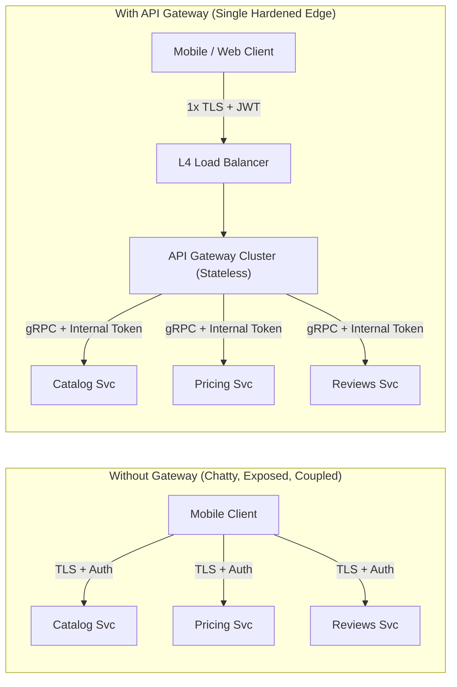
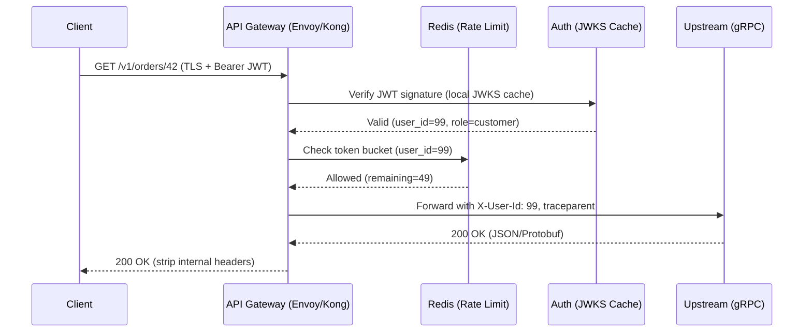
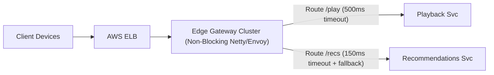

# API Gateway Pattern: Routing, Aggregation & What Never Goes There

> **Prerequisites:** [Lesson 06: Sync vs Async Communication in Microservices](../06-sync-vs-async-communication-in-microservices/README.md).  
> **Estimated Reading Time:** 23–27 minutes  
> **Target Audience:** Backend and platform engineers designing edge ingress, and candidates asked "what belongs in an API Gateway vs inside microservices?"  
> **Free PDF Notes:** [Download SD-L-007.pdf](https://backendroadmap.com/notes/system-design/SD-L-007.pdf)

> [!NOTE]
> **In one line:** An **API Gateway** is the single edge entry point for external clients into a microservice backend—handling cross-cutting concerns (**routing, TLS termination, authN/authZ, rate limiting, and light aggregation**) so individual services stay focused on business logic.

> [!TIP]
> **The Golden Rule:** Keep the API Gateway **thin and stateless**. Put edge security, routing, and rate limiting in the gateway; **never** put domain business logic, database queries, or complex multi-step orchestration there—otherwise your gateway becomes a monolithic bottleneck.

---

## 1. What an API Gateway Is, and What It Isn't

Imagine a mobile app rendering a Product Detail screen. Without an API Gateway, the client must know the DNS names of 6 internal microservices (Catalog, Pricing, Reviews, Inventory, Recommendations, Auth), make 6 separate TLS handshakes over a cellular network, and handle 6 different auth headers. Worse, internal service refactors break mobile apps in the wild. An API Gateway sits at the edge, exposes one clean public endpoint (`api.example.com`), terminates TLS, validates the JWT once, and routes or aggregates calls to internal services.

| Term | Precise Meaning | Example |
| :--- | :--- | :--- |
| **API Gateway** | L7 reverse proxy + policy engine at the edge of microservices | Kong, Envoy, AWS API Gateway, NGINX, APISIX |
| **L4 / L7 Load Balancer** | Distributes TCP/HTTP packets across identical backend instances | AWS NLB/ALB balancing traffic *into* the gateway |
| **Reverse Proxy** | Forwards client requests to an upstream server and returns the response | NGINX proxying `/users` to `users-svc` |
| **Protocol Translation** | Converts external REST/GraphQL into internal gRPC or event publishes | Envoy gRPC-JSON transcoder |
| **Request Aggregation** | Fan-out one external request to $N$ internal services and merge JSON | `GET /product/42` → Catalog + Reviews + Stock |
| **Not** | An ESB (Enterprise Service Bus) or a place for business workflows | Never calculate discounts or run SQL inside the gateway |

### Why It Matters
1. **Security boundary:** Exposes a single hardened perimeter (WAF, TLS 1.3, JWT validation, rate limiting) instead of 40 public microservice ports.
2. **Client-server decoupling:** Internal services can split, merge, or move from REST to gRPC without breaking mobile/web clients.
3. **Interview boundary test:** Almost every system design interview draws an API Gateway at the edge—interviewers will probe whether you know how to scale it, avoid turning it into a SPOF, and keep business logic out of it.

---

## 2. Anatomy: Direct Client-to-Service vs API Gateway



The API Gateway acts as a **stateless horizontal cluster** behind an L4/L7 Load Balancer. It authenticates the external JWT, attaches an internal identity header (or signed mTLS/JWT assertion), enforces per-user rate limits via Redis, and forwards requests over persistent internal HTTP/2 or gRPC connections.

| Responsibility | Belongs in API Gateway? | Why |
| :--- | :---: | :--- |
| **TLS termination & WAF** | Yes | Offloads crypto and blocks OWASP attacks at the edge |
| **JWT / OAuth2 verification** | Yes | Validates signature once before traffic hits internal services |
| **Rate limiting & quotas** | Yes | Stops abusive clients before they exhaust backend DB pools |
| **Path / Header routing** | Yes | Maps `/v1/orders/*` → `orders-svc:8080` |
| **Protocol translation (REST → gRPC)** | Yes | Shields external clients from internal binary protocols |
| **Domain business rules** | **No** | Couples deployments; turns gateway into a monolith |
| **Direct DB queries** | **No** | Violates Database-per-Service and creates a shared-DB bottleneck |
| **Long-running Saga orchestration** | **No** | Ties up gateway memory/sockets; belongs in a workflow engine |

> [!WARNING]
> **The #1 Trap — The "Smart" Gateway (ESB Anti-Pattern):** Teams start by putting "just one" pricing check or DB lookup inside the gateway. Within a year, 10 teams deploy business rules into the gateway repo, turning it into a single point of failure that requires full regression testing for every feature release.

---

## 3. Mathematical Model: Latency Overhead, Connection Savings & Availability

### 3.1 Mobile Latency Savings via Edge Aggregation
Over a 4G/5G cellular network, a client-to-edge RTT is $T_{\text{WAN}} \approx 60\text{ ms}$, whereas internal datacenter RTT is $T_{\text{LAN}} \approx 1.5\text{ ms}$.
- **Without Gateway:** Client makes $k = 4$ sequential/handshaken calls (1 TLS handshake = $2 \times T_{\text{WAN}}$ if not reused, plus 1 RTT per call):

$$T_{\text{direct}} \approx k \cdot (T_{\text{WAN}} + T_{\text{svc}})$$

- **With Gateway:** Client makes **1** WAN round-trip; the gateway fans out $k = 4$ calls over warm LAN connections in parallel:

$$T_{\text{gateway}} \approx T_{\text{WAN}} + T_{\text{gw\_overhead}} + \max_{i=1..k}(T_{\text{LAN}} + T_{\text{svc},i})$$

**Worked Example:** With $T_{\text{WAN}} = 60\text{ ms}$, $T_{\text{LAN}} = 1.5\text{ ms}$, $T_{\text{gw\_overhead}} = 3\text{ ms}$, and 4 services taking $[20, 25, 30, 18]\text{ ms}$:
- Direct (even if 2 sequential batches of 2): $2 \times 60 + 30 + 25 = 175\text{ ms}$ (plus extra TLS handshakes on cold connections: $+120\text{ ms} = 295\text{ ms}$).
- With Gateway: $60 + 3 + (1.5 + 30) = \mathbf{94.5\text{ ms}}$—over **3x faster** on cold mobile networks.

### 3.2 Gateway Availability & Multi-AZ Sizing
Because *all* external traffic transits the gateway, its availability $A_{\text{gw}}$ bounds the entire platform:

$$A_{\text{platform}} \le A_{\text{gw}} \times A_{\text{backend}}$$

To achieve $99.99\%$ ($4.3\text{ min/month}$ downtime), deploy at least $N \ge 3$ stateless gateway nodes across 3 Availability Zones so losing an entire AZ leaves $66\%$ capacity. If each gateway node handles $\mu = 15{,}000\text{ RPS}$ and peak load is $\lambda_{\text{peak}} = 45{,}000\text{ RPS}$, $N+1$ AZ-resilient sizing requires:

$$N_{\text{total}} = \left\lceil \frac{45{,}000}{15{,}000} \right\rceil \times \frac{3}{2} = 5 \text{ to } 6 \text{ nodes (2 per AZ)}$$

---

## 4. Metrics & Percentiles

| Metric | Meaning | Alert when |
| :--- | :--- | :--- |
| **Gateway Overhead ($T_{\text{total}} - T_{\text{upstream}}$)** | Time spent inside proxy, auth, and rate-limit plugins | $p_{99} > 10\text{ ms}$ |
| **5xx Edge Error Rate** | `502 Bad Gateway` / `503` / `504` returned to clients | $> 0.1\%$ for 1 minute |
| **429 Rate-Limited Requests** | Requests rejected by token-bucket/sliding-window limiter | Sudden spike (DDoS or misconfigured client) |
| **Upstream Connection Pool Saturation** | Percentage of open sockets to backend services in use | $> 80\%$ |
| **JWT / JWKS Cache Miss Rate** | Gateway fetching public keys from Auth provider | Any sustained cache miss (risks auth outage) |
| **CPU / Ephemeral Port Usage** | Proxy worker saturation or `TIME_WAIT` port exhaustion | CPU $> 70\%$ or ports $> 75\%$ |

### Worked Example (Edge Rate-Limit Incident)
An API Gateway handles **20,000 RPS** with a Redis-backed rate limiter (1.2 ms $p_{99}$). If Redis becomes unreachable and the rate-limiter plugin is configured **fail-closed** with a 2,000 ms timeout, every incoming request stalls 2 seconds and fails with `500`—taking down the entire company. Configuring the rate limiter **fail-open** with a 15 ms Redis timeout and an **in-memory local fallback** keeps gateway overhead $< 5\text{ ms}$ during a Redis outage.

---

## 5. Compounding & Failure Modes

| Failure Scenario | Without Safeguards | With Production Safeguards |
| :--- | :--- | :--- |
| **Slow Upstream Service** | One slow service (`reviews-svc` at 10s) ties up all gateway worker threads → **all routes fail** | Per-upstream timeouts + circuit breakers + isolated connection pools (bulkheads) |
| **Auth / JWKS Provider Outage** | Gateway fails to verify JWTs → 100% `401/500` across every endpoint | Gateway caches JWKS public keys locally with stale-while-revalidate |
| **Single-Region Gateway SPOF** | Config push with syntax error reloads and crashes all nodes simultaneously | Canary config rollout (1% → 10% → 100%) + declarative schema validation in CI |
| **Large Payload / Slowloris Attack** | Clients upload 500 MB bodies slowly, exhausting gateway RAM | Strict `max_body_size` (e.g., 1 MB) + `client_body_timeout` (5s) |

---

## 6. Numbers Every Engineer Must Know

| Item | Typical | Implication |
| :--- | :---: | :--- |
| **Envoy / NGINX proxy overhead** | 0.5 – 3 ms | Negligible compared to WAN RTT (50–150 ms) |
| **Managed Gateway (AWS API GW)** | 5 – 15 ms | Convenient, but watch per-million-request pricing at high QPS |
| **JWKS key cache TTL** | 5 – 15 min | Prevents auth-server dependency on every request |
| **Default gateway upstream timeout** | 5 – 30 s (often too high!) | Tune per route (e.g., 500 ms reads, 3 s writes) |
| **Max single-node Envoy RPS** | 15,000 – 50,000 RPS | Scales linearly horizontally when stateless |
| **Max HTTP header size** | 8 – 16 KB | Reject oversized cookies/JWTs at the edge |

---

## 7. Protocol Deep Dive: Request Lifecycle Inside an API Gateway



| Question | Answer |
| :--- | :--- |
| **Should internal microservices re-verify the external JWT?** | Typically the gateway verifies the external JWT and injects a signed internal token or mTLS identity; zero-trust architectures also validate internal tokens |
| **What if a route needs data from 3 services?** | Light read-only aggregation (scatter-gather) is okay in small doses, but if mobile vs web diverge, extract it into a **BFF** (Lesson 08) |
| **How do you prevent header spoofing?** | The gateway **strips** any client-supplied `X-User-Id` or `X-Internal-Role` headers before injecting verified claims |

**When NOT to use an API Gateway:** Internal-only service-to-service communication (use a **Service Mesh** or direct DNS/gRPC instead of routing internal traffic back out through the edge gateway), or a tiny 1–2 service MVP where a simple cloud Load Balancer suffices.

---

## 8. Hierarchical Budgets & Design Rules

| Slice | Rule | Control |
| :--- | :--- | :--- |
| **Statelessness** | Zero local session state on gateway nodes | Any node can serve any request; scale via HPA |
| **Business Logic** | Zero domain rules, SQL, or multi-step mutations | Code review + plugin allowlist |
| **Header Hygiene** | Strip untrusted `X-*` identity headers at ingress | Mandatory ingress filter |
| **Timeouts & Circuit Breakers** | Explicit per-route timeout; never infinite | Route config schema validation in CI |
| **Rate Limiting** | Fail-open with local in-memory fallback if Redis fails | Chaos test Redis outage |
| **Config Deployment** | Declarative GitOps (YAML/CRD) with canary rollout | Reject manual UI edits in production |
| **Observability** | Emit access logs, latency histograms, and `traceparent` | OpenTelemetry + Prometheus exporter |

---

## 9. Top Mitigations

1. **Enforce Header Stripping:** Always overwrite/strip `X-User-Id`, `X-Roles`, and `X-Forwarded-*` from untrusted clients to prevent privilege escalation.
2. **Cache Auth Keys Locally:** Store JWKS public keys in memory with background refresh so an Auth Service blip doesn't cause a site-wide outage.
3. **Fail-Open Rate Limiting:** If the distributed Redis rate-limit store times out ($> 15\text{ ms}$), fall back to an in-process token bucket rather than dropping valid traffic.
4. **Separate Gateways for External vs Internal (East-West) Traffic:** Never hairpin internal microservice calls through the public API Gateway.
5. **Version & Deprecate Routes Gracefully:** Support `/v1/` and `/v2/` routing simultaneously with `Sunset` response headers.
6. **Canary Gateway Configs:** Roll out route/plugin changes to 1% of gateway pods first; a bad regex in a gateway config can take down 100% of traffic.

---

## 10. Production Reference: Netflix Zuul & Amazon API Gateway Patterns

Netflix pioneered the modern API Gateway with **Zuul** (handling tens of billions of daily edge requests). Early on, Netflix learned two hard lessons:
- **Blocking I/O Collapse (Zuul 1 → Zuul 2):** Zuul 1 used synchronous blocking servlets; when a single downstream service slowed down, Zuul's thread pool filled up and starved unrelated routes. Migrating to **Zuul 2** (non-blocking Netty event loops) eliminated thread-per-request exhaustion.
- **Per-Route Isolation:** Netflix enforced strict **Hystrix/Resilience4j** timeouts and concurrency limits per downstream route so a slow recommendation service never starved playback.



**Lesson:** An API Gateway's #1 job under partial failure is **blast-radius containment**—using non-blocking I/O, per-route timeouts, and fast fallbacks.

---

## 11. Multi-Language Production Code Tabs

A minimal, production-shaped **stateless API Gateway middleware pipeline** (JWT verification, header stripping, token-bucket rate limiting, and upstream reverse proxy with timeout):

````carousel
```go
// Go: Minimal API Gateway reverse proxy with auth, header stripping, rate limit & timeout.
package main

import (
	"context"
	"net/http"
	"net/http/httputil"
	"net/url"
	"sync"
	"time"
)

type TokenBucket struct {
	mu     sync.Mutex
	tokens float64
	last   time.Time
}

func (b *TokenBucket) Allow(rate, burst float64) bool {
	b.mu.Lock()
	defer b.mu.Unlock()
	now := time.Now()
	b.tokens += now.Sub(b.last).Seconds() * rate
	if b.tokens > burst {
		b.tokens = burst
	}
	b.last = now
	if b.tokens < 1 {
		return false
	}
	b.tokens--
	return true
}

func NewGatewayHandler(upstreamURL string, bucket *TokenBucket) http.Handler {
	target, _ := url.Parse(upstreamURL)
	proxy := httputil.NewSingleHostReverseProxy(target)

	return http.HandlerFunc(func(w http.ResponseWriter, r *http.Request) {
		// 1. Strip untrusted internal identity headers
		r.Header.Del("X-User-Id")
		// 2. Authenticate (stubbed JWT verification)
		if r.Header.Get("Authorization") == "" {
			http.Error(w, "unauthorized", http.StatusUnauthorized)
			return
		}
		// 3. Rate limit (10 req/s, burst 20)
		if !bucket.Allow(10, 20) {
			http.Error(w, "rate limit exceeded", http.StatusTooManyRequests)
			return
		}
		// 4. Inject verified identity + enforce 500ms upstream timeout
		r.Header.Set("X-User-Id", "user-99")
		ctx, cancel := context.WithTimeout(r.Context(), 500*time.Millisecond)
		defer cancel()
		proxy.ServeHTTP(w, r.WithContext(ctx))
	})
}
```
<!-- slide -->
```typescript
// TypeScript: Express/Fastify-style API Gateway middleware with timeout & header hygiene.
import http from "node:http";

interface RouteTarget {
  prefix: string;
  upstream: string;
  timeoutMs: number;
}

const ROUTES: RouteTarget[] = [
  { prefix: "/v1/orders", upstream: "http://orders-svc:8080", timeoutMs: 500 },
  { prefix: "/v1/catalog", upstream: "http://catalog-svc:8081", timeoutMs: 250 },
];

export async function gatewayHandler(req: http.IncomingMessage, res: http.ServerResponse) {
  const path = req.url ?? "/";
  const route = ROUTES.find((r) => path.startsWith(r.prefix));
  if (!route) {
    res.writeHead(404).end("Route not found");
    return;
  }

  // Strip untrusted headers and verify auth token
  const headers = { ...req.headers };
  delete headers["x-user-id"];
  if (!headers["authorization"]) {
    res.writeHead(401).end("Missing Bearer token");
    return;
  }
  headers["x-user-id"] = "verified-user-99";

  // Forward with strict per-route AbortSignal timeout
  const controller = new AbortController();
  const timer = setTimeout(() => controller.abort(), route.timeoutMs);
  try {
    const upstreamRes = await fetch(`${route.upstream}${path}`, {
      method: req.method,
      headers: headers as Record<string, string>,
      signal: controller.signal,
    });
    res.writeHead(upstreamRes.status, Object.fromEntries(upstreamRes.headers));
    res.end(Buffer.from(await upstreamRes.arrayBuffer()));
  } catch {
    res.writeHead(504).end("Gateway Timeout");
  } finally {
    clearTimeout(timer);
  }
}
```
<!-- slide -->
```python
# Python: API Gateway latency & availability calculator (stdlib) + route policy check.
def gateway_latency(wan_ms=60.0, gw_overhead_ms=3.0, lan_ms=1.5, service_latencies=(20, 25, 30, 18)):
    """Compare direct multi-call mobile latency vs single-WAN-hop gateway aggregation."""
    direct_cold_ms = len(service_latencies) * wan_ms + sum(service_latencies)
    gw_parallel_ms = wan_ms + gw_overhead_ms + lan_ms + max(service_latencies)
    return {"direct_sequential_ms": direct_cold_ms, "gateway_parallel_ms": gw_parallel_ms}


def validate_route_policy(route: dict) -> list[str]:
    """CI linter: reject dangerous gateway configurations."""
    errors = []
    if route.get("timeout_ms", 0) <= 0 or route["timeout_ms"] > 5000:
        errors.append("timeout_ms must be between 1 and 5000")
    if not route.get("strip_headers"):
        errors.append("must strip untrusted identity headers")
    if route.get("contains_sql"):
        errors.append("anti-pattern: no DB access in gateway")
    return errors


if __name__ == "__main__":
    print(gateway_latency())
    print(validate_route_policy({"timeout_ms": 500, "strip_headers": True}))
```
<!-- slide -->
```csharp
// C#: YARP-style / ASP.NET Core API Gateway middleware with timeout & header hygiene.
using System.Net;

public sealed class GatewayMiddleware
{
    private readonly HttpClient _http;
    private readonly Dictionary<string, (Uri Upstream, TimeSpan Timeout)> _routes = new()
    {
        ["/v1/orders"] = (new Uri("http://orders-svc:8080"), TimeSpan.FromMilliseconds(500)),
        ["/v1/catalog"] = (new Uri("http://catalog-svc:8081"), TimeSpan.FromMilliseconds(250))
    };

    public GatewayMiddleware(HttpClient http) => _http = http;

    public async Task InvokeAsync(HttpContext ctx)
    {
        var match = _routes.FirstOrDefault(r => ctx.Request.Path.StartsWithSegments(r.Key));
        if (match.Key is null) { ctx.Response.StatusCode = 404; return; }

        if (!ctx.Request.Headers.ContainsKey("Authorization"))
        {
            ctx.Response.StatusCode = (int)HttpStatusCode.Unauthorized;
            return;
        }

        using var cts = CancellationTokenSource.CreateLinkedTokenSource(ctx.RequestAborted);
        cts.CancelAfter(match.Value.Timeout);

        var targetUri = new Uri(match.Value.Upstream, ctx.Request.Path + ctx.Request.QueryString);
        using var req = new HttpRequestMessage(new HttpMethod(ctx.Request.Method), targetUri);
        // Strip untrusted headers and inject verified claim
        req.Headers.Add("X-User-Id", "verified-user-99");

        using var resp = await _http.SendAsync(req, cts.Token);
        ctx.Response.StatusCode = (int)resp.StatusCode;
        await resp.Content.CopyToAsync(ctx.Response.Body, cts.Token);
    }
}
```
````

---

## 12. Hands-On CLI Verification Workflows

```bash
# 1. Verify API Gateway strips spoofed internal headers
curl -i -H "X-User-Id: admin-spoof" -H "Authorization: Bearer <valid_jwt>" \
  https://api.example.com/v1/orders/42

# 2. Test rate limiting (429 Too Many Requests + Retry-After header)
for i in {1..25}; do
  curl -s -o /dev/null -w "%{http_code}\n" https://api.example.com/v1/catalog
done | sort | uniq -c

# 3. Validate Kong declarative config before CI/CD deploy
deck validate --state kong.yaml

# 4. Inspect Envoy proxy upstream stats & circuit breakers
curl -s http://localhost:9901/stats | grep -E "upstream_rq_(5xx|timeout)|circuit_breakers"
```

---

## 13. Common Mistakes to Avoid

1. **Putting business logic or database queries inside the gateway:** Creates a tightly coupled bottleneck that slows down every team.
2. **Trusting client-supplied `X-User-Id` headers without stripping them first:** Critical privilege-escalation vulnerability.
3. **Making the rate limiter fail-closed on Redis timeouts:** Turns a cache hiccup into a 100% platform outage.
4. **Routing internal service-to-service traffic through the public API Gateway:** Adds unnecessary WAN/TLS hops and creates a hairpin bottleneck.
5. **Using a single global timeout (e.g., 60s) for all routes:** Slow routes exhaust connections for fast routes.
6. **Deploying gateway configs without canarying:** A bad regex or plugin config breaks all ingress simultaneously.
7. **Building one giant gateway for wildly different clients (Mobile, Web, IoT, Partners):** Leads to bloated payloads and conflicting release cycles—solved by the **BFF pattern** (Lesson 08).

---

## 14. Key Terms Glossary

| Key Term | Definition |
| :--- | :--- |
| **API Gateway** | Single L7 entry point handling routing, auth, rate limiting, and protocol translation. |
| **Cross-Cutting Concerns** | Platform-wide needs (TLS, auth, logging, throttling) handled once at the edge. |
| **Protocol Translation** | Converting external HTTP/REST/GraphQL into internal gRPC or events. |
| **Fail-Open vs Fail-Closed** | Allowing vs blocking traffic when an auxiliary dependency (e.g., rate-limit Redis) fails. |
| **Header Stripping** | Removing untrusted client headers before injecting verified gateway claims. |
| **JWKS (JSON Web Key Set)** | Public keys cached by the gateway to verify JWTs locally without calling Auth per request. |
| **Scatter-Gather** | Gateway pattern that fans out one request to $N$ services and merges the responses. |
| **ESB Anti-Pattern** | Overloading a gateway with heavy orchestration, transformations, and business rules. |
| **Bulkhead Isolation** | Separate connection/thread pools per upstream so one slow service doesn't starve others. |
| **North-South vs East-West** | External client-to-edge traffic (North-South) vs internal service-to-service traffic (East-West). |

---

## 15. System Design Interview Questions & Answers

### Basic Conceptual Questions

<details>
<summary><strong>Q1: What is the difference between a Load Balancer and an API Gateway? [BASIC]</strong></summary>

**Answer:**
A Load Balancer (L4/L7) distributes traffic across identical backend instances for availability and scaling. An API Gateway sits behind or alongside it to handle application-level concerns: path-based routing to *different* microservices, JWT authentication, rate limiting, request/response transformation, and light aggregation.
</details>

<details>
<summary><strong>Q2: Why shouldn't clients call microservices directly? [BASIC]</strong></summary>

**Answer:**
Direct calls expose internal topology, require clients to manage N endpoints and auth schemes, suffer high mobile latency from multiple WAN round-trips, and couple client releases to internal service refactors.
</details>

<details>
<summary><strong>Q3: What belongs in an API Gateway, and what never goes there? [BASIC]</strong></summary>

**Answer:**
**Belongs:** TLS termination, WAF, JWT verification, rate limiting, routing, protocol translation (REST→gRPC), and basic aggregation. **Never goes there:** domain business logic, direct DB queries, or multi-step Saga orchestration.
</details>

<details>
<summary><strong>Q4: Is an API Gateway a single point of failure? [BASIC]</strong></summary>

**Answer:**
Logically it is a single entry point, so it *must* be deployed as a stateless, horizontally scaled cluster across multiple Availability Zones behind an L4 Load Balancer with canary config rollouts.
</details>

### Scenario-Based Architecture Questions

<details>
<summary><strong>Q5: Your API Gateway uses Redis for rate limiting. Redis goes down for 2 minutes. Should the gateway fail-open or fail-closed? [SCENARIO]</strong></summary>

**Answer:**
For general API throttling, **fail-open** with a fast timeout (e.g., 15 ms) and an in-memory local token bucket fallback so legitimate users aren't locked out. Only security-critical checks (like auth signature verification) should fail-closed.
</details>

<details>
<summary><strong>Q6: A single slow downstream service (Reviews taking 15s) causes 504 timeouts on the unrelated Checkout route. Why and how do you fix it? [SCENARIO]</strong></summary>

**Answer:**
The gateway shared a global worker/connection pool or lacked per-route timeouts. Fix by configuring **non-blocking I/O**, **bulkhead isolation** (separate upstream pools), strict per-route timeouts (e.g., 300 ms for Reviews), and circuit breakers with a graceful fallback (hide reviews rather than failing checkout).
</details>

<details>
<summary><strong>Q7: Mobile users complain the Product page takes 400ms on 4G because it makes 5 API calls. How does an API Gateway help? [SCENARIO]</strong></summary>

**Answer:**
The gateway exposes a single aggregated endpoint (`GET /v1/products/{id}/summary`). The mobile client makes 1 WAN round-trip (60 ms), and the gateway fans out to the 5 internal services in parallel over warm LAN connections (~1.5 ms RTT), cutting total latency by 3x.
</details>

<details>
<summary><strong>Q8: Should internal microservice-to-microservice calls go through the API Gateway? [SCENARIO]</strong></summary>

**Answer:**
No. Routing East-West traffic through the external North-South gateway adds extra network hops, wastes gateway capacity, and couples internal traffic to edge policies. Use internal service discovery (Kubernetes DNS, Consul) or a Service Mesh (Lesson 09).
</details>

### Advanced & Tricky Interview Questions

<details>
<summary><strong>Q9: How do you prevent a malicious client from spoofing internal identity headers? [TRICKY]</strong></summary>

**Answer:**
The gateway must **unconditionally strip** all internal identity headers (`X-User-Id`, `X-Tenant-Id`, `X-Roles`) from incoming external requests before validating the JWT and re-injecting verified claims. Additionally, internal services should only accept traffic from the gateway's mTLS identity or verify a short-lived internal signed JWT.
</details>

<details>
<summary><strong>Q10: How do you deploy API Gateway routing changes without risking a global outage? [TRICKY]</strong></summary>

**Answer:**
Treat gateway configuration as code (GitOps) with automated schema/regex linting in CI, automated integration tests against a staging cluster, and progressive canary rollouts (1% → 10% → 50% → 100%) with automatic rollback on 5xx spikes.
</details>

<details>
<summary><strong>Q11: If your Auth Service goes down, why shouldn't every API request fail? [TRICKY]</strong></summary>

**Answer:**
Because stateless JWTs are self-contained and signed with asymmetric keys (RS256/EdDSA). The gateway caches the Auth Service's public JWKS keys in memory and verifies tokens locally at sub-millisecond speed—only refreshing keys periodically in the background.
</details>

<details>
<summary><strong>Q12: When does a single API Gateway become an architectural bottleneck, and what replaces it? [TRICKY]</strong></summary>

**Answer:**
When Mobile, Web, Smart TV, and Third-Party Partners all demand conflicting payload shapes, aggregation logic, and release cadences from one shared gateway. That's when you split the edge into **Backend-for-Frontend (BFF)** services (Lesson 08).
</details>

---

## 16. One-Page Master Cheat Sheet

```
+---------------------------------------------------------------------------------------------------------+
|                    API GATEWAY PATTERN — MASTER CHEAT SHEET                                             |
+---------------------------------------------------------------------------------------------------------+
| 1. ROLE: Single stateless edge entry point for North-South traffic (routing, TLS, auth, rate limits).   |
+---------------------------------------------------------------------------------------------------------+
| 2. NEVER PUT HERE: Business logic, SQL/DB access, or long-running Sagas (avoid the ESB anti-pattern).   |
+---------------------------------------------------------------------------------------------------------+
| 3. LATENCY WIN: Turns N WAN round-trips into 1 WAN + N parallel LAN calls (3x+ faster on mobile).       |
+---------------------------------------------------------------------------------------------------------+
| 4. SECURITY: Cache JWKS locally · Strip client X-User-Id headers · Enforce max body size & timeouts.    |
+---------------------------------------------------------------------------------------------------------+
| 5. RESILIENCE: Multi-AZ stateless cluster · Non-blocking I/O · Bulkheads · Fail-open rate limiting.     |
+---------------------------------------------------------------------------------------------------------+
| 6. EVOLUTION: When Web, Mobile & Partners conflict on one gateway -> split into BFFs (Lesson 08).       |
+---------------------------------------------------------------------------------------------------------+
```

---

## Further Reading & Sources

- Chris Richardson, *Microservices Patterns*, Chapter 8 ("External API Patterns: API Gateway").
- Sam Newman, *Building Microservices* (2nd ed.), Chapter 4 & "Backends for Frontends".
- Microsoft Azure Architecture Center, [Gateway Aggregation & Gateway Routing Patterns](https://learn.microsoft.com/en-us/azure/architecture/patterns/gateway-aggregation).
- Envoy Proxy Documentation, [Edge Proxy Architecture & Rate Limiting](https://www.envoyproxy.io/docs/envoy/latest/).

---

## Free PDF Notes

[SD-L-007.pdf](https://backendroadmap.com/notes/system-design/SD-L-007.pdf)

---

## Next

Continue with [Backend-for-Frontend (BFF): Why One Gateway Isn't Enough](../08-backend-for-frontend/README.md).
