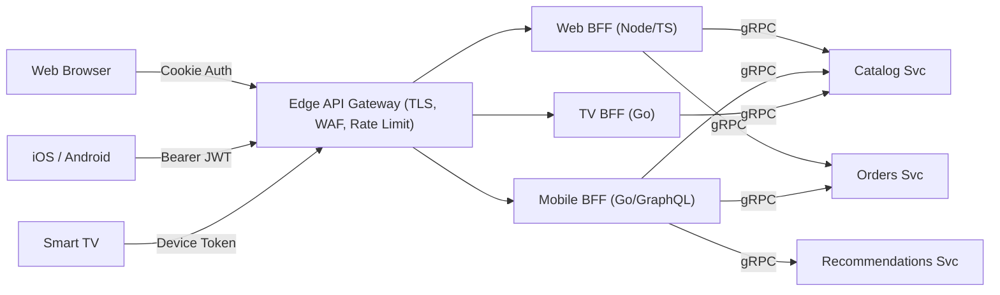
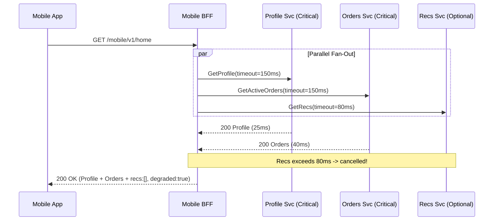
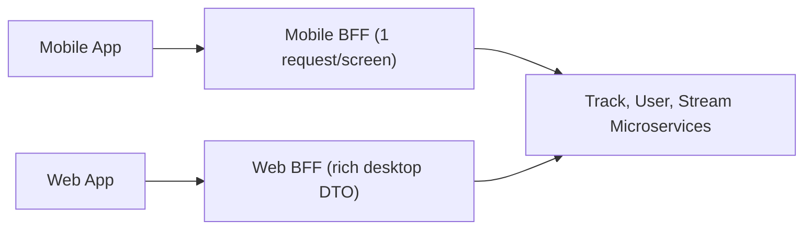

# Backend-for-Frontend (BFF): Why One Gateway Isn't Enough

> **Prerequisites:** [Lesson 07: API Gateway Pattern](../07-api-gateway-pattern/README.md).  
> **Estimated Reading Time:** 22–26 minutes  
> **Target Audience:** Full-stack, mobile, and backend architects designing multi-client platforms, and candidates asked "how do you serve Web, iOS, Android, and third-party APIs cleanly?"  
> **Free PDF Notes:** [Download SD-L-008.pdf](https://backendroadmap.com/notes/system-design/SD-L-008.pdf)

> [!NOTE]
> **In one line:** The **Backend-for-Frontend (BFF)** pattern places a dedicated, client-specific adapter service behind the edge for each distinct user experience (**Web, Mobile, TV, Partner**), tailoring payloads, aggregation, and auth flows without polluting core microservices or bloating a single general-purpose API Gateway.

> [!TIP]
> **The Golden Rule:** One BFF per **user experience / team**, not one per OS (unless iOS and Android diverge wildly). Keep **shared domain logic** in downstream microservices and **presentation/aggregation logic** in the BFF.

---

## 1. What a BFF Is, and What It Isn't

Suppose your company has a rich Desktop Web app, a bandwidth-constrained iOS/Android Mobile app, and a Smart TV app.
- **Desktop Web** wants a 45-field JSON payload with full seller analytics, pagination tables, and cookie-based OAuth sessions.
- **Mobile** wants a tiny 6-field summary payload with pre-formatted currency strings, compressed image URLs, and refresh-token auth.
- **Smart TV** wants a D-pad-friendly carousel with pre-fetched next-page metadata.

If you force all three through **one** general-purpose API Gateway, that gateway bloats with `if (client == "mobile")` branches, over-fetches data for mobile, and becomes a deployment bottleneck where the Web team's PR breaks the Mobile team's release. A **BFF** splits that presentation layer into dedicated backends owned by each client team.

| Term | Precise Meaning | Example |
| :--- | :--- | :--- |
| **BFF (Backend-for-Frontend)** | A dedicated backend service tailored to one specific client experience | `mobile-bff`, `web-bff`, `tv-bff` |
| **General API Gateway** | Single shared edge proxy for TLS, WAF, rate limiting, and routing | Envoy / Kong sitting *in front of* the BFFs |
| **Over-fetching** | Sending 40 KB of unused fields to a mobile client that only renders 4 KB | Desktop DTO reused on 3G mobile |
| **Under-fetching** | Client forced to make 6 sequential API calls to render one screen | Calling `/user`, `/orders`, `/recs` separately |
| **Conway's Law Alignment** | Aligning service ownership with frontend team boundaries | Mobile team owns `mobile-bff` |
| **Not** | A place to duplicate core business rules (pricing, tax, inventory) | BFFs *compose* services; they don't own domain state |

### Why It Matters
1. **Payload & battery efficiency:** Mobile apps download 5x–10x less JSON and make 1 request per screen instead of 6.
2. **Independent team velocity:** The Web team can deploy `web-bff` 10 times a day without coordinating with the iOS release cycle.
3. **Security tailored to client:** Web BFF can store OAuth tokens securely in `HttpOnly` cookies (never exposing tokens to browser JS), while Mobile BFF uses PKCE + bearer tokens.

---

## 2. Anatomy: Single Gateway vs Edge Gateway + BFFs



Notice the clean layering: the **Edge API Gateway** still handles global infrastructure concerns (TLS, DDoS/WAF, global rate limiting, routing `/web/*` → `web-bff` and `/mobile/*` → `mobile-bff`), while each **BFF** handles client-specific aggregation, field projection, and error formatting.

| Aspect | Single General Gateway | Gateway + BFFs |
| :--- | :--- | :--- |
| **Team Ownership** | Shared platform bottleneck | Frontend/experience teams own their BFF |
| **Payload Optimization** | Lowest common denominator (bloated) | Tailored per client (minimal bytes) |
| **Release Coupling** | Web change can break Mobile | Independent deploys per experience |
| **Auth Strategy** | Compromised one-size-fits-all | Web (`HttpOnly` cookie) vs Mobile (PKCE/JWT) |
| **Operational Overhead** | 1 service to run | $K$ BFF services to deploy, monitor, and patch |

> [!WARNING]
> **The #1 Trap — Duplicating Business Logic Across BFFs:** If `web-bff` and `mobile-bff` both implement their own discount calculation or inventory validation, they will inevitably drift—causing customers to see one price on Web and another on Mobile. **Core business rules belong strictly in downstream domain services.**

---

## 3. Mathematical Model: Mobile Bandwidth, Battery & Tail Latency

### 3.1 Payload Reduction & Time-to-First-Render
Suppose a shared API returns $S_{\text{shared}} = 48\text{ KB}$ of JSON, whereas a Mobile BFF trims unused fields and returns $S_{\text{BFF}} = 6\text{ KB}$ (compressed $\approx 1.8\text{ KB}$). Over a congested 3G/4G link at effective throughput $B = 400\text{ Kbps}$ ($50\text{ KB/s}$) with $T_{\text{WAN}} = 80\text{ ms}$:
- **Without BFF (3 sequential under-fetched calls of 48 KB total):**

$$T_{\text{no\_bff}} = 3 \times 80\text{ ms} + \frac{48\text{ KB}}{50\text{ KB/s}} = 240 + 960 = \mathbf{1{,}200\text{ ms}}$$

- **With Mobile BFF (1 aggregated, trimmed call of 6 KB):**

$$T_{\text{bff}} = 80\text{ ms} + T_{\text{lan\_fanout}} + \frac{6\text{ KB}}{50\text{ KB/s}} = 80 + 35 + 120 = \mathbf{235\text{ ms}}$$

That is a **5.1x speedup** on constrained mobile networks and dramatically lower cellular radio wake-time (battery savings).

### 3.2 Cost of N+1 BFFs (Duplication Factor)
If you have $M$ client experiences and $S$ downstream services, each BFF adds a small maintenance footprint. The key metric is **logic duplication ratio**:

$$R_{\text{dup}} = \frac{\text{LOC of shared domain rules in BFFs}}{\text{Total BFF LOC}}$$

Healthy BFFs keep $R_{\text{dup}} \approx 0$ by delegating all domain calculations to downstream services and sharing only thin SDK/gRPC client libraries.

---

## 4. Metrics & Percentiles

| Metric | Meaning | Alert when |
| :--- | :--- | :--- |
| **BFF Screen Latency $p_{95}$ / $p_{99}$** | End-to-end time for a composite screen endpoint | Exceeds client UX budget (e.g., $> 300\text{ ms}$) |
| **Partial Degradation Rate** | Requests served with optional widgets omitted (graceful fallback) | $> 2\%$ (indicates downstream brownout) |
| **Payload Size $p_{95}$ (KB)** | Response bytes per client endpoint | Regresses $> 20\%$ on Mobile BFF |
| **Fan-out Amplification** | Average downstream RPCs triggered per 1 BFF request | Unexpected jump (N+1 loop regression) |
| **BFF Error Rate (5xx)** | Unhandled failures in BFF aggregation | $> 0.1\%$ |

### Worked Example (Home Screen Partial Degradation)
`mobile-bff`'s `GET /mobile/home` fans out to 4 services with a **200 ms** total budget:
1. `UserProfile` (critical, 150 ms timeout)
2. `ActiveOrders` (critical, 150 ms timeout)
3. `Recommendations` (optional, 80 ms timeout)
4. `PromoBanner` (optional, 60 ms timeout)

If `Recommendations` spikes to 500 ms, `mobile-bff` cancels it at 80 ms, returns `recommendations: []` with `degraded: ["recommendations"]`, and still renders the Home screen in **155 ms** instead of failing the app launch.

---

## 5. Compounding & Failure Modes

| Failure Scenario | Without Graceful BFF Design | With Production BFF Safeguards |
| :--- | :--- | :--- |
| **Optional Service Slowdown** | `Promotions` hangs → entire Home Screen returns `500` | Tighter timeout on optional calls + partial response fallback |
| **N+1 Fan-out Bug** | BFF loops over 20 orders calling `GetItem(id)` 20 times | Use batch gRPC endpoints (`BatchGetItems`) + concurrency limits |
| **Code Drift Across BFFs** | Web and Mobile show different tax/discount totals | Single source of truth in `Pricing Service`; BFFs only format display |
| **BFF Explosion** | Team creates 12 micro-BFFs (iOS, iPad, Android, Watch, etc.) | Consolidate by *experience/team* (e.g., one `mobile-bff` for iOS+Android) |

---

## 6. Numbers Every Engineer Must Know

| Item | Typical | Implication |
| :--- | :---: | :--- |
| **BFF fan-out width** | 2 – 6 parallel RPCs | Beyond 8–10, tail amplification spikes; consider CQRS read model |
| **Mobile JSON payload target** | $< 15\text{ KB}$ (gzipped) | Keeps 3G/4G render under 250 ms |
| **BFF per-hop timeout** | 50 – 250 ms | Optional widgets get tighter timeouts than critical ones |
| **Optimal BFF count** | 2 – 4 (Web, Mobile, Partner/TV) | More than 1 per frontend team creates unnecessary ops overhead |
| **Language choice** | TypeScript/Node, Go, or Kotlin | Match the frontend/full-stack team's skills for fast iteration |

---

## 7. Protocol Deep Dive: BFF Scatter-Gather & Partial Failure



| Question | Answer |
| :--- | :--- |
| **Can GraphQL act as a BFF?** | Yes—a GraphQL server (e.g., Apollo) owned by the Web/Mobile team is a classic BFF implementation, though REST/JSON endpoints are often simpler and easier to cache at the CDN |
| **Should Web and Mobile share a BFF?** | Only if their data needs, auth flows, and release cadences are identical; once they diverge, split them |
| **Where does authentication happen?** | Edge Gateway validates the external token/cookie (or Web BFF exchanges OAuth code into an `HttpOnly` cookie session) and passes user identity downstream |

**When NOT to use a BFF:** You only have a single client type (e.g., only a Web SPA), your API is a uniform public developer API, or your team is too small (< 5 engineers) to justify maintaining multiple edge services.

---

## 8. Hierarchical Budgets & Design Rules

| Slice | Rule | Control |
| :--- | :--- | :--- |
| **Ownership** | Owned by the corresponding client/experience team | Separate repo/service per BFF |
| **Domain Logic** | Zero business state or DB ownership in BFF | Stateless; calls domain services only |
| **Resilience** | Classify every downstream call as **Critical** or **Optional** | Optional calls have aggressive timeouts + fallbacks |
| **Batching** | Never loop single-item RPCs inside a BFF | Require `Batch*` endpoints on domain services |
| **Shared Libraries** | Share only generated gRPC/OpenAPI clients & telemetry middleware | Never share business-logic packages across BFFs |
| **Caching** | Short-TTL edge/Redis caching per client shape if read-heavy | Vary cache key by `user_segment` / `locale` |

---

## 9. Top Mitigations

1. **Tag Every Downstream Call as Critical vs Optional:** Return degraded-but-usable screens when optional widgets (recommendations, badges, banners) time out.
2. **Use `HttpOnly` Cookies in Web BFF:** Keep OAuth access/refresh tokens server-side in `web-bff` so browser JavaScript (and XSS attacks) can never steal tokens.
3. **Cap Fan-Out & Use Batch RPCs:** Replace N+1 loops with batch calls to keep tail latency predictable.
4. **Keep Business Rules in Domain Services:** If two BFFs need the same calculation, push it down into a domain microservice immediately.
5. **Avoid BFF Proliferation:** Do not create separate BFFs for iOS vs Android unless their UX diverges fundamentally; use feature flags or API versioning first.
6. **Propagate `traceparent` Across Fan-Out:** Ensure distributed traces link the single BFF request to all parallel downstream RPCs.

---

## 10. Production Reference: SoundCloud's BFF Evolution

SoundCloud famously documented its move from a monolithic API to microservices and **BFFs** (popularized by Sam Newman based on SoundCloud's architecture). Initially, SoundCloud built one shared public API for Web, iOS, Android, and third-party partners.
- **The Pain:** Mobile teams waited weeks for backend teams to add a single field to the shared API, while mobile clients had to make 10+ requests to assemble a stream view—causing poor startup performance and battery drain.
- **The Fix:** SoundCloud introduced dedicated BFFs owned by the Web, Mobile, and Embedded Player teams. Each BFF aggregated internal microservices into a single tailored payload per screen, cutting mobile startup requests and letting frontend teams ship independently.



---

## 11. Multi-Language Production Code Tabs

A BFF screen-aggregation handler demonstrating **parallel fan-out**, **critical vs optional timeouts**, and **client-tailored payload projection**:

````carousel
```go
// Go: Mobile BFF home-screen aggregator with critical vs optional timeouts.
package main

import (
	"context"
	"sync"
	"time"
)

type HomeResponse struct {
	UserName string   `json:"userName"`
	Orders   []string `json:"orders"`
	Recs     []string `json:"recs"`
	Degraded bool     `json:"degraded"`
}

func BuildMobileHome(ctx context.Context, userID string) (HomeResponse, error) {
	var (
		wg       sync.WaitGroup
		resp     HomeResponse
		critErr  error
		mu       sync.Mutex
	)

	// Critical: User Profile (150ms budget)
	wg.Add(1)
	go func() {
		defer wg.Done()
		c, cancel := context.WithTimeout(ctx, 150*time.Millisecond)
		defer cancel()
		name, err := fetchProfile(c, userID)
		mu.Lock()
		if err != nil { critErr = err } else { resp.UserName = name }
		mu.Unlock()
	}()

	// Optional: Recommendations (80ms budget, graceful fallback)
	wg.Add(1)
	go func() {
		defer wg.Done()
		c, cancel := context.WithTimeout(ctx, 80*time.Millisecond)
		defer cancel()
		recs, err := fetchRecs(c, userID)
		mu.Lock()
		if err != nil {
			resp.Recs = []string{}
			resp.Degraded = true
		} else {
			resp.Recs = recs
		}
		mu.Unlock()
	}()

	wg.Wait()
	return resp, critErr
}

func fetchProfile(ctx context.Context, id string) (string, error) { return "Alice", nil }
func fetchRecs(ctx context.Context, id string) ([]string, error) { return []string{"item-1"}, nil }
```
<!-- slide -->
```typescript
// TypeScript: Mobile BFF aggregator using Promise.allSettled for partial degradation.
interface MobileHomeDTO {
  userName: string;
  activeOrderCount: number;
  recs: string[];
  degraded: boolean;
}

async function withTimeout<T>(promise: Promise<T>, ms: number): Promise<T> {
  return Promise.race([
    promise,
    new Promise<T>((_, reject) => setTimeout(() => reject(new Error("timeout")), ms)),
  ]);
}

export async function getMobileHome(userId: string): Promise<MobileHomeDTO> {
  const [profileRes, ordersRes, recsRes] = await Promise.allSettled([
    withTimeout(fetchProfile(userId), 150),   // Critical
    withTimeout(fetchOrders(userId), 150),    // Critical
    withTimeout(fetchRecs(userId), 80),       // Optional
  ]);

  if (profileRes.status === "rejected" || ordersRes.status === "rejected") {
    throw new Error("Critical dependency failed");
  }

  const degraded = recsRes.status === "rejected";
  return {
    userName: profileRes.value.name,          // Projected: only fields mobile renders
    activeOrderCount: ordersRes.value.length, // Projected: count instead of full order list
    recs: degraded ? [] : recsRes.value,
    degraded,
  };
}

const fetchProfile = async (id: string) => ({ name: "Alice", internalAuditId: "x" });
const fetchOrders = async (id: string) => [{ id: "o1" }];
const fetchRecs = async (id: string) => ["item-1", "item-2"];
```
<!-- slide -->
```python
# Python: Mobile vs Web BFF payload & latency simulation (stdlib asyncio).
import asyncio


async def fetch_critical_profile():
    await asyncio.sleep(0.025)
    return {"name": "Alice", "tier": "Gold", "audit_logs": ["..." for _ in range(50)]}


async def fetch_optional_recs(delay_s=0.12):
    await asyncio.sleep(delay_s)
    return ["item-1", "item-2"]


async def mobile_bff_home():
    profile_task = asyncio.wait_for(fetch_critical_profile(), timeout=0.15)
    recs_task = asyncio.wait_for(fetch_optional_recs(delay_s=0.12), timeout=0.08)

    profile, recs_result = await asyncio.gather(profile_task, recs_task, return_exceptions=True)
    if isinstance(profile, Exception):
        raise profile

    degraded = isinstance(recs_result, Exception)
    return {
        "userName": profile["name"],  # Trimmed payload for mobile
        "recs": [] if degraded else recs_result,
        "degraded": degraded,
    }


if __name__ == "__main__":
    print(asyncio.run(mobile_bff_home()))
```
<!-- slide -->
```csharp
// C#: Mobile BFF parallel fan-out with partial fallback in ASP.NET Core.
public record MobileHomeDto(string UserName, IReadOnlyList<string> Recs, bool Degraded);

public sealed class MobileHomeBff
{
    public async Task<MobileHomeDto> GetHomeAsync(string userId, CancellationToken ct)
    {
        using var critCts = CancellationTokenSource.CreateLinkedTokenSource(ct);
        critCts.CancelAfter(150);

        using var optCts = CancellationTokenSource.CreateLinkedTokenSource(ct);
        optCts.CancelAfter(80);

        var profileTask = FetchProfileAsync(userId, critCts.Token);
        var recsTask = FetchOptionalRecsAsync(userId, optCts.Token);

        var name = await profileTask; // Critical: throws if failed/timed out
        string[] recs;
        var degraded = false;
        try
        {
            recs = await recsTask;
        }
        catch (OperationCanceledException)
        {
            recs = Array.Empty<string>();
            degraded = true;
        }
        return new MobileHomeDto(name, recs, degraded);
    }

    private static Task<string> FetchProfileAsync(string id, CancellationToken ct) => Task.FromResult("Alice");
    private static Task<string[]> FetchOptionalRecsAsync(string id, CancellationToken ct) => Task.FromResult(new[] { "item-1" });
}
```
````

---

## 12. Hands-On CLI Verification Workflows

```bash
# 1. Compare payload size between Web BFF and Mobile BFF for the same screen
curl -s -w "web_bytes:%{size_download}\n" -o /dev/null https://api.example.com/web/v1/home
curl -s -w "mobile_bytes:%{size_download}\n" -o /dev/null https://api.example.com/mobile/v1/home

# 2. Verify graceful partial degradation when an optional downstream service is blocked
curl -s https://api.example.com/mobile/v1/home | jq '{userName, degraded, recs}'

# 3. Check compressed payload size on Mobile BFF
curl -s -H "Accept-Encoding: gzip" -w "gzip_bytes:%{size_download}\n" -o /dev/null \
  https://api.example.com/mobile/v1/home
```

---

## 13. Common Mistakes to Avoid

1. **Duplicating business logic (tax, pricing, eligibility) inside multiple BFFs:** Leads to inconsistent behavior across Web and Mobile.
2. **Creating a separate BFF for every device/OS unnecessarily:** Maintain `mobile-bff` for iOS + Android unless they truly diverge.
3. **Failing the whole screen when an optional widget times out:** Always classify downstream calls as Critical vs Optional.
4. **Putting an N+1 RPC loop in the BFF:** A loop of 30 `GetProduct` calls destroys $p_{99}$ latency; use batch endpoints.
5. **Removing the Edge API Gateway completely:** You still want one shared ingress for TLS, WAF, and global DDoS/rate limiting in front of your BFFs.
6. **Sharing a database between BFFs:** BFFs should be stateless aggregators, not database owners.
7. **Coupling BFF deployments to core microservice deployments:** Each BFF should deploy independently.

---

## 14. Key Terms Glossary

| Key Term | Definition |
| :--- | :--- |
| **Backend-for-Frontend (BFF)** | Client-specific backend adapter tailored to one UX (Web, Mobile, TV). |
| **Over-fetching** | Returning more fields than the client needs, wasting bandwidth and parse CPU. |
| **Under-fetching** | Requiring multiple sequential client round-trips to render one view. |
| **Partial Degradation** | Returning a valid response with optional widgets omitted when a non-critical service fails. |
| **Conway's Law** | System architecture mirrors the communication structure of the organization. |
| **Edge API Gateway** | Shared ingress layer sitting in front of BFFs for TLS, WAF, and rate limiting. |
| **Payload Projection** | Selecting and reshaping only the fields a specific client screen needs. |
| **Token Handler Pattern** | Web BFF storing OAuth tokens in `HttpOnly` cookies so browser JS never sees them. |
| **Critical vs Optional Call** | Classifying downstream RPCs by whether failure aborts the screen or triggers a fallback. |
| **Fan-Out Aggregation** | Issuing parallel downstream RPCs from the BFF and merging results. |

---

## 15. System Design Interview Questions & Answers

### Basic Conceptual Questions

<details>
<summary><strong>Q1: What is the Backend-for-Frontend (BFF) pattern? [BASIC]</strong></summary>

**Answer:**
A BFF is a dedicated backend service built for a specific user experience (e.g., `web-bff`, `mobile-bff`). Instead of one general-purpose API Gateway trying to satisfy all clients, each BFF tailors aggregation, payload shape, and authentication to its client.
</details>

<details>
<summary><strong>Q2: How does a BFF differ from an API Gateway? [BASIC]</strong></summary>

**Answer:**
An API Gateway is a single shared infrastructure edge handling TLS, WAF, routing, and rate limiting. A BFF sits behind (or extends) that edge as a client-owned application service handling screen-specific composition and payload projection.
</details>

<details>
<summary><strong>Q3: Why not just have one BFF for iOS, one for Android, one for iPad, and one for Web? [BASIC]</strong></summary>

**Answer:**
Because every BFF adds deployment, monitoring, and maintenance overhead. You create one BFF per *distinct user experience* (typically Web, Mobile, TV/Partner)—not per OS, unless iOS and Android diverge substantially.
</details>

<details>
<summary><strong>Q4: Should a BFF have its own database? [BASIC]</strong></summary>

**Answer:**
Generally no. A BFF is a stateless composition layer calling downstream domain microservices. (The only exception is a lightweight session/cache store like Redis for Web `HttpOnly` cookie sessions or short-TTL view caching.)
</details>

### Scenario-Based Architecture Questions

<details>
<summary><strong>Q5: Mobile app startup makes 6 API calls and takes 1.4s on 3G. How do you fix it with a BFF? [SCENARIO]</strong></summary>

**Answer:**
Create a `GET /mobile/v1/bootstrap` endpoint on `mobile-bff`. The app makes 1 WAN call, `mobile-bff` fans out to the 6 services in parallel over fast LAN connections, strips unused fields (shrinking JSON from e.g. 48 KB to 6 KB), and returns a single compressed payload in ~235 ms.
</details>

<details>
<summary><strong>Q6: Your Web app and Mobile app show different final checkout prices. What went wrong? [SCENARIO]</strong></summary>

**Answer:**
Domain business logic (discount/tax calculation) was duplicated inside `web-bff` and `mobile-bff` and drifted out of sync. Move all pricing logic into a single `Pricing Service` and restrict BFFs strictly to calling it and formatting the display.
</details>

<details>
<summary><strong>Q7: The Recommendations service is down, and now the Mobile Home screen won't load. How should the BFF handle this? [SCENARIO]</strong></summary>

**Answer:**
Classify Recommendations as an **optional** dependency with an aggressive timeout (e.g., 80 ms) and a circuit breaker. On timeout/error, `mobile-bff` returns `recs: []` and `degraded: true` so the user still sees their profile and orders.
</details>

<details>
<summary><strong>Q8: How do you handle authentication differently for a Web SPA vs a Mobile App using BFFs? [SCENARIO]</strong></summary>

**Answer:**
`web-bff` implements the **Token Handler Pattern**: it performs the OAuth2 exchange server-side and issues an `HttpOnly`, `SameSite=Strict`, `Secure` cookie to the browser so XSS cannot steal JWTs. `mobile-bff` accepts standard OAuth2 PKCE + Bearer JWTs stored in the device's secure enclave/keychain.
</details>

### Advanced & Tricky Interview Questions

<details>
<summary><strong>Q9: When is GraphQL a good fit for a BFF, and when is REST better? [TRICKY]</strong></summary>

**Answer:**
GraphQL shines when multiple rapidly evolving UI views query a rich graph of entities and frontend teams want declarative field selection without backend PRs. REST BFF endpoints are better when you need simple HTTP/CDN caching, strict bandwidth predictability, and simpler security/rate-limiting (no query-depth DoS).
</details>

<details>
<summary><strong>Q10: How do you prevent a BFF from becoming a bottleneck for 500-person engineering orgs? [TRICKY]</strong></summary>

**Answer:**
If 20 squads all commit to one `web-bff`, it becomes a monolith again. Split by **vertical product slice** (e.g., `web-checkout-bff`, `web-catalog-bff`) behind the Edge Gateway, or use **GraphQL Federation** where each domain team owns its subgraph.
</details>

<details>
<summary><strong>Q11: What happens to tail latency if a BFF fans out to 10 downstream services? [TRICKY]</strong></summary>

**Answer:**
Tail latency amplifies ($1 - 0.99^{10} \approx 9.6\%$ slow requests). Mitigate by keeping fan-out $\le 5$ services, setting tighter timeouts on optional widgets, caching semi-static data in Redis, or pre-joining read models asynchronously via CQRS.
</details>

<details>
<summary><strong>Q12: How do you avoid an N+1 RPC storm inside a BFF? [TRICKY]</strong></summary>

**Answer:**
Never call `GetItem(id)` inside a `for` loop over 50 search results. Require downstream microservices to expose **batch endpoints** (`BatchGetItems(ids[])`), or use a DataLoader-style request-scoped batcher in the BFF.
</details>

---

## 16. One-Page Master Cheat Sheet

```
+---------------------------------------------------------------------------------------------------------+
|                    BACKEND-FOR-FRONTEND (BFF) — MASTER CHEAT SHEET                                      |
+---------------------------------------------------------------------------------------------------------+
| 1. WHY: One general gateway bloats, over-fetches for mobile, and couples Web/Mobile release cycles.     |
+---------------------------------------------------------------------------------------------------------+
| 2. ARCHITECTURE: Client -> Edge API Gateway (TLS, WAF, Rate Limit) -> Client BFF -> Core Microservices. |
+---------------------------------------------------------------------------------------------------------+
| 3. GOLDEN RULE: 1 BFF per UX/Team (Web, Mobile, TV). Put presentation in BFF; business rules in Core.   |
+---------------------------------------------------------------------------------------------------------+
| 4. MOBILE WIN: 1 WAN hop + trimmed JSON (48 KB -> 6 KB) cuts 3G/4G screen load by ~5x.                  |
+---------------------------------------------------------------------------------------------------------+
| 5. RESILIENCE: Tag calls Critical vs Optional · Tight timeouts + partial fallback · Batch RPCs (no N+1).|
+---------------------------------------------------------------------------------------------------------+
| 6. SECURITY: Web BFF uses HttpOnly cookies (Token Handler); Mobile BFF uses PKCE + Bearer JWT.          |
+---------------------------------------------------------------------------------------------------------+
```

---

## Further Reading & Sources

- Sam Newman, [Pattern: Backends For Frontends](https://samnewman.io/patterns/architectural/bff/).
- Microsoft Azure Architecture Center, [Backends for Frontends Pattern](https://learn.microsoft.com/en-us/azure/architecture/patterns/backends-for-frontends).
- Phil Calçado, *How We Ended Up With Microservices* (SoundCloud BFF case study).
- OAuth 2.0 for Browser-Based Applications (IETF BCP) — BFF Token Handler Pattern.

---

## Free PDF Notes

[SD-L-008.pdf](https://backendroadmap.com/notes/system-design/SD-L-008.pdf)

---

## Next

Continue with [Service Mesh Explained: mTLS, Retries & Telemetry (Istio, Linkerd)](../09-service-mesh-explained/README.md).
