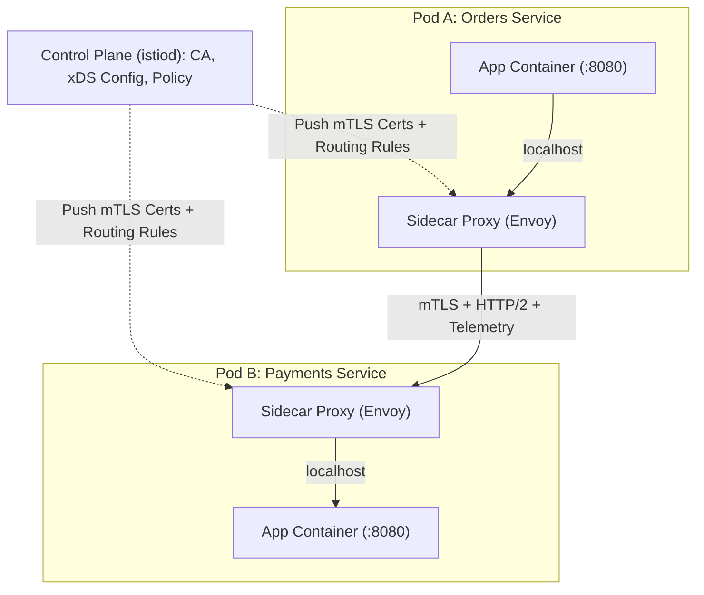
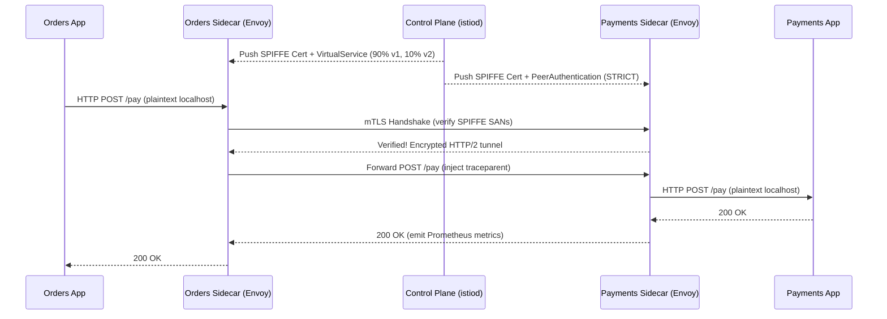
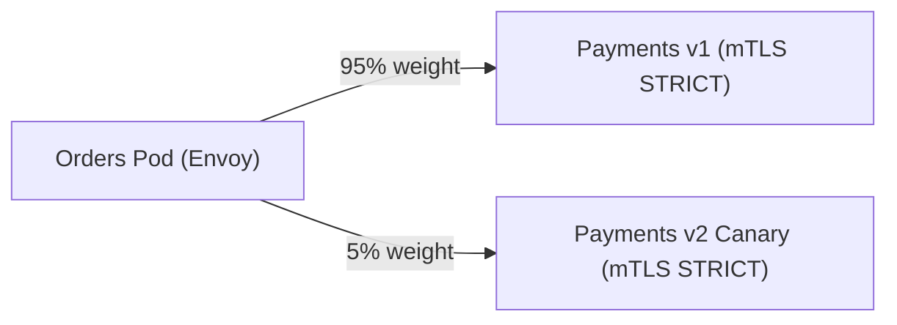

# Service Mesh Explained: mTLS, Retries & Telemetry (Istio, Linkerd)

> **Prerequisites:** [Lesson 08: Backend-for-Frontend (BFF)](../08-backend-for-frontend/README.md).  
> **Estimated Reading Time:** 24–28 minutes  
> **Target Audience:** Platform, SRE, and backend engineers running polyglot microservices, and candidates asked "when do you need a Service Mesh vs an API Gateway or client libraries?"  
> **Free PDF Notes:** [Download SD-L-009.pdf](https://backendroadmap.com/notes/system-design/SD-L-009.pdf)

> [!NOTE]
> **In one line:** A **Service Mesh** (Istio, Linkerd, Cilium) is a dedicated infrastructure layer that handles **service-to-service (East-West) networking**—delivering automatic **mTLS encryption, L7 traffic splitting, retries/timeouts, and Golden Signals telemetry**—without changing a single line of application code.

> [!TIP]
> **The Golden Rule:** Use an **API Gateway** for external North-South edge traffic and a **Service Mesh** for internal East-West traffic—**only** when polyglot teams, zero-trust mTLS compliance, or canary traffic shifting justify the CPU, memory, and operational tax.

---

## 1. What a Service Mesh Is, and What It Isn't

When you have 50 microservices written in Go, Python, Java, and Node.js, every team ends up re-implementing the same networking boilerplate: TLS certificate rotation, retry with jitter, circuit breaking, Prometheus latency histograms, and distributed trace header propagation. A single bug in the Python retry library causes a retry storm, while Java teams forget to rotate TLS certs. A **Service Mesh** extracts all of that East-West networking logic out of application libraries and into a uniform **Data Plane** (typically an out-of-process Envoy or Linkerd2-proxy sidecar, or kernel eBPF) managed by a central **Control Plane**.

| Term | Precise Meaning | Example |
| :--- | :--- | :--- |
| **Data Plane** | High-speed proxies intercepting all pod-to-pod traffic | Envoy (Istio), Linkerd2-proxy, Cilium eBPF |
| **Control Plane** | Central brain pushing xDS routing, certs, and policies to proxies | `istiod`, `linkerd-destination` |
| **mTLS (Mutual TLS)** | Both client and server proxies verify X.509 SPIFFE identities | `spiffe://cluster.local/ns/prod/sa/orders` |
| **East-West Traffic** | Internal service-to-service communication inside the cluster | `orders-svc` → `payments-svc` |
| **North-South Traffic** | External client-to-cluster traffic entering at the edge | Mobile App → API Gateway |
| **L7 Traffic Splitting** | Routing percentages of HTTP/gRPC traffic by weight or headers | 95% `v1`, 5% `v2` canary |
| **Not** | A replacement for an API Gateway or application-level idempotency | Proxies can't make non-idempotent POSTs safe to retry |

### Why It Matters
1. **Zero-trust security by default:** Automatic mTLS with short-lived (e.g., 24-hour) rotated certificates satisfies SOC2/PCI-DSS without app code changes.
2. **Consistent polyglot observability:** Every service—even legacy binaries—emits identical RED metrics (Rate, Errors, Duration) and trace spans.
3. **Architecture trade-off clarity:** Interviewers love asking *"why not just put Istio on everything?"*—expecting you to quantify the latency, RAM, and debugging tax.

---

## 2. Anatomy: Control Plane vs Data Plane (Sidecar & Ambient)



In the classic **sidecar model**, `iptables` (or eBPF) transparently redirects all inbound and outbound TCP packets from Pod A's app container through its local Envoy sidecar. Envoy upgrades the connection to **mTLS**, applies L7 routing/retries, records latency histograms, and forwards to Pod B's sidecar, which terminates mTLS and delivers plaintext HTTP/gRPC over `localhost` to App B. (Newer **sidecarless / Ambient Mesh** modes use a per-node L4 `ztunnel` + optional L7 waypoint proxy to cut memory overhead.)

| Feature | Client Libraries (e.g., Resilience4j) | Service Mesh (Istio / Linkerd) |
| :--- | :--- | :--- |
| **Language support** | Must build & maintain per language | Polyglot (works for Go, Python, C++, legacy) |
| **Latency overhead** | ~0 ms (in-process) | +1 – 3 ms per hop (2 extra proxy hops) |
| **Memory overhead** | Minimal | ~50 – 150 MB RAM per Envoy sidecar |
| **mTLS cert rotation** | Hard; app restarts or custom reloaders | Automatic, zero-downtime via Control Plane |
| **Operational complexity** | Low infra ops, high library drift | High infra ops (xDS, iptables, upgrades) |

> [!WARNING]
> **The #1 Trap — Blindly Enabling Mesh Retries:** If you turn on automatic HTTP retries in Istio/Linkerd for `POST /payments` without idempotency keys, the mesh will silently double-charge customers during transient 503s. **Never enable mesh-level retries on non-idempotent endpoints.**

---

## 3. Mathematical Model: Sidecar Resource Tax & Latency Overhead

### 3.1 Cluster Memory & CPU Tax
Every pod with a sidecar pays a fixed proxy memory footprint $M_{\text{proxy}}$ and CPU cost $C_{\text{proxy}}$ proportional to RPS. For a cluster with $N_{\text{pods}}$:

$$M_{\text{mesh}} = N_{\text{pods}} \times M_{\text{proxy}} + M_{\text{control\_plane}}$$

**Worked Example (Envoy vs Linkerd):**
Suppose you run $N_{\text{pods}} = 2{,}000$ microservices pods:
- **Envoy (Istio sidecar):** $M_{\text{proxy}} \approx 100\text{ MB}$ → $2{,}000 \times 100\text{ MB} = \mathbf{200\text{ GB RAM}}$ just for sidecars, plus ~0.35 vCPU per 1,000 RPS per proxy.
- **Linkerd2-proxy (Rust):** $M_{\text{proxy}} \approx 25\text{ MB}$ → $2{,}000 \times 25\text{ MB} = \mathbf{50\text{ GB RAM}}$ (4x lighter).

### 3.2 End-to-End Latency Overhead
Each service-to-service hop passes through **two** proxies (client-side outbound + server-side inbound). If each proxy adds $t_{\text{proxy}} \approx 1.2\text{ ms}$ at $p_{99}$:

$$\Delta T_{\text{mesh}} = 2 \times h \times t_{\text{proxy}}$$

For a call chain of $h = 4$ internal hops, the mesh adds $2 \times 4 \times 1.2 = \mathbf{9.6\text{ ms}}$ at $p_{99}$. For most web backends (SLO 200 ms) that is acceptable; for ultra-low-latency HFT or in-memory cache lookups (< 1 ms), it is prohibitive.

---

## 4. Metrics & Percentiles

| Metric | Meaning | Alert when |
| :--- | :--- | :--- |
| **Proxy $p_{99}$ Overhead** | `istio_request_duration_milliseconds` minus app duration | $> 5\text{ ms}$ per hop |
| **Control Plane xDS Push Latency** | Time to propagate route/endpoint updates to all proxies | $> 2\text{ s}$ (stale routing risk) |
| **mTLS Handshake Failure Rate** | Cert mismatch, expired SPIFFE SVID, or clock skew | $> 0$ in `STRICT` mode |
| **Sidecar Memory / OOMKills** | Envoy RSS hitting container memory limit (common with huge xDS config) | $> 80\%$ of limit |
| **503 `UC` / `UF` Envoy Flags** | Upstream connection reset / failure inside mesh | Sudden spike during deploys |

### Worked Example (xDS Config Bloat OOM)
A cluster grows to 1,500 Kubernetes Services. By default, Istio pushes *every* service's endpoints to *every* Envoy sidecar, swelling Envoy's config memory from 80 MB to **420 MB** and triggering OOMKills across pods. Applying Istio `Sidecar` CRDs to scope each namespace's `egress` visibility to only its actual dependencies cuts Envoy RAM back down to **65 MB**.

---

## 5. Compounding & Failure Modes

| Failure Scenario | Cause | Impact & Blast Radius |
| :--- | :--- | :--- |
| **Control Plane (`istiod`) Outage** | Bad CRD or OOM on `istiod` | Existing data-plane traffic continues, but **new pods can't get mTLS certs** and scaling/IP changes stall |
| **mTLS `STRICT` Cutover** | Enabling `STRICT` mTLS before legacy cronjobs have sidecars | Instant 100% connection reset for non-mesh callers |
| **App vs Mesh Timeout Mismatch** | App timeout is 500 ms, Mesh timeout is 15s (default) | App gives up while Envoy keeps retrying in the background |
| **Double Retries** | App retries 3x AND Envoy retries 3x | $3 \times 3 = 9\times$ traffic amplification during brownouts |

---

## 6. Numbers Every Engineer Must Know

| Item | Typical | Implication |
| :--- | :---: | :--- |
| **Sidecar latency per hop (2 proxies)** | 1 – 3 ms ($p_{99}$) | Fine for business microservices; avoid for Redis/Memcached calls |
| **Istio Envoy RAM per pod** | 60 – 150 MB | Scope `Sidecar` egress rules to prevent xDS bloat |
| **Linkerd2-proxy RAM per pod** | 15 – 40 MB | Lighter Rust proxy when you don't need full Envoy extensibility |
| **mTLS cert rotation interval** | 24 hours (SPIFFE) | Zero-downtime rotation without app restarts |
| **Control plane xDS sync time** | < 500 ms | Large clusters (> 5,000 pods) need scoped namespaces |

---

## 7. Protocol Deep Dive: mTLS Handshake & L7 Canary Routing



| Question | Answer |
| :--- | :--- |
| **How does the app talk to the sidecar without code changes?** | An `initContainer` programs `iptables` (or eBPF) in the pod network namespace to hijack all inbound/outbound TCP ports and route them through the proxy |
| **How does L7 routing work if traffic is encrypted?** | The proxy *terminates* mTLS (or originates it), so it inspects HTTP/gRPC headers, paths, and status codes before re-encrypting |
| **What about Ambient Mesh (sidecarless)?** | Splits L4 mTLS (`ztunnel` DaemonSet per node) from L7 processing (shared `waypoint` proxy), reducing per-pod RAM by ~70% |

**When NOT to use a Service Mesh:** You have fewer than ~15–20 microservices, your stack is homogeneous (e.g., all Go or all JVM with one shared RPC library), or your workload is ultra-low-latency (sub-millisecond Redis/trading pipelines) where proxy hops hurt more than they help.

---

## 8. Hierarchical Budgets & Design Rules

| Slice | Rule | Control |
| :--- | :--- | :--- |
| **mTLS Rollout** | Always start in `PERMISSIVE` mode, verify metrics, then `STRICT` | Gradual namespace-by-namespace enforcement |
| **Retries** | Only retry idempotent `GET`/`HEAD` or idempotency-keyed calls | Disable mesh retries if app already retries |
| **xDS Scoping** | Restrict every namespace's `Sidecar` egress to known dependencies | Prevents O(N²) Envoy memory growth |
| **Trace Propagation** | Apps MUST still forward `traceparent` / `x-request-id` from inbound to outbound | Mesh cannot correlate inbound-to-outbound inside app memory |
| **Bypass for Stateful Hot Paths** | Exclude high-QPS DB/Redis ports if native TLS is already used | `traffic.sidecar.istio.io/excludeOutboundPorts` |
| **Control Plane HA** | Run $\ge 2$ `istiod` replicas across AZs with PDBs | PodDisruptionBudget + resource reservations |

---

## 9. Top Mitigations

1. **Scope `Sidecar` Visibility:** Use `Sidecar` resources per namespace so Envoy only loads routes it actually calls, slashing RAM and CPU.
2. **Avoid Retry Stacking:** Pick *one* layer (either the app SDK or the mesh, never both) to perform retries, and set `retryOn` strictly to safe/idempotent conditions.
3. **Roll Out mTLS via `PERMISSIVE` → `STRICT`:** Monitor `istio_requests_total{connection_security_policy="none"}` before flipping to `STRICT`.
4. **Still Propagate Trace Headers in App Code:** A service mesh can't guess which outbound call belongs to which inbound request inside your app's thread pool—always forward W3C `traceparent`.
5. **Use Outlier Detection (Circuit Breaking):** Eject unhealthy pod IPs from the client-side load-balancing pool for 30s after 5 consecutive `5xx` errors.
6. **Pin Control Plane Versions & Canary Upgrades:** Upgrade `istiod` with canary revisions (`istiod-1-22`) and migrate namespaces incrementally.

---

## 10. Production Reference: Canary Rollout & Zero-Trust mTLS Migration

A fintech platform running 120 Kubernetes services (Go, Python, Java) faced a PCI-DSS audit requiring **encrypted and authenticated East-West traffic** with 24-hour certificate rotation, plus safe **5% canary deployments** for its Payments engine.



**Execution:**
1. Deployed Istio in `PERMISSIVE` mode across namespaces to capture baseline telemetry without breaking legacy cronjobs.
2. Scoped `Sidecar` egress configs, keeping proxy RAM under 75 MB/pod.
3. Flipped `PeerAuthentication` to `STRICT` namespace-by-namespace, achieving 100% mTLS with zero app code changes.
4. Used `VirtualService` weighted routing (`95% v1 / 5% v2`) + `DestinationRule` outlier detection to catch a `v2` memory leak at 5% traffic and auto-eject unhealthy pods.

---

## 11. Multi-Language Production Code Tabs

Even with a Service Mesh, **applications must propagate trace headers** (`traceparent`, `x-request-id`) and supply **idempotency keys** so mesh retries remain safe:

````carousel
```go
// Go: HTTP middleware + client helper forwarding W3C traceparent for Service Mesh tracing.
package main

import (
	"context"
	"net/http"
)

type ctxKey string
const traceKey ctxKey = "traceparent"

func MeshTraceMiddleware(next http.Handler) http.Handler {
	return http.HandlerFunc(func(w http.ResponseWriter, r *http.Request) {
		tp := r.Header.Get("traceparent")
		ctx := context.WithValue(r.Context(), traceKey, tp)
		next.ServeHTTP(w, r.WithContext(ctx))
	})
}

func CallDownstream(ctx context.Context, client *http.Client, url string) (*http.Response, error) {
	req, err := http.NewRequestWithContext(ctx, http.MethodGet, url, nil)
	if err != nil {
		return nil, err
	}
	// Mesh sidecar reads this header to stitch distributed trace spans!
	if tp, ok := ctx.Value(traceKey).(string); ok && tp != "" {
		req.Header.Set("traceparent", tp)
	}
	return client.Do(req)
}
```
<!-- slide -->
```typescript
// TypeScript: Propagating traceparent & idempotency-key for safe mesh retries.
import { AsyncLocalStorage } from "node:async_hooks";

const traceStore = new AsyncLocalStorage<{ traceparent?: string }>();

export function withMeshHeaders(init: RequestInit = {}): RequestInit {
  const ctx = traceStore.getStore();
  const headers = new Headers(init.headers);
  if (ctx?.traceparent) {
    headers.set("traceparent", ctx.traceparent);
  }
  return { ...init, headers };
}

export async function safeMeshPost(url: string, body: unknown, idempotencyKey: string) {
  return fetch(
    url,
    withMeshHeaders({
      method: "POST",
      headers: {
        "content-type": "application/json",
        "idempotency-key": idempotencyKey, // Safe if mesh retries on 503
      },
      body: JSON.stringify(body),
    })
  );
}
```
<!-- slide -->
```python
# Python: Service Mesh sidecar resource & latency budget calculator (stdlib).
def mesh_overhead(pods: int, rps: int, hops: int = 3, proxy_ram_mb: int = 90, hop_p99_ms: float = 1.2):
    """Estimate cluster RAM tax (GB) and p99 latency added by sidecar proxies."""
    total_ram_gb = round((pods * proxy_ram_mb) / 1024, 2)
    added_p99_ms = round(2 * hops * hop_p99_ms, 2)  # 2 proxies per hop
    est_vcpu = round((rps / 1000) * 0.35 * 2, 2)     # client + server proxy CPU
    return {
        "sidecar_ram_gb": total_ram_gb,
        "added_p99_ms": added_p99_ms,
        "proxy_vcpu_needed": est_vcpu,
    }


if __name__ == "__main__":
    print("Istio (Envoy):", mesh_overhead(pods=1000, rps=20000, proxy_ram_mb=100))
    print("Linkerd (Rust):", mesh_overhead(pods=1000, rps=20000, proxy_ram_mb=25, hop_p99_ms=0.8))
```
<!-- slide -->
```csharp
// C#: DelegatingHandler forwarding W3C traceparent & x-request-id for Service Mesh correlation.
public sealed class MeshHeaderPropagationHandler : DelegatingHandler
{
    private readonly IHttpContextAccessor _httpContext;

    public MeshHeaderPropagationHandler(IHttpContextAccessor httpContext) => _httpContext = httpContext;

    protected override Task<HttpResponseMessage> SendAsync(HttpRequestMessage request, CancellationToken ct)
    {
        var incoming = _httpContext.HttpContext?.Request.Headers;
        if (incoming is not null)
        {
            foreach (var header in new[] { "traceparent", "tracestate", "x-request-id" })
            {
                if (incoming.TryGetValue(header, out var val))
                    request.Headers.TryAddWithoutValidation(header, val.ToArray());
            }
        }
        return base.SendAsync(request, ct);
    }
}
```
````

---

## 12. Hands-On CLI Verification Workflows

```bash
# 1. Check Istio mTLS status between pods
istioctl x authz check deploy/orders-svc -n prod

# 2. Inspect Envoy routes & cluster endpoints inside a pod's sidecar
istioctl proxy-config routes deploy/orders-svc -n prod

# 3. Verify Linkerd golden metrics (RPS, success rate, p99) per deployment
linkerd viz stat deploy -n prod

# 4. Inspect real-time mTLS traffic tap in Linkerd
linkerd viz tap deploy/orders-svc -n prod --to deploy/payments-svc
```

---

## 13. Common Mistakes to Avoid

1. **Adopting a Service Mesh for 5 monolith-ish services:** You pay huge operational and RAM costs for problems you don't have yet.
2. **Enabling automatic retries on non-idempotent POST endpoints:** Causes duplicate charges/orders during transient 503s.
3. **Forgetting to propagate `traceparent` in app code:** Breaks distributed tracing across hops even though the mesh is installed.
4. **Leaving Istio `Sidecar` egress unscoped in large clusters:** Causes Envoy memory to balloon and OOMKill.
5. **Stacking app-level retries on top of mesh-level retries:** Creates multiplicative retry storms ($3 \times 3 = 9\times$ load).
6. **Confusing an API Gateway with a Service Mesh:** Gateways handle external North-South edge concerns (OAuth, WAF, public routing); meshes handle internal East-West concerns (mTLS, pod-to-pod L7).
7. **Flipping directly to `STRICT` mTLS without `PERMISSIVE` validation:** Breaks non-meshed jobs, health checks, or external databases.

---

## 14. Key Terms Glossary

| Key Term | Definition |
| :--- | :--- |
| **Service Mesh** | Dedicated infrastructure layer managing East-West service-to-service communication. |
| **Control Plane** | Central component (`istiod`) distributing certificates, routing rules, and policies. |
| **Data Plane** | Sidecar or node proxies (Envoy, Linkerd2-proxy) forwarding and securing live packets. |
| **mTLS (Mutual TLS)** | Bidirectional TLS where both client and server verify each other's cryptographic identity. |
| **SPIFFE / SVID** | Cryptographic workload identity standard (`spiffe://domain/ns/sa`) used by meshes. |
| **xDS API** | Envoy's dynamic discovery protocol for pushing listeners, routes, and clusters without restarts. |
| **Outlier Detection** | Passive health checking that ejects failing backend pods from the load-balancing pool. |
| **Traffic Shifting / Canary** | Routing a small percentage of live traffic (e.g., 5%) to a new service version. |
| **Ambient Mesh** | Sidecarless mesh architecture using per-node L4 `ztunnel` + optional L7 waypoint proxies. |
| **PERMISSIVE vs STRICT** | mTLS modes allowing plaintext + mTLS during migration (`PERMISSIVE`) vs mTLS-only (`STRICT`). |

---

## 15. System Design Interview Questions & Answers

### Basic Conceptual Questions

<details>
<summary><strong>Q1: What problem does a Service Mesh solve? [BASIC]</strong></summary>

**Answer:**
It removes cross-cutting East-West networking concerns—mTLS encryption, certificate rotation, retries, timeouts, circuit breaking, L7 traffic splitting, and telemetry—from application code into an infrastructure proxy layer, giving polyglot microservices uniform reliability and security.
</details>

<details>
<summary><strong>Q2: What is the difference between the Control Plane and the Data Plane? [BASIC]</strong></summary>

**Answer:**
The **Data Plane** consists of the proxies (e.g., Envoy sidecars) that sit in the hot path of every packet to encrypt, route, and measure traffic. The **Control Plane** (`istiod`) does not touch user packets; it issues certificates and pushes routing/policy configs to the Data Plane.
</details>

<details>
<summary><strong>Q3: Service Mesh vs API Gateway — do you need both? [BASIC]</strong></summary>

**Answer:**
They solve different boundaries. An **API Gateway** sits at the external North-South edge (WAF, public OAuth/JWT, rate limiting, client aggregation). A **Service Mesh** manages internal East-West pod-to-pod traffic (mTLS, internal canary routing, telemetry). Large platforms often use both.
</details>

<details>
<summary><strong>Q4: Why does a Service Mesh still require app code to forward trace headers? [BASIC]</strong></summary>

**Answer:**
Because the sidecar proxy operates outside the application process. When Service A receives an inbound request and makes 3 outbound calls, only Service A's code knows which inbound request triggered those outbound calls—so it must copy `traceparent` / `x-request-id` onto outbound headers.
</details>

### Scenario-Based Architecture Questions

<details>
<summary><strong>Q5: You enable Istio in a 1,200-service cluster and Envoy sidecars start OOMKilling. Why? [SCENARIO]</strong></summary>

**Answer:**
By default, Envoy receives xDS configuration for *every* service in the mesh ($O(N^2)$ config size). Fix by creating Istio `Sidecar` CRDs per namespace to restrict `egress` hosts to only the services that namespace actually calls.
</details>

<details>
<summary><strong>Q6: After enabling mesh retries, customers report duplicate credit-card charges. What happened? [SCENARIO]</strong></summary>

**Answer:**
The mesh retried a `POST /charge` request after a transient timeout or 503, even though the first request had already succeeded on the server. Fix by disabling mesh retries on non-idempotent mutations (`POST`), or requiring idempotency keys on all mutating endpoints.
</details>

<details>
<summary><strong>Q7: Your company has 8 microservices, all written in Go, and wants mTLS. Should you adopt Istio? [SCENARIO]</strong></summary>

**Answer:**
Probably not yet. For 8 homogeneous Go services, Istio's operational complexity and RAM overhead outweigh its benefits. You can use a lightweight mTLS library, WireGuard/Cilium node-level encryption, or Linkerd if you strictly need zero-code pod-level mTLS.
</details>

<details>
<summary><strong>Q8: How do you migrate a production cluster to STRICT mTLS with zero downtime? [SCENARIO]</strong></summary>

**Answer:**
1) Inject sidecars across workloads while `PeerAuthentication` is in `PERMISSIVE` mode (accepts both plaintext and mTLS). 2) Verify via telemetry that 100% of traffic to a namespace is mTLS. 3) Switch that namespace to `STRICT` mode, one namespace at a time.
</details>

### Advanced & Tricky Interview Questions

<details>
<summary><strong>Q9: What happens to live traffic if the Istio Control Plane (`istiod`) crashes for 10 minutes? [TRICKY]</strong></summary>

**Answer:**
Existing pods and connections keep flowing normally because the Data Plane (Envoy) caches its xDS config and certificates locally. However, **new** pods cannot receive certificates, new service IPs won't propagate, and config updates stall until `istiod` recovers.
</details>

<details>
<summary><strong>Q10: How does a sidecar intercept traffic without the app knowing it's there? [TRICKY]</strong></summary>

**Answer:**
During pod startup, an `initContainer` (`istio-init`) configures `iptables` (or CNI/eBPF rules) in the pod's network namespace to redirect all inbound and outbound TCP traffic to Envoy's listening ports (`15006` inbound, `15001` outbound), while excluding Envoy's own UID so it doesn't loop infinitely.
</details>

<details>
<summary><strong>Q11: Why is Ambient Mesh (sidecarless) gaining traction over sidecar meshes? [TRICKY]</strong></summary>

**Answer:**
Sidecars allocate per-pod CPU/RAM reserves for peak traffic, waste memory on idle pods, and require restarting app pods to upgrade Envoy. Ambient Mesh moves L4 mTLS to a shared per-node DaemonSet (`ztunnel`) and L7 features to optional shared `waypoint` proxies, cutting RAM by ~70% and decoupling proxy upgrades from app restarts.
</details>

<details>
<summary><strong>Q12: Should database connections (PostgreSQL, Redis) go through the Service Mesh? [TRICKY]</strong></summary>

**Answer:**
Often **no** for latency-sensitive Redis or custom binary protocols. While Envoy supports TCP/Postgres/Redis filters, adding two proxy hops to 0.5 ms Redis calls doubles/triples latency. Many teams exclude stateful DB/cache ports or rely on native TLS directly to managed DBs.
</details>

---

## 16. One-Page Master Cheat Sheet

```
+---------------------------------------------------------------------------------------------------------+
|                    SERVICE MESH EXPLAINED — MASTER CHEAT SHEET                                          |
+---------------------------------------------------------------------------------------------------------+
| 1. PURPOSE: Extracts East-West networking (mTLS, retries, timeouts, canary, telemetry) into proxies.    |
+---------------------------------------------------------------------------------------------------------+
| 2. ARCHITECTURE: Control Plane (istiod: certs + xDS) + Data Plane (Envoy / Linkerd2-proxy / ztunnel).   |
+---------------------------------------------------------------------------------------------------------+
| 3. OVERHEAD: +1-3 ms p99 per hop (2 proxies) · Envoy ~100 MB/pod, Linkerd ~25 MB/pod.                   |
+---------------------------------------------------------------------------------------------------------+
| 4. GOLDEN RULES: Gateways = North-South; Mesh = East-West · Never retry non-idempotent POSTs in mesh ·  |
|    Scope Sidecar egress to stop O(N^2) xDS bloat · Still forward W3C traceparent in app code!           |
+---------------------------------------------------------------------------------------------------------+
| 5. mTLS MIGRATION: Deploy sidecars -> PERMISSIVE mode -> verify 0 plaintext -> STRICT mode.             |
+---------------------------------------------------------------------------------------------------------+
```

---

## Further Reading & Sources

- Istio Documentation, [Architecture, Security (mTLS) & Ambient Mesh](https://istio.io/latest/docs/concepts/security/).
- Linkerd Documentation, [Why Linkerd Doesn't Use Envoy & Architecture](https://linkerd.io/2/overview/).
- Lee Calcote & Zack Butcher, *Istio: Up and Running* (O'Reilly).
- William Morgan, *Service Mesh Patterns & Trade-offs* (Buoyant).

---

## Free PDF Notes

[SD-L-009.pdf](https://backendroadmap.com/notes/system-design/SD-L-009.pdf)

---

## Next

Continue with [Sidecar, Ambassador & Adapter Patterns (with a Log-Shipping Example)](../10-sidecar-ambassador-adapter-patterns/README.md).
