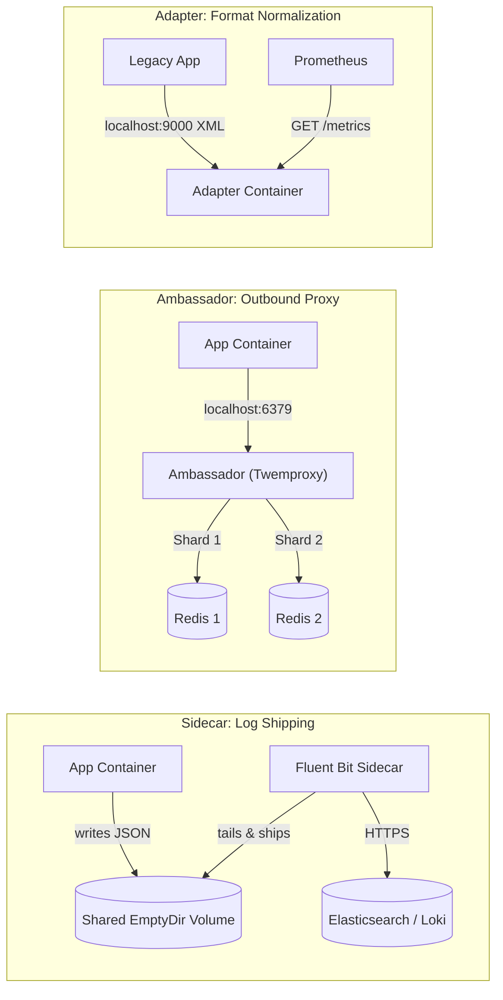
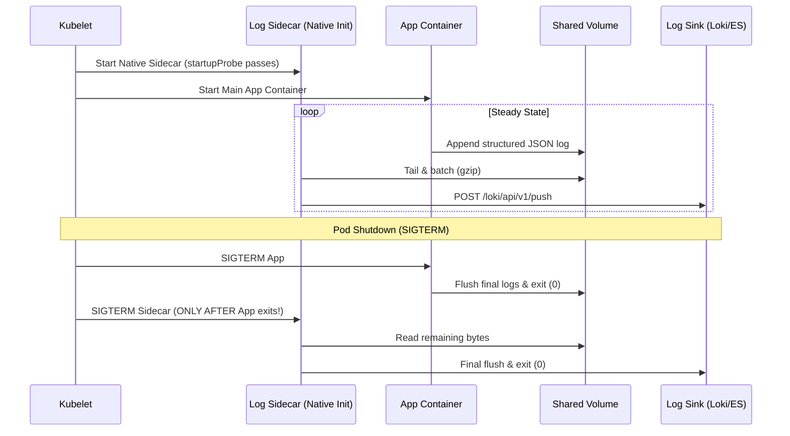
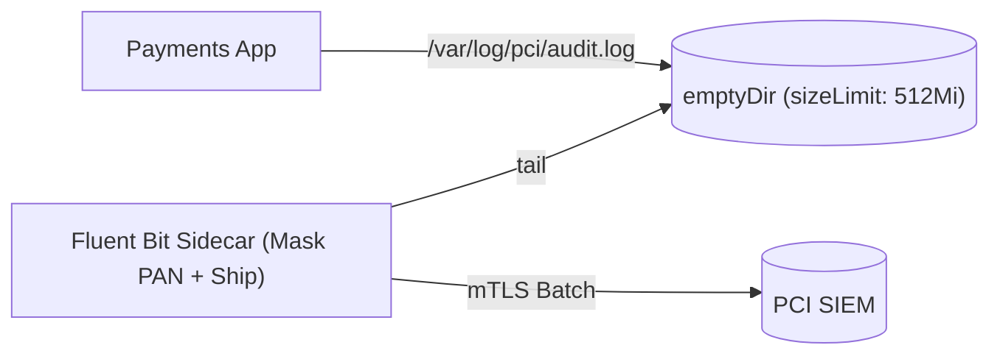

# Sidecar, Ambassador & Adapter Patterns (with a Log-Shipping Example)

> **Prerequisites:** [Lesson 09: Service Mesh Explained](../09-service-mesh-explained/README.md).  
> **Estimated Reading Time:** 22–26 minutes  
> **Target Audience:** Backend, platform, and Kubernetes engineers designing multi-container pods, and candidates asked "what is the difference between Sidecar, Ambassador, and Adapter patterns?"  
> **Free PDF Notes:** [Download SD-L-010.pdf](https://backendroadmap.com/notes/system-design/SD-L-010.pdf)

> [!NOTE]
> **In one line:** **Sidecar**, **Ambassador**, and **Adapter** are single-node co-located container patterns that extend an application with cross-cutting capabilities (**logging/syncing**, **outbound proxying**, or **interface normalization**) without modifying the core application binary.

> [!TIP]
> **The Golden Rule:** Use a **Sidecar** to *augment* the app (log shipping, config reload), an **Ambassador** to *proxy outbound* connections (sharding, retries, auth), and an **Adapter** to *standardize inbound/outbound* interfaces (legacy metrics → Prometheus). Keep helpers lightweight so they never starve the main app.

---

## 1. What the Three Co-Located Container Patterns Are, and What They Aren't

In Kubernetes and modern container orchestrators, a **Pod** groups tightly coupled containers that share a **lifecycle, network namespace (`localhost`), and storage volumes**. Instead of baking a Fluent Bit log shipper, a Vault secret fetcher, a Redis shard router, and a Prometheus format converter into every Go, Python, and legacy Java binary, you run small companion containers alongside the main application container.

| Pattern | Direction / Role | Concrete Example |
| :--- | :--- | :--- |
| **Sidecar** | Augments/extends the main container via shared disk or `localhost` | Fluent Bit / Vector shipping app logs from `/var/log/app` |
| **Ambassador** | Proxies **outbound** traffic from the main app to external/sharded services | Twemproxy / Cloud SQL Auth Proxy / Envoy outbound proxy |
| **Adapter** | Translates/normalizes the main app's output to a **standard external format** | Converting legacy JMX/XML stats into `/metrics` Prometheus format |
| **Not** | A way to bundle two unrelated microservices into one pod | Never put `orders-svc` and `payments-svc` in one pod—they scale independently |

### Why It Matters
1. **Separation of concerns & polyglot reuse:** Write a log-shipping or secret-rotation sidecar once and attach it to 100 services in any language.
2. **Legacy modernization:** Wrap unmodifiable third-party or legacy monoliths with an **Adapter** (for observability) or **Ambassador** (for mTLS/sharding) without touching source code.
3. **Failure & resource isolation:** Companion containers can be resource-capped and updated independently of business logic, though they share the pod's fate on node eviction.

---

## 2. Anatomy: Sidecar vs Ambassador vs Adapter



All three patterns rely on **co-location** inside the same Pod (or VM host):
- **Shared Volume (`emptyDir`):** The App writes structured logs to `/var/log/app/app.log`; the **Sidecar** tails the file, buffers on disk, and ships batches to Loki/Elasticsearch.
- **Shared Network (`localhost`):** The App connects to `localhost:6379` thinking it's a single Redis; the **Ambassador** hashes the key and routes to Shard 1 or Shard 2.
- **Interface Translation:** Prometheus expects OpenMetrics text on `:9100/metrics`, but a legacy C++ daemon only speaks a proprietary binary/XML protocol on `:9000`; the **Adapter** polls `:9000` and exposes `:9100/metrics`.

> [!WARNING]
> **The #1 Trap — Unbounded Sidecar Buffers & Missing `SIGTERM` Ordering:** If a log-shipping sidecar buffers 2 GB of unsent logs in memory or `emptyDir` during an Elasticsearch outage, it **OOMKills the entire pod** or fills node ephemeral storage. Worse, if Kubernetes sends `SIGTERM` to all containers simultaneously, the sidecar may exit *before* the app finishes flushing its final logs!

---

## 3. Mathematical Model: Pod Resource Overhead, Log Backpressure & Disk Budget

### 3.1 Log-Shipping Sidecar Bandwidth & Buffer Sizing
Suppose an app produces $\lambda_{\text{log}} = 2{,}000\text{ logs/s}$ at average size $S_{\text{log}} = 512\text{ bytes}$:

$$\text{Rate}_{\text{log}} = 2{,}000 \times 512\text{ B} \approx 1.024\text{ MB/s} \approx 61.4\text{ MB/min}$$

If the central log collector (Loki/Elasticsearch) goes down for $T_{\text{outage}} = 15\text{ minutes}$:

$$\text{Buffer}_{\text{needed}} = 61.4\text{ MB/min} \times 15\text{ min} = \mathbf{921\text{ MB}}$$

If the sidecar's `emptyDir.sizeLimit` is only 256 MB, the pod is **evicted** after 4 minutes of a logging outage. Conversely, if `emptyDir` is unbounded, 20 pods on one node can exhaust the node's root disk and take down healthy workloads.

### 3.2 Per-Pod Resource Tax
For a cluster of $N$ pods, total helper overhead is:

$$R_{\text{total}} = N \times (R_{\text{sidecar}} + R_{\text{ambassador}} + R_{\text{adapter}})$$

At $N = 500$ pods, even a modest 128 MB + 0.1 vCPU log sidecar consumes **64 GB RAM** and **50 vCPUs**. Switching from a heavy JVM/Ruby shipper (Logstash/Fluentd ~300 MB) to a C/Rust shipper (Fluent Bit/Vector ~30 MB) saves **135 GB RAM** across 500 pods.

---

## 4. Metrics & Percentiles

| Metric | Meaning | Alert when |
| :--- | :--- | :--- |
| **Log Shipper Drop / Backpressure Rate** | Lines dropped because downstream sink + disk buffer are full | $> 0$ for critical audit logs |
| **Sidecar Disk Buffer Usage (`emptyDir`)** | Bytes queued waiting for sink recovery | $> 70\%$ of `sizeLimit` |
| **Sidecar CPU Throttling (`cfs_throttled`)** | Helper container hitting CPU limit during traffic bursts | $> 10\%$ throttled periods |
| **Ambassador Upstream Pool Errors** | Connection resets or timeouts to sharded DB/cache | $> 0.5\%$ |
| **Adapter Scrape Latency $p_{99}$** | Time to poll legacy app and render `/metrics` | $> 500\text{ ms}$ (risks Prometheus scrape timeout) |

### Worked Example (Log-Shipping Backpressure)
An Orders pod writes `stdout` or `/var/log/orders.log`. Under a Black Friday 5x spike ($5\text{ MB/s}$ of logs), the Fluent Bit sidecar has `Mem_Buf_Limit 50MB` and a disk buffer cap of `500MB` on `emptyDir`. When the log sink slows down, Fluent Bit spills to disk up to 500 MB, then **drops debug logs** (preserving `ERROR` logs via priority filtering) rather than blocking the Orders app or triggering a Kubernetes `Evicted` pod status.

---

## 5. Compounding & Failure Modes

| Failure Mode | What Goes Wrong | Mitigation |
| :--- | :--- | :--- |
| **Shared `SIGTERM` Race** | K8s terminates sidecar before main app exits → last 5s of logs & in-flight requests lost | Use Kubernetes **Native Sidecars** (`restartPolicy: Always` in `initContainers`) so sidecars terminate *after* main containers |
| **Log Volume Exhaustion** | App logs stack traces in a tight error loop → fills node disk → node `DiskPressure` evicts pods | Set `emptyDir.sizeLimit` + log rate-limiting/sampling in the sidecar |
| **Sidecar Starving Main App** | Regex-heavy log parsing in sidecar spikes to 4 vCPUs on shared node | Set explicit `resources.limits` (CPU/RAM) on every helper container |
| **Circular Logging** | Sidecar logs its own debug output to the same shared volume → infinite feedback loop | Never write sidecar logs to the app's watched log directory |

---

## 6. Numbers Every Engineer Must Know

| Item | Typical | Implication |
| :--- | :---: | :--- |
| **Fluent Bit / Vector RAM** | 20 – 50 MB | Preferred lightweight log sidecars |
| **Fluentd / Logstash RAM** | 150 – 500 MB | Avoid as per-pod sidecars; run as DaemonSet/central aggregator if needed |
| **Localhost TCP proxy latency** | 0.05 – 0.2 ms | Ambassador/Adapter `localhost` hop is virtually free |
| **Kubernetes `terminationGracePeriodSeconds`** | 30 s default | Must exceed sidecar flush + drain time |
| **Sidecar vs DaemonSet threshold** | > 10 pods/node | Log *DaemonSets* (1 per node) beat *Sidecars* (1 per pod) for generic `stdout` logs |

---

## 7. Protocol Deep Dive: Native Sidecar Lifecycle & Log-Shipping Flow



| Question | Answer |
| :--- | :--- |
| **When should log shipping be a Sidecar vs a DaemonSet?** | Use a **DaemonSet** (1 agent per node tailing `/var/log/containers/*.log`) when apps log to `stdout/stderr`. Use a **Sidecar** when an app writes multiple distinct files (e.g., audit log + access log) that require per-app parsing/routing or strict tenant isolation |
| **How did Kubernetes 1.28+ fix sidecar shutdown races?** | **Native Sidecars**: defining a sidecar inside `initContainers` with `restartPolicy: Always` guarantees it starts *before* the main app and terminates *after* all main containers exit |
| **Does an Ambassador differ from a Service Mesh sidecar?** | A Service Mesh sidecar is a *cluster-wide* transparent L7 proxy; an **Ambassador** is an *app-specific* outbound proxy (e.g., Cloud SQL Auth Proxy, Twemproxy for Redis sharding) |

**When NOT to use Sidecars:** Don't deploy per-pod sidecars when a per-node **DaemonSet** (for generic `stdout` logs or node metrics) or an **in-process library** suffices—multiplying a 100 MB sidecar across 2,000 pods wastes 200 GB of RAM.

---

## 8. Hierarchical Budgets & Design Rules

| Slice | Rule | Control |
| :--- | :--- | :--- |
| **Resource Limits** | Every Sidecar/Ambassador/Adapter must have CPU & RAM `requests` and `limits` | OPA Gatekeeper / Kyverno policy |
| **Disk Bounds** | Shared `emptyDir` volumes must set `sizeLimit` | Prevents node `DiskPressure` evictions |
| **Lifecycle Ordering** | Use K8s Native Sidecars (`initContainers` + `restartPolicy: Always`) | Guarantees clean startup & graceful drain |
| **Backpressure** | Drop/sample `DEBUG`/`INFO` logs before dropping `ERROR`/audit logs or crashing | Sidecar buffer limits + priority rules |
| **DaemonSet First** | Default to node-level DaemonSets for `stdout` logging; Sidecar only for multi-file/custom needs | Platform architecture review |
| **Health Probes** | Sidecars/Ambassadors must expose `/healthz` so K8s doesn't route traffic before proxy is ready | `startupProbe` + `readinessProbe` |

---

## 9. Top Mitigations

1. **Use Kubernetes Native Sidecars (`restartPolicy: Always`):** Eliminates the classic race where the app starts before the Ambassador proxy is ready, or the log Sidecar dies before the app finishes flushing.
2. **Cap `emptyDir` and Memory Buffers:** Set `sizeLimit: 256Mi` on log volumes and configure ring-buffer drop policies so a logging outage never crashes the business app.
3. **Prefer DaemonSets for Standard `stdout` Logs:** Run 1 Fluent Bit DaemonSet per node instead of 30 Fluent Bit sidecars per node unless per-pod isolation is required.
4. **Pick Rust/C/Go Helpers Over JVM Helpers:** Keep helper containers under 30–50 MB RAM.
5. **Isolate Ambassador Connection Pools:** Configure timeouts and max connections in the Ambassador so a slow database shard fails fast.
6. **Keep Adapters Read-Only & Stateless:** An Adapter should only translate formats in memory, never store state.

---

## 10. Production Reference: Multi-Tenant Log-Shipping Sidecar & Native Shutdown

A regulated payments platform ran a legacy Java monolith and 40 microservices. The Java app wrote both `stdout` operational logs and a separate `/var/log/pci/audit.log` file that had to be shipped to an isolated PCI-compliant SIEM with custom field masking—making a shared node-level DaemonSet unsuitable.



**Incident & Fix:** During early rollouts, Kubernetes `SIGTERM` killed Fluent Bit in 1 second while the Java app took 8 seconds to drain in-flight payments—losing the final 8 seconds of PCI audit logs on every deploy. Migrating Fluent Bit to a **Kubernetes Native Sidecar** (`initContainers` with `restartPolicy: Always`) and capping `emptyDir` at `512Mi` guaranteed zero lost audit logs on graceful shutdowns and prevented disk-pressure evictions.

---

## 11. Multi-Language Production Code Tabs

Demonstrating the three patterns in practice: a **Sidecar** log-tailer with bounded buffer, an **Ambassador** outbound sharding proxy, and an **Adapter** normalizing legacy stats to Prometheus `/metrics`:

````carousel
```go
// Go: Ambassador pattern — local outbound proxy sharding keys across 2 Redis backends.
package main

import (
	"hash/fnv"
	"io"
	"net"
)

type ShardAmbassador struct {
	shards []string
}

func (a *ShardAmbassador) pickShard(key string) string {
	h := fnv.New32a()
	h.Write([]byte(key))
	return a.shards[int(h.Sum32())%len(a.shards)]
}

func (a *ShardAmbassador) HandleConn(client net.Conn, routingKey string) {
	defer client.Close()
	backend, err := net.Dial("tcp", a.pickShard(routingKey))
	if err != nil {
		return
	}
	defer backend.Close()
	go io.Copy(backend, client)
	io.Copy(client, backend)
}
```
<!-- slide -->
```typescript
// TypeScript: Adapter pattern — translating legacy JSON/XML stats to Prometheus format.
import http from "node:http";

interface LegacyStats {
  active_conns: number;
  err_total: number;
}

export function startMetricsAdapter(legacyUrl: string, port = 9100) {
  http.createServer(async (req, res) => {
    if (req.url !== "/metrics") {
      res.writeHead(404).end();
      return;
    }
    const raw = (await (await fetch(legacyUrl)).json()) as LegacyStats;
    const prom = [
      "# TYPE legacy_active_connections gauge",
      `legacy_active_connections ${raw.active_conns}`,
      "# TYPE legacy_errors_total counter",
      `legacy_errors_total ${raw.err_total}`,
    ].join("\n");
    res.writeHead(200, { "content-type": "text/plain; version=0.0.4" }).end(prom + "\n");
  }).listen(port);
}
```
<!-- slide -->
```python
# Python: Sidecar pattern — bounded-buffer log shipper tailing a shared file (stdlib).
from collections import deque
import time


class LogShipperSidecar:
    """Reads new lines from shared volume, batches them, and drops oldest if sink is down."""

    def __init__(self, max_buffer_lines: int = 10_000):
        self.buffer: deque[str] = deque(maxlen=max_buffer_lines)  # Bounded: never OOMs pod!

    def ingest_line(self, line: str) -> None:
        self.buffer.append(line)

    def flush_batch(self, batch_size: int = 100, sink_healthy: bool = True) -> int:
        if not sink_healthy or not self.buffer:
            return 0
        sent = 0
        while self.buffer and sent < batch_size:
            _ = self.buffer.popleft()  # Shipped to Loki/Elasticsearch
            sent += 1
        return sent


if __name__ == "__main__":
    sidecar = LogShipperSidecar(max_buffer_lines=5)
    for i in range(8):
        sidecar.ingest_line(f'{{"msg": "order {i}"}}')
    print("Buffered (capped at 5):", list(sidecar.buffer))
    print("Flushed:", sidecar.flush_batch(10), "Remaining:", len(sidecar.buffer))
```
<!-- slide -->
```csharp
// C#: Ambassador-style outbound retry/circuit-breaker wrapper on localhost for legacy apps.
using System.Net;

public sealed class OutboundAmbassadorProxy
{
    private readonly HttpClient _upstream;

    public OutboundAmbassadorProxy(HttpClient upstream) => _upstream = upstream;

    public async Task<HttpResponseMessage> ForwardWithRetryAsync(HttpRequestMessage req, CancellationToken ct)
    {
        for (var attempt = 1; attempt <= 3; attempt++)
        {
            using var clone = new HttpRequestMessage(req.Method, req.RequestUri);
            var resp = await _upstream.SendAsync(clone, ct);
            if ((int)resp.StatusCode < 500 || attempt == 3)
                return resp;

            await Task.Delay(TimeSpan.FromMilliseconds(50 * attempt), ct);
        }
        return new HttpResponseMessage(HttpStatusCode.ServiceUnavailable);
    }
}
```
````

---

## 12. Hands-On CLI Verification Workflows

```bash
# 1. Inspect containers (including native initContainer sidecars) in a Kubernetes pod
kubectl get pod orders-svc-7d9f -n prod -o jsonpath='{.spec.initContainers[*].name}{"\n"}{.spec.containers[*].name}{"\n"}'

# 2. Tail logs specifically from the log-shipping sidecar container
kubectl logs orders-svc-7d9f -n prod -c fluent-bit-sidecar --tail=50

# 3. Verify Adapter /metrics endpoint from inside the pod network
kubectl exec orders-svc-7d9f -n prod -c app -- curl -s localhost:9100/metrics | head -n 10

# 4. Check pod ephemeral storage & memory usage to ensure sidecars aren't bloating
kubectl top pod orders-svc-7d9f -n prod --containers
```

---

## 13. Common Mistakes to Avoid

1. **Running a per-pod log sidecar when a per-node DaemonSet works:** Wastes gigabytes of cluster RAM on `stdout` logs.
2. **Leaving `emptyDir` volumes unbounded:** A log spike or sink outage fills the node disk and evicts unrelated pods.
3. **Ignoring startup and shutdown ordering:** App starts before its Ambassador proxy is ready, or the log Sidecar exits before the app finishes draining.
4. **Putting business logic inside a Sidecar or Adapter:** Helpers must remain strictly cross-cutting infrastructure.
5. **Deploying two independent microservices in the same pod:** Violates independent scaling and couples failure domains.
6. **Omitting CPU/RAM `limits` on companion containers:** A regex bug in a log sidecar can starve the main application.
7. **Writing sidecar debug logs into the same directory the sidecar tails:** Creates an infinite self-amplifying log storm.

---

## 14. Key Terms Glossary

| Key Term | Definition |
| :--- | :--- |
| **Sidecar Pattern** | Co-located container that augments the main app (e.g., log shipping, secret sync). |
| **Ambassador Pattern** | Co-located container proxying *outbound* connections (e.g., sharding, auth, retries). |
| **Adapter Pattern** | Co-located container normalizing the app's interface to a standard external format. |
| **Kubernetes Pod** | Atomic scheduling unit sharing network namespace (`localhost`), IPC, and volumes. |
| **Native Sidecar** | K8s 1.28+ `initContainer` with `restartPolicy: Always` that starts first and stops last. |
| **`emptyDir` Volume** | Ephemeral pod-scoped directory shared between containers in the same pod. |
| **DaemonSet** | Kubernetes controller running exactly one pod per node (common for node-level log agents). |
| **Backpressure** | Bounding queues/buffers and shedding low-priority data when a downstream sink stalls. |
| **Co-location** | Running helper processes on the same host/pod to share `localhost` and local disk. |
| **Fate Sharing** | Containers in one pod are scheduled, restarted, and evicted together. |

---

## 15. System Design Interview Questions & Answers

### Basic Conceptual Questions

<details>
<summary><strong>Q1: What is the difference between Sidecar, Ambassador, and Adapter patterns? [BASIC]</strong></summary>

**Answer:**
All three co-locate a helper container with the main app in a Pod:
- **Sidecar** extends/augments the app (e.g., log shipping, config/secret syncing).
- **Ambassador** proxies *outbound* calls on the app's behalf (e.g., Redis sharding, Cloud SQL Auth Proxy).
- **Adapter** translates/normalizes the app's output to a standard format (e.g., legacy XML stats → Prometheus `/metrics`).
</details>

<details>
<summary><strong>Q2: Why put a helper in a separate container instead of a library inside the app? [BASIC]</strong></summary>

**Answer:**
Decoupling and polyglot reuse: you can write a log shipper, mTLS proxy, or metrics adapter once and attach it to Go, Python, Java, and legacy C++ binaries without modifying or recompiling application code, and upgrade the helper independently.
</details>

<details>
<summary><strong>Q3: How do containers in the same Kubernetes Pod communicate? [BASIC]</strong></summary>

**Answer:**
They share the same network namespace (communicating over `localhost` at sub-millisecond speed) and can mount shared storage volumes (like `emptyDir`) to exchange files such as logs or secrets.
</details>

<details>
<summary><strong>Q4: Give a real-world example of the Ambassador pattern. [BASIC]</strong></summary>

**Answer:**
Google's **Cloud SQL Auth Proxy** or **Twemproxy**: the app connects to `localhost:5432` or `localhost:6379`, and the Ambassador container transparently handles IAM authentication, TLS tunneling, connection pooling, or shard routing to the remote database.
</details>

### Scenario-Based Architecture Questions

<details>
<summary><strong>Q5: You have 1,000 pods writing logs to stdout. Should you use a Sidecar or a DaemonSet? [SCENARIO]</strong></summary>

**Answer:**
Use a **DaemonSet** (1 Fluent Bit agent per node). Running 1,000 sidecars at 40 MB each wastes 40 GB of RAM, whereas 30 node-level DaemonSet pods consume ~1.2 GB total. Only use a Sidecar if an app writes custom non-stdout files or requires strict per-tenant isolation/masking.
</details>

<details>
<summary><strong>Q6: During rolling deploys, you lose the last 5 seconds of logs from your app. Why and how do you fix it? [SCENARIO]</strong></summary>

**Answer:**
Kubernetes sends `SIGTERM` to the app and the log-shipping sidecar simultaneously, so the sidecar exits before the app finishes flushing. Fix by using **Kubernetes Native Sidecars** (`initContainers` with `restartPolicy: Always`), which guarantee the sidecar stays alive until *after* the main container exits.
</details>

<details>
<summary><strong>Q7: Elasticsearch goes down for 20 minutes, and suddenly your Orders pods get Evicted by Kubernetes. Why? [SCENARIO]</strong></summary>

**Answer:**
The log-shipping sidecar buffered unsent logs into an unbounded `emptyDir` volume, filling the node's ephemeral disk and triggering Kubelet `DiskPressure` evictions. Fix by setting `emptyDir.sizeLimit` and configuring the sidecar to drop/sample low-priority logs when its buffer is full.
</details>

<details>
<summary><strong>Q8: You inherited a closed-source legacy billing binary that only exposes stats over a proprietary TCP socket. How do you monitor it with Prometheus? [SCENARIO]</strong></summary>

**Answer:**
Use the **Adapter pattern**: co-locate a tiny Go/Python container in the same pod that polls the legacy binary over `localhost`, converts the proprietary stats into Prometheus exposition format, and serves `GET /metrics` on port `9100`.
</details>

### Advanced & Tricky Interview Questions

<details>
<summary><strong>Q9: How does an Ambassador container help an app talk to a sharded cache without changing app code? [TRICKY]</strong></summary>

**Answer:**
The app sends standard commands to `localhost:6379`. The Ambassador (e.g., Twemproxy/Envoy) intercepts the command, consistent-hashes the key, and routes it to the correct remote Redis shard—handling failover and connection pooling transparently.
</details>

<details>
<summary><strong>Q10: What happens if a legacy Kubernetes Job finishes, but its Sidecar container keeps running? [TRICKY]</strong></summary>

**Answer:**
Before Kubernetes 1.28 Native Sidecars, a regular `containers[]` sidecar would stay `Running` forever after the main Job container exited `0`, causing the Kubernetes `Job` to never complete! Native Sidecars (`initContainers` with `restartPolicy: Always`) automatically receive `SIGTERM` once all main containers finish.
</details>

<details>
<summary><strong>Q11: Can a Sidecar and main container cause CPU/memory contention? [TRICKY]</strong></summary>

**Answer:**
Yes. Even though they have separate cgroup limits, if you forget `resources.limits` on the sidecar, a burst in log parsing or proxy TLS handshakes can consume node CPU and starve the main application—or if they share `emptyDir` memory-backed (`medium: Memory`), sidecar logs eat directly into the pod's memory cgroup limit.
</details>

<details>
<summary><strong>Q12: When does the Sidecar pattern turn into an anti-pattern? [TRICKY]</strong></summary>

**Answer:**
When teams put *two distinct business services* in one pod (coupling scaling and deployments), or when every pod carries 4–5 heavy sidecars (log shipper + secret agent + APM agent + service mesh + DB proxy) totaling more RAM/CPU than the application itself.
</details>

---

## 16. One-Page Master Cheat Sheet

```
+---------------------------------------------------------------------------------------------------------+
|               SIDECAR, AMBASSADOR & ADAPTER PATTERNS — MASTER CHEAT SHEET                               |
+---------------------------------------------------------------------------------------------------------+
| 1. SIDECAR: Augments app (log shipping, secret sync) via shared volume or localhost.                    |
| 2. AMBASSADOR: Proxies OUTBOUND calls (sharding, Cloud SQL Auth Proxy, retries) on localhost.           |
| 3. ADAPTER: Normalizes app output to standard format (legacy XML/JMX -> Prometheus /metrics).           |
+---------------------------------------------------------------------------------------------------------+
| 4. LOG-SHIPPING RULE: Use DaemonSet (1/node) for stdout; Sidecar only for multi-file or PCI isolation.  |
+---------------------------------------------------------------------------------------------------------+
| 5. K8s SAFETY: Use Native Sidecars (initContainers + restartPolicy: Always) for clean startup/shutdown. |
|    Always bound emptyDir sizeLimit & container CPU/RAM limits so helpers never OOMKill/evict the app.   |
+---------------------------------------------------------------------------------------------------------+
```

---

## Further Reading & Sources

- Brendan Burns & David Oppenheimer, *Design Patterns for Container-Based Distributed Systems* (USENIX HotCloud).
- Kubernetes Documentation, [Sidecar Containers (Native Sidecars)](https://kubernetes.io/docs/concepts/workloads/pods/sidecar-containers/).
- Microsoft Azure Architecture Center, [Sidecar](https://learn.microsoft.com/en-us/azure/architecture/patterns/sidecar) & [Ambassador](https://learn.microsoft.com/en-us/azure/architecture/patterns/ambassador) Patterns.
- Fluent Bit Documentation, [Backpressure, Buffering & Kubernetes Deployment](https://docs.fluentbit.io/).

---

## Free PDF Notes

[SD-L-010.pdf](https://backendroadmap.com/notes/system-design/SD-L-010.pdf)

---

## Next

Continue with [Strangler Fig Pattern: Migrate a Monolith with Zero Downtime](../11-strangler-fig-pattern/README.md).
