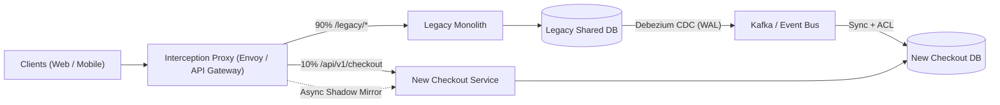
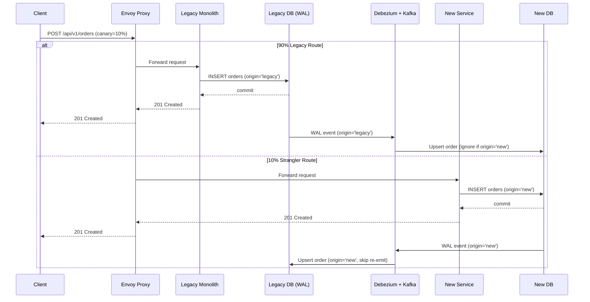
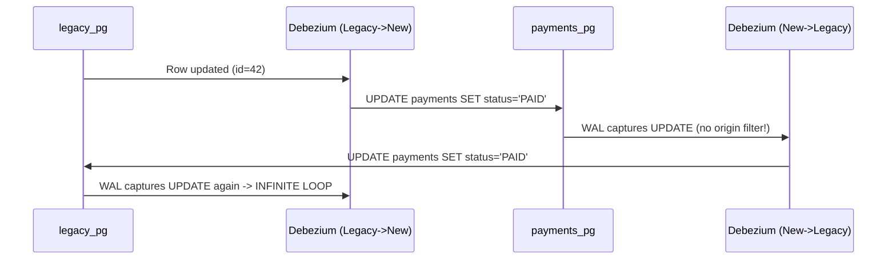

# Strangler Fig Pattern: Migrate a Monolith with Zero Downtime

> **Prerequisites:** [Lesson 10: Sidecar, Ambassador & Adapter Patterns](../10-sidecar-ambassador-adapter-patterns/README.md) · [Track: Architecture Patterns](../README.md).  
> **Estimated Reading Time:** 24–28 minutes  
> **Target Audience:** Backend engineers planning a monolith-to-microservices or legacy database migration, and candidates asked "how do you replace a live production monolith without a big-bang rewrite?"  
> **Free PDF Notes:** [Download SD-L-011.pdf](https://backendroadmap.com/notes/system-design/SD-L-011.pdf)

> [!NOTE]
> **In one line:** The Strangler Fig pattern incrementally replaces a legacy monolith by placing an **interception proxy (strangler router)** in front of it, routing one bounded context or endpoint at a time to new services, and **shadowing, dual-writing, and CDC-syncing** data until the old code can be deleted with zero downtime.

> [!TIP]
> **The Golden Rule:** Never rewrite a monolith in the dark and flip a single switch. Extract **one slice at a time** behind a routing facade, verify parity with **shadow traffic** before cutting over, and keep a **one-click rollback** via traffic weights until the legacy path has zero hits for at least one full billing cycle.

---

## 1. What the Strangler Fig Pattern Is, and What It Isn't

In 2004, Martin Fowler named the pattern after Australian strangler figs, which germinate in the upper branches of a host tree, send roots down to the soil, and gradually envelop the host until the original tree dies and rots away—leaving a self-supporting fig structure. In software, your e-commerce monolith handles Auth, Catalog, Cart, Checkout, and Billing inside one 800,000-line codebase and one shared PostgreSQL database. A "big-bang rewrite" freezes feature work for 18 months and almost always fails. Instead, you put an API gateway or reverse proxy in front of the monolith and migrate **Checkout** first, then **Catalog**, then **Billing**, while customers keep checking out uninterrupted.

| Term | Precise Meaning | Example |
| :--- | :--- | :--- |
| **Strangler Fig** | Incremental replacement of a legacy system behind an interception facade | Routing `/api/v1/checkout` to a new Go service while `/api/v1/orders` stays on Rails |
| **Interception Proxy** | Layer-7 router (Envoy, NGINX, API Gateway) that splits traffic by path, header, or percentage | Envoy shifting 5% → 25% → 100% of `/checkout` |
| **Shadow Traffic (Dark Launch)** | Duplicating live production requests to the new service asynchronously and comparing responses | Mirroring 100% of `GET /catalog` to check latency and JSON diff without user impact |
| **CDC (Change Data Capture)** | Streaming row-level commits from the legacy DB WAL to the new service's DB | Debezium reading Postgres `pgoutput` into Kafka → new Billing DB |
| **Anti-Corruption Layer (ACL)** | Translation boundary keeping legacy schemas out of the new domain (Lesson 12) | Translating `CUST_STAT_CD = 'A'` to `CustomerStatus.Active` |
| **Not a Big-Bang Rewrite** | Rebuilding everything in parallel and cutting over on one weekend | "v2.0 launch" that breaks 40 undocumented edge cases |
| **Not Branch-by-Abstraction Alone** | In-process interface swapping inside the monolith (useful *before* network extraction) | Swapping `IPricingEngine` in Java before extracting a service |

### Why It Matters
1. **Risk compression:** Instead of betting 18 months of engineering on a single cutover night, you ship value and validate assumptions in week 2.
2. **Continuous delivery:** Product teams keep shipping features in un-migrated slices while platform teams extract high-pain domains.
3. **Reversibility:** Weighted routing lets you roll back a broken slice in 2 seconds by flipping `weight: 0` on the proxy—no database restore required.

---

## 2. Anatomy: Interception, Shadowing & Data Sync



A Strangler Fig migration has **three distinct planes** that must work together:

| Plane | Responsibility | Key Mechanism |
| :--- | :--- | :--- |
| **1. Edge Routing Plane** | Intercepts all inbound traffic and routes by URI, HTTP method, tenant, or canary weight | Envoy / NGINX / Kong / AWS ALB |
| **2. Parity & Verification Plane** | Proves the new service matches legacy behavior before users see its responses | Shadow mirroring + response diffing |
| **3. Data Synchronization Plane** | Keeps legacy and new databases consistent while both systems exist | Dual-write (risky) or **CDC + Outbox** (safe) |

| Migration Phase | Traffic Split | Data Ownership | Rollback Cost |
| :--- | :--- | :--- | :--- |
| **Phase 0: Baseline** | 100% Legacy, 0% New | Legacy DB | N/A |
| **Phase 1: Dark Launch** | 100% Legacy, 100% Shadow to New | Legacy DB → CDC → New DB (read-only) | Zero (shadow is fire-and-forget) |
| **Phase 2: Canary Read/Write** | 95% Legacy, 5% New | Dual-sync (CDC or bidirectional outbox) | Low (flip proxy weight to 0%) |
| **Phase 3: Majority Cutover** | 10% Legacy, 90% New | New DB primary, reverse-sync to Legacy DB | Medium (reverse-sync must stay healthy) |
| **Phase 4: Decommission** | 0% Legacy, 100% New | New DB only; legacy routes return `410 Gone` | High (legacy code deleted) |

> [!WARNING]
> **The #1 Strangler Fig Trap: Migrating compute while sharing the legacy database.** If your new microservice still executes SQL `JOIN`s against the monolith's `users` and `orders` tables, you have built a **distributed monolith**. A schema change in the monolith breaks the new service, and you gain zero independent deployability or failure isolation. Always pair Strangler Fig with **data decoupling** (CDC + ACL).

---

## 3. Mathematical Model: Risk, Latency & Migration Velocity

**1. Blast Radius & Failure Probability.**  
In a big-bang rewrite of $N$ modules, each with independent defect probability $p$ on cutover day, the probability of *at least one* production-breaking defect on launch day is:

$$P(\text{incident}_{\text{big-bang}}) = 1 - (1 - p)^N$$

In a Strangler Fig migration of $N$ slices deployed sequentially with canary fraction $w \in (0, 1]$ per slice, the expected affected user requests per slice during canary validation is bounded by $w \cdot \lambda \cdot T_{\text{detect}}$.

**2. Interception Proxy Overhead & Tail Latency.**  
Adding a Layer-7 proxy adds network hop + TLS/header parsing latency $t_{\text{proxy}}$, and if the new service still calls back into the monolith for un-migrated data ($k$ internal RPCs), total latency is:

$$T_{\text{strangler}} = t_{\text{proxy}} + t_{\text{new}} + \sum_{i=1}^{k} t_{\text{callback}, i}$$

**3. CDC Replication Lag ($L_{\text{CDC}}$).**  
When Legacy DB writes at rate $\lambda_w$ and the CDC pipeline processes events at rate $\mu_{\text{cdc}}$, the time between a legacy commit and visibility in the new DB is:

$$L_{\text{CDC}} = t_{\text{WAL\_flush}} + t_{\text{broker}} + t_{\text{apply}} + \frac{\text{backlog}}{\mu_{\text{cdc}}}$$

### Worked Numerical Example
Suppose a monolith has $N = 12$ bounded contexts, each with $p = 0.08$ (8%) probability of a subtle production bug at cutover:
- **Big-bang rewrite:** $P(\text{incident}) = 1 - (1 - 0.08)^{12} = 1 - 0.3677 = \mathbf{63.2\%}$ chance of a SEV-1/SEV-2 outage on launch day, affecting 100% of $\lambda = 5{,}000\text{ req/s}$.
- **Strangler Fig (1 slice/month, 2% canary, $T_{\text{detect}} = 120\text{ s}$):** Each slice has an 8% chance of a bug, but during canary only $0.02 \times 5{,}000 = 100\text{ req/s}$ are exposed. Over 120 s before auto-rollback, at most $100 \times 120 = 12{,}000$ requests (0.04% of daily traffic) are affected, instead of $5{,}000 \times 3600 = 18{,}000{,}000$ requests during a 1-hour big-bang rollback.
- **Latency budget:** If $t_{\text{proxy}} = 1.8\text{ ms}$, $t_{\text{new}} = 14\text{ ms}$, and the new service makes $k = 2$ synchronous callbacks to the monolith at $12\text{ ms}$ each, $T_{\text{strangler}} = 1.8 + 14 + 24 = \mathbf{39.8\text{ ms}}$. Replacing those 2 callbacks with local CDC-replicated read tables drops latency to $1.8 + 14 = \mathbf{15.8\text{ ms}}$.

---

## 4. Metrics & Percentiles

| Metric | Meaning | Alert When |
| :--- | :--- | :--- |
| **Shadow Diff Rate (%)** | Percentage of shadowed requests where new vs legacy response bodies/status codes diverge | $> 0.1\%$ for non-deterministic fields excluded |
| **CDC Replication Lag ($p_{99}$)** | Time from legacy DB commit LSN to new DB commit | $> 500\text{ ms}$ (risks stale reads after write) |
| **Proxy Overhead ($p_{99}$)** | Added latency at the strangler router (`upstream_service_time` delta) | $> 5\text{ ms}$ |
| **Canary Error Delta** | `5xx_rate(new) - 5xx_rate(legacy)` at equal traffic slice | $> +0.05\%$ → auto-rollback canary |
| **Legacy Route Hit Rate** | RPS still hitting a supposedly migrated legacy endpoint | $> 0\text{ req/s}$ after Phase 4 target date |
| **Dual-Write / Sync DLQ** | Failed CDC or reverse-sync events parked in Dead-Letter Queue | $> 0$ events (immediate data drift risk) |

### Worked Example: Checkout Slice Cutover
An e-commerce platform processes $2{,}000\text{ req/s}$ peak, of which $180\text{ req/s}$ hit `POST /api/v1/checkout`.
1. **Shadowing (Week 1):** Envoy mirrors `GET /api/v1/checkout/summary` (idempotent) to the new Go service. Initial diff rate is `3.4%` due to floating-point rounding (`19.99` vs `19.9900001`) and missing legacy coupon edge cases. After 4 fixes, diff rate drops to `0.00%` over 48 hours.
2. **Canary (Week 2):** `POST /api/v1/checkout` shifts to 5% (`9 req/s`) on Go. Canary error delta is `0.00%`, $p_{99}$ drops from `210 ms` (monolith) to `42 ms` (Go + local Postgres).
3. **Cutover (Week 3):** Traffic shifts 25% → 50% → 100%. Debezium reverse-syncs new `orders` rows back to the legacy DB for 14 days so the legacy Reporting job keeps working until Reporting is migrated in Slice 2.

---

## 5. Compounding & Failure Modes

What happens when teams rush a Strangler Fig migration? Three compounding failure modes dominate production incidents:

| Failure Mode | Mechanism | Quantitative Impact (at 2,000 req/s) |
| :--- | :--- | :--- |
| **1. Ping-Pong Latency Amplification** | New service calls Monolith A → Monolith A calls New Service B → B calls Monolith A | 100 ms baseline balloons to $3 \times 100 + 4\text{ hops} = 340\text{ ms}$ ($p_{99} > 1.2\text{ s}$) |
| **2. Infinite CDC Sync Loop** | Legacy DB writes → CDC syncs to New DB → Reverse-CDC syncs back to Legacy DB | Write amplification $\infty$; saturates DB IOPS in $< 45\text{ s}$ |
| **3. Split-Brain Dual-Write Drift** | App writes to Legacy DB (succeeds) then New DB (network timeout) without transactional outbox | At $0.2\%$ network error rate on 200 writes/s: **34,560 corrupted/divergent records per day** |

**Why Ping-Pong happens:** Extracting a vertical slice without extracting its upstream dependencies forces cross-boundary HTTP calls. Every synchronous hop across the strangler boundary compounds availability: 4 hops at 99.9% each yields $0.999^4 = 99.60\%$ availability (nearly 35 hours/year downtime instead of 8.7 hours).

---

## 6. Numbers Every Engineer Must Know

| Item | Typical | Implication |
| :--- | :---: | :--- |
| **L7 Proxy (Envoy/NGINX) hop** | $0.5\text{–}2.5\text{ ms}$ | Negligible vs 50–300 ms monolith handlers |
| **Debezium Postgres CDC lag** | $20\text{–}150\text{ ms}$ | Fast enough for async sync; **not** safe for immediate read-your-own-writes |
| **Shadow traffic CPU overhead** | $+5\text{–}15\%$ on proxy + 100% on new service | Size new service for full prod load before enabling 100% shadow |
| **Canary auto-rollback window** | $30\text{–}120\text{ s}$ | Requires automated metric gates (error rate + $p_{99}$), not manual dashboards |
| **Legacy route drain period** | $14\text{–}30\text{ days}$ | Keep legacy path idle & monitored through at least one monthly billing/cron cycle |
| **Typical slice extraction cadence** | $2\text{–}6\text{ weeks}$ per domain | Slicing smaller (1–2 endpoints) beats slicing an entire subsystem at once |

---

## 7. Mechanism Deep Dive: Traffic Shifting, Shadowing & Loop-Free CDC



| Question | Answer |
| :--- | :--- |
| **How do you prevent infinite CDC loops during bidirectional sync?** | Tag every row/event with `origin_system` (`'legacy'` vs `'new'`) or a `sync_version` vector; the CDC consumer ignores events whose `origin_system` equals its own DB. |
| **Can you shadow `POST`/`PUT` mutating requests?** | Only if the new service is **completely isolated** (separate DB, mocked payment/email gateways) or uses an idempotency key that discards side effects. Never shadow real credit card charges! |
| **How do you handle sessions/auth during migration?** | Issue stateless JWTs (or store sessions in a shared Redis cluster) at the Edge Proxy so both the monolith and new services validate the exact same identity token. |
| **What if a client needs read-your-own-write across the boundary?** | Route the user's session consistently (sticky routing by `user_id` hash) to *either* legacy or new for that slice, avoiding cross-DB read-after-write lag. |

**When NOT to use Strangler Fig:**
- **Tiny codebase ($< 20\text{k}$ LOC) with low traffic:** A clean rewrite over 2–4 weeks with a maintenance window is cheaper than operating dual-sync CDC infrastructure.
- **No stable boundary or API:** If external clients connect directly to the legacy database via ODBC/JDBC rather than HTTP/RPC, you cannot intercept traffic at L7 without first putting an API/view layer in front of the DB.
- **End-of-life product:** If the system is being retired in 6 months, freeze it rather than strangling it.

---

## 8. Hierarchical Budgets & Design Rules

| Slice | Rule | Control |
| :--- | :--- | :--- |
| **Boundary Selection** | Start with **leaf nodes** (fewest inbound dependencies) or **highest-change-rate** domains | Dependency graph audit before coding |
| **Edge Routing** | 100% of traffic must pass through the Interception Proxy; zero direct client-to-monolith IPs | Firewall / Security Group blocking direct monolith ingress |
| **Shadowing** | Shadow `GET` first; mock external side effects (`Stripe`, `SendGrid`) in shadow mode | `X-Shadow-Mode: true` header + isolated shadow sinks |
| **Data Ownership** | One source of truth per entity at any point in time | `origin_system` column + CDC lag alerts |
| **Canary Gates** | Automated promotion/rollback on `5xx`, `p99`, and business metrics (e.g., conversion rate) | Argo Rollouts / Flagger / Envoy weighted clusters |
| **Decommissioning** | Delete legacy code and DB tables only after 0 RPS for 14–30 days | Log `410 Gone` alerts before dropping tables |

---

## 9. Top Mitigations

1. **Extract leaf domains first** (e.g., Notifications, Search, PDF Generation) to prove your proxy, CI/CD, and CDC pipeline before touching core Checkout or Ledger.
2. **Enforce `origin_system` tagging on all CDC events** to make bidirectional synchronization mathematically loop-free.
3. **Use sticky routing per `user_id` or `tenant_id`** during canary phases so a single user never hits the new service for writes and the legacy monolith for reads.
4. **Never share the legacy database** for new service writes; replicate needed reference data asynchronously via CDC into local read tables.
5. **Automate response diffing during Dark Launch**, stripping non-deterministic fields (`request_id`, `timestamp`) so parity is measured objectively.
6. **Keep legacy code read-only before deleting it:** Put a feature flag on legacy write paths for 7 days after 100% cutover before removing the code.
7. **Propagate `X-Request-ID` / W3C `traceparent`** across the proxy, monolith, and new services so distributed traces stitch together seamlessly.

---

## 10. Production Reference: SEV-1 Infinite Sync Loop & Ping-Pong Outage

**Context:** A fintech company migrated its `Payments` module out of a Java monolith into a new Go service using Strangler Fig. To keep legacy accounting reports working, they enabled bidirectional CDC (Debezium) between `legacy_pg` and `payments_pg`.



- **Root Cause:** `Debezium (New->Legacy)` did not filter out rows modified by the `cdc_sync_user` database role (nor check an `origin_system` column). A single `UPDATE` on row `id=42` triggered an infinite ping-pong loop between the two PostgreSQL WAL streams.
- **Impact:** Within 38 seconds, both databases hit 100% CPU and 45,000 IOPS, exhausting connection pools and causing a 22-minute SEV-1 payment outage.
- **Fix:**
  1. Added a `last_modified_by` column and configured Debezium SMT (Single Message Transform) `Filter` to drop any WAL event where `source.db_user == 'cdc_sync_user'`.
  2. Added a circuit breaker on the CDC consumer that trips if the same primary key is updated $> 3$ times within 1 second.
  3. Made `payments_pg` the sole write authority and switched `legacy_pg` to read-only replication for the `payments` table.

---

## 11. Multi-Language Production Code Tabs

A production-shaped **Strangler Router** with weighted canary routing, asynchronous shadow mirroring, and `origin_system` loop-prevention guard.

````carousel
```go
// Go: Strangler Fig L7 router with weighted canary split and async shadow mirroring.
package main

import (
	"bytes"
	"context"
	"hash/fnv"
	"io"
	"log"
	"net/http"
	"net/http/httputil"
	"net/url"
	"sync/atomic"
	"time"
)

type StranglerRouter struct {
	legacyProxy  *httputil.ReverseProxy
	newProxy     *httputil.ReverseProxy
	newURL       *url.URL
	canaryPct    atomic.Int32 // 0..100
	shadowEnable atomic.Bool
	httpClient   *http.Client
}

func NewStranglerRouter(legacyTarget, newTarget string) (*StranglerRouter, error) {
	lu, err := url.Parse(legacyTarget)
	if err != nil {
		return nil, err
	}
	nu, err := url.Parse(newTarget)
	if err != nil {
		return nil, err
	}
	return &StranglerRouter{
		legacyProxy: httputil.NewSingleHostReverseProxy(lu),
		newProxy:    httputil.NewSingleHostReverseProxy(nu),
		newURL:      nu,
		httpClient:  &http.Client{Timeout: 2 * time.Second},
	}, nil
}

// bucket returns deterministic 0..99 for sticky user routing (avoids read-after-write drift).
func bucket(userID string) int32 {
	h := fnv.New32a()
	_, _ = h.Write([]byte(userID))
	return int32(h.Sum32() % 100)
}

func (sr *StranglerRouter) ServeHTTP(w http.ResponseWriter, r *http.Request) {
	userID := r.Header.Get("X-User-ID")
	pct := sr.canaryPct.Load()

	if userID != "" && bucket(userID) < pct {
		sr.newProxy.ServeHTTP(w, r)
		return
	}

	// Dark launch: mirror idempotent GETs asynchronously without blocking the caller.
	if sr.shadowEnable.Load() && r.Method == http.MethodGet {
		bodyCopy, _ := io.ReadAll(r.Body)
		r.Body = io.NopCloser(bytes.NewReader(bodyCopy))
		go sr.mirrorShadow(r.URL.RequestURI(), r.Header.Clone(), bodyCopy)
	}

	sr.legacyProxy.ServeHTTP(w, r)
}

func (sr *StranglerRouter) mirrorShadow(uri string, hdr http.Header, body []byte) {
	ctx, cancel := context.WithTimeout(context.Background(), 1500*time.Millisecond)
	defer cancel()
	target := sr.newURL.String() + uri
	req, err := http.NewRequestWithContext(ctx, http.MethodGet, target, bytes.NewReader(body))
	if err != nil {
		return
	}
	req.Header = hdr
	req.Header.Set("X-Shadow-Mode", "true")
	resp, err := sr.httpClient.Do(req)
	if err != nil {
		log.Printf("shadow_error uri=%s err=%v", uri, err)
		return
	}
	_ = resp.Body.Close()
}
```
<!-- slide -->
```typescript
// TypeScript: Strangler Fig router + CDC loop-prevention guard.
import crypto from "node:crypto";

export type OriginSystem = "legacy" | "new";

export interface CdcEvent<T> {
  entityId: string;
  originSystem: OriginSystem;
  version: number;
  payload: T;
}

export class StranglerRouter {
  constructor(
    private canaryPct: number,
    private shadowEnabled: boolean,
    private callLegacy: (req: Request) => Promise<Response>,
    private callNew: (req: Request) => Promise<Response>
  ) {}

  private userBucket(userId: string): number {
    const hash = crypto.createHash("sha256").update(userId).digest();
    return hash.readUInt32BE(0) % 100;
  }

  async route(req: Request, userId: string): Promise<Response> {
    if (this.userBucket(userId) < this.canaryPct) {
      return this.callNew(req);
    }
    if (this.shadowEnabled && req.method === "GET") {
      // Fire-and-forget shadow request; never impacts caller latency.
      const shadowReq = new Request(req.url, { method: "GET", headers: new Headers(req.headers) });
      shadowReq.headers.set("X-Shadow-Mode", "true");
      void this.callNew(shadowReq).catch((err) => console.warn("shadow_failed", err));
    }
    return this.callLegacy(req);
  }
}

export function shouldApplyCdcEvent<T>(
  event: CdcEvent<T>,
  localSystem: OriginSystem,
  seenVersions: Map<string, number>
): boolean {
  if (event.originSystem === localSystem) return false; // Prevent infinite CDC ping-pong loop
  const prev = seenVersions.get(event.entityId) ?? 0;
  if (event.version <= prev) return false; // Idempotent guard against stale/replayed events
  seenVersions.set(event.entityId, event.version);
  return true;
}
```
<!-- slide -->
```python
# Python: Strangler Fig blast-radius & migration simulator (stdlib only).
import hashlib


def big_bang_incident_prob(num_slices: int = 12, defect_prob: float = 0.08) -> float:
    """Probability of at least one breaking defect on big-bang launch day."""
    return round(1.0 - (1.0 - defect_prob) ** num_slices, 4)


def strangler_exposed_requests(
    rps: int = 5000, canary_pct: float = 0.02, detect_s: int = 120
) -> int:
    """Bounded blast radius during a canary rollout with automated rollback."""
    return int(rps * canary_pct * detect_s)


def sticky_route(user_id: str, canary_pct: int) -> str:
    """Deterministic routing by user_id so read-after-write hits the same backend."""
    bucket = int(hashlib.sha256(user_id.encode()).hexdigest(), 16) % 100
    return "new_service" if bucket < canary_pct else "legacy_monolith"


def apply_cdc_event(event: dict, local_system: str, versions: dict[str, int]) -> bool:
    """Loop-free, idempotent CDC event consumer."""
    if event["origin_system"] == local_system:
        return False  # Drop self-originated events to stop infinite sync loops
    entity_id, ver = event["entity_id"], event["version"]
    if ver <= versions.get(entity_id, 0):
        return False
    versions[entity_id] = ver
    return True
```
<!-- slide -->
```csharp
// C#: Strangler Fig weighted router with deterministic sticky bucketing and shadow dispatch.
using System.Security.Cryptography;
using System.Text;

public sealed class StranglerRouter
{
    private volatile int _canaryPercent;
    private volatile bool _shadowEnabled;
    private readonly HttpClient _http;
    private readonly Uri _legacyBase;
    private readonly Uri _newBase;

    public StranglerRouter(HttpClient http, Uri legacyBase, Uri newBase, int canaryPercent = 0)
    {
        _http = http;
        _legacyBase = legacyBase;
        _newBase = newBase;
        _canaryPercent = canaryPercent;
    }

    public void SetCanaryPercent(int pct) => _canaryPercent = Math.Clamp(pct, 0, 100);
    public void SetShadow(bool enabled) => _shadowEnabled = enabled;

    private static int GetBucket(string userId)
    {
        var hash = SHA256.HashData(Encoding.UTF8.GetBytes(userId));
        return (int)(BitConverter.ToUInt32(hash, 0) % 100);
    }

    public async Task<HttpResponseMessage> ForwardAsync(
        HttpMethod method, string pathAndQuery, string userId, CancellationToken ct)
    {
        if (GetBucket(userId) < _canaryPercent)
        {
            return await _http.SendAsync(new HttpRequestMessage(method, new Uri(_newBase, pathAndQuery)), ct);
        }

        if (_shadowEnabled && method == HttpMethod.Get)
        {
            _ = Task.Run(async () =>
            {
                using var shadowReq = new HttpRequestMessage(HttpMethod.Get, new Uri(_newBase, pathAndQuery));
                shadowReq.Headers.TryAddWithoutValidation("X-Shadow-Mode", "true");
                try { using var _ = await _http.SendAsync(shadowReq, CancellationToken.None); }
                catch { /* log shadow error; never impact caller */ }
            }, CancellationToken.None);
        }

        return await _http.SendAsync(new HttpRequestMessage(method, new Uri(_legacyBase, pathAndQuery)), ct);
    }
}
```
````

---

## 12. Hands-On CLI Verification Workflows

Run the Python Strangler Fig math & CDC guard check:

```bash
python3 -c '
import hashlib
print("Big-bang incident prob:", round(1 - (1 - 0.08)**12, 4))
print("Canary blast radius (reqs):", int(5000 * 0.02 * 120))
for uid in ["user_101", "user_202", "user_303"]:
    b = int(hashlib.sha256(uid.encode()).hexdigest(), 16) % 100
    print(uid, "bucket=", b, "-> new" if b < 10 else "-> legacy")
'
```

Inspect real-world strangler routing, shadow mirroring, and CDC lag:

```bash
# 1. Envoy: inspect weighted cluster split and shadow traffic stats
curl -s localhost:9901/stats | grep -E "cluster\.(legacy|new_checkout)\.(upstream_rq_2xx|upstream_rq_5xx|shadow)"

# 2. Kubernetes / NGINX Ingress: shift canary traffic from 5% to 25%
kubectl annotate ingress checkout-canary nginx.ingress.kubernetes.io/canary-weight="25" --overwrite

# 3. Debezium Kafka Connect: check CDC connector health and replication lag
curl -s http://localhost:8083/connectors/legacy-pg-cdc/status | jq '.tasks[0].state'
kafka-consumer-groups.sh --bootstrap-server localhost:9092 --describe --group checkout-cdc-sync
```

---

## 13. Common Mistakes to Avoid

1. **Sharing the legacy database** between the monolith and new services (creates a distributed monolith).
2. **Migrating the hardest, most-coupled domain first** (e.g., Core Billing) instead of proving the pipeline on a leaf domain.
3. **Shadowing mutating `POST`/`DELETE` requests** without isolating side effects (charging customers twice).
4. **Enabling bidirectional CDC without `origin_system` filtering** (triggers infinite write loops).
5. **Non-sticky canary routing** where a user's write hits the new service and their immediate read hits the legacy monolith before CDC catches up.
6. **Forgetting to decommission legacy code**, leaving two active codebases and double maintenance forever.
7. **Skipping automated rollback gates** and relying on engineers to notice graphs 20 minutes after cutover.

---

## 14. Key Terms Glossary

| Key Term | Definition |
| :--- | :--- |
| **Strangler Fig Pattern** | Incrementally replacing a legacy system behind a proxy until the old system can be retired. |
| **Interception Proxy** | Layer-7 router sitting in front of legacy and new services to control traffic splitting. |
| **Dark Launch / Shadowing** | Sending a copy of live read traffic to a new service asynchronously to verify parity. |
| **Canary Cutover** | Routing a small percentage (e.g., 1–5%) of live traffic to the new service with auto-rollback. |
| **Change Data Capture (CDC)** | Streaming committed row changes from a database transaction log (WAL) to downstream consumers. |
| **Bidirectional Sync** | Replicating data in both directions during transition; requires `origin_system` loop guards. |
| **Distributed Monolith** | Microservices that are independently deployed but tightly coupled via a shared database or synchronous call chains. |
| **Sticky Routing** | Hashing a `user_id` or `tenant_id` so all requests for that entity hit the same backend version. |
| **Leaf Domain** | A bounded context with minimal inbound dependencies, ideal as the first strangler slice. |
| **Decommissioning** | Retiring legacy routes (`410 Gone`), archiving tables, and deleting dead monolith code. |

---

## 15. System Design Interview Questions & Answers

### Basic Conceptual Questions

<details>
<summary><strong>Q1: What is the Strangler Fig pattern and why is it preferred over a rewrite? [BASIC]</strong></summary>

**Answer:**
It is an incremental migration pattern where an interception proxy sits in front of a legacy monolith and routes one bounded context or endpoint at a time to new services. Unlike a big-bang rewrite—which freezes features for months and concentrates 100% of defect risk into a single cutover night—Strangler Fig delivers value continuously, bounds blast radius to a single slice, and allows instant rollback via proxy weights.
</details>

<details>
<summary><strong>Q2: What are the three planes of a Strangler Fig migration? [BASIC]</strong></summary>

**Answer:**
1. **Edge Routing Plane:** L7 proxy (Envoy, NGINX, API Gateway) splitting traffic by URI, header, or canary weight.
2. **Parity & Verification Plane:** Shadow traffic mirroring and response diffing during Dark Launch.
3. **Data Synchronization Plane:** CDC (e.g., Debezium) and Anti-Corruption Layers keeping legacy and new databases consistent without sharing tables.
</details>

<details>
<summary><strong>Q3: Which module should you strangle first in a monolith? [BASIC]</strong></summary>

**Answer:**
Pick a **leaf domain** (fewest inbound dependencies) that also has **high business change velocity** or **distinct scaling needs**—for example, Search, Notifications, or PDF/Report generation. Avoid starting with the most coupled core domain (like Ledger or Auth) until your routing, observability, and CDC pipelines are battle-tested.
</details>

<details>
<summary><strong>Q4: When is the Strangler Fig pattern NOT the right choice? [BASIC]</strong></summary>

**Answer:**
When the legacy system is small enough ($< 20\text{k}$ LOC) to rewrite cleanly in a few weeks, when clients connect directly to the legacy database via JDBC/ODBC with no HTTP/RPC boundary to intercept, or when the product is being sunset soon.
</details>

### Scenario-Based Architecture Questions

<details>
<summary><strong>Q5: Your new Checkout service is live, but it still queries the monolith's `users` and `inventory` tables directly. What's wrong and how do you fix it? [SCENARIO]</strong></summary>

**Answer:**
You have created a **distributed monolith**: any schema change in the monolith breaks Checkout, and both compete for the same DB connection pool and locks. Fix it by giving Checkout its own database and replicating needed `users`/`inventory` projections asynchronously via CDC (Debezium + Kafka) or domain events into local read tables, translated through an Anti-Corruption Layer.
</details>

<details>
<summary><strong>Q6: You want to shadow-test a new `POST /orders` endpoint without charging customers twice. How do you design it? [SCENARIO]</strong></summary>

**Answer:**
1. First, shadow only idempotent `GET` endpoints.
2. For `POST /orders`, deploy the shadow instance with `X-Shadow-Mode: true` routing to **mocked/sandbox external adapters** (payment gateway stub, no-op email sender) and an isolated shadow database.
3. Compare the HTTP status, validation errors, and serialized order payload against the legacy response asynchronously, then purge shadow DB rows on a TTL.
</details>

<details>
<summary><strong>Q7: During a 10% canary rollout, users complain that they placed an order and immediately got a 404 on the order confirmation page. Why? [SCENARIO]</strong></summary>

**Answer:**
Non-sticky routing + CDC replication lag. The `POST /orders` request hit the 10% new service (writing to `new_db`), while the immediate `GET /orders/{id}` hit the 90% legacy monolith (reading `legacy_db`) before CDC could replicate the row. Fix it by **sticky routing** on `user_id` (consistent hashing) so a given user stays on either `new` or `legacy` for the entire slice.
</details>

<details>
<summary><strong>Q8: How do you safely decommission a legacy endpoint once 100% of traffic is on the new service? [SCENARIO]</strong></summary>

**Answer:**
1. Keep the legacy route disabled behind a feature flag for 14–30 days (covering at least one monthly billing/cron cycle) and monitor for zero hits.
2. Switch the legacy handler to return `410 Gone` for 7 days to catch any forgotten internal cron jobs or mobile app versions.
3. Archive and drop the legacy tables, then delete the dead monolith code.
</details>

### Advanced & Tricky Interview Questions

<details>
<summary><strong>Q9: How do you prevent infinite write loops when running bidirectional CDC between Legacy DB and New DB? [TRICKY]</strong></summary>

**Answer:**
Tag every row or transaction with an `origin_system` (`'legacy'` vs `'new'`) or connect the CDC writer using a dedicated DB role (e.g., `cdc_sync_user`). Configure the Debezium Single Message Transform (SMT) or consumer to drop any WAL event originating from `cdc_sync_user` or matching the local `origin_system`, and add a per-key rate limiter circuit breaker as a safety net.
</details>

<details>
<summary><strong>Q10: How do you handle authentication and sessions when half the endpoints are on Rails and half are on Go? [TRICKY]</strong></summary>

**Answer:**
Move session validation to the **Interception Proxy** (or use stateless signed JWTs). On login, an Auth service issues a JWT (or opaque token exchanged at the proxy via `ext_authz` against Redis) and injects verified headers (`X-User-ID`, `X-Roles`, `X-Tenant-ID`) downstream. Both Rails and Go trust the proxy-verified headers without sharing session-store code.
</details>

<details>
<summary><strong>Q11: What is "ping-pong latency amplification" in a Strangler Fig migration, and how do you eliminate it? [TRICKY]</strong></summary>

**Answer:**
It occurs when the new service calls back into the monolith, which in turn calls another extracted service, multiplying network hops and compounding failure probability ($0.999^k$). Eliminate it by replicating read-only reference data locally via CDC, or migrating tightly coupled call chains together as a single vertical slice.
</details>

<details>
<summary><strong>Q12: You're migrating a monolith with 400 stored procedures in Oracle. How does Strangler Fig apply? [TRICKY]</strong></summary>

**Answer:**
You cannot intercept SQL stored-procedure calls at an HTTP proxy. First apply **Branch by Abstraction** inside the application layer to wrap stored-procedure calls behind explicit domain interfaces, or expose them behind an internal API gateway. Only once calls pass through a network/API boundary can you place a Strangler Fig proxy in front of them and migrate procedures one by one to application code + CDC.
</details>

---

## 16. One-Page Master Cheat Sheet

```
+---------------------------------------------------------------------------------------------------------+
|                    STRANGLER FIG PATTERN — MASTER CHEAT SHEET                                           |
+---------------------------------------------------------------------------------------------------------+
| 1. IDEA: Put an L7 Interception Proxy in front of the monolith. Migrate 1 slice at a time.              |
|    Big-bang risk: 1 - (1-p)^N (12 slices @ 8% = 63.2% outage). Canary risk: w * rps * T_detect.         |
+---------------------------------------------------------------------------------------------------------+
| 2. 4 PHASES: Dark Launch (shadow GETs, 0% live) -> Canary (5% sticky) -> Cutover (100%) -> Retire (410).|
+---------------------------------------------------------------------------------------------------------+
| 3. DATA SYNC: Never share the legacy DB! Use Debezium CDC + ACL to replicate into New DB.               |
|    Bidirectional sync MUST filter by `origin_system` or `cdc_sync_user` to prevent infinite WAL loops.  |
+---------------------------------------------------------------------------------------------------------+
| 4. STICKY ROUTING: Hash `user_id` so read-after-write hits the same backend (beats CDC lag 20-150 ms).  |
+---------------------------------------------------------------------------------------------------------+
| 5. WATCH: Shadow Diff (<0.1%), CDC Lag p99 (<500 ms), Canary Error Delta (<0.05%), Legacy RPS (=0).     |
+---------------------------------------------------------------------------------------------------------+
| 6. AVOID: Ping-pong cross-boundary RPCs, shadowing unmocked POSTs, keeping legacy code alive forever.   |
+---------------------------------------------------------------------------------------------------------+
```

---

## Further Reading & Sources

- Martin Fowler, [*Strangler Fig Application*](https://martinfowler.com/bliki/StranglerFigApplication.html) (2004, updated 2024).
- Sam Newman, *Monolith to Microservices* (O'Reilly), Chapters 2–4 ("Planning a Migration" & "Splitting the Monolith").
- Microsoft Azure Architecture Center, [*Strangler Fig Pattern*](https://learn.microsoft.com/en-us/azure/architecture/patterns/strangler-fig).
- Debezium Documentation, [*Reliable Microservices Data Exchange With the Outbox Pattern & CDC*](https://debezium.io/documentation/reference/stable/transformations/outbox-event-router.html).

---

## Free PDF Notes

[SD-L-011.pdf](https://backendroadmap.com/notes/system-design/SD-L-011.pdf)

---

## Next

Continue with [Lesson 12: Anti-Corruption Layer: Keep Legacy Models Out of Your Domain](../12-anti-corruption-layer/README.md).
