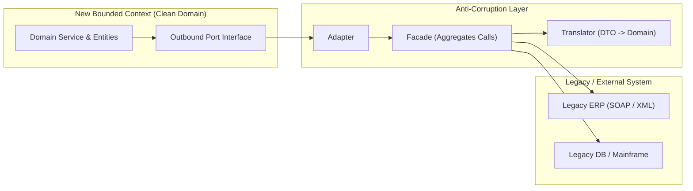
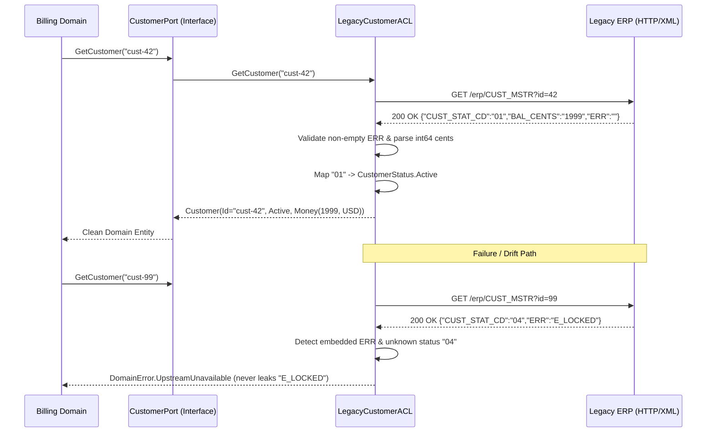

# Anti-Corruption Layer: Keep Legacy Models Out of Your Domain

> **Prerequisites:** [Lesson 11: Strangler Fig Pattern](../11-strangler-fig-pattern/README.md) · [Track: Architecture Patterns](../README.md).  
> **Estimated Reading Time:** 22–26 minutes  
> **Target Audience:** Backend engineers integrating clean domain services with legacy ERPs, mainframes, or third-party APIs, and candidates asked "how do you prevent legacy data models from polluting a new microservice?"  
> **Free PDF Notes:** [Download SD-L-012.pdf](https://backendroadmap.com/notes/system-design/SD-L-012.pdf)

> [!NOTE]
> **In one line:** An **Anti-Corruption Layer (ACL)** is an explicit **translation boundary** (facade + adapter + translator) placed between your clean domain model and an upstream legacy or third-party system so cryptic schemas, status codes, and semantic quirks never leak into your core business logic.

> [!TIP]
> **The Golden Rule:** Never let an external API's field names (`CUST_STAT_CD = "03"`), nullability quirks, or database types cross your service boundary. Translate **at the edge** into your own ubiquitous language, validate invariants immediately, and isolate the ACL so you can delete it the day the legacy system is retired.

---

## 1. What an Anti-Corruption Layer Is, and What It Isn't

When you extract a new `BillingService` from a 15-year-old ERP using Strangler Fig, the legacy ERP still owns customer records. It represents a customer's status as `CUST_STAT_CD` (`"01"`, `"02"`, `"99"`), stores monetary amounts as `DECIMAL` strings in cents *sometimes* and dollars *other times* depending on `CURR_FLG`, and returns `HTTP 200 OK` with `{"error_code": "E_TIMEOUT"}` in the body. If your new `BillingService` imports those DTOs directly, every `if (dto.CUST_STAT_CD == "01")` spreads legacy rot across 40 domain files. An **Anti-Corruption Layer** intercepts that legacy payload at the boundary and translates it into a clean, strongly typed `CustomerAccount { Status: Active, Balance: Money(1999, USD) }`.

| Term | Precise Meaning | Example |
| :--- | :--- | :--- |
| **Anti-Corruption Layer (ACL)** | Coined by Eric Evans (DDD); a boundary layer translating between two incompatible domain models | Translating SAP IDoc XML into clean `InvoiceIssued` domain objects |
| **Translator / Mapper** | Stateless pure component converting legacy DTOs/enums to domain value objects | `LegacyCustomerMapper.toDomain(raw)` |
| **Facade** | Simplifies a chatty, multi-step legacy API into one clean domain-level call | Wrapping 3 SOAP calls (`getHeader`, `getLines`, `getTax`) into `fetchOrder()` |
| **Adapter** | Implements your domain's outbound Port interface using the legacy transport (HTTP/SOAP/MQ) | `LegacyErpCustomerAdapter implements CustomerRepository` |
| **Ubiquitous Language** | The consistent, unambiguous vocabulary shared by your domain code and product team | `SubscriptionStatus.PastDue` instead of `STAT_CD = '7'` |
| **Not a Shared Kernel** | Sharing a common library/DB schema between two teams (high coupling) | Two services importing `common-legacy-dtos.jar` |
| **Not a Pass-Through Wrapper** | A 1:1 DTO rename (`custStatCd` → `custStatCode`) that preserves legacy semantics and bugs | Still passing raw `"01"` strings into business rules |

### Why It Matters
1. **Domain purity:** Core business rules stay readable, testable, and free of legacy workarounds.
2. **Swappability:** When the legacy ERP is finally replaced (or you switch payment providers from LegacyPay to Stripe), you rewrite **only the ACL**, touching zero domain logic.
3. **Blast-radius containment:** Legacy protocol quirks (XML, SOAP, `200 OK` errors, EBCDIC encodings, weird date formats) are normalized and caught at one testable choke point.

---

## 2. Anatomy: Where the ACL Sits



An ACL can be deployed in **two topologies**, each with clear trade-offs:

| Topology | How It Works | Best For | Latency Cost |
| :--- | :--- | :--- | :--- |
| **In-Process ACL (Library / Module)** | Lives inside the new service's infrastructure layer behind a Port interface | 1-to-1 integration; low latency; simple deployment | **~0.05–0.5 ms** (in-memory mapping) |
| **Standalone ACL Microservice (Gateway/Sidecar)** | Separate deployable process translating between Legacy and 3+ new services | Fan-out where multiple new services consume the same messy legacy API | **+2–8 ms** (extra network hop + serialization) |

| Legacy Quirk | Without ACL (Model Pollution) | With ACL (Normalized Boundary) |
| :--- | :--- | :--- |
| **Cryptic codes** | `if status == "03" || status == "09"` in 18 files | `CustomerStatus.Suspended` mapped once in Translator |
| **Fake `200 OK` errors** | Downstream treats error body as valid empty customer | ACL inspects `error_code` and throws `UpstreamTimeoutError` |
| **Split endpoints** | Domain orchestrates 3 legacy calls + joins in memory | Facade aggregates 3 calls and returns 1 `OrderAggregate` |
| **Ambiguous nulls** | `""`, `"N/A"`, `"0000-00-00"`, `null` all mean "unset" | Translator normalizes all four to `Option.None` / `null` |

> [!WARNING]
> **The #1 ACL Trap: Putting business logic inside the ACL.** The ACL's job is **syntactic and semantic translation**, not business decisions. If you put discount calculations, fraud rules, or retry workflows inside the ACL, you split domain logic across two layers and make both impossible to reason about. Keep the ACL strictly limited to **mapping, validation, and protocol adaptation**.

---

## 3. Mathematical Model: Coupling, Translation Overhead & Blast Radius

**1. Coupling Surface Area ($C$).**  
Suppose your domain has $M$ business modules that depend on $K$ legacy fields/quirks. Without an ACL, every module directly references the legacy model, creating $M \times K$ coupling points. With an ACL, only the Translator touches the $K$ legacy fields, and the $M$ modules depend only on your stable domain model:

$$C_{\text{no-ACL}} = M \times K \qquad C_{\text{ACL}} = K + M$$

When the legacy schema changes (or is replaced), the number of files requiring modification drops from $O(M \cdot K)$ to $O(K)$ inside the ACL.

**2. ACL Latency & Serialization Budget.**  
For an in-process ACL wrapping $n$ legacy calls (sequentially or in parallel) plus translation CPU time $t_{\text{map}}$:

$$T_{\text{ACL, seq}} = \sum_{i=1}^{n} t_{\text{legacy}, i} + t_{\text{map}}, \qquad T_{\text{ACL, par}} = \max_{i=1..n}(t_{\text{legacy}, i}) + t_{\text{map}}$$

If deployed as a standalone ACL service, add network + JSON/Protobuf marshal time $t_{\text{hop}}$.

**3. Contract Drift Error Rate.**  
If a legacy system introduces unannounced field changes at rate $\lambda_{\text{drift}}$ per quarter and an ACL enforces strict schema validation at the boundary, silent data corruption drops to zero (fail-fast `422`/`502` at the ACL instead of corrupting downstream state).

### Worked Numerical Example
Suppose a new `Subscription` domain has $M = 15$ modules (billing, dunning, invoices, refunds, etc.) consuming $K = 24$ cryptic fields from a legacy Mainframe ERP:
- **Without ACL:** $C_{\text{no-ACL}} = 15 \times 24 = \mathbf{360}$ coupling points scattered across the codebase. Replacing the Mainframe touches 360 call sites.
- **With ACL:** $C_{\text{ACL}} = 24 + 15 = \mathbf{39}$ total edges, and **only the 24 mappings inside 1 ACL package** touch the Mainframe schema.
- **Latency:** The legacy ERP requires 3 calls: `getCustomer` (35 ms), `getContracts` (55 ms), and `getCreditLimit` (25 ms), plus `t_map = 0.4 ms` for XML-to-domain translation:
  - Sequential ACL Facade: $35 + 55 + 25 + 0.4 = \mathbf{115.4\text{ ms}}$.
  - Parallel ACL Facade (`errgroup` / `Promise.all`): $\max(35, 55, 25) + 0.4 = \mathbf{55.4\text{ ms}}$ (a **52% latency reduction** hidden cleanly behind the Facade).

---

## 4. Metrics & Percentiles

| Metric | Meaning | Alert When |
| :--- | :--- | :--- |
| **ACL Translation Error Rate** | Percentage of legacy payloads failing schema/enum mapping (`UnknownStatusCode`, `InvalidMoney`) | $> 0.01\%$ (indicates upstream schema drift or undocumented enum) |
| **ACL Unmapped Field Count** | Unknown legacy enum values falling into `default` / `Unknown` | $> 0$ in production logs |
| **ACL Facade Latency ($p_{99}$)** | End-to-end time inside the ACL (legacy calls + mapping) | Exceeds upstream SLO budget (e.g., $> 250\text{ ms}$) |
| **ACL Cache Hit Ratio** | Percentage of read translations served from short-TTL ACL cache | Drops $> 15\%$ suddenly (risks stampeding legacy DB) |
| **Legacy Upstream `200`-with-Error** | Legacy responses returning HTTP 200 containing an embedded error payload | Spikes $> 1\%$ (legacy degradation masked as HTTP 200) |

### Worked Example: Mainframe Status Code Drift
Your ACL translates `CUST_STAT_CD` (`"01"` → `Active`, `"02"` → `Suspended`, `"99"` → `Closed`). One Tuesday, the legacy ERP team deploys a patch adding `"04"` (`PendingKYC`) without telling anyone.
- **Without ACL:** `"04"` falls into `else` branches across 15 services—some treat it as `Active` (allowing payouts!), others crash with `NullPointerException`.
- **With ACL:** The Translator's exhaustive `switch` immediately rejects `"04"`, increments `acl_translation_errors_total{field="CUST_STAT_CD", value="04"}`, fires a PagerDuty alert within 60 seconds, and fails closed (preventing unauthorized payouts) until `"04"` is mapped in 1 file.

---

## 5. Compounding & Failure Modes

How does a poorly designed ACL—or missing ACL—compound into production outages?

| Failure Mode | Mechanism | Quantitative Impact |
| :--- | :--- | :--- |
| **1. Leaky Abstraction Cascade** | ACL passes raw legacy `id` formats or pagination cursors to domain; domain builds logic around them | Swapping legacy system requires rewriting **60–80%** of domain tests and APIs |
| **2. Chatty Facade Amplification** | Facade loops $N$ items and calls legacy `getDetail(id)` per item ($N+1$ problem) | For a 50-item order at 20 ms/call: $1 + 50 \times 20\text{ ms} = \mathbf{1{,}020\text{ ms}}$; saturates legacy thread pool |
| **3. Silent Defaulting Corruption** | Translator maps unknown enum `"04"` to `Active` instead of failing fast | Corrupts **100%** of `"04"` accounts until manual DB backfill weeks later |

**Standalone ACL Bottleneck:** If 6 microservices route through a single shared ACL service without horizontal autoscaling or per-caller rate limits, a traffic spike in `Analytics` exhausts the ACL's connection pool to the legacy ERP, taking down `Checkout` too (shared fate).

---

## 6. Numbers Every Engineer Must Know

| Item | Typical | Implication |
| :--- | :---: | :--- |
| **In-process DTO mapping** | $0.05\text{–}0.5\text{ ms}$ | Practically free; never an excuse to leak legacy models |
| **Standalone ACL hop** | $2\text{–}8\text{ ms}$ | Justified only when 3+ services share complex legacy protocol translation (e.g., SOAP/EDI) |
| **XML/SOAP parse vs JSON** | $3\text{–}10\times$ slower CPU | Parse legacy XML once at the ACL boundary, never inside domain services |
| **Parallel Facade speedup** | $2\text{–}4\times$ lower latency | Always fan out independent legacy calls concurrently inside the Facade |
| **Contract test suite runtime** | $< 2\text{ s}$ | Run golden-file fixture tests against captured legacy payloads on every commit |
| **ACL lifespan** | Months to years | Design it to be **deletable** (`rm -rf acl/legacy_erp`) once migration completes |

---

## 7. Mechanism Deep Dive: Translation, Error Normalization & Quarantine



| Question | Answer |
| :--- | :--- |
| **Should the ACL map outbound writes as well as inbound reads?** | Yes. An ACL is bidirectional: it translates incoming legacy events/responses into domain models **and** translates domain commands into legacy API requests/schemas. |
| **What should the ACL do with unmapped legacy fields?** | Drop them intentionally. Your domain should only carry attributes it actually uses; carrying 90 unused legacy fields recreates the coupling you're trying to avoid. |
| **How do you test an ACL without a live mainframe?** | Record anonymized production responses as **golden fixtures** (contract tests) and run your Translator against them in CI to verify every edge case (`"0000-00-00"`, `null`, `"E_TIMEOUT"`). |
| **Should an ACL have its own database?** | Usually no—keep it stateless. The only exception is an **ID mapping table** (`legacy_cust_id ↔ new_uuid`) if legacy IDs cannot be derived deterministically. |

**When NOT to use an Anti-Corruption Layer:**
- **Greenfield services speaking the same domain language:** If both services are owned by your team and share clean, versioned Protobuf/OpenAPI contracts, an ACL adds pointless boilerplate.
- **Pure pass-through CRUD / BFF:** If your service is just a thin UI aggregator with no real domain invariants, a simple DTO mapper suffices.
- **When you control and can fix the upstream schema cheaply:** Fixing a bad field name in an internal service you own is better than building a permanent translation layer around it.

---

## 8. Hierarchical Budgets & Design Rules

| Slice | Rule | Control |
| :--- | :--- | :--- |
| **Boundary Isolation** | Domain packages must **never** import legacy DTOs, XML structs, or HTTP client types | Go `depguard` / ArchUnit / ESLint `no-restricted-imports` |
| **Fail-Fast Mapping** | Unknown legacy enum codes or invalid money/date formats must fail explicitly, never silently default | Exhaustive `switch` + `acl_translation_errors_total` metric |
| **Error Normalization** | Convert legacy `200 OK` error bodies and SOAP faults into typed domain errors (`NotFound`, `Unavailable`) | Normalized error taxonomy at the Adapter |
| **Concurrency** | Fan out independent legacy calls in parallel with bounded timeouts inside the Facade | `context.WithTimeout` / `Promise.all` + circuit breaker |
| **Zero Business Logic** | No pricing, discount, or workflow rules inside the ACL | Code review gate: ACL contains only mapping + I/O |
| **Deletability** | Keep all legacy translation in one isolated folder/package | `internal/acl/legacy_erp/` ready for `rm -rf` |

---

## 9. Top Mitigations

1. **Enforce import boundaries automatically** (ArchUnit in Java/C#, `depguard` in Go, ESLint rules in TS) so no developer accidentally imports a legacy DTO into the domain layer.
2. **Fail closed on unknown enum values** and alert immediately—silent fallback to `"Active"` or `"Default"` causes silent data corruption.
3. **Normalize legacy `200 OK` error payloads** inside the Adapter before they reach domain code.
4. **Use golden-file contract tests** built from real captured legacy payloads so edge cases (negative zero, legacy date strings, missing fields) never regress.
5. **Parallelize multi-call Facades** and wrap them with timeouts, retries (for idempotent reads), and circuit breakers so a slow mainframe doesn't exhaust your service's threads.
6. **Maintain an explicit ID-mapping strategy** (deterministic UUIDv5 or a small indexed mapping table) so legacy integer IDs (`000412`) don't leak into your new public APIs.

---

## 10. Production Reference: Silent Money Corruption via Missing ACL

**Context:** A retail platform migrated its `Checkout` service away from a 12-year-old Perl/MySQL monolith. To save time, the new Node.js `Checkout` service directly consumed the legacy `GET /legacy/cart` JSON response without an ACL.

```mermaid
flowchart LR
    L["Legacy Perl API"] -->|"{\"total\": \"19.99\", \"curr\": \"USD\"}"| N["New Checkout (No ACL)"]
    L2["Legacy Perl API (JPY order)"] -->|"{\"total\": 2000, \"curr\": \"JPY\"}"| N
    N -->|"Assumed dollars * 100 -> 200000 yen!"| P["Payment Gateway (Overcharged 100x)"]
```

- **Root Cause:** The legacy API returned `total` as a string in major units (`"19.99"`) for USD/EUR, but as an integer in minor units (`2000`) for zero-decimal currencies like JPY—and sometimes returned `"total": ""` for free promotional items. Without an ACL normalizing this into a `Money(amountMinorUnits: int64, currency: Currency)` value object, three different handlers in `Checkout` multiplied `total` by `100` inconsistently.
- **Impact:** Over 4 hours during a Japan campaign, 1,420 JPY orders were charged **100x** the actual price before fraud alerts triggered a SEV-1 halt and manual refunds.
- **Fix:**
  1. Introduced a strict `LegacyCartACL` that parsed `total` according to currency decimal rules (`JPY` = 0 decimals, `USD` = 2 decimals), rejected empty/NaN totals, and returned an immutable `Money` domain value object.
  2. Added an ESLint `no-restricted-imports` rule forbidding domain services from referencing `LegacyCartDto`.

---

## 11. Multi-Language Production Code Tabs

An **Anti-Corruption Layer** translating a messy legacy ERP customer payload (`CUST_STAT_CD`, `200 OK` embedded error, stringified cents) into a clean domain `Customer` entity behind a Port interface.

````carousel
```go
// Go: Anti-Corruption Layer translating legacy ERP payloads into clean domain models.
package main

import (
	"context"
	"errors"
	"fmt"
	"strconv"
	"strings"
)

// --- Clean Domain Layer (zero legacy knowledge) ---
type CustomerStatus int

const (
	StatusActive CustomerStatus = iota + 1
	StatusSuspended
	StatusClosed
)

type Money struct {
	MinorUnits int64
	Currency   string
}

type Customer struct {
	ID      string
	Status  CustomerStatus
	Balance Money
}

type CustomerPort interface {
	GetCustomer(ctx context.Context, id string) (Customer, error)
}

var (
	ErrUpstreamUnavailable = errors.New("upstream unavailable")
	ErrContractDrift       = errors.New("legacy contract drift")
)

// --- Anti-Corruption Layer (isolated & deletable) ---
type LegacyErpDTO struct {
	CustID     string `json:"CUST_ID"`
	CustStatCd string `json:"CUST_STAT_CD"`
	BalCents   string `json:"BAL_CENTS"`
	CurrCd     string `json:"CURR_CD"`
	ErrCode    string `json:"ERR_CD"`
}

type LegacyErpACL struct {
	fetchRaw func(ctx context.Context, id string) (LegacyErpDTO, error)
}

func (a *LegacyErpACL) GetCustomer(ctx context.Context, id string) (Customer, error) {
	raw, err := a.fetchRaw(ctx, id)
	if err != nil {
		return Customer{}, fmt.Errorf("%w: %v", ErrUpstreamUnavailable, err)
	}
	// Normalize legacy HTTP-200 embedded errors
	if strings.TrimSpace(raw.ErrCode) != "" {
		return Customer{}, fmt.Errorf("%w: legacy code=%s", ErrUpstreamUnavailable, raw.ErrCode)
	}
	status, err := mapStatus(raw.CustStatCd)
	if err != nil {
		return Customer{}, err
	}
	cents, err := strconv.ParseInt(strings.TrimSpace(raw.BalCents), 10, 64)
	if err != nil {
		return Customer{}, fmt.Errorf("%w: invalid BAL_CENTS=%q", ErrContractDrift, raw.BalCents)
	}
	return Customer{
		ID:      raw.CustID,
		Status:  status,
		Balance: Money{MinorUnits: cents, Currency: strings.ToUpper(raw.CurrCd)},
	}, nil
}

func mapStatus(code string) (CustomerStatus, error) {
	switch code {
	case "01":
		return StatusActive, nil
	case "02":
		return StatusSuspended, nil
	case "99":
		return StatusClosed, nil
	default:
		// Fail closed on undocumented enum values
		return 0, fmt.Errorf("%w: unknown CUST_STAT_CD=%q", ErrContractDrift, code)
	}
}
```
<!-- slide -->
```typescript
// TypeScript: Anti-Corruption Layer with exhaustive status mapping and error normalization.
export enum CustomerStatus {
  Active = "ACTIVE",
  Suspended = "SUSPENDED",
  Closed = "CLOSED",
}

export interface Money {
  readonly minorUnits: number;
  readonly currency: string;
}

export interface Customer {
  readonly id: string;
  readonly status: CustomerStatus;
  readonly balance: Money;
}

export interface CustomerPort {
  getCustomer(id: string): Promise<Customer>;
}

// Legacy DTO stays strictly inside the ACL module
interface LegacyErpDto {
  CUST_ID: string;
  CUST_STAT_CD: string;
  BAL_CENTS: string;
  CURR_CD: string;
  ERR_CD?: string;
}

const STATUS_MAP: Record<string, CustomerStatus> = {
  "01": CustomerStatus.Active,
  "02": CustomerStatus.Suspended,
  "99": CustomerStatus.Closed,
};

export class LegacyErpAcl implements CustomerPort {
  constructor(private readonly fetchRaw: (id: string) => Promise<LegacyErpDto>) {}

  async getCustomer(id: string): Promise<Customer> {
    const raw = await this.fetchRaw(id);
    if (raw.ERR_CD && raw.ERR_CD.trim() !== "") {
      throw new Error(`UpstreamUnavailable: legacy ERR_CD=${raw.ERR_CD}`);
    }
    const status = STATUS_MAP[raw.CUST_STAT_CD];
    if (!status) {
      throw new Error(`ContractDrift: unknown CUST_STAT_CD=${raw.CUST_STAT_CD}`);
    }
    const minorUnits = Number.parseInt(raw.BAL_CENTS, 10);
    if (!Number.isSafeInteger(minorUnits)) {
      throw new Error(`ContractDrift: invalid BAL_CENTS=${raw.BAL_CENTS}`);
    }
    return {
      id: raw.CUST_ID,
      status,
      balance: { minorUnits, currency: raw.CURR_CD.toUpperCase() },
    };
  }
}
```
<!-- slide -->
```python
# Python: Anti-Corruption Layer translating legacy ERP dict into clean Domain dataclasses.
from dataclasses import dataclass
from enum import Enum
from typing import Callable


class CustomerStatus(Enum):
    ACTIVE = "ACTIVE"
    SUSPENDED = "SUSPENDED"
    CLOSED = "CLOSED"


@dataclass(frozen=True)
class Money:
    minor_units: int
    currency: str


@dataclass(frozen=True)
class Customer:
    id: str
    status: CustomerStatus
    balance: Money


class ContractDriftError(ValueError):
    pass


class UpstreamUnavailableError(RuntimeError):
    pass


_LEGACY_STATUS_MAP = {
    "01": CustomerStatus.ACTIVE,
    "02": CustomerStatus.SUSPENDED,
    "99": CustomerStatus.CLOSED,
}


class LegacyErpACL:
    """Translates cryptic legacy ERP payloads into clean Domain entities."""

    def __init__(self, fetch_raw: Callable[[str], dict]) -> None:
        self._fetch_raw = fetch_raw

    def get_customer(self, customer_id: str) -> Customer:
        raw = self._fetch_raw(customer_id)
        if err_cd := raw.get("ERR_CD", "").strip():
            raise UpstreamUnavailableError(f"Legacy error: {err_cd}")

        code = raw.get("CUST_STAT_CD")
        if code not in _LEGACY_STATUS_MAP:
            raise ContractDriftError(f"Unknown CUST_STAT_CD: {code!r}")

        try:
            cents = int(str(raw["BAL_CENTS"]).strip())
        except (KeyError, ValueError) as exc:
            raise ContractDriftError(f"Invalid BAL_CENTS: {raw.get('BAL_CENTS')!r}") from exc

        return Customer(
            id=str(raw["CUST_ID"]),
            status=_LEGACY_STATUS_MAP[code],
            balance=Money(minor_units=cents, currency=str(raw["CURR_CD"]).upper()),
        )
```
<!-- slide -->
```csharp
// C#: Anti-Corruption Layer implementing a clean domain port.
public enum CustomerStatus { Active, Suspended, Closed }

public sealed record Money(long MinorUnits, string Currency);
public sealed record Customer(string Id, CustomerStatus Status, Money Balance);

public interface ICustomerPort
{
    Task<Customer> GetCustomerAsync(string id, CancellationToken ct = default);
}

internal sealed record LegacyErpDto(
    string CUST_ID, string CUST_STAT_CD, string BAL_CENTS, string CURR_CD, string? ERR_CD);

public sealed class LegacyErpAcl : ICustomerPort
{
    private readonly Func<string, CancellationToken, Task<LegacyErpDto>> _fetchRaw;

    internal LegacyErpAcl(Func<string, CancellationToken, Task<LegacyErpDto>> fetchRaw) =>
        _fetchRaw = fetchRaw;

    public async Task<Customer> GetCustomerAsync(string id, CancellationToken ct = default)
    {
        var raw = await _fetchRaw(id, ct);
        if (!string.IsNullOrWhiteSpace(raw.ERR_CD))
            throw new InvalidOperationException($"UpstreamUnavailable: {raw.ERR_CD}");

        var status = raw.CUST_STAT_CD switch
        {
            "01" => CustomerStatus.Active,
            "02" => CustomerStatus.Suspended,
            "99" => CustomerStatus.Closed,
            _ => throw new FormatException($"ContractDrift: unknown CUST_STAT_CD={raw.CUST_STAT_CD}")
        };

        if (!long.TryParse(raw.BAL_CENTS, out var cents))
            throw new FormatException($"ContractDrift: invalid BAL_CENTS={raw.BAL_CENTS}");

        return new Customer(raw.CUST_ID, status, new Money(cents, raw.CURR_CD.ToUpperInvariant()));
    }
}
```
````

---

## 12. Hands-On CLI Verification Workflows

Verify the Python ACL's fail-fast behavior on valid, drift, and embedded-error payloads:

```bash
python3 -c '
from dataclasses import dataclass
from enum import Enum

class Status(Enum): ACTIVE="ACTIVE"; SUSPENDED="SUSPENDED"; CLOSED="CLOSED"
MAP = {"01": Status.ACTIVE, "02": Status.SUSPENDED, "99": Status.CLOSED}

def translate(raw):
    if raw.get("ERR_CD"): raise RuntimeError(f"Upstream: {raw[\"ERR_CD\"]}")
    if raw["CUST_STAT_CD"] not in MAP: raise ValueError(f"Drift: {raw[\"CUST_STAT_CD\"]}")
    return (raw["CUST_ID"], MAP[raw["CUST_STAT_CD"]].value, int(raw["BAL_CENTS"]))

print("Valid:", translate({"CUST_ID": "42", "CUST_STAT_CD": "01", "BAL_CENTS": "1999", "ERR_CD": ""}))
for bad in [{"CUST_ID": "42", "CUST_STAT_CD": "04", "BAL_CENTS": "0"}, {"CUST_ID": "42", "ERR_CD": "E_LOCK"}]:
    try: translate(bad)
    except Exception as e: print("Caught safely:", type(e).__name__, e)
'
```

Enforce ACL import boundaries in CI so legacy DTOs never leak into domain packages:

```bash
# 1. Grep gate in CI: fail build if domain/ imports acl/ or legacy DTOs
! grep -rn "internal/acl/" ./internal/domain/

# 2. Check Prometheus for ACL contract drift errors
curl -s http://localhost:9090/api/v1/query?query=rate\(acl_translation_errors_total\[5m\]\) | jq '.data.result'
```

---

## 13. Common Mistakes to Avoid

1. **Passing legacy DTOs directly into domain services** instead of translating at the boundary.
2. **Putting business rules inside the ACL** (e.g., calculating discounts or fraud checks in the mapper).
3. **Silently defaulting unknown enum values** (mapping unknown `"04"` to `Active`) instead of failing closed and alerting.
4. **Building a 1:1 pass-through wrapper** that just renames `snake_case` to `camelCase` without fixing legacy semantics.
5. **Making the ACL stateful with its own business database** when it should be a pure translation layer.
6. **Ignoring `200 OK` embedded error payloads** from legacy SOAP/XML/REST APIs.
7. **Forgetting CI architectural fitness checks** (`depguard`, ArchUnit, ESLint) to keep legacy imports out of the domain.

---

## 14. Key Terms Glossary

| Key Term | Definition |
| :--- | :--- |
| **Anti-Corruption Layer (ACL)** | An isolation boundary that translates between an external/legacy model and your clean domain model. |
| **Ubiquitous Language** | The shared, domain-specific vocabulary used consistently in code and product discussions. |
| **Bounded Context** | An explicit boundary within which a particular domain model and its terms apply cleanly. |
| **Translator / Mapper** | The component inside an ACL that converts legacy DTOs, codes, and types into domain objects. |
| **Facade** | A simplified interface hiding multiple chatty or complex legacy API calls behind one clean method. |
| **Adapter** | A wrapper implementing a domain Port interface using a specific external protocol or client. |
| **Contract Drift** | Unannounced changes in an upstream system's schema, types, or enum values. |
| **Fail Closed** | Rejecting ambiguous or unmapped inputs safely rather than guessing a default value. |
| **Shared Kernel** | Two contexts sharing a common model/library—an alternative to ACL that increases coupling. |
| **Golden Fixture Test** | A unit/contract test using captured real production payloads to verify ACL translation. |

---

## 15. System Design Interview Questions & Answers

### Basic Conceptual Questions

<details>
<summary><strong>Q1: What is an Anti-Corruption Layer (ACL) and why do we use it? [BASIC]</strong></summary>

**Answer:**
An Anti-Corruption Layer is a translation boundary (adapter + facade + translator) placed between a clean domain service and a legacy or third-party system. It prevents cryptic legacy schemas, status codes, and protocol quirks from leaking into your core domain logic, keeping the domain pure, testable, and easy to migrate later.
</details>

<details>
<summary><strong>Q2: How does an ACL relate to the Strangler Fig pattern? [BASIC]</strong></summary>

**Answer:**
Strangler Fig routes traffic incrementally from a legacy monolith to new services. While both coexist, the new services still need data or capabilities from the monolith. The ACL sits at the boundary of each new service so that legacy data models synced via CDC or APIs are translated into clean domain models rather than infecting the new services.
</details>

<details>
<summary><strong>Q3: What is the difference between a Pass-Through Wrapper and a true ACL? [BASIC]</strong></summary>

**Answer:**
A pass-through wrapper only changes syntax (e.g., `CUST_STAT_CD` → `custStatCode`) while preserving legacy semantics, magic strings, and quirks. A true ACL performs **semantic translation**: mapping `"01"` to `CustomerStatus.Active`, normalizing ambiguous nulls, aggregating chatty calls into one domain entity, and converting `200 OK` error bodies into typed domain errors.
</details>

<details>
<summary><strong>Q4: When is an ACL unnecessary overhead? [BASIC]</strong></summary>

**Answer:**
When integrating two greenfield services that you own and that already share a clean, versioned contract (e.g., Protobuf/OpenAPI in your ubiquitous language), or in a simple pass-through CRUD/BFF service with no domain logic to protect.
</details>

### Scenario-Based Architecture Questions

<details>
<summary><strong>Q5: Your new service needs data from 3 legacy SOAP endpoints that take 40 ms each and return XML. How do you design the ACL? [SCENARIO]</strong></summary>

**Answer:**
Build an in-process ACL implementing a domain `Port` interface. Inside the ACL's **Facade**, execute the 3 SOAP calls **in parallel** with a strict timeout (dropping latency from $120\text{ ms}$ to $\sim 45\text{ ms}$), parse the XML once at the boundary, normalize any SOAP faults or `200` error bodies, and map the result into a single immutable domain aggregate.
</details>

<details>
<summary><strong>Q6: Should the ACL be an in-process library or a separate standalone microservice? [SCENARIO]</strong></summary>

**Answer:**
Default to an **in-process module** behind a Port interface: it adds sub-millisecond overhead and zero operational complexity. Only extract a **standalone ACL service** when 3+ independent microservices need the exact same complex legacy protocol translation (e.g., mainframe MQ/EDI) and you want to centralize connection pooling, rate limiting, and schema mapping in one place.
</details>

<details>
<summary><strong>Q7: The legacy ERP team frequently adds undocumented status codes without warning. How should your ACL handle them? [SCENARIO]</strong></summary>

**Answer:**
**Fail closed** on unknown enum values instead of silently defaulting to `Active` or `Unknown`. Increment an `acl_translation_errors_total` metric with the offending field/value, trigger an immediate alert, and quarantine or reject the affected operation safely until the new code is explicitly mapped in the ACL.
</details>

<details>
<summary><strong>Q8: How do you prevent developers from bypassing the ACL and importing legacy DTOs directly into domain code? [SCENARIO]</strong></summary>

**Answer:**
Enforce the boundary automatically in CI using architectural fitness functions: `depguard` in Go, ArchUnit in Java/C#, or ESLint `no-restricted-imports` in TypeScript. Make legacy DTO types package-private (`internal` in C#, unexported in Go) so the compiler itself blocks domain packages from referencing them.
</details>

### Advanced & Tricky Interview Questions

<details>
<summary><strong>Q9: How do you handle ID impedance mismatch (legacy 6-digit integer IDs vs new UUIDs) in an ACL? [TRICKY]</strong></summary>

**Answer:**
Never expose legacy integer IDs in your new domain's public APIs. Either generate **deterministic UUIDv5** values from `namespace + legacy_id` (stateless, bidirectional) or maintain a small indexed `id_mapping(legacy_id, domain_uuid)` lookup table inside the ACL/adapter. The domain works purely with `CustomerId(UUID)` while the ACL translates at the edge.
</details>

<details>
<summary><strong>Q10: Can an ACL become a distributed single point of failure? How do you prevent it? [TRICKY]</strong></summary>

**Answer:**
Yes, if deployed as a shared standalone ACL service without isolation. A spike in one low-priority consumer (e.g., Analytics) can exhaust the ACL's connection pool to the legacy mainframe and starve `Checkout`. Prevent this with per-caller rate limits, bulkhead connection pools, circuit breakers, and short-TTL caching for read-heavy reference data—or prefer in-process ACLs.
</details>

<details>
<summary><strong>Q11: Where does an ACL end and business logic begin? Give a concrete example. [TRICKY]</strong></summary>

**Answer:**
Translating `BAL_CENTS: "1999", CURR_CD: "USD"` into `Money(1999, USD)` or mapping `"02"` to `CustomerStatus.Suspended` belongs in the **ACL**. Deciding *"if `Customer.Status == Suspended` and `Balance < $50`, waive the late fee"* belongs strictly in the **Domain Layer**. If a rule changes when product managers change pricing policy, it does not belong in the ACL.
</details>

<details>
<summary><strong>Q12: How do you test an ACL thoroughly when the legacy system has no staging environment? [TRICKY]</strong></summary>

**Answer:**
Use **record-and-replay golden fixtures**. Capture anonymized real production payloads (including weird edge cases like `"0000-00-00"`, zero-decimal currencies, and embedded `ERR_CD` responses) into versioned JSON/XML fixture files. Run deterministic contract tests in CI against those fixtures on every PR, and validate live production traffic via shadow-mode translation metrics.
</details>

---

## 16. One-Page Master Cheat Sheet

```
+---------------------------------------------------------------------------------------------------------+
|                    ANTI-CORRUPTION LAYER (ACL) — MASTER CHEAT SHEET                                     |
+---------------------------------------------------------------------------------------------------------+
| 1. PURPOSE: Isolate your clean Domain Model from legacy schemas, cryptic enums, and protocol quirks.    |
|    Coupling drops from O(M * K) across all modules to O(K) inside one deletable ACL package.            |
+---------------------------------------------------------------------------------------------------------+
| 2. COMPONENTS: Port (domain interface) -> Adapter (protocol) -> Facade (parallel calls) -> Translator.  |
+---------------------------------------------------------------------------------------------------------+
| 3. TOPOLOGY: Default to in-process (~0.1 ms). Use standalone ACL service (+2-8 ms) only for 3+ clients. |
+---------------------------------------------------------------------------------------------------------+
| 4. GOLDEN RULES:                                                                                        |
|    - Translate at the edge; drop unused legacy fields.                                                  |
|    - Fail closed on unknown enums/codes; alert on contract drift.                                       |
|    - Normalize HTTP 200 embedded errors into typed domain errors.                                       |
|    - ZERO business logic in the ACL.                                                                    |
+---------------------------------------------------------------------------------------------------------+
| 5. ENFORCE: Compiler visibility (internal/unexported) + CI rules (depguard/ArchUnit/ESLint) + fixtures. |
+---------------------------------------------------------------------------------------------------------+
```

---

## Further Reading & Sources

- Eric Evans, *Domain-Driven Design: Tackling Complexity in the Heart of Software*, Chapter 14 ("Maintaining Model Integrity — Anticorruption Layer").
- Microsoft Azure Architecture Center, [*Anti-Corruption Layer pattern*](https://learn.microsoft.com/en-us/azure/architecture/patterns/anti-corruption-layer).
- Vaughn Vernon, *Implementing Domain-Driven Design*, Chapter 3 ("Context Maps").
- Sam Newman, *Monolith to Microservices*, Chapter 4 ("Decomposing the Database").

---

## Free PDF Notes

[SD-L-012.pdf](https://backendroadmap.com/notes/system-design/SD-L-012.pdf)

---

## Next

Continue with [Lesson 13: Hexagonal Architecture (Ports & Adapters): Swap Infra, Test Fast](../13-hexagonal-architecture/README.md).
