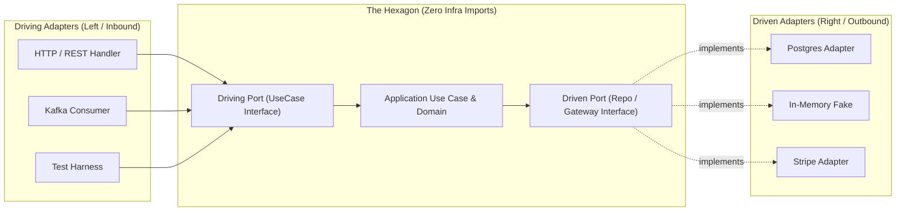
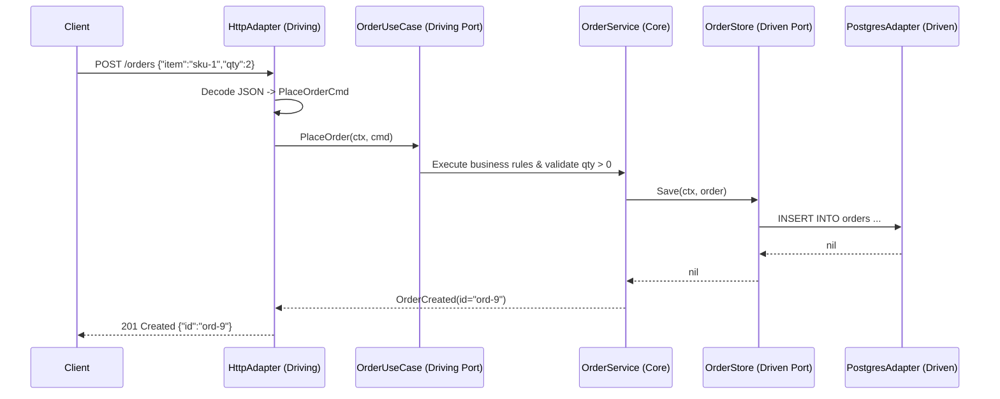
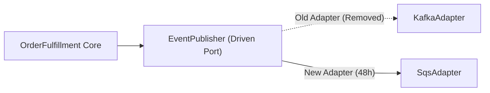

# Hexagonal Architecture (Ports & Adapters): Swap Infra, Test Fast

> **Prerequisites:** [Lesson 12: Anti-Corruption Layer](../12-anti-corruption-layer/README.md) · [Track: Architecture Patterns](../README.md).  
> **Estimated Reading Time:** 23–27 minutes  
> **Target Audience:** Backend engineers structuring microservices for fast unit testing and swappable databases/brokers, and candidates asked "how does Ports & Adapters differ from traditional layered architecture?"  
> **Free PDF Notes:** [Download SD-L-013.pdf](https://backendroadmap.com/notes/system-design/SD-L-013.pdf)

> [!NOTE]
> **In one line:** **Hexagonal Architecture** (Ports & Adapters, coined by Alistair Cockburn) places your pure **domain & application logic** at the center, defines technology-agnostic **Ports** (interfaces) at its boundary, and pushes HTTP, gRPC, SQL, Kafka, and Stripe into interchangeable **Adapters** on the outside—so you can test business rules in milliseconds without booting a database.

> [!TIP]
> **The Golden Rule:** All dependencies point **inward** toward the Hexagon. Your domain defines the `OrderRepository` interface (Outbound Port); Postgres and In-Memory fakes implement it (Outbound Adapters). If your business logic imports `database/sql`, `express`, or `kafka-go`, you broke the Hexagon.

---

## 1. What Hexagonal Architecture Is, and What It Isn't

In a classic 3-tier layered architecture (`Controller → Service → Repository → DB`), dependencies flow downward: `Service` imports `PostgresOrderRepo`, which imports `pgx` or `EntityFramework`. Want to test a refund rule? You either spin up Docker + Postgres (slow, flaky) or mock SQL driver internals (brittle). Want to expose the same refund logic over gRPC or a Kafka consumer instead of REST? You duplicate validation or couple it to HTTP `req/res`. **Hexagonal Architecture** inverts that dependency: the **Domain** owns the interfaces (**Ports**), and both **Driving Adapters** (HTTP, CLI, Kafka consumer) and **Driven Adapters** (Postgres, Redis, Stripe) plug into the outside.

| Term | Precise Meaning | Example |
| :--- | :--- | :--- |
| **Hexagon (Core)** | Pure domain entities, value objects, and application use cases with zero I/O imports | `PlaceOrderUseCase`, `Order`, `Money` |
| **Driving (Primary) Port** | Interface exposed *by* the core for callers to invoke use cases | `OrderUseCase` interface (`PlaceOrder(cmd)`) |
| **Driving (Primary) Adapter** | External entry point that translates transport input into a Driving Port call | `HttpOrderHandler`, `KafkaOrderConsumer`, `CliRunner` |
| **Driven (Secondary) Port** | Interface defined *by* the core for external capabilities it needs | `OrderStore`, `PaymentGateway`, `EventPublisher` |
| **Driven (Secondary) Adapter** | Infrastructure implementation of a Driven Port | `PostgresOrderStore`, `InMemoryOrderStore`, `StripeAdapter` |
| **Composition Root** | Startup wiring (`main.go` / DI container) that plugs Adapters into the Core | `svc := NewOrderService(pgStore, stripeClient)` |
| **Not 6-Sided Mandate** | "Hexagon" just means "multiple ports on a symmetric boundary," not literally 6 sides | You can have 2 ports or 12 ports |

### Why It Matters
1. **100–1,000x faster test feedback:** Domain unit tests run against in-memory Adapters in $< 5\text{ ms}$ with zero Docker containers.
2. **Transport & storage independence:** Expose the exact same use case via REST, gRPC, and Kafka consumer without duplicating business logic.
3. **Safe infrastructure swaps:** Migrate from MySQL to DynamoDB, or RabbitMQ to Kafka, by writing one new Adapter and swapping it in `main()`.

---

## 2. Anatomy: Traditional Layered vs Hexagonal (Ports & Adapters)



| Dimension | Classic 3-Tier Layered | Hexagonal (Ports & Adapters) |
| :--- | :--- | :--- |
| **Dependency Direction** | Top-down (`Service -> Repo -> DB`) | **Inward** (`Adapters -> Ports <- Core`) |
| **Who owns the Repo interface?** | Repository / Data layer | **The Domain / Application Core** |
| **Unit test speed (1,000 tests)** | $15\text{–}90\text{ s}$ (needs DB/Testcontainers) | **$0.05\text{–}0.5\text{ s}$** (in-memory adapters) |
| **Multiple entry points (HTTP + Queue)** | Often duplicates logic in controllers | Both Driving Adapters call the same Driving Port |
| **Boilerplate cost** | Low (few interfaces) | Moderate (Port interfaces + DTO mapping) |

> [!WARNING]
> **The #1 Hexagonal Trap: Leaky Ports.** Defining a Driven Port like `FindBySQL(query string, args ...any)` or returning `*sql.Row` / `gorm.Model` from a Port completely defeats Hexagonal Architecture. Your Port signature must speak **pure domain types** (`FindByID(ctx, OrderID) (Order, error)`), never SQL, HTTP status codes, or ORM annotations.

---

## 3. Mathematical Model: Test Feedback Loop & Interface Dispatch

**1. CI Test Suite Runtime ($T_{\text{CI}}$).**  
Suppose a service has $N_u$ domain/use-case tests and $N_i$ adapter integration tests. With real DB startup overhead $T_{\text{boot}}$ and per-test DB transaction time $t_{\text{db}}$ vs in-memory time $t_{\text{mem}}$:

$$T_{\text{layered}} = T_{\text{boot}} + (N_u + N_i) \cdot t_{\text{db}} \qquad T_{\text{hexagonal}} = N_u \cdot t_{\text{mem}} + \left(T_{\text{boot}} + N_i \cdot t_{\text{db}}\right)$$

Hexagonal Architecture shifts 85–90% of tests into the **Test Pyramid base** ($N_u$ fast in-memory tests) and keeps only thin contract tests ($N_i$) against real Postgres/Kafka.

**2. Runtime Interface Dispatch Overhead.**  
In Go/C#/Java/TypeScript, calling a Port interface instead of a concrete struct adds one virtual-table (vtable/itable) indirection $t_{\text{vtable}}$:

$$\Delta T_{\text{dispatch}} = k_{\text{ports}} \cdot t_{\text{vtable}} \ll t_{\text{network/disk}}$$

### Worked Numerical Example
Consider a service with **500 tests**:
- **Classic Layered (all hitting Testcontainers Postgres):** $T_{\text{boot}} = 8\text{ s}$, $t_{\text{db}} = 45\text{ ms}$ per test:
  $$T_{\text{layered}} = 8\text{ s} + 500 \times 0.045\text{ s} = \mathbf{30.5\text{ s}}\text{ (plus Docker flakiness on local laptops)}$$
- **Hexagonal (450 in-memory domain tests + 50 real Postgres adapter contract tests):** $t_{\text{mem}} = 0.2\text{ ms}$:
  $$T_{\text{hexagonal}} = (450 \times 0.0002\text{ s}) + (8\text{ s} + 50 \times 0.045\text{ s}) = 0.09\text{ s} + 10.25\text{ s} = \mathbf{10.34\text{ s}}$$
  And during local TDD, developers run the 450 domain tests in **90 milliseconds** without starting Docker at all!
- **Production dispatch cost:** Even if a request crosses $k_{\text{ports}} = 5$ interfaces, $5 \times 3\text{ ns} = 15\text{ ns}$ ($0.000015\text{ ms}$)—completely invisible next to a $4\text{ ms}$ Postgres query.

---

## 4. Metrics & Percentiles

| Metric | Meaning | Alert When |
| :--- | :--- | :--- |
| **Domain Unit Test Runtime ($p_{95}$)** | Time to run all pure Hexagon tests without Docker | $> 2\text{ s}$ (signals I/O or sleep leaked into core tests) |
| **Core Infra Import Count** | Number of framework/DB imports inside `domain/` or `application/` | $> 0$ (hard CI build failure) |
| **Adapter Contract Pass Rate** | Shared test suite run against *both* `InMemoryAdapter` and `PostgresAdapter` | $< 100\%$ (in-memory fake diverged from real DB behavior!) |
| **Adapter Mapping Overhead ($p_{99}$)** | Time spent converting HTTP/SQL rows to domain structs | $> 2\text{ ms}$ (e.g., excessive reflection/serialization) |

### Worked Example: In-Memory Fake Drift Caught by Contract Tests
A team writes `InMemoryOrderStore` for fast unit tests and `PostgresOrderStore` for production. `InMemoryOrderStore` overwrites duplicate `OrderID`s silently, whereas `PostgresOrderStore` throws `UniqueViolationError`.
- **Fix:** Write **one shared Port Contract Test Suite** (`RunOrderStoreContractTests(t, factory)`). Run it against `InMemoryOrderStore` in $< 1\text{ ms}$ and against `PostgresOrderStore` in integration CI. When `InMemoryOrderStore` fails the duplicate-key test, fake drift is caught immediately.

---

## 5. Compounding & Failure Modes

| Failure Mode | Mechanism | Quantitative Impact |
| :--- | :--- | :--- |
| **1. Fake-vs-Real Drift** | In-memory adapter doesn't enforce unique constraints, transaction isolation, or `NULL` sorting like Postgres | Unit tests pass 100%, production fails on race conditions / `23505` errors |
| **2. Transaction Boundary Leak** | Use case needs atomic write across 2 Driven Ports (`OrderStore` + `OutboxStore`), but each Port opens its own connection | Non-atomic dual-write; at $0.1\%$ crash rate on 500 writes/s: **43,200 orphaned records/day** |
| **3. Over-Abstraction (Interface Explosion)** | Creating 1-method interfaces for pure CPU helpers (`IUuidGenerator`, `IStringFormatter`) | $3\times$ file count, slower onboarding, zero swappability gain |

**Solving the Transaction Boundary cleanly:** Define a `UnitOfWork` (or `TxManager`) Driven Port: `RunInTx(ctx, func(txPorts Ports) error)` so the application core controls transaction atomicity *without* importing `sql.Tx`!

---

## 6. Numbers Every Engineer Must Know

| Item | Typical | Implication |
| :--- | :---: | :--- |
| **vtable / interface call** | $1\text{–}5\text{ ns}$ | Zero excuse to skip Ports for performance reasons |
| **In-memory domain test** | $0.05\text{–}0.5\text{ ms}$ | Run 1,000+ tests on every file save |
| **Real Postgres adapter test** | $20\text{–}80\text{ ms}$ (+5–10 s container boot) | Reserve for Adapter Contract Tests only |
| **Core external dependencies** | **0** (stdlib only) | Core compiles in milliseconds and survives framework rewrites |
| **Port count per microservice** | $3\text{–}8$ Ports | More than ~15 Ports usually means the service is too big (split bounded context) |

---

## 7. Mechanism Deep Dive: Driving vs Driven Flow & Composition Root



| Question | Answer |
| :--- | :--- |
| **Where does `main()` wire everything together?** | In the **Composition Root** (`cmd/server/main.go` or `Program.cs`), which is the *only* place allowed to import both the Core and all concrete Adapters. |
| **How does a Driving Adapter differ from a Driven Adapter?** | **Driving (Primary)** adapters *call into* the Hexagon (HTTP controller, gRPC server, Kafka consumer, CLI). **Driven (Secondary)** adapters *are called by* the Hexagon (Postgres, Redis, Stripe, S3). |
| **Should Driving Ports also be interfaces?** | Useful if you want to mock the service in HTTP controller tests, or swap decorators (logging/metrics). In Go, concrete UseCase structs + Driving interfaces at the HTTP handler work great. |
| **Can an Adapter call another Adapter directly?** | No. All coordination flows through the Core so business invariants are never bypassed. |

**When NOT to use Hexagonal Architecture:**
- **Simple CRUD / Admin microservices:** If a service just maps HTTP JSON straight to SQL rows with zero domain rules, Ports & Adapters adds 3x boilerplate for no benefit—use a simple handler + SQL repository.
- **Throwaway prototypes / hackathons:** Speed to first demo matters more than long-term swappability.
- **Data-pipeline ETL jobs:** Batch scripts transforming S3 Parquet files into BigQuery don't benefit from multi-port abstraction.

---

## 8. Hierarchical Budgets & Design Rules

| Slice | Rule | Control |
| :--- | :--- | :--- |
| **Dependency Rule** | `Core` imports **nothing** from `Adapters` or frameworks (`gin`, `pgx`, `prisma`, `efcore`) | CI import linter (`depguard`, ArchUnit, ESLint) |
| **Port Ownership** | Driven Port interfaces live in the **Core** package, not in the `postgres/` package | Package layout: `core/ports.go`, `adapters/postgres/` |
| **Port Granularity** | One cohesive Port per external capability (`OrderStore`, `PaymentGateway`), not per SQL query | Interface Segregation Principle |
| **Contract Parity** | Every Driven Port with an In-Memory fake must have a shared Contract Test Suite | Run against both Fake and Real DB in CI |
| **DTO Separation** | HTTP JSON structs and SQL DB models stay inside their respective Adapters | Map to/from Domain entities at Adapter edge |
| **Transactions** | Use a `UnitOfWork` / `Tx` Port when multiple stores must commit atomically | Never pass `*sql.Tx` into Core signatures |

---

## 9. Top Mitigations

1. **Keep the Core 100% framework-free** (no ORM tags, no JSON tags on domain entities, no HTTP status codes).
2. **Run a shared Contract Test Suite** against both your In-Memory fake and your real Postgres/Redis adapter so fakes never lie.
3. **Use a `UnitOfWork` Port** for multi-repository atomic commits instead of leaking `*sql.Tx` or opening separate connections.
4. **Only create Ports for real I/O boundaries** (DB, network, clock, randomness)—don't wrap pure math or string helpers in interfaces.
5. **Enforce dependency direction in CI** with `depguard` / ArchUnit / `dependency-cruiser` so deadlines never erode the boundary.
6. **Keep Adapters thin:** Adapters only translate protocols/rows and handle retries/timeouts; all business decisions stay in the Core.

---

## 10. Production Reference: Swapping Kafka for SQS in 48 Hours

**Context:** A logistics platform ran an `OrderFulfillment` service written in Go using Hexagonal Architecture. Inbound shipments arrived via an HTTP Driving Adapter, and outbound `ShipmentDispatched` events were published through an `EventPublisher` Driven Port backed by a `KafkaAdapter`.



- **Trigger:** Due to a cloud migration, the team had to decommission their self-managed Kafka cluster and move to AWS SQS/SNS within 1 week.
- **Why it succeeded without an incident:**
  1. `OrderFulfillment` core had **zero** `sarama` or `confluent-kafka-go` imports—only `EventPublisher.Publish(ctx, ShipmentDispatched)`.
  2. Engineers wrote `SqsAdapter` (140 lines) and ran the existing `EventPublisherContractTest` against LocalStack SQS.
  3. They deployed `SqsAdapter` behind a feature flag in `main.go` (Composition Root), verified metrics, and cut over in **48 hours** with **zero edits** to domain logic or the 620 domain unit tests.

---

## 11. Multi-Language Production Code Tabs

A complete **Hexagonal `OrderService`** with Driving Port, Driven Port (`OrderStore`), Core Use Case, In-Memory Adapter, and HTTP/JSON Driving Adapter.

````carousel
```go
// Go: Hexagonal Architecture (Core + Ports + In-Memory & HTTP Adapters).
package main

import (
	"context"
	"encoding/json"
	"errors"
	"net/http"
)

// --- 1. CORE (Domain + Ports; zero infra imports) ---
var ErrInvalidQty = errors.New("quantity must be positive")

type Order struct {
	ID  string
	SKU string
	Qty int
}

type OrderStore interface { // Driven Port (owned by Core)
	Save(ctx context.Context, o Order) error
}

type OrderUseCase interface { // Driving Port
	PlaceOrder(ctx context.Context, id, sku string, qty int) (Order, error)
}

type OrderService struct{ store OrderStore }

func (s *OrderService) PlaceOrder(ctx context.Context, id, sku string, qty int) (Order, error) {
	if qty <= 0 {
		return Order{}, ErrInvalidQty
	}
	o := Order{ID: id, SKU: sku, Qty: qty}
	if err := s.store.Save(ctx, o); err != nil {
		return Order{}, err
	}
	return o, nil
}

// --- 2. DRIVEN ADAPTER (In-Memory for <1ms tests; swap for Postgres in prod) ---
type InMemoryOrderStore struct{ data map[string]Order }

func (m *InMemoryOrderStore) Save(_ context.Context, o Order) error {
	m.data[o.ID] = o
	return nil
}

// --- 3. DRIVING ADAPTER (HTTP) ---
type HTTPOrderHandler struct{ uc OrderUseCase }

func (h *HTTPOrderHandler) ServeHTTP(w http.ResponseWriter, r *http.Request) {
	var body struct {
		ID  string `json:"id"`
		SKU string `json:"sku"`
		Qty int    `json:"qty"`
	}
	if err := json.NewDecoder(r.Body).Decode(&body); err != nil {
		http.Error(w, "bad json", http.StatusBadRequest)
		return
	}
	o, err := h.uc.PlaceOrder(r.Context(), body.ID, body.SKU, body.Qty)
	if errors.Is(err, ErrInvalidQty) {
		http.Error(w, err.Error(), http.StatusUnprocessableEntity)
		return
	}
	if err != nil {
		http.Error(w, "internal error", http.StatusInternalServerError)
		return
	}
	w.WriteHeader(http.StatusCreated)
	_ = json.NewEncoder(w).Encode(o)
}
```
<!-- slide -->
```typescript
// TypeScript: Hexagonal Architecture (Core + Ports + Swappable Adapters).
// --- 1. CORE ---
export interface Order {
  readonly id: string;
  readonly sku: string;
  readonly qty: number;
}

export interface OrderStore { // Driven Port
  save(order: Order): Promise<void>;
}

export class OrderService { // Driving Port + Core UseCase
  constructor(private readonly store: OrderStore) {}

  async placeOrder(id: string, sku: string, qty: number): Promise<Order> {
    if (qty <= 0) throw new Error("InvalidQty: quantity must be positive");
    const order: Order = { id, sku, qty };
    await this.store.save(order);
    return order;
  }
}

// --- 2. DRIVEN ADAPTER (In-Memory Fake for fast unit tests) ---
export class InMemoryOrderStore implements OrderStore {
  public readonly items = new Map<string, Order>();
  async save(order: Order): Promise<void> {
    this.items.set(order.id, order);
  }
}

// --- 3. DRIVING ADAPTER (HTTP controller) ---
export class HttpOrderController {
  constructor(private readonly service: OrderService) {}

  async handlePost(reqBody: { id: string; sku: string; qty: number }) {
    try {
      const order = await this.service.placeOrder(reqBody.id, reqBody.sku, reqBody.qty);
      return { status: 201, body: order };
    } catch (err) {
      return { status: 422, body: { error: (err as Error).message } };
    }
  }
}
```
<!-- slide -->
```python
# Python: Hexagonal Architecture using typing.Protocol for structural Ports.
from dataclasses import dataclass
from typing import Protocol


# --- 1. CORE ---
@dataclass(frozen=True)
class Order:
    id: str
    sku: str
    qty: int


class OrderStore(Protocol):  # Driven Port
    def save(self, order: Order) -> None: ...


class OrderService:  # Core Use Case
    def __init__(self, store: OrderStore) -> None:
        self._store = store

    def place_order(self, order_id: str, sku: str, qty: int) -> Order:
        if qty <= 0:
            raise ValueError("quantity must be positive")
        order = Order(id=order_id, sku=sku, qty=qty)
        self._store.save(order)
        return order


# --- 2. DRIVEN ADAPTER (In-Memory Fake) ---
class InMemoryOrderStore:
    def __init__(self) -> None:
        self.rows: dict[str, Order] = {}

    def save(self, order: Order) -> None:
        self.rows[order.id] = order


# --- 3. DRIVING ADAPTER (CLI / HTTP) ---
def handle_http_post(service: OrderService, payload: dict) -> tuple[int, dict]:
    try:
        order = service.place_order(payload["id"], payload["sku"], int(payload["qty"]))
        return 201, {"id": order.id, "sku": order.sku, "qty": order.qty}
    except ValueError as exc:
        return 422, {"error": str(exc)}
```
<!-- slide -->
```csharp
// C#: Hexagonal Architecture (Core + Driven Port + In-Memory Adapter + Composition Root).
public sealed record Order(string Id, string Sku, int Qty);

public interface IOrderStore // Driven Port
{
    Task SaveAsync(Order order, CancellationToken ct = default);
}

public sealed class OrderService // Core Use Case
{
    private readonly IOrderStore _store;
    public OrderService(IOrderStore store) => _store = store;

    public async Task<Order> PlaceOrderAsync(string id, string sku, int qty, CancellationToken ct = default)
    {
        if (qty <= 0) throw new ArgumentOutOfRangeException(nameof(qty), "Quantity must be positive");
        var order = new Order(id, sku, qty);
        await _store.SaveAsync(order, ct);
        return order;
    }
}

public sealed class InMemoryOrderStore : IOrderStore // Driven Adapter (for <1ms unit tests)
{
    public Dictionary<string, Order> Rows { get; } = new();
    public Task SaveAsync(Order order, CancellationToken ct = default)
    {
        Rows[order.Id] = order;
        return Task.CompletedTask;
    }
}
```
````

---

## 12. Hands-On CLI Verification Workflows

Benchmark the Core vs DB test feedback loop in Python:

```bash
python3 -c '
import time
t0 = time.perf_counter()
store = {}
for i in range(1000):
    assert i + 1 > 0
    store[f"ord-{i}"] = {"sku": "A", "qty": i + 1}
elapsed_ms = (time.perf_counter() - t0) * 1000
print(f"1,000 in-memory domain tests completed in {elapsed_ms:.2f} ms (vs ~45,000 ms on real DB)")
'
```

Verify dependency boundaries in Go / TypeScript / .NET:

```bash
# 1. Go: verify core package has zero external DB/HTTP imports
go list -f '{{.Imports}}' ./internal/core/... | grep -E "sql|pgx|gin|echo|kafka" && echo "VIOLATION!" || echo "Hexagon clean"

# 2. TypeScript: check dependency graph rules with dependency-cruiser
npx depcruise src/core --validate .dependency-cruiser.js

# 3. Run fast core unit tests separately from slow integration tests
go test ./internal/core/...        # < 100 ms
go test -tags=integration ./internal/adapters/...
```

---

## 13. Common Mistakes to Avoid

1. **Leaking SQL/ORM/HTTP types into Port signatures** (e.g., returning `*sql.Rows` or `gorm.Model`).
2. **Putting business logic inside Driving Adapters** (e.g., validating business rules in HTTP controllers).
3. **Not running Contract Tests against In-Memory Fakes**, causing silent divergence from Postgres/Redis.
4. **Creating 1-to-1 interfaces for every helper class**, bloating the codebase with pointless abstractions.
5. **Passing `*sql.Tx` into the Core** instead of using a `UnitOfWork` Port for atomic multi-store writes.
6. **Allowing Adapters to call other Adapters directly**, bypassing the Core.
7. **Forgetting CI import checks**, allowing developers to import `pgx` or `express` inside `core/` under deadline pressure.

---

## 14. Key Terms Glossary

| Key Term | Definition |
| :--- | :--- |
| **Hexagonal Architecture** | Architecture isolating core business logic behind Ports, with external tech plugged in as Adapters. |
| **Driving (Primary) Port** | Interface exposed by the Core for external callers (UI, API, CLI, test suite) to invoke use cases. |
| **Driven (Secondary) Port** | Interface defined by the Core for external dependencies (DB, message broker, payment API). |
| **Driving Adapter** | Component translating inbound transport requests (HTTP, gRPC, Kafka) into Driving Port calls. |
| **Driven Adapter** | Component implementing a Driven Port using real infrastructure or an in-memory test fake. |
| **Composition Root** | The single startup entry point (`main`) that wires concrete Adapters into Core services. |
| **Contract Test Suite** | Shared tests verifying that both In-Memory Fakes and Real Adapters obey the exact same Port semantics. |
| **Unit of Work Port** | Abstraction allowing the Core to execute atomic transactions across multiple Ports without importing DB types. |
| **Dependency Inversion** | High-level domain modules define interfaces; low-level infrastructure modules implement them. |
| **Leaky Abstraction** | When infrastructure details (SQL errors, HTTP codes, ORM tags) escape into Core domain signatures. |

---

## 15. System Design Interview Questions & Answers

### Basic Conceptual Questions

<details>
<summary><strong>Q1: What is Hexagonal Architecture (Ports & Adapters)? [BASIC]</strong></summary>

**Answer:**
Proposed by Alistair Cockburn, it isolates the application's core domain logic inside a "hexagon" with zero infrastructure dependencies. The Core defines technology-agnostic **Ports** (interfaces), and external systems—both inbound callers (HTTP, Kafka, CLI) and outbound dependencies (Postgres, Redis, Stripe)—connect via **Adapters** on the outside.
</details>

<details>
<summary><strong>Q2: What is the difference between a Driving (Primary) Adapter and a Driven (Secondary) Adapter? [BASIC]</strong></summary>

**Answer:**
A **Driving Adapter** initiates interaction with the Core (e.g., REST controller, gRPC handler, Kafka consumer, automated test). A **Driven Adapter** is invoked *by* the Core to perform I/O (e.g., Postgres repository, S3 client, Stripe gateway).
</details>

<details>
<summary><strong>Q3: Why does Hexagonal Architecture make unit testing dramatically faster? [BASIC]</strong></summary>

**Answer:**
Because the Core only depends on Driven Port interfaces, you can plug in **in-memory fake Adapters** during unit tests. Hundreds of domain tests execute in milliseconds with zero Docker containers, databases, or network calls, while a small Contract Test suite verifies the real DB adapters.
</details>

<details>
<summary><strong>Q4: When is Hexagonal Architecture overkill? [BASIC]</strong></summary>

**Answer:**
For simple CRUD services with no real business invariants (just JSON-to-SQL pass-through), throwaway prototypes, or small batch ETL scripts. In those cases, Ports & Adapters adds extra interfaces and DTO mapping with little return.
</details>

### Scenario-Based Architecture Questions

<details>
<summary><strong>Q5: Your service currently only has a REST API, but product asks to also trigger the exact same workflow from Kafka events. How does Hexagonal help? [SCENARIO]</strong></summary>

**Answer:**
All business validation and orchestration already live in the Core behind a Driving Port (`PlaceOrderUseCase`). You simply add a new Driving Adapter (`KafkaOrderConsumer`) that deserializes the Kafka message into a `PlaceOrderCmd` and calls the exact same `PlaceOrderUseCase`, with zero duplication of business logic.
</details>

<details>
<summary><strong>Q6: Your in-memory unit tests pass, but production fails with Postgres unique-constraint errors. How do you prevent Fake-vs-Real drift? [SCENARIO]</strong></summary>

**Answer:**
Write a **Port Contract Test Suite** parameterized by an `OrderStore` factory. Run the exact same test suite (testing duplicates, not-found, ordering, concurrency) against both `InMemoryOrderStore` and `PostgresOrderStore` in CI so the fake is forced to match real database semantics.
</details>

<details>
<summary><strong>Q7: A use case must atomically insert an `Order` and an `OutboxEvent` in Postgres, but `OrderStore` and `OutboxStore` are separate Ports. How do you keep them atomic without leaking `*sql.Tx`? [SCENARIO]</strong></summary>

**Answer:**
Introduce a `UnitOfWork` (or `TxManager`) Driven Port: `RunInTx(ctx, func(ports TxPorts) error)`. The Postgres implementation opens a single `sql.Tx`, passes transaction-scoped `OrderStore` and `OutboxStore` adapters into the callback, and commits or rolls back—keeping `*sql.Tx` completely invisible to the Core.
</details>

<details>
<summary><strong>Q8: How do you migrate a microservice from MySQL to DynamoDB using Hexagonal Architecture? [SCENARIO]</strong></summary>

**Answer:**
Implement a new `DynamoOrderStore` Driven Adapter that satisfies the existing `OrderStore` Port, verify it with the Port Contract Test Suite, and swap it in the Composition Root (`main.go`)—optionally using a dual-write or feature-flagged composite Adapter during cutover—without touching Core business logic.
</details>

### Advanced & Tricky Interview Questions

<details>
<summary><strong>Q9: How does Hexagonal Architecture differ from Clean Architecture? [TRICKY]</strong></summary>

**Answer:**
Both enforce the Dependency Rule (dependencies point inward toward business logic). Hexagonal Architecture focuses on the **boundary** (symmetric Core with Driving/Driven Ports and Adapters) and is agnostic about how you organize code *inside* the Core. Clean Architecture prescribes **concentric internal rings** (Entities → Use Cases → Interface Adapters → Frameworks) inside the Core.
</details>

<details>
<summary><strong>Q10: Is mocking every Port with `gomock`/`Mockito` better than writing In-Memory Fake Adapters? [TRICKY]</strong></summary>

**Answer:**
In-Memory Fakes are usually superior for stateful Ports like repositories. Mocks couple tests to exact call counts and arguments (brittle refactoring) and don't verify state transitions. A small stateful `InMemoryOrderStore` verified by Contract Tests behaves like a real database at memory speed.
</details>

<details>
<summary><strong>Q11: Where should an Anti-Corruption Layer (ACL) live in a Hexagonal service? [TRICKY]</strong></summary>

**Answer:**
The ACL **is** a Driven Adapter (or a set of Driven Adapters) on the right side of the Hexagon. The Core defines a clean Driven Port (`CustomerPort`); the `LegacyErpAclAdapter` implements that Port, calls the messy legacy API, translates the payload, and returns clean Domain entities to the Core.
</details>

<details>
<summary><strong>Q12: How do you prevent performance regressions from excessive DTO mapping between Core and Adapters? [TRICKY]</strong></summary>

**Answer:**
Measure mapping overhead ($p_{99}$ is typically $< 0.5\text{ ms}$ for normal OLTP payloads). Avoid reflection-based auto-mappers; use explicit, compiler-checked mapping functions. For high-throughput streaming/analytics hot paths ($> 100\text{k}$ msgs/sec per node), keep domain structs allocation-free (value types, zero-copy slices) rather than abandoning the boundary.
</details>

---

## 16. One-Page Master Cheat Sheet

```
+---------------------------------------------------------------------------------------------------------+
|                    HEXAGONAL ARCHITECTURE (PORTS & ADAPTERS) — MASTER CHEAT SHEET                       |
+---------------------------------------------------------------------------------------------------------+
| 1. CORE IDEA: Business logic sits in the center (Hexagon) with ZERO framework/DB/HTTP imports.          |
|    All dependencies point INWARD. Core defines Ports; Adapters implement/call them.                     |
+---------------------------------------------------------------------------------------------------------+
| 2. DRIVING (LEFT): HTTP, gRPC, Kafka Consumer, CLI -> call Driving Ports (UseCase interfaces).          |
|    DRIVEN (RIGHT): Postgres, Redis, Stripe, ACL    -> implement Driven Ports (Store/Gateway interfaces).|
+---------------------------------------------------------------------------------------------------------+
| 3. TEST SPEED: 450 in-memory domain tests (~90 ms) + 50 real DB contract tests (~10 s) = fast TDD.      |
|    Always run a shared Contract Test Suite against BOTH In-Memory Fakes and Real DB Adapters.           |
+---------------------------------------------------------------------------------------------------------+
| 4. TRANSACTIONS: Use a `UnitOfWork` Port (`RunInTx`) instead of leaking `*sql.Tx` into the Core.        |
+---------------------------------------------------------------------------------------------------------+
| 5. AVOID: Leaky Ports (`gorm.Model`, `*sql.Row`), 1-method helper interfaces, and logic in controllers. |
+---------------------------------------------------------------------------------------------------------+
```

---

## Further Reading & Sources

- Alistair Cockburn, [*Hexagonal Architecture (Ports and Adapters)*](https://alistair.cockburn.us/hexagonal-architecture/) (2005).
- Juan Manuel Garrido de Paz, [*Hexagonal Architecture Explained*](https://jmgarridopaz.github.io/content/hexagonalarchitecture.html).
- Vaughn Vernon, *Implementing Domain-Driven Design*, Chapter 4 ("Architecture — Hexagonal").
- Martin Fowler, [*PresentationDomainDataLayering*](https://martinfowler.com/bliki/PresentationDomainDataLayering.html).

---

## Free PDF Notes

[SD-L-013.pdf](https://backendroadmap.com/notes/system-design/SD-L-013.pdf)

---

## Next

Continue with [Lesson 14: Clean Architecture: The Dependency Rule (and When It's Overkill)](../14-clean-architecture/README.md).
