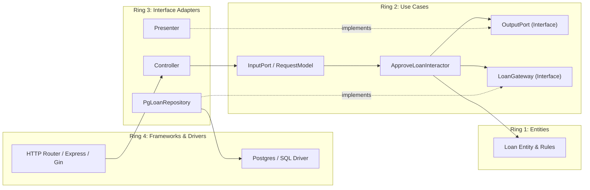
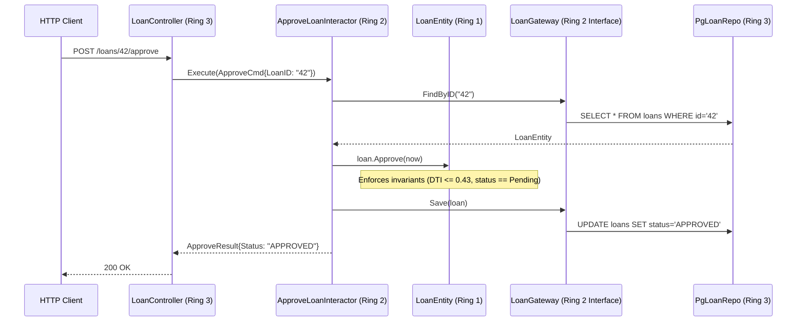
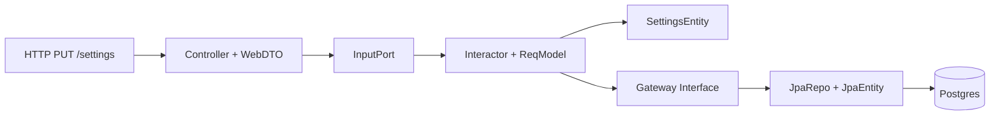

# Clean Architecture: The Dependency Rule (and When It's Overkill)

> **Prerequisites:** [Lesson 13: Hexagonal Architecture (Ports & Adapters)](../13-hexagonal-architecture/README.md) · [Track: Architecture Patterns](../README.md).  
> **Estimated Reading Time:** 23–27 minutes  
> **Target Audience:** Backend engineers structuring large domain-heavy services, and candidates asked "what is the Dependency Rule in Clean Architecture, and when does Clean Architecture become over-engineering?"  
> **Free PDF Notes:** [Download SD-L-014.pdf](https://backendroadmap.com/notes/system-design/SD-L-014.pdf)

> [!NOTE]
> **In one line:** **Clean Architecture** (Robert C. Martin, 2012) organizes a system into concentric rings—**Entities → Use Cases → Interface Adapters → Frameworks & Drivers**—governed by **The Dependency Rule**: source-code dependencies must only point **inward**, so enterprise business rules never know what database, web framework, or UI exists.

> [!TIP]
> **The Golden Rule:** Use **Clean Architecture** for complex, long-lived domains where business rules change independently of frameworks. Use **Vertical Slice** or simple **Transaction Script** for CRUD/BFF services—applying 4 concentric layers + 4 DTO mappings to a 200-line CRUD endpoint is architectural cargo-culting.

---

## 1. What Clean Architecture Is, and What It Isn't

Consider a loan-underwriting service whose core rules—debt-to-income ratios, credit-tier pricing, regulatory compliance—must survive 10 years, while web frameworks, SQL ORMs, and queue libraries change every 3 years. In a naive MVC app, your `LoanController` passes an HTTP request into a `LoanService` that directly manipulates Hibernate/EntityFramework entities tied to SQL columns. **Clean Architecture** separates *policy* from *detail* using four concentric rings: **Entities** (enterprise-wide rules), **Use Cases** (application-specific workflows), **Interface Adapters** (controllers, presenters, repository implementations), and **Frameworks & Drivers** (HTTP servers, Postgres, Kafka).

| Term | Precise Meaning | Example |
| :--- | :--- | :--- |
| **The Dependency Rule** | Source-code imports may only point from outer rings to inner rings, never outward | `UseCase` cannot import `gin`, `pgx`, or `Controller` |
| **Ring 1: Entities** | Enterprise business objects and invariant rules reusable across multiple apps | `LoanApplication.Approve()`, `Money`, `InterestRate` |
| **Ring 2: Use Cases** | Application-specific orchestrators defining Input/Output DTOs and Gateway interfaces | `ApproveLoanInteractor.Execute(cmd)` |
| **Ring 3: Interface Adapters** | Controllers, Presenters, and Repository implementations converting data formats | `HttpLoanController`, `PgLoanRepository` |
| **Ring 4: Frameworks & Drivers** | Glue code for web servers, DB drivers, message brokers, and `main()` | `net/http`, `pgxpool`, `express`, `Kestrel` |
| **Dependency Inversion (DIP)** | Use Case defines `OutputPort` / `Repo` interface; outer ring implements it | Control flows out via `Presenter` interface without outward imports |
| **Not Mandatory 4-Folder Boilerplate** | Small services can collapse rings or use Vertical Slices while keeping the Dependency Rule | Package-by-feature instead of 40 tiny `impl` folders |

### Why It Matters
1. **Longevity:** Frameworks and ORMs churn every few years; isolating Entities and Use Cases protects your highest-value business logic from rewrites.
2. **Screaming Architecture:** Reading the top-level directory (`loans/apply`, `loans/underwrite`, `loans/repay`) tells you what the system *does*, not what framework (`rails`, `spring`, `express`) it uses.
3. **Pragmatic trade-off awareness:** Senior engineers know *both* how to enforce the Dependency Rule in complex domains *and* when to skip it for simple CRUD.

---

## 2. Anatomy: Concentric Rings & Crossing the Boundary



**How runtime control crosses the boundary without violating the Dependency Rule:**  
When `ApproveLoanInteractor` (Ring 2) finishes, it needs to hand results back to `Controller`/`Presenter` (Ring 3) *without importing Ring 3*. It does so by calling an `OutputPort` interface defined *inside Ring 2*, which `Presenter` (Ring 3) implements.

| Aspect | Clean Architecture | Hexagonal (Ports & Adapters) | Vertical Slice Architecture |
| :--- | :--- | :--- | :--- |
| **Primary Axis** | Concentric horizontal rings (Entities → Use Cases → Adapters) | Symmetric boundary (Core ↔ Ports ↔ Adapters) | Feature slices (`PlaceOrder/`, `CancelOrder/`) |
| **Internal Core Structure** | Prescribes Entities vs Use Cases split | Agnostic inside the Hexagon | Each slice picks its own internal complexity |
| **Boilerplate per Feature** | High (Request/Response models, Ports, Presenters, Entities) | Moderate (Ports + Domain + Adapters) | Low (1 handler + optional domain model per slice) |
| **Best Fit** | Complex, long-lived enterprise domains (fintech, ERP, healthcare) | Microservices with swappable infra & fast TDD | CRUD / BFF / rapid product iteration |

> [!WARNING]
> **The #1 Clean Architecture Trap: Cargo-Cult Over-Engineering.** Creating 6 files (`CreateUserRequest.ts`, `CreateUserResponse.ts`, `CreateUserInputPort.ts`, `CreateUserOutputPort.ts`, `CreateUserPresenter.ts`, `CreateUserInteractor.ts`) just to `INSERT INTO users (email)` creates massive ceremony, slows feature delivery by 3–4x, and produces **anemic pass-through layers** that add zero protection.

---

## 3. Mathematical Model: Mapping Indirection & Change Amplification

**1. Layer-Crossing Mapping Cost ($M_{\text{files}}$).**  
In strict 4-ring Clean Architecture, adding 1 new field (e.g., `tax_id`) to an endpoint requires touching $L$ boundary representations (HTTP JSON DTO → Input RequestModel → Domain Entity → DB Row Model → Output ResponseModel → HTTP Response JSON):

$$M_{\text{clean}} = 2 \cdot R_{\text{crossed}} \approx 6\text{ transformations}, \qquad M_{\text{vertical}} \approx 2\text{ transformations}$$

**2. Cognitive & Latency Overhead.**  
Every ring crossing adds struct allocation/copying time $t_{\text{map}}$ and developer navigation hops $H$:

$$T_{\text{overhead}} = \sum_{j=1}^{M_{\text{clean}}} t_{\text{map}, j}$$

**3. Long-Term Maintenance Break-Even ($T_{\text{dev}}$).**  
Let $C_{\text{setup}}$ be the upfront boilerplate cost of Clean Architecture, $v_{\text{crud}}$ vs $v_{\text{clean}}$ be feature velocity, and $C_{\text{rewrite}}$ be the cost of a framework/DB migration avoided at year $Y$:

$$\text{Net Value} = C_{\text{rewrite}} - \left[ C_{\text{setup}} + N_{\text{features}} \cdot \Delta t_{\text{ceremony}} \right]$$

### Worked Numerical Example
Compare two services over 3 years:
- **Service A (Simple Admin CRUD, 40 endpoints, low domain complexity, 0 framework rewrites):**
  - Ceremony overhead: $\Delta t_{\text{ceremony}} = 1.5\text{ hours/endpoint} \times 40 = 60\text{ hours}$ wasted, plus 240 extra boilerplate files to maintain. $C_{\text{rewrite}} = 0$. **Net Value = $-60\text{ hours}$ (Overkill!)**.
- **Service B (Core Lending Engine, 120 complex underwriting rules, migrates from Monolith REST + Oracle to gRPC + Postgres in Year 2):**
  - Without Clean Architecture: $C_{\text{rewrite}} \approx 1{,}200\text{ hours}$ untangling SQL/ORM/HTTP from underwriting rules.
  - With Clean Architecture: $C_{\text{setup}} + \text{ceremony} \approx 180\text{ hours}$; framework/DB swap costs $220\text{ hours}$. **Net Savings = $1{,}200 - (180 + 220) = \mathbf{800\text{ engineering hours}}$ saved**.
- **Runtime CPU cost:** 6 explicit struct mappings take $\approx 6 \times 1.2\ \mu\text{s} = \mathbf{7.2\ \mu\text{s}}$ ($0.007\text{ ms}$)—negligible vs network I/O, *unless* you use reflection-based auto-mappers.

---

## 4. Metrics & Percentiles

| Metric | Meaning | Alert When |
| :--- | :--- | :--- |
| **Dependency Rule Violations** | Count of outward imports (inner ring importing outer ring) | $> 0$ (block PR in CI) |
| **Cyclomatic Complexity in Ring 3/4** | Branching logic inside Controllers, Presenters, or Repositories | $> 5$ (signals business logic leaking into outer rings) |
| **Entity Test Coverage** | Unit test coverage of Ring 1 & Ring 2 without mocks/DB | $< 90\%$ (core rules aren't being unit-tested) |
| **Files Touched per Simple PR** | Median files modified for a 1-field feature change | $> 8$ files on CRUD endpoints (signals over-layered boilerplate) |
| **Mapping Allocation Rate** | Heap allocations per request in `Adapters` (via `pprof` / profiler) | $> 20\%$ of CPU/allocs (switch from reflection mapper to explicit code) |

### Worked Example: Detecting Over-Abstraction vs Boundary Drift
An engineering team notices PRs adding a single field to `GET /profile` touch **11 files** across 4 packages, while `Controller` has **14 `if/else` branches** checking subscription tiers.
- **Diagnosis:** They have the *worst of both worlds*—maximum Clean Architecture boilerplate *and* business logic leaking into Ring 3 (`Controller`).
- **Fix:** Move the 14 `if/else` branches into Ring 1 (`Subscription.CanAccessFeature()`), and collapse redundant `InputPort`/`Presenter` interfaces where only 1 implementation exists.

---

## 5. Compounding & Failure Modes

| Failure Mode | Mechanism | Quantitative Impact |
| :--- | :--- | :--- |
| **1. Anemic Domain Model** | Ring 1 (`Entities`) are just getter/setter bags; all logic sits in Ring 2 (`Interactors`) or Ring 3 (`Services`) | Invariants duplicated across 6 Use Cases; bug fixes miss 2 of 6 call sites |
| **2. Reflection Auto-Mapper Bugs** | Using `AutoMapper` / `mapstructure` across 4 rings silently drops renamed fields to `0` or `null` | Runtime-only failures; **100%** of affected requests silently drop fields until noticed in prod |
| **3. Circular Package Dependencies** | Ring 2 imports Ring 3 DTOs while Ring 3 imports Ring 2 Interactors | Compile errors in Go/Rust; forces "shared `models/` dump package" that destroys boundaries |

**Why "Anemic Entities" happen:** Teams treat Entities as database rows rather than rich behavioral objects. In Clean Architecture, `Loan.Approve(creditScore)` belongs on the **Entity** (Ring 1); `ApproveLoanInteractor` (Ring 2) only loads the Entity, calls `loan.Approve()`, and saves it.

---

## 6. Numbers Every Engineer Must Know

| Item | Typical | Implication |
| :--- | :---: | :--- |
| **Explicit struct mapping** | $0.5\text{–}3\ \mu\text{s}$ | Practically free; always prefer compile-time explicit mappers |
| **Reflection auto-mapper** | $50\text{–}300\ \mu\text{s}$ | $50\text{–}100\times$ slower and hides field mismatches until runtime |
| **Ring 1 + Ring 2 test speed** | $< 50\text{ ms}$ for 500 tests | Zero DB/HTTP setup needed for core business rules |
| **Files per feature (strict 4-ring)** | $6\text{–}10$ files | Justified for complex domains; **overkill** for simple CRUD |
| **Files per feature (Vertical Slice)** | $1\text{–}3$ files | Better default for < 5-rule endpoints; extract Entities only as complexity grows |

---

## 7. Mechanism Deep Dive: The Dependency Rule & Screaming Architecture



| Question | Answer |
| :--- | :--- |
| **How does Clean Architecture differ from 3-tier MVC?** | In 3-tier MVC, `Business -> DataAccess -> DB` (business depends on data layer). In Clean Architecture, `DataAccess -> Business` via Dependency Inversion: the Use Case defines the repository interface, and the DB layer implements it. |
| **Do you always need a separate `Presenter` and `OutputPort`?** | No. In backend REST/gRPC APIs, returning a plain `Result` struct/DTO from `Execute(cmd) (Result, error)` obeys the Dependency Rule with half the boilerplate of callback `Presenter` interfaces. |
| **What is "Screaming Architecture"?** | Your top-level folder structure should scream the **business domain** (`underwriting/`, `disbursement/`, `repayments/`), not the technical pattern (`controllers/`, `models/`, `repositories/`). |
| **Can Ring 2 (Use Cases) return Ring 1 (Entities) directly to Ring 3 (Controllers)?** | Strictly speaking, returning an `OutputDTO` prevents Controllers from mutating Entity state or accidentally serializing private domain fields. |

**When Clean Architecture IS Overkill (When NOT to use it):**
- **Pure CRUD / Admin Backends:** If 90% of endpoints are `Create`, `Read`, `Update`, `Delete` with basic field validation, 4 concentric rings slow your team down for zero gain.
- **Early-Stage Startups / MVPs:** When product-market fit is unproven and requirements pivot weekly, optimize for **deletion speed** (Vertical Slices), not 10-year framework independence.
- **Thin BFFs (Backend-for-Frontend) or API Gateways:** Their entire job is aggregating HTTP responses—there are no Enterprise Entities to protect.

---

## 8. Hierarchical Budgets & Design Rules

| Slice | Rule | Control |
| :--- | :--- | :--- |
| **Dependency Rule** | Inner rings (`entities`, `usecases`) never import outer rings (`adapters`, `infra`) | CI import linter (`depguard`, ArchUnit, `dependency-cruiser`) |
| **Rich Entities** | Business invariants (`loan.Approve()`) live on Ring 1 Entities, not in Ring 2 or 3 | Code review: reject anemic getter/setter entities in complex domains |
| **Pragmatic Boundaries** | Return `(ResultDTO, error)` from Use Cases instead of `OutputPort` callbacks unless multi-format rendering is needed | Avoid unnecessary indirection |
| **No Reflection Mappers** | Write explicit, compiler-checked mapping functions between Rings | Ban `AutoMapper` / reflection copy in hot paths |
| **Screaming Layout** | Organize by **domain capability** first, then clean rings inside (`loans/domain`, `loans/usecase`, `loans/infra`) | Reject flat `controllers/` + `services/` + `models/` |
| **Right-Sizing** | Use Vertical Slice for CRUD endpoints; apply full Clean rings only to invariant-heavy domains | ADR (Architecture Decision Record) per service |

---

## 9. Top Mitigations

1. **Enforce the Dependency Rule in CI** (`ArchUnit`, `depguard`, `dependency-cruiser`) so deadlines never introduce outward imports.
2. **Adopt Screaming Architecture** (package by feature/domain, not by technical layer) so related code lives together.
3. **Skip `InputPort`/`OutputPort` callback ceremony** in stateless REST/gRPC services—a concrete `UseCase` returning a `ResultDTO` is clean and idiomatic.
4. **Put invariants inside Ring 1 Entities** (rich domain model) rather than sprawling `Interactor` scripts.
5. **Use explicit compile-time mappers** instead of reflection auto-mappers so renamed fields fail at compile time, not in production.
6. **Know when to downshift:** Use Vertical Slice Architecture for simple CRUD modules inside the same repo.

---

## 10. Production Reference: The 6-Layer CRUD Rewrite

**Context:** A B2B SaaS startup built a new `SettingsService` (storing user notification preferences and webhook URLs—12 simple CRUD endpoints) using strict textbook Clean Architecture: 4 Maven modules (`domain`, `application`, `adapters`, `frameworks`), separate `InputPort`/`OutputPort`/`Presenter` interfaces per endpoint, and MapStruct/reflection mappers.



- **Problem:** Adding a single boolean field (`email_digest_enabled`) required editing **14 files** across 4 Maven modules and writing 6 mapping tests. Feature velocity dropped by **65%**, and a misconfigured reflection mapper silently reset `webhook_secret` to `null` in production during a schema update.
- **Root Cause:** Applying enterprise Clean Architecture ceremony to a trivial CRUD domain with zero complex invariants, combined with reflection-based mapping.
- **Fix:**
  1. Collapsed `SettingsService` into **Vertical Slices** (1 handler + explicit SQL query per endpoint), cutting file count per feature from 14 to 2.
  2. Reserved full Clean Architecture rings strictly for the `BillingEngine` and `TaxCalculator` services where complex invariants justified the boundary.

---

## 11. Multi-Language Production Code Tabs

A pragmatic **Clean Architecture** `ApproveLoan` slice showing **Ring 1 (Entity)**, **Ring 2 (Use Case + Gateway interface)**, and **Ring 3 (Adapter)** obeying the Dependency Rule without unnecessary callback ceremony.

````carousel
```go
// Go: Pragmatic Clean Architecture (Ring 1 Entity -> Ring 2 UseCase -> Ring 3 Adapter).
package main

import (
	"context"
	"errors"
)

// --- RING 1: ENTITY (Enterprise Business Rules; zero external imports) ---
var (
	ErrAlreadyDecided = errors.New("loan already decided")
	ErrHighDTI        = errors.New("debt-to-income ratio exceeds 0.43")
)

type Loan struct {
	ID     string
	DTI    float64
	Status string // "PENDING", "APPROVED", "REJECTED"
}

func (l *Loan) Approve() error {
	if l.Status != "PENDING" {
		return ErrAlreadyDecided
	}
	if l.DTI > 0.43 {
		l.Status = "REJECTED"
		return ErrHighDTI
	}
	l.Status = "APPROVED"
	return nil
}

// --- RING 2: USE CASE (Application Rules + Gateway Interface) ---
type LoanGateway interface {
	FindByID(ctx context.Context, id string) (*Loan, error)
	Save(ctx context.Context, loan *Loan) error
}

type ApproveLoanResult struct {
	LoanID string
	Status string
}

type ApproveLoanUseCase struct {
	gateway LoanGateway
}

func (uc *ApproveLoanUseCase) Execute(ctx context.Context, loanID string) (ApproveLoanResult, error) {
	loan, err := uc.gateway.FindByID(ctx, loanID)
	if err != nil {
		return ApproveLoanResult{}, err
	}
	ruleErr := loan.Approve()
	if saveErr := uc.gateway.Save(ctx, loan); saveErr != nil {
		return ApproveLoanResult{}, saveErr
	}
	return ApproveLoanResult{LoanID: loan.ID, Status: loan.Status}, ruleErr
}

// --- RING 3: INTERFACE ADAPTER (Implements Ring 2 Gateway) ---
type InMemoryLoanAdapter struct{ rows map[string]*Loan }

func (a *InMemoryLoanAdapter) FindByID(_ context.Context, id string) (*Loan, error) {
	l, ok := a.rows[id]
	if !ok {
		return nil, errors.New("not found")
	}
	copyLoan := *l
	return &copyLoan, nil
}
func (a *InMemoryLoanAdapter) Save(_ context.Context, l *Loan) error {
	copyLoan := *l
	a.rows[l.ID] = &copyLoan
	return nil
}
```
<!-- slide -->
```typescript
// TypeScript: Clean Architecture (Entity -> UseCase -> Adapter) obeying the Dependency Rule.
// --- RING 1: ENTITY ---
export class Loan {
  constructor(
    public readonly id: string,
    public readonly dti: number,
    public status: "PENDING" | "APPROVED" | "REJECTED"
  ) {}

  approve(): void {
    if (this.status !== "PENDING") throw new Error("Loan already decided");
    if (this.dti > 0.43) {
      this.status = "REJECTED";
      throw new Error("DTI exceeds 0.43");
    }
    this.status = "APPROVED";
  }
}

// --- RING 2: USE CASE ---
export interface LoanGateway {
  findById(id: string): Promise<Loan | null>;
  save(loan: Loan): Promise<void>;
}

export class ApproveLoanUseCase {
  constructor(private readonly gateway: LoanGateway) {}

  async execute(loanId: string): Promise<{ loanId: string; status: string }> {
    const loan = await this.gateway.findById(loanId);
    if (!loan) throw new Error("LoanNotFound");
    try {
      loan.approve();
    } finally {
      await this.gateway.save(loan);
    }
    return { loanId: loan.id, status: loan.status };
  }
}

// --- RING 3: INTERFACE ADAPTER ---
export class InMemoryLoanAdapter implements LoanGateway {
  private readonly store = new Map<string, Loan>();
  async findById(id: string) {
    const l = this.store.get(id);
    return l ? new Loan(l.id, l.dti, l.status) : null;
  }
  async save(loan: Loan) {
    this.store.set(loan.id, new Loan(loan.id, loan.dti, loan.status));
  }
}
```
<!-- slide -->
```python
# Python: Clean Architecture (Entity -> UseCase -> Gateway Adapter).
from dataclasses import dataclass
from typing import Protocol


# --- RING 1: ENTITY ---
@dataclass
class Loan:
    id: str
    dti: float
    status: str = "PENDING"

    def approve(self) -> None:
        if self.status != "PENDING":
            raise ValueError("Loan already decided")
        if self.dti > 0.43:
            self.status = "REJECTED"
            raise ValueError("DTI exceeds 0.43")
        self.status = "APPROVED"


# --- RING 2: USE CASE ---
class LoanGateway(Protocol):
    def find_by_id(self, loan_id: str) -> Loan | None: ...
    def save(self, loan: Loan) -> None: ...


class ApproveLoanUseCase:
    def __init__(self, gateway: LoanGateway) -> None:
        self._gateway = gateway

    def execute(self, loan_id: str) -> dict[str, str]:
        loan = self._gateway.find_by_id(loan_id)
        if loan is None:
            raise LookupError("Loan not found")
        try:
            loan.approve()
        finally:
            self._gateway.save(loan)
        return {"loan_id": loan.id, "status": loan.status}


# --- RING 3: ADAPTER ---
class InMemoryLoanAdapter:
    def __init__(self, seed: dict[str, Loan] | None = None) -> None:
        self._rows = seed or {}

    def find_by_id(self, loan_id: str) -> Loan | None:
        l = self._rows.get(loan_id)
        return Loan(l.id, l.dti, l.status) if l else None

    def save(self, loan: Loan) -> None:
        self._rows[loan.id] = Loan(loan.id, loan.dti, loan.status)
```
<!-- slide -->
```csharp
// C#: Clean Architecture (Entity -> UseCase -> Adapter).
// --- RING 1: ENTITY ---
public sealed class Loan
{
    public string Id { get; }
    public double Dti { get; }
    public string Status { get; private set; }

    public Loan(string id, double dti, string status = "PENDING") =>
        (Id, Dti, Status) = (id, dti, status);

    public void Approve()
    {
        if (Status != "PENDING") throw new InvalidOperationException("Loan already decided");
        if (Dti > 0.43) { Status = "REJECTED"; throw new InvalidOperationException("DTI exceeds 0.43"); }
        Status = "APPROVED";
    }
}

// --- RING 2: USE CASE ---
public interface ILoanGateway
{
    Task<Loan?> FindByIdAsync(string id, CancellationToken ct = default);
    Task SaveAsync(Loan loan, CancellationToken ct = default);
}

public sealed record ApproveLoanResult(string LoanId, string Status);

public sealed class ApproveLoanUseCase
{
    private readonly ILoanGateway _gateway;
    public ApproveLoanUseCase(ILoanGateway gateway) => _gateway = gateway;

    public async Task<ApproveLoanResult> ExecuteAsync(string loanId, CancellationToken ct = default)
    {
        var loan = await _gateway.FindByIdAsync(loanId, ct) ?? throw new KeyNotFoundException();
        try { loan.Approve(); }
        finally { await _gateway.SaveAsync(loan, ct); }
        return new ApproveLoanResult(loan.Id, loan.Status);
    }
}
```
````

---

## 12. Hands-On CLI Verification Workflows

Test the Ring 1 Entity invariants and Ring 2 UseCase in Python with zero external dependencies:

```bash
python3 -c '
from dataclasses import dataclass

@dataclass
class Loan:
    id: str; dti: float; status: str = "PENDING"
    def approve(self):
        if self.status != "PENDING": raise ValueError("already decided")
        if self.dti > 0.43: self.status = "REJECTED"; raise ValueError("DTI > 0.43")
        self.status = "APPROVED"

l1 = Loan("L1", 0.35); l1.approve(); print("L1:", l1)
l2 = Loan("L2", 0.52)
try: l2.approve()
except ValueError as e: print("L2 rejected as expected:", e, l2)
'
```

Enforce the Dependency Rule in CI across languages:

```bash
# 1. Go: verify Ring 1 (entities) and Ring 2 (usecases) never import adapters or frameworks
go list -f '{{.Imports}}' ./internal/entities/... ./internal/usecases/... | grep -E "adapters|frameworks|sql|http" && echo "DEPENDENCY RULE VIOLATION" || echo "Clean!"

# 2. .NET: run NetArchTest / ArchUnit architecture tests
dotnet test --filter "FullyQualifiedName~ArchitectureTests"

# 3. TypeScript: validate ring boundaries
npx depcruise src --validate .dependency-cruiser.js
```

---

## 13. Common Mistakes to Avoid

1. **Applying 4-ring Clean Architecture to simple CRUD services** (massive boilerplate for zero gain).
2. **Building Anemic Entities** where Ring 1 only holds getters/setters and Ring 2 contains all business rules.
3. **Violating the Dependency Rule** by putting `@Entity` / `gorm` / `json` annotations on Ring 1 Entities.
4. **Using reflection auto-mappers** across rings, hiding missing/renamed field bugs until production.
5. **Creating pointless `InputPort`/`Presenter` interfaces** when a Use Case has only one caller and returns a DTO.
6. **Organizing folders by technical layer** (`controllers/`, `entities/`, `repos/`) instead of domain features ("Screaming Architecture").
7. **Skipping automated CI dependency checks**, allowing inner rings to import outer rings over time.

---

## 14. Key Terms Glossary

| Key Term | Definition |
| :--- | :--- |
| **Clean Architecture** | Concentric layered architecture (Entities → Use Cases → Interface Adapters → Frameworks) by Robert C. Martin. |
| **The Dependency Rule** | Source-code dependencies must point strictly inward toward higher-level policies. |
| **Entities (Ring 1)** | Enterprise-wide business objects encapsulating core data and invariant rules. |
| **Use Cases (Ring 2)** | Application-specific orchestrators coordinating Entities and defining Gateway/Output interfaces. |
| **Interface Adapters (Ring 3)** | Controllers, Presenters, and Repository implementations translating between outer tech and inner Use Cases. |
| **Frameworks & Drivers (Ring 4)** | Outermost ring containing web frameworks, database drivers, message brokers, and `main()`. |
| **Screaming Architecture** | Folder/module layout that reflects business capabilities (`loans/`, `billing/`) rather than frameworks. |
| **Anemic Domain Model** | Anti-pattern where Entities have no behavior and all logic lives in procedural service classes. |
| **Vertical Slice Architecture** | Organizing code by individual feature/request slice rather than horizontal layers; great for CRUD. |
| **Dependency Inversion Principle** | High-level modules define abstractions; low-level modules implement them. |

---

## 15. System Design Interview Questions & Answers

### Basic Conceptual Questions

<details>
<summary><strong>Q1: What is the Dependency Rule in Clean Architecture? [BASIC]</strong></summary>

**Answer:**
Source-code dependencies may only point **inward**—from outer rings (Frameworks, Adapters) toward inner rings (Use Cases, Entities). Nothing in an inner circle can know anything at all about something in an outer circle (not its classes, functions, variables, or data formats).
</details>

<details>
<summary><strong>Q2: What are the four concentric rings of Clean Architecture? [BASIC]</strong></summary>

**Answer:**
From innermost to outermost:
1. **Entities:** Enterprise business rules and domain invariants.
2. **Use Cases:** Application-specific workflows and Gateway interfaces.
3. **Interface Adapters:** Controllers, Presenters, and Repository implementations.
4. **Frameworks & Drivers:** Web servers, databases, queues, and startup wiring.
</details>

<details>
<summary><strong>Q3: What is "Screaming Architecture"? [BASIC]</strong></summary>

**Answer:**
A codebase whose top-level directory structure reveals what the application *does* (e.g., `orders/`, `payments/`, `shipping/`) rather than what framework or technical pattern it uses (`controllers/`, `models/`, `services/`).
</details>

<details>
<summary><strong>Q4: When is Clean Architecture overkill? [BASIC]</strong></summary>

**Answer:**
For simple CRUD/admin services with minimal business logic, thin BFF/API gateways, or early-stage prototypes where requirements change weekly. In these cases, Vertical Slice Architecture or a simple Handler + Repository delivers features 3x faster with less ceremony.
</details>

### Scenario-Based Architecture Questions

<details>
<summary><strong>Q5: How does a Use Case return data to a Presenter without importing the Presenter? [SCENARIO]</strong></summary>

**Answer:**
Via **Dependency Inversion**: the Use Case (Ring 2) defines an `OutputPort` interface in Ring 2 and invokes `outputPort.Present(result)`. The `Presenter` (Ring 3) implements that interface. At runtime, control flows outward to Ring 3, while the compile-time dependency points inward from Ring 3 to Ring 2.
</details>

<details>
<summary><strong>Q6: Your team complains that adding one field to an API takes 10 file edits in Clean Architecture. How do you fix this? [SCENARIO]</strong></summary>

**Answer:**
Remove unnecessary ceremony: drop `InputPort`/`OutputPort`/`Presenter` interfaces where only 1 implementation exists (return `(ResultDTO, error)` directly from the Use Case), and downshift pure CRUD endpoints to **Vertical Slices** while keeping full Clean rings only for complex domain modules.
</details>

<details>
<summary><strong>Q7: How do you prevent developers from putting `@Entity` / `gorm` / `json` tags on Ring 1 Entities? [SCENARIO]</strong></summary>

**Answer:**
Keep separate persistence models inside Ring 3 (`PgLoanRow` with SQL/ORM tags) and map explicitly to/from Ring 1 `Loan` Entities inside the Repository Adapter. Enforce this in CI with `depguard` / `ArchUnit` / `ESLint` banning ORM/HTTP imports inside `entities/` and `usecases/`.
</details>

<details>
<summary><strong>Q8: You're starting a brand-new microservice. Should you start with Clean Architecture or Vertical Slices? [SCENARIO]</strong></summary>

**Answer:**
Start with **Vertical Slices** + clean domain functions. As soon as a slice develops rich, shared invariants (e.g., ledger rules, state machines, complex pricing), extract Ring 1 Entities and Ring 2 Use Cases for that specific module. You get speed on day 1 and Clean boundaries where complexity actually lives.
</details>

### Advanced & Tricky Interview Questions

<details>
<summary><strong>Q9: Clean Architecture vs Onion Architecture vs Hexagonal Architecture—what's the real difference? [TRICKY]</strong></summary>

**Answer:**
All three share the exact same core principle: **Dependency Inversion pointing inward toward domain logic**. Hexagonal focuses on the **boundary** (Driving/Driven Ports & Adapters) and leaves the inside unstructured. Onion and Clean explicitly subdivide the inside into **Entities** (core) and **Application/Use Cases** (middle ring). In practice, combining Hexagonal's Ports & Adapters naming with Clean's Entity/UseCase split is the cleanest approach.
</details>

<details>
<summary><strong>Q10: Should Ring 1 Entities ever be returned directly as HTTP JSON responses? [TRICKY]</strong></summary>

**Answer:**
No. Returning Ring 1 Entities directly couples your public API contract to internal domain refactoring, risks leaking sensitive fields (like `internalRiskScore`), and encourages adding `json:`/`@JsonProperty` tags to Ring 1. Always map to an explicit Response DTO in Ring 3.
</details>

<details>
<summary><strong>Q11: How do you handle cross-cutting concerns (logging, metrics, transactions) without polluting Ring 2 Use Cases? [TRICKY]</strong></summary>

**Answer:**
Use the **Decorator pattern** around the Use Case or Driving Port in the Composition Root (`LoggingDecorator(MetricsDecorator(TxDecorator(useCase)))`), or use a `UnitOfWork` interface for transactions. Ring 2 stays pure business orchestration.
</details>

<details>
<summary><strong>Q12: Why are reflection-based auto-mappers dangerous in Clean Architecture? [TRICKY]</strong></summary>

**Answer:**
They convert compile-time type safety into silent runtime failures: renaming a field in Ring 1 without updating Ring 3 compiles cleanly and silently maps `null`/`0` in production, while costing $50\text{–}100\times$ more CPU/allocations than explicit field-by-field mapping functions.
</details>

---

## 16. One-Page Master Cheat Sheet

```
+---------------------------------------------------------------------------------------------------------+
|                    CLEAN ARCHITECTURE — MASTER CHEAT SHEET                                              |
+---------------------------------------------------------------------------------------------------------+
| 1. THE DEPENDENCY RULE: Source-code imports point strictly INWARD:                                      |
|    Frameworks & Drivers (R4) -> Interface Adapters (R3) -> Use Cases (R2) -> Entities (R1).             |
+---------------------------------------------------------------------------------------------------------+
| 2. RICH ENTITIES: Put invariants (`loan.Approve()`) on Ring 1 Entities, NOT anemic getter/setter bags.  |
+---------------------------------------------------------------------------------------------------------+
| 3. PRAGMATIC RULE: Skip `InputPort`/`Presenter` callbacks for REST/gRPC; return `(ResultDTO, error)`.   |
|    Use explicit compile-time mappers (never reflection auto-mappers).                                   |
+---------------------------------------------------------------------------------------------------------+
| 4. SCREAMING ARCHITECTURE: Top-level folders = business capabilities (`loans/`, `billing/`), not MVC.   |
+---------------------------------------------------------------------------------------------------------+
| 5. WHEN IT'S OVERKILL: Pure CRUD, thin BFFs, MVPs -> use Vertical Slice Architecture instead (1-3 files)|
|    per feature instead of 6-10 files. Enforce boundaries in CI (`depguard` / `ArchUnit` / `depcruise`). |
+---------------------------------------------------------------------------------------------------------+
```

---

## Further Reading & Sources

- Robert C. Martin, [*The Clean Architecture*](https://blog.cleancoder.com/uncle-bob/2012/08/13/the-clean-architecture.html) (Clean Coder Blog, 2012) & *Clean Architecture* (Prentice Hall, 2017).
- Jimmy Bogard, [*Vertical Slice Architecture*](https://www.jimmybogard.com/vertical-slice-architecture/) (when to skip horizontal layers).
- Microsoft .NET Architecture Guides, *Architecting Modern Web Applications with ASP.NET Core and Azure* ("Clean Architecture").
- Martin Fowler, [*Anemic Domain Model*](https://martinfowler.com/bliki/AnemicDomainModel.html).

---

## Free PDF Notes

[SD-L-014.pdf](https://backendroadmap.com/notes/system-design/SD-L-014.pdf)

---

## Next

Continue with [Lesson 15: Serverless Architecture: Cold Starts, Limits & When NOT to Use It](../15-serverless-architecture/README.md).
