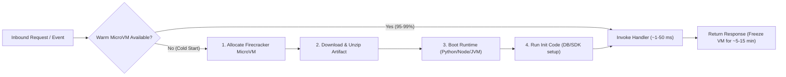
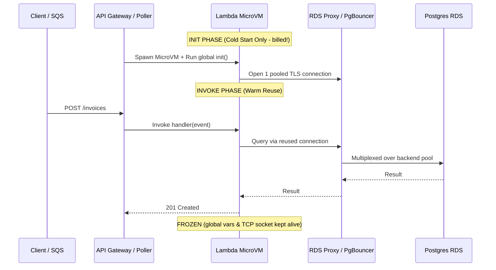
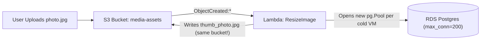

# Serverless Architecture: Cold Starts, Limits & When NOT to Use It

> **Prerequisites:** [Lesson 14: Clean Architecture: The Dependency Rule](../14-clean-architecture/README.md) · [Track: Architecture Patterns](../README.md).  
> **Estimated Reading Time:** 24–28 minutes  
> **Target Audience:** Backend engineers evaluating AWS Lambda / Cloud Run / Cloudflare Workers vs containers, and candidates asked "how do cold starts work, and when should you NOT use serverless?"  
> **Free PDF Notes:** [Download SD-L-015.pdf](https://backendroadmap.com/notes/system-design/SD-L-015.pdf)

> [!NOTE]
> **In one line:** **Serverless (FaaS + BaaS)** runs stateless event-driven functions on demand with **zero idle cost** and **automatic per-request scaling**, trading away **predictable tail latency (cold starts)**, **long-lived state/connections**, and **steady-state cost efficiency** at high utilization.

> [!TIP]
> **The Golden Rule:** Use serverless for **spiky, event-driven, or low-duty-cycle workloads** (webhooks, S3 thumbnailing, cron jobs, bursty APIs). Switch to **always-on containers (ECS/K8s)** once steady utilization crosses **~25–35%** or when $p_{99}$ latency budgets cannot tolerate 200–1,500 ms cold starts.

---

## 1. What Serverless Architecture Is, and What It Isn't

You run a SaaS webhook processor that receives 2 requests/minute overnight, 400 requests/second for 3 minutes when a customer triggers a bulk import, and processes PDF invoices uploaded to S3. On always-on EC2/Kubernetes, you either pay for peak capacity 24/7 (95% idle waste) or wait 60–120 seconds for Horizontal Pod Autoscaler + Cluster Autoscaler while webhooks time out. With **Serverless (FaaS)**, the cloud provider spins up microVMs (e.g., AWS Firecracker) in milliseconds on demand, bills you strictly per 1 ms of execution, and scales to zero when idle.

| Term | Precise Meaning | Example |
| :--- | :--- | :--- |
| **FaaS (Function-as-a-Service)** | Ephemeral, stateless compute scaled per-request from 0 to thousands of instances | AWS Lambda, GCP Cloud Functions, Azure Functions |
| **BaaS (Backend-as-a-Service)** | Managed, scale-to-zero stateful infrastructure (DBs, queues, auth) | DynamoDB, Aurora Serverless, SQS, S3 |
| **Serverless Containers** | Request-driven container scaling (0 to $N$) with custom runtimes & higher concurrency | AWS App Runner, GCP Cloud Run |
| **Edge Isolates (V8)** | Lightweight JS/Wasm isolates running at 300+ PoPs with $< 5\text{ ms}$ cold starts | Cloudflare Workers, Fastly Compute |
| **Cold Start** | Latency penalty when no warm microVM exists: download code + boot runtime + init SDKs | $150\text{ ms}$ (Go/Python) to $1.5\text{–}4\text{ s}$ (Java/JVM) |
| **Provisioned Concurrency** | Pre-warmed microVMs kept alive to eliminate cold starts (costs idle money) | Keeping 20 warm Lambdas before market open |
| **Not "No Servers"** | Servers still exist—you just don't patch OS kernels or provision capacity | Shared-responsibility model |

### Why It Matters
1. **Economic alignment:** You stop paying for idle CPU at 3 AM; spiky or low-traffic microservices cost pennies/month.
2. **Operational leverage:** No OS patching, AMI rotation, or node-group scaling tuning.
3. **Architectural pitfalls:** Ignoring cold starts, RDS connection exhaustion, and 15-minute execution caps causes catastrophic SEV-1s.

---

## 2. Anatomy: Cold Start vs Warm Execution & Concurrency



Every concurrent request in AWS Lambda requires its own dedicated microVM (1 concurrent request per instance, unlike a Node/Go container handling 1,000 requests per pod).

| Runtime / Platform | Typical Cold Start ($p_{50}$–$p_{99}$) | Max Execution Timeout | Concurrency Model |
| :--- | :---: | :---: | :--- |
| **Cloudflare Workers (V8 Isolate)** | $1\text{–}5\text{ ms}$ | 30 s CPU (wall time higher) | Multi-tenant isolate |
| **AWS Lambda (Go / Rust / Python)** | $80\text{–}350\text{ ms}$ | 15 minutes | 1 req / microVM |
| **AWS Lambda (Node.js / TypeScript)** | $120\text{–}450\text{ ms}$ | 15 minutes | 1 req / microVM |
| **AWS Lambda (Java / .NET w/o SnapStart)** | $800\text{–}3{,}500\text{ ms}$ | 15 minutes | 1 req / microVM |
| **AWS Lambda (Java w/ SnapStart)** | $150\text{–}400\text{ ms}$ | 15 minutes | Pre-initialized snapshot |
| **GCP Cloud Run (Containers)** | $400\text{–}2{,}000\text{ ms}$ | 60 minutes | Up to 1,000 req / container |

> [!WARNING]
> **The #1 Serverless Trap: Connecting Lambda directly to PostgreSQL/MySQL.** Because each concurrent Lambda invocation spawns an independent microVM with its own connection pool, a 500-concurrency traffic burst opens $500 \times \text{pool\_size}$ TCP connections in $< 2\text{ seconds}$, instantly exhausting `max_connections` on RDS/Postgres. Always place **RDS Proxy** or **PgBouncer** in front of relational databases—or use HTTP-based serverless DBs (DynamoDB).

---

## 3. Mathematical Model: Concurrency, Cold Start Probability & Cost Break-Even

**1. Little's Law for Serverless Concurrency ($C$).**  
At arrival rate $\lambda$ (requests/sec) and average execution duration $D$ (seconds), the number of simultaneous microVMs required is:

$$C = \lambda \times D$$

If a burst adds $\Delta C$ new microVMs faster than existing ones finish, every newly spawned microVM incurs cold start latency $T_{\text{cold}}$.

**2. Cold Start Rate During Steady vs Bursty Traffic.**  
If containers stay warm for idle TTL $T_{\text{idle}}$ (typically 5–15 min) and arrivals follow a Poisson process at low rate $\lambda$, the probability a request hits zero warm containers scales as $e^{-\lambda T_{\text{idle}}}$ when $C \le 1$, plus any burst $\Delta C$ exceeding the current warm pool.

**3. Cost Break-Even: Lambda vs Always-On Container (ECS/EC2).**  
Let $P_{\text{req}}$ be the per-request fee, $P_{\text{GB-s}}$ be the Lambda compute price per GB-second, $M$ be memory (GB), $D$ be duration (s), and $C_{\text{container}}$ be the monthly cost of an equivalent always-on container:

$$\text{Monthly Cost}_{\text{Lambda}} = N_{\text{req}} \cdot \left(P_{\text{req}} + M \cdot D \cdot P_{\text{GB-s}}\right)$$

### Worked Numerical Example
Compare **AWS Lambda (1 GB RAM, $D = 0.08\text{ s}$)** vs **2 Always-On Fargate/ECS tasks (1 vCPU / 2 GB total, $\approx \$60/\text{month}$)** using standard list pricing ($P_{\text{req}} = \$0.20 / 1\text{M}$, $P_{\text{GB-s}} = \$0.0000166667$):
- **Cost per 1M Lambda requests:**
  $$\text{Cost}_{1\text{M}} = \$0.20 + 1{,}000{,}000 \times (1\text{ GB} \times 0.08\text{ s} \times \$0.0000166667) = \$0.20 + \$1.33 = \mathbf{\$1.53 / 1\text{M reqs}}$$
- **Low-duty-cycle workload (2M reqs/month, ~0.77 req/s average):**
  - Lambda: $2 \times \$1.53 = \mathbf{\$3.06 / \text{month}}$.
  - Containers: $\mathbf{\$60.00 / \text{month}}$ (Lambda is **20x cheaper**!).
- **High steady-state workload (100M reqs/month, ~38.5 req/s steady):**
  - Lambda: $100 \times \$1.53 = \mathbf{\$153.00 / \text{month}}$ (plus API Gateway HTTP fee $\approx \$100/100\text{M}$ = **$\$253/\text{month}$**).
  - Containers: $\mathbf{\$60.00 / \text{month}}$ (Containers are **4x cheaper**!).
- **Concurrency check at 500 req/s burst ($D = 0.25\text{ s}$):**
  $$C = 500 \times 0.25 = \mathbf{125\text{ concurrent microVMs}}$$
  If each opens 5 Postgres connections directly, that's **625 connections**—blowing past a `db.t4g.medium` limit (`~400 max_connections`).

---

## 4. Metrics & Percentiles

| Metric | Meaning | Alert When |
| :--- | :--- | :--- |
| **`InitDuration` ($p_{99}$)** | Cold-start initialization time (runtime boot + SDK init) | $> 500\text{ ms}$ on user-facing APIs |
| **Cold Start Ratio (%)** | `count(InitDuration present) / Invocations` | $> 2\%$ on latency-sensitive endpoints |
| **Concurrent Executions** | Active microVMs vs account/reserved quota (default 1,000/region) | $> 70\%$ of regional concurrency limit |
| **Throttles (`429`)** | Invocations rejected due to concurrency limit or burst cap (1,000/10 s) | $> 0$ on synchronous APIs |
| **Duration vs Timeout Ratio** | `Duration / ConfiguredTimeout` | $> 80\%$ (risk of silent mid-work termination) |
| **DB Connection Errors** | `FATAL: remaining connection slots are reserved` / RDS Proxy wait time | $> 0$ (missing connection pooling proxy) |

### Worked Example: API Cold Start Spike at 9:00 AM
A B2B dashboard uses Java Lambdas (Spring Boot, `InitDuration = 2,400 ms`, `p50 warm = 35 ms`). At 9:00 AM EST, 200 users log in simultaneously:
- 45 concurrent Lambdas cold-start at once: users see $p_{99} = \mathbf{2.48\text{ s}}$ while warm users see $40\text{ ms}$.
- **Mitigation:** Switching the hot API handler to Go (`InitDuration = 110 ms`) or enabling **SnapStart / Provisioned Concurrency (15 warm instances)** drops $p_{99}$ from `2,480 ms` to `145 ms`.

---

## 5. Compounding & Failure Modes

| Failure Mode | Mechanism | Quantitative Impact |
| :--- | :--- | :--- |
| **1. Cascading Retry Storm** | Downstream DB slows down → Lambda duration jumps from 100 ms to 5 s → Concurrency $C = \lambda \cdot D$ jumps **$50\times$** → Hits 1,000 concurrency cap → Async retries re-invoke | Account-wide throttling across **all** Lambdas in the same AWS region (shared concurrency pool!) |
| **2. Recursive Infinite Loop** | Lambda writes to S3 bucket `uploads/` → S3 `ObjectCreated` trigger invokes the **same** Lambda → writes back to `uploads/` | 100,000+ invocations in 60 seconds; **$500–$5,000 surprise bill** before billing alarm fires |
| **3. Async DLQ Silent Loss** | EventBridge/SNS async Lambda fails twice and drops event after 24h without a configured DLQ | Permanent data loss with zero HTTP client error |

**Why Concurrency Exhaustion is Contagious:** By default, all Lambdas in an AWS account/region share **one 1,000-concurrency pool**. A runaway `ImageThumbnailer` batch job consuming 950 concurrent executions will throttle your critical `AuthLogin` Lambda with `429 TooManyRequestsException` unless you configure **Reserved Concurrency**!

---

## 6. Numbers Every Engineer Must Know

| Item | Typical | Implication |
| :--- | :---: | :--- |
| **AWS Lambda max timeout** | $15\text{ minutes}$ ($900\text{ s}$) | Never run unbounded batch jobs or WebSockets inside Lambda |
| **AWS Lambda payload cap** | $6\text{ MB}$ sync / $256\text{ KB}$ async | Pass S3 pre-signed URLs/keys, never large files in JSON body |
| **Default regional concurrency** | $1{,}000$ (burst $500\text{–}1{,}000 / 10\text{ s}$) | Request quota increase + set Reserved Concurrency per critical function |
| **Bundle size impact on cold start** | $+10\text{–}30\text{ ms}$ per $10\text{ MB}$ | Tree-shake `node_modules` / avoid fat uber-JARs |
| **Warm container idle TTL** | $5\text{–}15\text{ minutes}$ | Expect cold starts after idle gaps or traffic spikes |
| **Container vs Lambda break-even** | $\sim 25\text{–}35\%$ steady utilization | Above 30% steady CPU/concurrency, containers are cheaper |

---

## 7. Mechanism Deep Dive: Execution Lifecycle, Connection Reuse & When NOT to Use



| Question | Answer |
| :--- | :--- |
| **Why initialize DB/HTTP clients *outside* the handler function?** | Code outside `handler(event)` runs only once during `INIT` (cold start) and stays cached across thousands of warm invocations—saving 20–100 ms of TLS handshake per request. |
| **What happens to background goroutines/threads after `handler` returns?** | The microVM is **frozen immediately** when the handler returns. Background tasks (async metrics flush, fire-and-forget writes) pause mid-flight and may never run—always `await`/flush before returning. |
| **How do you prevent one noisy Lambda from starving others?** | Set **Reserved Concurrency** on critical functions (guarantees their slice of the regional pool) and cap noisy batch functions (e.g., `max_concurrency = 50`). |
| **Should you put Lambdas inside a VPC?** | Only if they must reach private RDS/Redis. Modern AWS Hyperplane ENIs eliminated the old 10-second VPC cold start penalty, though you still need NAT Gateway/VPC Endpoints for internet/AWS APIs. |

**When NOT to Use Serverless (FaaS):**
1. **Steady, predictable high-throughput APIs ($> 30\%$ utilization):** Always-on containers (ECS/K8s) are $3\text{–}5\times$ cheaper and have zero cold starts.
2. **Strict sub-50 ms $p_{99}$ latency SLOs:** Even a 150 ms Go/Node cold start violates tight trading, gaming, or ad-bidding tail budgets unless you pay for Provisioned Concurrency (which negates scale-to-zero savings).
3. **Long-running jobs ($> 15\text{ min}$) or stateful WebSockets/gRPC streams:** Use ECS/Fargate, Kubernetes Jobs, or Temporal workers.
4. **Heavy in-memory caching or ML model weights ($> 10\text{ GB}$ RAM / GPU):** Loading a 4 GB model on every cold start is slow and expensive; keep it resident on GPU/container nodes.

---

## 8. Hierarchical Budgets & Design Rules

| Slice | Rule | Control |
| :--- | :--- | :--- |
| **Init Optimization** | Initialize SDKs/DB clients at module scope; keep bundle $< 10\text{ MB}$ | Tree-shake (`esbuild`), strip debug symbols (`-ldflags="-s -w"`) |
| **DB Connections** | Never connect FaaS directly to Postgres/MySQL without a proxy | Mandatory **RDS Proxy / PgBouncer** or HTTP DB (DynamoDB) |
| **Blast-Radius Isolation** | Isolate critical APIs from batch/async Lambdas | **Reserved Concurrency** + per-SQS `MaximumConcurrency` |
| **Async Reliability** | Every async Lambda must have an **OnFailure Destination / DLQ** + Idempotency | DynamoDB idempotency key + SQS DLQ |
| **Loop Prevention** | Never write output back to the same S3 prefix/SQS queue that triggers the function | Separate `raw/` vs `processed/` buckets/prefixes |
| **Cost Guardrails** | Cap `MaximumConcurrency` on event sources and set billing alarms | CloudWatch Billing Alarm + `ReservedConcurrentExecutions` |

---

## 9. Top Mitigations

1. **Initialize clients outside the handler** (`init()` / module top-level) to reuse TCP/TLS connections across warm invocations.
2. **Use RDS Proxy / PgBouncer** (or DynamoDB) so concurrency bursts never exhaust relational DB `max_connections`.
3. **Set Reserved Concurrency** on mission-critical functions and **cap concurrency** on batch/SQS triggers to prevent account-wide `429` starvation.
4. **Always configure a DLQ / OnFailure Destination** and make handlers **idempotent** (since async Lambda retries at least twice on failure).
5. **Shrink deployment packages** (e.g., `esbuild` for TS, compiled Go binary, SnapStart for Java) to cut cold starts by 50–80%.
6. **Never trigger a Lambda from the same bucket/prefix it writes to**; enforce separate `input/` and `output/` prefixes.
7. **Re-evaluate Lambda vs Containers quarterly** using the cost break-even formula once steady RPS grows.

---

## 10. Production Reference: The Recursive S3 Loop & RDS Connection Storm

**Context:** A media startup deployed an AWS Lambda `ResizeImage` triggered by S3 `s3:ObjectCreated:*` on bucket `media-assets`. The Lambda resized uploaded images and saved metadata to Amazon RDS Postgres, then wrote the thumbnail back to `media-assets`.



- **Root Cause:** Two compounding bugs:
  1. The S3 trigger had **no prefix filter** (`uploads/` vs `thumbs/`), so writing `thumb_photo.jpg` re-triggered `ResizeImage` infinitely (`thumb_thumb_thumb_...`).
  2. The Lambda created a `new Pool()` inside the handler without RDS Proxy, opening 200+ connections within 8 seconds.
- **Impact:** Concurrency hit the 1,000 account limit in 14 seconds, exhausting RDS connections (taking down the main web app) and generating 180,000 invocations ($2,100 in S3/Lambda charges) before engineers disabled the trigger.
- **Fix:**
  1. Split buckets/prefixes (`s3://media-raw/uploads/` → `s3://media-cdn/thumbs/`) and enabled AWS Lambda recursive-loop detection.
  2. Moved `pg.Pool(max=1)` outside the handler and routed all Lambda DB traffic through **AWS RDS Proxy**.

---

## 11. Multi-Language Production Code Tabs

Production-shaped **Serverless Handler** demonstrating **global client reuse** (outside handler), **idempotency**, **explicit flush before return**, and **cold-start vs warm detection**.

````carousel
```go
// Go: AWS Lambda handler with global client init (reused across warm invocations).
package main

import (
	"context"
	"encoding/json"
	"errors"
	"net/http"
	"sync"
	"time"
)

type WebhookEvent struct {
	EventID string `json:"event_id"`
	Payload string `json:"payload"`
}

// Initialized ONCE during cold start (INIT phase), reused across all warm invokes.
var (
	httpClient = &http.Client{Timeout: 3 * time.Second}
	seenMu     sync.Mutex
	seenEvents = make(map[string]struct{}) // In prod: DynamoDB conditional PutItem
	isCold     = true
)

func HandleRequest(ctx context.Context, raw json.RawMessage) (map[string]any, error) {
	cold := isCold
	isCold = false

	var evt WebhookEvent
	if err := json.Unmarshal(raw, &evt); err != nil {
		return nil, err
	}
	if evt.EventID == "" {
		return nil, errors.New("missing event_id")
	}

	// Idempotency guard for at-least-once async Lambda retries
	seenMu.Lock()
	_, duplicate := seenEvents[evt.EventID]
	if !duplicate {
		seenEvents[evt.EventID] = struct{}{}
	}
	seenMu.Unlock()

	if duplicate {
		return map[string]any{"status": "duplicate_ignored", "cold_start": cold}, nil
	}
	// Always finish/flush all I/O before returning; Lambda freezes the microVM immediately after!
	_ = httpClient
	return map[string]any{"status": "processed", "cold_start": cold}, nil
}
```
<!-- slide -->
```typescript
// TypeScript: Serverless handler with module-scope client reuse and idempotency.
// Module scope: runs ONCE per cold start, cached across warm invocations.
const seenIds = new Set<string>(); // Replace with DynamoDB conditional write in prod
let isColdStart = true;

export interface WebhookEvent {
  eventId: string;
  amountCents: number;
}

export async function handler(event: WebhookEvent): Promise<{ statusCode: number; coldStart: boolean }> {
  const coldStart = isColdStart;
  isColdStart = false;

  if (!event.eventId) {
    return { statusCode: 400, coldStart };
  }
  if (seenIds.has(event.eventId)) {
    // Safe no-op on async Lambda retry
    return { statusCode: 200, coldStart };
  }

  // Must await all async work before returning; background promises freeze when VM pauses.
  await processOrder(event);
  seenIds.add(event.eventId);
  return { statusCode: 201, coldStart };
}

async function processOrder(_event: WebhookEvent): Promise<void> {
  // Reuses global HTTP/RDS Proxy connection pool
}
```
<!-- slide -->
```python
# Python: Serverless cost break-even, concurrency & cold-start simulator (stdlib only).
def lambda_monthly_cost(
    requests_per_month: int,
    memory_gb: float = 1.0,
    avg_duration_s: float = 0.08,
    include_http_api_gw: bool = True,
) -> float:
    """Estimate AWS Lambda + API Gateway monthly cost (USD)."""
    req_cost = (requests_per_month / 1_000_000) * 0.20
    compute_cost = requests_per_month * memory_gb * avg_duration_s * 0.0000166667
    gw_cost = (requests_per_month / 1_000_000) * 1.00 if include_http_api_gw else 0.0
    return round(req_cost + compute_cost + gw_cost, 2)


def required_concurrency(rps: float, avg_duration_s: float) -> float:
    """Little's Law: concurrent microVMs needed for a given RPS and duration."""
    return round(rps * avg_duration_s, 2)


# Module-level state (runs once per cold start)
_SEEN_EVENTS: set[str] = set()
_IS_COLD = True


def lambda_handler(event: dict, _context: object = None) -> dict:
    global _IS_COLD
    cold, _IS_COLD = _IS_COLD, False
    eid = event["event_id"]
    if eid in _SEEN_EVENTS:
        return {"status": "duplicate_ignored", "cold_start": cold}
    _SEEN_EVENTS.add(eid)
    return {"status": "processed", "cold_start": cold}
```
<!-- slide -->
```csharp
// C#: AWS Lambda handler with static client reuse (outside handler) and idempotency.
using System.Collections.Concurrent;

public sealed record WebhookEvent(string EventId, long AmountCents);
public sealed record HandlerResult(string Status, bool ColdStart);

public sealed class Function
{
    // Static fields initialize once during cold start and persist across warm invocations.
    private static readonly HttpClient SharedHttp = new() { Timeout = TimeSpan.FromSeconds(3) };
    private static readonly ConcurrentDictionary<string, byte> Seen = new();
    private static int _coldFlag = 1;

    public async Task<HandlerResult> FunctionHandler(WebhookEvent evt)
    {
        bool isCold = Interlocked.Exchange(ref _coldFlag, 0) == 1;
        if (!Seen.TryAdd(evt.EventId, 0))
            return new HandlerResult("duplicate_ignored", isCold);

        await Task.CompletedTask; // Always await all I/O before returning
        _ = SharedHttp;
        return new HandlerResult("processed", isCold);
    }
}
```
````

---

## 12. Hands-On CLI Verification Workflows

Run the Python cost break-even & Little's Law concurrency calculator:

```bash
python3 -c '
def lambda_cost(reqs, mem_gb=1.0, dur_s=0.08):
    return round((reqs/1e6)*0.20 + reqs*mem_gb*dur_s*0.0000166667, 2)

for label, reqs in [("Low (2M/mo)", 2_000_000), ("Mid (30M/mo)", 30_000_000), ("High (100M/mo)", 100_000_000)]:
    print(f"{label:15s} -> Lambda compute: ${lambda_cost(reqs):>6.2f}/mo  (vs ~$60/mo always-on containers)")
print("Burst concurrency @ 500 rps, 250ms:", 500 * 0.25, "microVMs")
'
```

Inspect real AWS Lambda cold starts, concurrency, and throttling via CLI:

```bash
# 1. Check account-level regional concurrency limit and current usage
aws lambda get-account-settings

# 2. Set Reserved Concurrency (guarantees 200 slots and caps noisy neighbor)
aws lambda put-function-concurrency --function-name checkout-webhook --reserved-concurrent-executions 200

# 3. Query CloudWatch Logs Insights for InitDuration (cold starts)
aws logs start-query --log-group-name /aws/lambda/checkout-webhook \
  --start-time $(date -d '1 hour ago' +%s) --end-time $(date +%s) \
  --query-string 'filter @type="REPORT" | stats count(@initDuration) as cold_starts, pct(@initDuration, 99) as p99_cold_ms, count(*) as total'
```

---

## 13. Common Mistakes to Avoid

1. **Connecting Lambdas directly to Postgres/MySQL** without RDS Proxy/PgBouncer (exhausts `max_connections` on bursts).
2. **Initializing DB/HTTP clients inside the handler** instead of at module/global scope (adds 20–100 ms to every request).
3. **Forgetting Reserved Concurrency**, allowing one noisy batch Lambda to consume all 1,000 regional slots and starve critical APIs.
4. **Spawning un-awaited background tasks** after returning—Lambda freezes the microVM immediately.
5. **Writing back to the same S3 bucket/prefix or SQS queue** that triggers the Lambda (infinite recursive billing loop).
6. **Running steady high-traffic APIs ($> 30\%$ utilization) on Lambda** instead of containers, overpaying by 3–5x.
7. **Omitting DLQs / OnFailure destinations** on async Lambdas, silently dropping failed events.

---

## 14. Key Terms Glossary

| Key Term | Definition |
| :--- | :--- |
| **Serverless (FaaS)** | Event-driven compute where the cloud provisions, scales, and bills per-millisecond execution automatically. |
| **Cold Start (`InitDuration`)** | Startup latency when a request arrives with no warm microVM available. |
| **Warm Invocation** | Reusing an already-initialized microVM and its global/module-scope connections. |
| **Firecracker MicroVM** | Lightweight virtualization technology used by AWS Lambda for fast, isolated function sandboxes. |
| **Provisioned Concurrency** | Pre-warmed microVMs kept alive to eliminate cold starts at a fixed hourly cost. |
| **Reserved Concurrency** | A dedicated slice of the regional concurrency pool guaranteed (and capped) for one function. |
| **RDS Proxy / PgBouncer** | Connection-multiplexing proxy preventing ephemeral serverless functions from exhausting DB connections. |
| **V8 Isolate** | Lightweight JS/Wasm sandbox used by edge platforms (Cloudflare Workers) for $< 5\text{ ms}$ cold starts. |
| **SnapStart** | Snapshot-and-restore optimization for JVM/.NET Lambdas that cuts cold starts by 5–10x. |
| **Scale-to-Zero** | Releasing all compute instances when idle so idle cost is $0. |

---

## 15. System Design Interview Questions & Answers

### Basic Conceptual Questions

<details>
<summary><strong>Q1: What causes a serverless cold start, and what happens during one? [BASIC]</strong></summary>

**Answer:**
A cold start occurs when a request arrives and no warm microVM is available. The platform must: (1) allocate a Firecracker microVM, (2) download/mount the deployment artifact, (3) boot the language runtime (Python, Node, JVM), and (4) run module-level initialization code (SDKs, DB pools) before invoking your handler.
</details>

<details>
<summary><strong>Q2: How does serverless concurrency differ from traditional container concurrency? [BASIC]</strong></summary>

**Answer:**
A traditional Go or Node.js container can multiplex hundreds of concurrent requests inside one process. In AWS Lambda, **1 microVM handles strictly 1 concurrent request at a time**. By Little's Law ($C = \lambda \cdot D$), 500 req/s taking 200 ms requires **100 concurrent microVMs**.
</details>

<details>
<summary><strong>Q3: How do you reduce cold start latency? [BASIC]</strong></summary>

**Answer:**
Use fast-booting runtimes (Go, Rust, Python, Node) or V8 isolates (Cloudflare Workers), minimize bundle size (`esbuild`, no fat dependencies), enable SnapStart for Java/.NET, and use **Provisioned Concurrency** on latency-critical user-facing endpoints.
</details>

<details>
<summary><strong>Q4: When should you NOT use serverless (FaaS)? [BASIC]</strong></summary>

**Answer:**
1. Steady, predictable high-utilization workloads ($> 25\text{–}35\%$ steady CPU/concurrency, where containers are 3–5x cheaper).
2. Strict sub-50 ms $p_{99}$ SLOs that cannot tolerate cold starts without expensive Provisioned Concurrency.
3. Long-running jobs ($> 15\text{ min}$), stateful WebSockets, or large in-memory ML models ($> 10\text{ GB}$ / GPUs).
</details>

### Scenario-Based Architecture Questions

<details>
<summary><strong>Q5: Your Lambda-backed API suddenly fails with `FATAL: remaining connection slots are reserved` in RDS Postgres during a traffic spike. Why, and how do you fix it? [SCENARIO]</strong></summary>

**Answer:**
Each concurrent Lambda microVM opens its own DB connection pool. A burst to 300 concurrent Lambdas opens $300 \times \text{pool\_size}$ connections in seconds, exhausting Postgres `max_connections`. Fix it by placing **RDS Proxy** (or PgBouncer) between Lambda and RDS, setting `pool_size = 1` at module scope, or migrating to DynamoDB.
</details>

<details>
<summary><strong>Q6: A batch image-processing Lambda spiked to 1,000 concurrent executions and caused your `Login` Lambda to return `429` errors. How do you prevent this? [SCENARIO]</strong></summary>

**Answer:**
All Lambdas in a region share one default concurrency pool (1,000). Set **Reserved Concurrency** on `Login` (e.g., 200) to guarantee its capacity, and cap `MaximumConcurrency` on the batch image-processing SQS/event trigger (e.g., 50) so it can never starve critical APIs.
</details>

<details>
<summary><strong>Q7: Your Lambda writes an audit log using an un-awaited `fetch()` right before returning `200 OK`, and 80% of audit logs are missing. Why? [SCENARIO]</strong></summary>

**Answer:**
Lambda **freezes the microVM immediately** when the handler returns. Any un-awaited promise, background thread, or buffered telemetry not flushed before `return` is paused mid-flight and may never execute. Always `await`/flush all I/O before returning, or offload to an SQS queue / Lambda Extension.
</details>

<details>
<summary><strong>Q8: Your serverless API now receives a steady 100M requests/month (40 req/s 24/7). Should you stay on Lambda or move to containers? [SCENARIO]</strong></summary>

**Answer:**
Move to **always-on containers (ECS/Fargate or Kubernetes)**. At 100M req/month, Lambda + API Gateway costs ~$250/month (and scales linearly with traffic), whereas two 1-vCPU containers handle 40 req/s effortlessly for ~$60/month with zero cold starts.
</details>

### Advanced & Tricky Interview Questions

<details>
<summary><strong>Q9: How does a "cascading retry storm" happen in serverless, and why is it worse than in containers? [TRICKY]</strong></summary>

**Answer:**
If a downstream dependency slows from 50 ms to 5 s, Little's Law ($C = \lambda \cdot D$) causes concurrency to jump **100x** instantly. Because Lambda auto-scales without a fixed pod cap, it hammers the struggling dependency with 100x more parallel connections, triggering timeouts, async retries, and regional concurrency exhaustion. Mitigate with strict timeouts, circuit breakers, and capped `MaximumConcurrency`.
</details>

<details>
<summary><strong>Q10: Why can moving a Lambda into a VPC still hurt scalability even though Hyperplane ENIs fixed the 10-second cold start? [TRICKY]</strong></summary>

**Answer:**
Each VPC-attached Lambda microVM still consumes **one private IP address** from your VPC subnet (shared via Hyperplane ENI per security-group/subnet tuple, but still bounded by subnet CIDR size if you have many SG combinations), and outbound internet calls require a **NAT Gateway** ($0.045/GB + hourly cost) instead of free public egress.
</details>

<details>
<summary><strong>Q11: How do you handle a 45-minute workflow in a serverless architecture when Lambda times out at 15 minutes? [TRICKY]</strong></summary>

**Answer:**
Decompose the workflow into short idempotent steps orchestrated by **AWS Step Functions** or **Temporal** (Lesson 16), or run the long-lived step on **Fargate / Cloud Run Jobs** triggered by the event. Never try to chain Lambdas recursively via `Invoke` without a durable state machine.
</details>

<details>
<summary><strong>Q12: Are Cloudflare Workers (V8 Isolates) strictly better than AWS Lambda (Firecracker MicroVMs)? [TRICKY]</strong></summary>

**Answer:**
No—different trade-offs. V8 Isolates have $< 5\text{ ms}$ cold starts and run at the edge globally, making them ideal for auth, routing, and lightweight APIs, but they restrict native binaries, memory (128 MB), and CPU time (30 s). Firecracker microVMs support arbitrary Linux binaries, up to 10 GB RAM, and 15-minute jobs.
</details>

---

## 16. One-Page Master Cheat Sheet

```
+---------------------------------------------------------------------------------------------------------+
|                    SERVERLESS ARCHITECTURE — MASTER CHEAT SHEET                                         |
+---------------------------------------------------------------------------------------------------------+
| 1. CONCURRENCY (Little's Law): C = rps * duration. 1 microVM = 1 concurrent request!                    |
|    Cold start = VM boot + download + runtime + init() (1-5ms V8, 100-350ms Go/Py, 1-3s JVM).           |
+---------------------------------------------------------------------------------------------------------+
| 2. COST BREAK-EVEN: Lambda wins for spiky / low-duty-cycle (<25-35% utilization).                       |
|    2M req/mo = ~$3 (Lambda) vs $60 (containers). 100M req/mo = ~$253 (Lambda+GW) vs $60 (containers).   |
+---------------------------------------------------------------------------------------------------------+
| 3. GOLDEN RULES:                                                                                        |
|    - Init SDKs/DB pools OUTSIDE the handler (reused across warm invokes).                               |
|    - ALWAYS use RDS Proxy / PgBouncer (or DynamoDB) for DB access.                                      |
|    - Set Reserved Concurrency on critical APIs; cap batch concurrency.                                  |
|    - Always await/flush before returning (VM freezes immediately).                                      |
+---------------------------------------------------------------------------------------------------------+
| 4. WHEN NOT TO USE: Steady >30% load, strict <50ms p99, >15 min jobs, WebSockets, >10GB ML models.      |
+---------------------------------------------------------------------------------------------------------+
```

---

## Further Reading & Sources

- Eric Jonas et al. (UC Berkeley), [*Cloud Programming Simplified: A Berkeley View on Serverless Computing*](https://arxiv.org/abs/1902.03383) (2019).
- AWS Architecture Center, [*Serverless Application Lens — AWS Well-Architected Framework*](https://docs.aws.amazon.com/wellarchitected/latest/serverless-applications-lens/welcome.html).
- Marc Brooker (AWS), [*Firecracker: Lightweight Virtualization for Serverless Applications*](https://www.usenix.org/conference/nsdi20/presentation/agache) (NSDI '20).
- Yan Cui (*theburningmonk*), *Production-Ready Serverless* (Manning).

---

## Free PDF Notes

[SD-L-015.pdf](https://backendroadmap.com/notes/system-design/SD-L-015.pdf)

---

## Next

Continue with [Lesson 16: Saga Orchestration with Workflow Engines: Temporal & Step Functions](../16-saga-orchestration-with-workflow-engines/README.md).
