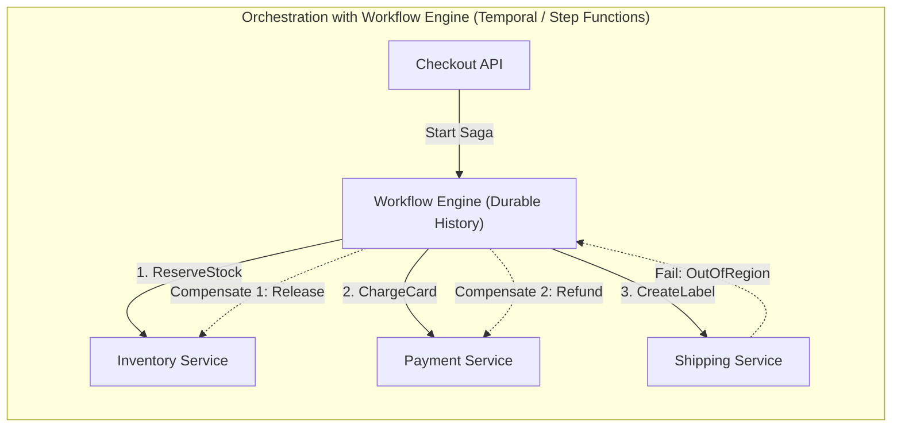
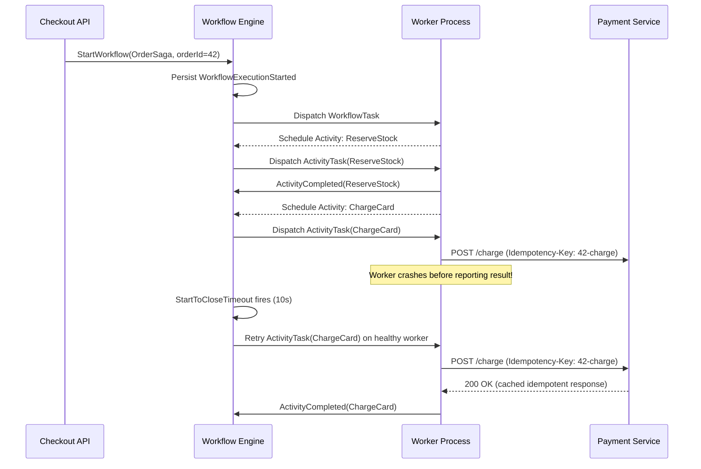
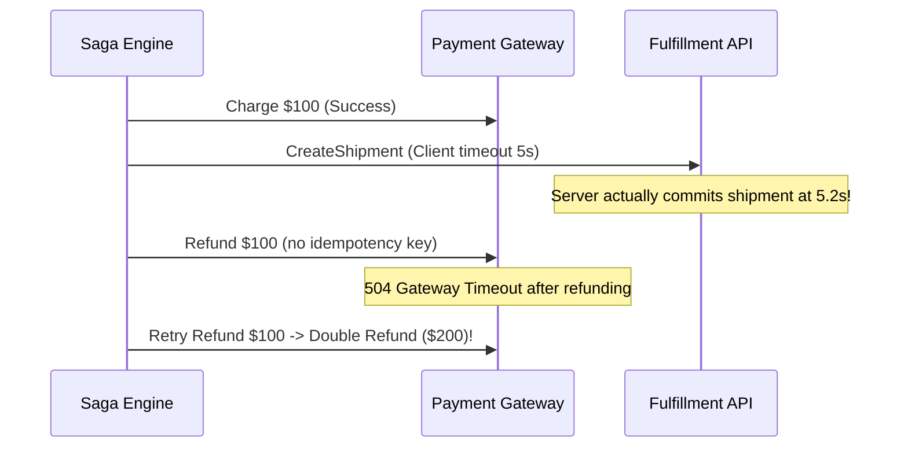

# Saga Orchestration with Workflow Engines: Temporal & Step Functions

> **Prerequisites:** [Lesson 15: Serverless Architecture](../15-serverless-architecture/README.md) · [Lesson 06: Sync vs Async Communication in Microservices](../06-sync-vs-async-communication-in-microservices/README.md).  
> **Estimated Reading Time:** 24–28 minutes  
> **Target Audience:** Backend and staff engineers designing multi-service business transactions (checkout, booking, payouts), and candidates asked "how do you handle distributed transactions without 2PC?"  
> **Free PDF Notes:** [Download SD-L-016.pdf](https://backendroadmap.com/notes/system-design/SD-L-016.pdf)

> [!NOTE]
> **In one line:** A **Saga** breaks a distributed transaction into a sequence of local ACID transactions paired with **compensating actions** on failure. A **workflow engine** (Temporal, AWS Step Functions) executes that saga as **durable, replayable code or state machines**, surviving process crashes, network partitions, and days-long waits without distributed locks.

> [!TIP]
> **The Golden Rule:** Never hold a database lock across a network boundary. Use **durable orchestration** when a workflow spans 3+ services, needs timeouts/human approvals, or requires deterministic rollback; make every forward step **idempotent** and every compensation **commutatively safe and retryable**.

---

## 1. What Saga Orchestration Is, and What It Isn't

When a user books a flight + hotel + car rental, three independent microservices own three separate databases. A classic two-phase commit (2PC / XA) locks rows across all three databases while a coordinator polls everyone—one slow network hop or crashed participant stalls the entire cluster. Instead, a **Saga** commits each service's local transaction immediately and, if step 3 (car rental) fails, runs **compensating transactions** in reverse order (cancel hotel, refund flight).

You can coordinate a saga via **choreography** (services react to each other's events) or **orchestration** (a central workflow engine directs each step). Workflow engines like **Temporal** and **AWS Step Functions** elevate orchestration from brittle cron-and-state-table glue into **durable execution**: the engine persists every state transition to an append-only event history so a crashed worker resumes mid-flight without repeating completed side effects.

| Term | Precise Meaning | Example |
| :--- | :--- | :--- |
| **Saga** | A sequence of local transactions $T_1, T_2, \dots, T_n$ with compensating actions $C_1, \dots, C_{n-1}$ | Reserve inventory $\to$ Charge card $\to$ Create shipment |
| **Compensating transaction** | Semantic undo that reverses the business effect of a committed local step | `RefundPayment(txId)` (does not erase history; appends a credit) |
| **Pivot transaction** | The point of no return in a saga; once it commits, the saga must complete forward | Final payment capture or irreversible wire transfer |
| **Retryable transaction** | Steps *after* the pivot that are guaranteed to eventually succeed via retries | Send receipt email, update analytics ledger |
| **Orchestrator (Workflow Engine)** | Durable state machine that invokes activities, tracks timers, and drives compensations | Temporal Server, AWS Step Functions, Cadence |
| **Durable Execution** | Code execution backed by an event-sourced history log so memory state survives crashes | Temporal workflow replay |
| **Not 2PC / ACID** | Sagas provide **ACD** (Atomicity via compensation, Consistency eventually, Durability), **not Isolation** | Dirty reads: another user sees reserved stock before payment fails |

### Why It Matters
1. **2PC does not scale across microservices**—availability drops multiplicatively with every participant, and SaaS APIs (Stripe, Twilio) do not speak XA.
2. **Hand-rolled state machines rot**—storing `status = 'CHARGED'` in a database with polling cron jobs leaks edge cases (timeouts, partial rollbacks, out-of-order callbacks).
3. **Lack of Isolation (I in ACID) is the #1 interview trap**—candidates forget to explain how semantic locks, versioned states, or reservations prevent concurrent anomalies while a saga is in flight.

---

## 2. Anatomy: Choreography vs Workflow Engine Orchestration



In **choreography**, `OrderService` emits `OrderCreated`, `InventoryService` emits `StockReserved`, `PaymentService` emits `PaymentFailed`, and `InventoryService` must know to listen for `PaymentFailed`. By 5+ services, nobody can read the control flow from a single place, and adding a step risks cyclic event loops.

In **workflow-engine orchestration**, the entire forward and compensation graph lives in one versioned workflow definition (code in Temporal; ASL JSON in Step Functions). The engine persists every scheduled activity, result, timer, and signal.

| Dimension | Choreography (Event-Driven) | Hand-Rolled DB Orchestrator | Workflow Engine (Temporal / Step Functions) |
| :--- | :--- | :--- | :--- |
| **Control flow visibility** | Scattered across N consumers | Central state table + cron | Single code/DSL definition + live UI trace |
| **Crash recovery** | Re-consume from broker offset | Custom sweeper locks & polling | Automatic deterministic replay / state checkpoint |
| **Long-lived timers** | Hard (delayed queues / TTL hacks) | DB polling every minute | Native durable timers (`sleep("7 days")`) |
| **Cyclic dependency risk** | High as services grow | Low | Low (acyclic DAG / explicit loop bounds) |
| **Infrastructure cost** | Existing Kafka / RabbitMQ | Existing RDBMS | Managed service or self-hosted Temporal + DB |

> [!WARNING]
> **Workflow code in Temporal MUST be deterministic.** Because Temporal recovers crashed workers by replaying the workflow function from the beginning against recorded history events, calling `time.Now()`, `uuid.New()`, `math/rand`, or making direct HTTP calls inside workflow code breaks replay (`NonDeterministicError`). Always wrap non-deterministic I/O inside **Activities** and use engine-provided `workflow.Now(ctx)` / `workflow.SideEffect()`.

---

## 3. Mathematical Model: Saga Latency, Compensation Cost & State History

Let a saga have $n$ sequential forward steps with latencies $t_1, t_2, \dots, t_n$, per-step failure probability $p_i$, and compensation latencies $c_1, \dots, c_{n-1}$.

**1. Expected Latency (Happy Path vs Failure Path):**
If the saga succeeds (probability $\prod_{i=1}^n (1 - p_i)$), latency includes engine checkpoint overhead $t_{\text{eng}}$ per transition:

$$T_{\text{happy}} = \sum_{i=1}^{n} \left(t_i + t_{\text{eng}}\right)$$

If step $k$ fails (after steps $1 \dots k-1$ succeeded), the engine executes $k-1$ compensations in reverse order:

$$T_{\text{fail}}(k) = \sum_{i=1}^{k} (t_i + t_{\text{eng}}) + \sum_{j=1}^{k-1} (c_j + t_{\text{eng}})$$

**2. History Event Growth (Temporal / Event-Sourced Engines):**
Each activity execution appends roughly $4$–$5$ history events (`ActivityTaskScheduled`, `Started`, `Completed` + `WorkflowTaskScheduled/Started/Completed`). For $n$ forward steps and $r$ retries per step:

$$E_{\text{total}} \approx 5 \cdot n \cdot (1 + \bar{r}) + 2$$

**Worked Numerical Example:**
Suppose a 4-step checkout saga (`Reserve`, `FraudCheck`, `Charge`, `Ship`) has $t_i = 80\text{ ms}$, engine checkpoint $t_{\text{eng}} = 12\text{ ms}$, and compensation $c_j = 60\text{ ms}$:
- **Happy path:** $T_{\text{happy}} = 4 \times (80 + 12) = 368\text{ ms}$.
- **Failure at Step 4 (`Ship` fails):** $T_{\text{fail}}(4) = 4 \times 92 + 3 \times (60 + 12) = 368 + 216 = 584\text{ ms}$.
- **Event history size:** With average retries $\bar{r} = 0.25$ and 4 forward + 3 compensation activities ($7$ activities total): $E_{\text{total}} \approx 5 \times 7 \times 1.25 + 2 \approx 46$ events (~23 KB), well below Temporal's 50,000-event hard limit. (A loop running 10,000 iterations *without* `ContinueAsNew` would hit 50,000 events and terminate!)

**3. Availability of Orchestrated Saga vs 2PC:**
In 2PC, all $n$ participants must be simultaneously up during the prepare/commit window: $A_{\text{2PC}} = \prod_{i=1}^n a_i$. With a durable workflow engine of availability $a_{\text{eng}}$, a transient outage in service $k$ merely *pauses* that saga instance until retries succeed, preserving completion availability:

$$A_{\text{saga}} \approx a_{\text{eng}} \cdot a_{\text{ingress}}$$

---

## 4. Metrics & Percentiles

| Metric | Meaning | Alert when |
| :--- | :--- | :--- |
| **Workflow Task Schedule-to-Start Latency ($p_{99}$)** | Time a workflow task sits in the engine queue waiting for a worker | $> 200\text{ ms}$ (workers saturated or starved) |
| **Activity Schedule-to-Close Latency ($p_{99}$)** | Total time including retries for an activity to finish | Exceeds step SLA (e.g., $> 5\text{ s}$) |
| **Saga Compensation Rate** | Percentage of started sagas that trigger rollback | $> 2\%$ or sudden $3\times$ spike (bad deploy downstream) |
| **Compensation Failure / Stuck Saga Count** | Sagas where a compensating action exhausted retries | **Any $> 0$** (requires manual intervention / DLQ) |
| **History Event Count / Size per Execution** | Number of persisted events in one workflow run | $> 10{,}000$ events (must use `ContinueAsNew`) |
| **Non-Deterministic Replay Errors** | Worker code mismatch against persisted history | **Any $> 0$** (bad unversioned workflow deploy) |

### Worked Example (Multi-Day Travel Booking Saga)
A travel platform runs 500 bookings/sec at peak. Step 1 reserves a seat (120 ms), Step 2 authorizes payment (350 ms), Step 3 waits up to 15 minutes for a partner hotel webhook (Signal), Step 4 captures payment (200 ms).
- Because Step 3 uses a durable signal + 15-minute timer, **zero threads or DB connections are held** during the 15-minute wait.
- If the hotel rejects at minute 14, the engine wakes up on any healthy worker, runs `VoidPaymentAuth` and `ReleaseSeat`, and closes the saga cleanly.
- If Step 4 (`CapturePayment`) times out due to a gateway blip, the engine retries with exponential backoff (`1s, 2s, 4s, 8s`) using the same `idempotency_key = workflow_id + "-capture"`.

---

## 5. Compounding & Failure Modes

What happens when a downstream dependency slows down from $100\text{ ms}$ to $5\text{ s}$ while the saga engine keeps spawning workflows at $\lambda = 200\text{ sagas/s}$?

| Scenario | What Happens in Naive Orchestration | What Happens with Bounded Durable Engine |
| :--- | :--- | :--- |
| **Downstream latency $50\times$ spike ($100\text{ ms} \to 5\text{ s}$)** | Worker thread pool exhausts in 2s; incoming checkouts fail with 503 | Workflows pause durably in engine DB; active worker slots saturate and **task queue depth** absorbs the spike |
| **Worker pod OOM-killed mid-saga** | In-memory state lost; customer charged without shipment | New worker pulls task, replays event history in $<10\text{ ms}$, resumes at exact next step |
| **Unbounded retry storm on Payment 500s** | $200\text{ sagas/s} \times 10\text{ retries}$ = $2{,}000\text{ RPS}$ hammering wounded Payment service | Exponential backoff + jitter + circuit-breaker activity rate limits cap downstream RPS |
| **Unversioned workflow code deploy** | Running sagas crash with `NonDeterministicError` on replay | Temporal `GetVersion` / worker build-ID routing keeps old runs on old logic |

---

## 6. Numbers Every Engineer Must Know

| Item | Typical | Implication |
| :--- | :---: | :--- |
| Temporal activity state transition | 5–15 ms | Do not model 1-ms in-memory loops as separate activities |
| AWS Step Functions Standard transition | ~$0.025 per 1,000 transitions | High-volume short workflows can get expensive; use Express Workflows |
| AWS Step Functions Express max duration | 5 minutes | Standard workflows run up to **1 year** |
| Temporal max history length | 50,000 events / 50 MB | Long-running entity workflows must call `ContinueAsNew` |
| Activity heartbeat timeout | 10–60 seconds | Long tasks (video transcode) must send heartbeats or engine assumes crash |
| Default retry initial interval | 1 second (backoff 2.0) | Always cap `MaximumInterval` (e.g., 60s) and `MaximumAttempts` for non-idempotent risks |

---

## 7. Protocol Deep Dive: Temporal Replay & Step Functions Checkpointing



| Question | Answer |
| :--- | :--- |
| **What if the worker crashes after charging the card but before notifying the engine?** | The engine's `StartToCloseTimeout` fires and schedules a retry. The **idempotency key** prevents a double charge. |
| **What if a compensation itself fails?** | Compensations must be **retried indefinitely** (with alerting after N attempts) or routed to a manual ops queue—you cannot "undo an undo" automatically. |
| **How do you prevent concurrent reads of uncommitted saga state (lack of Isolation)?** | Use **semantic locks** (mark row `status = 'PENDING_RESERVATION'`), **commutative updates** (increment/decrement deltas instead of blind overwrites), or **pessimistic reservation expiry**. |
| **How do you deploy a new version of a workflow while old sagas are mid-flight?** | In Temporal, use `workflow.GetVersion` or Worker Versioning (Build IDs). In Step Functions, each execution stays pinned to the state machine version it started on. |

**When NOT to use a workflow engine:**
- **Sub-10ms synchronous request paths** (e.g., a cache-backed product lookup or single-DB CRUD write)—engine persistence adds ~10–30 ms per step.
- **Simple two-step local transactions** inside one modular monolith—a single ACID `BEGIN...COMMIT` is faster, simpler, and provides full Isolation.
- **Pure high-throughput stream ETL** (millions of events/sec)—use Kafka + Flink/Spark rather than per-item stateful workflows.

---

## 8. Hierarchical Budgets & Design Rules

| Slice | Rule | Control |
| :--- | :--- | :--- |
| **Idempotency** | Every activity & compensation must accept a deterministic key (`workflowId + step`) | Unique constraint or idempotency table downstream |
| **Timeouts** | Always set `StartToCloseTimeout` (per attempt) AND `ScheduleToCloseTimeout` (total) | Never rely on infinite timeouts |
| **Isolation** | Expose `PENDING` / `RESERVED` states explicitly to readers | Semantic lock + reservation TTL |
| **Compensation order** | Register compensations *before* or *immediately upon* each forward step | LIFO stack executed in `defer` / `finally` block |
| **Determinism** | Zero raw `time.Now()`, `rand`, or direct network calls in workflow code | Wrap all I/O in Activities; run replay tests in CI |
| **Payload size** | Keep workflow arguments and activity results small ($< 64\text{ KB}$) | Pass S3/Blob keys instead of raw files |
| **History bounds** | Cap loops and long-lived workflows | `ContinueAsNew` every ~2,000 events |

---

## 9. Top Mitigations

1. **Pass deterministic idempotency keys** (`{workflowId}-{activityName}-{attempt_or_step}`) to every external API and DB mutation.
2. **Design compensations as idempotent, retryable operations** that succeed even if the forward step never actually ran (e.g., `ReleaseReservation` returns `200 OK` if already released).
3. **Separate `NonRetryable` business errors from transient infrastructure errors**—do not retry `InsufficientFunds` 10 times; trigger compensation immediately.
4. **Use a Pivot Transaction**—place irreversible external actions (sending a physical shipment, irreversibly wiring money) *after* all reversible validations and reservations.
5. **Run workflow replay tests in CI** against exported production JSON histories before deploying workflow code changes.
6. **Add Saga Heartbeats and Stuck-Execution Alerts** so a compensation stuck on a 500 error pages an on-call engineer within 5 minutes.
7. **Apply semantic locking** (`PENDING` flags, credit holds) to mitigate the missing `I` (Isolation) in Sagas.

---

## 10. Production Reference: Double-Charge Incident from Non-Idempotent Compensation

**Incident Summary (SEV-1):** An e-commerce checkout saga used a custom workflow orchestrator. Step 1 reserved inventory, Step 2 charged the customer's card, and Step 3 called an external tax/fulfillment API. During a 12-minute outage of the fulfillment API, `CreateFulfillment` timed out after 5 seconds.

**Root Cause:**
1. The workflow did **not** pass an idempotency key to `RefundPayment` during compensation. When a transient 504 hit the refund endpoint, the engine retried `RefundPayment`, issuing **two** full refunds for a single charge.
2. Worse, `CreateFulfillment` had actually succeeded on the server right after the 5-second client timeout—so customers received **both** free merchandise and a double refund.



**The Fix:**
1. Enforced `Idempotency-Key: {sagaId}-charge` and `{sagaId}-refund` on every payment call.
2. Added a `CancelOrCheckShipment` compensation that queries fulfillment status by `{sagaId}` before deciding whether to cancel or mark for manual reconciliation.
3. Increased `CreateShipment` timeout to 15s and marked `FulfillmentTimeout` as requiring reconciliation rather than blind refund.

---

## 11. Multi-Language Production Code Tabs

A clean, production-shaped **Saga Orchestrator** with LIFO compensation stack, idempotency keys, and retryable vs non-retryable error handling.

````carousel
```go
// Go: Saga orchestrator with LIFO compensations and deterministic step keys.
package saga

import (
	"context"
	"errors"
	"fmt"
)

var ErrNonRetryable = errors.New("business rejection")

type Compensation func(ctx context.Context) error

type Orchestrator struct {
	sagaID        string
	compensations []Compensation
}

func NewOrchestrator(sagaID string) *Orchestrator {
	return &Orchestrator{sagaID: sagaID}
}

func (o *Orchestrator) RunStep(
	ctx context.Context,
	stepName string,
	forward func(ctx context.Context, idempKey string) error,
	compensate func(ctx context.Context, idempKey string) error,
) error {
	fwdKey := fmt.Sprintf("%s-%s-fwd", o.sagaID, stepName)
	if err := forward(ctx, fwdKey); err != nil {
		return err
	}
	if compensate != nil {
		compKey := fmt.Sprintf("%s-%s-comp", o.sagaID, stepName)
		// Push compensation onto LIFO stack only after forward step succeeds.
		o.compensations = append(o.compensations, func(c context.Context) error {
			return compensate(c, compKey)
		})
	}
	return nil
}

func (o *Orchestrator) Rollback(ctx context.Context) error {
	var errs []error
	// Execute compensations in reverse (LIFO) order.
	for i := len(o.compensations) - 1; i >= 0; i-- {
		if err := o.compensations[i](ctx); err != nil {
			errs = append(errs, err)
		}
	}
	return errors.Join(errs...)
}
```
<!-- slide -->
```typescript
// TypeScript: Saga orchestrator with LIFO compensation stack (Temporal-style).
type StepFn = (idempotencyKey: string) => Promise<void>;

export class SagaOrchestrator {
  private compensations: Array<() => Promise<void>> = [];

  constructor(private readonly sagaId: string) {}

  async step(name: string, forward: StepFn, compensate?: StepFn): Promise<void> {
    const fwdKey = `${this.sagaId}:${name}:fwd`;
    await forward(fwdKey);
    if (compensate) {
      const compKey = `${this.sagaId}:${name}:comp`;
      this.compensations.push(() => compensate(compKey));
    }
  }

  async rollback(): Promise<void> {
    const errors: unknown[] = [];
    // Reverse order guarantees Step 2 is undone before Step 1.
    for (let i = this.compensations.length - 1; i >= 0; i--) {
      try {
        await this.compensations[i]();
      } catch (err) {
        errors.push(err); // Collect all failures; alert ops if non-empty.
      }
    }
    if (errors.length > 0) {
      throw new AggregateError(errors, `Saga ${this.sagaId} compensation failed`);
    }
  }
}
```
<!-- slide -->
```python
# Python: Saga orchestrator with deterministic idempotency keys & LIFO rollback.
from dataclasses import dataclass, field
from typing import Callable, List, Optional


@dataclass
class SagaOrchestrator:
    saga_id: str
    _compensations: List[Callable[[], None]] = field(default_factory=list)

    def run_step(
        self,
        name: str,
        forward: Callable[[str], None],
        compensate: Optional[Callable[[str], None]] = None,
    ) -> None:
        fwd_key = f"{self.saga_id}:{name}:fwd"
        forward(fwd_key)
        if compensate is not None:
            comp_key = f"{self.saga_id}:{name}:comp"
            self._compensations.append(lambda k=comp_key, fn=compensate: fn(k))

    def rollback(self) -> List[Exception]:
        failures: List[Exception] = []
        for comp in reversed(self._compensations):
            try:
                comp()
            except Exception as exc:
                failures.append(exc)
        return failures
```
<!-- slide -->
```csharp
// C#: Saga orchestrator with LIFO compensation stack and idempotency keys.
public sealed class SagaOrchestrator(string sagaId)
{
    private readonly Stack<Func<CancellationToken, Task>> _compensations = new();

    public async Task RunStepAsync(
        string stepName,
        Func<string, CancellationToken, Task> forward,
        Func<string, CancellationToken, Task>? compensate,
        CancellationToken ct = default)
    {
        var fwdKey = $"{sagaId}:{stepName}:fwd";
        await forward(fwdKey, ct);

        if (compensate is not None)
        {
            var compKey = $"{sagaId}:{stepName}:comp";
            _compensations.Push(token => compensate(compKey, token));
        }
    }

    public async Task RollbackAsync(CancellationToken ct = default)
    {
        var exceptions = new List<Exception>();
        while (_compensations.TryPop(out var comp))
        {
            try { await comp(ct); }
            catch (Exception ex) { exceptions.Add(ex); }
        }
        if (exceptions.Count > 0)
            throw new AggregateException($"Saga {sagaId} compensation failed", exceptions);
    }
}
```
````

---

## 12. Hands-On CLI Verification Workflows

Inspecting workflows in **Temporal** and **AWS Step Functions** from the terminal:

```bash
# Temporal CLI: start a checkout saga, inspect its event history, and send a signal
temporal workflow start \
  --task-queue checkout-tq \
  --type OrderSagaWorkflow \
  --workflow-id "order-42" \
  --input '{"orderId":"42","amountCents":9900}'

temporal workflow show --workflow-id "order-42"
temporal workflow signal --workflow-id "order-42" --name "HotelConfirmed" --input '{"ok":true}'

# AWS Step Functions CLI: start execution and inspect transition history
aws stepfunctions start-execution \
  --state-machine-arn "arn:aws:states:us-east-1:123456789012:stateMachine:OrderSaga" \
  --name "order-42" \
  --input '{"orderId":"42","amountCents":9900}'

aws stepfunctions get-execution-history \
  --execution-arn "arn:aws:states:us-east-1:123456789012:execution:OrderSaga:order-42"
```

Verify the latency and event-history math in Python:

```bash
python -c "
n, t_step, t_eng, t_comp = 4, 80, 12, 60
happy = n * (t_step + t_eng)
fail_step4 = happy + (n - 1) * (t_comp + t_eng)
events = 5 * (n + n - 1) * 1.25 + 2
print(f'Happy: {happy}ms, Fail@4: {fail_step4}ms, Est. Events: {events:.0f}')
"
```

---

## 13. Common Mistakes to Avoid

1. **Assuming Sagas give you ACID Isolation**—concurrent requests can see intermediate `RESERVED` or `CHARGED` states unless you add semantic locks.
2. **Non-deterministic workflow code** (`time.Now()`, `rand`, direct HTTP) inside Temporal, causing `NonDeterministicError` on crash replay.
3. **Non-idempotent forward or compensating activities**, leading to double charges or double refunds on retry.
4. **Retrying business rejections** (e.g., `InvalidCard`) instead of failing fast to compensation.
5. **Unbounded workflow loops without `ContinueAsNew`**, hitting the 50,000-event history limit.
6. **Passing multi-megabyte payloads** through workflow arguments instead of object storage references.
7. **Forgetting to alert on failed compensations**, leaving half-rolled-back orders silently stuck.

---

## 14. Key Terms Glossary

| Key Term | Definition |
| :--- | :--- |
| **Saga** | Distributed transaction broken into local ACID steps + compensating actions. |
| **Orchestration** | Central workflow engine directs each service step and rollback. |
| **Choreography** | Services react to domain events with no central coordinator. |
| **Compensating Transaction** | Semantic undo operation that reverses a previously committed local step. |
| **Pivot Transaction** | Point of no return after which the saga only moves forward. |
| **Durable Execution** | Execution model backed by persisted event history that survives process crashes. |
| **Deterministic Replay** | Re-executing workflow code using recorded activity outputs to rebuild memory state. |
| **Activity** | Side-effecting unit of work (HTTP call, DB write) invoked by a workflow. |
| **Semantic Lock** | Application-level flag (`PENDING`) preventing concurrent anomalies during a saga. |
| **ContinueAsNew** | Closing an overly long workflow history and atomically starting a fresh execution with carried state. |

---

## 15. System Design Interview Questions & Answers

### Basic Conceptual Questions

<details>
<summary><strong>Q1: Why use Sagas instead of Two-Phase Commit (2PC) in microservices? [BASIC]</strong></summary>

**Answer:**
2PC holds locks across multiple databases while waiting for all participants to vote and commit. One slow or crashed service stalls everyone, availability multiplies downward ($\prod a_i$), and external APIs (Stripe, shipping carriers) do not support XA/2PC. Sagas commit local transactions immediately and use compensating actions on failure, trading Isolation for high availability and loose coupling.
</details>

<details>
<summary><strong>Q2: Orchestration vs Choreography — when do you choose each? [BASIC]</strong></summary>

**Answer:**
Use **choreography** for simple 2–3 service flows where loose decoupling is paramount (e.g., `UserSignedUp` $\to$ send welcome email + create analytics profile). Use **orchestration** (Temporal, Step Functions) when the flow has 3+ steps, explicit rollback/compensation ordering, long-lived timers, human approvals, or needs a single place to debug and version business logic.
</details>

<details>
<summary><strong>Q3: What is a compensating transaction, and how is it different from a database rollback? [BASIC]</strong></summary>

**Answer:**
A database rollback erases uncommitted changes before anyone sees them. A compensating transaction is a **new forward business action** (e.g., `IssueRefund`, `RestockItem`) that semantically undoes a *previously committed* local transaction. Because the original commit was visible, the undo is recorded in the audit log too.
</details>

<details>
<summary><strong>Q4: What is the difference between a Workflow and an Activity in Temporal? [BASIC]</strong></summary>

**Answer:**
A **Workflow** is deterministic orchestration logic (control flow, timers, compensation order) replayed from event history on crash. An **Activity** is a single side-effecting operation (calling Stripe, writing to Postgres) whose result is recorded once in history and never re-executed during replay unless it failed and is being retried.
</details>

### Scenario-Based Architecture Questions

<details>
<summary><strong>Q5: Design a 4-step travel booking saga (Flight, Hotel, Car, Payment). Where does the Pivot go? [SCENARIO]</strong></summary>

**Answer:**
Reserve Flight, Hotel, and Car first (all have reversible `CancelReservation` compensations). Then **authorize** payment, and make **CapturePayment** (or final ticket issuance) the **Pivot Transaction**. Once captured, any post-pivot steps (email itinerary, award loyalty points) are **retryable transactions** that never roll back—they retry until they succeed.
</details>

<details>
<summary><strong>Q6: A worker crashes right after charging the customer's credit card, before reporting back to Temporal. What happens? [SCENARIO]</strong></summary>

**Answer:**
The activity's `StartToCloseTimeout` expires on the Temporal server. Temporal schedules a retry on another healthy worker. Because the payment activity sends a deterministic `Idempotency-Key: {workflowId}-charge`, Stripe returns the original cached `200 OK` without charging the card a second time, and the saga proceeds.
</details>

<details>
<summary><strong>Q7: Your saga waits 48 hours for a compliance officer's approval before disbursing funds. How do you model this? [SCENARIO]</strong></summary>

**Answer:**
Use a durable **Signal + Timer** race (`WaitWithTimeout(48h)`). The workflow consumes zero threads or connections while waiting. If the officer approves via API, the API sends a Signal to the workflow; if 48 hours pass first, the timer fires and the workflow automatically runs compensations to release the hold.
</details>

<details>
<summary><strong>Q8: The compensation step `RefundPayment` fails with a 500 error. What should the orchestrator do? [SCENARIO]</strong></summary>

**Answer:**
Never ignore or swallow a failed compensation. Retry `RefundPayment` with exponential backoff up to a high threshold (or indefinitely with a capped interval like 60s), emit a high-severity alert (`CompensationStuck`) after N attempts, and surface it in an operations dashboard/DLQ for manual reconciliation.
</details>

### Advanced & Tricky Interview Questions

<details>
<summary><strong>Q9: Sagas lack Isolation (the I in ACID). Give a concrete concurrency bug and how to fix it. [TRICKY]</strong></summary>

**Answer:**
*Bug (Dirty Read / Lost Update):* Saga A reserves the last concert ticket and deducts `stock` from `1` to `0`, then fails payment 2 seconds later and restores `stock` to `1`. Meanwhile, User B sees `stock = 0` and leaves ("Sold Out"). *Fix:* Use **semantic locking**—create a `Reservation(status='PENDING', expiresAt=now+5m)` row rather than blindly mutating final state, or use **counter-reservation** (`available = total - reserved`) with UI messaging ("1 ticket held in cart").
</details>

<details>
<summary><strong>Q10: You deploy updated workflow code that swaps Step 2 and Step 3, while 10,000 old sagas are mid-flight. What breaks? [TRICKY]</strong></summary>

**Answer:**
When an in-flight old saga wakes up on a new worker, Temporal replays its event history against the *new* code. Seeing Step 3 in code when history recorded Step 2 throws a `NonDeterministicError`, stalling all 10,000 sagas. *Fix:* Use `workflow.GetVersion` to branch old vs new histories, or use **Worker Versioning (Build IDs)** so old runs stay routed to old worker pods until they drain.
</details>

<details>
<summary><strong>Q11: Why is `StartToCloseTimeout` alone dangerous, and why do you also need `HeartbeatTimeout`? [TRICKY]</strong></summary>

**Answer:**
If an activity is a 30-minute video transcode, `StartToCloseTimeout` must be $>30\text{ min}$. If the worker dies at minute 1, the engine waits 29 minutes before retrying! A 15-second `HeartbeatTimeout` forces the worker to ping progress every 5s; if it crashes at minute 1, Temporal detects it in 15 seconds and retries from the last heartbeat checkpoint.
</details>

<details>
<summary><strong>Q12: How do you handle a "zombie" activity that finishes *after* its timeout already triggered a compensation? [TRICKY]</strong></summary>

**Answer:**
This is the classic distributed race. Pass a **fencing token** or check the saga's current status (`WHERE saga_id = ? AND status = 'ACTIVE'`) inside the downstream service's local transaction, or make the downstream service reject stale attempts once a `CANCELLED` tombstone for `{sagaId}` exists.
</details>

---

## 16. One-Page Master Cheat Sheet

```
+---------------------------------------------------------------------------------------------------------+
|                    SAGA ORCHESTRATION & WORKFLOW ENGINES — MASTER CHEAT SHEET                           |
+---------------------------------------------------------------------------------------------------------+
| 1. SAGA = Local ACID transactions T1..Tn + Compensations Cn-1..C1 (LIFO). ACD without Isolation (I).    |
+---------------------------------------------------------------------------------------------------------+
| 2. ORCHESTRATION vs CHOREOGRAPHY: Use Workflow Engines (Temporal / Step Functions) for 3+ steps,        |
|    timers, human approvals, and single-pane visibility.                                                 |
+---------------------------------------------------------------------------------------------------------+
| 3. DURABLE EXECUTION: History log checkpoints every step. Replay rebuilds state after crashes.          |
|    RULE: Workflow code MUST be deterministic; all I/O lives in Activities.                              |
+---------------------------------------------------------------------------------------------------------+
| 4. IDEMPOTENCY + ISOLATION: Every activity & compensation takes `sagaId:step`. Use semantic locks       |
|    (`PENDING`) and Pivot Transactions (irreversible step) to protect data integrity.                    |
+---------------------------------------------------------------------------------------------------------+
| 5. OPS LIMITS: Bound history (<50k events via ContinueAsNew), separate business vs transient errors,    |
|    use GetVersion/BuildIDs for deploys, and alert immediately on stuck compensations.                   |
+---------------------------------------------------------------------------------------------------------+
```

---

## Further Reading & Sources

- Hector Garcia-Molina & Kenneth Salem, [Sagas (1987 Original Paper)](https://www.cs.cornell.edu/andru/cs711/2002fa/reading/sagas.pdf).
- Temporal Documentation, [Durable Execution & Deterministic Workflows](https://docs.temporal.io/workflows).
- AWS Architecture & Step Functions Docs, [Saga Pattern with AWS Step Functions](https://docs.aws.amazon.com/prescriptive-guidance/latest/cloud-design-patterns/saga-orchestration.html).
- Chris Richardson, *Microservices Patterns*, Chapter 4: "Managing transactions with sagas".

---

## Free PDF Notes

[SD-L-016.pdf](https://backendroadmap.com/notes/system-design/SD-L-016.pdf)

---

## Next

Continue with [Lesson 17: CQRS & Event Sourcing in Microservices: Queries Across Services](../17-cqrs-event-sourcing-in-microservices/README.md).
