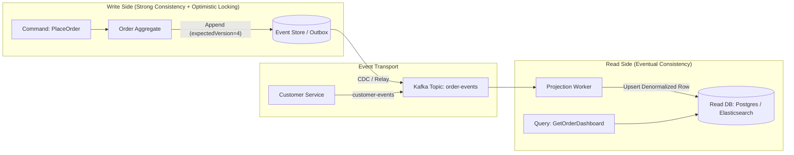
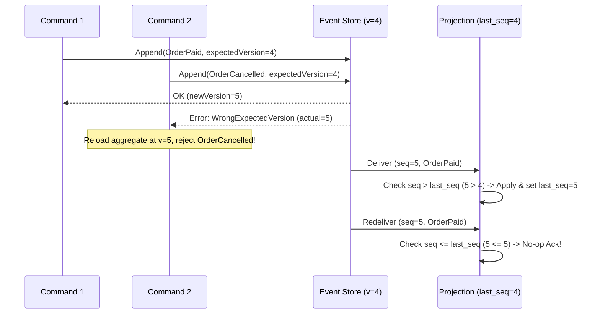
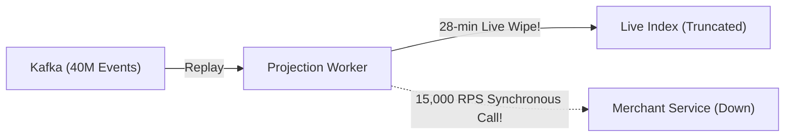

# CQRS & Event Sourcing in Microservices: Queries Across Services

> **Prerequisites:** [Lesson 16: Saga Orchestration with Workflow Engines](../16-saga-orchestration-with-workflow-engines/README.md) · [Lesson 05: Database per Service](../05-database-per-service/README.md).  
> **Estimated Reading Time:** 24–28 minutes  
> **Target Audience:** Backend engineers struggling with cross-service joins, slow read APIs, or audit-heavy domains, and candidates asked "how do you query data across microservices?"  
> **Free PDF Notes:** [Download SD-L-017.pdf](https://backendroadmap.com/notes/system-design/SD-L-017.pdf)

> [!NOTE]
> **In one line:** **CQRS** separates the write model (optimized for validation and consistency) from the read model (denormalized projections optimized for queries). **Event Sourcing** stores state as an immutable append-only log of domain events rather than overwriting current rows—together they power cross-service queries, full audit trails, and time-travel debugging, at the cost of **eventual consistency and schema evolution complexity**.

> [!TIP]
> **The Golden Rule:** You can—and usually should—use **CQRS without Event Sourcing** (a relational write DB projecting to Elasticsearch/Redis). Only adopt **Event Sourcing** when you genuinely need an immutable audit log, temporal queries ("state at 3 PM Tuesday"), or event replay—never as a default CRUD replacement.

---

## 1. What CQRS & Event Sourcing Are, and What They Aren't

In a microservices architecture with **Database per Service**, `OrderService` owns orders, `CustomerService` owns names, and `CatalogService` owns product titles. A dashboard asking *"Show the last 20 orders with customer email and product name, sorted by total"* cannot run a SQL `JOIN` across three isolated databases. Scatter-gather API calls from the gateway create $N+1$ network hops, high tail latency, and coupled availability.

**CQRS (Command Query Responsibility Segregation)** solves this by maintaining a dedicated **Read Model (Projection)**—for example, a denormalized PostgreSQL view, Redis hash, or Elasticsearch index—updated asynchronously from domain events. **Event Sourcing** goes a step further on the write side: instead of `UPDATE accounts SET balance = 80`, the write store appends `MoneyWithdrawn(amount=20, seq=42)` to an **Event Store**.

| Term | Precise Meaning | Example |
| :--- | :--- | :--- |
| **Command** | An intent to change state; validated and may be rejected | `PlaceOrder`, `WithdrawMoney` |
| **Query** | A side-effect-free read against a denormalized view | `GetOrderDashboard(userId)` |
| **CQRS** | Separate data models (and often separate DBs) for writes vs reads | Postgres write DB $\to$ Elasticsearch read DB |
| **Event Sourcing (ES)** | Persisting state as an ordered sequence of immutable domain events | `OrderCreated`, `ItemAdded`, `OrderPaid` |
| **Projection / Materialized View** | A read-optimized table built by folding events from offset $0$ | `order_summary_view` |
| **Snapshot** | Periodic checkpoint of aggregate state at version $N$ to bound replay time | Account state saved every 100 events |
| **Not** | Mandatory pairing—CQRS does not require Event Sourcing, and ES is not a message broker | Use Kafka/Outbox for cross-service transport |

### Why It Matters
1. **Cross-service queries are the #1 pain point of Database-per-Service**—CQRS projections eliminate distributed joins and API scatter-gather.
2. **Read/write workloads have asymmetric shapes**—writes need strict invariants and normalization; reads need fast full-text search, aggregations, and denormalized joins.
3. **Interviewer trap:** Candidates propose Event Sourcing for every service, ignoring **eventual consistency (stale reads)**, **schema upcasting**, and **GDPR deletion ("right to be forgotten")**.

---

## 2. Anatomy: Write Side, Event Store, and Cross-Service Projections



Notice how the **Write Side** only validates business rules for a single aggregate (using optimistic concurrency: `WHERE aggregate_id = ? AND version = ?`). Meanwhile, the **Projection Worker** joins `order-events` and `customer-events` asynchronously into a single denormalized `order_dashboard` table so queries execute in **one index lookup ($<5\text{ ms}$)** with zero cross-service RPCs.

| Pattern | Write Store | Read Store | Best For |
| :--- | :--- | :--- | :--- |
| **Classic CRUD** | Normalized RDBMS | Same RDBMS | Simple domains, $<10\text{k}$ QPS, same-DB joins |
| **CQRS + Outbox** | Normalized RDBMS | Elasticsearch / Redis / Read Replica | Cross-service queries, search, heavy read/write skew |
| **CQRS + Event Sourcing** | Append-only Event Store | Multiple projections (SQL, Graph, Search) | Ledgers, medical/audit logs, temporal replay, complex state machines |

> [!WARNING]
> **Read-Your-Own-Writes anomaly:** Because projections update asynchronously, a user who submits `PlaceOrder` and immediately redirects to `/orders` may see an empty list for 50–500 ms. You must handle this in the UX or API (e.g., optimistic UI state, returning the created resource in the command response, or passing the written `eventVersion` token to the query).

---

## 3. Mathematical Model: Replay Time, Snapshots & Projection Lag

**1. Aggregate Load Time Without vs With Snapshots:**
In Event Sourcing, loading an aggregate with $N$ events at per-event deserialization/fold cost $t_e$ takes $O(N)$:

$$T_{\text{load}}(N) = t_{\text{query}} + N \cdot t_e$$

With a **Snapshot** taken every $K$ events (latest snapshot at $S \le N$, remaining tail events $N \bmod K$), load time is bounded:

$$T_{\text{load,snap}}(N) \le t_{\text{query}} + t_{\text{snap}} + (K - 1) \cdot t_e$$

**2. Read-Side Lag (Little's Law on Projections):**
If write commands produce events at rate $\lambda_e$ and a single-partition projection worker upserts at rate $\mu_p$, projection lag $L_{\text{time}}$ under a burst of duration $T_{\text{burst}}$ is:

$$L_{\text{events}} = (\lambda_{e,\text{burst}} - \mu_p) \cdot T_{\text{burst}}, \qquad L_{\text{time}} = \frac{L_{\text{events}}}{\mu_p}$$

**Worked Numerical Example:**
Suppose a high-volume ledger account accumulates $N = 12{,}000$ events over a year, with $t_{\text{query}} = 2\text{ ms}$ and $t_e = 0.05\text{ ms}$:
- **Without snapshots:** $T_{\text{load}} = 2 + 12{,}000 \times 0.05 = 602\text{ ms}$ per command—unacceptable for checkout!
- **With snapshots every $K = 200$ events** ($t_{\text{snap}} = 3\text{ ms}$, worst-case 199 tail events):
  $T_{\text{load,snap}} \le 2 + 3 + 199 \times 0.05 = 14.95\text{ ms}$ (**40× faster**).
- **Projection Rebuild Time:** Rebuilding a read model from scratch over $10^7$ historical events at $\mu_p = 20{,}000\text{ events/s}$ takes $10^7 / 20{,}000 = 500\text{ s}$ ($\approx 8.3\text{ minutes}$) using a blue/green shadow index.

---

## 4. Metrics & Percentiles

| Metric | Meaning | Alert when |
| :--- | :--- | :--- |
| **Projection Lag ($p_{99}$)** | `now() - event.occurredAt` when projection commits | $> 2\text{ s}$ (stale reads breaking UX) |
| **Event Store Append Latency ($p_{99}$)** | Time to append event + check expected version | $> 25\text{ ms}$ |
| **Optimistic Concurrency Conflict Rate** | `WrongExpectedVersion` retries per second | $> 5\%$ (hot aggregate contention) |
| **Events Loaded per Command ($p_{99}$)** | Tail events replayed before handling a command | $> 500$ (snapshot cadence too large or missing) |
| **Projection DLQ / Poison Event Count** | Events failing deserialization or upsert | **Any $> 0$** (blocks partition progress) |

### Worked Example (`OrderDashboard` Cross-Service Query)
An e-commerce platform splits `Orders`, `Customers`, and `Payments` into three services.
- **Before CQRS:** `GET /dashboard` called `Orders` (40 ms), then fanned out 20 parallel calls to `Customers` (35 ms) and `Payments` (45 ms) $\to$ $p_{99} = 210\text{ ms}$ and any `Payments` blip failed the dashboard.
- **With CQRS:** A projection consumer subscribes to `OrderCreated`, `CustomerUpdated`, and `PaymentSettled`, upserting into a denormalized `order_dashboard` table in PostgreSQL. `GET /dashboard` runs a single indexed `SELECT` in **4 ms** ($p_{99}$), and stays 100% available even if `Payments` is down for maintenance.

---

## 5. Compounding & Failure Modes

| Failure Mode | Mechanism | Impact at Scale |
| :--- | :--- | :--- |
| **Out-of-order cross-service events** | `PaymentSettled` arrives at projection before `OrderCreated` | Naive `UPDATE` affects 0 rows and loses payment status |
| **Non-idempotent projection** | Broker redelivers `OrderDeposited($50)` | Read model balance inflated by $+\$50$ |
| **Hot aggregate contention** | 500 concurrent requests hit one `InventoryItem` aggregate | Massive `WrongExpectedVersion` retry storm |
| **Schema change breaks replay** | Old `OrderCreated` v1 lacks `currency` field required by v2 code | Projection crashes on historical replay |
| **Dual-write bug** | Service writes to Event Store, crashes before publishing to Kafka | Read model permanently misses the event |

---

## 6. Numbers Every Engineer Must Know

| Item | Typical | Implication |
| :--- | :---: | :--- |
| CQRS projection lag (healthy) | 20–250 ms | Design UI for brief eventual consistency |
| Snapshot interval $K$ | 50–500 events | Bounds aggregate load time to $<20\text{ ms}$ |
| Single-partition projection throughput | 5,000–25,000 events/s (batched upserts) | Batch SQL `INSERT ... ON CONFLICT` for rebuilds |
| Event store storage growth | 500 B–2 KB per event | Plan cold-tier archiving for multi-year streams |
| Scatter-gather vs CQRS read latency | 150–400 ms vs 2–10 ms | CQRS removes network fan-out from read path |

---

## 7. Protocol Deep Dive: Optimistic Concurrency & Idempotent Projections



| Question | Answer |
| :--- | :--- |
| **How does Event Sourcing prevent concurrent write corruption without locks?** | **Optimistic Concurrency Control:** the Event Store enforces a `UNIQUE (aggregate_id, version)` constraint. Only one writer can claim `version = 5`; losers reload and re-validate. |
| **How do projections handle out-of-order events across two topics (`Order` & `Payment`)?** | Use **UPSERT with partial column merges** (`INSERT ... ON CONFLICT DO UPDATE`) so `PaymentSettled` can create a stub row that `OrderCreated` later enriches. |
| **How do you handle GDPR "Right to be Forgotten" in an immutable Event Store?** | **Crypto-shredding:** encrypt PII fields (`email`, `address`) with a per-user key stored in a key vault. To delete the user, destroy their encryption key—all historical events remain intact and immutable, but PII is permanently unreadable. |
| **How do you evolve event schemas over years?** | Add **Upcasters** in the deserialization pipeline that transform `v1` events into `v2` in-memory before folding, and never mutate or delete existing fields. |

**When NOT to use CQRS / Event Sourcing:**
- Simple CRUD microservices where the write schema and read schema are identical.
- Systems requiring **strict linearizable read-after-write** across all users without version-token propagation.
- Teams without operational maturity for schema versioning, projection rebuilds, and outbox relays.

---

## 8. Hierarchical Budgets & Design Rules

| Slice | Rule | Control |
| :--- | :--- | :--- |
| **Write Store** | Enforce `UNIQUE (aggregate_id, version)` | Optimistic concurrency check on every append |
| **Publishing** | Never dual-write Event Store + Kafka | Transactional Outbox or native Event Store subscription |
| **Projections** | Must be **idempotent** and **rebuildable from offset 0** | Store `last_processed_seq` / `event_id` in same TX as view update |
| **Cross-service joins** | Tolerate out-of-order arrival between topics | `UPSERT` partial rows; never assume Topic A arrives before Topic B |
| **Snapshots** | Snapshot every $K$ events in a background worker | Keep snapshots disposable (can always rebuild from events) |
| **Schema** | Additive changes only + Upcasters for breaking shifts | CI contract tests against archived `v1` event fixtures |
| **PII / GDPR** | Never store raw PII in immutable events if deletion is required | Crypto-shredding with per-subject KMS/vault key |

---

## 9. Top Mitigations

1. **Start with CQRS + Outbox** before adopting full Event Sourcing; you get 90% of the query benefits with 20% of the complexity.
2. **Track `last_version` per aggregate in projections** (inside the same DB transaction as the view update) for exact idempotency.
3. **Use Blue/Green Projection Rebuilds**—spin up `order_dashboard_v2`, replay from offset 0, verify counts, and swap the read alias with zero downtime.
4. **Return the new `version` in command responses** so clients can pass `?minVersion=5` to read replicas or poll briefly for read-your-own-writes.
5. **Use `UPSERT` (merge) semantics** in multi-stream projections so `PaymentSettled` arriving before `OrderCreated` never drops data.
6. **Encrypt PII with per-user keys (crypto-shredding)** to satisfy GDPR without mutating immutable event logs.
7. **Automate snapshotting** once any aggregate exceeds 100–200 events.

---

## 10. Production Reference: Projection Rebuild Outage & Blue/Green Fix

**Incident Summary (SEV-1):** A fintech team needed to add a `merchant_category` column to their `transactions_read` Elasticsearch index. An engineer truncated the live index and triggered a full replay from Kafka offset 0.

**Root Cause:**
1. Truncating the live index immediately wiped 40 million records from customer-facing transaction history for **28 minutes** while the replay ran.
2. Worse, the projection code called `MerchantService` synchronously via HTTP for every historical event during replay, DDoS-ing `MerchantService` with 15,000 RPS and causing a cascading outage.



**The Fix:**
1. **Blue/Green Indexing:** Replays always target a *new* index (`transactions_read_v2`) while `transactions_read_alias` continues serving `v1` with zero downtime.
2. **Zero-RPC Projections:** `MerchantCategory` was added to the `TransactionCreated` event (fat event / event-carried state transfer) or cached in a local projection table—projections never make live HTTP calls during replay.

---

## 11. Multi-Language Production Code Tabs

An **Event-Sourced Aggregate + Optimistic Concurrency Event Store + Idempotent Projection** in all 4 languages.

````carousel
```go
// Go: Event-sourced BankAccount aggregate with optimistic concurrency & projection.
package cqrs

import (
	"errors"
	"sync"
)

var ErrConcurrency = errors.New("wrong expected version")

type Event struct {
	AggregateID string
	Version     int
	Type        string
	Amount      int64
}

type EventStore struct {
	mu     sync.Mutex
	events map[string][]Event
}

func NewEventStore() *EventStore {
	return &EventStore{events: make(map[string][]Event)}
}

func (s *EventStore) Append(aggID string, expectedVer int, newEvents []Event) error {
	s.mu.Lock()
	defer s.mu.Unlock()
	stream := s.events[aggID]
	if len(stream) != expectedVer {
		return ErrConcurrency
	}
	for i := range newEvents {
		newEvents[i].AggregateID = aggID
		newEvents[i].Version = expectedVer + i + 1
		stream = append(stream, newEvents[i])
	}
	s.events[aggID] = stream
	return nil
}

// IdempotentProjection folds events into a read model, skipping already-seen versions.
type AccountView struct {
	Balance     int64
	LastVersion int
}

func ApplyToView(view *AccountView, ev Event) {
	if ev.Version <= view.LastVersion {
		return // Idempotent skip on redelivery
	}
	if ev.Type == "Deposited" {
		view.Balance += ev.Amount
	} else if ev.Type == "Withdrawn" {
		view.Balance -= ev.Amount
	}
	view.LastVersion = ev.Version
}
```
<!-- slide -->
```typescript
// TypeScript: Optimistic-locking Event Store & idempotent CQRS projection.
export interface DomainEvent {
  aggregateId: string;
  version: number;
  type: "Deposited" | "Withdrawn";
  amount: number;
}

export class EventStore {
  private streams = new Map<string, DomainEvent[]>();

  append(aggregateId: string, expectedVersion: number, events: Omit<DomainEvent, "aggregateId" | "version">[]): DomainEvent[] {
    const stream = this.streams.get(aggregateId) ?? [];
    if (stream.length !== expectedVersion) {
      throw new Error(`WrongExpectedVersion: expected ${expectedVersion}, got ${stream.length}`);
    }
    const committed = events.map((e, idx) => ({
      ...e,
      aggregateId,
      version: expectedVersion + idx + 1,
    }));
    this.streams.set(aggregateId, [...stream, ...committed]);
    return committed;
  }
}

export class AccountReadModel {
  private views = new Map<string, { balance: number; lastVersion: number }>();

  project(ev: DomainEvent): void {
    const current = this.views.get(ev.aggregateId) ?? { balance: 0, lastVersion: 0 };
    if (ev.version <= current.lastVersion) return; // Idempotent guard
    const delta = ev.type === "Deposited" ? ev.amount : -ev.amount;
    this.views.set(ev.aggregateId, {
      balance: current.balance + delta,
      lastVersion: ev.version,
    });
  }
}
```
<!-- slide -->
```python
# Python: Event Store with optimistic concurrency + idempotent CQRS projection.
from dataclasses import dataclass
from typing import Dict, List


@dataclass(frozen=True)
class Event:
    aggregate_id: str
    version: int
    kind: str  # "Deposited" | "Withdrawn"
    amount: int


class ConcurrencyError(Exception):
    pass


class EventStore:
    def __init__(self) -> None:
        self._streams: Dict[str, List[Event]] = {}

    def append(self, agg_id: str, expected_version: int, kinds_amounts: List[tuple]) -> List[Event]:
        stream = self._streams.setdefault(agg_id, [])
        if len(stream) != expected_version:
            raise ConcurrencyError(f"Expected v{expected_version}, found v{len(stream)}")
        committed = [
            Event(agg_id, expected_version + i + 1, k, amt)
            for i, (k, amt) in enumerate(kinds_amounts)
        ]
        stream.extend(committed)
        return committed


class AccountProjection:
    def __init__(self) -> None:
        self.views: Dict[str, Dict[str, int]] = {}

    def apply(self, ev: Event) -> None:
        row = self.views.setdefault(ev.aggregate_id, {"balance": 0, "last_version": 0})
        if ev.version <= row["last_version"]:
            return  # Idempotent skip
        row["balance"] += ev.amount if ev.kind == "Deposited" else -ev.amount
        row["last_version"] = ev.version
```
<!-- slide -->
```csharp
// C#: Optimistic-concurrency Event Store & idempotent CQRS projection.
public sealed record DomainEvent(string AggregateId, int Version, string Type, long Amount);

public sealed class EventStore
{
    private readonly Dictionary<string, List<DomainEvent>> _streams = new();

    public IReadOnlyList<DomainEvent> Append(string aggId, int expectedVersion, IReadOnlyList<(string Type, long Amount)> items)
    {
        if (!_streams.TryGetValue(aggId, out var stream))
            _streams[aggId] = stream = new List<DomainEvent>();

        if (stream.Count != expectedVersion)
            throw new InvalidOperationException($"WrongExpectedVersion: expected {expectedVersion}, actual {stream.Count}");

        var committed = new List<DomainEvent>(items.Count);
        for (int i = 0; i < items.Count; i++)
        {
            var ev = new DomainEvent(aggId, expectedVersion + i + 1, items[i].Type, items[i].Amount);
            stream.Add(ev);
            committed.Add(ev);
        }
        return committed;
    }
}

public sealed class AccountProjection
{
    private readonly Dictionary<string, (long Balance, int LastVersion)> _views = new();

    public void Apply(DomainEvent ev)
    {
        var current = _views.GetValueOrDefault(ev.AggregateId, (Balance: 0L, LastVersion: 0));
        if (ev.Version <= current.LastVersion) return; // Idempotent guard
        var delta = ev.Type == "Deposited" ? ev.Amount : -ev.Amount;
        _views[ev.AggregateId] = (current.Balance + delta, ev.Version);
    }
}
```
````

---

## 12. Hands-On CLI Verification Workflows

Verify snapshot speedup, projection rebuild time, and Kafka consumer lag for CQRS projections:

```bash
# Calculate Event Sourcing snapshot vs no-snapshot load latency and rebuild time
python -c "
N, K, t_q, t_e, t_s = 12000, 200, 2.0, 0.05, 3.0
no_snap = t_q + N * t_e
with_snap = t_q + t_s + (K - 1) * t_e
rebuild_s = 10_000_000 / 20_000
print(f'No snapshot: {no_snap:.1f}ms | With snapshot(K={K}): {with_snap:.2f}ms | 10M rebuild: {rebuild_s:.0f}s')
"

# Check Kafka projection consumer group lag (how stale the read model is)
kafka-consumer-groups.sh --bootstrap-server localhost:9092 \
  --describe --group order-dashboard-projector

# Blue/Green Elasticsearch index alias swap (zero-downtime projection rebuild)
curl -X POST "http://localhost:9200/_aliases" -H 'Content-Type: application/json' -d '{
  "actions": [
    { "remove": { "index": "orders_read_v1", "alias": "orders_read" } },
    { "add":    { "index": "orders_read_v2", "alias": "orders_read" } }
  ]
}'
```

---

## 13. Common Mistakes to Avoid

1. **Treating CQRS and Event Sourcing as inseparable**—you can use CQRS with a plain Postgres write DB and an Elastic read DB.
2. **Making live HTTP calls inside projection workers during replay**, turning a rebuild into a self-inflicted DDoS.
3. **Truncating the live read table before rebuilding**, causing read downtime.
4. **Skipping optimistic concurrency (`expectedVersion`)** on the Event Store, allowing silent lost updates.
5. **Forgetting idempotency in projections** (`ev.Version <= view.LastVersion`), corrupting counters on broker redelivery.
6. **Storing unencrypted PII in immutable events** and later realizing GDPR deletion is impossible.
7. **Ignoring read-your-own-writes**, confusing users who refresh immediately after a mutation.

---

## 14. Key Terms Glossary

| Key Term | Definition |
| :--- | :--- |
| **CQRS** | Separating the write (command) model from the read (query) model. |
| **Event Sourcing** | Storing aggregate state as an append-only sequence of immutable domain events. |
| **Projection** | A read-optimized table or index built by folding a stream of events. |
| **Snapshot** | Periodic saved state of an aggregate at version $K$ to bound replay latency. |
| **Optimistic Concurrency** | Rejecting appends whose `expectedVersion` no longer matches the stream head. |
| **Eventual Consistency** | Delay between a command committing and its read projection reflecting the change. |
| **Upcaster** | Pure function that upgrades historical `v1` events to `v2` during deserialization. |
| **Crypto-Shredding** | Encrypting PII with per-user keys so key deletion satisfies GDPR on immutable logs. |
| **Read-Your-Own-Writes** | Guarantee that a user immediately sees the effect of their own mutation. |
| **Blue/Green Rebuild** | Replaying events into a shadow read index before atomically swapping the read alias. |

---

## 15. System Design Interview Questions & Answers

### Basic Conceptual Questions

<details>
<summary><strong>Q1: What is CQRS, and why do microservices need it? [BASIC]</strong></summary>

**Answer:**
CQRS separates the model that handles writes (commands, validation) from the model that serves reads (queries). In microservices with Database-per-Service, you cannot SQL-join across services. CQRS lets a read projection subscribe to events from multiple services and build a single denormalized view for fast, single-query reads.
</details>

<details>
<summary><strong>Q2: Can you use CQRS without Event Sourcing? [BASIC]</strong></summary>

**Answer:**
Yes, and most production systems should. A service can write to a normalized PostgreSQL table, emit domain events via a Transactional Outbox, and project them into Redis or Elasticsearch for queries—no Event Store required.
</details>

<details>
<summary><strong>Q3: What is Event Sourcing, and when is it worth the complexity? [BASIC]</strong></summary>

**Answer:**
Event Sourcing persists every state change as an immutable event rather than overwriting current state. It is worth the complexity in domains requiring strict auditability (banking ledgers, healthcare), temporal queries ("what was the portfolio value on Jan 1?"), or replaying historical events to test new business rules.
</details>

<details>
<summary><strong>Q4: Why do you need Snapshots in Event Sourcing? [BASIC]</strong></summary>

**Answer:**
Without snapshots, loading an aggregate with 50,000 events requires reading and folding all 50,000 events on every command. Saving a snapshot every $K$ events (e.g., $K=200$) bounds load time to at most $1$ snapshot + $K-1$ events.
</details>

### Scenario-Based Architecture Questions

<details>
<summary><strong>Q5: How do you implement a paginated search across Orders, Customers, and Payments? [SCENARIO]</strong></summary>

**Answer:**
Create a dedicated **Query/Projection Service** backed by Elasticsearch or PostgreSQL. Subscribe it to `OrderCreated`, `CustomerUpdated`, and `PaymentSettled` events. Upsert fields into a single denormalized `order_search` document/row keyed by `orderId`. The search API queries that single store with zero cross-service RPCs.
</details>

<details>
<summary><strong>Q6: A user places an order and immediately redirects to `/orders`, but the new order isn't there yet. How do you fix this? [SCENARIO]</strong></summary>

**Answer:**
Three complementary techniques: (1) Return the created order payload directly in the `POST /orders` response so the UI renders it optimistically; (2) Return the committed `version` token and pass `?minVersion=5` to the query endpoint (which briefly polls or falls back to the write service if lag exceeds a threshold); (3) Keep projection lag $<100\text{ ms}$ via dedicated fast-path consumers.
</details>

<details>
<summary><strong>Q7: How do you rebuild a corrupted read projection without taking down production reads? [SCENARIO]</strong></summary>

**Answer:**
Use **Blue/Green Projections**: keep `orders_v1` serving live traffic via an alias/view. Deploy a shadow consumer writing to `orders_v2` from offset 0 (using batched upserts and zero external HTTP calls). Once `orders_v2` catches up to the stream head and passes row-count/checksum validation, atomically swap the alias from `v1` to `v2`.
</details>

<details>
<summary><strong>Q8: In a cross-service projection, `PaymentSettled` arrives before `OrderCreated`. What happens? [SCENARIO]</strong></summary>

**Answer:**
If the projector assumes `OrderCreated` always arrives first and runs `UPDATE orders SET paid = true WHERE id = ?`, the update affects 0 rows and payment status is lost. Instead, use `INSERT INTO orders (id, paid) VALUES (?, true) ON CONFLICT (id) DO UPDATE SET paid = true` so partial rows merge cleanly regardless of arrival order.
</details>

### Advanced & Tricky Interview Questions

<details>
<summary><strong>Q9: How do you comply with GDPR "Right to be Forgotten" if your Event Store is immutable? [TRICKY]</strong></summary>

**Answer:**
Use **Crypto-Shredding**: encrypt all PII fields (`name`, `email`, `ssn`) inside events using a per-user symmetric key stored in a mutable Key Store. When the user requests deletion, delete their key from the Key Store (and purge the read projections). The event stream remains immutable and cryptographically intact, while the PII is permanently unrecoverable.
</details>

<details>
<summary><strong>Q10: Two concurrent requests try to withdraw $80 from an account with $100. How does Event Sourcing prevent overdraft? [TRICKY]</strong></summary>

**Answer:**
Both commands load the stream at `version = 4` (balance $100) and attempt to append `Withdrawn($80)` with `expectedVersion = 4`. The Event Store enforces `UNIQUE (aggregate_id, version)`. Request A commits `version = 5`; Request B fails with `WrongExpectedVersion`, reloads at `version = 5` (balance $20), and rejects the second withdrawal.
</details>

<details>
<summary><strong>Q11: You changed an event schema from `v1` (single `name` string) to `v2` (`firstName`, `lastName`). How do you replay 5 years of events? [TRICKY]</strong></summary>

**Answer:**
Never rewrite historical events in place. Register an **Upcaster** in the event serializer/deserializer that intercepts `v1` payloads during replay and deterministically transforms them into `v2` objects in memory before passing them to aggregate folds or projections.
</details>

<details>
<summary><strong>Q12: What is a "Hot Aggregate" problem in Event Sourcing and how do you solve it? [TRICKY]</strong></summary>

**Answer:**
If 1,000 requests/sec mutate a single aggregate (e.g., a flash-sale `ProductInventory` stream), optimistic concurrency causes massive `WrongExpectedVersion` retries. Solutions: shard the aggregate into sub-streams (e.g., 10 inventory buckets of 100 items each), serialize commands through a single-writer actor/partition, or keep high-contention counters in a standard atomic RDBMS row instead of Event Sourcing.
</details>

---

## 16. One-Page Master Cheat Sheet

```
+---------------------------------------------------------------------------------------------------------+
|                    CQRS & EVENT SOURCING — MASTER CHEAT SHEET                                           |
+---------------------------------------------------------------------------------------------------------+
| 1. CQRS: Split Write (Command/Validation) from Read (Denormalized Projection) to solve cross-service    |
|    queries without distributed SQL joins or scatter-gather RPCs.                                        |
+---------------------------------------------------------------------------------------------------------+
| 2. EVENT SOURCING: Append immutable events instead of overwriting rows. Add Snapshots every K events    |
|    (e.g., K=200) so load time stays O(K) instead of O(N).                                               |
+---------------------------------------------------------------------------------------------------------+
| 3. CONCURRENCY & IDEMPOTENCY: Enforce `UNIQUE(aggregate_id, version)` on writes. Track `last_version`   |
|    in projections to ignore duplicate deliveries.                                                       |
+---------------------------------------------------------------------------------------------------------+
| 4. CROSS-SERVICE ORDERING: Use `UPSERT` partial merges so out-of-order topics never drop updates.       |
|    Never call external HTTP APIs during projection replay!                                              |
+---------------------------------------------------------------------------------------------------------+
| 5. OPS & COMPLIANCE: Blue/green index swaps for zero-downtime rebuilds; Upcasters for schema evolution; |
|    Crypto-shredding for GDPR on immutable logs; handle read-your-own-writes in UI/API.                  |
+---------------------------------------------------------------------------------------------------------+
```

---

## Further Reading & Sources

- Martin Fowler, [CQRS](https://martinfowler.com/bliki/CQRS.html) and [Event Sourcing](https://martinfowler.com/eaaDev/EventSourcing.html).
- Greg Young, *Versioning in an Event Sourced System* (Upcasters & Snapshots).
- Microsoft Azure Architecture Center, [CQRS Pattern](https://learn.microsoft.com/en-us/azure/architecture/patterns/cqrs).
- Chris Richardson, *Microservices Patterns*, Chapter 7: "Implementing queries in a microservice architecture".

---

## Free PDF Notes

[SD-L-017.pdf](https://backendroadmap.com/notes/system-design/SD-L-017.pdf)

---

## Next

Continue with [Lesson 18: Distributed Tracing Across Microservices: traceparent, Spans & Kafka](../18-distributed-tracing-across-microservices/README.md).
