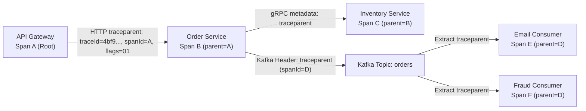
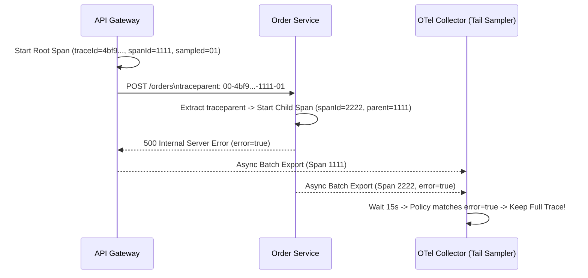
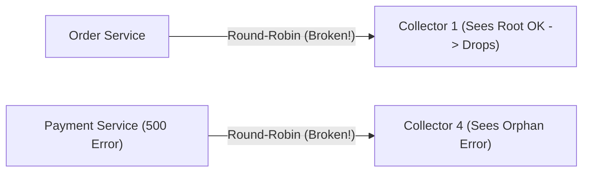

# Distributed Tracing Across Microservices: traceparent, Spans & Kafka

> **Prerequisites:** [Lesson 17: CQRS & Event Sourcing in Microservices](../17-cqrs-event-sourcing-in-microservices/README.md) · [Lesson 07: API Gateway Pattern](../07-api-gateway-pattern/README.md).  
> **Estimated Reading Time:** 24–28 minutes  
> **Target Audience:** Backend and SRE engineers debugging tail latency across HTTP/gRPC/Kafka hops, and candidates asked "how do you trace a request across 20 microservices?"  
> **Free PDF Notes:** [Download SD-L-018.pdf](https://backendroadmap.com/notes/system-design/SD-L-018.pdf)

> [!NOTE]
> **In one line:** **Distributed tracing** reconstructs the causal tree of a single request across process, network, and broker boundaries by propagating a W3C **`traceparent`** header (`trace-id`, `parent-span-id`, `flags`). Each service records **spans** (operation name, start/end timestamps, attributes, parent link) and exports them asynchronously to a collector (OpenTelemetry $\to$ Jaeger/Tempo).

> [!TIP]
> **The Golden Rule:** Use **Head Sampling** (e.g., 1%) at the API Gateway for normal traffic, and **Tail-Based Sampling** at the OpenTelemetry Collector to keep **100% of errors and high-latency ($>p_{99}$) traces**—never drop slow or failing traces just because a random coin flip at the edge said `sampled=0`.

---

## 1. What Distributed Tracing Is, and What It Isn't

When a user clicks "Checkout" and waits 2.4 seconds, logs on 14 different pods only show isolated fragments: `"DB query 12 ms"`, `"Kafka publish 4 ms"`, `"HTTP 500"`. Without a shared `trace_id` and causal `parent_id`, you cannot tell whether the 2.4 seconds was spent in a synchronous lock, a retry loop, or sitting in a Kafka partition waiting for a lagged consumer.

**Distributed Tracing** solves this by assigning a globally unique 128-bit **Trace ID** at the edge and passing a lightweight **Span Context** (`traceparent`) across every HTTP call, gRPC metadata, and Kafka message header.

| Term | Precise Meaning | Example |
| :--- | :--- | :--- |
| **Trace** | Directed Acyclic Graph (DAG) of all spans belonging to one end-to-end request | Full lifecycle of `POST /checkout` |
| **Span** | A single timed unit of work with `span_id`, `parent_span_id`, timestamps, and tags | `InventoryDB.ReserveStock` (18 ms) |
| **W3C `traceparent`** | Standard header `00-<32hex traceId>-<16hex spanId>-<2hex flags>` | `00-4bf92f3577b34da6a3ce929d0e0e4736-00f067aa0ba902b7-01` |
| **Context Propagation** | Injecting/extracting `traceparent` across HTTP headers, gRPC metadata, and Kafka headers | Gateway $\to$ Order $\to$ Kafka $\to$ Email |
| **Span Link** | Non-parent causal reference used for async batching or fan-in | Batch consumer linking 100 producer spans |
| **Head vs Tail Sampling** | Deciding to keep a trace at the edge (head) vs after seeing the whole trace (tail) | Keep 1% baseline + 100% of `status=5xx` |
| **Not** | A replacement for metrics or structured logs | Tracing explains *why* a specific request was slow; metrics show *how often* |

### Why It Matters
1. **Logs and metrics alone cannot pinpoint cross-service tail latency**—only a waterfall trace shows critical-path serialization vs parallel fan-out.
2. **Async messaging (Kafka/SQS) breaks thread-local context**—you must explicitly inject/extract `traceparent` into message headers and handle batching via **Span Links**.
3. **Unbounded tracing bankrupts observability budgets**—at 50,000 RPS, 100% trace retention generates terabytes per day; smart sampling is mandatory.

---

## 2. Anatomy: `traceparent` Across HTTP and Kafka



In synchronous HTTP/gRPC calls, the caller injects `traceparent` into request headers and the callee creates a child span (`parent_span_id = caller_span_id`). Across **Kafka**, the producer injects its `PRODUCER` span context into the Kafka record's `headers` array before sending; each independent consumer (`Email`, `Fraud`) extracts that header and starts a `CONSUMER` child span, preserving the **exact end-to-end trace** even if the consumer runs 30 seconds later!

| Sampling Strategy | Decision Point | Keeps 100% of Errors/Slow Traces? | Memory / Infra Cost |
| :--- | :--- | :--- | :--- |
| **Head-Based (Probabilistic)** | Ingress / API Gateway (`flags=01` for 1%) | **No** (99% of errors are dropped!) | Very low (stateless) |
| **Tail-Based (Collector)** | OpenTelemetry Collector after trace completes | **Yes** (inspects final status & duration) | Higher (buffers spans in RAM for 15–30s) |
| **Hybrid (Debug/Canary)** | `flags=01` forced for canary/VIP/error-header + Tail | **Yes** | Balanced |

> [!WARNING]
> **Never rely on Clock Synchronization across hosts to infer causality.** Distributed servers have clock skew (10–200 ms NTP drift), so a child span on Node B can appear to start *before* its parent span on Node A! Always rely on `parent_span_id` (and `SpanKind` = `CLIENT`/`SERVER`, `PRODUCER`/`CONSUMER`) for causal ordering, never raw wall-clock timestamps.

---

## 3. Mathematical Model: Span Storage, Network Bandwidth & Tail-Sampling Memory

Suppose a system handles $\lambda = 20{,}000\text{ RPS}$, each request generates an average of $S = 12$ spans across microservices, and each serialized span (protobuf/JSON) averages $B = 800\text{ bytes}$.

**1. Unsampled Ingestion Rate ($R_{\text{raw}}$) and Daily Storage:**

$$R_{\text{raw}} = \lambda \cdot S \cdot B$$

With sampling rate $p \in (0, 1]$ (e.g., $p = 0.02$ for 2%):

$$R_{\text{stored}} = p \cdot R_{\text{raw}}, \qquad \text{Daily Storage} = R_{\text{stored}} \times 86{,}400$$

**2. Tail-Sampling Collector Buffer Memory ($M_{\text{buf}}$):**
To make a tail-sampling decision, the OpenTelemetry Collector must hold all spans for active traces in memory for a decision wait window $W_{\text{wait}}$ (typically $15\text{–}30\text{ s}$):

$$M_{\text{buf}} = \lambda \cdot S \cdot B \cdot W_{\text{wait}} \cdot \alpha_{\text{mem}}$$

where $\alpha_{\text{mem}} \approx 2.0$ accounts for Go/collector in-memory struct overhead.

**Worked Numerical Example:**
At $\lambda = 20{,}000\text{ RPS}$, $S = 12$ spans, $B = 800\text{ bytes}$:
- **Unsampled ingestion:** $R_{\text{raw}} = 20{,}000 \times 12 \times 800 = 192{,}000{,}000\text{ B/s} \approx \mathbf{192\text{ MB/s}}$ (**16.6 TB/day!**).
- **At 2% sampling ($p = 0.02$):** $R_{\text{stored}} = 3.84\text{ MB/s} \approx \mathbf{332\text{ GB/day}}$ (50× cheaper).
- **Tail-sampling collector RAM ($W_{\text{wait}} = 15\text{ s}$, $\alpha_{\text{mem}} = 2$):**
  $M_{\text{buf}} = 192\text{ MB/s} \times 15\text{ s} \times 2 = \mathbf{5.76\text{ GB}}$ total across the collector tier. Using **consistent-hash trace-ID routing** (`loadbalancing` exporter) across 6 collector pods requires ~1 GB RAM per pod!

---

## 4. Metrics & Percentiles

| Metric | Meaning | Alert when |
| :--- | :--- | :--- |
| **Trace Completeness / Orphan Span Ratio** | % of spans whose `parent_span_id` is missing | $> 1\%$ (broken header propagation or Kafka header strip) |
| **Collector Dropped Spans** | Spans dropped due to full queue / OOM | **Any $> 0$** (scale collectors or lower head rate) |
| **Exporter Latency ($p_{99}$)** | Time for app SDK batch exporter to flush to Collector | $> 500\text{ ms}$ (risk of app-side ring buffer drop) |
| **Tail-Sampler Decision Wait vs Trace Duration** | Traces still open when collector flushes decision | $> 2\%$ split traces (increase `decision_wait`) |
| **Span Attribute Cardinality** | Unique tag values (e.g., `user_id` indexed as metric tag) | Unbounded growth (keep high-cardinality IDs in span attributes only, never Prometheus labels) |

### Worked Example (Finding a Hidden Kafka Consumer Bottleneck)
Users report 4-second delays on order confirmation emails.
- **Metrics** show `OrderService` $p_{99} = 35\text{ ms}$ and `EmailService` processing $p_{99} = 45\text{ ms}$. Both look healthy!
- **Distributed Trace** reveals:
  - `OrderService.CreateOrder` (`0–35 ms`, `PRODUCER` span `D` at `32 ms`).
  - `EmailService.Consume` (`CONSUMER` span `E`, `parent=D`) starts at **`3,890 ms`** and finishes at `3,935 ms`!
- The **3,855 ms gap** between `PRODUCER` end and `CONSUMER` start proves the delay is **Kafka consumer lag / partition starvation**, not slow code in either service.

---

## 5. Compounding & Failure Modes

| Failure Mode | Mechanism | Impact at Scale |
| :--- | :--- | :--- |
| **Broken `traceparent` on one hop** | Custom HTTP client or proxy strips unknown headers | Trace splits into disconnected islands; root cause invisible |
| **100% Head Sampling at peak** | SDK exports every span synchronously or saturates network | App memory spikes; $192\text{ MB/s}$ overwhelms Tempo/Jaeger |
| **Batch Kafka consumer without Span Links** | Consumer processes 500 messages in one batch under a single parent | 499 producer traces lose their consumer link (or create a 500-parent mess) |
| **No `trace_id` load-balancing before tail sampler** | Spans of the same trace land on different collector pods | Tail sampler sees partial traces and drops errors |
| **Blocking span export** | App waits on collector network I/O on request thread | Observability outage causes **production API outage** |

---

## 6. Numbers Every Engineer Must Know

| Item | Typical | Implication |
| :--- | :---: | :--- |
| W3C `traceparent` header size | 55 bytes | Negligible overhead on HTTP/gRPC/Kafka headers |
| OTel SDK CPU/latency overhead | $< 1\text{–}2\%$ CPU, $< 0.5\text{ ms}$ | Safe for production when batched asynchronously |
| Tail-sampling `decision_wait` | 10–30 seconds | Must exceed normal synchronous trace duration |
| Max spans per trace (healthy) | 5–100 spans | $> 1{,}000$ spans usually indicates an N+1 query or retry loop |
| Collector ring-buffer flush interval | 1–5 seconds | Always drop spans rather than blocking request threads |

---

## 7. Protocol Deep Dive: W3C `traceparent` & Batch Span Links



**Anatomy of `traceparent`:**
`00-4bf92f3577b34da6a3ce929d0e0e4736-00f067aa0ba902b7-01`
- `00`: Version (2 hex chars).
- `4bf9...4736`: **Trace ID** (16 bytes / 32 hex chars, globally unique).
- `00f0...02b7`: **Parent Span ID** (8 bytes / 16 hex chars, caller's active span).
- `01`: **Trace Flags** (`01` = sampled, `00` = not sampled).

| Question | Answer |
| :--- | :--- |
| **How do you trace a Kafka batch consumer that processes 100 messages at once?** | A span can only have one `parent_span_id`, so use **Span Links**: create one `BatchProcess` span and attach 100 `Link` references pointing to each Kafka message's extracted `(trace_id, span_id)`. |
| **How do you correlate logs with traces?** | Inject `trace_id` and `span_id` into your structured JSON logger (`zap`, `pino`, `structlog`, `Serilog`) via the active context so clicking a span opens its exact logs. |
| **What is `tracestate`?** | A companion W3C header carrying vendor-specific key-value pairs (e.g., `rojo=00f067aa0ba902b7,congo=t61rcWkgMzE`) alongside `traceparent`. |

**When NOT to use heavy tracing:**
- Tight inner-loop CPU functions (e.g., creating a span inside a `for` loop of 10,000 array items)—creates massive overhead and unreadable waterfalls. Trace **network/DB/queue boundaries**, not every helper function.

---

## 8. Hierarchical Budgets & Design Rules

| Slice | Rule | Control |
| :--- | :--- | :--- |
| **Propagation** | Use W3C `traceparent` everywhere (HTTP, gRPC, Kafka) | Standardize on OpenTelemetry SDK propagators |
| **Sampling** | Tail-sample 100% errors & slow traces ($> p_{99}$), 1–5% healthy | Consistent-hash `trace_id` routing to OTel Collectors |
| **Async safety** | Never block request threads on span export | Bounded async ring buffer (`BatchSpanProcessor`, drop-on-full) |
| **Log correlation** | Every structured log line includes `trace_id` & `span_id` | Logging middleware reads active OTel span |
| **Granularity** | Instrument boundaries (RPC, SQL, Redis, Broker), not loops | Max ~50–100 spans per normal request |
| **PII hygiene** | Scrub secrets/tokens from span attributes | Collector `attributes` / `redaction` processor |

---

## 9. Top Mitigations

1. **Adopt W3C `traceparent` + OpenTelemetry** instead of proprietary vendor headers (`X-B3-*`, `uber-trace-id`).
2. **Route spans by `trace_id` hash** (OTel `loadbalancing` exporter) before tail-sampling collectors so all spans of a trace hit the same collector.
3. **Inject `traceparent` into Kafka/SQS message headers** on produce, and extract (or attach as **Span Links** for batches) on consume.
4. **Always use non-blocking `BatchSpanProcessor`** with bounded queue size so collector slowness never stalls production traffic.
5. **Correlate logs and traces** by automatically stamping `trace_id` on every JSON log entry.
6. **Add `tracestate` / baggage sparingly**—never stuff large user objects into `baggage` headers because they travel over every downstream network hop.
7. **Scrub PII and auth headers** at the collector edge before writing traces to storage.

---

## 10. Production Reference: Tail-Sampling Split-Brain & OOM Outage

**Incident Summary (SEV-1):** A SaaS platform deployed 8 OpenTelemetry Collector pods behind a round-robin Kubernetes Service (`ClusterIP`) and enabled tail-based sampling (`keep 100% errors, 2% baseline`). During a minor checkout bug, engineers noticed **zero error traces** appeared in Grafana Tempo, and collector pods began OOM-crashing every 10 minutes.

**Root Cause:**
1. Round-robin load balancing sent Span 1 (from Gateway) to Collector Pod 1, and Span 2 (the `500 Error` from PaymentService) to Collector Pod 4. Pod 1 saw a `200 OK` partial trace and dropped it; Pod 4 saw an orphan error span without root context.
2. During a traffic spike, `decision_wait: 60s` buffered 60 seconds of unsampled spans in RAM, exceeding the 2 GB pod memory limit.



**The Fix:**
1. Added a stateless **Gateway Collector tier** running the `loadbalancing` exporter configured with `routing_key: "traceID"`, ensuring all spans with the same `trace_id` land on the same tail-sampling pod.
2. Reduced `decision_wait` from `60s` to `15s`, added `memory_limiter` processor (`80%` soft limit), and increased collector RAM from 2 GB to 4 GB.

---

## 11. Multi-Language Production Code Tabs

Zero-dependency **W3C `traceparent` Parser, Generator & Kafka Header Propagator** in all 4 languages (showing the exact wire mechanics OpenTelemetry uses under the hood).

````carousel
```go
// Go: W3C traceparent parsing, child span creation, and Kafka header injection.
package tracing

import (
	"crypto/rand"
	"encoding/hex"
	"fmt"
	"strings"
)

type SpanContext struct {
	TraceID string // 32 hex chars
	SpanID  string // 16 hex chars
	Sampled bool
}

func ParseTraceparent(header string) (SpanContext, bool) {
	parts := strings.Split(strings.TrimSpace(header), "-")
	if len(parts) != 4 || parts[0] != "00" || len(parts[1]) != 32 || len(parts[2]) != 16 {
		return SpanContext{}, false
	}
	return SpanContext{
		TraceID: parts[1],
		SpanID:  parts[2],
		Sampled: parts[3] == "01",
	}, true
}

func (sc SpanContext) Child() SpanContext {
	b := make([]byte, 8)
	_, _ = rand.Read(b)
	return SpanContext{TraceID: sc.TraceID, SpanID: hex.EncodeToString(b), Sampled: sc.Sampled}
}

func (sc SpanContext) Format() string {
	flag := "00"
	if sc.Sampled {
		flag = "01"
	}
	return fmt.Sprintf("00-%s-%s-%s", sc.TraceID, sc.SpanID, flag)
}
```
<!-- slide -->
```typescript
// TypeScript: W3C traceparent parser, child context, and Kafka header carrier.
import { randomBytes } from "crypto";

export interface SpanContext {
  traceId: string;
  spanId: string;
  sampled: boolean;
}

export function parseTraceparent(header?: string): SpanContext | null {
  if (!header) return null;
  const parts = header.trim().split("-");
  if (parts.length !== 4 || parts[0] !== "00" || parts[1].length !== 32 || parts[2].length !== 16) {
    return null;
  }
  return { traceId: parts[1], spanId: parts[2], sampled: parts[3] === "01" };
}

export function childContext(parent: SpanContext): SpanContext {
  return {
    traceId: parent.traceId,
    spanId: randomBytes(8).toString("hex"),
    sampled: parent.sampled,
  };
}

export function injectKafkaHeaders(ctx: SpanContext, headers: Record<string, string>): void {
  headers["traceparent"] = `00-${ctx.traceId}-${ctx.spanId}-${ctx.sampled ? "01" : "00"}`;
}
```
<!-- slide -->
```python
# Python: W3C traceparent parser, child span generator, and Kafka header propagator.
from dataclasses import dataclass
import os
from typing import Dict, Optional


@dataclass(frozen=True)
class SpanContext:
    trace_id: str
    span_id: str
    sampled: bool = True

    @classmethod
    def parse(cls, header: str) -> Optional["SpanContext"]:
        parts = header.strip().split("-")
        if len(parts) != 4 or parts[0] != "00" or len(parts[1]) != 32 or len(parts[2]) != 16:
            return None
        return cls(trace_id=parts[1], span_id=parts[2], sampled=(parts[3] == "01"))

    def child(self) -> "SpanContext":
        return SpanContext(trace_id=self.trace_id, span_id=os.urandom(8).hex(), sampled=self.sampled)

    def to_header(self) -> str:
        return f"00-{self.trace_id}-{self.span_id}-{'01' if self.sampled else '00'}"

    def inject_kafka(self, headers: Dict[str, bytes]) -> None:
        headers["traceparent"] = self.to_header().encode("utf-8")
```
<!-- slide -->
```csharp
// C#: W3C traceparent parsing and child span context (mirrors System.Diagnostics.Activity).
using System.Security.Cryptography;

public readonly record struct SpanContext(string TraceId, string SpanId, bool Sampled)
{
    public static bool TryParse(string? header, out SpanContext ctx)
    {
        ctx = default;
        if (string.IsNullOrWhiteSpace(header)) return false;
        var parts = header.Trim().Split('-');
        if (parts.Length != 4 || parts[0] != "00" || parts[1].Length != 32 || parts[2].Length != 16)
            return false;

        ctx = new SpanContext(parts[1], parts[2], parts[3] == "01");
        return true;
    }

    public SpanContext CreateChild()
    {
        var newSpanId = Convert.ToHexString(RandomNumberGenerator.GetBytes(8)).ToLowerInvariant();
        return this with { SpanId = newSpanId };
    }

    public string ToHeader() => $"00-{TraceId}-{SpanId}-{(Sampled ? "01" : "00")}";
}
```
````

---

## 12. Hands-On CLI Verification Workflows

Verify W3C `traceparent` propagation, Kafka header inspection, and tail-sampling memory sizing:

```bash
# 1. Send a traced HTTP request with W3C traceparent and inspect response/collector
curl -i -H "traceparent: 00-4bf92f3577b34da6a3ce929d0e0e4736-00f067aa0ba902b7-01" \
  http://localhost:8080/api/orders

# 2. Inspect Kafka message headers (including traceparent) using kcat
kcat -b localhost:9092 -t order-events -C -c 5 -f 'Key=%k Headers=%h Payload=%s\n'

# 3. Calculate trace storage and tail-sampling collector memory
python -c "
rps, spans, bytes_per_span, sample_rate, wait_s = 20000, 12, 800, 0.02, 15
raw_mb_s = rps * spans * bytes_per_span / 1e6
daily_gb = raw_mb_s * sample_rate * 86400 / 1000
buf_gb = raw_mb_s * wait_s * 2 / 1000
print(f'Raw: {raw_mb_s:.1f} MB/s | Stored ({sample_rate*100:.0f}%): {daily_gb:.1f} GB/day | Tail-Sample RAM: {buf_gb:.2f} GB')
"
```

---

## 13. Common Mistakes to Avoid

1. **Relying solely on 1% Head Sampling**, which drops 99% of your production errors and slow requests.
2. **Using round-robin load balancing in front of tail-sampling collectors**, splitting traces across pods so errors are lost.
3. **Forgetting to propagate `traceparent` into Kafka/SQS message headers**, creating blind spots after async boundaries.
4. **Trusting wall-clock timestamps across hosts** instead of `parent_span_id` for causal ordering.
5. **Creating spans inside tight in-memory loops**, bloating trace size and CPU overhead.
6. **Using synchronous/blocking span exporters**, turning an observability collector outage into an API outage.
7. **Putting `user_id` or `order_id` into Prometheus metric labels** derived from spans (cardinality explosion).

---

## 14. Key Terms Glossary

| Key Term | Definition |
| :--- | :--- |
| **Trace** | End-to-end causal tree/DAG of spans for a single distributed request. |
| **Span** | A named, timed operation with `span_id`, `parent_span_id`, and key-value attributes. |
| **W3C `traceparent`** | Standard HTTP/message header carrying `version-traceId-spanId-flags`. |
| **Context Propagation** | Passing trace context across process, RPC, and message-broker boundaries. |
| **Span Link** | Non-parent causal reference connecting a batch consumer span to multiple producer spans. |
| **Head Sampling** | Sampling decision made at request ingress before the outcome is known. |
| **Tail Sampling** | Sampling decision made in the collector after buffering the full trace (keeps 100% errors/slow). |
| **OpenTelemetry (OTel)** | Vendor-neutral standard for tracing, metrics, and log instrumentation and collection. |
| **Clock Skew** | Time drift between physical/virtual hosts causing child timestamps to look earlier than parents. |
| **Orphan Span** | A span whose `parent_span_id` is missing due to dropped spans or broken propagation. |

---

## 15. System Design Interview Questions & Answers

### Basic Conceptual Questions

<details>
<summary><strong>Q1: What is the difference between a Trace and a Span? [BASIC]</strong></summary>

**Answer:**
A **Span** represents a single timed operation (e.g., an HTTP call or SQL query) with a `span_id`, `parent_span_id`, start/end time, and attributes. A **Trace** is the entire tree/DAG of all spans sharing the same `trace_id` for one end-to-end request.
</details>

<details>
<summary><strong>Q2: What is inside the W3C `traceparent` header? [BASIC]</strong></summary>

**Answer:**
Four hyphen-separated fields: `version` (`00`), 128-bit `trace-id` (32 hex chars), 64-bit `parent-id` / `span-id` (16 hex chars), and 8-bit `trace-flags` (`01` for sampled, `00` for unsampled).
</details>

<details>
<summary><strong>Q3: How do Metrics, Logs, and Traces complement each other? [BASIC]</strong></summary>

**Answer:**
**Metrics** tell you *what* is happening in aggregate (e.g., $p_{99}$ latency jumped to 2s). **Traces** show *where* in the call graph that 2s was spent for a specific slow request. **Logs** (correlated by `trace_id`) tell you *why* (exact stack trace or business state).
</details>

<details>
<summary><strong>Q4: Why can't you just use `X-Request-ID` instead of distributed tracing? [BASIC]</strong></summary>

**Answer:**
`X-Request-ID` tells you which logs belong to a request, but it does not capture **parent-child causality**, **parallel vs sequential execution**, or **exact per-hop durations** in a waterfall diagram.
</details>

### Scenario-Based Architecture Questions

<details>
<summary><strong>Q5: How do you propagate traces across Kafka when a producer sends 1 event and 3 consumers read it? [SCENARIO]</strong></summary>

**Answer:**
The producer creates a `PRODUCER` span and injects `traceparent` into the Kafka message `headers`. Each of the 3 consumers extracts `traceparent` from the header and starts its own `CONSUMER` child span sharing the same `trace_id` and referencing the producer's `span_id` as `parent_span_id`.
</details>

<details>
<summary><strong>Q6: Your service processes Kafka messages in batches of 200. How do you model the trace? [SCENARIO]</strong></summary>

**Answer:**
Since a span only has one `parent_span_id`, create a single `BatchProcess` span and attach **Span Links** to each of the 200 incoming `SpanContext`s extracted from the batch's Kafka headers. That preserves causal traceability to all 200 producers without creating 200 duplicate consumer spans.
</details>

<details>
<summary><strong>Q7: You have 30,000 RPS and can only afford to store 2% of traces, but you MUST never miss a 500 error. What do you design? [SCENARIO]</strong></summary>

**Answer:**
Deploy **Tail-Based Sampling** in an OpenTelemetry Collector tier:
1. Ingress/services emit 100% of spans asynchronously to a stateless **Gateway Collector**.
2. The Gateway routes spans using consistent hashing on **`trace_id`** (`loadbalancing` exporter) to a **Tail-Sampler Collector** pool.
3. Each Tail-Sampler buffers traces for `15s` and keeps **100% of traces with `error=true` or `duration > 1s`**, plus **2% probabilistic** of remaining healthy traces.
</details>

<details>
<summary><strong>Q8: A trace shows a child span starting 40 ms *before* its parent span. Is tracing broken? [SCENARIO]</strong></summary>

**Answer:**
No—that is **NTP clock skew** between the caller's host and the callee's host. Tracing UIs (Jaeger/Tempo) use `parent_span_id` for the tree hierarchy and may show a warning or adjust visual alignment, rather than trusting cross-host wall clocks.
</details>

### Advanced & Tricky Interview Questions

<details>
<summary><strong>Q9: Why does Tail-Based Sampling fail behind a standard Kubernetes ClusterIP Service? [TRICKY]</strong></summary>

**Answer:**
Standard `ClusterIP` load-balances TCP/HTTP connections round-robin. Different spans of the same `trace_id` from different microservices will land on *different* collector pods, so no single pod sees the complete trace to evaluate `error` or `total_duration`. You must put a `trace_id`-aware `loadbalancing` exporter in front of the tail-sampling tier.
</details>

<details>
<summary><strong>Q10: A third-party payment webhook calls you back 10 minutes later. How do you link it to the original trace? [TRICKY]</strong></summary>

**Answer:**
Third-party webhooks won't preserve `traceparent` headers. Persist the original `traceparent` string in your database alongside the `payment_intent_id` (or pass it in `metadata`). When the webhook arrives, extract the stored `SpanContext` and attach it as a **Span Link** (or parent) to the webhook handler's new trace.
</details>

<details>
<summary><strong>Q11: What happens if an async exporter's collector goes down for 5 minutes? Could it crash your microservices? [TRICKY]</strong></summary>

**Answer:**
Only if misconfigured! A properly configured OTel `BatchSpanProcessor` uses a **bounded in-memory queue** (e.g., `max_queue_size = 2048`) and **drops new spans** when full rather than blocking request threads or growing memory unboundedly. Observability must always degrade gracefully.
</details>

<details>
<summary><strong>Q12: Why should you never copy `trace_id` or `user_id` into Prometheus metric labels? [TRICKY]</strong></summary>

**Answer:**
Prometheus stores a separate time series for every unique label-value combination. High-cardinality values like `trace_id` or `user_id` create millions of time series, causing immediate OOM crashes in Prometheus. Keep high-cardinality IDs in **spans and logs**, and use **Exemplars** (linking a Prometheus histogram bucket to a sample `trace_id`) to bridge metrics to traces.
</details>

---

## 16. One-Page Master Cheat Sheet

```
+---------------------------------------------------------------------------------------------------------+
|                    DISTRIBUTED TRACING — MASTER CHEAT SHEET                                             |
+---------------------------------------------------------------------------------------------------------+
| 1. W3C TRACEPARENT: `00-<32hex traceId>-<16hex spanId>-<2hex flags>`.                                   |
|    Propagate across HTTP headers, gRPC metadata, and Kafka message headers.                             |
+---------------------------------------------------------------------------------------------------------+
| 2. ASYNC & BATCHING: Kafka producer injects `traceparent` into record headers; consumer extracts it.    |
|    For batch consumers (N messages), use **Span Links** instead of a single parent.                     |
+---------------------------------------------------------------------------------------------------------+
| 3. SAMPLING: Head sampling (1% at edge) drops 99% of errors. Use **Tail-Based Sampling** (with          |
|    consistent-hash `trace_id` routing) to keep 100% of errors/slow traces + 1-5% baseline.              |
+---------------------------------------------------------------------------------------------------------+
| 4. SAFETY: Never block request threads on span export (bounded queue, drop-on-full).                    |
|    Never trust cross-host wall clocks (NTP skew); rely on `parent_span_id`.                             |
+---------------------------------------------------------------------------------------------------------+
| 5. CORRELATION: Stamp `trace_id` + `span_id` on every structured JSON log; use Metrics Exemplars.       |
+---------------------------------------------------------------------------------------------------------+
```

---

## Further Reading & Sources

- W3C Specification, [Trace Context (`traceparent` & `tracestate`)](https://www.w3.org/TR/trace-context/).
- OpenTelemetry Documentation, [Context Propagation & Tail Sampling](https://opentelemetry.io/docs/concepts/signals/traces/).
- Google Research, *Dapper, a Large-Scale Distributed Systems Tracing Infrastructure*.
- Cindy Sridharan, *Distributed Systems Observability* (Logs, Metrics, Traces).

---

## Free PDF Notes

[SD-L-018.pdf](https://backendroadmap.com/notes/system-design/SD-L-018.pdf)

---

## Next

Continue with [Lesson 19: Microservice Anti-Patterns: Signs You Built a Distributed Monolith](../19-microservice-anti-patterns/README.md).
