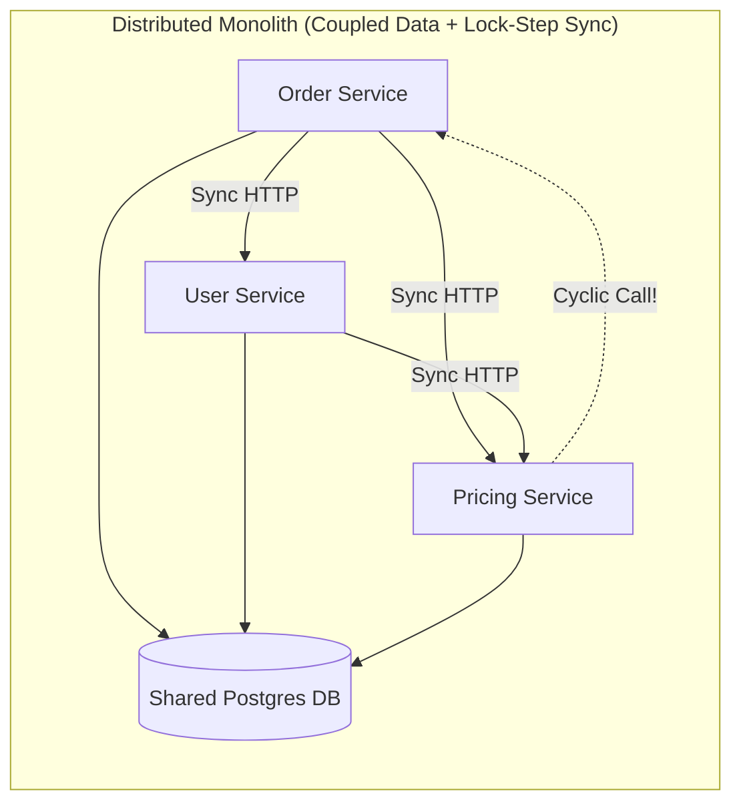
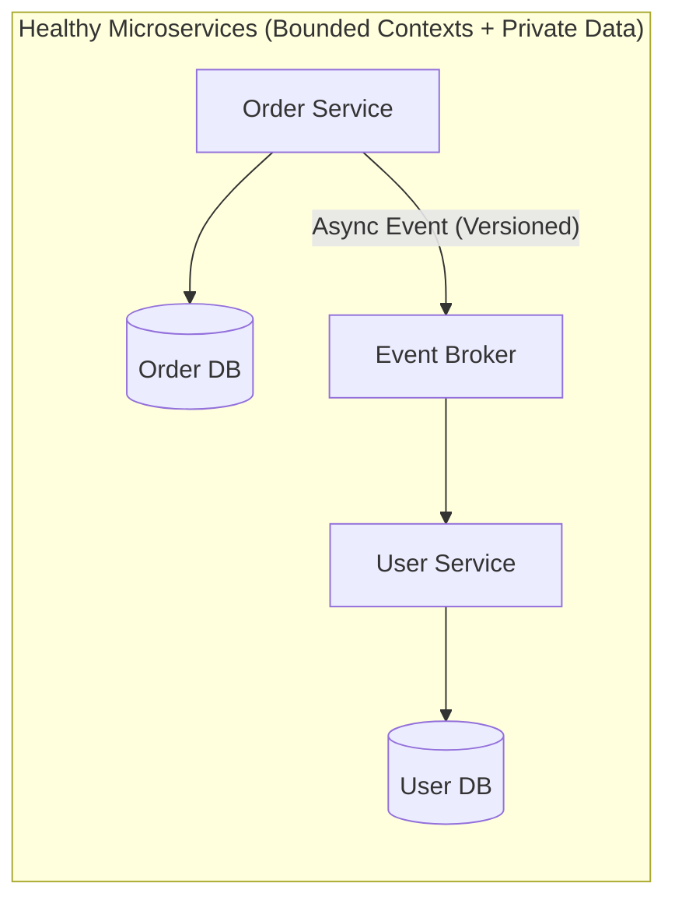
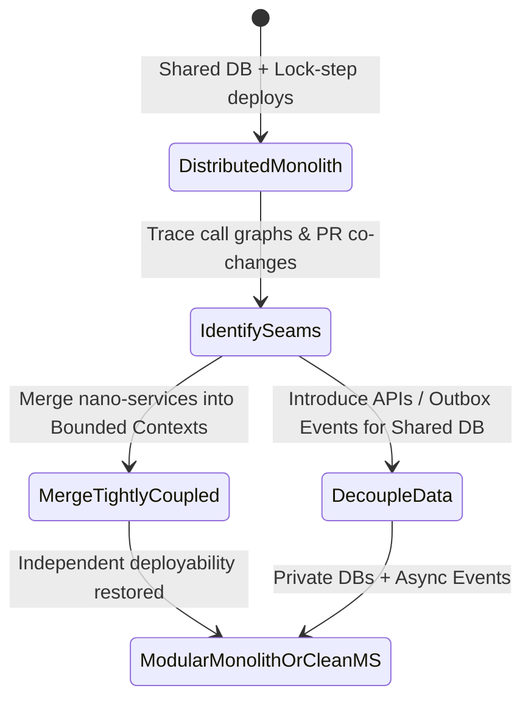
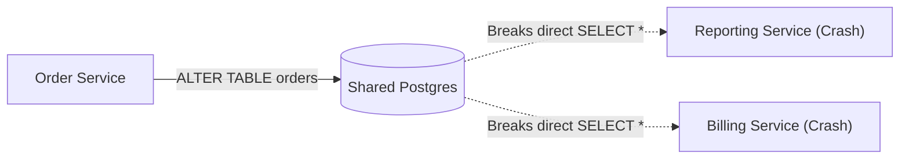

# Microservice Anti-Patterns: Signs You Built a Distributed Monolith

> **Prerequisites:** [Lesson 18: Distributed Tracing Across Microservices](../18-distributed-tracing-across-microservices/README.md) · [Lesson 01: Monolith vs Microservices](../01-monolith-vs-microservices/README.md).  
> **Estimated Reading Time:** 24–28 minutes  
> **Target Audience:** Engineering leads, architects, and candidates asked "what is a distributed monolith, and how do you avoid or fix one?"  
> **Free PDF Notes:** [Download SD-L-019.pdf](https://backendroadmap.com/notes/system-design/SD-L-019.pdf)

> [!NOTE]
> **In one line:** A **distributed monolith** happens when you split code into separately deployed processes without decoupling their **data, release cycles, or failure domains**—giving you all the latency, operational cost, and partial-failure complexity of microservices with none of the independent deployability or fault isolation.

> [!TIP]
> **The Golden Rule:** If Service A and Service B **must be deployed together** or **share a database schema**, they are not microservices—they are a distributed monolith. Either decouple them via explicit contracts and private data stores, or **merge them back into a Modular Monolith**.

---

## 1. What a Distributed Monolith Is, and What It Isn't

A team splits a 100k-line monolith into 18 microservices to "move faster." Six months later, shipping a simple checkout feature requires coordinated PRs across 6 repositories, a shared staging environment where everyone blocks everyone else, and a single `users` database table queried by 9 services. A deploy to `PricingService` crashes `OrderService` because of a shared internal library DTO change. They didn't build microservices—they built a **distributed monolith**.

| Anti-Pattern | Precise Meaning | Concrete Symptom |
| :--- | :--- | :--- |
| **Distributed Monolith** | Physically separated services that remain tightly coupled logically, temporally, or via data | Coordinated lock-step releases across repos |
| **Shared Database** | Multiple services reading/writing the same tables | `OrderService` joins `users` table directly; schema migration breaks 5 services |
| **Chatty Sync Chains** | Deep synchronous HTTP/gRPC call graphs ($A \to B \to C \to D \to E$) | $15\text{ ms}$ local call becomes $450\text{ ms}$ $p_{99}$ network chain |
| **Shared Domain Library** | Common `core-models.jar` / `common-types` forcing lock-step upgrades | Changing one field requires rebuilding and redeploying all 12 services |
| **Entity/CRUD Services** | Splitting by technical noun (`UserService`, `AddressService`) instead of Bounded Context | Every business action touches 5+ services |
| **Cyclic Dependencies** | $A$ calls $B$, $B$ calls $C$, $C$ calls $A$ | Impossible to boot, test, or reason about in isolation |
| **Not** | A Modular Monolith | A Modular Monolith has *high* cohesion and *low* coupling in one deployable; a Distributed Monolith has *high* coupling across *many* deployables |

### Why It Matters
1. **You pay the distributed-systems tax for zero benefit**—network serialization, retries, tracing, Kubernetes YAML, and partial failures, while still deploying like a monolith.
2. **Tail latency and failure blast radius explode**—deep synchronous chains multiply failure probabilities and tail latency.
3. **Interviewers love this topic** because recognizing *when not to split* (or how to merge back into a modular monolith) separates senior architects from resume-driven developers.

---

## 2. Anatomy: True Microservices vs Distributed Monolith





| Dimension | Healthy Microservices | Distributed Monolith | Modular Monolith |
| :--- | :--- | :--- | :--- |
| **Deployment** | Independent, zero coordination | Lock-step release trains | Single atomic deploy |
| **Data ownership** | Private DB per service | Shared tables / cross-schema joins | Logical module schemas |
| **Call latency** | Shallow (1–2 hops) + async events | Deep sync chains (5–10 hops) | In-process ($\mu\text{s}$) |
| **Blast radius** | Isolated via bulkheads/async | Cascading outages | Process-wide (mitigated by tests) |

> [!WARNING]
> **The "Nano-service" Trap:** Splitting a domain into 40 tiny services for a team of 8 engineers guarantees a distributed monolith. A healthy rule of thumb (Conway's Law / Team Topologies) is **1–2 services per "two-pizza" team (5–8 engineers)**—never more services than engineers!

---

## 3. Mathematical Model: Availability Collapse & Tail-Latency Amplification

When a distributed monolith replaces in-process function calls with a synchronous chain of $n$ microservices:

**1. Availability Collapse:**
If each service $i$ has availability $a_i$ (e.g., $99.9\% = 0.999$) and all $n$ are required synchronously:

$$A_{\text{chain}} = \prod_{i=1}^{n} a_i = a^n$$

**2. Tail-Latency Amplification ($p_{99}$):**
If a request makes $k$ **parallel** fan-out calls to services each having independent latency CDF $F(t)$ (where $p_{99}$ is $F(t_{99}) = 0.99$), the probability that **all $k$** finish within $t$ is $F(t)^k$:

$$P(\max_{1 \le i \le k} T_i \le t) = F(t)^k \implies \text{At } t_{99},\; 0.99^k$$

With $k = 10$ parallel calls, the chance of at least one call hitting its $>p_{99}$ tail is $1 - 0.99^{10} = \mathbf{9.56\%}$—meaning your **$p_{90}$** is now as slow as a single service's **$p_{99}$**!

**Worked Numerical Example:**
Suppose a single service has $99.9\%$ availability ($43.8\text{ min}$ downtime/month) and $p_{50} = 10\text{ ms}$, $p_{99} = 100\text{ ms}$.
- **Sequential chain of $n = 8$ services:**
  - Availability: $0.999^8 = \mathbf{99.20\%}$ (**5.8 hours** of downtime/month—8× worse!).
  - Latency: $8 \times 10\text{ ms} = 80\text{ ms}$ typical, and if just one hits $p_{99}$, $>170\text{ ms}$.
- **Parallel fan-out of $k = 15$ chatty calls:**
  - Probability that **at least one** call exceeds $100\text{ ms}$: $1 - 0.99^{15} = \mathbf{14.0\%}$! Nearly 1 in 7 users experiences tail latency.

---

## 4. Metrics & Percentiles

| Metric | Meaning | Alert when (Distributed Monolith Smell) |
| :--- | :--- | :--- |
| **Coupled Deploy Ratio** | % of PRs requiring changes in $\ge 2$ service repos | $> 20\%$ (wrong service boundaries) |
| **Sync Call Depth ($p_{95}$)** | Max synchronous hops per ingress request | $> 3\text{–}4$ hops |
| **Shared DB Access Count** | Services connecting to the same DB/schema | $> 1$ service per database |
| **Chain Availability vs SLA** | Product of synchronous dependency SLAs | Below customer SLA (e.g., $< 99.9\%$) |
| **Staging Environment Wait Time** | Hours blocked waiting for "all services green" | $> 2\text{ hours}$ (sign of lock-step coupling) |

### Worked Example (Diagnosing a Distributed Monolith with Tracing)
A team complains that `GET /product/123` takes **420 ms** at $p_{99}$ and fails whenever `ReviewsService` or `RecommendationsService` restarts.
- **Trace inspection** shows 14 synchronous HTTP hops: `Gateway` $\to$ `Product` $\to$ `Pricing` $\to$ `Tax` $\to$ `Currency` $\to$ `User` $\to$ `Inventory`...
- **Fix:**
  1. `Pricing`, `Tax`, and `Currency` always change together and share the same team $\to$ **merge them into one `PricingService`** (eliminating 3 network hops).
  2. `Reviews` and `Recommendations` are non-critical $\to$ add **circuit breakers + cached fallbacks** so `GET /product/123` never fails when they are down.
  3. Result: $p_{99}$ drops from **420 ms to 55 ms**, and availability rises from **99.1% to 99.95%**.

---

## 5. Compounding & Failure Modes

| Anti-Pattern | How It Compounds at Scale |
| :--- | :--- |
| **Shared Database** | One team adds an unindexed `WHERE` clause or `ALTER TABLE` lock $\to$ all 8 services stall on DB connections simultaneously |
| **Shared "Common" Library** | A bug fix in `common-auth-v2` forces 15 teams to bump versions and redeploy in lock-step |
| **Chatty N+1 RPCs** | Fetching 50 orders triggers 50 `GET /user/{id}` calls $\to$ 100 RPS ingress becomes 5,000 RPS internal traffic |
| **Synchronous Retry Amplification** | 4-hop chain with 3 retries per hop: $3^4 = \mathbf{81\times}$ load amplification on the leaf service during a blip! |

---

## 6. Numbers Every Engineer Must Know

| Item | Typical | Implication |
| :--- | :---: | :--- |
| In-process call vs HTTP/gRPC hop | $0.001\text{ ms}$ vs $2\text{–}10\text{ ms}$ | Network hops are $1{,}000\text{–}10{,}000\times$ slower |
| Healthy sync call depth | $\le 2\text{–}3$ hops | Deeper chains collapse availability and tail latency |
| Services per team ratio | 1–2 services per 6–8 engineers | $> 3$ services per engineer = operational paralysis |
| Retry amplification ($r$ retries, $d$ hops) | $(1 + r)^d$ | Cap retries at the **edge** or use retry budgets ($<10\%$) |
| Shared DB schema coupling | 0 cross-service joins allowed | Enforce separate DB users/schemas per service |

---

## 7. Protocol Deep Dive: How to Untangle a Distributed Monolith



| Question | Answer |
| :--- | :--- |
| **How do you split a Shared Database safely?** | (1) Create a **Database View** or **Anti-Corruption Layer** for legacy readers; (2) Route all writes through the owning service's API; (3) Replicate needed read data via **Outbox/CDC events** (CQRS); (4) Revoke direct DB credentials from other services. |
| **When should you merge microservices back together?** | When two services are owned by the same team, deploy together $>30\%$ of the time, or exchange chatty synchronous calls for every single user action. |
| **How do you break a cyclic dependency ($A \to B \to A$)?** | Extract the shared concept into a third service, or replace one direction with an **asynchronous domain event** (e.g., $A$ emits `OrderPlaced`; $B$ reacts without calling $A$ back synchronously). |

**When NOT to use Microservices at all:**
- Early-stage startups (<15 engineers) searching for product-market fit—boundaries will change every month; start with a **Modular Monolith**.

---

## 8. Hierarchical Budgets & Design Rules

| Slice | Rule | Control |
| :--- | :--- | :--- |
| **Data Ownership** | 1 database/schema per service; zero cross-service SQL joins | Separate DB credentials per service |
| **API Contracts** | Versioned protobuf/OpenAPI; **never** share internal domain libraries | CI breaking-change checks (`buf breaking`) |
| **Call Depth** | Max 3 synchronous hops; use async events or CQRS for fan-out | Distributed tracing alerts on depth $> 3$ |
| **Resilience** | Every sync call has timeout, circuit breaker, and fallback | Retry budgets ($\le 10\%$ extra load) |
| **Team Alignment** | Conway's Law: 1 bounded context = 1 owning team | Track cross-repo PR coupling metric |
| **Batching** | Never N+1 RPC inside loops | Provide bulk endpoints (`POST /users:batchGet`) |

---

## 9. Top Mitigations

1. **Enforce Database-per-Service** at the credential level so no service can `SELECT` from another service's tables.
2. **Merge chatty nano-services** back into coarser **Bounded Contexts** (or a Modular Monolith).
3. **Replace deep synchronous chains with async events + CQRS** for non-immediate work.
4. **Ban shared domain model libraries**—share only wire-level schemas (Protobuf/OpenAPI) with backward compatibility.
5. **Add `batchGet` endpoints** to eliminate N+1 RPC loops across services.
6. **Put timeouts, circuit breakers, and retry budgets** on every synchronous client so leaf blips don't amplify $81\times$.
7. **Eliminate shared staging bottlenecks** using **contract testing (Pact)** and mocked/ephemeral environments.

---

## 10. Production Reference: The 14-Service "Microservice" Rewrite That Halted Shipping

**Incident / Case Study:** A 20-person engineering org rewrote a working Rails monolith into 14 Node.js microservices backed by a single shared PostgreSQL cluster. Within 4 months:
- Feature velocity dropped by **70%** because every feature touched 4–5 repos and required a manual "deployment order" spreadsheet.
- A `NOT NULL` column added to `orders` broke `ReportingService` and `BillingService` in production because they queried `orders` directly.



**The Fix:**
1. Consolidated the 14 services down to **3 coarse-grained services** (`Core Commerce`, `Billing`, `Analytics`) aligned to their 3 engineering squads.
2. Moved `Billing` and `Analytics` off direct SQL reads onto **Outbox-published Kafka events** (`OrderCompleted`).
3. Release frequency recovered from 1 coordinated deploy/week to 15+ independent deploys/day.

---

## 11. Multi-Language Production Code Tabs

Detecting **N+1 RPC Anti-Patterns & Retry Amplification** and replacing them with **Bulk/Batch Fetching + Circuit-Breaker Timeouts** in all 4 languages.

````carousel
```go
// Go: Replace N+1 RPC loop with bounded-timeout bulk fetch + graceful fallback.
package catalog

import (
	"context"
	"time"
)

type UserSummary struct{ ID, Name string }

type UserClient interface {
	BatchGet(ctx context.Context, ids []string) (map[string]UserSummary, error)
}

// Anti-pattern: looping `for _, id := range ids { client.Get(id) }`.
// Fix: single bulk RPC with strict timeout and degraded fallback.
func EnrichOrders(ctx context.Context, client UserClient, userIDs []string) map[string]UserSummary {
	ctx, cancel := context.WithTimeout(ctx, 80*time.Millisecond)
	defer cancel()

	users, err := client.BatchGet(ctx, userIDs)
	if err != nil {
		// Degrade gracefully instead of failing the entire checkout/order view.
		return map[string]UserSummary{}
	}
	return users
}
```
<!-- slide -->
```typescript
// TypeScript: Replacing N+1 RPC anti-pattern with bulk fetch + timeout fallback.
export interface UserSummary {
  id: string;
  name: string;
}

export async function enrichOrdersSafely(
  userIds: string[],
  batchFetch: (ids: string[], signal: AbortSignal) => Promise<Record<string, UserSummary>>
): Promise<Record<string, UserSummary>> {
  const uniqueIds = [...new Set(userIds)];
  const controller = new AbortController();
  const timer = setTimeout(() => controller.abort(), 80); // Hard 80ms budget

  try {
    return await batchFetch(uniqueIds, controller.signal);
  } catch {
    // Graceful degradation: show orders without user display names if UserService is down.
    return {};
  } finally {
    clearTimeout(timer);
  }
}
```
<!-- slide -->
```python
# Python: Quantifying Distributed Monolith availability collapse & retry amplification.
def chain_availability(per_service_avail: float, hops: int) -> float:
    return per_service_avail ** hops


def retry_amplification(retries_per_hop: int, hops: int) -> int:
    return (1 + retries_per_hop) ** hops


def parallel_tail_exceedance(p_single: float, fanout: int) -> float:
    """Probability at least 1 of `fanout` parallel calls exceeds the single-service percentile."""
    return 1.0 - (p_single ** fanout)
```
<!-- slide -->
```csharp
// C#: Bulk RPC with strict CancellationToken timeout & graceful degradation.
public sealed record UserSummary(string Id, string Name);

public static class OrderEnricher
{
    public static async Task<IReadOnlyDictionary<string, UserSummary>> EnrichSafelyAsync(
        IEnumerable<string> userIds,
        Func<IReadOnlyList<string>, CancellationToken, Task<IReadOnlyDictionary<string, UserSummary>>> batchGet,
        CancellationToken ct)
    {
        using var cts = CancellationTokenSource.CreateLinkedTokenSource(ct);
        cts.CancelAfter(TimeSpan.FromMilliseconds(80)); // Prevent tail-latency cascade

        try
        {
            return await batchGet(userIds.Distinct().ToList(), cts.Token);
        }
        catch (OperationCanceledException) when (!ct.IsCancellationRequested)
        {
            return new Dictionary<string, UserSummary>(); // Graceful fallback on dependency timeout
        }
    }
}
```
````

---

## 12. Hands-On CLI Verification Workflows

Quantify availability collapse, retry storms, and audit cross-repo coupling:

```bash
# 1. Calculate availability collapse & retry amplification in a distributed monolith
python -c "
avail = 0.999
for hops in [1, 3, 8, 12]:
    a = avail ** hops
    downtime_min = (1 - a) * 43800
    amp = (1 + 2) ** hops  # 2 retries per hop
    print(f'Hops={hops:2d} | Avail={a*100:.3f}% | Downtime={downtime_min:6.1f} min/mo | RetryStorm={amp}x')
"

# 2. Detect shared-library coupling in a monorepo/workspace (check how many services import internal DTOs)
rg -n "shared-domain-models" services/

# 3. Check Buf breaking-change contract rules on Protobuf APIs
buf breaking --against '.git#branch=main'
```

---

## 13. Common Mistakes to Avoid

1. **Sharing a database across microservices**, turning schema changes into coordinated outages.
2. **Splitting by technical layer or single table** (`AddressService`, `UserService`) instead of Bounded Contexts.
3. **Sharing internal domain libraries/DTOs** across service boundaries, forcing lock-step deploys.
4. **Building deep synchronous HTTP/gRPC chains** ($>3$ hops) that collapse availability and amplify retries.
5. **Making N+1 RPC calls inside a loop** instead of `batchGet` or CQRS projections.
6. **Requiring a shared "all-services-up" staging environment** to run integration tests instead of contract tests.
7. **Refusing to merge services back together** when empirical evidence shows they are tightly coupled.

---

## 14. Key Terms Glossary

| Key Term | Definition |
| :--- | :--- |
| **Distributed Monolith** | Separately deployed services that remain tightly coupled in data, code, or release cycles. |
| **Modular Monolith** | Single deployable with strict internal module boundaries and private schemas. |
| **Shared Database Anti-Pattern** | Multiple microservices reading/writing the same database tables. |
| **Nano-service** | Over-split service too small to own a meaningful business capability. |
| **Retry Amplification** | Exponential traffic multiplication $(1+r)^d$ across multi-hop synchronous retries. |
| **Tail-Latency Amplification** | Parallel fan-out causing overall $p_{90}$ to degrade toward single-service $p_{99}$. |
| **Lock-Step Deployment** | Having to deploy multiple services together in a specific order. |
| **Contract Testing** | Verifying producer/consumer API compatibility independently without a shared staging cluster. |
| **Bounded Context** | DDD boundary within which a domain model and data ownership are cohesive and autonomous. |
| **Anti-Corruption Layer (ACL)** | Translation adapter isolating a clean service from a legacy or coupled schema. |

---

## 15. System Design Interview Questions & Answers

### Basic Conceptual Questions

<details>
<summary><strong>Q1: What is a Distributed Monolith? [BASIC]</strong></summary>

**Answer:**
An architecture where code is split into multiple network-separated processes/containers, yet they remain tightly coupled—sharing a database, requiring coordinated lock-step deployments, or chaining deep synchronous RPCs. It combines the operational overhead of microservices with the coupling of a monolith.
</details>

<details>
<summary><strong>Q2: Name 4 unmistakable signs that a system is a Distributed Monolith. [BASIC]</strong></summary>

**Answer:**
1. Multiple services read/write the same database tables.
2. A single feature requires coordinated PRs and lock-step deployments across 3+ repos.
3. Services share internal domain libraries/DTOs that force simultaneous upgrades.
4. You cannot run or test Service A without booting Services B, C, D, and E.
</details>

<details>
<summary><strong>Q3: Why is a Modular Monolith often better than Microservices for a small team? [BASIC]</strong></summary>

**Answer:**
A Modular Monolith gives you clean module boundaries and fast in-process calls ($\mu\text{s}$ instead of ms), ACID transactions, and one deployment pipeline—without distributed tracing, network partial failures, or Kubernetes sprawl. You can extract a module into a microservice later *only* when scaling or team independence demands it.
</details>

<details>
<summary><strong>Q4: What is the Shared Database anti-pattern? [BASIC]</strong></summary>

**Answer:**
When two or more microservices directly query or mutate the same database tables. It breaks encapsulation: one team's `ALTER TABLE` or heavy query locks or breaks other teams' services.
</details>

### Scenario-Based Architecture Questions

<details>
<summary><strong>Q5: Checkout makes 6 sequential synchronous calls to 99.9% available services. What is the resulting availability? [SCENARIO]</strong></summary>

**Answer:**
$0.999^6 = 99.40\%$, which translates to **~4.3 hours of downtime per month** (6× worse than a single service). To fix this, make non-critical calls (email, analytics, loyalty) asynchronous via an Outbox + broker, and add cached fallbacks/circuit breakers for optional enrichments.
</details>

<details>
<summary><strong>Q6: You inherited a 15-service distributed monolith sharing one Postgres DB. How do you untangle it incrementally? [SCENARIO]</strong></summary>

**Answer:**
1. Map table ownership: assign each table to exactly one owning service.
2. Merge nano-services that belong to the same team and deploy together.
3. For cross-service reads, introduce read APIs or **Outbox/CDC events** feeding local CQRS projections.
4. Enforce separate DB users/schemas so cross-service SQL is technically impossible.
</details>

<details>
<summary><strong>Q7: Service A loops over 50 order IDs and calls `GET /users/{id}` 50 times. How do you fix this? [SCENARIO]</strong></summary>

**Answer:**
Eliminate the N+1 RPC anti-pattern by either: (a) adding a **bulk endpoint** (`POST /users:batchGet`) with a tight timeout and graceful fallback, or (b) maintaining a local **CQRS projection** of `user_id -> display_name` updated via `UserUpdated` events so `Service A` needs zero runtime RPCs.
</details>

<details>
<summary><strong>Q8: Two services (`Orders` and `Fraud`) call each other synchronously in a cycle. How do you break it? [SCENARIO]</strong></summary>

**Answer:**
Break the cycle by converting one direction to **asynchronous events** or extracting shared validation into a separate step. For example, `Orders` calls `Fraud.ScoreSync()` before confirming, and later `Orders` publishes `OrderPaid` to Kafka, which `Fraud` consumes asynchronously to update its ML features—no sync callback needed.
</details>

### Advanced & Tricky Interview Questions

<details>
<summary><strong>Q9: Explain Retry Amplification in a 4-hop synchronous chain. [TRICKY]</strong></summary>

**Answer:**
If each hop retries a failed call 2 times (3 total attempts), a brief hiccup at Hop 4 causes Hop 3 to send $3\times$ traffic, Hop 2 to send $3^2 = 9\times$, and Hop 1 to send $3^4 = \mathbf{81\times}$ traffic to Hop 4—turning a 2-second blip into a full cascading outage. *Fix:* Retry only at the **outermost edge** (or use a **retry budget** capping retries at 10% of requests) and fail fast internally.
</details>

<details>
<summary><strong>Q10: How does parallel fan-out affect $p_{99}$ tail latency even when all services are fast on average? [TRICKY]</strong></summary>

**Answer:**
If `Gateway` fans out to 20 parallel microservices, each with $p_{99} = 150\text{ ms}$, the probability that *every* single one finishes under 150 ms is $0.99^{20} = 81.8\%$. That means **18.2% of requests** wait $>150\text{ ms}$—your overall $p_{82}$ is now worse than a single service's $p_{99}$!
</details>

<details>
<summary><strong>Q11: Why does a "shared `common-models` NuGet/npm/Maven package" create a Distributed Monolith? [TRICKY]</strong></summary>

**Answer:**
Sharing domain entities across services couples their internal representations. If `OrderService` adds a validation rule or field to `common-models`, `BillingService` and `ShippingService` must upgrade and redeploy simultaneously or risk serialization mismatches. Share only **wire contracts** (Protobuf/OpenAPI) with backward-compatible evolution rules.
</details>

<details>
<summary><strong>Q12: Your org has 12 engineers and 25 microservices. What is the single highest-leverage architectural move? [TRICKY]</strong></summary>

**Answer:**
**Consolidate into 2–3 Coarse Services (or a Modular Monolith).** With $<1$ engineer per service, you have no independent team ownership, massive CI/CD and Kubernetes overhead, and guaranteed cross-service coupling. Align service count to team count (Conway's Law).
</details>

---

## 16. One-Page Master Cheat Sheet

```
+---------------------------------------------------------------------------------------------------------+
|                    MICROSERVICE ANTI-PATTERNS — MASTER CHEAT SHEET                                      |
+---------------------------------------------------------------------------------------------------------+
| 1. DISTRIBUTED MONOLITH: Separate deploys + tight coupling = distributed cost with monolith rigidity.   |
|    Signs: Shared DB, lock-step deploys, shared DTO libs, cyclic calls, N+1 RPCs, >3 sync hops.          |
+---------------------------------------------------------------------------------------------------------+
| 2. MATH OF COUPLING:                                                                                    |
|    - Sync Availability = a^n (0.999^8 = 99.2% = 5.8h downtime/mo)                                       |
|    - Retry Amplification = (1+r)^d (2 retries across 4 hops = 81x storm)                                |
|    - Parallel Tail = 1 - 0.99^k (15 parallel calls -> 14% hit p99 tail)                                 |
+---------------------------------------------------------------------------------------------------------+
| 3. FIXES: Database-per-Service (separate creds) · Merge nano-services · Async events + CQRS ·           |
|    Bulk APIs (batchGet) · Edge-only retries / retry budgets · Wire contracts (Protobuf) not shared DTOs.|
+---------------------------------------------------------------------------------------------------------+
| 4. GOLDEN RULE: If two services always deploy together, merge them. Start with a Modular Monolith.     |
+---------------------------------------------------------------------------------------------------------+
```

---

## Further Reading & Sources

- Sam Newman, *Building Microservices* (2nd ed.), Chapter 1 & Chapter 4 ("Integration Styles").
- Martin Fowler, [MonolithFirst](https://martinfowler.com/bliki/MonolithFirst.html).
- Jeff Dean & Luiz André Barroso, *The Tail at Scale* (Communications of the ACM, 2013).
- Matthew Skelton & Manuel Pais, *Team Topologies* (Conway's Law & cognitive load).

---

## Free PDF Notes

[SD-L-019.pdf](https://backendroadmap.com/notes/system-design/SD-L-019.pdf)

---

## Next

Continue with [Lesson 20: Configuration Management: Change Config Without Redeploying](../20-configuration-management/README.md).
