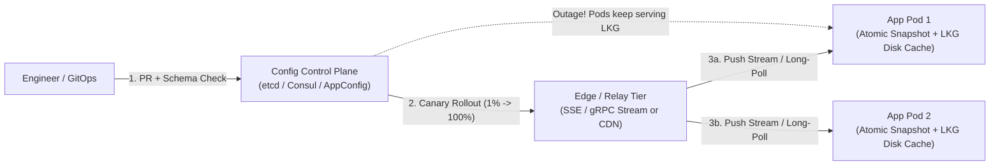
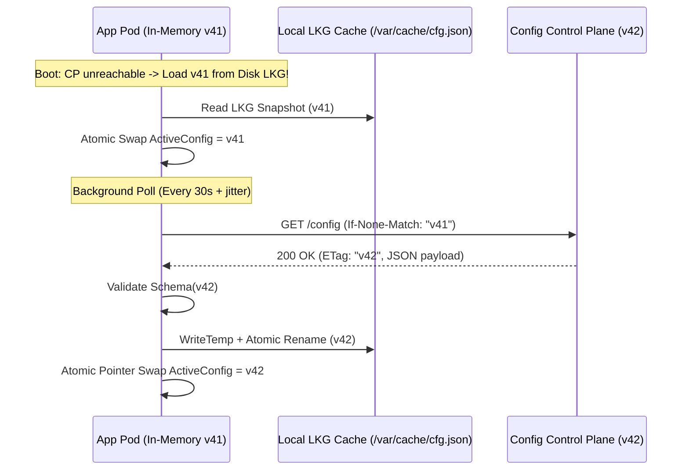

# Configuration Management: Change Config Without Redeploying

> **Prerequisites:** [Lesson 19: Microservice Anti-Patterns](../19-microservice-anti-patterns/README.md) · [Lesson 10: Sidecar, Ambassador & Adapter Patterns](../10-sidecar-ambassador-adapter-patterns/README.md).  
> **Estimated Reading Time:** 24–28 minutes  
> **Target Audience:** Backend and platform engineers building dynamic config, feature flags, and zero-downtime kill switches, and candidates asked "how do you change config across 500 pods without redeploying?"  
> **Free PDF Notes:** [Download SD-L-020.pdf](https://backendroadmap.com/notes/system-design/SD-L-020.pdf)

> [!NOTE]
> **In one line:** **Dynamic Configuration Management** decouples runtime behavior (timeouts, rate limits, feature flags, kill switches) from code deployments by storing versioned config in a centralized control plane (etcd, Consul, AWS AppConfig, LaunchDarkly) and propagating updates to pods in seconds—with **schema validation, atomic snapshots, progressive rollouts, and instant rollback**.

> [!TIP]
> **The Golden Rule:** **Treat configuration changes with the exact same rigor as code deployments.** Validate schemas before publish, roll out progressively (canary 1% $\to$ 10% $\to$ 100%), cache the last-known-good snapshot locally on every pod so control-plane outages never take down the data plane, and **never** use dynamic config to bypass secrets rotation or database migrations.

---

## 1. What Dynamic Configuration Management Is, and What It Isn't

A Black Friday traffic spike hits your checkout service. Your payment gateway starts timing out at 3 seconds, and you need to lower the downstream timeout from `5000 ms` to `1200 ms` and enable a graceful degradation flag (`disable_recommendations = true`) across 400 pods—**right now**. If those values are baked into Docker images or static Kubernetes `ConfigMap` env vars requiring a rolling pod restart, it takes 15 minutes to rebuild/roll out while the site is burning.

**Dynamic Configuration Management** separates *build-time/startup* configuration from *runtime* configuration so operators can flip a kill switch or tune a circuit breaker in $<5\text{ seconds}$ without restarting a single process.

| Term | Precise Meaning | Example |
| :--- | :--- | :--- |
| **Static / Env Config** | Read once at process startup; requires pod restart to change | `PORT=8080`, `DB_HOST=...` |
| **Dynamic Config** | Polled or streamed at runtime; updates in-memory behavior without restart | `checkout.timeout_ms = 1200` |
| **Feature Flag** | Boolean or multivariate rule targeting user segments/percentages | `enable_new_search: 10%` |
| **Kill Switch** | Emergency dynamic flag that disables a non-critical or failing subsystem | `recommendations.enabled = false` |
| **Control Plane vs Data Plane** | Config server/store (control) vs application pods serving user traffic (data) | Consul/AppConfig vs 400 API pods |
| **Last-Known-Good (LKG) Cache** | Local disk/memory snapshot used when the config server is unreachable | Pod boots/runs from `/var/cache/config.json` |
| **Not** | A place for raw secrets (API keys, DB passwords) or arbitrary executable code | Use Vault / Secrets Manager for secrets; CI/CD for code |

### Why It Matters
1. **MTTR drops from 15 minutes (redeploy) to 5 seconds (config push)** during incidents.
2. **Bad config causes more SEV-1s than bad code**—a single typo (`timeout_ms = 0` or invalid regex) pushed globally without validation can take down an entire fleet instantaneously.
3. **Resilience requires Control/Data Plane isolation**—your 400 API pods must never fail requests or fail to boot if the config service goes down.

---

## 2. Anatomy: Push/Stream vs Pull & Control/Data Plane Isolation



| Delivery Model | How It Works | Latency to Fleet | Scalability & Failure Mode |
| :--- | :--- | :---: | :--- |
| **Env Vars / K8s ConfigMap Restart** | Mounted at startup; rolling restart | 5–20 min | Simple, zero runtime deps, too slow for kill switches |
| **Short Polling (`GET /config` every $T$ s)** | Pods poll with `ETag` / `If-None-Match` + jitter | $T$ seconds (e.g., 15–60s) | Easy to CDN-cache; thundering herd if no jitter |
| **Long Polling / Watch (Consul/etcd)** | Server holds request open until version changes | $< 1\text{ s}$ | High open-connection count on server; needs watch relays |
| **SSE / gRPC Streaming (LaunchDarkly/Envoy)** | Persistent stream pushes delta updates | $< 500\text{ ms}$ | Fastest propagation; needs reconnect backoff + fallback poll |

> [!WARNING]
> **Never mutate live config fields one by one!** If you update `rate_limit_window_sec` and `rate_limit_max_requests` non-atomically, a worker thread can read the *new* window with the *old* max, triggering a false-positive outage. Always publish and swap an **immutable, versioned Config Snapshot** atomically (`atomic.Pointer` / `volatile` reference swap).

---

## 3. Mathematical Model: Propagation Latency, Polling Load & Blast Radius

**1. Polling Server Load ($\text{RPS}_{\text{cfg}}$) with $N$ Pods and Poll Interval $T$:**
If $N$ pods poll every $T$ seconds:

$$\text{RPS}_{\text{cfg}} = \frac{N}{T}$$

Adding **uniform jitter** $\pm J$ (e.g., $T \pm 20\%$) prevents synchronized thundering herds when 1,000 pods boot together after a deploy.

**2. Bandwidth with `ETag` (`304 Not Modified`):**
If config changes $c$ times per day and each full payload is $B_{\text{cfg}}$ bytes (while a `304` response is $B_{304} \approx 200\text{ bytes}$):

$$\text{Daily Bandwidth} = N \cdot \left(\frac{86{,}400}{T} \cdot B_{304} + c \cdot B_{\text{cfg}}\right)$$

**3. Progressive Rollout Blast Radius:**
If a bad config has probability $p_{\text{bad}}$ and rolls out instantaneously to 100% of $N$ pods, blast radius is $N$. With staged rings (e.g., $1\% \to 10\% \to 50\% \to 100\%$ with automated health bake time $W_{\text{bake}}$), error budget impact is capped at $1\%$ during detection.

**Worked Numerical Example:**
Suppose $N = 2{,}000$ pods poll every $T = 30\text{ s}$, full config payload $B_{\text{cfg}} = 50\text{ KB}$, `304` size $B_{304} = 200\text{ B}$, and config changes $c = 20\text{ times/day}$:
- **Polling RPS:** $\text{RPS}_{\text{cfg}} = 2{,}000 / 30 = \mathbf{66.7\text{ RPS}}$ (tiny—one CDN edge or 2 tiny pods handle this easily).
- **Daily bandwidth WITH `ETag` (`304`):**
  $2{,}000 \times (2{,}880 \times 200\text{ B} + 20 \times 50{,}000\text{ B}) = 2{,}000 \times (576\text{ KB} + 1{,}000\text{ KB}) \approx \mathbf{3.15\text{ GB/day}}$.
- **Daily bandwidth WITHOUT `ETag` (sending 50 KB every 30s):**
  $2{,}000 \times 2{,}880 \times 50{,}000\text{ B} = \mathbf{288\text{ GB/day}}$ (**91× more bandwidth**!).

---

## 4. Metrics & Percentiles

| Metric | Meaning | Alert when |
| :--- | :--- | :--- |
| **Config Propagation Lag ($p_{99}$)** | Time from publish to 99% of pods applying new `version` | $> 60\text{ s}$ (or $> 5\text{ s}$ for streaming kill switches) |
| **Config Version Skew** | Number of distinct config versions active simultaneously in prod | $> 2$ versions for $> 5\text{ minutes}$ (stuck pods) |
| **Schema Validation Rejection Rate** | Publishes rejected by JSON Schema / Cue / Protobuf validator | Any spike (catches human typos before prod!) |
| **Control Plane Fetch Error Rate** | Pods failing to reach config server (falling back to LKG) | $> 1\%$ for $> 2\text{ min}$ |
| **Fallback-to-LKG Pod Count** | Pods running on stale disk/memory cache | $> 0$ sustained (control plane degraded) |

### Worked Example (Taming a Payment Timeout Incident)
During peak traffic, `PaymentGateway` $p_{99}$ jumps from 300 ms to 4,200 ms, exhausting `CheckoutService` worker threads (configured with `payment_timeout_ms = 5000`).
- **Action:** Operator submits a GitOps PR changing `payment_timeout_ms: 1200` and `checkout_shed_non_vip: false -> true`.
- **Pipeline:** CI validates `payment_timeout_ms` is within `[100, 10000]` via JSON Schema $\to$ pushes `config_v482` to AppConfig/Consul $\to$ Canary 5% pods apply `v482` in 2 seconds; error rate drops and thread pool stabilizes $\to$ automated bake promotes `v482` to 100% of 400 pods in **25 seconds** with **zero restarts**.

---

## 5. Compounding & Failure Modes

| Failure Mode | Mechanism | Impact at Scale |
| :--- | :--- | :--- |
| **Unvalidated typo pushed globally** | Operator sets `timeout_ms = 0` or `max_conns = -1` | All 2,000 pods crash or time out 100% of requests in 3 seconds |
| **Control Plane required for pod startup** | New autoscaled pod fails to boot because config server is down | Traffic spike triggers autoscaling $\to$ new pods crash-loop $\to$ total outage |
| **Thundering herd on config server** | 2,000 pods restart simultaneously and poll at exact same second | Config server OOMs/503s right when fleet is recovering |
| **Non-atomic partial config read** | Thread reads `new` currency list with `old` exchange rate map | Silent financial corruption |
| **Flag debt (zombie feature flags)** | 400 stale `if (flag)` branches accumulate over 3 years | Combinatorial test explosion; accidental flip of dead code |

---

## 6. Numbers Every Engineer Must Know

| Item | Typical | Implication |
| :--- | :---: | :--- |
| Streaming / SSE propagation time | 100 ms – 2 s | Fast enough for emergency kill switches |
| Jittered `ETag` polling interval | 15 – 60 s | Low server load + CDN cacheable |
| Config snapshot payload size | 5 – 100 KB | Keep small; don't store ML models or large GeoIP tables in config |
| Canary bake window for risky config | 2 – 5 minutes | Catches bad timeouts/thresholds before 100% blast radius |
| Feature flag TTL / cleanup cadence | 30 – 90 days | Enforce expiration dates so flags don't rot |

---

## 7. Protocol Deep Dive: Atomic Snapshots, `ETag` Polling & LKG Fallback



| Question | Answer |
| :--- | :--- |
| **How do you guarantee a newly autoscaled pod can boot if the Config Control Plane is down?** | Bake a **compile-time default / seed config** into the container image (or mount a static Kubernetes `ConfigMap` baseline) AND persist the **Last-Known-Good (LKG)** snapshot to local ephemeral/node cache. |
| **How do you prevent a bad config value from crashing the app?** | Validate in **two places**: (1) CI/Control-Plane **JSON Schema / Cue** validation before publish, and (2) **client-side validation** before swapping the atomic pointer—if invalid, reject `v42`, keep `v41`, and emit a `ConfigValidationError` metric. |
| **How are Secrets different from Dynamic Config?** | Secrets (DB passwords, TLS keys, API tokens) require encryption at rest/transit, RBAC audit logs, short leases, and memory-zeroing (HashiCorp Vault, AWS Secrets Manager). Dynamic config is non-secret behavioral tuning. |

**When NOT to use Dynamic Config:**
- **Database connection strings or schema-coupled settings** that require pool draining or migrations—use standard blue/green or rolling deployments.
- **High-frequency per-user data** (user profiles, permissions)—that belongs in a database/cache, not a global config snapshot broadcast to every pod.

---

## 8. Hierarchical Budgets & Design Rules

| Slice | Rule | Control |
| :--- | :--- | :--- |
| **Schema & Bounds** | Every key has a strict type, min/max range, and default | JSON Schema / Cue / Protobuf validation in CI + runtime |
| **Atomicity** | Swap whole versioned config snapshots, never individual fields | Immutable struct + atomic pointer/reference |
| **Control/Data Isolation** | Data plane must boot & serve traffic if Control Plane is 100% down | Baked defaults + local LKG file cache |
| **Rollout Safety** | Progressive rollout + instant 1-click rollback | Canary 5% $\to$ bake $\to$ 100% (AWS AppConfig / GitOps) |
| **Thundering Herd** | Add random jitter to all polling intervals + use `ETag` (`304`) | `interval * (1 + rand(-0.2, 0.2))` |
| **Auditability** | Every config change has author, timestamp, diff, and reason | GitOps PR history or control-plane audit log |
| **Flag Hygiene** | Every temporary feature flag has an owner and expiry date | Automated Jira/Slack reminder after 30–60 days |

---

## 9. Top Mitigations

1. **Validate config schemas at both publish-time (CI) and read-time (SDK)**—never swap an invalid snapshot.
2. **Use atomic immutable config snapshots** so readers never observe torn/half-updated multi-field states.
3. **Cache Last-Known-Good (LKG) on disk + bake safe defaults into the image** so pods never fail to start during a control-plane outage.
4. **Roll out config changes progressively** (canary ring $\to$ bake $\to$ fleet) just like code deploys.
5. **Add `ETag` (`304 Not Modified`) and $\pm 20\%$ jitter** to polling clients to cut bandwidth $90\times$ and prevent thundering herds.
6. **Keep secrets out of config stores**—use Vault / KMS / AWS Secrets Manager with strict RBAC.
7. **Expire temporary feature flags** aggressively to avoid dead-code accumulation.

---

## 10. Production Reference: Global Regex Typo & Unvalidated Config Outage

**Incident Summary (SEV-1):** A major CDN/routing platform pushed a dynamic configuration update containing a malformed WAF regex rule (`.*.*.*+` causing catastrophic backtracking) globally to all edge PoPs simultaneously.

**Root Cause:**
1. The config control plane pushed to **100% of the global fleet in <5 seconds** with no canary ring.
2. There was **no automated regex-complexity or canary CPU check** before global promotion.
3. Every edge worker thread pegged at 100% CPU evaluating the regex, dropping global traffic for 27 minutes.


**The Fix:**
1. Implemented **Staged Rollout Rings** (Dogfood $\to$ 1% Canary PoP $\to$ 10% $\to$ 100% with automatic CPU/error rollback).
2. Added **pre-publish static analyzers** (rejecting catastrophic-backtracking regexes and out-of-bounds timeouts).
3. Built a **hard-coded out-of-band rollback button** that restores the previous signed config version without waiting for CI.

---

## 11. Multi-Language Production Code Tabs

Thread-safe **Atomic Config Snapshot Manager with `ETag` Polling, Schema Validation & Last-Known-Good (LKG) Fallback** in all 4 languages.

````carousel
```go
// Go: Atomic config snapshot swap with schema validation & LKG fallback.
package config

import (
	"encoding/json"
	"errors"
	"os"
	"sync/atomic"
)

type AppConfig struct {
	Version              string `json:"version"`
	PaymentTimeoutMs     int    `json:"payment_timeout_ms"`
	EnableRecommendations bool   `json:"enable_recommendations"`
}

func (c AppConfig) Validate() error {
	if c.PaymentTimeoutMs < 100 || c.PaymentTimeoutMs > 10000 {
		return errors.New("payment_timeout_ms out of safe bounds [100, 10000]")
	}
	return nil
}

type Manager struct {
	current atomic.Pointer[AppConfig]
	lkgPath string
}

func NewManager(lkgPath string, fallback AppConfig) *Manager {
	m := &Manager{lkgPath: lkgPath}
	if data, err := os.ReadFile(lkgPath); err == nil {
		var lkg AppConfig
		if json.Unmarshal(data, &lkg) == nil && lkg.Validate() == nil {
			m.current.Store(&lkg)
			return m
		}
	}
	m.current.Store(&fallback)
	return m
}

func (m *Manager) Get() AppConfig { return *m.current.Load() }

func (m *Manager) TryApply(raw []byte) error {
	var next AppConfig
	if err := json.Unmarshal(raw, &next); err != nil {
		return err
	}
	if err := next.Validate(); err != nil {
		return err // Reject invalid config; keep current LKG active
	}
	_ = os.WriteFile(m.lkgPath, raw, 0o600)
	m.current.Store(&next) // Atomic pointer swap
	return nil
}
```
<!-- slide -->
```typescript
// TypeScript: Immutable dynamic config manager with validation & LKG fallback.
import * as fs from "fs";

export interface AppConfig {
  readonly version: string;
  readonly paymentTimeoutMs: number;
  readonly enableRecommendations: boolean;
}

function validateConfig(cfg: AppConfig): void {
  if (cfg.paymentTimeoutMs < 100 || cfg.paymentTimeoutMs > 10000) {
    throw new Error(`Invalid paymentTimeoutMs: ${cfg.paymentTimeoutMs}`);
  }
}

export class ConfigManager {
  private current: AppConfig;

  constructor(private readonly lkgPath: string, fallback: AppConfig) {
    this.current = fallback;
    try {
      const parsed = JSON.parse(fs.readFileSync(lkgPath, "utf8")) as AppConfig;
      validateConfig(parsed);
      this.current = Object.freeze(parsed);
    } catch {
      // Fallback to baked default if LKG missing or corrupt
    }
  }

  get(): AppConfig {
    return this.current; // Immutable snapshot reference
  }

  tryApply(next: AppConfig): boolean {
    try {
      validateConfig(next);
      const frozen = Object.freeze({ ...next });
      fs.writeFileSync(this.lkgPath, JSON.stringify(frozen));
      this.current = frozen;
      return true;
    } catch {
      return false; // Keep LKG active on bad config
    }
  }
}
```
<!-- slide -->
```python
# Python: Immutable dynamic config manager with bounds validation & LKG cache.
from dataclasses import dataclass
import json
from pathlib import Path


@dataclass(frozen=True)
class AppConfig:
    version: str
    payment_timeout_ms: int
    enable_recommendations: bool

    def validate(self) -> None:
        if not (100 <= self.payment_timeout_ms <= 10000):
            raise ValueError(f"payment_timeout_ms={self.payment_timeout_ms} out of bounds")


class ConfigManager:
    def __init__(self, lkg_path: str, fallback: AppConfig) -> None:
        self._lkg_path = Path(lkg_path)
        self._current = fallback
        if self._lkg_path.exists():
            try:
                data = json.loads(self._lkg_path.read_text())
                lkg = AppConfig(**data)
                lkg.validate()
                self._current = lkg
            except Exception:
                pass  # Keep safe baked fallback

    @property
    def current(self) -> AppConfig:
        return self._current

    def try_apply(self, raw_json: str) -> bool:
        try:
            nxt = AppConfig(**json.loads(raw_json))
            nxt.validate()
            self._lkg_path.write_text(raw_json)
            self._current = nxt  # Atomic reference swap in Python
            return True
        except Exception:
            return False  # Reject bad config; keep LKG active
```
<!-- slide -->
```csharp
// C#: Volatile immutable config snapshot with validation & LKG fallback.
using System.Text.Json;

public sealed record AppConfig(string Version, int PaymentTimeoutMs, bool EnableRecommendations)
{
    public void Validate()
    {
        if (PaymentTimeoutMs is < 100 or > 10000)
            throw new ArgumentOutOfRangeException(nameof(PaymentTimeoutMs));
    }
}

public sealed class ConfigManager
{
    private volatile AppConfig _current;
    private readonly string _lkgPath;

    public ConfigManager(string lkgPath, AppConfig fallback)
    {
        _lkgPath = lkgPath;
        _current = fallback;
        if (File.Exists(lkgPath))
        {
            try
            {
                var lkg = JsonSerializer.Deserialize<AppConfig>(File.ReadAllText(lkgPath));
                if (lkg is not null) { lkg.Validate(); _current = lkg; }
            }
            catch { /* Fall back to baked default */ }
        }
    }

    public AppConfig Current => _current;

    public bool TryApply(string json)
    {
        try
        {
            var next = JsonSerializer.Deserialize<AppConfig>(json) ?? throw new InvalidOperationException();
            next.Validate();
            File.WriteAllText(_lkgPath, json);
            _current = next; // Atomic reference assignment
            return true;
        }
        catch { return false; }
    }
}
```
````

---

## 12. Hands-On CLI Verification Workflows

Manage dynamic config with **Consul**, **AWS AppConfig**, and verify polling bandwidth math:

```bash
# 1. Consul KV: write dynamic config and watch for instant updates without restart
consul kv put config/checkout/prod '{"version":"v42","payment_timeout_ms":1200,"enable_recommendations":false}'
consul watch -type=key -key=config/checkout/prod cat

# 2. AWS AppConfig: deploy a validated config profile with a progressive rollout strategy
aws appconfig start-deployment \
  --application-id "checkout-app" \
  --environment-id "prod" \
  --deployment-strategy-id "AppConfig.Linear20PercentEvery30Seconds" \
  --configuration-profile-id "runtime-settings" \
  --configuration-version "42"

# 3. Verify ETag polling bandwidth savings (304 Not Modified vs full 50KB fetch)
python -c "
N, T, b304, bfull, changes = 2000, 30, 200, 50_000, 20
polls_per_day = 86400 / T
with_etag_gb = N * (polls_per_day * b304 + changes * bfull) / 1e9
without_etag_gb = N * (polls_per_day * bfull) / 1e9
print(f'RPS={N/T:.1f} | With ETag: {with_etag_gb:.2f} GB/day | Without ETag: {without_etag_gb:.2f} GB/day')
"
```

---

## 13. Common Mistakes to Avoid

1. **Pushing unvalidated config globally to 100% of pods**—one typo causes a fleet-wide SEV-1.
2. **Requiring the Config Server to be up for pods to boot**, breaking autoscaling during a control-plane outage.
3. **Mutating config fields individually instead of swapping an atomic snapshot**, causing torn reads.
4. **Polling without `ETag` (`304`) or random jitter**, creating thundering herds and wasted bandwidth.
5. **Storing raw secrets (API keys, DB passwords) in plain dynamic config** instead of a Secrets Manager/Vault.
6. **Using dynamic config for structural changes** (DB migrations, protocol changes) that require code deploys.
7. **Never cleaning up old feature flags**, leaving hundreds of dead code paths behind.

---

## 14. Key Terms Glossary

| Key Term | Definition |
| :--- | :--- |
| **Dynamic Configuration** | Runtime settings updated without rebuilding or restarting application processes. |
| **Control Plane / Data Plane** | Config management server vs application pods serving live user traffic. |
| **Last-Known-Good (LKG)** | Local cached config snapshot allowing pods to run/boot if the config server is down. |
| **Atomic Snapshot** | Immutable config object swapped in memory as a single unit to prevent torn reads. |
| **Feature Flag** | Conditional toggle enabling/disabling features for targeted users or percentages. |
| **Kill Switch** | Emergency dynamic flag to shed non-critical load or disable a failing dependency. |
| **Progressive Rollout** | Staged config promotion (e.g., 1% $\to$ 10% $\to$ 100%) with health bake checks. |
| **Version Skew** | Multiple config versions active concurrently across a fleet during rollout or failure. |
| **ETag / `304 Not Modified`** | HTTP caching header returning empty body when config hasn't changed. |
| **Flag Debt** | Accumulation of obsolete feature flag branches in source code. |

---

## 15. System Design Interview Questions & Answers

### Basic Conceptual Questions

<details>
<summary><strong>Q1: What is the difference between static (env var) config and dynamic configuration? [BASIC]</strong></summary>

**Answer:**
Static config (environment variables, startup `ConfigMap`) is read once at boot and requires a pod restart/redeploy to change. Dynamic configuration is fetched or streamed at runtime so operators can tune timeouts, rate limits, or kill switches across hundreds of pods in seconds without restarts.
</details>

<details>
<summary><strong>Q2: What is a Kill Switch, and why shouldn't it require a CI/CD deploy? [BASIC]</strong></summary>

**Answer:**
A Kill Switch is a boolean dynamic flag (e.g., `disable_ml_recommendations = true`) that sheds expensive or failing non-critical work during an incident. During a SEV-1, waiting 10–15 minutes for a build/deploy pipeline prolongs the outage; a dynamic kill switch takes effect in seconds.
</details>

<details>
<summary><strong>Q3: Why should you never store database passwords in a general feature-flag/config service? [BASIC]</strong></summary>

**Answer:**
Config services are optimized for fast distribution and broad readability, not secret hygiene. Secrets belong in a dedicated Secrets Manager (HashiCorp Vault, AWS Secrets Manager) with KMS encryption, fine-grained IAM, short-lived leases, and audit trails.
</details>

<details>
<summary><strong>Q4: What is Last-Known-Good (LKG) caching? [BASIC]</strong></summary>

**Answer:**
Each pod persists the last valid config snapshot it received to local disk (and memory) and bakes a safe default into its container image. If the central config server goes down, existing pods keep running and newly autoscaled pods can still boot using the LKG/default config.
</details>

### Scenario-Based Architecture Questions

<details>
<summary><strong>Q5: Design a system to propagate config updates to 5,000 pods within 5 seconds without overloading the config server. [SCENARIO]</strong></summary>

**Answer:**
Use a **two-tier architecture**:
1. A central **Control Plane** (etcd/Consul/AppConfig) stores versioned, schema-validated config.
2. Stateless **Edge Relay / Streaming pods** (or a CDN) maintain persistent SSE/gRPC streams (or jittered `ETag` long-polls) with the 5,000 app pods.
3. On update, the Control Plane pushes a lightweight invalidation/delta to the relays, which fan out to the 5,000 pods in $<2\text{ s}$. Each pod validates the schema, writes to disk LKG, and swaps an immutable in-memory pointer.
</details>

<details>
<summary><strong>Q6: An engineer accidentally sets `db_timeout_ms = 0` in dynamic config, taking down production. How do you prevent this? [SCENARIO]</strong></summary>

**Answer:**
Three layers of defense:
1. **Schema & Bounds Validation** at publish time (GitOps/CI + Control Plane rejects `db_timeout_ms < 50`).
2. **Client-Side Guardrail**: the app SDK validates bounds before swapping the atomic pointer and rejects invalid payloads.
3. **Progressive Canary Rollout**: deploy to 1–5% of pods first with a 2-minute automated health check (monitoring error rate and latency) before promoting to 100%.
</details>

<details>
<summary><strong>Q7: Your Config Server is completely down for 30 minutes while traffic spikes and Kubernetes autoscales 50 new pods. What happens? [SCENARIO]</strong></summary>

**Answer:**
If designed properly (Control/Data Plane isolation), the 50 new pods boot using their **baked-in safe default config** (or node-level LKG cache) and immediately serve traffic. They emit a `config_control_plane_unreachable` warning metric and keep retrying with exponential backoff until the Config Server recovers.
</details>

<details>
<summary><strong>Q8: You update `rate_limit_count` and `rate_limit_window_sec` together, and half your pods briefly reject valid users. Why? [SCENARIO]</strong></summary>

**Answer:**
Non-atomic per-key updates! A request thread read the *new* `rate_limit_count` (e.g., `10`) with the *old* `rate_limit_window_sec` (`60s` instead of `1s`). *Fix:* Always distribute and swap the **entire config object as a single immutable, versioned snapshot**.
</details>

### Advanced & Tricky Interview Questions

<details>
<summary><strong>Q9: How do you handle Kubernetes `ConfigMap` updates without pod restarts, and what is the catch? [TRICKY]</strong></summary>

**Answer:**
If a `ConfigMap` is mounted as a **volume** (not `env`), kubelet eventually updates the symlinked file on disk via `inotify`—no pod restart needed. *The catch:* (1) kubelet sync takes up to **60–90 seconds** (too slow for emergency kill switches), (2) there is **no built-in canary rollout** (all pods in the namespace update together), and (3) your app must watch the symlink (`..data`) rather than the file inode.
</details>

<details>
<summary><strong>Q10: How do you prevent a thundering herd when 2,000 pods reconnect after a Config Server restart? [TRICKY]</strong></summary>

**Answer:**
Combine: (1) **Random jitter** on all reconnect/poll timers (`base * (1 + rand(0, 0.3))` + exponential backoff), (2) **CDN / Edge Relay caching** keyed by `config_version` + `ETag` (`304 Not Modified`), and (3) **Connection rate-limiting / load shedding** on the control plane so data-plane pods gracefully fall back to LKG.
</details>

<details>
<summary><strong>Q11: A feature flag controls a database schema migration path. Why is that dangerous with dynamic config? [TRICKY]</strong></summary>

**Answer:**
Unlike simple UI toggles, toggling between two incompatible DB read/write paths mid-flight can leave half the fleet writing to `v1` columns and half reading `v2` columns. Dual-write/migration phases must be controlled carefully via **expand-and-contract** deployments, and config flags should only flip *after* 100% of pods support both schemas.
</details>

<details>
<summary><strong>Q12: How do you test dynamic configuration combinations without combinatorial explosion? [TRICKY]</strong></summary>

**Answer:**
(1) Keep flags short-lived (30–60 day TTL) and delete dead flags; (2) Test the **default-off** and **target-on** states in CI rather than all $2^N$ permutations; (3) Group related toggles into a single **enum/mode** (`routing_mode = "v1" | "v2" | "shadow"`) instead of 3 independent booleans.
</details>

---

## 16. One-Page Master Cheat Sheet

```
+---------------------------------------------------------------------------------------------------------+
|                    CONFIGURATION MANAGEMENT — MASTER CHEAT SHEET                                        |
+---------------------------------------------------------------------------------------------------------+
| 1. DYNAMIC CONFIG = Tune timeouts, rate limits, feature flags & kill switches in seconds (no redeploy). |
|    NOT for raw secrets (use Vault/Secrets Manager) or DB migrations.                                    |
+---------------------------------------------------------------------------------------------------------+
| 2. CONTROL vs DATA PLANE ISOLATION:                                                                     |
|    Pods MUST boot & serve traffic if Config Server is 100% down -> Baked defaults + Disk LKG cache.     |
+---------------------------------------------------------------------------------------------------------+
| 3. SAFETY TRIAD:                                                                                        |
|    - Validate schemas & bounds at publish-time (CI) AND read-time (SDK).                                |
|    - Swap whole immutable snapshots atomically (never field-by-field).                                  |
|    - Roll out progressively (1% canary -> bake -> 100%) with 1-click rollback.                          |
+---------------------------------------------------------------------------------------------------------+
| 4. SCALE: Use SSE/gRPC streams or ETag (`304`) polling + ±20% jitter to avoid thundering herds.         |
+---------------------------------------------------------------------------------------------------------+
```

---

## Further Reading & Sources

- Google SRE Book, [Chapter 8: Release Engineering & Configuration](https://sre.google/sre-book/release-engineering/).
- AWS AppConfig Documentation, [Deployment Strategies & Validators](https://docs.aws.amazon.com/appconfig/latest/userguide/what-is-appconfig.html).
- Pete Hodgson (Martin Fowler's Blog), [Feature Toggles (aka Feature Flags)](https://martinfowler.com/articles/feature-toggles.html).
- Tang et al. (Facebook), *Holistic Configuration Management at Facebook* (SOSP '15).

---

## Free PDF Notes

[SD-L-020.pdf](https://backendroadmap.com/notes/system-design/SD-L-020.pdf)

---

## Next

Continue with [Track: Security](../../13-security/README.md).
