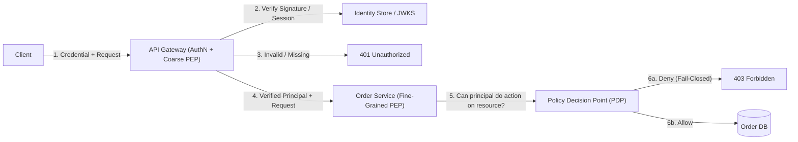
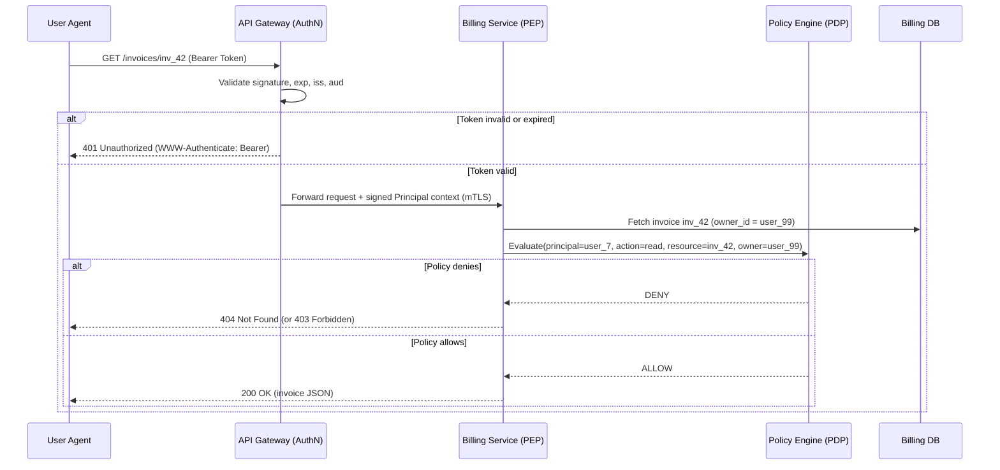
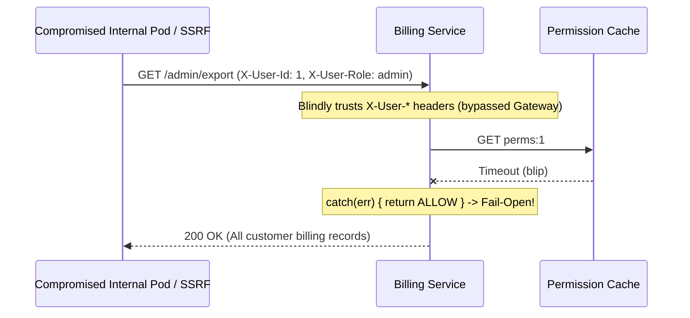

# Authentication vs Authorization: Who You Are vs What You Can Do

> **Prerequisites:** [Lesson 20: Configuration Management](../../12-architecture-patterns/20-configuration-management/README.md).  
> **Estimated Reading Time:** 24–28 minutes  
> **Target Audience:** Backend engineers designing API gateways and service boundaries, and candidates asked "where do authentication and authorization live, and how do they fail?"  
> **Free PDF Notes:** [Download SD-M-001.pdf](https://backendroadmap.com/notes/system-design/SD-M-001.pdf)

> [!NOTE]
> **In one line:** **Authentication (AuthN)** proves *who* a caller is (identity verification, returning HTTP `401` when missing or invalid). **Authorization (AuthZ)** decides *what* that verified identity is allowed to do on a specific resource (access control, returning HTTP `403` when denied). Mixing them up creates broken boundaries, privilege escalation, and silent fail-open outages.

> [!TIP]
> **The Golden Rule:** Authenticate once at the edge (API Gateway / Identity Provider) to establish a trusted **Principal**, but authorize *close to the resource* (inside the owning service) using **fail-closed** policy checks. Never trust client-supplied user IDs, roles, or headers that bypassed your trust boundary.

---

## 1. What Authentication & Authorization Are, and What They Aren't

Consider a banking API receiving `DELETE /v1/accounts/acct_9921/cards/card_44`. First, the system must verify that the caller actually possesses a valid credential belonging to `user_108` (AuthN). Second, the system must verify that `user_108` owns `acct_9921` and has the `cards:delete` permission (AuthZ). Passing step 1 does **not** imply passing step 2—an authenticated attacker (`user_108`) trying to delete `user_205`'s card is the #1 API vulnerability (Broken Object Level Authorization / IDOR).

| Term | Precise Meaning | Example |
| :--- | :--- | :--- |
| **Authentication (AuthN)** | Verifying the claimed identity of a human, service, or device | Password + MFA, mTLS client cert, signed JWT |
| **Authorization (AuthZ)** | Evaluating whether an authenticated principal may perform an action on a resource | `user_108` can `READ` `order_55`, cannot `REFUND` it |
| **Principal / Subject** | The verified identity produced by AuthN (`sub` claim or user record) | `user:108` or `spiffe://prod/svc/checkout` |
| **Credential** | Secret or cryptographic proof presented during AuthN | Password, API key, session cookie, private key |
| **Policy Enforcement Point (PEP)** | Middleware/gateway that intercepts a request and enforces the AuthZ decision | API Gateway filter, Express/FastAPI/ASP.NET middleware |
| **Policy Decision Point (PDP)** | Engine that evaluates policies against principal, action, and resource | OPA, Cedar, Zanzibar, or local RBAC evaluator |
| **HTTP `401 Unauthorized`** | Misnamed by RFC 7235: means **Unauthenticated** (missing/invalid credentials) | Expired token or missing `Authorization` header |
| **HTTP `403 Forbidden`** | Caller is **authenticated**, but **not authorized** for the target action/resource | Standard user hitting `/admin/audit-logs` |
| **Not** | Encryption, network firewalling, or input validation | TLS protects transit; AuthN/AuthZ protect identity & access |

### Why It Matters
1. **Every multi-user or multi-service system** needs a clear boundary between *identity* (who) and *entitlement* (what).
2. **Broken Object Level Authorization (BOLA/IDOR)** has been #1 on the OWASP API Security Top 10 for years because teams authenticate at the gateway and forget resource-level authorization in the service.
3. **AuthN and AuthZ scale differently:** AuthN happens once per session or token TTL and is easily cached/centralized; AuthZ happens on *every* request and depends on mutable domain state (ownership, org membership, feature flags).

---

## 2. Anatomy: The AuthN -> AuthZ Request Pipeline



Separating **coarse-grained AuthN** at the gateway from **fine-grained AuthZ** inside the service prevents two classic failures:
1. **Gateway bloat:** The API gateway should not query the Orders database to check if `user_108` owns `order_55`. Only the Order Service owns that state.
2. **Implicit trust:** If the Order Service blindly trusts `X-User-Id: 108` without verifying that the header came from the gateway (via mTLS or a signed internal token), any internal SSRF or misrouted pod can impersonate any user.

| Dimension | Authentication (AuthN) | Authorization (AuthZ) |
| :--- | :--- | :--- |
| **Core Question** | Who are you? | What are you allowed to do? |
| **Inputs** | Credentials (password, token, cert) | Principal + Action + Resource + Context |
| **Failure Code** | `401 Unauthorized` (+ `WWW-Authenticate`) | `403 Forbidden` (or `404` to hide existence) |
| **Frequency** | Once per login or token validation | Every single API call and state mutation |
| **State Dependency** | Identity provider, user credentials, JWKS | Domain ownership, roles, ACLs, org hierarchy |
| **Caching** | Easy (JWKS cached minutes/hours; sessions in Redis) | Hard (revoking access must take effect fast) |

> [!WARNING]
> **Never fail-open on AuthN or AuthZ errors.** If Redis, the Identity Provider, or the Policy Decision Point times out, the default decision **must** be `Deny` (`503` or `403`). A `try { checkAuth() } catch { return true; }` block turns any downstream outage into a full authentication bypass.

---

## 3. Mathematical Model: Latency, Availability, and Brute-Force Cost

**Request Latency Overhead.** Every authenticated and authorized request pays both verification costs:

$$T_{\text{auth}} = T_{\text{AuthN}} + T_{\text{AuthZ}}$$

- With **centralized remote introspection** (calling an Auth server on every request) and remote PDP: $T_{\text{auth}} \approx 8\text{ ms} + 12\text{ ms} = 20\text{ ms}$ added to every hop.
- With **local asymmetric verification** (cached JWKS) and local/cached PDP: $T_{\text{auth}} \approx 0.15\text{ ms} + 0.5\text{ ms} = 0.65\text{ ms}$.

**Availability Impact (Serial Dependency).** If a service makes synchronous network calls to an external AuthN service ($A_{\text{AuthN}}$) and an external PDP ($A_{\text{PDP}}$) on every request without caching or local fallback:

$$A_{\text{effective}} = A_{\text{service}} \times A_{\text{AuthN}} \times A_{\text{PDP}}$$

If each is $99.9\%$ ($0.999$), $A_{\text{effective}} = 0.999^3 = 99.70\%$ (26.2 hours of downtime/year instead of 8.76 hours). Local signature verification and cached policy snapshots decouple request availability from IdP uptime.

**Password Hashing & Brute-Force Resistance.** For interactive login (AuthN), password hashing must be intentionally slow (Argon2id or bcrypt). If an attacker can test $R$ guesses/second against a leaked hash with keyspace $K$:

$$E[\text{time to crack}] = \frac{K}{2R}$$

With an 8-character lowercase password ($K = 26^8 \approx 2.09 \times 10^{11}$) and fast SHA-256 on a GPU ($R = 10^{10}$ guesses/s), expected crack time is **10.4 seconds**. With Argon2id tuned to $64\text{ MiB}$ RAM and $t = 3$ iterations ($R \approx 10^3$ guesses/s on high-end hardware), expected crack time rises to **3.3 years**—while costing a legitimate login server only $\sim 80\text{ ms}$ once per session.

---

## 4. Metrics & Percentiles

| Metric | Meaning | Alert When |
| :--- | :--- | :--- |
| **`authn.verify.p99`** | 99th-percentile time to verify credentials/tokens | $> 5\text{ ms}$ (local) or $> 30\text{ ms}$ (Redis/IdP) |
| **`authz.eval.p99`** | 99th-percentile time to evaluate policy decision | $> 10\text{ ms}$ |
| **`http.401.rate`** | Fraction of requests failing authentication | Sudden spike (credential stuffing or key rotation bug) |
| **`http.403.rate`** | Fraction of requests failing authorization | Sudden spike (misconfigured client or IDOR probing) |
| **`auth.fail_closed.errors`** | Requests rejected because IdP/PDP was unreachable | $> 0.1\%$ (indicates IdP/PDP outage) |
| **`login.hash.queue_depth`** | Concurrent Argon2id/bcrypt operations waiting | Growing queue (CPU/RAM saturation DoS) |

### Worked Example (`POST /v1/transfers`)
A fintech API processes $5{,}000\text{ req/s}$ at peak.
- **AuthN:** Gateway verifies an RS256 token locally against a cached JWKS ($0.2\text{ ms}$ CPU). Total gateway AuthN CPU = $5{,}000 \times 0.2\text{ ms} = 1.0\text{ vCPU-second/s}$ (easily absorbed).
- **AuthZ:** Transfer Service checks `principal.id == account.owner_id` using the already-fetched account row ($0\text{ extra DB round-trips}$) plus an OPA sidecar check ($0.4\text{ ms}$). Total added latency = **$0.6\text{ ms}$**.
- **Login endpoint (`POST /login`):** Protected by rate limiting ($5\text{ attempts/min/IP}$) and Argon2id ($80\text{ ms}$ CPU, $64\text{ MiB}$ RAM). Even at $100\text{ logins/s}$, it requires $8\text{ vCPUs}$ and $6.4\text{ GiB}$ RAM—so login must be isolated on its own worker pool so a credential-stuffing attack cannot starve `/v1/transfers`.

---

## 5. Compounding & Failure Modes

What happens when AuthN/AuthZ boundaries degrade under load or misconfiguration?

| Failure Mode | Mechanism | Blast Radius |
| :--- | :--- | :--- |
| **Credential Stuffing on Shared Pool** | Attackers flood `/login` ($80\text{ ms}$ Argon2id each). Shared app threads saturate. | Entire API (including `/health` and `/transfers`) times out. |
| **Missing Resource-Level AuthZ (IDOR)** | Gateway checks valid JWT, service trusts `GET /invoices/{id}` without `WHERE owner_id = sub`. | Any authenticated user can enumerate and download every customer's invoices. |
| **403 vs 404 Oracle** | Returning `403` for existing IDs and `404` for non-existent IDs. | Attackers probe sequential/UUID IDs to confirm which accounts or records exist. |
| **Confused Deputy (Header Spoofing)** | Service trusts `X-User-Id` header assuming only the gateway sets it. | Any pod or misconfigured proxy that reaches the service directly can impersonate `admin`. |
| **JWKS / Policy Cache Stampede** | All 200 pods expire JWKS cache simultaneously and hit IdP. | IdP collapses; pods fail-closed with `503`, causing total outage. |

---

## 6. Numbers Every Engineer Must Know

| Item | Typical | Implication |
| :--- | :---: | :--- |
| Local JWT / HMAC verification | **0.05 – 0.3 ms** | Negligible overhead; safe on every request |
| Redis session lookup | **0.5 – 2 ms** | Fast, requires HA Redis in the request path |
| Remote IdP introspection | **10 – 40 ms** | Avoid per-request; cache or use self-contained tokens |
| Argon2id / bcrypt login hash | **50 – 150 ms** | Isolate `/login` pool; rate-limit to prevent CPU/RAM DoS |
| Constant-time compare (`hmac.Equal`) | **~50 ns** | Always use for secrets/signatures to stop timing attacks |
| CSPRNG token/session entropy | **$\ge 128$ bits** | $2^{128}$ space makes guessing mathematically infeasible |
| JWKS cache TTL | **5 – 15 min** | Add jitter and background refresh to prevent stampedes |

---

## 7. Protocol Deep Dive: PEP, PDP, and Zero-Trust Service Calls



| Question | Answer |
| :--- | :--- |
| **Why return `404` instead of `403` on private resources?** | Returning `403` confirms the resource exists (existence oracle). For private tenant resources, `404` hides existence from unauthorized callers. |
| **Should the API Gateway do AuthZ?** | Only *coarse-grained* AuthZ (e.g., "is this route public?", "does token have scope `billing:read`?"). Fine-grained ownership belongs in the owning service. |
| **How do microservices trust the Principal from the Gateway?** | Either pass the verified JWT downstream (and re-verify locally), or terminate at the gateway and mint a short-lived internal signed token / mTLS SPIFFE identity. |
| **What is the difference between Authentication and Identification?** | Identification is claiming who you are (`email: alice@acme.com`). Authentication is *proving* it (password + WebAuthn). |

**When not to build custom AuthN/AuthZ:** Never roll your own cryptography, password reset flows, or OAuth servers. Use battle-tested Identity Providers (Auth0, Keycloak, Cognito, Okta) for AuthN, and structured policy engines or well-tested middleware for AuthZ.

---

## 8. Hierarchical Budgets & Design Rules

| Slice | Rule | Control |
| :--- | :--- | :--- |
| **Trust Boundary** | Never trust client-supplied identity headers (`X-User-Id`) | Strip at edge; require mTLS or signed token internally |
| **Default Decision** | Deny by default on all routes and policies | Explicit allow-list; fail-closed on errors |
| **Password Storage** | Argon2id (64 MiB, t=3) or bcrypt (cost $\ge 12$) | Never MD5/SHA-256; isolate `/login` worker pool |
| **HTTP Semantics** | `401` for missing/bad AuthN; `403`/`404` for denied AuthZ | Automated integration tests per endpoint |
| **Object Ownership** | Enforce `owner_id = principal.sub` in every query | Parameterized tenant-scoped repository layer |
| **Service-to-Service** | Authenticate callers too (mTLS / Client Credentials) | No unauthenticated internal "trusted network" |
| **Audit Trail** | Log `who`, `what`, `resource`, `decision`, `reason`, `req_id` | Never log raw passwords, tokens, or session IDs |

---

## 9. Top Mitigations

1. **Enforce fail-closed middleware globally:** Register AuthN/AuthZ middleware at the router root and explicitly mark public routes (`/health`, `/login`) rather than opting in per handler.
2. **Scope every DB query by tenant/owner:** Pass `Principal` into the data-access layer so `SELECT * FROM orders WHERE id = $1 AND tenant_id = $2` makes IDOR structurally impossible.
3. **Use constant-time comparison:** Compare API keys, HMACs, and reset tokens with `crypto/subtle.ConstantTimeCompare` (or equivalent) to prevent byte-by-byte timing leaks.
4. **Isolate expensive AuthN endpoints:** Put `/login` and `/password-reset` on dedicated rate-limited workers so Argon2id CPU/memory usage cannot DoS regular API traffic.
5. **Strip and re-sign internal headers:** At the ingress gateway, strip incoming `X-User-*` headers and propagate identity via verified JWT or mTLS client certificates.
6. **Prevent enumeration:** Return uniform error messages on login (`"Invalid credentials"`) and `404` on unauthorized private object lookups.
7. **Automate negative AuthZ tests:** Every endpoint test suite must assert `401` (no token), `403`/`404` (wrong user's resource), and `200` (authorized user).

---

## 10. Production Reference: The "Trusted Header" & Fail-Open SEV-1

A SaaS platform placed an API Gateway in front of 30 microservices. The gateway authenticated incoming JWTs and injected `X-User-Id` and `X-User-Role` headers before forwarding requests over the internal VPC. Inside the Billing Service, an engineer wrote a helper that fetched user permissions from Redis; to "keep checkout up during Redis blips," they added a `catch` block that defaulted to `allow = true`.



- **Root Cause 1 (AuthN):** The Billing Service trusted unauthenticated HTTP headers (`X-User-Id`) instead of verifying a cryptographic credential (JWT or mTLS). An SSRF bug in an unrelated image-proxy service allowed an external attacker to hit `http://billing:8080` directly with forged headers.
- **Root Cause 2 (AuthZ):** The permission check failed *open* on Redis timeout, granting access during transient errors.
- **Fix:** (1) Require mTLS + signed JWT verification inside every microservice (`PEP`), (2) remove all fail-open catch blocks so any cache/PDP failure returns `503` or `403`, and (3) add a CI check banning unauthenticated internal routes.

---

## 11. Multi-Language Production Code Tabs

Fail-closed AuthN (extracting a verified `Principal`) and resource-level AuthZ (`PEP` checking ownership and role) with constant-time secret comparison.

````carousel
```go
// Go: Fail-closed AuthN + Resource-level AuthZ middleware (stdlib only).
package main

import (
	"context"
	"crypto/subtle"
	"net/http"
	"strings"
)

type Principal struct {
	UserID string
	Roles  map[string]bool
}

type ctxKey struct{}

// AuthNMiddleware verifies the credential and attaches Principal, or returns 401.
func AuthNMiddleware(verify func(token string) (Principal, bool)) func(http.Handler) http.Handler {
	return func(next http.Handler) http.Handler {
		return http.HandlerFunc(func(w http.ResponseWriter, r *http.Request) {
			hdr := r.Header.Get("Authorization")
			if !strings.HasPrefix(hdr, "Bearer ") {
				w.Header().Set("WWW-Authenticate", "Bearer")
				http.Error(w, "unauthenticated", http.StatusUnauthorized) // 401
				return
			}
			p, ok := verify(strings.TrimPrefix(hdr, "Bearer "))
			if !ok {
				http.Error(w, "invalid credentials", http.StatusUnauthorized) // 401
				return
			}
			next.ServeHTTP(w, r.WithContext(context.WithValue(r.Context(), ctxKey{}, p)))
		})
	}
}

// AuthorizeResource enforces object ownership or admin role (fail-closed -> 403).
func AuthorizeResource(ctx context.Context, ownerID string) bool {
	p, ok := ctx.Value(ctxKey{}).(Principal)
	if !ok {
		return false // fail-closed if AuthN context is missing
	}
	return p.Roles["admin"] || subtle.ConstantTimeCompare([]byte(p.UserID), []byte(ownerID)) == 1
}
```
<!-- slide -->
```typescript
// TypeScript: Express-style AuthN + Resource-level AuthZ (fail-closed).
import { timingSafeEqual } from "node:crypto";

export interface Principal {
  userId: string;
  roles: Set<string>;
}

export interface HttpResponse {
  status: number;
  body: string;
}

function safeEqual(a: string, b: string): boolean {
  const bufA = Buffer.from(a);
  const bufB = Buffer.from(b);
  return bufA.length === bufB.length && timingSafeEqual(bufA, bufB);
}

export async function handleGetInvoice(
  authHeader: string | undefined,
  invoiceOwnerId: string,
  verifyToken: (token: string) => Promise<Principal | null>
): Promise<HttpResponse> {
  // 1. Authentication (Who are you?) -> 401
  if (!authHeader?.startsWith("Bearer ")) {
    return { status: 401, body: "Missing bearer token" };
  }
  let principal: Principal | null = null;
  try {
    principal = await verifyToken(authHeader.slice(7));
  } catch {
    return { status: 503, body: "Auth service unavailable" }; // Fail-closed!
  }
  if (!principal) {
    return { status: 401, body: "Invalid or expired token" };
  }

  // 2. Authorization (What can you do?) -> 403/404
  const isAllowed =
    principal.roles.has("admin") || safeEqual(principal.userId, invoiceOwnerId);
  if (!isAllowed) {
    return { status: 403, body: "Forbidden: you do not own this resource" };
  }
  return { status: 200, body: "Invoice data" };
}
```
<!-- slide -->
```python
# Python: Fail-closed AuthN + AuthZ pipeline with constant-time comparison (stdlib only).
import hmac
from dataclasses import dataclass
from typing import Callable, Optional


@dataclass(frozen=True)
class Principal:
    user_id: str
    roles: frozenset[str]


def handle_request(
    auth_header: Optional[str],
    resource_owner_id: str,
    verify_token: Callable[[str], Optional[Principal]],
) -> tuple[int, str]:
    # Step 1: Authentication -> 401 Unauthorized
    if not auth_header or not auth_header.startswith("Bearer "):
        return 401, "Missing Bearer credential"
    try:
        principal = verify_token(auth_header.removeprefix("Bearer "))
    except Exception:
        return 503, "Authentication unavailable"  # Fail-closed on IdP error

    if principal is None:
        return 401, "Invalid credentials"

    # Step 2: Authorization -> 403 Forbidden (object-level ownership check)
    is_owner = hmac.compare_digest(principal.user_id, resource_owner_id)
    if not (is_owner or "admin" in principal.roles):
        return 403, "Forbidden"

    return 200, f"Access granted for {principal.user_id}"
```
<!-- slide -->
```csharp
// C#: Fail-closed AuthN + Resource-level AuthZ with CryptographicOperations.FixedTimeEquals.
using System.Security.Cryptography;
using System.Text;

public sealed record Principal(string UserId, IReadOnlySet<string> Roles);

public static class SecurityGate
{
    public static (int Status, string Body) HandleGetOrder(
        string? authHeader,
        string orderOwnerId,
        Func<string, Principal?> verifyToken)
    {
        // 1. AuthN: Verify identity -> 401
        if (string.IsNullOrEmpty(authHeader) || !authHeader.StartsWith("Bearer "))
            return (401, "Unauthenticated");

        Principal? principal;
        try
        {
            principal = verifyToken(authHeader["Bearer ".Length..]);
        }
        catch
        {
            return (503, "AuthN unavailable"); // Fail-closed
        }
        if (principal is null)
            return (401, "Invalid token");

        // 2. AuthZ: Verify entitlement on this specific resource -> 403
        bool isOwner = CryptographicOperations.FixedTimeEquals(
            Encoding.UTF8.GetBytes(principal.UserId),
            Encoding.UTF8.GetBytes(orderOwnerId));

        if (!isOwner && !principal.Roles.Contains("admin"))
            return (403, "Forbidden");

        return (200, "Order payload");
    }
}
```
````

---

## 12. Hands-On CLI Verification Workflows

Verify HTTP `401` vs `403` vs `200` semantics and measure password hashing vs token verification latency:

```bash
# 1. Unauthenticated request must return 401 + WWW-Authenticate header
curl -i -s https://api.example.com/v1/orders/ord_123 | head -n 5

# 2. Authenticated as user_A requesting user_B's order must return 403 (or 404)
curl -i -s -H "Authorization: Bearer $USER_A_TOKEN" \
  https://api.example.com/v1/orders/ord_belongs_to_user_B | head -n 5

# 3. Verify mTLS client certificate authentication against an internal service
openssl s_client -connect billing.internal:8443 \
  -cert client.crt -key client.key -CAfile ca.crt -brief
```

Benchmark hash cost (Argon2id/scrypt) vs HMAC verification in Python (stdlib `hashlib` / `hmac`):

```python
import hashlib, hmac, os, time

salt = os.urandom(16)
t0 = time.perf_counter()
dk = hashlib.scrypt(b"correct-horse-battery-staple", salt=salt, n=16384, r=8, p=1)
print(f"scrypt AuthN hash: {(time.perf_counter() - t0)*1000:.2f} ms")

key, msg = os.urandom(32), b"user_108:order_55"
sig = hmac.new(key, msg, hashlib.sha256).digest()
t1 = time.perf_counter()
for _ in range(10_000):
    hmac.compare_digest(hmac.new(key, msg, hashlib.sha256).digest(), sig)
print(f"HMAC verify avg: {(time.perf_counter() - t1)/10_000*1e6:.2f} us")
```

---

## 13. Common Mistakes to Avoid

1. **Returning `401` when you mean `403` (or vice versa).** `401` = who are you?; `403` = I know who you are, and you can't do this.
2. **Authenticating at the gateway and skipping object-level AuthZ in the service** (leading directly to BOLA/IDOR).
3. **Failing open** when Redis, the IdP, or OPA times out.
4. **Trusting client-supplied `user_id` or `role` fields** in JSON bodies or unverified `X-User-Id` headers.
5. **Using fast hashes (MD5, SHA-256) for passwords** instead of memory-hard KDFs (Argon2id, scrypt, bcrypt).
6. **Leaking resource existence** by returning `403` for existing private IDs and `404` for missing ones.
7. **Sharing worker pools** between expensive password-hashing `/login` routes and low-latency API routes.
8. **Logging credentials** (passwords, Bearer tokens, session IDs) in access logs or exception traces.

---

## 14. Key Terms Glossary

| Key Term | Definition |
| :--- | :--- |
| **Authentication (AuthN)** | Verifying the identity of a caller using credentials or cryptographic proof. |
| **Authorization (AuthZ)** | Deciding whether an authenticated principal is permitted to perform an action on a resource. |
| **Principal** | The verified identity (user or service) resulting from successful authentication. |
| **Policy Enforcement Point (PEP)** | Component that intercepts a request and enforces the allow/deny decision. |
| **Policy Decision Point (PDP)** | Component that evaluates authorization rules against principal, action, and resource. |
| **IDOR / BOLA** | Broken Object Level Authorization: accessing another user's object by changing its ID. |
| **Fail-Closed** | Denying access by default if the authentication or authorization system errors or times out. |
| **Confused Deputy** | A privileged service tricked into performing unauthorized actions on behalf of a caller. |
| **mTLS** | Mutual TLS: both client and server present and verify X.509 certificates. |
| **Timing Attack** | Inferring secret bytes by measuring tiny differences in string comparison duration. |

---

## 15. System Design Interview Questions & Answers

### Basic Conceptual Questions

<details>
<summary><strong>Q1: What is the exact difference between Authentication and Authorization? [BASIC]</strong></summary>

**Answer:**
Authentication (AuthN) verifies *who* the caller is (e.g., validating a password, MFA, or signed JWT) and establishes a Principal. Authorization (AuthZ) determines *what* that Principal is allowed to do on a specific resource (e.g., `user_1` can read `doc_9` but cannot delete it). AuthN always precedes AuthZ.
</details>

<details>
<summary><strong>Q2: When should an API return HTTP 401 vs 403 vs 404? [BASIC]</strong></summary>

**Answer:**
Return `401 Unauthorized` when credentials are missing, malformed, or expired (AuthN failure). Return `403 Forbidden` when the caller is authenticated but lacks permission (AuthZ failure). Return `404 Not Found` instead of `403` on private tenant resources when you want to prevent attackers from enumerating whether a resource ID exists.
</details>

<details>
<summary><strong>Q3: What is a Principal, and why is it immutable during a request? [BASIC]</strong></summary>

**Answer:**
A Principal is the verified identity object (user ID, tenant ID, roles/scopes, auth method) produced by AuthN. It must be treated as immutable and derived strictly from verified credentials—never merged with or overridden by request body parameters.
</details>

<details>
<summary><strong>Q4: Why do we use Argon2id/bcrypt for passwords instead of SHA-256? [BASIC]</strong></summary>

**Answer:**
SHA-256 is designed to be fast—GPUs compute billions of hashes per second. Argon2id and bcrypt are intentionally slow and (for Argon2id) memory-hard, making offline brute-force attacks orders of magnitude more expensive while keeping legitimate login latency acceptable (~80 ms).
</details>

### Scenario-Based Architecture Questions

<details>
<summary><strong>Q5: Your API Gateway validates JWTs. Should microservices still perform Authorization? [SCENARIO]</strong></summary>

**Answer:**
Yes. The gateway can perform AuthN and coarse-grained AuthZ (e.g., route-level scopes), but only the owning microservice knows domain state like "does `user_108` own `order_55`?" or "is `user_108` still a member of `org_9`?". Skipping service-level AuthZ causes IDOR vulnerabilities.
</details>

<details>
<summary><strong>Q6: Attackers are flooding `/login` with credential stuffing, causing `/checkout` to time out. How do you fix it? [SCENARIO]</strong></summary>

**Answer:**
Password hashing (Argon2id/bcrypt) is CPU- and memory-intensive. Isolate `/login` onto a separate service or worker pool (bulkhead pattern), enforce per-IP and per-account rate limiting/lockout with exponential backoff, and add bot/CAPTCHA challenges at the edge so `/checkout` remains unaffected.
</details>

<details>
<summary><strong>Q7: How do microservices securely trust the user identity forwarded by the API Gateway? [SCENARIO]</strong></summary>

**Answer:**
Never trust plain HTTP headers like `X-User-Id` on an open internal network. Either (1) forward the original signed JWT and have each service verify it locally against a cached JWKS, or (2) terminate external auth at the gateway, strip incoming `X-User-*` headers, and communicate over mTLS with a short-lived signed internal assertion token.
</details>

<details>
<summary><strong>Q8: Your authorization engine (OPA/Redis) goes down for 2 minutes. Should services fail-open or fail-closed? [SCENARIO]</strong></summary>

**Answer:**
Always fail-closed (`403` or `503`). Failing open turns any transient cache or network outage into a trivial authentication/authorization bypass. To preserve availability without failing open, run OPA as a local sidecar with replicated policy bundles or cache short-lived signed decisions locally.
</details>

### Advanced & Tricky Interview Questions

<details>
<summary><strong>Q9: How does a Confused Deputy attack happen in microservices, and how do you stop it? [TRICKY]</strong></summary>

**Answer:**
A Confused Deputy occurs when Service A has broad privileges (e.g., an admin DB connection or S3 role) and performs an action requested by Service B or a user without propagating and checking the original caller's permissions. Fix it by propagating the end-user's Principal/token through the call chain and enforcing AuthZ on the *user's* permissions, not just the service's.
</details>

<details>
<summary><strong>Q10: Why can naive string comparison on API keys or HMACs leak secrets? [TRICKY]</strong></summary>

**Answer:**
Standard `==` returns `false` on the first mismatched byte. An attacker sending thousands of requests can measure nanosecond latency differences to guess the secret one byte at a time (a timing side-channel). Always use constant-time comparison (`crypto/subtle.ConstantTimeCompare`, `hmac.compare_digest`, `timingSafeEqual`).
</details>

<details>
<summary><strong>Q11: How do you prevent JWKS or policy cache stampedes across 500 pods? [TRICKY]</strong></summary>

**Answer:**
Add randomized jitter to cache TTLs (e.g., `10 min ± 2 min`), refresh proactively in the background before expiry (stale-while-revalidate), and use single-flight/coalescing per pod so only one goroutine/thread fetches the new keys.
</details>

<details>
<summary><strong>Q12: Can you have Authorization without Authentication? [TRICKY]</strong></summary>

**Answer:**
Yes, in the form of anonymous/public access policies (e.g., `principal = anonymous` is authorized to `READ` public catalog items, rate-limited by IP). Even then, the system explicitly models an `anonymous` principal and evaluates a policy rather than skipping the AuthZ layer.
</details>

---

## 16. One-Page Master Cheat Sheet

```
+---------------------------------------------------------------------------------------------------------+
|                  AUTHENTICATION vs AUTHORIZATION — MASTER CHEAT SHEET                                   |
+---------------------------------------------------------------------------------------------------------+
| 1. AUTHN (Who are you?) -> HTTP 401 Unauthorized. Verifies credentials -> produces immutable Principal. |
| 2. AUTHZ (What can you do?) -> HTTP 403 Forbidden (or 404 to hide existence). Checks Principal+Action+  |
|    Resource. Must happen close to the owning service to prevent BOLA / IDOR.                            |
+---------------------------------------------------------------------------------------------------------+
| 3. ARCHITECTURE: Gateway = coarse AuthN (JWKS/session) + strip forged headers. Service = fine AuthZ.    |
|    Zero-trust internal calls: mTLS + signed internal assertion or forwarded JWT.                        |
+---------------------------------------------------------------------------------------------------------+
| 4. MATH & LATENCY: Local verify ~0.2 ms vs remote IdP ~20 ms. Serial IdP call multiplies unavailability: |
|    A_eff = A_svc * A_authn * A_pdp. Isolate slow Argon2id (~80 ms) login pools from API traffic.        |
+---------------------------------------------------------------------------------------------------------+
| 5. GOLDEN RULES: Fail-CLOSED on errors · Constant-time secret compare · Tenant-scoped DB queries ·      |
|    Never log raw tokens/passwords · Automated negative AuthZ tests (401, 403, 200) on every route.      |
+---------------------------------------------------------------------------------------------------------+
```

---

## Further Reading & Sources

- OWASP, [API Security Top 10: API1 Broken Object Level Authorization](https://owasp.org/API-Security/editions/2023/en/0xa1-broken-object-level-authorization/).
- NIST Special Publication 800-63B, *Digital Identity Guidelines: Authentication and Lifecycle Management*.
- RFC 9110, *HTTP Semantics* (Section 15.5.2 `401 Unauthorized` & Section 15.5.4 `403 Forbidden`).
- Google Cloud Architecture Center, *BeyondCorp Zero Trust Enterprise Security*.

---

## Free PDF Notes

[SD-M-001.pdf](https://backendroadmap.com/notes/system-design/SD-M-001.pdf)

---

## Next

Continue with [Lesson 02: Session-Based Authentication: Cookies, HttpOnly, SameSite & CSRF](../02-session-based-authentication/README.md): stateful sessions, cookie security flags, and CSRF defenses.
