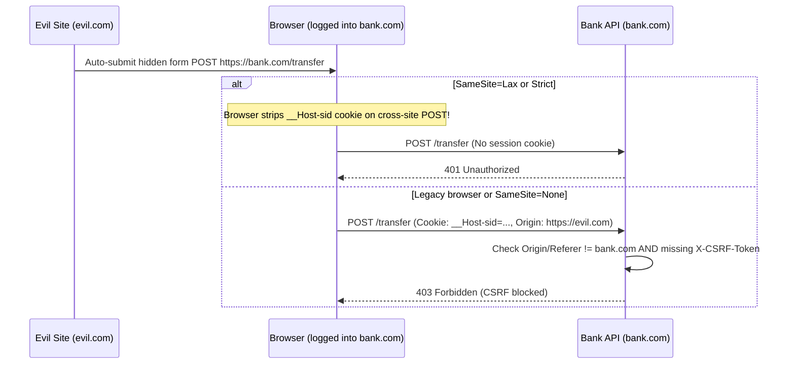

# Session-Based Authentication: Cookies, HttpOnly, SameSite & CSRF

> **Prerequisites:** [Lesson 01: Authentication vs Authorization](../01-authentication-vs-authorization/README.md).  
> **Estimated Reading Time:** 24–28 minutes  
> **Target Audience:** Backend engineers building web apps and BFFs (Backend-for-Frontend), and candidates asked "how do stateful sessions, cookie flags, and CSRF protection work together?"  
> **Free PDF Notes:** [Download SD-M-002.pdf](https://backendroadmap.com/notes/system-design/SD-M-002.pdf)

> [!NOTE]
> **In one line:** Session-based authentication stores the user's session state **on the server** (usually Redis) and gives the browser an opaque, high-entropy **session ID** inside a hardened cookie (`HttpOnly`, `Secure`, `SameSite`). Because browsers attach cookies automatically on cross-site requests, you must pair cookie auth with `SameSite` and **CSRF protection**.

> [!TIP]
> **The Golden Rule:** For browser-facing applications, **opaque server-side sessions in `HttpOnly; Secure; SameSite=Lax` cookies** beat `localStorage` JWTs on security and revocation: JavaScript cannot steal the token via XSS, and logout/ban takes effect **immediately** in Redis.

---

## 1. What Session-Based Authentication Is, and What It Isn't

When a user logs into a web app, the server creates a record in Redis (`sess:9f8a... -> {userId: 108, role: "member", expiresAt: ...}`) and sets `Set-Cookie: __Host-sid=9f8a...; HttpOnly; Secure; SameSite=Lax; Path=/`. On every subsequent request, the browser automatically sends that cookie, and the server looks up the session in Redis. Unlike a self-contained JWT, the cookie itself carries **zero user data**—it is just a random pointer.

| Term | Precise Meaning | Example |
| :--- | :--- | :--- |
| **Opaque Session ID** | Cryptographically random identifier ($\ge 128$ bits) with no embedded claims | `32` bytes from `crypto/rand` base64url-encoded |
| **Session Store** | Fast, shared server-side key-value store holding session state | Redis Cluster with TTL + AOF/replication |
| **`HttpOnly` flag** | Blocks `document.cookie` access from JavaScript | Prevents direct token theft via XSS |
| **`Secure` flag** | Browser sends cookie only over HTTPS | Blocks plaintext interception on Wi-Fi |
| **`SameSite` flag** | Controls whether cookies are sent on cross-site requests (`Strict`, `Lax`, `None`) | `Lax` blocks cross-site `POST` CSRF |
| **`__Host-` prefix** | Browser enforces `Secure`, `Path=/`, and no `Domain` attribute | Prevents subdomain cookie-tossing |
| **CSRF** | Cross-Site Request Forgery: an attacker's site tricks the browser into sending your cookies | Hidden `<form action="bank.com/transfer" method="POST">` |
| **Not** | Sticky-session in-memory storage on one web server | In-memory sessions break on deploy/autoscaling |

### Why It Matters
1. **Instant revocation:** Logging out, changing a password, or banning a compromised account is a single `DEL sess:<id>` in Redis—effective in $< 1\text{ ms}$.
2. **XSS resilience:** Tokens in `localStorage` or `sessionStorage` are readable by any third-party script or XSS payload. `HttpOnly` cookies cannot be read by JavaScript at all.
3. **Browser-native lifecycle:** Browsers handle storage, expiration, and transport automatically, but that automatic attachment is also why **CSRF** exists.

---

## 2. Anatomy: Cookie Flags, CSRF & Redis Session Flow

```mermaid
sequenceDiagram
    participant B as Browser
    participant S as App Server
    participant R as Redis Session Store

    B->>S: POST /login (email, password)
    S->>S: Verify Argon2id hash
    S->>R: SETEX sess:new_csprng_id 3600 "{user:108}"
    S-->>B: 200 OK + Set-Cookie: __Host-sid=new_csprng_id; HttpOnly; Secure; SameSite=Lax; Path=/
    Note over B: Browser stores cookie (hidden from JS)
    B->>S: POST /transfer (Cookie: __Host-sid=..., X-CSRF-Token: ...)
    S->>S: Verify Origin/Referer + CSRF token
    S->>R: GET sess:new_csprng_id
    R-->>S: "{user:108}"
    S-->>B: 200 OK (Transfer complete)
```

### Cookie Security Attributes Matrix

| Attribute | Setting | Protects Against | Trade-off |
| :--- | :--- | :--- | :--- |
| **`HttpOnly`** | Always `true` for session ID | XSS stealing the session ID via `document.cookie` | JS cannot read cookie (which is what you want) |
| **`Secure`** | Always `true` in prod | Network sniffing / MITM downgrade | Requires HTTPS even in staging (localhost is exempt) |
| **`SameSite=Lax`** | Default for most apps | Cross-site `POST`/`PUT`/`DELETE` CSRF | Top-level `GET` links (clicking from email) still send cookie |
| **`SameSite=Strict`** | High-security banking | All cross-site cookie sends (even `GET` links) | Clicking a link from Google/email appears logged out |
| **`SameSite=None`** | Cross-domain embeds/SSO | Required for third-party iframes | Must pair with `Secure` and strict CSRF tokens |
| **`__Host-` prefix** | `__Host-sid=...` | Subdomain cookie overwriting (`evil.example.com`) | Cannot set `Domain=` attribute; locked to exact host |

> [!WARNING]
> **Always rotate the session ID upon login or privilege elevation.** If an application reuses an existing pre-login anonymous session ID after authentication, an attacker who planted that ID beforehand (**Session Fixation**) instantly hijacks the authenticated session.

---

## 3. Mathematical Model: Entropy, Redis Memory & Lookup Throughput

**1. Session ID Entropy (Brute-Force Resistance).** If a session ID has $b$ bits of cryptographic randomness and $N$ active sessions exist concurrently, the probability of an attacker guessing a valid session on any single request is:

$$P(\text{hit}) = \frac{N}{2^b}$$

With $b = 128$ bits ($2^{128} \approx 3.4 \times 10^{38}$) and $N = 10^7$ active users:

$$P(\text{hit}) = \frac{10^7}{3.4 \times 10^{38}} \approx 2.9 \times 10^{-32}$$

Even at $10^6$ guesses/second, expected time to a single hit exceeds the age of the universe by $> 10^{15}\times$. Never use sequential IDs, timestamps, or `UUIDv1`—use `crypto/rand` ($128$–$256$ bits).

**2. Redis Memory Sizing.** Each session in Redis consumes key overhead ($\sim 64\text{ bytes}$), value payload ($\sim 200\text{ bytes}$ JSON/MsgPack), and hash-table/jemalloc overhead ($\sim 64\text{ bytes}$), totaling $\approx 328\text{ bytes}$ per session. For $N = 10{,}000{,}000$ concurrent sessions:

$$\text{RAM} = 10^7 \times 328\text{ B} \approx 3.28\text{ GiB}$$

Adding a $2\times$ replication factor (1 primary + 1 replica) plus $30\%$ headroom for Redis fragmentation: $3.28 \times 2 \times 1.3 \approx 8.5\text{ GiB}$ total cluster RAM—easily served by a modest 3-shard Redis cluster.

**3. Lookup Latency & Throughput.** A single-key `GET sess:<id>` in Redis takes $\sim 0.4\text{ ms}$ (same-AZ) and one Redis shard handles $\sim 80{,}000$–$100{,}000\text{ ops/s}$. At $50{,}000\text{ req/s}$, session lookups add $< 1\text{ ms}$ to $p_{99}$ latency.

---

## 4. Metrics & Percentiles

| Metric | Meaning | Alert When |
| :--- | :--- | :--- |
| **`session.redis.p99`** | 99th-percentile Redis `GET`/`SETEX` latency | $> 3\text{ ms}$ (indicates network saturation or big keys) |
| **`session.redis.errors`** | Failed Redis reads/writes | $> 0.05\%$ (causes fail-closed `503`s or forced logouts) |
| **`session.active.count`** | Total active session keys in Redis | Sudden spike (bot/login flood) or approaching `maxmemory` |
| **`csrf.rejected.rate`** | Requests rejected for invalid CSRF token or `Origin` | Spike may indicate active CSRF attack or broken frontend deploy |
| **`session.evictions`** | Redis `evicted_keys` counter | $> 0$ (Redis is silently logging out active users!) |

### Worked Example (E-Commerce BFF)
An e-commerce site serves $20{,}000\text{ req/s}$ across 40 stateless Go/Node instances backed by a 3-node Redis Cluster.
- **Session Payload:** `{userId, tenantId, csrfSecret, createdAt, lastSeenAt}` = $180\text{ bytes}$.
- **Sliding vs Absolute TTL:** Each session has a $24\text{-hour}$ sliding idle TTL (`EXPIRE` refreshed if `lastSeenAt` is $> 5\text{ min}$ old, avoiding a Redis write on every asset/API call) and a $7\text{-day}$ absolute max lifetime (`createdAt + 7d`) so stolen cookies cannot live forever.
- **Write amplification reduction:** By only extending TTL when remaining TTL $< 90\%$ of $24\text{h}$, Redis write QPS drops by $> 95\%$.

---

## 5. Compounding & Failure Modes

| Failure Mode | Mechanism | Impact |
| :--- | :--- | :--- |
| **Redis Eviction (`allkeys-lru`)** | Redis runs out of memory and evicts random session keys. | Active users are randomly logged out mid-checkout. |
| **Missing `SameSite` + No CSRF Token** | Attacker embeds `` or auto-submitting `<form method="POST">` on `evil.com`. | Victim's browser executes state-changing actions silently. |
| **Subdomain Cookie Tossing** | Cookie set with `Domain=.example.com`; compromised `blog.example.com` overwrites `sid` on `app.example.com`. | Session fixation and account takeover. |
| **In-Memory Sticky Sessions** | Sessions stored in local Node/JVM heap with sticky load balancer. | Every rolling deploy or node crash logs out thousands of users. |
| **Thundering Herd on Redis Restart** | Redis restarts empty; 100k users simultaneously get `401` and hit `/login` (Argon2id). | Login CPU spikes $100\times$ and melts the auth database. |

---

## 6. Numbers Every Engineer Must Know

| Item | Typical | Implication |
| :--- | :---: | :--- |
| Session ID length | **128 – 256 bits** (16–32 random bytes) | Never predictable; `crypto/rand` only |
| Cookie size limit (RFC 6265) | **4,096 bytes** per cookie | Keep cookie to just the ~44-char ID; store data in Redis |
| Redis `GET` latency (same AZ) | **0.3 – 1.0 ms** | Negligible, but requires HA + multi-AZ failover |
| Memory per Redis session | **~300 – 400 bytes** | 10M sessions $\approx 3.3\text{ GiB}$ primary RAM |
| Sliding TTL refresh threshold | **Every 5 – 15 min** (not every request) | Avoids turning `GET` traffic into Redis `SET` traffic |
| Idle vs Absolute TTL | **1–24h idle / 7–30d max** | Bounds exposure of a compromised session |

---

## 7. Protocol Deep Dive: CSRF Defenses & Session Rotation



| Question | Answer |
| :--- | :--- |
| **If I set `SameSite=Lax`, do I still need CSRF tokens?** | Defense-in-depth says **yes**: `SameSite=Lax` still sends cookies on top-level `GET` navigations (so `GET` must never mutate state) and across same-site subdomains (`evil.sub.example.com` is "same-site" to `app.example.com`!). Use `Origin` header checks + CSRF tokens for state-changing requests. |
| **Synchronizer Token vs Double-Submit Cookie?** | **Synchronizer Token** stores a per-session CSRF secret in Redis and expects it in `X-CSRF-Token` (best when you already have Redis sessions). **Double-Submit Cookie** compares a signed/random CSRF cookie value against `X-CSRF-Token` header (stateless, useful if sessions are encrypted cookies). |
| **Why does `X-CSRF-Token` header stop CSRF?** | Cross-site HTML `<form>` submissions cannot set custom HTTP headers, and CORS preflight blocks cross-origin `fetch()` from setting `X-CSRF-Token` unless explicitly allowed. |
| **How do SPAs get the CSRF token if the session cookie is `HttpOnly`?** | Two separate cookies: `__Host-sid` (`HttpOnly=true`) for auth, and `csrf_token` (`HttpOnly=false`, `SameSite=Lax`) or a `/me` JSON endpoint so JS can read it and send it in `X-CSRF-Token`. |

**When not to use Session Cookies:** Pure machine-to-machine (M2M) APIs, CLI tools, and mobile native apps calling third-party APIs generally use `Authorization: Bearer <token>` (OAuth 2.0 / JWT / API Keys) because they have no browser cookie jar and no CSRF risk.

---

## 8. Hierarchical Budgets & Design Rules

| Slice | Rule | Control |
| :--- | :--- | :--- |
| **Session ID** | $\ge 128$ bits from OS CSPRNG; rotate on login/elevation | `crypto/rand`; delete old key on login |
| **Cookie Flags** | `__Host-sid`, `HttpOnly`, `Secure`, `SameSite=Lax`, `Path=/` | Automated response-header security test |
| **CSRF Defense** | `Origin`/`Referer` check + `X-CSRF-Token` on all non-safe methods | Enforce `POST`/`PUT`/`PATCH`/`DELETE` only for mutations |
| **Redis Policy** | `noeviction` (never `allkeys-lru` for sessions!) + AOF/replica | Alert if memory $> 75\%$ |
| **TTLs** | Both idle (sliding) and absolute (max age) expiration | Lazy refresh (only update TTL if $> 10\%$ elapsed) |
| **Logout** | `DEL sess:<id>` in Redis + `Set-Cookie: Max-Age=0` | Invalidate all user sessions on password change |

---

## 9. Top Mitigations

1. **Use `__Host-` cookie prefix** with `HttpOnly; Secure; SameSite=Lax; Path=/` to block XSS theft, MITM, and subdomain cookie tossing.
2. **Rotate session IDs on every authentication state change** (anonymous -> logged-in, password change, MFA step-up) to eliminate Session Fixation.
3. **Pair `SameSite=Lax` with `Origin` + Synchronizer CSRF tokens** on all state-changing endpoints.
4. **Never mutate state on `GET` requests** (e.g., `/logout` or `/delete` must be `POST`), because `SameSite=Lax` allows cookies on top-level `GET` links.
5. **Configure Redis with `maxmemory-policy noeviction`** and persistence/replication so sessions aren't silently dropped.
6. **Store only a minimal Principal + CSRF secret in Redis**—don't bloat session objects with shopping carts or large user profiles.
7. **Index active sessions per user (`user_sessions:<uid>`)** so "Log out of all devices" or account compromise can revoke every session in one pipeline.

---

## 10. Production Reference: Subdomain Takeover + Cookie Tossing

A fintech company hosted `app.acme.com` and `marketing.acme.com`. Their session cookie was set with `Domain=.acme.com` so users stayed logged in across portals, and `SameSite=Lax` was assumed to block CSRF. An old DNS CNAME for `promo.acme.com` pointed to an unclaimed third-party SaaS bucket, allowing an attacker to claim `promo.acme.com`.

```mermaid
sequenceDiagram
    participant Attacker as promo.acme.com (Claimed Subdomain)
    participant Victim as Victim Browser
    participant App as app.acme.com

    Victim->>Attacker: Visits promo.acme.com link
    Attacker-->>Victim: Set-Cookie: sid=ATTACKER_SESSION; Domain=.acme.com
    Note over Victim: promo.acme.com is "same-site" to app.acme.com!
    Victim->>App: Logs in -> App reuses existing sid=ATTACKER_SESSION (No rotation!)
    Attacker->>App: Uses sid=ATTACKER_SESSION -> Full Account Takeover
```

- **Root Cause:** (1) `Domain=.acme.com` allowed any subdomain to overwrite cookies, (2) `promo.acme.com` was considered *same-site* by `SameSite=Lax`, bypassing CSRF checks, and (3) `app.acme.com` did not rotate the session ID on login.
- **Fix:** Switched to `__Host-sid` (host-locked, no `Domain`), rotated session IDs on login, enforced per-session CSRF tokens, and cleaned up dangling DNS CNAMEs.

---

## 11. Multi-Language Production Code Tabs

Production session creation (CSPRNG + rotation), hardened `__Host-` cookie emission, and Synchronizer CSRF verification.

````carousel
```go
// Go: Hardened session creation, __Host- cookie, and CSRF verification (stdlib only).
package main

import (
	"crypto/rand"
	"crypto/subtle"
	"encoding/base64"
	"net/http"
	"time"
)

type Session struct {
	UserID     string
	CSRFToken  string
	AbsoluteAt time.Time
}

func newRandomToken(bytesLen int) (string, error) {
	b := make([]byte, bytesLen)
	if _, err := rand.Read(b); err != nil {
		return "", err
	}
	return base64.RawURLEncoding.EncodeToString(b), nil
}

func IssueSessionCookie(w http.ResponseWriter, sid string, ttl time.Duration) {
	http.SetCookie(w, &http.Cookie{
		Name:     "__Host-sid", // Enforces Secure, Path=/, no Domain
		Value:    sid,
		Path:     "/",
		MaxAge:   int(ttl.Seconds()),
		HttpOnly: true,
		Secure:   true,
		SameSite: http.SameSiteLaxMode,
	})
}

func VerifyCSRF(r *http.Request, sess Session) bool {
	if r.Method == http.MethodGet || r.Method == http.MethodHead {
		return true
	}
	sent := r.Header.Get("X-CSRF-Token")
	return len(sent) > 0 && subtle.ConstantTimeCompare([]byte(sent), []byte(sess.CSRFToken)) == 1
}
```
<!-- slide -->
```typescript
// TypeScript: Session rotation, hardened cookie header, and CSRF check.
import { randomBytes, timingSafeEqual } from "node:crypto";

export interface SessionData {
  userId: string;
  csrfToken: string;
  absoluteExpiresAt: number;
}

export function generateOpaqueId(bytes = 32): string {
  return randomBytes(bytes).toString("base64url");
}

export function buildSetCookieHeader(sid: string, maxAgeSeconds: number): string {
  return [
    `__Host-sid=${sid}`,
    "Path=/",
    `Max-Age=${maxAgeSeconds}`,
    "HttpOnly",
    "Secure",
    "SameSite=Lax",
  ].join("; ");
}

export function verifyCsrf(method: string, headerToken: string | undefined, session: SessionData): boolean {
  if (method === "GET" || method === "HEAD" || method === "OPTIONS") return true;
  if (!headerToken) return false;
  const a = Buffer.from(headerToken);
  const b = Buffer.from(session.csrfToken);
  return a.length === b.length && timingSafeEqual(a, b);
}
```
<!-- slide -->
```python
# Python: CSPRNG session creation (with rotation) + CSRF check (stdlib only).
import hmac
import secrets
import time
from dataclasses import dataclass


@dataclass
class Session:
    user_id: str
    csrf_token: str
    absolute_expires_at: float


def rotate_and_create_session(store: dict[str, Session], old_sid: str | None, user_id: str, max_age_s: int = 86400) -> tuple[str, Session]:
    if old_sid:
        store.pop(old_sid, None)  # Prevent Session Fixation
    new_sid = secrets.token_urlsafe(32)  # 256 bits of CSPRNG entropy
    sess = Session(
        user_id=user_id,
        csrf_token=secrets.token_urlsafe(32),
        absolute_expires_at=time.time() + max_age_s,
    )
    store[new_sid] = sess
    return new_sid, sess


def verify_csrf(method: str, sent_token: str | None, sess: Session) -> bool:
    if method in ("GET", "HEAD", "OPTIONS"):
        return True
    if not sent_token:
        return False
    return hmac.compare_digest(sent_token, sess.csrf_token)
```
<!-- slide -->
```csharp
// C#: Hardened session cookie options and constant-time CSRF check (ASP.NET Core style).
using System.Security.Cryptography;
using System.Text;

public sealed record SessionRecord(string UserId, string CsrfToken, DateTimeOffset AbsoluteExpiresAt);

public static class SessionSecurity
{
    public static string NewOpaqueToken(int byteCount = 32)
    {
        byte[] bytes = RandomNumberGenerator.GetBytes(byteCount);
        return Convert.ToBase64String(bytes).TrimEnd('=').Replace('+', '-').Replace('/', '_');
    }

    public static string FormatHostCookie(string sid, int maxAgeSeconds) =>
        $"__Host-sid={sid}; Path=/; Max-Age={maxAgeSeconds}; HttpOnly; Secure; SameSite=Lax";

    public static bool VerifyCsrf(string method, string? sentToken, SessionRecord session)
    {
        if (method is "GET" or "HEAD" or "OPTIONS") return true;
        if (string.IsNullOrEmpty(sentToken)) return false;

        return CryptographicOperations.FixedTimeEquals(
            Encoding.UTF8.GetBytes(sentToken),
            Encoding.UTF8.GetBytes(session.CsrfToken));
    }
}
```
````

---

## 12. Hands-On CLI Verification Workflows

Inspect `Set-Cookie` security flags, test CSRF rejection, and check Redis session memory/evictions:

```bash
# 1. Verify Set-Cookie includes __Host- prefix, HttpOnly, Secure, SameSite=Lax
curl -i -s -X POST https://app.example.com/login \
  -H "Content-Type: application/json" \
  -d '{"email":"alice@example.com","password":"secret"}' \
  | grep -i "set-cookie"

# 2. Verify state-changing POST without X-CSRF-Token is rejected with 403
curl -i -s -X POST https://app.example.com/v1/transfer \
  -b "__Host-sid=$SID" -d '{"amount":100}' | head -n 5

# 3. Redis: verify noeviction policy, eviction count (must be 0), and session TTL
redis-cli CONFIG GET maxmemory-policy
redis-cli INFO stats | grep evicted_keys
redis-cli TTL "sess:$SID"
```

---

## 13. Common Mistakes to Avoid

1. **Storing JWTs or session tokens in `localStorage`**, exposing them to any XSS script.
2. **Omitting `HttpOnly` or `Secure`** on session cookies.
3. **Not rotating the session ID on login**, leaving the app vulnerable to Session Fixation.
4. **Relying solely on `SameSite=Lax` without CSRF tokens**, forgetting same-site subdomains and legacy clients.
5. **Mutating state on `GET` requests** (e.g., `/account/delete` or `/logout`), bypassing `SameSite=Lax`.
6. **Using `allkeys-lru` on the session Redis cluster**, causing silent random logouts under memory pressure.
7. **Setting `Domain=.example.com`** when `__Host-` host-locked cookies are sufficient.
8. **Writing to Redis on every single request** to bump sliding TTL instead of using a lazy refresh threshold.

---

## 14. Key Terms Glossary

| Key Term | Definition |
| :--- | :--- |
| **Session ID** | Opaque, random server-generated key mapping a browser cookie to server-side session state. |
| **`HttpOnly`** | Cookie attribute preventing client-side JavaScript (`document.cookie`) from reading the cookie. |
| **`Secure`** | Cookie attribute restricting transmission to encrypted HTTPS connections. |
| **`SameSite`** | Cookie attribute (`Strict`, `Lax`, `None`) governing cross-site cookie attachment. |
| **`__Host-` Prefix** | Cookie naming convention forcing `Secure`, `Path=/`, and no `Domain` attribute. |
| **CSRF** | Cross-Site Request Forgery: tricking a user's browser into sending authenticated requests from another site. |
| **Synchronizer Token** | Server-stored per-session secret that must be echoed in a custom header on state-changing requests. |
| **Session Fixation** | Attack where an attacker sets a known session ID before login and hijacks it after the victim logs in. |
| **Sliding Expiration** | Extending session TTL upon user activity, bounded by an absolute maximum lifetime. |
| **XSS** | Cross-Site Scripting: injecting malicious JS into a page; mitigated for cookies via `HttpOnly`. |

---

## 15. System Design Interview Questions & Answers

### Basic Conceptual Questions

<details>
<summary><strong>Q1: How does session-based authentication work end-to-end? [BASIC]</strong></summary>

**Answer:**
The client submits credentials to `/login`. After verification, the server generates a cryptographically random session ID (128+ bits), stores the user's state in a shared store (e.g., Redis) with a TTL, and returns the session ID in a `Set-Cookie` header (`HttpOnly; Secure; SameSite=Lax`). On subsequent requests, the browser sends the cookie automatically, and the server fetches the session from Redis.
</details>

<details>
<summary><strong>Q2: What do `HttpOnly`, `Secure`, and `SameSite=Lax` each protect against? [BASIC]</strong></summary>

**Answer:**
`HttpOnly` prevents JavaScript (`document.cookie`) from reading the cookie during an XSS attack. `Secure` ensures the cookie is only sent over HTTPS, preventing plaintext network sniffing. `SameSite=Lax` prevents the browser from attaching the cookie on cross-site `POST`/`PUT`/`DELETE` requests, blocking most CSRF attacks.
</details>

<details>
<summary><strong>Q3: Why is `localStorage` discouraged for storing auth tokens in browser apps? [BASIC]</strong></summary>

**Answer:**
Any JavaScript running on the origin—including XSS payloads or compromised third-party analytics/ad scripts—can read `localStorage.getItem()` and exfiltrate the token. `HttpOnly` cookies cannot be accessed by JavaScript at all.
</details>

<details>
<summary><strong>Q4: What is Session Fixation and how do you prevent it? [BASIC]</strong></summary>

**Answer:**
Session Fixation occurs when an attacker supplies or pre-sets a known session ID in the victim's browser, and the server keeps using that same ID after the victim logs in. Prevent it by always generating a brand-new session ID and deleting the old one upon login or privilege elevation.
</details>

### Scenario-Based Architecture Questions

<details>
<summary><strong>Q5: How do you scale session-based auth across 100 stateless API servers? [SCENARIO]</strong></summary>

**Answer:**
Never store sessions in local server memory or rely on sticky load balancing. Store sessions in a centralized, replicated Redis Cluster (10M sessions $\approx 3.3\text{ GiB}$ RAM) with `noeviction`. Use lazy TTL updates (refresh only when $> 10\%$ of TTL has elapsed) to avoid unnecessary Redis writes.
</details>

<details>
<summary><strong>Q6: A user's account is compromised. How do you kick them out immediately? [SCENARIO]</strong></summary>

**Answer:**
Maintain a secondary set `user_sessions:<userId>` in Redis alongside each session key. On compromise or password reset, look up all session IDs for that user and `DEL` them in a single Redis pipeline. Every subsequent request from the attacker fails immediately on the next Redis lookup.
</details>

<details>
<summary><strong>Q7: Why isn't `SameSite=Lax` alone enough to guarantee CSRF safety? [SCENARIO]</strong></summary>

**Answer:**
Three reasons: (1) `SameSite=Lax` still sends cookies on top-level `GET` navigations (so any state-changing `GET` endpoint is vulnerable), (2) subdomains under the same registrable domain (e.g., `blog.acme.com` -> `app.acme.com`) are considered *same-site*, and (3) older browsers ignore `SameSite`. Always pair `SameSite=Lax` with `Origin` checks and Synchronizer CSRF tokens.
</details>

<details>
<summary><strong>Q8: Your Redis session cluster experiences a 30-second failover. What happens to users? [SCENARIO]</strong></summary>

**Answer:**
During failover, session lookups fail and the app must fail-closed (`503 Service Unavailable`), *not* return `401` (which would cause clients to clear cookies) and *not* fail-open. Multi-AZ Redis Sentinel/Cluster promotes a replica in a few seconds so users remain logged in once connectivity resumes.
</details>

### Advanced & Tricky Interview Questions

<details>
<summary><strong>Q9: Why does `__Host-sid` prevent subdomain cookie tossing? [TRICKY]</strong></summary>

**Answer:**
Browsers enforce strict rules for any cookie prefixed with `__Host-`: it must have `Secure`, `Path=/`, and **must not** have a `Domain` attribute. This locks the cookie to the exact host (`app.acme.com`) so a compromised sibling subdomain (`promo.acme.com`) cannot set or overwrite it.
</details>

<details>
<summary><strong>Q10: How do you support "Remember Me" without allowing a stolen session to live forever? [TRICKY]</strong></summary>

**Answer:**
Use dual-TTL bounds: a sliding idle timeout (e.g., 24 hours, refreshed lazily on activity) combined with an **absolute** `max_age` timestamp stored inside the session record (e.g., 14 or 30 days). Even if an attacker replays the cookie daily, it hard-expires at the absolute deadline.
</details>

<details>
<summary><strong>Q11: What happens if you store full user permissions inside an encrypted cookie instead of Redis? [TRICKY]</strong></summary>

**Answer:**
You avoid the Redis lookup (stateless encrypted cookie), but you lose **instant server-side revocation** and hit the **4 KB cookie size limit**. If a user is banned or demoted, their encrypted cookie remains valid until it expires unless you re-introduce a server-side revocation list.
</details>

<details>
<summary><strong>Q12: Why should `/logout` be a `POST` with a CSRF token instead of a `GET`? [TRICKY]</strong></summary>

**Answer:**
With `GET /logout`, an attacker can embed `` on any third-party site. Because `SameSite=Lax` attaches cookies to top-level navigations (and legacy/some contexts), this enables Logout CSRF. Making `/logout` a `POST` requiring a CSRF token prevents third-party sites from forcing logouts.
</details>

---

## 16. One-Page Master Cheat Sheet

```
+---------------------------------------------------------------------------------------------------------+
|               SESSION-BASED AUTHENTICATION — MASTER CHEAT SHEET                                         |
+---------------------------------------------------------------------------------------------------------+
| 1. MODEL: Server stores state in Redis (sess:<id>); browser holds opaque >=128-bit CSPRNG ID in cookie. |
|    Instant revocation (DEL key). ~330 B/session -> 10M sessions = ~3.3 GiB primary RAM.                 |
+---------------------------------------------------------------------------------------------------------+
| 2. COOKIE HARDENING: __Host-sid=...; HttpOnly; Secure; SameSite=Lax; Path=/                             |
|    HttpOnly stops XSS theft | Secure stops MITM | SameSite=Lax stops cross-site POST | __Host- stops    |
|    subdomain cookie tossing.                                                                            |
+---------------------------------------------------------------------------------------------------------+
| 3. CSRF DEFENSE: SameSite=Lax + Origin header check + X-CSRF-Token (Synchronizer Token) on POST/PUT/DEL.|
|    Never mutate state (including /logout) on GET requests.                                              |
+---------------------------------------------------------------------------------------------------------+
| 4. LIFECYCLE: Always rotate session ID on login (stops Session Fixation). Use sliding + absolute TTL.   |
|    Lazy-refresh Redis TTL to cut write QPS. Set Redis maxmemory-policy = noeviction.                    |
+---------------------------------------------------------------------------------------------------------+
```

---

## Further Reading & Sources

- OWASP, [Session Management Cheat Sheet](https://cheatsheetseries.owasp.org/cheatsheets/Session_Management_Cheat_Sheet.html) & [Cross-Site Request Forgery Prevention Cheat Sheet](https://cheatsheetseries.owasp.org/cheatsheets/Cross-Site_Request_Forgery_Prevention_Cheat_Sheet.html).
- RFC 6265bis, *HTTP State Management Mechanism* (`SameSite` and `__Host-` cookie prefixes).
- MDN Web Docs, *Using HTTP cookies*.

---

## Free PDF Notes

[SD-M-002.pdf](https://backendroadmap.com/notes/system-design/SD-M-002.pdf)

---

## Next

Continue with [Lesson 03: JWT Authentication: Claims, RS256, JWKS & the Revocation Problem](../03-jwt-authentication/README.md): stateless signed tokens, asymmetric key rotation, and why JWTs cannot be easily revoked.
