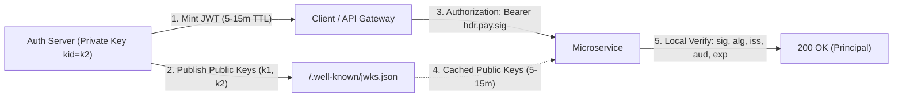
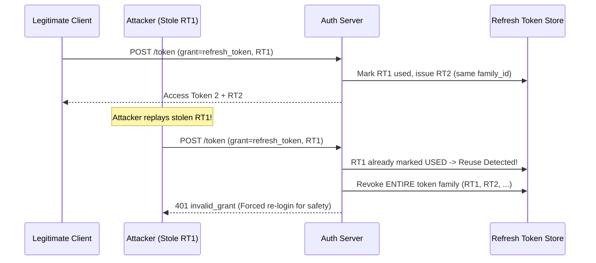
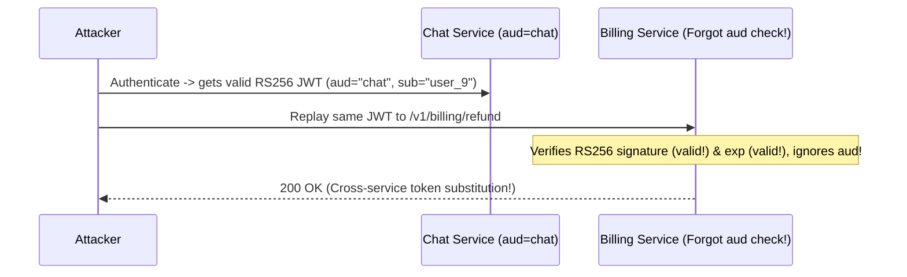

# JWT Authentication: Claims, RS256, JWKS & the Revocation Problem

> **Prerequisites:** [Lesson 02: Session-Based Authentication](../02-session-based-authentication/README.md).  
> **Estimated Reading Time:** 24–28 minutes  
> **Target Audience:** Backend engineers building distributed microservices or mobile/API auth, and candidates asked "when do you choose JWTs vs stateful sessions, and how do you handle revocation?"  
> **Free PDF Notes:** [Download SD-M-003.pdf](https://backendroadmap.com/notes/system-design/SD-M-003.pdf)

> [!NOTE]
> **In one line:** A **JWT (JSON Web Token)** is a signed, self-contained token (`header.payload.signature`) that lets any microservice verify a caller's identity **locally** using a public key from a **JWKS** endpoint—eliminating per-request database/Redis lookups, at the cost of **no built-in instant revocation** until `exp` expires.

> [!TIP]
> **The Golden Rule:** Keep JWT **access tokens short-lived (5–15 minutes)** and **signed with `RS256` or `ES256`** (never `HS256` across untrusted services). Pair them with **rotating refresh tokens** stored server-side so compromised sessions can still be terminated.

---

## 1. What JWT Authentication Is, and What It Isn't

In a 50-microservice architecture, calling Redis or an Auth service on every internal hop adds latency and creates a single point of failure. With JWTs, the Authorization Server signs a JSON payload (`{"sub": "user_108", "iss": "https://auth.acme.com", "aud": "api.acme.com", "exp": 1795600900}`) with its **private key**. Any downstream service fetches the corresponding **public key** once from `/.well-known/jwks.json` and verifies the signature locally in $< 0.3\text{ ms}$.

| Term | Precise Meaning | Example |
| :--- | :--- | :--- |
| **JWS (Signed JWT)** | Three base64url segments (`header.payload.signature`); **tamper-proof, NOT secret** | Anyone can base64-decode the payload |
| **JWE (Encrypted JWT)** | Encrypted payload so intermediaries cannot read claims | Used for sensitive PII across untrusted hops |
| **Registered Claims** | Standard fields: `iss` (issuer), `sub` (subject), `aud` (audience), `exp`, `nbf`, `iat`, `jti` | `exp`: Unix timestamp when token expires |
| **`HS256`** | Symmetric HMAC-SHA256: same secret signs and verifies | Any verifier could also *forge* tokens |
| **`RS256` / `ES256`** | Asymmetric RSA/ECDSA: private key signs, public key verifies | Only Auth Server can mint; all services verify |
| **JWKS** | JSON Web Key Set (`/.well-known/jwks.json`) publishing public keys by `kid` | Enables zero-downtime key rotation |
| **Revocation Problem** | A valid, unexpired JWT cannot be invalidated without consulting shared state | User is banned, but JWT works for 14 more min |
| **Not** | Encryption (base64url is encoding, not encryption) or a replacement for browser cookies | Never put PII/secrets in JWS claims |

### Why It Matters
1. **Stateless verification at scale:** Microservices verify tokens at $100{,}000+\text{ req/s}$ with zero network calls to an Auth DB.
2. **Cryptographic key separation:** With `RS256`/`ES256` + JWKS, compromised downstream services cannot mint new tokens.
3. **The revocation trade-off is the #1 interview topic:** Knowing how to bound the revocation window (short `exp`, refresh token rotation, or hybrid `jti` denylist) separates senior engineers from beginners.

---

## 2. Anatomy: JWT Structure, JWKS Rotation & Verification



### `HS256` vs `RS256` vs `ES256`

| Algorithm | Key Type | Signature Size | Verify Speed | Best Use Case |
| :--- | :--- | :---: | :---: | :--- |
| **`HS256`** | Symmetric shared secret | 32 bytes | ~5 µs | Single monolith verifying its own tokens |
| **`RS256`** | Asymmetric RSA-2048 | 256 bytes | ~50–150 µs | Multi-service / OIDC standard compatibility |
| **`ES256`** | Asymmetric ECDSA P-256 | 64 bytes | ~120–250 µs | Bandwidth-sensitive mobile/IoT APIs (smaller tokens) |

> [!WARNING]
> **Always pin allowed algorithms (`algorithms=["RS256"]`) and validate `iss` and `aud`.** Never accept `"alg": "none"`, and never let the token's own `alg` header dictate verification—otherwise an attacker can switch `"alg": "RS256"` to `"alg": "HS256"` and sign a forged token using your *public* RSA key as the HMAC secret (**Algorithm Confusion Attack**).

---

## 3. Mathematical Model: Bandwidth Overhead, Key Rotation & Denylist Sizing

**1. Header Bandwidth Bloat.** Every HTTP request carries the JWT in `Authorization: Bearer <token>`.
- A typical `RS256` JWT (header $40\text{ B}$ + claims $260\text{ B}$ + 2048-bit RSA sig $342\text{ B}$ base64url) $\approx 650\text{ bytes}$ (vs $44\text{ bytes}$ for an opaque session ID).
- If a team stuffs 100 fine-grained permissions into claims, the JWT swells to $4\text{ KB}$. At $50{,}000\text{ req/s}$:

$$\text{Ingress Bandwidth} = 50{,}000 \times 4{,}096\text{ B} = 204.8\text{ MB/s} \approx 1.64\text{ Gbps}$$

Keep JWT claims minimal (`sub`, `iss`, `aud`, `exp`, `jti`, coarse `roles`/`scope`) so the token stays under **1 KB**.

**2. Zero-Downtime Key Rotation Timing.** If access tokens have $T_{\text{exp}} = 15\text{ min}$ and services cache JWKS for $T_{\text{cache}} = 10\text{ min}$, then after publishing a new key `k2` in JWKS, you must wait at least:

$$T_{\text{wait}} \ge T_{\text{cache}} = 10\text{ min}$$

before signing tokens with `k2` (so all services have fetched `k2`), and keep the old public key `k1` in JWKS for at least:

$$T_{\text{retire}} \ge T_{\text{exp}} = 15\text{ min}$$

after stopping `k1` signing (so in-flight `k1` tokens still verify).

**3. Hybrid `jti` Denylist Sizing.** Suppose $10{,}000{,}000$ active users exist, $0.1\%$ ($10{,}000$) log out or are banned within any $15\text{-minute}$ window, and each revoked `jti` (16-byte UUID + 64 B Redis overhead = $80\text{ B}$) is stored with `TTL = remaining_exp` ($\le 15\text{ min}$):

$$\text{Denylist RAM} = 10{,}000 \times 80\text{ B} = 800\text{ KB}$$

Less than **1 MB** of Redis RAM restores instant revocation for high-risk events while keeping 99.9% of verifications stateless!

---

## 4. Metrics & Percentiles

| Metric | Meaning | Alert When |
| :--- | :--- | :--- |
| **`jwt.verify.p99`** | 99th-percentile local signature + claim verification | $> 2\text{ ms}$ |
| **`jwt.jwks.refresh.errors`** | Failures fetching `/.well-known/jwks.json` | $> 0$ consecutive failures (risks outage on next rotation) |
| **`jwt.rejected.expired`** | Tokens rejected due to `exp` | Sudden spike (client clock skew or broken refresh flow) |
| **`jwt.rejected.invalid_sig`** | Signature or `iss`/`aud` mismatches | Spike indicates key rotation bug or token tampering |
| **`refresh.reuse.detected`** | Revoked refresh token replayed | $> 0$ (indicates stolen refresh token; revoke family!) |

### Worked Example (Microservice Mesh)
An API platform serves $30{,}000\text{ req/s}$ across 12 services.
- **Access Token:** `ES256` JWT, $T_{\text{exp}} = 10\text{ min}$, size $= 420\text{ bytes}$ (`sub`, `org_id`, `scope`, `jti`, `exp`, `iss`, `aud`).
- **Refresh Token:** Opaque 256-bit random string stored hashed (`SHA-256`) in Postgres/Redis with $T_{\text{refresh}} = 14\text{ days}$, rotated on every use.
- **Revocation:** Normal API calls verify `ES256` locally ($0.15\text{ ms}$). High-sensitivity endpoints (`POST /wire-transfer`, `DELETE /api-keys`) also check the tiny Redis `jti` denylist ($+0.4\text{ ms}$) so a banned user is blocked immediately on critical actions.

---

## 5. Compounding & Failure Modes

| Failure Mode | Mechanism | Impact |
| :--- | :--- | :--- |
| **`alg: none` or `RS256 -> HS256` Confusion** | Library trusts header `alg` instead of pinning `["RS256"]`. | Attacker forges arbitrary `admin` JWTs with zero secrets. |
| **Missing `aud` (Audience) Validation** | Token minted for `notes-api` is accepted by `billing-api` using the same IdP. | Cross-service privilege escalation (**Token Substitution**). |
| **Unbounded Claims Bloat** | Storing 500 RBAC permissions inside JWT claims. | Requests exceed 8 KB HTTP header limits and fail with `431 Request Header Fields Too Large`. |
| **Unknown `kid` Cache Miss Storm** | Auth server rotates to `k2` immediately; 500 pods miss `k2` in cache and simultaneously hammer JWKS. | JWKS endpoint saturates; all 500 pods fail auth. |
| **No Refresh Token Reuse Detection** | Attacker steals refresh token and uses it; legitimate user also uses it. | Both get valid access tokens silently until 14-day expiry. |

---

## 6. Numbers Every Engineer Must Know

| Item | Typical | Implication |
| :--- | :---: | :--- |
| Access token TTL (`exp`) | **5 – 15 minutes** | Bounds the window of a leaked or unrevoked JWT |
| Clock skew leeway (`nbf`/`exp`) | **30 – 60 seconds** | Prevents false `401`s from NTP drift between servers |
| Refresh token TTL | **7 – 30 days** | Stored hashed server-side; enables revocation & rotation |
| `RS256` / `ES256` token size | **~400 – 800 bytes** | Keep claims lean; HTTP header limits are often 8 KB |
| JWKS cache TTL | **5 – 15 minutes** | Pre-publish new `kid` before signing with it |
| `jti` denylist memory (15m window) | **< 5 MB** | Only revoked tokens enter Redis until their `exp` |

---

## 7. Protocol Deep Dive: Refresh Token Rotation & Reuse Detection



| Question | Answer |
| :--- | :--- |
| **What happens if a legitimate client retries a refresh due to a network timeout?** | To avoid false positives on flaky mobile networks, keep a tiny **grace period** (e.g., 5–10 seconds) where the immediately-previous RT returns the same new pair, *or* require explicit re-auth if outside the grace window. |
| **Should you store raw refresh tokens in the database?** | Never. Hash refresh tokens with `SHA-256` before storing in DB/Redis (just like API keys), so a read-only DB dump cannot be used to mint access tokens. |
| **How do you handle `kid` cache misses safely?** | On an unknown `kid`, trigger a **single-flight** JWKS refresh rate-limited to at most once per 30 seconds per pod—never fetch JWKS on every bad request (which enables a DoS). |
| **JWS vs JWE: when do you encrypt?** | Only use JWE if the token traverses untrusted third-party intermediaries *and* must carry sensitive PII. Otherwise TLS + minimal claims in JWS is simpler and faster. |

**When not to use JWTs:** If you are building a monolithic or BFF-backed browser web app where instant server-side logout/revocation is critical and a Redis lookup costs $< 0.5\text{ ms}$, **opaque server-side sessions** (Lesson 02) are simpler, smaller, and immune to JWT revocation headaches.

---

## 8. Hierarchical Budgets & Design Rules

| Slice | Rule | Control |
| :--- | :--- | :--- |
| **Algorithm** | Pin `RS256` or `ES256` explicitly in verifier config | Reject `none`, reject unexpected `HS256` |
| **Claims Check** | Mandatory verification of `sig`, `exp`, `nbf`, `iss`, `aud` | Standardize in shared auth middleware |
| **Token Size** | Keep JWT $< 1\text{ KB}$ (IDs/roles only, no full ACLs) | CI assertion on minted token byte length |
| **Access TTL** | $5$–$15\text{ min}$ max; never issue 30-day JWT access tokens | Automated policy check on IdP config |
| **Refresh Tokens** | Opaque CSPRNG, stored `SHA-256` hashed, rotated with reuse detection | Revoke entire `family_id` on replay |
| **Key Rotation** | Publish `k2` in JWKS $\ge T_{\text{cache}}$ before signing; keep `k1` $\ge T_{\text{exp}}$ after | Automated JWKS rotation runbook |
| **Revocation** | Hybrid `jti` denylist in Redis for high-risk endpoints | `SETEX revoked:<jti> <remaining_ttl> 1` |

---

## 9. Top Mitigations

1. **Pin the verification algorithm** (`RS256` or `ES256`) on the server—never trust the JWT's `alg` header.
2. **Always validate `iss` (issuer) and `aud` (audience)** so tokens from another tenant or service cannot be replayed against your API.
3. **Keep access tokens short-lived (5–15 min)** and pair them with rotating, hashed refresh tokens with reuse detection.
4. **Add a Redis `jti` denylist** (with TTL = remaining `exp`) if you need instant revocation on ban/logout for sensitive endpoints.
5. **Never put sensitive PII or secrets in JWS claims**—base64url is trivially decoded by anyone.
6. **Pre-publish new JWKS keys** before signing with them, and rate-limit unknown-`kid` JWKS refreshes per pod.
7. **For SPAs, prefer a BFF (Backend-for-Frontend)** that keeps JWTs/refresh tokens server-side and talks to the browser via `HttpOnly` cookies.

---

## 10. Production Reference: The "Missing `aud`" & `alg: none` Incidents

Two real-world classes of JWT CVEs repeatedly hit production systems:
1. **The `alg: none` / Key Confusion Bug:** Early JWT libraries (and misconfigured custom verifiers) accepted `{"alg": "none"}` with an empty signature, or used the `alg` header from the untrusted token to pick `RSA` vs `HMAC`. Attackers forged `{"sub": "admin"}` tokens and bypassed authentication completely.
2. **Cross-Service Token Replay (Missing `aud`):** A company used one Auth0 tenant for both `staging-api` and `prod-api` (or `chat-service` and `admin-billing`). Because `billing` only checked signature and `exp`—ignoring `aud`—a token issued for a low-privilege service was replayed directly against `billing`.



- **Fix:** Upgrade to strict JWT verifiers that require an explicit `allowedAlgorithms` list, mandatory `expectedIssuer` and `expectedAudience`, and separate signing keys/issuers per environment.

---

## 11. Multi-Language Production Code Tabs

Strict JWT verification (`alg` pinning, `iss`, `aud`, `exp`, `nbf` with leeway, and `jti` denylist check) across Go, TypeScript, Python, and C#.

````carousel
```go
// Go: Strict JWT claim + signature validation + jti denylist check (stdlib crypto).
package main

import (
	"crypto"
	"crypto/rsa"
	"crypto/sha256"
	"encoding/base64"
	"encoding/json"
	"errors"
	"strings"
	"time"
)

type Claims struct {
	Iss string `json:"iss"`
	Sub string `json:"sub"`
	Aud string `json:"aud"`
	Exp int64  `json:"exp"`
	Nbf int64  `json:"nbf"`
	Jti string `json:"jti"`
}

func VerifyRS256JWT(token string, pub *rsa.PublicKey, expectedIss, expectedAud string, isRevoked func(jti string) bool) (*Claims, error) {
	parts := strings.Split(token, ".")
	if len(parts) != 3 {
		return nil, errors.New("malformed jwt")
	}
	var hdr struct{ Alg string `json:"alg"` }
	hdrBytes, err := base64.RawURLEncoding.DecodeString(parts[0])
	if err != nil || json.Unmarshal(hdrBytes, &hdr) != nil || hdr.Alg != "RS256" {
		return nil, errors.New("disallowed alg: must be RS256") // Stops alg:none & HS256 confusion
	}
	sig, err := base64.RawURLEncoding.DecodeString(parts[2])
	if err != nil {
		return nil, errors.New("bad signature encoding")
	}
	digest := sha256.Sum256([]byte(parts[0] + "." + parts[1]))
	if err := rsa.VerifyPKCS1v15(pub, crypto.SHA256, digest[:], sig); err != nil {
		return nil, errors.New("invalid signature")
	}
	var c Claims
	payloadBytes, err := base64.RawURLEncoding.DecodeString(parts[1])
	if err != nil || json.Unmarshal(payloadBytes, &c) != nil {
		return nil, errors.New("invalid claims")
	}
	now := time.Now().Unix()
	const leeway = 30
	if c.Iss != expectedIss || c.Aud != expectedAud || now > c.Exp+leeway || now < c.Nbf-leeway {
		return nil, errors.New("claims validation failed")
	}
	if c.Jti != "" && isRevoked(c.Jti) {
		return nil, errors.New("token revoked")
	}
	return &c, nil
}
```
<!-- slide -->
```typescript
// TypeScript: Strict RS256 JWT verification with algorithm pinning & claim checks.
import { createVerify } from "node:crypto";

export interface JwtClaims {
  iss: string;
  sub: string;
  aud: string;
  exp: number;
  nbf?: number;
  jti?: string;
}

export function verifyRs256Jwt(
  token: string,
  publicKeyPem: string,
  expectedIss: string,
  expectedAud: string,
  isRevoked: (jti: string) => boolean
): JwtClaims {
  const parts = token.split(".");
  if (parts.length !== 3) throw new Error("Malformed JWT");
  const [hB64, pB64, sB64] = parts;

  const header = JSON.parse(Buffer.from(hB64, "base64url").toString("utf8"));
  if (header.alg !== "RS256") {
    throw new Error("Disallowed algorithm"); // Pin RS256 explicitly
  }

  const verifier = createVerify("RSA-SHA256");
  verifier.update(`${hB64}.${pB64}`);
  if (!verifier.verify(publicKeyPem, Buffer.from(sB64, "base64url"))) {
    throw new Error("Invalid signature");
  }

  const claims: JwtClaims = JSON.parse(Buffer.from(pB64, "base64url").toString("utf8"));
  const now = Math.floor(Date.now() / 1000);
  const leeway = 30;
  if (claims.iss !== expectedIss || claims.aud !== expectedAud) throw new Error("Invalid iss/aud");
  if (now > claims.exp + leeway) throw new Error("Token expired");
  if (claims.nbf !== undefined && now < claims.nbf - leeway) throw new Error("Token not yet valid");
  if (claims.jti && isRevoked(claims.jti)) throw new Error("Token revoked");

  return claims;
}
```
<!-- slide -->
```python
# Python: Strict JWT claim validation & jti revocation check (stdlib + PyJWT pattern).
import base64
import json
import time
from typing import Callable


def decode_unverified_header_and_claims(token: str) -> tuple[dict, dict]:
    parts = token.split(".")
    if len(parts) != 3:
        raise ValueError("Malformed JWT")
    pad = lambda s: s + "=" * (-len(s) % 4)
    header = json.loads(base64.urlsafe_b64decode(pad(parts[0])))
    claims = json.loads(base64.urlsafe_b64decode(pad(parts[1])))
    return header, claims


def validate_claims(
    header: dict,
    claims: dict,
    expected_iss: str,
    expected_aud: str,
    is_revoked: Callable[[str], bool],
    leeway_s: int = 30,
) -> dict:
    if header.get("alg") not in ("RS256", "ES256"):
        raise ValueError(f"Disallowed alg: {header.get('alg')}")
    # Note: verify cryptographic signature via PyJWT/cryptography before trusting claims!
    now = int(time.time())
    if claims.get("iss") != expected_iss or claims.get("aud") != expected_aud:
        raise ValueError("Invalid issuer or audience")
    if now > int(claims.get("exp", 0)) + leeway_s:
        raise ValueError("Token expired")
    if now < int(claims.get("nbf", 0)) - leeway_s:
        raise ValueError("Token not active yet")
    jti = claims.get("jti")
    if jti and is_revoked(jti):
        raise ValueError("Token revoked")
    return claims
```
<!-- slide -->
```csharp
// C#: Strict JWT validation with RSA-SHA256 pinning and claim checks (.NET 8 stdlib).
using System.Security.Cryptography;
using System.Text;
using System.Text.Json;

public sealed record JwtClaims(string iss, string sub, string aud, long exp, long nbf, string? jti);

public static class JwtVerifier
{
    public static JwtClaims VerifyRs256(
        string token, RSA publicKey, string expectedIss, string expectedAud, Func<string, bool> isRevoked)
    {
        var parts = token.Split('.');
        if (parts.Length != 3) throw new SecurityException("Malformed JWT");

        var hdr = JsonDocument.Parse(Base64UrlDecode(parts[0])).RootElement;
        if (hdr.GetProperty("alg").GetString() != "RS256")
            throw new SecurityException("Disallowed algorithm");

        byte[] data = Encoding.ASCII.GetBytes($"{parts[0]}.{parts[1]}");
        byte[] sig = Base64UrlDecode(parts[2]);
        if (!publicKey.VerifyData(data, sig, HashAlgorithmName.SHA256, RSASignaturePadding.Pkcs1))
            throw new SecurityException("Invalid signature");

        var claims = JsonSerializer.Deserialize<JwtClaims>(Base64UrlDecode(parts[1]))
            ?? throw new SecurityException("Invalid claims");

        long now = DateTimeOffset.UtcNow.ToUnixTimeSeconds();
        const long leeway = 30;
        if (claims.iss != expectedIss || claims.aud != expectedAud) throw new SecurityException("Bad iss/aud");
        if (now > claims.exp + leeway || now < claims.nbf - leeway) throw new SecurityException("Expired/nbf");
        if (claims.jti is not null && isRevoked(claims.jti)) throw new SecurityException("Revoked");

        return claims;
    }

    private static byte[] Base64UrlDecode(string s)
    {
        string padded = s.Replace('-', '+').Replace('_', '/').PadRight(s.Length + (4 - s.Length % 4) % 4, '=');
        return Convert.FromBase64String(padded);
    }
}

public sealed class SecurityException(string msg) : Exception(msg);
```
````

---

## 12. Hands-On CLI Verification Workflows

Inspect a live JWKS endpoint, decode a JWT payload locally, and generate an `RS256` keypair:

```bash
# 1. Fetch and inspect an IdP's JWKS public keys
curl -s https://auth.example.com/.well-known/jwks.json | jq '.keys[] | {kid, alg, kty, use}'

# 2. Decode a JWT header & payload (remember: base64url is NOT encrypted!)
python3 -c '
import sys, base64, json
t = sys.argv[1].split(".")
pad = lambda s: s + "=" * (-len(s) % 4)
print("HEADER:", json.loads(base64.urlsafe_b64decode(pad(t[0]))))
print("CLAIMS:", json.loads(base64.urlsafe_b64decode(pad(t[1]))))
' "$JWT_TOKEN"

# 3. Generate an RSA-2048 private/public keypair for local RS256 testing
openssl genpkey -algorithm RSA -pkeyopt rsa_keygen_bits:2048 -out jwt_private.pem
openssl rsa -pubout -in jwt_private.pem -out jwt_public.pem
```

---

## 13. Common Mistakes to Avoid

1. **Treating a JWS as encrypted** and storing PII, SSNs, or internal secrets in the payload.
2. **Using `HS256` across microservices**, giving every verifying service the ability to forge tokens.
3. **Not pinning `alg`** (leaving the door open to `alg: none` or `RS256`->`HS256` key confusion).
4. **Skipping `aud` and `iss` checks**, enabling cross-service or cross-environment token replay.
5. **Issuing long-lived JWT access tokens (e.g., 24 hours or 30 days)** with no revocation strategy.
6. **Stuffing hundreds of permissions into JWT claims**, causing `431 Request Header Fields Too Large`.
7. **Rotating JWKS keys without a grace window**, breaking in-flight tokens and causing `401` spikes.
8. **Storing JWTs in `localStorage`** in browser SPAs instead of using a BFF + `HttpOnly` cookies.

---

## 14. Key Terms Glossary

| Key Term | Definition |
| :--- | :--- |
| **JWT** | JSON Web Token (RFC 7519): compact, URL-safe token format (`header.payload.signature`). |
| **JWS / JWE** | JSON Web Signature (signed, readable) vs JSON Web Encryption (encrypted payload). |
| **Claims** | Key-value assertions inside the JWT payload (`sub`, `iss`, `aud`, `exp`, `jti`). |
| **`kid` (Key ID)** | Header parameter identifying which key in the JWKS signed the token. |
| **JWKS** | JSON Web Key Set: public endpoint publishing active public keys for local verification. |
| **`RS256` / `ES256`** | Asymmetric signing algorithms (RSA-2048 / ECDSA P-256) with SHA-256. |
| **`HS256`** | Symmetric HMAC-SHA256 signing algorithm sharing one secret between signer and verifier. |
| **Revocation Problem** | Inability to invalidate a stateless, unexpired JWT without consulting shared state. |
| **`jti` (JWT ID)** | Unique token identifier used for replay prevention and denylist revocation. |
| **Refresh Token Rotation** | Issuing a new refresh token on every use and revoking the token family on reuse. |

---

## 15. System Design Interview Questions & Answers

### Basic Conceptual Questions

<details>
<summary><strong>Q1: What are the three parts of a JWT, and is a standard JWT encrypted? [BASIC]</strong></summary>

**Answer:**
A standard JWS consists of `header.payload.signature`, each base64url-encoded and separated by dots. It is **signed (tamper-proof), NOT encrypted**—anyone with the token can base64-decode and read the payload. Encryption requires JWE.
</details>

<details>
<summary><strong>Q2: Why prefer `RS256` or `ES256` over `HS256` in a microservices architecture? [BASIC]</strong></summary>

**Answer:**
`HS256` uses a single shared secret for both signing and verification—if any verifying microservice is compromised, the attacker can mint arbitrary admin tokens. `RS256`/`ES256` use asymmetric keys: only the Auth Server holds the private key, while microservices verify locally with the public key from JWKS.
</details>

<details>
<summary><strong>Q3: What are `iss`, `sub`, `aud`, `exp`, and `jti`? [BASIC]</strong></summary>

**Answer:**
`iss` is the issuer (Auth Server), `sub` is the subject (user/service ID), `aud` is the intended audience (target API), `exp` is the Unix expiration timestamp, and `jti` is a unique token ID used for revocation or replay detection.
</details>

<details>
<summary><strong>Q4: What is the JWT Revocation Problem? [BASIC]</strong></summary>

**Answer:**
Because JWTs are verified locally without hitting a central database, revoking a user's access (logout, password reset, ban) does not invalidate already-issued JWTs until their `exp` timestamp passes.
</details>

### Scenario-Based Architecture Questions

<details>
<summary><strong>Q5: A user is banned for fraud, but they have a valid JWT. How do you block them immediately? [SCENARIO]</strong></summary>

**Answer:**
Combine two defenses: (1) keep access token `exp` short (5–15 min) and revoke their **refresh token** in the DB so they cannot renew, and (2) for immediate effect on critical endpoints, maintain a small Redis `jti` (or `revoked_before:<user_id>`) denylist with TTL equal to the max access token lifetime (~15 min, $< 1\text{ MB}$ RAM).
</details>

<details>
<summary><strong>Q6: How do you rotate signing keys in production without logging everyone out? [SCENARIO]</strong></summary>

**Answer:**
Step 1: Generate new key `k2` and publish **both** `k1` and `k2` in `/.well-known/jwks.json`. Step 2: Wait longer than the JWKS cache TTL (e.g., 15 min) so all services have cached `k2`. Step 3: Switch the Auth Server to sign new tokens with `kid: k2`. Step 4: Keep `k1` in JWKS until all `k1`-signed tokens expire (`exp`), then remove `k1`.
</details>

<details>
<summary><strong>Q7: Your JWTs grew to 6 KB because you added 200 permission strings. What goes wrong and how do you fix it? [SCENARIO]</strong></summary>

**Answer:**
Large tokens waste bandwidth on every request (hundreds of MB/s at scale) and hit default HTTP header limits (`431` / `400` from Nginx/ALB at 8 KB). Fix it by keeping only identity (`sub`, `org_id`, coarse `roles`) in the JWT and resolving fine-grained permissions inside the service or via a local PDP/cache.
</details>

<details>
<summary><strong>Q8: Should you use JWTs or Redis sessions for a consumer web app with instant logout requirements? [SCENARIO]</strong></summary>

**Answer:**
Prefer **Redis-backed opaque sessions** in `HttpOnly; Secure; SameSite=Lax` cookies (or a BFF). They give instant revocation, zero XSS token exposure, and tiny 44-byte cookies, while Redis lookup adds $< 1\text{ ms}$.
</details>

### Advanced & Tricky Interview Questions

<details>
<summary><strong>Q9: Explain the `RS256` to `HS256` Algorithm Confusion attack and how to prevent it. [TRICKY]</strong></summary>

**Answer:**
If a verifier passes the public RSA key into a generic `verify(token, key)` function that reads `header.alg` from the untrusted token, an attacker can craft a forged token with `"alg": "HS256"` and sign it using the server's *public* RSA key (which is public in JWKS!) as the HMAC secret. Prevent it by explicitly pinning allowed algorithms (`algorithms=["RS256"]`) in the verifier.
</details>

<details>
<summary><strong>Q10: How does Refresh Token Reuse Detection work? [TRICKY]</strong></summary>

**Answer:**
Every refresh token belongs to a `family_id` and is single-use. When used, it is marked `used` and replaced by a new token in the same family. If an already-used refresh token is presented again (either by an attacker or the victim after an attacker stole it), the server detects reuse and immediately revokes the **entire token family**, forcing re-authentication.
</details>

<details>
<summary><strong>Q11: What happens if an unknown `kid` triggers an unthrottled JWKS fetch on every request? [TRICKY]</strong></summary>

**Answer:**
An attacker can send 50,000 requests/sec with random `kid: "evil-123"` headers, causing every pod to hammer the Auth Server's JWKS endpoint (amplification DoS). Always rate-limit/single-flight JWKS refreshes (e.g., at most once per 30 seconds per pod).
</details>

<details>
<summary><strong>Q12: Why is `revoked_before:<user_id>` sometimes better than a per-`jti` denylist? [TRICKY]</strong></summary>

**Answer:**
If a user has 10 active access tokens across 5 devices and resets their password, you may not know all 10 `jti` values. Storing one timestamp `revoked_before:<user_id> = now` rejects *every* token for that user whose `iat < revoked_before` in a single key.
</details>

---

## 16. One-Page Master Cheat Sheet

```
+---------------------------------------------------------------------------------------------------------+
|                    JWT AUTHENTICATION — MASTER CHEAT SHEET                                              |
+---------------------------------------------------------------------------------------------------------+
| 1. FORMAT: header.payload.signature (base64url). JWS is SIGNED, NOT encrypted. Never put PII/secrets.   |
| 2. SIGNING: Use RS256 or ES256 (private key on Auth Server, public keys at /.well-known/jwks.json).     |
|    Avoid HS256 across services. Always pin allowed `alg` (stops alg:none & RS256->HS256 confusion).     |
+---------------------------------------------------------------------------------------------------------+
| 3. MANDATORY CHECKS: Signature + alg + exp + nbf (30s leeway) + iss + aud (stops cross-service replay). |
| 4. REVOCATION PROBLEM: Stateless JWTs can't be revoked natively. Fix: short exp (5-15m) + rotating      |
|    hashed refresh tokens (with reuse detection) + optional tiny Redis jti/revoked_before denylist.      |
+---------------------------------------------------------------------------------------------------------+
| 5. KEY ROTATION: Publish k2 in JWKS -> wait >= JWKS cache TTL -> sign with k2 -> keep k1 >= max exp.    |
|    Single-flight & rate-limit unknown-kid refreshes. Keep JWT claims < 1 KB.                            |
+---------------------------------------------------------------------------------------------------------+
```

---

## Further Reading & Sources

- RFC 7519, *JSON Web Token (JWT)* & RFC 8725, *JSON Web Token Best Current Practices*.
- RFC 7517, *JSON Web Key (JWK)*.
- Auth0 / Okta Engineering, *Refresh Token Rotation & Reuse Detection*.

---

## Free PDF Notes

[SD-M-003.pdf](https://backendroadmap.com/notes/system-design/SD-M-003.pdf)

---

## Next

Continue with [Lesson 04: OAuth 2.0: Authorization Code + PKCE, Scopes & Client Credentials](../04-oauth-2-0/README.md): delegated authorization flows, PKCE, and machine-to-machine tokens.
