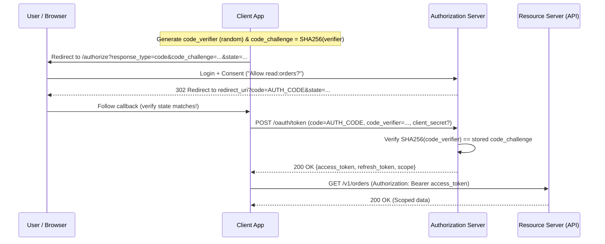
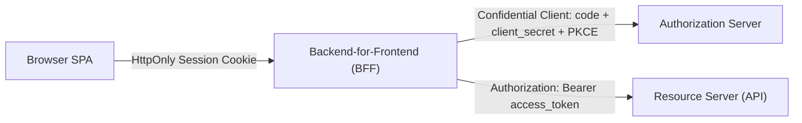
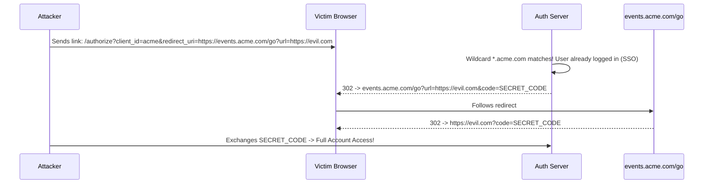

# OAuth 2.0: Authorization Code + PKCE, Scopes & Client Credentials

> **Prerequisites:** [Lesson 03: JWT Authentication](../03-jwt-authentication/README.md).  
> **Estimated Reading Time:** 24–28 minutes  
> **Target Audience:** Backend engineers integrating third-party APIs or building an Authorization Server, and candidates asked "walk me through OAuth 2.0 Authorization Code + PKCE vs Client Credentials."  
> **Free PDF Notes:** [Download SD-M-004.pdf](https://backendroadmap.com/notes/system-design/SD-M-004.pdf)

> [!NOTE]
> **In one line:** **OAuth 2.0** is a **delegated authorization** framework (RFC 6749), *not* an authentication protocol: it lets a user grant a third-party app limited **scoped** access to their resources without ever sharing their password. Modern **OAuth 2.1** standardizes on **Authorization Code + PKCE** for users and **Client Credentials** for service-to-service calls.

> [!TIP]
> **The Golden Rule:** Always use **Authorization Code + PKCE (`S256`)** for user-facing apps (web, SPA, mobile) with a cryptographic `state` parameter and exact `redirect_uri` matching. Never use the deprecated **Implicit** or **Resource Owner Password Credentials (ROPC)** grants.

---

## 1. What OAuth 2.0 Is, and What It Isn't

Before OAuth, if a budgeting app wanted to read your bank transactions, you had to give it your banking username and password—granting it full access to wire money too, with no way to revoke just that app. OAuth 2.0 solves this by introducing an **Authorization Server** that asks the user for consent ("Allow BudgetApp to `read:transactions`?") and issues a scoped **Access Token** to the app.

| Term | Precise Meaning | Example |
| :--- | :--- | :--- |
| **Resource Owner** | The user who owns the protected data and grants consent | Alice |
| **Client** | The application requesting access to the Resource Owner's data | BudgetApp (web, mobile, or backend) |
| **Authorization Server (AS)** | Authenticates the user, obtains consent, and mints tokens | `https://auth.bank.com` |
| **Resource Server (RS)** | The API hosting protected data that validates access tokens | `https://api.bank.com` |
| **Authorization Code** | Short-lived, single-use code returned via browser redirect, exchanged for tokens | `code=splxlOBeZQQYbYS6WxSbIA` |
| **PKCE** | Proof Key for Code Exchange (RFC 7636): binds code exchange to the original client | `code_challenge = BASE64URL(SHA256(code_verifier))` |
| **`state`** | Unpredictable per-request token binding browser session to callback (stops CSRF) | `state=9f81c...` |
| **Scope** | Granular permission string requested by the client | `read:transactions offline_access` |
| **Not** | An authentication protocol (OAuth doesn't define user identity; OpenID Connect does) | Access token audience is the RS, not the Client |

### Why It Matters
1. **Least-privilege delegation:** Scopes limit blast radius (`read:orders` cannot `write:payments`).
2. **Confidential vs Public Clients:** Mobile apps and SPAs cannot keep a `client_secret` secret (anyone can decompile the binary or inspect JS), which is why **PKCE** is mandatory for all clients in OAuth 2.1.
3. **Machine-to-Machine (M2M):** Microservices and cron jobs use **Client Credentials** (`grant_type=client_credentials`) because no human user is present.

---

## 2. Anatomy: Authorization Code + PKCE vs Client Credentials



### OAuth 2.0 / 2.1 Grant Types Comparison

| Grant Type | Status in OAuth 2.1 | Use Case | Key Security Control |
| :--- | :--- | :--- | :--- |
| **Authorization Code + PKCE** | **Required** | Web apps (BFF), SPAs, Native/Mobile apps | `S256` PKCE + `state` + exact `redirect_uri` |
| **Client Credentials** | **Active** | Backend-to-backend / M2M / Cron | `client_secret` or `private_key_jwt` / mTLS |
| **Refresh Token** | **Active** | Renewing short-lived access tokens | Rotation + reuse detection |
| **Implicit (`response_type=token`)** | **Deprecated / Removed** | Legacy SPAs | Exposed access token in URL fragment `#access_token=` |
| **Password (ROPC)** | **Deprecated / Removed** | Legacy migration only | Client handles raw user password (anti-pattern) |

> [!WARNING]
> **Never use wildcard `redirect_uri` matching (e.g., `https://app.com/*`) or accept `code_challenge_method=plain`.** An open redirector on `app.com/out?next=https://evil.com` combined with a wildcard `redirect_uri` leaks the authorization `code` directly to an attacker. Always require **exact string matching** on `redirect_uri` and enforce `S256` PKCE.

---

## 3. Mathematical Model: PKCE Binding, Entropy & Token Exchange Load

**1. PKCE Cryptographic Binding.**
The client generates a high-entropy `code_verifier` $v \in \{0,1\}^{256}$ (43–128 URL-safe characters) and sends:

$$c = \text{BASE64URL}(\text{SHA-256}(v))$$

Even if malware on a phone intercepts the redirect containing `code`, it only saw $c$ on the `/authorize` URL. Inverting SHA-256 requires $2^{256}$ operations, and guessing $v$ requires $2^{256}$ attempts—so the attacker **cannot** exchange `code` at `/oauth/token`.

**2. Authorization Code Lifetime & Single-Use Window.**
An authorization `code` is valid for only $T_{\text{code}} \le 60\text{ seconds}$ and is **strictly single-use**. If a `code` is presented a second time, the Authorization Server must **revoke all tokens** previously issued from that `code` (RFC 6749 Section 4.1.2).

**3. Client Credentials Token Caching (Avoiding AS Overload).**
Suppose 50 microservices make $10{,}000\text{ req/s}$ internally using `client_credentials` tokens with $T_{\text{exp}} = 3{,}600\text{ s}$ (1 hour).
- **Without caching** (fetching a new token per call): $10{,}000\text{ token requests/s}$ to `/oauth/token`—an immediate self-inflicted DoS.
- **With caching** (refresh at $80\%$ of TTL, i.e., every $2{,}880\text{ s}$):

$$\text{AS QPS} = \frac{50}{2{,}880\text{ s}} \approx 0.017\text{ req/s}$$

A **$580{,}000\times$ reduction** in Authorization Server load.

---

## 4. Metrics & Percentiles

| Metric | Meaning | Alert When |
| :--- | :--- | :--- |
| **`oauth.token.p99`** | 99th-percentile `/oauth/token` exchange latency | $> 150\text{ ms}$ |
| **`oauth.authorize.abandon_rate`** | Users starting `/authorize` who never complete consent | Sudden spike (UX or redirect bug) |
| **`oauth.pkce.mismatch`** | `/oauth/token` calls failing `code_verifier` verification | $> 0$ (possible code interception attempt) |
| **`oauth.code.replay`** | Single-use authorization code presented twice | $> 0$ (active attack -> auto-revoke tokens!) |
| **`oauth.state.mismatch`** | Callback requests with missing/wrong `state` | Spike indicates Login CSRF probing |

### Worked Example (Mobile Banking App + BFF)
A mobile app connects to its backend via OAuth 2.0 Authorization Code + PKCE:
1. App generates 32-byte `code_verifier` and computes `S256` `code_challenge`.
2. System browser (ASWebAuthenticationSession / Custom Tabs, **not** an embedded WebView) opens `/authorize` with `scope=read:accounts transfer:initiate`.
3. User authenticates with Passkey/MFA and approves.
4. AS redirects to `myapp://callback?code=...&state=...` (`code` TTL = 60 s).
5. App verifies `state`, exchanges `code` + `code_verifier` at `/oauth/token`, and receives a $10\text{-minute}$ access token + rotating refresh token.
6. Resource Server checks `scope` includes `transfer:initiate` *and* checks user ownership before executing any transfer.

---

## 5. Compounding & Failure Modes

| Failure Mode | Mechanism | Impact |
| :--- | :--- | :--- |
| **Missing `state` Parameter (Login CSRF)** | Attacker initiates OAuth flow, gets their own `code`, and tricks victim's browser into visiting `/callback?code=ATTACKER_CODE`. | Victim is silently logged into the **attacker's** account (e.g., attacker sees victim's saved searches/cards). |
| **Embedded WebView in Mobile Apps** | App uses `WKWebView`/`WebView` instead of OS system browser. | Violates RFC 8252; app can sniff user's IdP password and loses SSO cookies. |
| **Token Confusion on `RS`** | Resource Server accepts any valid token from the IdP without checking `aud` or `scope`. | A token with `scope=read:profile` accesses `write:payments`. |
| **Client Credentials Cache Stampede** | 200 pods start at once or expire their M2M token at the exact same second. | Thundering herd hits `/oauth/token`. |
| **Referrer Header Leakage** | Redirect response or callback page loads third-party scripts/images. | Authorization `code` leaks in `Referer` header to analytics vendors. |

---

## 6. Numbers Every Engineer Must Know

| Item | Typical | Implication |
| :--- | :---: | :--- |
| Authorization `code` TTL | **30 – 60 seconds** | Single-use; must be exchanged immediately |
| `code_verifier` length | **43 – 128 chars** (256+ bits) | High entropy required by RFC 7636 |
| PKCE method | **`S256` only** | Never allow `plain` in production |
| Access token TTL | **5 – 60 minutes** | Shorter for user-delegated, up to 1h for M2M |
| M2M token refresh threshold | **75% – 85% of TTL** (+ jitter) | Prevents expiry races and thundering herds |
| `redirect_uri` matching | **Exact byte-for-byte match** | No wildcards, no open-redirect paths |

---

## 7. Protocol Deep Dive: Scopes vs Permissions & BFF Pattern



| Question | Answer |
| :--- | :--- |
| **Are OAuth `scopes` enough for Authorization?** | **No.** Scopes express *delegated capability* ("this app may read orders on Alice's behalf"). The Resource Server must *also* check Alice's own permissions/ownership (`order.owner_id == sub`). |
| **Why use a BFF for SPAs instead of storing OAuth tokens in the browser?** | Even with PKCE, tokens returned to a browser SPA must live in memory or `localStorage`/`sessionStorage`, where XSS can steal them. A BFF keeps `access_token` and `refresh_token` on the server and uses an `HttpOnly; SameSite=Lax` cookie with the browser. |
| **What is `private_key_jwt` in Client Credentials?** | Instead of sending a static `client_secret`, the client signs a short-lived JWT assertion with its own private key. The AS verifies it against the client's registered public key—no shared secret over the wire. |
| **How does OAuth 2.0 differ from OAuth 2.1?** | OAuth 2.1 consolidates best practices: PKCE is mandatory for all Authorization Code flows, Implicit and ROPC grants are removed, and exact `redirect_uri` matching is required. |

**When not to use OAuth 2.0:** For simple first-party login on a single web app with no third-party API delegation, plain session-based auth (or OIDC via a managed provider) is far simpler than running your own OAuth Authorization Server.

---

## 8. Hierarchical Budgets & Design Rules

| Slice | Rule | Control |
| :--- | :--- | :--- |
| **User Flow** | Authorization Code + PKCE (`S256`) only | Disable Implicit & ROPC in AS config |
| **CSRF Binding** | Cryptographic `state` stored in `HttpOnly` cookie/session | Verify `state` on `/callback` before exchanging `code` |
| **Redirect URIs** | Exact match pre-registered per client | Reject wildcards, `http://` (except localhost loopback) |
| **Mobile Apps** | System browser (`ASWebAuthenticationSession` / Custom Tabs) | Ban embedded WebViews (RFC 8252) |
| **M2M Auth** | `client_credentials` with cached token + jittered refresh | Refresh at 80% TTL; use `private_key_jwt` or mTLS |
| **Resource Server** | Validate `iss`, `aud`, `exp`, *and* required `scope` + ownership | Enforce least-privilege scopes per endpoint |
| **Code Replay** | Single-use `code`; revoke issued tokens on second use | Atomic `GETDEL` / `UPDATE ... WHERE used=false` |

---

## 9. Top Mitigations

1. **Enforce PKCE `S256`** on all Authorization Code clients—even confidential server-side clients.
2. **Validate `state` with constant-time comparison** on `/callback` to block Login CSRF.
3. **Require exact `redirect_uri` matching** (scheme, host, port, path) and audit your domain for open redirects.
4. **Make authorization codes single-use and short-lived ($\le 60\text{ s}$)**, revoking all tokens if a code is replayed.
5. **Use a BFF for browser SPAs** so refresh/access tokens never touch browser storage.
6. **Cache `client_credentials` tokens** with jittered proactive refresh (at ~80% of TTL) and single-flight coalescing.
7. **Separate OAuth `scope` checks from user RBAC/ownership checks** on the Resource Server.

---

## 10. Production Reference: The Open-Redirect + Wildcard `redirect_uri` Leak

An enterprise SaaS platform registered `https://*.acme.com/callback` as an allowed `redirect_uri` for its OAuth client. An old marketing subdomain `events.acme.com` had an open-redirect endpoint `/go?url=...`.



- **Root Cause:** (1) Wildcard `redirect_uri` allowed any subdomain path, (2) PKCE was not enforced, and (3) an open redirector forwarded the `code` query parameter to `evil.com`.
- **Fix:** Enforced exact `redirect_uri` matching (`https://app.acme.com/oauth/callback`), enabled mandatory `S256` PKCE for all clients, and eliminated open redirects.

---

## 11. Multi-Language Production Code Tabs

PKCE (`S256`) challenge generation/verification and `state` validation (stdlib only) in Go, TypeScript, Python, and C#.

````carousel
```go
// Go: PKCE S256 generation/verification and state check (stdlib only).
package main

import (
	"crypto/rand"
	"crypto/sha256"
	"crypto/subtle"
	"encoding/base64"
)

func NewPKCEPair() (verifier, challenge string, err error) {
	b := make([]byte, 32) // 256 bits -> 43-char base64url verifier
	if _, err = rand.Read(b); err != nil {
		return "", "", err
	}
	verifier = base64.RawURLEncoding.EncodeToString(b)
	sum := sha256.Sum256([]byte(verifier))
	challenge = base64.RawURLEncoding.EncodeToString(sum[:])
	return verifier, challenge, nil
}

func VerifyPKCE(verifier, storedChallenge string) bool {
	if len(verifier) < 43 || len(verifier) > 128 {
		return false
	}
	sum := sha256.Sum256([]byte(verifier))
	computed := base64.RawURLEncoding.EncodeToString(sum[:])
	return subtle.ConstantTimeCompare([]byte(computed), []byte(storedChallenge)) == 1
}
```
<!-- slide -->
```typescript
// TypeScript: PKCE S256 generator/verifier and state check (Node crypto).
import { createHash, randomBytes, timingSafeEqual } from "node:crypto";

export function createPkcePair(): { verifier: string; challenge: string; state: string } {
  const verifier = randomBytes(32).toString("base64url");
  const challenge = createHash("sha256").update(verifier).digest("base64url");
  const state = randomBytes(16).toString("base64url");
  return { verifier, challenge, state };
}

export function verifyPkce(verifier: string, storedChallenge: string): boolean {
  if (verifier.length < 43 || verifier.length > 128) return false;
  const computed = createHash("sha256").update(verifier).digest("base64url");
  const a = Buffer.from(computed);
  const b = Buffer.from(storedChallenge);
  return a.length === b.length && timingSafeEqual(a, b);
}
```
<!-- slide -->
```python
# Python: PKCE S256 generator/verifier and scope enforcement (stdlib only).
import base64
import hashlib
import hmac
import secrets


def create_pkce_pair() -> tuple[str, str, str]:
    verifier = secrets.token_urlsafe(32)  # 43 chars
    digest = hashlib.sha256(verifier.encode("ascii")).digest()
    challenge = base64.urlsafe_b64encode(digest).rstrip(b"=").decode("ascii")
    state = secrets.token_urlsafe(16)
    return verifier, challenge, state


def verify_pkce(verifier: str, stored_challenge: str) -> bool:
    if not (43 <= len(verifier) <= 128):
        return False
    digest = hashlib.sha256(verifier.encode("ascii")).digest()
    computed = base64.urlsafe_b64encode(digest).rstrip(b"=").decode("ascii")
    return hmac.compare_digest(computed, stored_challenge)


def has_required_scope(token_scope: str, required: str) -> bool:
    return required in token_scope.split()
```
<!-- slide -->
```csharp
// C#: PKCE S256 generator and verifier (.NET 8 stdlib).
using System.Security.Cryptography;
using System.Text;

public static class PkceHelper
{
    public static (string Verifier, string Challenge, string State) CreatePair()
    {
        string verifier = Base64Url(RandomNumberGenerator.GetBytes(32));
        byte[] hash = SHA256.HashData(Encoding.ASCII.GetBytes(verifier));
        string challenge = Base64Url(hash);
        string state = Base64Url(RandomNumberGenerator.GetBytes(16));
        return (verifier, challenge, state);
    }

    public static bool Verify(string verifier, string storedChallenge)
    {
        if (verifier.Length < 43 || verifier.Length > 128) return false;
        string computed = Base64Url(SHA256.HashData(Encoding.ASCII.GetBytes(verifier)));
        return CryptographicOperations.FixedTimeEquals(
            Encoding.ASCII.GetBytes(computed),
            Encoding.ASCII.GetBytes(storedChallenge));
    }

    private static string Base64Url(byte[] bytes) =>
        Convert.ToBase64String(bytes).TrimEnd('=').Replace('+', '-').Replace('/', '_');
}
```
````

---

## 12. Hands-On CLI Verification Workflows

Test `client_credentials` token acquisition, Authorization Code + PKCE exchange, and `S256` challenge computation:

```bash
# 1. Compute a PKCE verifier and S256 challenge locally
python3 -c '
import secrets, hashlib, base64
v = secrets.token_urlsafe(32)
c = base64.urlsafe_b64encode(hashlib.sha256(v.encode()).digest()).rstrip(b"=").decode()
print(f"VERIFIER={v}\nCHALLENGE={c}")
'

# 2. Exchange Authorization Code + PKCE verifier for tokens
curl -s -X POST https://auth.example.com/oauth/token \
  -H "Content-Type: application/x-www-form-urlencoded" \
  -d "grant_type=authorization_code" \
  -d "client_id=my-app" \
  -d "code=$AUTH_CODE" \
  -d "redirect_uri=https://app.example.com/callback" \
  -d "code_verifier=$VERIFIER" | jq .

# 3. Machine-to-Machine Client Credentials grant
curl -s -X POST https://auth.example.com/oauth/token \
  -u "$CLIENT_ID:$CLIENT_SECRET" \
  -d "grant_type=client_credentials&scope=read:orders" | jq .
```

---

## 13. Common Mistakes to Avoid

1. **Treating an OAuth 2.0 Access Token as proof of user authentication** (that's OpenID Connect's ID Token, Lesson 05).
2. **Omitting PKCE** on server-side or mobile clients, or allowing `code_challenge_method=plain`.
3. **Omitting `state` validation** on `/callback`, enabling Login CSRF.
4. **Using wildcard `redirect_uri` patterns**, allowing open-redirect code theft.
5. **Using the Implicit or Password (ROPC) grants** in new applications.
6. **Fetching a new `client_credentials` token on every M2M API call** instead of caching with jittered refresh.
7. **Relying solely on OAuth `scopes`** without checking resource ownership in the Resource Server.

---

## 14. Key Terms Glossary

| Key Term | Definition |
| :--- | :--- |
| **OAuth 2.0 / 2.1** | Delegated authorization framework allowing scoped access without sharing passwords. |
| **Resource Owner** | The end-user granting consent to access their data. |
| **Authorization Server** | Server that authenticates users, collects consent, and issues tokens. |
| **Resource Server** | Protected API that validates access tokens and enforces scopes. |
| **PKCE** | Proof Key for Code Exchange (`S256` hash binding `/authorize` to `/oauth/token`). |
| **`state`** | Random CSRF-prevention token binding the authorization request to the user's browser session. |
| **Scope** | Granular capability string (e.g., `read:orders`) limiting what a token can do. |
| **Client Credentials** | M2M grant where a service authenticates as itself with no human user involved. |
| **Confidential vs Public Client** | Server-side app that can keep a secret vs SPA/mobile app that cannot. |
| **BFF (Backend-for-Frontend)** | Server-side proxy for SPAs that holds OAuth tokens securely and uses `HttpOnly` cookies. |

---

## 15. System Design Interview Questions & Answers

### Basic Conceptual Questions

<details>
<summary><strong>Q1: Is OAuth 2.0 an authentication protocol or an authorization protocol? [BASIC]</strong></summary>

**Answer:**
OAuth 2.0 is a **delegated authorization** protocol—it tells a Resource Server what a client is allowed to access (`scope`), not *who* the user is to the client. Authentication on top of OAuth 2.0 is provided by **OpenID Connect (OIDC)** via the ID Token.
</details>

<details>
<summary><strong>Q2: What are the four roles in OAuth 2.0? [BASIC]</strong></summary>

**Answer:**
(1) **Resource Owner** (user), (2) **Client** (app requesting access), (3) **Authorization Server** (issues tokens after login/consent), and (4) **Resource Server** (API serving protected data).
</details>

<details>
<summary><strong>Q3: Why is the Implicit grant deprecated in OAuth 2.1? [BASIC]</strong></summary>

**Answer:**
The Implicit grant returns the `access_token` directly in the browser URL fragment (`#access_token=...`), exposing it to browser history, referrer headers, and XSS without any proof of client possession. Authorization Code + PKCE replaces it safely.
</details>

<details>
<summary><strong>Q4: When do you use Client Credentials instead of Authorization Code? [BASIC]</strong></summary>

**Answer:**
Use **Client Credentials** for machine-to-machine (M2M) communication (e.g., a cron job or microservice calling another service) where there is no human user present. Use **Authorization Code + PKCE** whenever a human user is logging in or delegating access.
</details>

### Scenario-Based Architecture Questions

<details>
<summary><strong>Q5: Walk through how PKCE stops authorization code interception on a mobile app. [SCENARIO]</strong></summary>

**Answer:**
A mobile app cannot safely embed a `client_secret`, and custom URL schemes (`myapp://callback`) can be hijacked by malicious apps on the device. With PKCE, the app generates a random `code_verifier` in memory and sends its SHA-256 hash (`code_challenge`) to `/authorize`. Even if malware intercepts the `code` on redirect, it cannot compute `code_verifier` from `code_challenge`, so `/oauth/token` rejects the exchange.
</details>

<details>
<summary><strong>Q6: You are building a React SPA that calls your backend APIs. Where should OAuth tokens live? [SCENARIO]</strong></summary>

**Answer:**
Use the **BFF (Backend-for-Frontend)** pattern. The BFF performs Authorization Code + PKCE with `client_secret` on the server, stores `access_token` and `refresh_token` in Redis, and issues an `HttpOnly; Secure; SameSite=Lax` session cookie to the browser. This keeps tokens completely out of JavaScript/XSS reach.
</details>

<details>
<summary><strong>Q7: How do you prevent 100 microservices from DDoSing your Authorization Server using Client Credentials? [SCENARIO]</strong></summary>

**Answer:**
Each service caches its M2M access token in memory and refreshes it proactively at ~80% of its TTL with randomized jitter (e.g., `48 min ± 3 min` for a 1-hour token) using a single-flight lock so concurrent requests share one refresh call.
</details>

<details>
<summary><strong>Q8: Your Resource Server receives an OAuth access token with `scope=read:invoices`. Is that enough to return invoice `inv_42`? [SCENARIO]</strong></summary>

**Answer:**
No. `scope=read:invoices` only proves the user delegated invoice-reading permission to the *client app*. The Resource Server must still check `aud` (is this token meant for me?) and **ownership/RBAC** (does `principal.sub` actually own `inv_42`?).
</details>

### Advanced & Tricky Interview Questions

<details>
<summary><strong>Q9: What is Login CSRF in OAuth 2.0, and how does `state` prevent it? [TRICKY]</strong></summary>

**Answer:**
In Login CSRF, an attacker starts an OAuth flow, pauses at `/callback?code=ATTACKER_CODE`, and tricks a victim's browser into visiting that URL—logging the victim into the *attacker's* account. Binding a random `state` value to the victim's browser session (`HttpOnly` cookie) and verifying it on `/callback` causes the victim's browser to reject the attacker's callback.
</details>

<details>
<summary><strong>Q10: What should the Authorization Server do if an authorization `code` is presented twice? [TRICKY]</strong></summary>

**Answer:**
Per RFC 6749 Section 4.1.2, authorization codes are strictly single-use. If a `code` is presented a second time, the Authorization Server must reject it *and* **immediately revoke all access and refresh tokens** previously issued for that `code`, because replay indicates interception.
</details>

<details>
<summary><strong>Q11: Why shouldn't a Client App parse or rely on the contents of an OAuth Access Token? [TRICKY]</strong></summary>

**Answer:**
An access token's audience (`aud`) is the **Resource Server**, not the Client. Its format may be opaque or change without notice. If the Client needs to know who the user is, it should use OpenID Connect (OIDC) and read the **ID Token** (whose `aud` is the Client).
</details>

<details>
<summary><strong>Q12: Why does RFC 8252 forbid embedded WebViews for mobile OAuth? [TRICKY]</strong></summary>

**Answer:**
Embedded WebViews (`WKWebView`/`WebView`) allow the host app to inspect keystrokes, DOM, and cookies—breaking the trust boundary between the user and the Authorization Server—and they cannot share existing SSO sessions with the OS browser. System browsers (`ASWebAuthenticationSession` / Chrome Custom Tabs) isolate credentials from the app.
</details>

---

## 16. One-Page Master Cheat Sheet

```
+---------------------------------------------------------------------------------------------------------+
|                    OAUTH 2.0 / 2.1 — MASTER CHEAT SHEET                                                 |
+---------------------------------------------------------------------------------------------------------+
| 1. PURPOSE: Delegated Authorization (scoped access without sharing passwords). NOT Authentication.      |
|    Roles: Resource Owner (user) | Client (app) | Authorization Server (tokens) | Resource Server (API). |
+---------------------------------------------------------------------------------------------------------+
| 2. GRANTS:                                                                                              |
|    - User-facing: Authorization Code + PKCE (S256) + state + exact redirect_uri. (Implicit/ROPC DEAD).  |
|    - Machine-to-Machine: Client Credentials (cache token in memory, refresh at ~80% TTL + jitter).      |
+---------------------------------------------------------------------------------------------------------+
| 3. SECURITY: code TTL <= 60s, strictly single-use (replay -> revoke all tokens). Use BFF + HttpOnly     |
|    cookies for SPAs. Use OS system browser (never WebView) for mobile apps.                             |
+---------------------------------------------------------------------------------------------------------+
| 4. RESOURCE SERVER: Validate signature/introspection + iss + aud + exp + scope + object ownership.      |
+---------------------------------------------------------------------------------------------------------+
```

---

## Further Reading & Sources

- RFC 6749, *The OAuth 2.0 Authorization Framework* & *OAuth 2.1 Draft Specification*.
- RFC 7636, *Proof Key for Code Exchange by OAuth Public Clients (PKCE)*.
- RFC 8252, *OAuth 2.0 for Native Apps* & *OAuth 2.0 for Browser-Based Applications (BCP)*.

---

## Free PDF Notes

[SD-M-004.pdf](https://backendroadmap.com/notes/system-design/SD-M-004.pdf)

---

## Next

Continue with [Lesson 05: OpenID Connect & SSO: ID Tokens, Discovery and SAML vs OIDC](../05-openid-connect-sso/README.md): identity layer on OAuth 2.0, ID Token verification, and enterprise SSO.
