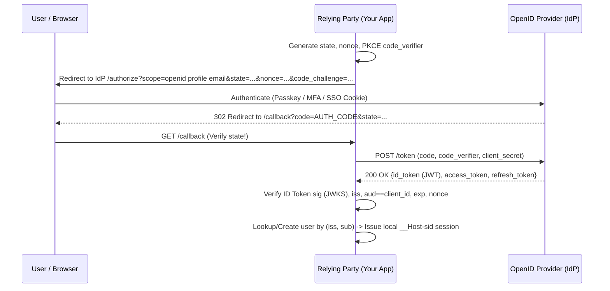
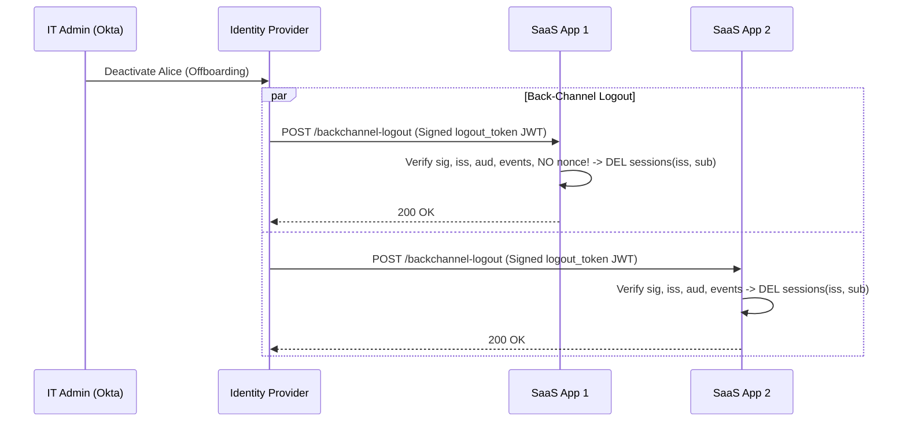
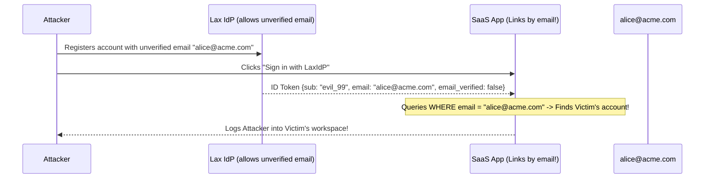

# OpenID Connect & SSO: ID Tokens, Discovery and SAML vs OIDC

> **Prerequisites:** [Lesson 04: OAuth 2.0](../04-oauth-2-0/README.md).  
> **Estimated Reading Time:** 24–28 minutes  
> **Target Audience:** Backend engineers implementing "Sign in with Google/Okta/Entra ID" or enterprise SSO, and candidates asked "how does OpenID Connect extend OAuth 2.0, and when do you use OIDC vs SAML?"  
> **Free PDF Notes:** [Download SD-M-005.pdf](https://backendroadmap.com/notes/system-design/SD-M-005.pdf)

> [!NOTE]
> **In one line:** **OpenID Connect (OIDC)** adds a standardized **authentication** layer on top of OAuth 2.0: requesting `scope=openid` returns a signed JWT **ID Token** (whose `aud` is your `client_id`) proving *who* the user is, alongside an **Access Token** for APIs and a **Discovery** document (`/.well-known/openid-configuration`) for zero-config integration.

> [!TIP]
> **The Golden Rule:** Key user accounts by the immutable pair **`(iss, sub)`**—never by `email` (emails change and can be hijacked across unverified IdPs). Always validate `iss`, `aud == client_id`, `exp`, and **`nonce`** on every ID Token.

---

## 1. What OpenID Connect & SSO Are, and What They Aren't

OAuth 2.0 only tells an API what a client can access; it never standardized how a client app learns *who* logged in. Every provider invented custom `/me` endpoints—until **OpenID Connect (OIDC)** standardized identity on top of OAuth 2.0. With **Single Sign-On (SSO)**, a user authenticates once with a central **Identity Provider (IdP)** (Okta, Google, Microsoft Entra ID) and seamlessly signs into multiple Relying Parties (RPs / apps) without re-entering passwords.

| Term | Precise Meaning | Example |
| :--- | :--- | :--- |
| **OpenID Connect (OIDC)** | Identity (AuthN) protocol layered on OAuth 2.0 | "Sign in with Google" / Enterprise SSO |
| **Relying Party (RP)** | The client application trusting the IdP to authenticate the user | Your SaaS web app (`client_id`) |
| **ID Token** | Signed JWT proving user identity to the RP (`aud == client_id`) | `{iss, sub, aud, exp, iat, nonce, email}` |
| **`nonce`** | Random value bound to the client session to prevent ID Token replay | Verified against `claims.nonce` after exchange |
| **OIDC Discovery** | Standard JSON metadata at `/.well-known/openid-configuration` | Auto-configures endpoints & `jwks_uri` |
| **UserInfo Endpoint** | OAuth-protected endpoint returning additional profile claims | `GET /userinfo` with `Bearer access_token` |
| **SSO / SLO** | Single Sign-On across apps / Single Logout across sessions | Back-channel logout JWTs |
| **SAML 2.0** | Older XML-based enterprise SSO standard using signed XML Assertions | Legacy corporate portals & HR tools |
| **Not** | An API authorization token (never send an ID Token as a `Bearer` token to backend APIs!) | Use Access Token for APIs, ID Token for login |

### Why It Matters
1. **Enterprise sales requirement:** B2B SaaS products must support SSO (OIDC and/or SAML 2.0) so enterprise IT teams can enforce MFA, conditional access, and instant offboarding from one IdP.
2. **ID Token vs Access Token:** Confusing the two is a classic security bug—ID Tokens are meant *only* for the Client (`aud = client_id`), while Access Tokens are meant for Resource Servers (`aud = api`).
3. **Immutable identity:** Using `(iss, sub)` instead of `email` prevents account takeover when employees change names, recycle emails, or link unverified social accounts.

---

## 2. Anatomy: OIDC Authorization Code + PKCE Flow & SAML Comparison



### OIDC vs SAML 2.0 Comparison

| Dimension | OpenID Connect (OIDC) | SAML 2.0 |
| :--- | :--- | :--- |
| **Data Format** | JSON / JWT (compact, URL-safe) | XML (verbose, requires XML canonicalization) |
| **Transport** | REST / JSON + OAuth 2.0 | Browser HTTP POST / Redirect with base64 XML |
| **Mobile & SPA Support** | Native (PKCE, REST) | Poor (awkward in mobile apps/SPAs) |
| **Discovery & Rotation** | `/.well-known/openid-configuration` + JWKS | Static XML Metadata files (often manual) |
| **API Delegation** | Built-in (Access Token + Scopes) | None (AuthN only) |
| **Primary Attack Surface** | `state`/`nonce` omission, `aud` mismatch | XML Signature Wrapping (XSW), XXE injection |
| **When to Choose** | All new apps, mobile, APIs, modern SaaS | Enterprise customers requiring legacy SAML IdPs |

> [!WARNING]
> **Never auto-link accounts solely by `email` without checking `email_verified: true` and explicit user confirmation.** If an attacker registers `victim@acme.com` on a lax social IdP (or before the victim signs up) and your app merges accounts by `email`, the attacker takes over the victim's account (**Pre-Account Takeover**). Always key users by `(iss, sub)`.

---

## 3. Mathematical Model: Discovery Caching, Token Budgets & Logout Propagation

**1. OIDC Discovery & JWKS Caching.**
An RP caches two artifacts from the IdP:
- `/.well-known/openid-configuration` (endpoints + `jwks_uri`): changes rarely; cache for $T_{\text{disc}} = 1\text{–}24\text{ hours}$.
- `jwks_uri` (public signing keys): cache for $T_{\text{jwks}} = 5\text{–}15\text{ min}$ with background refresh.

**2. SSO Login Cost vs Local Session Cost.**
An OIDC login round-trip (browser redirects + `/token` TLS handshake + JWKS verify) takes $T_{\text{OIDC}} \approx 150\text{–}400\text{ ms}$ once at login. Afterward, the RP issues its own local `__Host-sid` Redis session ($< 1\text{ ms}$ per request), so **0%** of normal API traffic depends on IdP latency.

**3. Single Logout (SLO) Propagation Window.**
When an employee is offboarded in Okta/Entra ID:
- **Without Back-Channel Logout:** Their local RP session remains active until the RP's session TTL expires (e.g., $T_{\text{sess}} = 8\text{–}24\text{ hours}$).
- **With OIDC Back-Channel Logout:** The IdP POSTs a signed `logout_token` JWT (containing `iss`, `sub`, `sid`, and `events: {"http://schemas.openid.net/event/backchannel-logout": {}}`) directly to the RP's `/backchannel-logout` endpoint. The RP deletes all Redis sessions for `(iss, sub)` or `sid` in $< 50\text{ ms}$, closing the offboarding window from hours to **sub-second**.

---

## 4. Metrics & Percentiles

| Metric | Meaning | Alert When |
| :--- | :--- | :--- |
| **`oidc.login.p99`** | 99th-percentile `/callback` + `/token` exchange duration | $> 800\text{ ms}$ (IdP slowness or DNS/TLS issue) |
| **`oidc.id_token.invalid`** | ID Tokens failing `sig`, `iss`, `aud`, or `nonce` | $> 0$ spike (key rotation or replay attack) |
| **`oidc.discovery.errors`** | Failures fetching `.well-known/openid-configuration` | $> 0$ consecutive errors |
| **`oidc.backchannel_logout.rate`** | Offboarding/logout events processed | Sudden drop or `5xx` errors (broken SLO) |
| **`sso.idp_initiated.rejected`** | Unsolicited IdP-initiated logins blocked | Monitor for misconfigured enterprise tenants |

### Worked Example (B2B Multi-Tenant SaaS SSO)
A B2B SaaS platform onboards 500 enterprise tenants, each with their own Okta/Entra ID OIDC issuer:
1. User enters `alice@bigcorp.com` on the login screen -> RP maps domain `bigcorp.com` to tenant `bigcorp`'s OIDC config (`issuer`, `client_id`).
2. RP generates `state` + `nonce` + `code_verifier`, stores them in a short-lived `HttpOnly` login cookie (`Max-Age=300`), and redirects to `bigcorp`'s `authorization_endpoint`.
3. On `/callback`, RP verifies `state`, exchanges `code` + `code_verifier`, and validates the ID Token's signature against `bigcorp`'s `jwks_uri`, plus `iss`, `aud`, `exp`, and `nonce`.
4. RP looks up `(iss, sub)` in `user_identities` table (unique index on `(issuer, subject)`), creates a local session, and logs Alice in.

---

## 5. Compounding & Failure Modes

| Failure Mode | Mechanism | Impact |
| :--- | :--- | :--- |
| **Missing `nonce` Validation** | RP skips checking `claims.nonce` in the ID Token. | Attacker replays a captured ID Token in a different session. |
| **Account Keyed by `email` Instead of `(iss, sub)`** | User changes email or another IdP issues unverified email claim. | Account takeover or permanent lockout when email changes. |
| **Cross-Tenant `iss` Confusion** | RP accepts an ID Token from Tenant B's IdP while logging into Tenant A. | User from Tenant B accesses Tenant A's workspace. |
| **SAML XML Signature Wrapping (XSW)** | Attacker injects an unsigned `<Assertion>` alongside a valid signed `<Assertion>`; parser reads the unsigned one. | Complete SAML authentication bypass (forged admin login). |
| **IdP-Initiated SSO Without `InResponseTo` / `state`** | Unsolicited SAML/OIDC assertion accepted without binding to a prior SP request. | Susceptible to Login CSRF and replay attacks. |

---

## 6. Numbers Every Engineer Must Know

| Item | Typical | Implication |
| :--- | :---: | :--- |
| OIDC Discovery cache TTL | **1 – 24 hours** | Refresh on unknown `kid` or scheduled background job |
| OIDC login flow latency | **150 – 400 ms** | One-time cost; issue local session afterward |
| `nonce` / `state` entropy | **$\ge 128$ bits** | Bound to `HttpOnly` pre-login cookie (`Max-Age=300s`) |
| Back-channel logout propagation | **< 1 second** | Essential for enterprise employee offboarding |
| `sub` max length (OIDC Core) | **255 ASCII chars** | Size DB column `VARCHAR(255)` for `(issuer, subject)` |
| SAML Assertion clock skew | **$\le 3\text{ minutes}$** | Keep NTP synchronized across RP and IdPs |

---

## 7. Protocol Deep Dive: Back-Channel Logout & SAML vs OIDC



| Question | Answer |
| :--- | :--- |
| **How does a `logout_token` differ from an ID Token?** | A Back-Channel `logout_token` is a JWT signed by the IdP containing `iss`, `aud`, `sub` (and/or `sid`), `iat`, `jti`, and the `events` claim (`backchannel-logout`). Crucially, it **must NOT contain a `nonce`** (to prevent confusion with an ID Token). |
| **Front-Channel vs Back-Channel Logout?** | **Front-Channel** uses hidden `<iframe>`s in the user's browser to hit `/logout` on each RP—unreliable if the user closes the tab or third-party cookies are blocked. **Back-Channel** is server-to-server HTTP POST, so it works even when the user's browser is closed. |
| **Why is SAML 2.0 harder to implement safely than OIDC?** | SAML relies on XML Digital Signatures (XMLDSig) and XML Canonicalization (C14N), which have a long history of **XML Signature Wrapping (XSW)** and **XXE** vulnerabilities. OIDC uses flat JSON + JWS, which is far simpler and safer to parse. |
| **Should you ever accept IdP-initiated SSO?** | Prefer **SP-initiated** flows (`state`/`nonce`/`InResponseTo`). If an enterprise customer demands IdP-initiated SAML, strictly validate `Recipient`, `Audience`, `NotBefore`/`NotOnOrAfter`, and assertion ID replay cache (`jti`/AssertionID in Redis). |

**When not to build custom OIDC/SAML parsing:** Never write your own XMLDSig/SAML parser. Use battle-tested libraries (`coreos/go-oidc`, `openid-client`, `authlib`, `Microsoft.AspNetCore.Authentication.OpenIdConnect`) or an enterprise SSO broker (Keycloak, WorkOS, Auth0, Cognito).

---

## 8. Hierarchical Budgets & Design Rules

| Slice | Rule | Control |
| :--- | :--- | :--- |
| **User Key** | Unique index on `(issuer, subject)` (`VARCHAR(255)`) | Never use mutable `email` as primary key |
| **Email Linking** | Require `email_verified == true` + explicit re-auth | Prevents Pre-Account Takeover |
| **ID Token Checks** | Verify signature (JWKS), `iss`, `aud == client_id`, `exp`, `nonce` | Pin allowed `alg`; reject `alg: none` |
| **Token Separation** | Never send ID Token as `Bearer` to backend APIs | ID Token -> RP login; Access Token -> RS APIs |
| **Tenant Isolation** | Bind expected `iss` and `client_id` to the initiating tenant | Prevent cross-tenant issuer confusion |
| **Offboarding (SLO)** | Support OIDC Back-Channel Logout + short local session TTL | Index sessions by `(iss, sub)` and `sid` |
| **SAML Safety** | Disable DTDs/external entities (XXE); verify single signed root | Use vetted SAML library; never hand-roll XMLDSig |

---

## 9. Top Mitigations

1. **Key user accounts by `(iss, sub)`**, treating `email` strictly as a display/contact attribute unless `email_verified` is true and explicitly linked.
2. **Always bind and verify `nonce`** (in addition to `state` and PKCE) to prevent ID Token replay across sessions.
3. **Validate `aud == your_client_id`** (and `azp` if multiple audiences are present) on every ID Token.
4. **Never pass ID Tokens to downstream APIs**—use the Access Token for Resource Servers and keep the ID Token in the RP/BFF.
5. **Implement OIDC Back-Channel Logout** so enterprise offboarding kills active app sessions in $< 1\text{ second}$.
6. **Enforce tenant-to-issuer pinning** in multi-tenant B2B apps so Tenant A never accepts Tenant B's IdP tokens.
7. **Use vetted libraries for SAML 2.0** with DTD processing disabled (blocks XXE) and strict XSW protections.

---

## 10. Production Reference: The `email` Pre-Account Takeover & Missing `nonce`

A B2B SaaS app added "Sign in with Google" and "Sign in with Microsoft" alongside email/password login. On OIDC callback, the backend extracted `claims.email` and ran `SELECT * FROM users WHERE email = $1`—creating or logging into whichever account matched that email, without checking `email_verified` or `(iss, sub)`.



- **Root Cause:** (1) Accounts were matched by `email` instead of `(iss, sub)`, and (2) `email_verified` was ignored.
- **Fix:** Migrated identity mapping to a dedicated `user_federated_identities(issuer, subject, user_id)` table, required `email_verified == true` plus password/MFA confirmation before linking an existing account, and enforced `nonce` validation on all OIDC flows.

---

## 11. Multi-Language Production Code Tabs

OIDC ID Token claim validation (`iss`, `aud`, `exp`, `nonce`, `email_verified`) and immutable `(iss, sub)` identity key construction in Go, TypeScript, Python, and C#.

````carousel
```go
// Go: OIDC ID Token claim validation (after JWKS signature check) + (iss, sub) key.
package main

import (
	"crypto/subtle"
	"errors"
	"time"
)

type IDTokenClaims struct {
	Iss           string `json:"iss"`
	Sub           string `json:"sub"`
	Aud           string `json:"aud"`
	Exp           int64  `json:"exp"`
	Nonce         string `json:"nonce"`
	Email         string `json:"email"`
	EmailVerified bool   `json:"email_verified"`
}

func ValidateIDToken(c IDTokenClaims, expectedIss, expectedClientID, expectedNonce string) (string, error) {
	if c.Iss != expectedIss || c.Aud != expectedClientID {
		return "", errors.New("issuer or audience mismatch")
	}
	if time.Now().Unix() > c.Exp+30 {
		return "", errors.New("id_token expired")
	}
	if subtle.ConstantTimeCompare([]byte(c.Nonce), []byte(expectedNonce)) != 1 {
		return "", errors.New("nonce mismatch: possible replay")
	}
	if c.Sub == "" {
		return "", errors.New("missing subject")
	}
	// Return immutable federated identity key (never key by mutable email!)
	return c.Iss + "|" + c.Sub, nil
}
```
<!-- slide -->
```typescript
// TypeScript: OIDC ID Token validation (post-signature check) & immutable identity key.
import { timingSafeEqual } from "node:crypto";

export interface IdTokenClaims {
  iss: string;
  sub: string;
  aud: string | string[];
  exp: number;
  nonce?: string;
  email?: string;
  email_verified?: boolean;
}

export function validateIdTokenClaims(
  claims: IdTokenClaims,
  expectedIss: string,
  clientId: string,
  expectedNonce: string
): { identityKey: string; verifiedEmail: string | null } {
  const audMatch = Array.isArray(claims.aud)
    ? claims.aud.includes(clientId)
    : claims.aud === clientId;

  if (claims.iss !== expectedIss || !audMatch) throw new Error("Invalid iss/aud");
  if (Math.floor(Date.now() / 1000) > claims.exp + 30) throw new Error("ID token expired");

  const a = Buffer.from(claims.nonce ?? "");
  const b = Buffer.from(expectedNonce);
  if (a.length === 0 || a.length !== b.length || !timingSafeEqual(a, b)) {
    throw new Error("Invalid nonce");
  }
  if (!claims.sub) throw new Error("Missing sub");

  return {
    identityKey: `${claims.iss}|${claims.sub}`, // Immutable user key
    verifiedEmail: claims.email_verified ? (claims.email ?? null) : null,
  };
}
```
<!-- slide -->
```python
# Python: OIDC ID Token claim validation & immutable (iss, sub) mapping (stdlib only).
import hmac
import time


def validate_id_token_claims(
    claims: dict,
    expected_iss: str,
    client_id: str,
    expected_nonce: str,
) -> tuple[str, str]:
    # Assumes cryptographic signature already verified via IdP JWKS
    if claims.get("iss") != expected_iss:
        raise ValueError("Issuer mismatch")
    aud = claims.get("aud")
    aud_ok = (client_id in aud) if isinstance(aud, list) else (aud == client_id)
    if not aud_ok:
        raise ValueError("Audience mismatch (must match client_id)")
    if int(time.time()) > int(claims.get("exp", 0)) + 30:
        raise ValueError("ID token expired")
    if not hmac.compare_digest(claims.get("nonce", ""), expected_nonce):
        raise ValueError("Nonce mismatch")
    sub = claims.get("sub")
    if not sub:
        raise ValueError("Missing sub")
    return claims["iss"], sub  # Immutable primary identity key
```
<!-- slide -->
```csharp
// C#: OIDC ID Token claim validation + immutable (iss, sub) identity key.
using System.Security.Cryptography;
using System.Text;

public sealed record IdTokenClaims(
    string Iss, string Sub, string Aud, long Exp, string Nonce, string? Email, bool EmailVerified);

public static class OidcValidator
{
    public static (string Issuer, string Subject) Validate(
        IdTokenClaims claims, string expectedIss, string clientId, string expectedNonce)
    {
        if (claims.Iss != expectedIss || claims.Aud != clientId)
            throw new InvalidOperationException("Issuer or audience mismatch");

        if (DateTimeOffset.UtcNow.ToUnixTimeSeconds() > claims.Exp + 30)
            throw new InvalidOperationException("ID token expired");

        bool nonceOk = !string.IsNullOrEmpty(claims.Nonce) &&
            CryptographicOperations.FixedTimeEquals(
                Encoding.UTF8.GetBytes(claims.Nonce),
                Encoding.UTF8.GetBytes(expectedNonce));
        if (!nonceOk)
            throw new InvalidOperationException("Nonce mismatch");

        if (string.IsNullOrEmpty(claims.Sub))
            throw new InvalidOperationException("Missing sub");

        return (claims.Iss, claims.Sub);
    }
}
```
````

---

## 12. Hands-On CLI Verification Workflows

Fetch an OIDC Discovery document, inspect endpoints/JWKS, and verify `logout_token` structure:

```bash
# 1. Fetch OIDC Discovery metadata (example: Google's public OIDC endpoint)
curl -s https://accounts.google.com/.well-known/openid-configuration | jq '{
  issuer,
  authorization_endpoint,
  token_endpoint,
  userinfo_endpoint,
  jwks_uri,
  id_token_signing_alg_values_supported
}'

# 2. Fetch the JWKS referenced by jwks_uri
JWKS_URI=$(curl -s https://accounts.google.com/.well-known/openid-configuration | jq -r '.jwks_uri')
curl -s "$JWKS_URI" | jq '.keys[] | {kid, kty, alg, use}'
```

---

## 13. Common Mistakes to Avoid

1. **Using `email` as the primary user key** instead of `(iss, sub)`.
2. **Skipping `nonce` validation** on ID Tokens, allowing replay across sessions.
3. **Sending the ID Token as a `Bearer` token to backend APIs** instead of the Access Token.
4. **Auto-linking accounts by `email` without checking `email_verified: true`** and user confirmation.
5. **Forgetting to check `aud == client_id`** on ID Tokens (or `azp` when multiple audiences exist).
6. **Relying solely on Front-Channel `<iframe>` logout** instead of OIDC Back-Channel Logout.
7. **Hand-rolling SAML XMLDSig parsers**, exposing the app to XML Signature Wrapping and XXE.

---

## 14. Key Terms Glossary

| Key Term | Definition |
| :--- | :--- |
| **OpenID Connect (OIDC)** | Standardized authentication layer built on top of OAuth 2.0. |
| **ID Token** | Signed JWT issued by the IdP to the Client (`aud = client_id`) asserting user identity. |
| **Relying Party (RP)** | Client application that delegates authentication to an OpenID Provider (IdP). |
| **OIDC Discovery** | Standard `/.well-known/openid-configuration` JSON describing IdP endpoints and keys. |
| **`nonce`** | Random value bound to the login session and echoed in the ID Token to stop replay. |
| **`sub` (Subject)** | Locally unique, immutable identifier for the user at a given `iss` (Issuer). |
| **SSO (Single Sign-On)** | Authenticating once at a central IdP to access multiple independent applications. |
| **Back-Channel Logout** | Server-to-server signed `logout_token` POSTed by the IdP to terminate RP sessions. |
| **SAML 2.0** | XML-based enterprise SSO protocol using signed XML Assertions. |
| **XSW (XML Signature Wrapping)** | Attack exploiting XML signature verification to inject forged SAML assertions. |

---

## 15. System Design Interview Questions & Answers

### Basic Conceptual Questions

<details>
<summary><strong>Q1: How does OpenID Connect extend OAuth 2.0? [BASIC]</strong></summary>

**Answer:**
OAuth 2.0 only provides delegated authorization (Access Tokens). OIDC adds `scope=openid`, a standardized **ID Token** (a signed JWT proving *who* authenticated), a `/userinfo` endpoint, and `/.well-known/openid-configuration` discovery—turning OAuth 2.0 into a complete authentication + SSO protocol.
</details>

<details>
<summary><strong>Q2: What is the difference between an ID Token and an Access Token? [BASIC]</strong></summary>

**Answer:**
An **ID Token** is for the **Client** (`aud = client_id`); it proves who the user is and must never be sent to backend Resource Servers. An **Access Token** is for **Resource Servers** (`aud = api`); it grants scoped API access and should not be parsed for login identity by the client.
</details>

<details>
<summary><strong>Q3: What is OIDC Discovery? [BASIC]</strong></summary>

**Answer:**
A standard JSON document at `<issuer>/.well-known/openid-configuration` that advertises the IdP's `authorization_endpoint`, `token_endpoint`, `jwks_uri`, supported scopes, and signing algorithms—enabling clients to configure and rotate keys automatically.
</details>

<details>
<summary><strong>Q4: Why is `nonce` needed in OIDC when we already have `state`? [BASIC]</strong></summary>

**Answer:**
`state` protects the `/callback` redirect against Login CSRF (binding the browser to the authorization request). `nonce` is embedded inside the signed **ID Token** itself, binding the ID Token to the client's session and preventing an attacker from replaying a captured ID Token.
</details>

### Scenario-Based Architecture Questions

<details>
<summary><strong>Q5: You're building a B2B SaaS app. Enterprise customers want Okta/Entra ID SSO. Should you recommend OIDC or SAML 2.0? [SCENARIO]</strong></summary>

**Answer:**
Recommend **OIDC** first: it uses JSON/JWT, supports mobile/SPAs natively via PKCE, has automatic Discovery/JWKS rotation, and avoids XML parsing vulnerabilities. However, support **SAML 2.0** (via a vetted library or SSO broker) as a fallback for legacy enterprise IdPs that only speak SAML.
</details>

<details>
<summary><strong>Q6: A user logs in with Google, and later changes their Google email address. What happens if you keyed your `users` table by `email`? [SCENARIO]</strong></summary>

**Answer:**
They get locked out of their old account or accidentally create a brand-new empty account. Worse, if someone else later registers that old email, they could hijack the account. Always key federated users by the immutable `(iss, sub)` pair.
</details>

<details>
<summary><strong>Q7: An enterprise customer fires an employee and disables them in Okta. How do you ensure they are kicked out of your SaaS app immediately? [SCENARIO]</strong></summary>

**Answer:**
Implement **OIDC Back-Channel Logout**: index your local Redis sessions by `(iss, sub)` and `sid`, and expose a `/backchannel-logout` endpoint that verifies the IdP's signed `logout_token` JWT and deletes all matching sessions immediately.
</details>

<details>
<summary><strong>Q8: How do you prevent a user from Tenant B from logging into Tenant A in a multi-tenant OIDC app? [SCENARIO]</strong></summary>

**Answer:**
Store each tenant's expected `issuer` and `client_id` in your tenant config. On `/callback`, look up the initiating tenant from the `state` session and strictly assert that `id_token.iss == tenant.expected_issuer` and `id_token.aud == tenant.client_id`.
</details>

### Advanced & Tricky Interview Questions

<details>
<summary><strong>Q9: Explain Pre-Account Takeover via `email` auto-linking and how to prevent it. [TRICKY]</strong></summary>

**Answer:**
If an app automatically merges a social/OIDC login with an existing local account based solely on `email` without verifying `email_verified: true` (or if an attacker pre-registers an unverified email), the attacker gains access to the victim's account. Prevent it by keying on `(iss, sub)`, requiring `email_verified: true`, and prompting the user to authenticate with their existing method before linking a new IdP.
</details>

<details>
<summary><strong>Q10: Why is Front-Channel Logout (`<iframe>`) increasingly broken in modern browsers? [TRICKY]</strong></summary>

**Answer:**
Modern browsers block or partition third-party cookies by default (Safari ITP, Chrome/Firefox privacy protections). When the IdP renders hidden `<iframe>`s to hit each RP's `/logout`, the RP doesn't receive its session cookie and cannot identify which session to clear. Back-Channel Logout (server-to-server) solves this completely.
</details>

<details>
<summary><strong>Q11: What is an XML Signature Wrapping (XSW) attack in SAML 2.0? [TRICKY]</strong></summary>

**Answer:**
An attacker takes a legitimately signed SAML Response, moves the signed `<Assertion>` to an unexpected element, and inserts a forged unsigned `<Assertion>` (e.g., `role=admin`) where the application looks for user attributes. If the SAML library validates the signature on *any* element without checking that the validated element is the exact one parsed for identity, authentication is bypassed.
</details>

<details>
<summary><strong>Q12: Why must a Back-Channel `logout_token` NOT contain a `nonce` claim? [TRICKY]</strong></summary>

**Answer:**
The OIDC Back-Channel Logout spec explicitly forbids `nonce` in `logout_token`s so a `logout_token` (which is also a signed JWT from the same `iss` with `sub` and `aud`) can never be confused with or replayed as an authentication **ID Token**.
</details>

---

## 16. One-Page Master Cheat Sheet

```
+---------------------------------------------------------------------------------------------------------+
|                    OPENID CONNECT & SSO — MASTER CHEAT SHEET                                            |
+---------------------------------------------------------------------------------------------------------+
| 1. OIDC = OAuth 2.0 + Identity Layer (scope=openid). Returns ID Token (JWT, aud=client_id) for login    |
|    and Access Token for APIs. Never send ID Tokens as Bearer tokens to backend APIs.                    |
+---------------------------------------------------------------------------------------------------------+
| 2. ID TOKEN CHECKS: Signature (JWKS) + iss + aud==client_id + exp + nonce (stops replay).               |
|    DISCOVERY: /.well-known/openid-configuration advertises endpoints & jwks_uri (cache 1-24h).           |
+---------------------------------------------------------------------------------------------------------+
| 3. IDENTITY MAPPING: Key users by immutable (iss, sub), NEVER mutable email. Require email_verified     |
|    + confirmation before linking accounts (stops Pre-Account Takeover).                                 |
+---------------------------------------------------------------------------------------------------------+
| 4. SSO & OFFBOARDING: Prefer OIDC over SAML 2.0 (avoids XMLDSig/XSW/XXE). Implement Back-Channel        |
|    Logout (signed logout_token, NO nonce) to kill local Redis sessions in < 1 second.                    |
+---------------------------------------------------------------------------------------------------------+
```

---

## Further Reading & Sources

- OpenID Foundation, *OpenID Connect Core 1.0*, *OpenID Connect Discovery 1.0*, & *OpenID Connect Back-Channel Logout 1.0*.
- OASIS, *Security Assertion Markup Language (SAML) V2.0* & OWASP *SAML Security Cheat Sheet*.
- Auth0 / Okta Docs, *ID Token Validation & Account Linking Best Practices*.

---

## Free PDF Notes

[SD-M-005.pdf](https://backendroadmap.com/notes/system-design/SD-M-005.pdf)

---

## Next

Continue with [Lesson 06: RBAC vs ABAC vs ReBAC: Permissions at Scale (Google Zanzibar)](../06-rbac-vs-abac-vs-rebac/README.md): modeling roles, attributes, and relationship graphs for fine-grained authorization.
