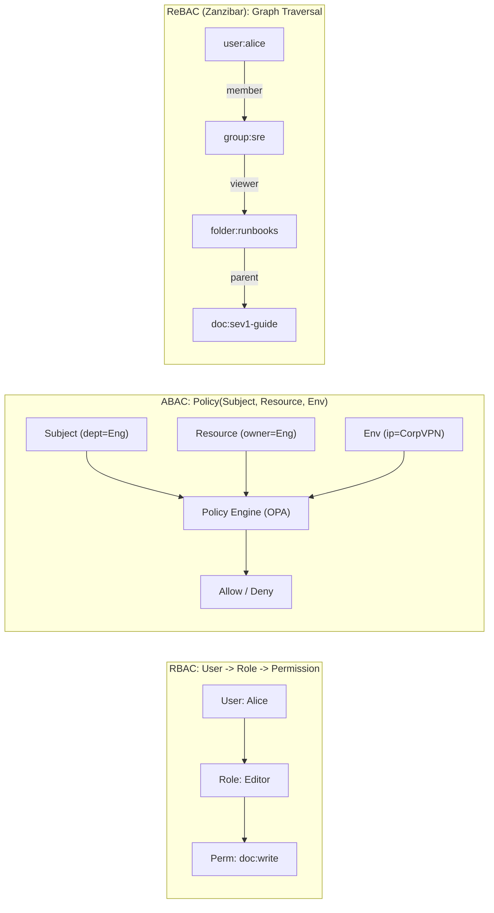
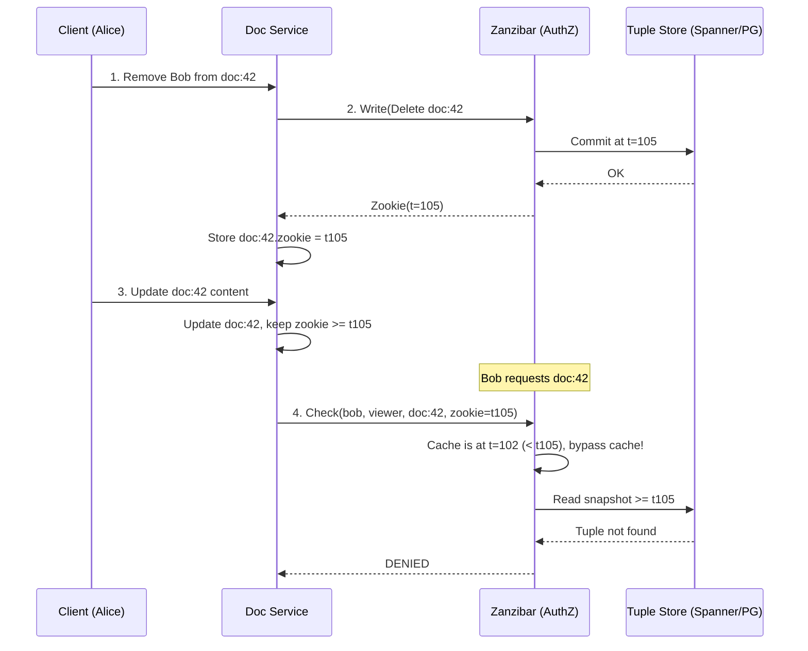
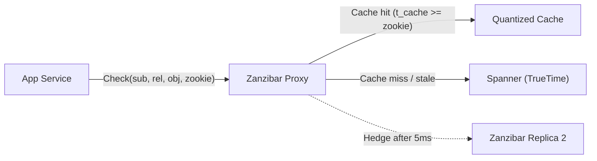

# RBAC vs ABAC vs ReBAC: Permissions at Scale (Google Zanzibar)

> **Prerequisites:** [Lesson 05: OpenID Connect & SSO](../05-openid-connect-sso/README.md).  
> **Estimated Reading Time:** 24–28 minutes  
> **Target Audience:** Backend and platform engineers designing multi-tenant authorization, and candidates asked "how would you design permissions for Google Drive, GitHub, or Slack?"  
> **Free PDF Notes:** [Download SD-M-006.pdf](https://backendroadmap.com/notes/system-design/SD-M-006.pdf)

> [!NOTE]
> **In one line:** **RBAC** grants permissions via static roles (`admin`, `editor`), **ABAC** evaluates dynamic rules over attributes (`user.dept == doc.dept && time < 18:00`), and **ReBAC** models authorization as a graph of relationships (`doc:123#viewer@user:alice`). Modern multi-tenant platforms combine RBAC/ABAC for coarse-grained org policies with **ReBAC (Google Zanzibar)** for fine-grained resource sharing at scale.

> [!TIP]
> **The Golden Rule:** Use **RBAC** when permissions are coarse and map cleanly to job titles; add **ABAC** for contextual constraints (IP, time, region); adopt **ReBAC** the moment users can share individual resources with other users, groups, or nested folders. Never try to model per-document sharing by creating one RBAC role per document.

---

## 1. What Authorization Models Are, and What They Aren't

Authentication (AuthN) answers *"Who are you?"* (OIDC, JWTs, mTLS). **Authorization (AuthZ)** answers *"What are you allowed to do to this resource right now?"* When an engineer conflates AuthN with AuthZ—by stuffing hundreds of per-resource permissions into an OIDC JWT—tokens bloat past HTTP header limits (8 KB) and permissions cannot be revoked until the token expires.

| Term | Precise Meaning | Example |
| :--- | :--- | :--- |
| **RBAC (Role-Based)** | Permissions attach to named roles; users are assigned roles | `user:alice` has role `billing_admin` -> `invoice:write` |
| **ABAC (Attribute-Based)** | Policy engine evaluates boolean rules over subject, resource, and environment attributes | Allow if `user.clearance >= doc.classification` and `req.country == "DE"` |
| **ReBAC (Relationship-Based)** | Permissions are derived by traversing a directed graph of object-subject tuples | `folder:eng#parent@doc:spec`, `group:sre#member@user:alice` -> `can_view` |
| **Relation Tuple** | Canonical Zanzibar fact: `object#relation@subject` | `doc:roadmap#editor@group:platform#member` |
| **Userset Rewrite** | Declarative rule defining how relations compose or inherit | `viewer = viewer + editor + parent->viewer` |
| **Zookie** | Opaque consistency token encoding a snapshot timestamp to prevent stale reads | `zookie = "t=17000042"` passed on `Check` |
| **Not** | Authentication, or an excuse to hardcode `if user.isAdmin` across 40 microservices | AuthZ is a centralized policy/graph decision |

### Why It Matters
1. **Role explosion kills naive RBAC:** In a SaaS app with 100,000 organizations and 10M documents, creating per-document roles (`doc_9921_editor`) produces billions of roles and breaks every relational join.
2. **Stale permissions are a security incident:** If Alice removes Bob from a confidential doc and immediately uploads a secret, a stale authorization cache can leak the new secret to Bob (**the New Enemy Problem**).
3. **Every service needs sub-10 ms checks:** Authorization sits on the critical path of *every* API request. A 150 ms AuthZ check destroys your p99 latency budget.

---

## 2. Anatomy: RBAC vs ABAC vs ReBAC



In **RBAC**, the lookup is a simple set intersection: does the user's role set contain a role mapped to the required permission? It is fast and auditable, making compliance reviews ("who has `prod_db_admin`?") trivial. However, RBAC has no native concept of *which* specific document or folder a user owns.

In **ABAC**, a Policy Decision Point (PDP) such as Open Policy Agent (OPA) evaluates Rego or Cedar policies against JSON attributes. ABAC excels at environmental and compliance rules ("only allow PII export from EU IPs during business hours"), but auditing *"list every user who can read `doc:42`"* is notoriously hard because you would have to evaluate the policy across every user-resource combination.

In **ReBAC**, every access fact is stored as a tuple (`doc:42#viewer@user:alice` or `doc:42#parent@folder:9`). A `Check(subject, relation, object)` query traverses the graph backwards from the object to the subject, while `Expand` and `ListObjects` answer reverse-index questions cleanly.

| Dimension | RBAC | ABAC | ReBAC (Zanzibar) |
| :--- | :--- | :--- | :--- |
| **Core primitive** | User -> Role -> Permission | `f(user_attrs, res_attrs, env)` -> Bool | `object#relation@subject` tuple |
| **Fine-grained sharing** | Poor (causes role explosion) | Moderate (requires attribute sync) | Native (per-object tuples + inheritance) |
| **Contextual rules (IP, time)** | Poor | Native | Poor (combine with ABAC caveats) |
| **"Who can access X?" audit** | Easy (query role table) | Very hard (no static graph) | Native (`Expand` / `Read` API) |
| **Typical p95 latency** | < 1 ms (in-memory / JWT) | 1–5 ms (local OPA eval) | 2–10 ms (indexed graph + cache) |

> [!WARNING]
> **The #1 Trap: Putting mutable fine-grained permissions inside JWTs.** A JWT is a stateless snapshot valid until `exp`. If you embed `permissions: ["doc:1:edit", "doc:2:view"]` in a 1-hour JWT, revoking Bob's access takes up to 60 minutes, and sharing 500 documents overflows HTTP header limits. Keep JWTs for **identity** (`sub`, `tenant_id`) and query an AuthZ service for **permissions**.

---

## 3. Mathematical Model: Matrix Size, Graph Traversal & Staleness

**1. RBAC State Space vs ReBAC Tuple Space.**  
Let $|U|$ be users, $|R|$ be roles, $|P|$ be permissions, and $|O|$ be objects. Pure RBAC requires:

$$S_{\text{RBAC}} = O(|U|\cdot|R| + |R|\cdot|P|)$$

If you simulate per-object permissions in RBAC by creating $k$ roles per object ($|R| = k|O|$), the role-permission table explodes to $O(k|O|\cdot|P|)$. In ReBAC, you store only explicit edges $|E|$ (typically 2–5 tuples per shared object) and derive transitive access via graph rules, keeping storage linear in actual shares: $S_{\text{ReBAC}} = O(|E|)$.

**2. Graph Traversal Cost & Leopard Indexing.**  
Without indexing, checking if `user:u` can access `doc:d` through $L$ levels of nested groups and folders with average branching factor $b$ costs:

$$T_{\text{naive}} = O(b^L)$$

For $b = 10$ and $L = 6$ nested folders/groups, $10^6 = 1{,}000{,}000$ node visits—completely unusable at 10M QPS. Google Zanzibar solves this with **Leopard**, an offline/incremental reachability index that flattens group-to-group memberships so group reachability becomes an $O(1)$ set intersection of sorted integer IDs.

**3. Cache Staleness vs Zookie Consistency.**  
Suppose tuple writes happen at rate $\lambda_w$ and a read cache has TTL $\Delta t$. The probability that a permission revocation has *not* yet propagated to a random cache shard when an object is updated is proportional to $\Delta t$. Zanzibar eliminates this window for causal sequences by attaching a **Zookie** $z_t$ (encoding Spanner commit timestamp $t_{\text{write}}$) to the resource metadata. Any subsequent `Check(subject, rel, obj, zookie=z_t)` forces the evaluator to read at snapshot $t_{\text{eval}} \ge t_{\text{write}}$, guaranteeing **zero stale reads** for the New Enemy Problem while allowing older, safe reads to hit caches at $t_{\text{write}} - \Delta t$.

**Worked Numerical Example:**  
A multi-tenant SaaS has $10^6$ users, $5 \times 10^7$ documents, and an average of $3$ direct shares per document ($|E| = 1.5 \times 10^8$ tuples, ~15 GB indexed). Each API request triggers $2$ AuthZ checks at $50{,}000$ API RPS ($100{,}000$ AuthZ QPS). With a 92% L1/L2 cache hit rate (0.3 ms hit, 8 ms miss):

$$T_{\text{avg}} = 0.92 \times 0.3\text{ ms} + 0.08 \times 8.0\text{ ms} = 0.276 + 0.640 = 0.916\text{ ms}$$

The backend tuple store only absorbs $100{,}000 \times 0.08 = 8{,}000\text{ QPS}$ instead of $100{,}000\text{ QPS}$.

---

## 4. Metrics & Percentiles

| Metric | Meaning | Alert when |
| :--- | :--- | :--- |
| **`Check` latency $p_{99}$** | End-to-end time for an authorization decision | > 15 ms (threatens API SLO) |
| **Cache hit ratio** | Fraction of `Check` calls served from quantized snapshot cache | < 80% (causes DB/Spanner saturation) |
| **Zookie staleness / fallback rate** | Checks forced to bypass cache due to newer Zookie timestamp | > 20% (indicates hot-row write contention) |
| **Tuple write-to-visible lag** | Time from ACL update to global visibility | > 5 s for non-Zookie reads |
| **Graph traversal depth $p_{99}$** | Number of hops executed per `Check` | > 12 hops (potential cycle or deep nesting) |
| **AuthZ error / fail-closed rate** | 5xx or timeouts causing `Deny` | > 0.01% (blocks legitimate users) |

### Worked Example (Multi-Tenant Document Sharing)
A workspace has `org:acme` -> `team:backend` -> `folder:arch` -> `doc:design-v2`. Alice is a member of `team:backend`. When Alice opens `doc:design-v2`, the Document Service extracts `sub=user:alice` from her OIDC JWT and calls `Check(user:alice, viewer, doc:design-v2, zookie=doc.zookie)`. The AuthZ service checks its distributed cache at snapshot `>= doc.zookie`, resolves `doc:design-v2#parent@folder:arch` -> `folder:arch#viewer@team:backend#member` -> `user:alice`, and returns `ALLOWED` in 2.4 ms. When Alice is removed from `team:backend`, a single tuple delete (`team:backend#member@user:alice`) revokes her access to all 40,000 documents in `folder:arch` immediately.

---

## 5. Compounding & Failure Modes

Authorization systems fail in two catastrophic ways: **fail-open** (security breach) and **fail-closed outage** (total platform downtime).

**A. The "New Enemy" Problem (Stale Cache + Write Skew).**  
1. At $t=10$, Alice removes Bob from `doc:secret`.  
2. At $t=11$, Alice overwrites `doc:secret` with sensitive M&A data, generating `zookie = t11`.  
3. At $t=12$, Bob requests `doc:secret`. Without a Zookie, the AuthZ server might read a 5-second-old replica at $t=8$ (where Bob *still* had access) and serve the $t=11$ content to Bob!  
*Quantification:* Without Zookies, even a 2-second replication lag at 10,000 ACL mutations/hour creates ~5.5 race windows per second where revoked users can read newly written data.

**B. Hot-Object Thundering Herd (Quantization).**  
If 50,000 employees open the company-wide `doc:all-hands-2026` at 9:00 AM, and every request passes `Check(..., consistency=EXACT_NOW)`, caching is bypassed and all 50,000 checks hit the primary database. Zanzibar prevents this via **timestamp quantization** (rounding read snapshots to 5-second buckets unless a newer Zookie forces an exact floor) and **request hedging / singleflight deduplication** across AuthZ replicas.

**C. Deep Nesting & Cycles.**  
If `group:A#member@group:B#member` and `group:B#member@group:A#member` are both written, a naive recursive evaluator enters an infinite loop and exhausts stack/goroutines across the cluster. Every ReBAC engine MUST enforce cycle detection (visited set) and a hard max-depth limit (e.g., 25 hops).

---

## 6. Numbers Every Engineer Must Know

| Item | Typical | Implication |
| :--- | :---: | :--- |
| **Google Zanzibar scale** | 10M+ QPS, trillions of tuples | Proven architecture for global ReBAC |
| **Zanzibar `Check` latency** | < 10 ms at 95th percentile | Fast enough for synchronous API gateways |
| **Quantization window** | 1–5 seconds | Enables > 90% cache hit rates without Zookie violations |
| **Max traversal depth** | 20–25 hops | Prevents stack overflow and DoS from deep/cyclic graphs |
| **JWT header size limit** | 8 KB (Nginx/ALB default) | Cannot store per-resource ACLs inside JWTs |
| **OPA local policy eval** | 0.1–2 ms | Ideal for ABAC sidecar / in-process checks |
| **AuthZ availability target** | 99.999% ("five nines") | Every API call depends on AuthZ; outages halt all traffic |

---

## 7. Protocol Deep Dive: Zanzibar `Check` & Zookie Flow



| Question | Answer |
| :--- | :--- |
| **Why not always read at `now()`?** | Reading at `now()` defeats caching and creates cross-region Spanner/DB round-trips on every request. |
| **What if a document has no recent ACL change?** | Its Zookie is old ($t_{\text{zookie}} \ll t_{\text{cache}}$), so the quantized cache serves the check in < 1 ms. |
| **How do you combine ReBAC with ABAC?** | Use **caveats** (e.g., SpiceDB Caveats): attach a conditional expression (`ip_allowlist(req.ip)`) to a relationship tuple. |
| **How do you list all documents Alice can view?** | Use `LookupResources` / `ListObjects`, which traverses the graph from `user:alice` outward or intersects with a search index. |

**When NOT to use ReBAC:**  
Do not deploy a Zanzibar-style graph database for a simple B2B app where every user in `org:X` has one of three roles (`owner`, `member`, `billing`) and there is no per-resource sharing or nested folders. Standard RBAC in PostgreSQL + short-lived role claims is simpler, faster, and has zero operational overhead.

---

## 8. Hierarchical Budgets & Design Rules

| Slice | Rule | Control |
| :--- | :--- | :--- |
| **Model selection** | RBAC for coarse org roles; ABAC for context; ReBAC for sharing | Architecture Decision Record (ADR) |
| **Token payload** | Identity (`sub`, `org_id`) only; never embed per-resource ACLs | Token size < 2 KB |
| **Consistency** | Store Zookie alongside resource metadata; pass on every `Check` | Prevents New Enemy Problem |
| **Latency budget** | AuthZ `Check` p99 <= 10 ms | Quantized cache + singleflight |
| **Safety** | Fail-closed on AuthZ 5xx/timeout; never fail-open | Circuit breaker + default Deny |
| **Graph bounds** | Cycle detection + max depth <= 25 hops | Enforced in evaluator |
| **Auditability** | Log every `Write` tuple mutation and `Deny` decision | Immutable audit stream |

---

## 9. Top Mitigations

1. **Separate AuthN from AuthZ:** Keep JWTs small (`sub`, `tenant_id`) and evaluate permissions dynamically via an AuthZ service or sidecar.
2. **Adopt Zookies for causal consistency:** Store the returned Zookie on the protected resource row so ACL revocations take effect before new content is served.
3. **Quantize read timestamps + use Singleflight:** Round non-Zookie reads to 1–5 s buckets and deduplicate concurrent identical checks to protect the backing store.
4. **Enforce cycle detection and max-depth limits:** Always track visited `(object, relation)` pairs during graph traversal.
5. **Pre-materialize / index deep group hierarchies:** Use a Leopard-style flattened group index if nested groups exceed 4–5 levels.
6. **Combine ReBAC with ABAC caveats:** Evaluate IP, device trust, or time-of-day constraints at the edge of a relationship check rather than duplicating tuples.
7. **Always fail-closed:** If the AuthZ service is unreachable or times out, return `403 Forbidden` / `503 Service Unavailable`—never fall back to `Allow`.

---

## 10. Production Reference: Google Zanzibar & The "New Enemy" Problem

Google's 2019 USENIX ATC paper (*Zanzibar: Google's Consistent, Global Authorization System*) documented the system backing Drive, Docs, YouTube, Photos, and Cloud IAM:
- **Scale:** Over 2 trillion ACL tuples, serving > 10 million QPS globally with **95th percentile latency under 10 ms** and **99.999% availability**.
- **The Problem:** Early naive caching caused the **New Enemy Problem**—if a user was removed from a folder and a new secret was written, a slightly stale ACL cache could allow the removed user to read the new secret. Furthermore, hot objects (like viral YouTube videos) caused massive read amplification.
- **The Solution:**
  1. Store all tuples in **Cloud Spanner** using TrueTime for external consistency.
  2. Return an opaque **Zookie** on every ACL write; callers store it with the resource and pass it on `Check`.
  3. **Request hedging** (send a backup RPC to another server if the first takes > 5 ms) and **Leopard** indexing for deeply nested groups.



**Lesson:** Consistency and latency in authorization are not mutually exclusive—Zookies let you have *strict causal consistency* where it matters and *sub-millisecond cached reads* everywhere else.

---

## 11. Multi-Language Production Code Tabs

A minimal, production-shaped **ReBAC Evaluator** supporting direct tuples, userset rewrites (e.g., `group#member` indirection and `parent` folder inheritance), cycle detection, and Zookie snapshot validation.

````carousel
```go
// Go: ReBAC Zanzibar-style Check with cycle detection and Zookie floor check.
package main

import (
	"errors"
	"fmt"
)

type Tuple struct {
	Object   string // e.g. "doc:42"
	Relation string // e.g. "viewer", "parent"
	Subject  string // e.g. "user:alice", "group:sre#member"
	Revision int64
}

type ReBAC struct {
	tuples   []Tuple
	revision int64
}

func (r *ReBAC) Write(obj, rel, sub string) int64 {
	r.revision++
	r.tuples = append(r.tuples, Tuple{obj, rel, sub, r.revision})
	return r.revision
}

func (r *ReBAC) Check(sub, rel, obj string, minZookie int64) (bool, error) {
	if r.revision < minZookie {
		return false, errors.New("stale snapshot: below required zookie")
	}
	visited := make(map[string]bool)
	return r.checkRec(sub, rel, obj, visited, 0), nil
}

func (r *ReBAC) checkRec(sub, rel, obj string, visited map[string]bool, depth int) bool {
	if depth > 20 {
		return false // hard depth bound
	}
	key := fmt.Sprintf("%s#%s@%s", obj, rel, sub)
	if visited[key] {
		return false // cycle detected
	}
	visited[key] = true

	for _, t := range r.tuples {
		if t.Object == obj && t.Relation == rel {
			if t.Subject == sub {
				return true
			}
			// Userset indirection: e.g. "group:sre#member"
			var uObj, uRel string
			if n, _ := fmt.Sscanf(t.Subject, "%[^#]#%s", &uObj, &uRel); n == 2 {
				if r.checkRec(sub, uRel, uObj, visited, depth+1) {
					return true
				}
			}
		}
		// Folder inheritance: doc#parent@folder -> check folder#rel@sub
		if t.Object == obj && t.Relation == "parent" {
			if r.checkRec(sub, rel, t.Subject, visited, depth+1) {
				return true
			}
		}
	}
	return false
}

func main() {
	z := &ReBAC{}
	z.Write("group:sre", "member", "user:alice")
	z.Write("folder:eng", "viewer", "group:sre#member")
	zookie := z.Write("doc:42", "parent", "folder:eng")
	ok, _ := z.Check("user:alice", "viewer", "doc:42", zookie)
	fmt.Println("Alice can view doc:42 ->", ok) // true
}
```
<!-- slide -->
```typescript
// TypeScript: ReBAC Zanzibar-style Check with cycle detection and Zookie validation.
interface Tuple {
  object: string;
  relation: string;
  subject: string;
  revision: number;
}

export class ReBACEngine {
  private tuples: Tuple[] = [];
  private revision = 0;

  write(object: string, relation: string, subject: string): number {
    this.revision += 1;
    this.tuples.push({ object, relation, subject, revision: this.revision });
    return this.revision;
  }

  check(subject: string, relation: string, object: string, minZookie = 0): boolean {
    if (this.revision < minZookie) {
      throw new Error("Stale snapshot: below required zookie");
    }
    return this.checkRec(subject, relation, object, new Set<string>(), 0);
  }

  private checkRec(
    subject: string,
    relation: string,
    object: string,
    visited: Set<string>,
    depth: number
  ): boolean {
    if (depth > 20) return false;
    const key = `${object}#${relation}@${subject}`;
    if (visited.has(key)) return false;
    visited.add(key);

    for (const t of this.tuples) {
      if (t.object === object && t.relation === relation) {
        if (t.subject === subject) return true;
        if (t.subject.includes("#")) {
          const [uObj, uRel] = t.subject.split("#");
          if (this.checkRec(subject, uRel, uObj, visited, depth + 1)) return true;
        }
      }
      if (t.object === object && t.relation === "parent") {
        if (this.checkRec(subject, relation, t.subject, visited, depth + 1)) return true;
      }
    }
    return false;
  }
}
```
<!-- slide -->
```python
# Python: ReBAC Zanzibar-style Check with cycle detection and Zookie validation.
from dataclasses import dataclass

@dataclass(frozen=True)
class Tuple:
    obj: str
    rel: str
    sub: str
    revision: int

class ReBACEngine:
    def __init__(self) -> None:
        self.tuples: list[Tuple] = []
        self.revision: int = 0

    def write(self, obj: str, rel: str, sub: str) -> int:
        self.revision += 1
        self.tuples.append(Tuple(obj, rel, sub, self.revision))
        return self.revision

    def check(self, sub: str, rel: str, obj: str, min_zookie: int = 0) -> bool:
        if self.revision < min_zookie:
            raise RuntimeError("Stale snapshot: below required zookie")
        return self._check_rec(sub, rel, obj, set(), 0)

    def _check_rec(self, sub: str, rel: str, obj: str, visited: set[str], depth: int) -> bool:
        if depth > 20:
            return False
        key = f"{obj}#{rel}@{sub}"
        if key in visited:
            return False
        visited.add(key)

        for t in self.tuples:
            if t.obj == obj and t.rel == rel:
                if t.sub == sub:
                    return True
                if "#" in t.sub:
                    u_obj, u_rel = t.sub.split("#", 1)
                    if self._check_rec(sub, u_rel, u_obj, visited, depth + 1):
                        return True
            if t.obj == obj and t.rel == "parent":
                if self._check_rec(sub, rel, t.sub, visited, depth + 1):
                    return True
        return False

if __name__ == "__main__":
    z = ReBACEngine()
    z.write("group:sre", "member", "user:alice")
    z.write("folder:eng", "viewer", "group:sre#member")
    zookie = z.write("doc:42", "parent", "folder:eng")
    print("Alice can view doc:42 ->", z.check("user:alice", "viewer", "doc:42", zookie))
```
<!-- slide -->
```csharp
// C#: ReBAC Zanzibar-style Check with cycle detection and Zookie validation.
using System;
using System.Collections.Generic;

public record RelationTuple(string Obj, string Rel, string Sub, long Revision);

public class ReBACEngine
{
    private readonly List<RelationTuple> _tuples = new();
    private long _revision = 0;

    public long Write(string obj, string rel, string sub)
    {
        _revision++;
        _tuples.Add(new RelationTuple(obj, rel, sub, _revision));
        return _revision;
    }

    public bool Check(string sub, string rel, string obj, long minZookie = 0)
    {
        if (_revision < minZookie)
            throw new InvalidOperationException("Stale snapshot: below required zookie.");
        return CheckRec(sub, rel, obj, new HashSet<string>(), 0);
    }

    private bool CheckRec(string sub, string rel, string obj, HashSet<string> visited, int depth)
    {
        if (depth > 20) return false;
        var key = $"{obj}#{rel}@{sub}";
        if (!visited.Add(key)) return false;

        foreach (var t in _tuples)
        {
            if (t.Obj == obj && t.Rel == rel)
            {
                if (t.Sub == sub) return true;
                var idx = t.Sub.IndexOf('#');
                if (idx > 0)
                {
                    var uObj = t.Sub[..idx];
                    var uRel = t.Sub[(idx + 1)..];
                    if (CheckRec(sub, uRel, uObj, visited, depth + 1)) return true;
                }
            }
            if (t.Obj == obj && t.Rel == "parent")
            {
                if (CheckRec(sub, rel, t.Sub, visited, depth + 1)) return true;
            }
        }
        return false;
    }
}
```
````

---

## 12. Hands-On CLI Verification Workflows

Test ReBAC (using SpiceDB's `zed` CLI) and ABAC (using Open Policy Agent `opa` CLI) locally:

```bash
# 1. SpiceDB (Zanzibar implementation): write a relationship tuple and check permission
zed relationship create doc:roadmap viewer group:platform#member
zed relationship create group:platform member user:alice
zed permission check doc:roadmap viewer user:alice
# Output: true (with zedToken / Zookie printed)

# 2. Verify "New Enemy" Zookie enforcement with SpiceDB
zed permission check doc:roadmap viewer user:alice --revision "$ZED_TOKEN"

# 3. OPA (ABAC): evaluate a Rego policy against input JSON
opa eval -i input.json -d policy.rego "data.authz.allow"

# 4. Benchmark local ReBAC graph check in Python
python -c "from rebac import ReBACEngine; z=ReBACEngine(); z.write('doc:1','viewer','user:a'); print(z.check('user:a','viewer','doc:1'))"
```

---

## 13. Common Mistakes to Avoid

1. **Stuffing per-resource permissions into JWTs**, causing token bloat and delayed revocation.
2. **Modeling per-resource sharing with RBAC**, leading to millions of roles and broken DB joins.
3. **Ignoring the New Enemy Problem**, allowing stale ACL caches to serve newly written secrets to removed users.
4. **Traversing ReBAC graphs without cycle detection or max-depth bounds**, causing infinite loops.
5. **Failing open** when the authorization service times out or returns 5xx.
6. **Using ABAC alone when you need "list all resources user X can access"**, which forces full-table scans.
7. **Skipping request deduplication/quantization**, letting a viral document DDoS your tuple database.

---

## 14. Key Terms Glossary

| Key Term | Definition |
| :--- | :--- |
| **RBAC** | Role-Based Access Control; permissions are bound to roles, and users are assigned roles. |
| **ABAC** | Attribute-Based Access Control; policies evaluate attributes of subject, resource, and environment. |
| **ReBAC** | Relationship-Based Access Control; permissions are derived from a graph of object-subject tuples. |
| **Relation Tuple** | Canonical fact in Zanzibar: `object#relation@subject`. |
| **Userset Rewrite** | Rule defining how a relation inherits or unions other relations (e.g., `editor` implies `viewer`). |
| **Zookie** | Opaque snapshot timestamp token preventing stale reads (New Enemy Problem). |
| **New Enemy Problem** | Race condition where a revoked user reads newly written data via a stale ACL cache. |
| **Leopard Index** | Zanzibar's flattened reachability index for $O(1)$ deeply nested group checks. |
| **Quantization** | Rounding read timestamps to fixed buckets (e.g., 5 s) to maximize cache hits. |
| **PDP / PEP** | Policy Decision Point (evaluates rules) / Policy Enforcement Point (gateway/service enforcing decision). |

---

## 15. System Design Interview Questions & Answers

### Basic Conceptual Questions

<details>
<summary><strong>Q1: What is the core difference between RBAC, ABAC, and ReBAC? [BASIC]</strong></summary>

**Answer:**
RBAC assigns permissions to static roles (`admin`, `editor`) and roles to users. ABAC evaluates dynamic boolean policies over attributes (`user.dept == doc.dept && time < 18:00`). ReBAC models permissions as edges in a relationship graph (`doc:1#parent@folder:2`, `folder:2#viewer@user:alice`) and checks reachability.
</details>

<details>
<summary><strong>Q2: What is "role explosion" in RBAC? [BASIC]</strong></summary>

**Answer:**
When an application needs per-resource or per-team permissions, teams often create roles like `doc_42_editor` or `project_99_viewer`. As resources grow to millions, the role and role-mapping tables explode in size, making administration, caching, and SQL joins unmanageable.
</details>

<details>
<summary><strong>Q3: Why shouldn't you put fine-grained permissions inside a JWT? [BASIC]</strong></summary>

**Answer:**
JWTs are stateless and valid until expiration (`exp`), so revoking a permission takes up to the token's TTL. Additionally, listing hundreds of resource IDs inflates the JWT past HTTP header limits (typically 8 KB).
</details>

<details>
<summary><strong>Q4: What is a Zanzibar relation tuple? [BASIC]</strong></summary>

**Answer:**
A tuple of the form `object#relation@subject` (e.g., `doc:roadmap#viewer@user:alice` or `folder:eng#viewer@group:sre#member`). It represents a single direct edge in the authorization graph.
</details>

### Scenario-Based Architecture Questions

<details>
<summary><strong>Q5: Design permissions for a Google Drive clone with nested folders and group sharing. [SCENARIO]</strong></summary>

**Answer:**
Use **ReBAC (Google Zanzibar / SpiceDB)**. Store tuples for folder-parent links (`doc:1#parent@folder:2`), direct shares (`folder:2#viewer@group:eng#member`), and group memberships (`group:eng#member@user:alice`). Define userset rewrites so `owner` implies `editor` implies `viewer`, and `parent->viewer` inherits down folders. Store a Zookie on each file to guarantee causal consistency on ACL changes.
</details>

<details>
<summary><strong>Q6: You have ReBAC, but compliance requires blocking PII exports outside the EU after 6 PM. How do you handle this? [SCENARIO]</strong></summary>

**Answer:**
Combine ReBAC with **ABAC**. Either evaluate the contextual ABAC rule (`req.region == "EU" && hour < 18`) at the API Gateway/PEP using OPA alongside the ReBAC `Check`, or attach an ABAC **caveat** directly to the ReBAC relationship tuple so the check only succeeds if the runtime context satisfies the caveat.
</details>

<details>
<summary><strong>Q7: How do you implement "List all documents Alice can view" (Search/Feed filtering) in ReBAC? [SCENARIO]</strong></summary>

**Answer:**
Two approaches: (1) For small result sets, use Zanzibar's `LookupResources` / reverse-index traversal from `user:alice` to reachable `doc:*` IDs, then paginate. (2) For full-text search across millions of docs, either post-filter top-$K$ search hits with batched `Check` calls, or stream ACL tuple changes via CDC into the search index (Elasticsearch/OpenSearch) as a pre-computed `allowed_principals` filter.
</details>

<details>
<summary><strong>Q8: Your AuthZ service hits 100% CPU when 50,000 users open a company-wide announcement doc simultaneously. Fix it. [SCENARIO]</strong></summary>

**Answer:**
Enable **timestamp quantization** (round read timestamps to 5-second buckets unless a newer Zookie requires otherwise) so all 50,000 checks share the exact same cache key. Add **singleflight** request coalescing in the AuthZ proxy so concurrent cache misses collapse into a single database read, and add **hedged requests** to avoid tail-latency spikes.
</details>

### Advanced & Tricky Interview Questions

<details>
<summary><strong>Q9: Explain the "New Enemy Problem" and how Zanzibar's Zookie solves it. [TRICKY]</strong></summary>

**Answer:**
Suppose Alice revokes Bob's access to `doc:42` at $t=10$, then writes sensitive text to `doc:42` at $t=11$. If Bob requests `doc:42` at $t=12$ and the AuthZ check hits a stale replica at $t=8$, Bob sees the $t=11$ secret despite being revoked at $t=10$. Zanzibar solves this by returning a **Zookie** ($t=10$) on the ACL write; the app stores it on `doc:42` and passes it on every `Check`. The AuthZ server refuses to use any cache/replica older than $t=10$.
</details>

<details>
<summary><strong>Q10: How does Google Zanzibar achieve < 10 ms p95 latency when groups are nested 10 levels deep? [TRICKY]</strong></summary>

**Answer:**
Recursive graph traversal across 10 levels of large groups would explode to millions of reads. Zanzibar uses **Leopard**, a specialized indexing system that continuously pre-computes and flattens group-to-group and user-to-group reachability into sorted integer sets, turning deep group membership checks into $O(1)$ set intersections in memory.
</details>

<details>
<summary><strong>Q11: What happens if two users create a cyclic group membership (`A -> B -> A`)? [TRICKY]</strong></summary>

**Answer:**
Without protection, a recursive `Check` loops infinitely until stack overflow or timeout. The evaluator must maintain a per-request `visited` set of `(object, relation)` keys to prune cycles immediately, plus a hard maximum recursion depth (e.g., 20–25 hops).
</details>

<details>
<summary><strong>Q12: Should an authorization service fail-open or fail-closed during an outage, and how do you protect availability? [TRICKY]</strong></summary>

**Answer:**
Always **fail-closed** (return Deny / 503) because failing open creates an immediate, total security breach. To avoid outages, run the AuthZ service at 99.999% availability using multi-region replicas, quantized local L1 caches, request hedging, and strict circuit breakers—never sacrifice fail-closed semantics.
</details>

---

## 16. One-Page Master Cheat Sheet

```
+---------------------------------------------------------------------------------------------------------+
|                    RBAC vs ABAC vs ReBAC (ZANZIBAR) — MASTER CHEAT SHEET                                 |
+---------------------------------------------------------------------------------------------------------+
| 1. RBAC: User -> Role -> Permission. Great for coarse org roles; breaks on per-object sharing.          |
| 2. ABAC: Policy(Subject, Resource, Env). Great for IP/time/compliance; hard to audit "who has access?"  |
| 3. ReBAC: object#relation@subject tuples. Native per-object sharing, nested folders, and Expand/List.   |
+---------------------------------------------------------------------------------------------------------+
| 4. NEVER put per-resource ACLs in JWTs (8 KB limit + cannot revoke until exp).                          |
+---------------------------------------------------------------------------------------------------------+
| 5. NEW ENEMY PROBLEM: Revoke ACL (t=10) -> Write secret (t=11) -> Stale cache (t=8) leaks secret!       |
|    FIX: Store Zookie (t=10) on resource; Check(sub, rel, obj, zookie) enforces snapshot >= t=10.        |
+---------------------------------------------------------------------------------------------------------+
| 6. SCALE AT 10M QPS: Quantized caches (1-5s buckets) + Singleflight + Leopard (flattened groups) +      |
|    Hedged reads + Cycle detection + Max depth (25) + Fail-Closed.                                       |
+---------------------------------------------------------------------------------------------------------+
```

---

## Further Reading & Sources

- Pang et al. (Google), [Zanzibar: Google's Consistent, Global Authorization System](https://research.google/pubs/zanzibar-googles-consistent-global-authorization-system/) (USENIX ATC 2019).
- AuthZed / SpiceDB Documentation, [Zanzibar Concepts & Zookies](https://authzed.com/docs/spicedb/concepts/consistency).
- Open Policy Agent (OPA), [ABAC & Policy-Based Control](https://www.openpolicyagent.org/docs/latest/).
- NIST, [Role-Based Access Control (RBAC) & Attribute-Based Access Control (SP 800-162)](https://csrc.nist.gov/publications/detail/sp/800-162/final).

---

## Free PDF Notes

[SD-M-006.pdf](https://backendroadmap.com/notes/system-design/SD-M-006.pdf)

---

## Next

Continue with [Lesson 07: Service-to-Service Auth Without Static Secrets: mTLS, SPIFFE, Zero Trust](../07-service-to-service-auth-without-static-secrets/README.md).
