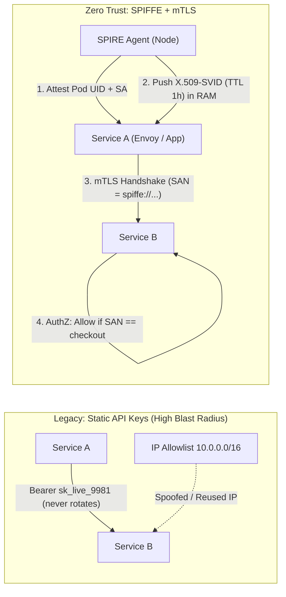
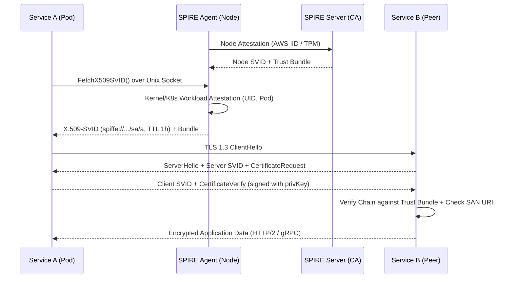
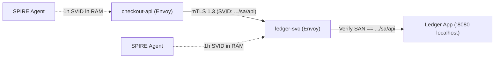

# Service-to-Service Auth Without Static Secrets: mTLS, SPIFFE, Zero Trust

> **Prerequisites:** [Lesson 06: RBAC vs ABAC vs ReBAC](../06-rbac-vs-abac-vs-rebac/README.md).  
> **Estimated Reading Time:** 24–28 minutes  
> **Target Audience:** Backend, platform, and security engineers eliminating static API keys across microservices, and candidates asked "how do services authenticate to each other in a Zero Trust architecture?"  
> **Free PDF Notes:** [Download SD-M-007.pdf](https://backendroadmap.com/notes/system-design/SD-M-007.pdf)

> [!NOTE]
> **In one line:** Static API keys and IP allowlists fail in elastic cloud networks because pods spin up every second and leaked keys live forever. **SPIFFE + mTLS** gives every workload a short-lived, cryptographically attested identity (`spiffe://prod.corp/ns/payments/sa/ledger`) delivered via a local socket, rotating automatically every hour with zero secrets on disk.

> [!TIP]
> **The Golden Rule:** Never authenticate a microservice by its IP address or a long-lived static API key. Authenticate **workload identity** using short-lived **mTLS X.509 certificates (SVIDs)** issued after hardware/platform attestation, and authorize every RPC on the verified `SPIFFE ID`.

---

## 1. What Workload Identity Is, and What It Isn't

In a legacy monolith-to-DB setup, teams put a static `API_KEY` or `DB_PASSWORD` in an environment variable and trusted the VPC firewall ("castle-and-moat"). In Kubernetes or multi-cloud microservices, IPs are ephemeral (reused across tenants/services in seconds), and a single SSRF, log leak, or compromised sidecar exposes static keys to every internal service.

| Term | Precise Meaning | Example |
| :--- | :--- | :--- |
| **Zero Trust** | Never trust network location (VPC/IP); authenticate and authorize every call | Verify identity even on `10.0.x.x` |
| **mTLS (Mutual TLS)** | Both server *and* client present X.509 certificates and prove key possession | Order Service verifies Payment Service cert and vice versa |
| **SPIFFE** | Open standard for cryptographic workload identity (`spiffe://trust-domain/path`) | `spiffe://prod.acme.io/ns/checkout/sa/api` |
| **SVID** | SPIFFE Verifiable Identity Document (short-lived X.509 cert or JWT) | X.509 cert with 1-hour TTL and SPIFFE URI in SAN |
| **SPIRE** | Production implementation of SPIFFE (Server + Node Agent) | Issues SVIDs after node + workload attestation |
| **Attestation** | Cryptographic proof of *what* node/pod is running before issuing an SVID | AWS Nitro/Instance Identity Doc + K8s Pod UID/SA |
| **Not** | Storing a 10-year wildcard TLS cert in Kubernetes `Secrets` or Git | Long-lived shared certs are just static secrets |

### Why It Matters
1. **Eliminates Secret Zero:** Workloads no longer need a bootstrap API key on disk to fetch other secrets; the node/platform attests the process and hands it an SVID in memory.
2. **Limits blast radius to minutes:** If an attacker steals an SVID from memory, it expires automatically in 30–60 minutes and cannot be renewed from outside the attested node.
3. **Decouples identity from IP addresses:** A pod can autoscale from IP `10.2.1.4` to `10.9.8.12` while keeping the exact same cryptographic identity.

---

## 2. Anatomy: Static Secrets vs SPIFFE/SPIRE + mTLS



In the **SPIFFE/SPIRE** model, a privileged **SPIRE Agent** runs as a DaemonSet on every host. When `checkout-api` starts, it connects to the local Unix Domain Socket (`/run/spire/sockets/agent.sock`). The Agent inspects the caller's Linux kernel UID, cgroup, and Kubernetes Pod UID (workload attestation), confirms the node itself was attested by AWS/GCP/TPM (node attestation), and streams a fresh **X.509-SVID** over the socket.

Neither the developer nor Kubernetes `etcd` ever holds a static private key—the private key is generated in memory and rotated automatically at 50% of its TTL.

| Dimension | Static API Keys | IP Allowlists | mTLS + SPIFFE/SVID |
| :--- | :--- | :--- | :--- |
| **Identity binding** | Secret string | Ephemeral network IP | Cryptographic keypair + SAN URI |
| **Rotation** | Manual / quarterly (painful) | N/A | Automatic every 30–60 min |
| **Leak blast radius** | Indefinite until revoked | Any pod reusing that IP | <= 1 hour (bounded by TTL) |
| **Wire encryption** | None (unless paired with TLS) | None | Built-in TLS 1.3 AEAD |
| **Secret Zero problem** | Yes (how to deploy the first key?) | No | Solved via platform/kernel attestation |

> [!WARNING]
> **The #1 Trap: Shared "Service Mesh" certs or missing SAN validation.** Using mTLS where every service shares the *same* client certificate (`CN=internal-mesh`) only gives you encryption, not authentication—any compromised pod can impersonate the payment ledger. Always verify the exact **SPIFFE URI SAN** (`spiffe://...`) in your authorization policy.

---

## 3. Mathematical Model: Blast Radius, Signing Load & Handshake Overhead

**1. Expected Exposure Window (Blast Radius).**  
If an SVID has lifetime $T_{\text{TTL}}$ and is rotated at $50\%$ TTL, a credential stolen at a uniform random point in its active window has expected remaining validity:

$$E[\text{exposure}] = \frac{1}{2}\,(0.5\,T_{\text{TTL}}) + \frac{1}{2}\,T_{\text{TTL}} \approx 0.75\,T_{\text{TTL}} \quad (\text{worst-case } T_{\text{TTL}})$$

With $T_{\text{TTL}} = 1\text{ hour}$, worst-case exposure is $60\text{ min}$ vs $\infty$ for an unrotated static API key.

**2. Control-Plane Signing Rate ($\lambda_{\text{sign}}$).**  
Suppose a cluster runs $N$ workloads, each rotating its SVID every $R = 0.5\,T_{\text{TTL}}$ seconds. The steady-state Certificate Signing Request (CSR) rate at the SPIRE Server / CA is:

$$\lambda_{\text{sign}} = \frac{N}{0.5\,T_{\text{TTL}}}$$

**Worked Numerical Example:**  
A fleet has $N = 20{,}000$ pods with $T_{\text{TTL}} = 3600\text{ s}$ ($R = 1800\text{ s}$):

$$\lambda_{\text{sign}} = \frac{20{,}000}{1800} \approx 11.1\text{ CSRs/sec}$$

An ECDSA P-256 signature takes ~0.05 ms of CPU, so 11.1 CSRs/sec consumes less than **0.1% of a single CPU core**. However, if all 20,000 pods restart simultaneously after a region power event, the spike is $20{,}000$ CSRs in 30 s ($\sim 667\text{ CSRs/sec}$), which requires jittered rotation and horizontally scaled SPIRE/CA replicas.

**3. mTLS Handshake vs Connection Pooling.**  
An mTLS 1.3 handshake adds **1 RTT** (plus ~0.5–1.5 ms ECDSA verify/sign CPU). Over persistent HTTP/2 or gRPC connection pools, the handshake occurs once per connection lifetime:

$$\text{Overhead} = \frac{T_{\text{handshake}}}{N_{\text{reqs/conn}} \cdot T_{\text{RPC}}}$$

At $1{,}000$ RPCs/conn, a $2\text{ ms}$ handshake amortizes to **0.002 ms/RPC** (negligible). Without connection pooling (new TCP+mTLS per request), latency and CPU spike dramatically.

---

## 4. Metrics & Percentiles

| Metric | Meaning | Alert when |
| :--- | :--- | :--- |
| **SVID time-to-expiry (`min`)** | Shortest remaining TTL across active pods | < 20% of TTL (rotation is failing!) |
| **mTLS handshake failure rate** | Rejected TLS client/server handshakes | > 0.1% (clock skew, expired CA, SAN mismatch) |
| **SPIRE Agent/Server CSR latency $p_{99}$** | Time to attest and sign an SVID | > 500 ms |
| **AuthZ SAN deny rate** | Valid mTLS cert, but caller SPIFFE ID not authorized | Sudden spike (misconfigured deploy or lateral probe) |
| **Trust bundle propagation lag** | Time for new Root/Intermediate CA to reach all nodes | > 5 minutes before rotation cutover |

### Worked Example (Payment Ledger mTLS)
`checkout-api` (`spiffe://prod.corp/ns/checkout/sa/api`) calls `ledger-svc` (`spiffe://prod.corp/ns/payments/sa/ledger`). Both pods receive ECDSA P-256 X.509-SVIDs with a 1-hour TTL from their local SPIRE Agent. At `t=0`, they establish a pooled gRPC/HTTP2 mTLS 1.3 connection. `ledger-svc` extracts the peer certificate's URI SAN, verifies it matches `spiffe://prod.corp/ns/checkout/sa/api`, and allows `DebitAccount`. At `t=30 min`, SPIRE pushes a new SVID over the Workload API socket; Envoy/the Go `tls.Config` hot-swaps the cert in memory with zero dropped connections.

---

## 5. Compounding & Failure Modes

**A. The "Expired Intermediate CA" Cliff.**  
Short-lived leaf SVIDs (1 hour) depend on an Intermediate CA (typically 24h–7d TTL) and a Root CA (1–5 years). If the Intermediate CA expires or fails to rotate, *every* pod's SVID stops renewing simultaneously, and 30–60 minutes later the entire service mesh suffers a **100% outage** where no service can talk to any other.  
*Mitigation:* Rotate Intermediate CAs at 50% TTL, monitor `cert_expiry_seconds`, and decouple trust bundle distribution from leaf signing.

**B. Clock Skew Across Nodes.**  
X.509 certificates have `NotBefore` and `NotAfter` timestamps. If Node B's NTP drifts 5 minutes behind Node A, Node B rejects newly issued SVIDs from Node A as "not yet valid." Always backdate `NotBefore` by 1–5 minutes in your CA and enforce NTP/chrony monitoring (< 100 ms skew).

**C. Thundering Herd on Cluster Restart.**  
If 10,000 pods restart at once, all 10,000 request SVIDs simultaneously. Without jittered rotation (`TTL * (0.5 ± 0.1)`) and local caching in the Node Agent, the CA database locks up.

---

## 6. Numbers Every Engineer Must Know

| Item | Typical | Implication |
| :--- | :---: | :--- |
| **X.509-SVID leaf TTL** | 1 hour (3,600 s) | Limits stolen-key blast radius; easy for CA to sustain |
| **Rotation trigger** | 50% of TTL (30 min) + jitter | Gives 30 min of retry headroom if CA is briefly degraded |
| **Intermediate CA TTL** | 24 hours – 7 days | Must be monitored separately from leaf SVIDs |
| **ECDSA P-256 sign time** | ~0.05 ms per signature | 10x faster than RSA-2048 signing (~0.5–1.5 ms) |
| **mTLS 1.3 handshake** | 1 RTT + ~1 ms CPU | Amortize via HTTP/2 / gRPC connection pooling |
| **Clock skew tolerance** | Backdate `NotBefore` by 60–300 s | Prevents NTP drift from breaking fresh SVIDs |

---

## 7. Protocol Deep Dive: SPIFFE Workload API & mTLS Handshake



| Question | Answer |
| :--- | :--- |
| **How does Service A prove it owns the SVID?** | During mTLS `CertificateVerify`, Service A signs the handshake transcript with the SVID's private key (which never leaves memory). |
| **What if Service A calls Service B through an L7 proxy?** | Either terminate mTLS at the sidecar (Envoy/Istio) or propagate identity via a signed **JWT-SVID** if an L7 intermediary cannot pass client certs. |
| **Do I need a Service Mesh (Istio/Linkerd) to use SPIFFE?** | No! Applications can use the `go-spiffe` / `spiffe` SDKs directly over the Workload API socket without sidecars. |
| **How do external clients (browsers/mobile) authenticate?** | They don't use SPIFFE. Edge/API Gateways terminate public TLS + OIDC/OAuth2, then translate to internal mTLS + JWT/headers. |

**When NOT to use mTLS + SPIFFE:**  
If you have a 2-service startup monolith talking to a managed RDS database inside a single account, setting up a full SPIRE server/agent hierarchy is premature. Start with cloud-native **IAM Workload Identity** (AWS IAM Roles for Service Accounts / GCP Workload Identity) + standard server-TLS, and adopt SPIFFE/mTLS as your microservice mesh grows.

---

## 8. Hierarchical Budgets & Design Rules

| Slice | Rule | Control |
| :--- | :--- | :--- |
| **Identity format** | Every workload gets a unique `spiffe://domain/ns/.../sa/...` | No shared wildcard certs |
| **Leaf TTL & rotation** | 1-hour TTL; rotate at 50% TTL with +/-10% jitter | Alert if remaining TTL < 20% |
| **Key algorithm** | ECDSA P-256 (fast signing, small certs) | Avoid RSA-2048 for high-churn SVIDs |
| **Authorization** | Verify both CA chain *and* exact peer SPIFFE URI SAN | Fail-closed on SAN mismatch |
| **Connection reuse** | Use HTTP/2 or gRPC connection pools | Amortizes 1-RTT mTLS handshake |
| **Trust bundle rotation** | Publish new Root/Intermediate CA *before* signing with it | Dual-trust overlap window >= 2x TTL |
| **Secret storage** | SVID private keys live in RAM/tmpfs only | Never persist to disk or `etcd` |

---

## 9. Top Mitigations

1. **Eliminate static API keys** between internal services by issuing short-lived X.509-SVIDs via SPIRE or cloud workload identity.
2. **Enforce strict SAN authorization** (not just "signed by our CA") so a compromised analytics pod cannot call the payment ledger.
3. **Rotate at 50% TTL with random jitter** to prevent thundering herds and survive transient CA outages.
4. **Backdate `NotBefore` by 2–5 minutes** to absorb minor NTP clock skew across nodes.
5. **Use overlapping trust bundles** during Root/Intermediate CA rotation so old and new certs verify seamlessly.
6. **Monitor `svid_time_to_expiry`** as a PagerDuty/alerting metric—if rotation stalls, you have 30 minutes to fix it before an outage.
7. **Pool mTLS connections** (HTTP/2, gRPC) so handshake latency and CPU are paid once per connection, not per RPC.

---

## 10. Production Reference: Sidecar mTLS + SPIFFE SAN Enforcement

In large-scale Zero Trust meshes (Uber, Netflix, ByteDance, and Istio-based platforms), **Envoy sidecars** or native **SPIFFE SDKs** handle mTLS transparently:
- **The Problem (Real-World SEV-1 Pattern):** A fintech migrated to mTLS using a custom script that rotated internal certs every 30 days. One weekend, the script silently failed on the `ledger` namespace due to a permissions change. Nobody noticed until 30 days later at 02:00 UTC when all `ledger` certs expired simultaneously, causing a **100% checkout outage** for 4 hours.
- **The Fix:**
  1. Replaced the 30-day cron script with **SPIRE** issuing 1-hour SVIDs over the Workload API.
  2. Added an alert on `min(svid_ttl_remaining) < 1200s` (catches rotation failures in 40 minutes, not 30 days).
  3. Enforced explicit SPIFFE ID allowlists (`spiffe://prod/ns/checkout/sa/api -> ledger:443`).



**Lesson:** Short-lived certificates (1 hour) are *safer* AND *more reliable* than 30-day certificates—because rotation happens 24 times a day, any broken rotation pipeline is detected immediately in staging or within minutes in production.

---

## 11. Multi-Language Production Code Tabs

Production-shaped **mTLS server/verifier** that validates the peer's X.509 certificate chain against the Trust Bundle *and* enforces an exact **SPIFFE URI SAN** (`spiffe://prod.corp/ns/checkout/sa/api`).

````carousel
```go
// Go: mTLS server verifying peer certificate chain AND exact SPIFFE URI SAN.
package main

import (
	"crypto/tls"
	"crypto/x509"
	"errors"
	"net/http"
	"os"
)

func verifySpiffeSAN(allowedID string) func([][]byte, [][]*x509.Certificate) error {
	return func(_ [][]byte, verifiedChains [][]*x509.Certificate) error {
		if len(verifiedChains) == 0 || len(verifiedChains[0]) == 0 {
			return errors.New("no verified peer certificate")
		}
		leaf := verifiedChains[0][0]
		for _, uri := range leaf.URIs {
			if uri.String() == allowedID {
				return nil
			}
		}
		return errors.New("unauthorized SPIFFE ID")
	}
}

func newMTLSServer(bundlePath, certPath, keyPath string) (*http.Server, error) {
	caPEM, err := os.ReadFile(bundlePath)
	if err != nil {
		return nil, err
	}
	pool := x509.NewCertPool()
	pool.AppendCertsFromPEM(caPEM)

	cert, err := tls.LoadX509KeyPair(certPath, keyPath)
	if err != nil {
		return nil, err
	}

	tlsCfg := &tls.Config{
		MinVersion:            tls.VersionTLS13,
		Certificates:          []tls.Certificate{cert},
		ClientCAs:             pool,
		ClientAuth:            tls.RequireAndVerifyClientCert,
		VerifyPeerCertificate: verifySpiffeSAN("spiffe://prod.corp/ns/checkout/sa/api"),
	}
	return &http.Server{Addr: ":8443", TLSConfig: tlsCfg}, nil
}
```
<!-- slide -->
```typescript
// TypeScript (Node.js): mTLS server checking CA trust + exact SPIFFE URI SAN.
import https from "node:https";
import fs from "node:fs";
import type { TLSSocket } from "node:tls";

const ALLOWED_SPIFFE_ID = "spiffe://prod.corp/ns/checkout/sa/api";

export function startMTLSServer() {
  const server = https.createServer(
    {
      minVersion: "TLSv1.3",
      cert: fs.readFileSync("/run/svid/tls.crt"),
      key: fs.readFileSync("/run/svid/tls.key"),
      ca: fs.readFileSync("/run/svid/bundle.crt"),
      requestCert: true,
      rejectUnauthorized: true,
    },
    (req, res) => {
      const socket = req.socket as TLSSocket;
      const peer = socket.getPeerCertificate();
      const san = peer.subjectaltname ?? "";
      if (!san.includes(`URI:${ALLOWED_SPIFFE_ID}`)) {
        res.writeHead(403).end("Forbidden: invalid SPIFFE ID");
        return;
      }
      res.writeHead(200).end("Authorized via mTLS + SPIFFE");
    }
  );
  server.listen(8443);
}
```
<!-- slide -->
```python
# Python: mTLS SSLContext requiring client cert + verifying SPIFFE URI SAN.
import ssl
from cryptography import x509

ALLOWED_SPIFFE_ID = "spiffe://prod.corp/ns/checkout/sa/api"

def create_mtls_context(cert_path: str, key_path: str, bundle_path: str) -> ssl.SSLContext:
    ctx = ssl.SSLContext(ssl.PROTOCOL_TLS_SERVER)
    ctx.minimum_version = ssl.TLSVersion.TLSv1_3
    ctx.load_cert_chain(certfile=cert_path, keyfile=key_path)
    ctx.load_verify_locations(cafile=bundle_path)
    ctx.verify_mode = ssl.CERT_REQUIRED
    return ctx

def authorize_peer(ssl_sock: ssl.SSLSocket) -> bool:
    der_cert = ssl_sock.getpeercert(binary_form=True)
    if not der_cert:
        return False
    cert = x509.load_der_x509_certificate(der_cert)
    san = cert.extensions.get_extension_for_class(x509.SubjectAlternativeName).value
    uris = san.get_values_for_type(x509.UniformResourceIdentifier)
    return ALLOWED_SPIFFE_ID in uris
```
<!-- slide -->
```csharp
// C#: Kestrel / SslStream mTLS validation enforcing TLS 1.3 + SPIFFE URI SAN.
using System.Net.Security;
using System.Security.Authentication;
using System.Security.Cryptography.X509Certificates;

public static class SpiffeVerifier
{
    private const string AllowedSpiffeId = "spiffe://prod.corp/ns/checkout/sa/api";

    public static SslServerAuthenticationOptions BuildOptions(
        X509Certificate2 serverCert, X509Certificate2Collection trustBundle)
    {
        return new SslServerAuthenticationOptions
        {
            ServerCertificate = serverCert,
            ClientCertificateRequired = true,
            EnabledSslProtocols = SslProtocols.Tls13,
            CertificateRevocationCheckMode = X509RevocationMode.NoCheck,
            RemoteCertificateValidationCallback = (_, cert, chain, errors) =>
            {
                if (cert is not X509Certificate2 peer || chain is null) return false;
                chain.ChainPolicy.TrustMode = X509ChainTrustMode.CustomRootTrust;
                chain.ChainPolicy.CustomTrustStore.AddRange(trustBundle);
                if (!chain.Build(peer)) return false;

                var san = peer.Extensions["2.5.29.17"]?.Format(false) ?? "";
                return san.Contains(AllowedSpiffeId, StringComparison.Ordinal);
            }
        };
    }
}
```
````

---

## 12. Hands-On CLI Verification Workflows

Inspect SVIDs, verify mTLS handshakes, and audit SPIRE workload registrations:

```bash
# 1. Inspect an X.509-SVID certificate to verify its SPIFFE URI SAN and short TTL
openssl x509 -in /run/svid/tls.crt -noout -text | grep -A2 "Subject Alternative Name"
openssl x509 -in /run/svid/tls.crt -noout -dates

# 2. Test an mTLS connection as an authenticated client
openssl s_client -connect ledger-svc:8443 \
  -cert /run/svid/tls.crt -key /run/svid/tls.key -CAfile /run/svid/bundle.crt \
  -tls1_3 -brief

# 3. SPIRE: list registered workload entries and their selectors
spire-server entry show -spiffeID spiffe://prod.corp/ns/checkout/sa/api

# 4. Istio: inspect the active mTLS certs inside an Envoy sidecar
istioctl proxy-config secret deploy/checkout-api -n checkout
```

---

## 13. Common Mistakes to Avoid

1. **Trusting IP addresses or VPC CIDRs** as authentication in dynamic cloud/Kubernetes clusters.
2. **Validating only the CA signature** without checking the peer's exact **SPIFFE URI SAN** (allows lateral impersonation).
3. **Using 1-year static client certificates** instead of short-lived, auto-rotated SVIDs.
4. **Creating a new TCP + mTLS connection per RPC** instead of using HTTP/2 or gRPC connection pools.
5. **Forgetting to monitor Intermediate CA expiry**, causing a simultaneous mesh-wide outage.
6. **Rotating the CA without an overlapping trust bundle**, dropping all connections during cutover.
7. **Ignoring NTP clock skew**, which causes peers to reject freshly minted SVIDs as "not yet valid."

---

## 14. Key Terms Glossary

| Key Term | Definition |
| :--- | :--- |
| **Zero Trust** | Security model requiring authentication and authorization for every request, regardless of network location. |
| **mTLS** | Mutual TLS; both client and server present X.509 certificates and prove private-key possession. |
| **SPIFFE** | Secure Production Identity Framework for Everyone; standardizes workload identity URIs and documents. |
| **SPIFFE ID** | URI identifying a workload: `spiffe://<trust-domain>/<workload-path>`. |
| **SVID** | SPIFFE Verifiable Identity Document (X.509 certificate or JWT) proving a workload's SPIFFE ID. |
| **SPIRE** | Production implementation of SPIFFE consisting of a Central Server and per-node Agents. |
| **Attestation** | Process of verifying node hardware/cloud identity and kernel/K8s workload identity before issuing an SVID. |
| **SAN (Subject Alternative Name)** | X.509 extension where the `spiffe://...` URI is encoded. |
| **Trust Bundle** | Set of root/intermediate CA public certificates used to verify peer SVIDs. |
| **Secret Zero** | The bootstrap problem of how a service authenticates to fetch its very first secret. |

---

## 15. System Design Interview Questions & Answers

### Basic Conceptual Questions

<details>
<summary><strong>Q1: What is the difference between TLS and mTLS? [BASIC]</strong></summary>

**Answer:**
In standard TLS (used by browsers), only the **server** presents a certificate to prove its identity. In **mTLS (Mutual TLS)**, **both** the server and the client present X.509 certificates and sign the handshake transcript, proving both identities cryptographically.
</details>

<details>
<summary><strong>Q2: What is SPIFFE and what is an SVID? [BASIC]</strong></summary>

**Answer:**
**SPIFFE** is an open standard that gives every workload a portable cryptographic identity URI (`spiffe://trust-domain/ns/payments/sa/ledger`). An **SVID** (SPIFFE Verifiable Identity Document) is the short-lived X.509 certificate or JWT that proves that identity.
</details>

<details>
<summary><strong>Q3: Why are IP allowlists insufficient for microservice authentication? [BASIC]</strong></summary>

**Answer:**
In Kubernetes and autoscaling clouds, IP addresses are ephemeral and recycled across different services. An IP allowlist cannot distinguish between `checkout-api` and a compromised `analytics-worker` that later receives the same IP, and it provides zero wire encryption.
</details>

<details>
<summary><strong>Q4: What is "Secret Zero" and how does SPIRE solve it? [BASIC]</strong></summary>

**Answer:**
"Secret Zero" is the chicken-and-egg problem: if a service needs an API key to log into Vault, how do you securely deliver that first API key? SPIRE solves it via **platform attestation**—verifying the cloud instance identity document (e.g., AWS Nitro/IMDS) and Linux kernel/Kubernetes pod metadata (UID, Pod UID) to issue an SVID with zero pre-installed secrets.
</details>

### Scenario-Based Architecture Questions

<details>
<summary><strong>Q5: Design service-to-service authentication for 500 microservices in Kubernetes without static secrets. [SCENARIO]</strong></summary>

**Answer:**
Deploy **SPIRE** (or Istio/Linkerd with SPIFFE). A SPIRE Agent DaemonSet runs on each node, attests pods via K8s/kernel selectors, and pushes 1-hour ECDSA P-256 X.509-SVIDs over a local Unix socket. Services communicate over pooled HTTP/2 or gRPC with **mTLS 1.3**, and each service enforces an authorization allowlist on the peer's **SPIFFE URI SAN**.
</details>

<details>
<summary><strong>Q6: A service mesh mTLS setup is encrypting traffic, yet a compromised logging pod can still call the billing API. Why? [SCENARIO]</strong></summary>

**Answer:**
The billing API is only verifying that the client cert is signed by the internal CA (**authentication**), without checking *which* SPIFFE ID is inside the cert's SAN (**authorization**). Fix this by enforcing peer SPIFFE ID allowlists (e.g., only `spiffe://prod/ns/checkout/sa/api` may call `billing:443`).
</details>

<details>
<summary><strong>Q7: How do you rotate your Root or Intermediate CA in an active mTLS mesh with zero downtime? [SCENARIO]</strong></summary>

**Answer:**
Use a **two-phase trust bundle rollout**: (1) Add the *new* CA certificate to the Trust Bundle distributed to all workloads while still signing SVIDs with the *old* CA. (2) Once 100% of workloads have the updated bundle, switch the CA to sign new SVIDs with the *new* CA. (3) Wait at least `1 * SVID_TTL` for old certs to expire, then remove the old CA from the bundle.
</details>

<details>
<summary><strong>Q8: Your service latency jumped by 15 ms after enabling mTLS. What happened and how do you fix it? [SCENARIO]</strong></summary>

**Answer:**
The client is likely opening a new TCP + mTLS connection on every HTTP/1.1 request instead of reusing connections. Enable **HTTP/2 or gRPC connection pooling** (or keep-alive) so the 1-RTT handshake happens once per connection, and switch from RSA-2048 to **ECDSA P-256** certs for 10x faster signing.
</details>

### Advanced & Tricky Interview Questions

<details>
<summary><strong>Q9: How do you propagate the end-user's identity alongside mTLS when Service A calls Service B on a user's behalf? [TRICKY]</strong></summary>

**Answer:**
mTLS authenticates the **workload** (`Service A`), not the end user (`user:alice`). Propagate both: mTLS proves the caller is legitimately `Service A`, and an internal signed **JWT** (or OIDC token) in the `Authorization` header carries `sub=user:alice`. `Service B` only trusts the user JWT *because* mTLS proved it came from `Service A` (or the API Gateway).
</details>

<details>
<summary><strong>Q10: What happens if you revoke a compromised pod's SVID? Why is short TTL preferred over CRL/OCSP? [TRICKY]</strong></summary>

**Answer:**
CRLs (Certificate Revocation Lists) and OCSP add network lookups, caching staleness, and availability failure modes to every mTLS handshake. Instead, SPIFFE relies on **short TTLs (e.g., 1 hour)** and terminating the compromised pod/node so it cannot attest for a new SVID. For immediate kill-switches, push a deny-rule for that SPIFFE ID to the policy engine.
</details>

<details>
<summary><strong>Q11: Why is `NotBefore` backdated on newly issued SVIDs? [TRICKY]</strong></summary>

**Answer:**
Distributed hosts have slight NTP clock drift. If the CA issues a cert with `NotBefore = 12:00:00` and a peer's clock is `11:59:58`, the peer rejects the certificate as invalid. Backdating `NotBefore` by 1–5 minutes absorbs normal clock skew.
</details>

<details>
<summary><strong>Q12: Can an L7 load balancer terminate mTLS without losing the client's workload identity? [TRICKY]</strong></summary>

**Answer:**
If an L7 proxy terminates mTLS, the TCP connection to the backend comes from the proxy's IP/cert, not the original client. To preserve identity, either use **TLS passthrough** (L4), use a **service mesh** where the proxy itself is attested and forwards a signed **JWT-SVID** or `X-Forwarded-Client-Cert` (XFCC) header from a trusted proxy SPIFFE ID.
</details>

---

## 16. One-Page Master Cheat Sheet

```
+---------------------------------------------------------------------------------------------------------+
|               SERVICE-TO-SERVICE AUTH WITHOUT STATIC SECRETS — MASTER CHEAT SHEET                       |
+---------------------------------------------------------------------------------------------------------+
| 1. ZERO TRUST: Never trust VPC IPs or static API keys. Authenticate every RPC via workload identity.    |
| 2. SPIFFE ID: spiffe://trust-domain/ns/<ns>/sa/<sa> encoded in X.509-SVID URI SAN.                      |
| 3. ATTESTATION: Node Agent verifies kernel/K8s/cloud identity -> eliminates "Secret Zero".              |
+---------------------------------------------------------------------------------------------------------+
| 4. SHORT TTL: 1-hour leaf SVIDs, rotated in RAM at 50% TTL + jitter. Never written to disk/etcd.        |
| 5. AUTHN + AUTHZ: Verify CA chain AND exact peer SPIFFE URI SAN (CA-only check allows lateral moves!).  |
+---------------------------------------------------------------------------------------------------------+
| 6. PERFORMANCE: ECDSA P-256 (~0.05ms sign) + HTTP/2/gRPC connection pooling (<0.01ms amortized).        |
| 7. RELIABILITY: Monitor min(SVID TTL), backdate NotBefore (2-5m), dual-trust CA bundle rotations.       |
+---------------------------------------------------------------------------------------------------------+
```

---

## Further Reading & Sources

- SPIFFE / CNCF, [SPIFFE Specification & Workload API](https://spiffe.io/docs/latest/spiffe-about/overview/).
- Google Cloud, [BeyondCorp: A New Approach to Enterprise Security](https://cloud.google.com/beyondcorp).
- Istio Documentation, [Mutual TLS & Security Architecture](https://istio.io/latest/docs/concepts/security/).
- NIST SP 800-207, [Zero Trust Architecture](https://csrc.nist.gov/publications/detail/sp/800-207/final).

---

## Free PDF Notes

[SD-M-007.pdf](https://backendroadmap.com/notes/system-design/SD-M-007.pdf)

---

## Next

Continue with [Lesson 08: Encryption in Transit: Why TLS Everywhere, Even Inside Your Network](../08-encryption-in-transit/README.md).
