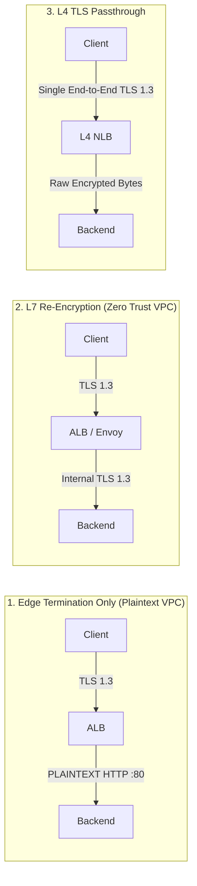
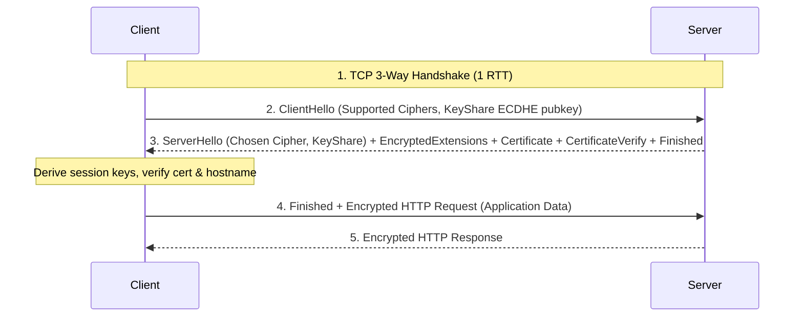
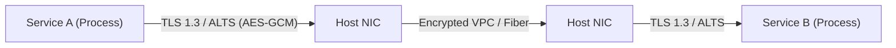

# Encryption in Transit: Why TLS Everywhere, Even Inside Your Network

> **Prerequisites:** [Lesson 07: Service-to-Service Auth Without Static Secrets](../07-service-to-service-auth-without-static-secrets/README.md).  
> **Estimated Reading Time:** 22–26 minutes  
> **Target Audience:** Backend and infrastructure engineers designing internal RPC, database, and edge networking, and candidates asked "do we really need TLS inside a private VPC?"  
> **Free PDF Notes:** [Download SD-M-008.pdf](https://backendroadmap.com/notes/system-design/SD-M-008.pdf)

> [!NOTE]
> **In one line:** Terminating TLS at the load balancer and running plaintext HTTP inside your VPC leaves every east-west packet readable to compromised pods, misconfigured BGP/DNS, and shared-host sniffers. **TLS 1.3 everywhere** gives you confidentiality, integrity, and **Forward Secrecy** for ~1% CPU overhead using hardware AES-NI.

> [!TIP]
> **The Golden Rule:** Enforce **TLS 1.3** (minimum TLS 1.2 with AEAD + ECDHE) on *every* hop—external edge, internal service-to-service, and database/cache connections. If an L7 load balancer must inspect HTTP headers, terminate TLS at the LB and **re-encrypt** over a new TLS connection to the backend (**end-to-end encryption in transit**).

---

## 1. What Encryption in Transit Is, and What It Isn't

**Encryption in transit** protects data while it moves across a network link—preventing passive eavesdropping, active packet tampering (MITM), and server impersonation. A common architectural mistake is assuming a "private VPC" is a physically isolated wire; in reality, cloud VPCs are multi-tenant software-defined networks running over shared physical NICs, switches, and hypervisors.

| Term | Precise Meaning | Example |
| :--- | :--- | :--- |
| **TLS 1.3** | Modern transport security protocol (RFC 8446); 1-RTT handshake, AEAD-only, mandatory PFS | `TLS_AES_256_GCM_SHA384` |
| **PFS (Perfect Forward Secrecy)** | Ephemeral key exchange (ECDHE) so stealing a server's private key cannot decrypt past recorded traffic | New ephemeral session key per connection |
| **AEAD** | Authenticated Encryption with Associated Data (confidentiality + integrity in one pass) | `AES-128-GCM`, `ChaCha20-Poly1305` |
| **Edge Termination** | Decrypting TLS at the public LB and forwarding plaintext HTTP inside the VPC | ALB `:443` -> EC2 `:80` (anti-pattern for sensitive data) |
| **Re-encryption (Split TLS)** | Terminating at LB for L7 routing, then opening a fresh TLS session to the backend | ALB `:443` -> Backend `:8443` |
| **TLS Passthrough** | L4 proxy forwards raw encrypted TLS bytes directly to the backend without decrypting | NLB `:443` -> Backend `:443` |
| **Not** | A substitute for encryption at rest (TLS only protects the wire, not disk/DB snapshots) | Combine with Envelope Encryption (Lesson 09) |

### Why It Matters
1. **Compromised neighbor / lateral movement:** If an attacker exploits a single low-privilege pod (e.g., an image resizer), plaintext east-west traffic lets them sniff session tokens, PII, and DB credentials on the node bridge.
2. **Compliance mandates:** PCI-DSS, HIPAA, and SOC 2 increasingly require encryption in transit across *all* network segments carrying cardholder or health data, including internal VPCs.
3. **Zero-cost myth-busting:** Engineers often skip internal TLS fearing "TLS is slow," unaware that modern CPUs encrypt AES-GCM at **5–10 GB/s per core** via AES-NI.

---

## 2. Anatomy: Edge Termination vs Re-Encryption vs Passthrough



In **Edge Termination Only**, the load balancer decrypts traffic and sends plaintext HTTP to backend instances. Any misrouted traffic, debug tcpdump, or compromised sidecar on the path sees raw payloads and `Authorization` headers.

In **L7 Re-Encryption**, the load balancer terminates the public TLS session (enabling WAF, rate limiting, and path-based routing), then immediately initiates a second TLS 1.3 (or mTLS) connection to the backend.

In **TLS Passthrough**, the L4 load balancer inspects only the TCP 4-tuple (and optional SNI) and forwards encrypted packets untouched—maximum security, but the LB cannot inspect HTTP headers or terminate DDoS at L7.

| Pattern | L7 Routing / WAF | Internal Wire Security | Latency Overhead |
| :--- | :---: | :---: | :--- |
| **Edge Termination Only** | Yes | None (plaintext inside VPC) | 1 handshake |
| **L7 Re-Encryption** | Yes | Full (encrypted end-to-end) | 2 handshakes (amortized via pooling) |
| **L4 TLS Passthrough** | No (L4 only) | Full (single unbroken TLS session) | 1 handshake |

> [!WARNING]
> **The #1 Trap: Enabling TLS 1.3 `0-RTT` Early Data on non-idempotent endpoints.** TLS 1.3's `0-RTT` lets a client send application data in its very first packet before the handshake completes—but `0-RTT` data **has no replay protection**. An active network attacker can capture and replay that packet to trigger duplicate `POST /payments` or `POST /transfer` calls. Disable `0-RTT` globally or restrict it strictly to idempotent `GET`s.

---

## 3. Mathematical Model: Handshake RTTs, CPU Cost & Throughput

**1. Handshake Latency: TLS 1.2 vs TLS 1.3.**  
After the 1-RTT TCP 3-way handshake, TLS 1.2 requires **2 RTTs** for key exchange (`ClientHello` -> `ServerHello` -> `ClientKeyExchange` -> `Finished`), whereas TLS 1.3 combines key share into `ClientHello` and completes in **1 RTT**:

$$T_{\text{conn, TLS1.2}} = \text{RTT}_{\text{TCP}} + 2\,\text{RTT} = 3\,\text{RTT}$$

$$T_{\text{conn, TLS1.3}} = \text{RTT}_{\text{TCP}} + 1\,\text{RTT} = 2\,\text{RTT}$$

**Worked Numerical Example:**  
For a mobile user with $\text{RTT} = 60\text{ ms}$:
- TLS 1.2 cold connection: $3 \times 60 = 180\text{ ms}$ before the first HTTP byte is sent.
- TLS 1.3 cold connection: $2 \times 60 = 120\text{ ms}$ (**33% faster**).  
Inside a datacenter ($\text{RTT} = 0.5\text{ ms}$), a TLS 1.3 handshake takes **$0.5\text{ ms}$** network time + **~$0.5\text{ ms}$** ECDSA CPU.

**2. Symmetric Bulk Encryption Cost (AES-NI).**  
With hardware AES-NI + AVX2, a single modern x86/ARMv8 core encrypts `AES-128-GCM` at $R_{\text{aes}} \approx 8\text{ GB/s}$ ($64\text{ Gbps}$). For a busy microservice pushing $500\text{ MB/s}$ ($4\text{ Gbps}$) of internal RPCs:

$$\text{CPU cores for encryption} = \frac{0.5\text{ GB/s}}{8\text{ GB/s/core}} = 0.0625\text{ cores (6.25\% of 1 core)}$$

Symmetric encryption is essentially free; **asymmetric handshakes** (if you fail to pool connections) are the only real CPU cost.

---

## 4. Metrics & Percentiles

| Metric | Meaning | Alert when |
| :--- | :--- | :--- |
| **TLS handshake duration $p_{99}$** | Time spent in TLS negotiation | > 2x network RTT (indicates CPU saturation or missing ECDSA) |
| **TLS handshake failure rate** | Failed negotiations (bad cert, cipher mismatch, expired) | > 0.1% |
| **TLS version distribution** | Share of TLS 1.3 vs 1.2 vs legacy 1.0/1.1 | Any TLS 1.0/1.1 traffic (security violation) |
| **Connection reuse ratio** | Requests per TLS connection (`reqs / handshakes`) | < 10 for internal services (missing connection pool) |
| **Certificate days-to-expiry** | Remaining validity of edge and internal certs | < 14 days (for 90d certs) or < 20% TTL |

### Worked Example (Internal Checkout -> Inventory RPC)
A checkout service sends 10,000 RPS (average 4 KB payload = 40 MB/s) to `inventory-svc` over 100 pooled HTTP/2 TLS 1.3 connections.
- **Handshake cost:** 100 connections established at startup (~1 ms each), then 0 handshakes/sec steady-state.
- **Bulk encryption cost:** 40 MB/s at 8 GB/s/core = **0.5% of 1 CPU core**.
- **Latency penalty:** 0 ms per RPC (amortized).  
Every packet on the VPC wire is encrypted with `TLS_AES_256_GCM_SHA384` and Forward Secrecy.

---

## 5. Compounding & Failure Modes

**A. Connection Churn + RSA-2048 CPU Collapse.**  
If a client disables HTTP keep-alive or connection pooling and opens a fresh TLS connection per request at 5,000 RPS using **RSA-2048** certificates (~1.5 ms/sign), the server burns $5{,}000 \times 1.5\text{ ms} = 7.5\text{ CPU cores}$ solely on TLS handshakes—causing cascading timeouts. Switching to **ECDSA P-256** (~0.05 ms/sign) + **HTTP/2 connection pooling** cuts handshake CPU by **> 99%**.

**B. Mixed-Content / Downgrade & Broken Certificate Validation.**  
Setting `InsecureSkipVerify: true` (Go), `rejectUnauthorized: false` (Node.js), or `verify=False` (Python) in production disables certificate chain and hostname verification. You still pay the encryption CPU cost, *while remaining completely vulnerable to active MITM attacks*.

**C. TLS 1.3 `0-RTT` Replay Attack.**  
An attacker intercepts a `0-RTT` `POST /api/v1/withdraw` packet and replays it 10 times to the server before the replay window closes, executing 10 withdrawals.

---

## 6. Numbers Every Engineer Must Know

| Item | Typical | Implication |
| :--- | :---: | :--- |
| **TLS 1.3 handshake** | 1 RTT (vs 2 RTT for TLS 1.2) | Saves 1 full network RTT on every cold connection |
| **AES-128-GCM (AES-NI)** | 5–10 GB/s per core | Bulk encryption is negligible (< 1–2% CPU) |
| **ECDSA P-256 vs RSA-2048** | ~0.05 ms vs ~1.5 ms sign | Prefer ECDSA P-256 for high-scale TLS termination |
| **HSTS `max-age`** | 31,536,000 s (1 year) | Prevents browser SSL-stripping downgrade attacks |
| **TLS 1.0 / 1.1 status** | Deprecated (RFC 8996) | Disable everywhere; fail compliance if enabled |
| **Session ticket rotation** | Every 1–24 hours | Must rotate ticket keys or you break Forward Secrecy |

---

## 7. Protocol Deep Dive: TLS 1.3 1-RTT Handshake



| Question | Answer |
| :--- | :--- |
| **Why is Forward Secrecy mandatory in TLS 1.3?** | TLS 1.3 removed static RSA key transport entirely; every handshake uses ephemeral `(EC)DHE` keys that are discarded when the session ends. |
| **What if I use TLS session resumption (`0-RTT` vs `1-RTT` PSK)?** | `1-RTT` PSK resumption skips certificate verification overhead safely. `0-RTT` sends early data before server confirmation and is vulnerable to replay. |
| **Does TLS protect against compromised endpoints?** | No. If an attacker has root on the server, they can read plaintext in application memory. TLS protects the *network wire*. |
| **How do browsers know never to connect over HTTP?** | **HSTS** (`Strict-Transport-Security: max-age=31536000; includeSubDomains; preload`). |

**When NOT to use TLS:**  
Only for loopback communication inside the exact same kernel (`127.0.0.1` / Unix Domain Socket between an app and its local Envoy sidecar), where kernel memory isolation already protects the channel and adding TLS would double-encrypt traffic unnecessarily.

---

## 8. Hierarchical Budgets & Design Rules

| Slice | Rule | Control |
| :--- | :--- | :--- |
| **Minimum version** | `TLSv1.3` preferred; `TLSv1.2` absolute floor | Disable TLS 1.0/1.1 at LB & services |
| **Cipher suites** | AEAD + ECDHE only (`AES-GCM`, `ChaCha20-Poly1305`) | Ban RC4, 3DES, CBC, static RSA |
| **Certificate verification** | Always verify CA chain + exact hostname/SAN | Ban `InsecureSkipVerify` in prod lint |
| **0-RTT Early Data** | Disabled by default; allow only on idempotent `GET` | LB/Nginx `ssl_early_data off;` |
| **Edge security** | Redirect HTTP->HTTPS + HSTS (`preload`) | Enforced at CDN/ALB |
| **Internal VPC traffic** | Re-encrypt at L7 LB or use mTLS mesh | No plaintext HTTP/SQL inside VPC |
| **Session ticket keys** | Rotate STEK every <= 24h in RAM | Preserves Forward Secrecy |

---

## 9. Top Mitigations

1. **Enforce TLS 1.3 (min TLS 1.2) everywhere**, including internal VPC service-to-service, Redis, Kafka, and PostgreSQL connections.
2. **Never disable certificate/hostname verification** (`InsecureSkipVerify`, `verify=False`) even in staging—use a private CA instead.
3. **Use ECDSA P-256 certificates** and **HTTP/2 / gRPC connection pooling** to eliminate handshake CPU bottlenecks.
4. **Disable TLS 1.3 `0-RTT`** on any endpoint that mutates state or lacks idempotency keys.
5. **Rotate TLS Session Ticket Encryption Keys (STEKS)** every few hours so Forward Secrecy holds across resumed sessions.
6. **Enable HSTS (`max-age=31536000; includeSubDomains`)** on all public domains to defeat SSL-stripping.
7. **Automate certificate renewal** (ACME/Cert-Manager/SPIRE) with alerts at < 20% remaining TTL.

---

## 10. Production Reference: Google ALTS & Internal VPC Encryption

Historically, even large tech companies ran plaintext inside their datacenters until the 2013 Snowden revelations showed that inter-datacenter fiber links were tapped. Google responded by encrypting all internal WAN and datacenter RPCs using **ALTS (Application Layer Transport Security)**, and AWS/GCP added hardware-accelerated VPC encryption.
- **The Problem:** Relying solely on network-layer encryption (IPsec/VPC) still leaves traffic exposed to compromised sidecars, misconfigured load balancers, or multi-tenant host taps before packets hit the NIC.
- **The Fix:** Encrypt at the **application transport layer (TLS 1.3 / ALTS)** from process to process, backed by AES-NI hardware acceleration and automated short-lived certs.



**Lesson:** Network-layer encryption (VPC/IPsec) and transport-layer encryption (TLS 1.3) are complementary—TLS ensures that even if a switch, proxy, or neighboring container snoops the wire, it sees only authenticated ciphertext.

---

## 11. Multi-Language Production Code Tabs

Hardened **TLS 1.3 Client/Server** configurations enforcing minimum TLS 1.3, strict certificate & hostname verification, and AEAD ciphers.

````carousel
```go
// Go: Hardened TLS 1.3 client & server config (never InsecureSkipVerify).
package main

import (
	"crypto/tls"
	"net/http"
	"time"
)

func hardenedHTTPClient() *http.Client {
	tlsCfg := &tls.Config{
		MinVersion: tls.VersionTLS13, // TLS 1.3 only uses AEAD + PFS ciphers
	}
	transport := &http.Transport{
		TLSClientConfig:     tlsCfg,
		MaxIdleConns:        100,
		MaxIdleConnsPerHost: 100, // Pool connections to amortize 1-RTT handshake
		IdleConnTimeout:     90 * time.Second,
		ForceAttemptHTTP2:   true,
	}
	return &http.Client{Transport: transport, Timeout: 5 * time.Second}
}

func hardenedTLSServer(certFile, keyFile string) *http.Server {
	return &http.Server{
		Addr: ":8443",
		TLSConfig: &tls.Config{
			MinVersion: tls.VersionTLS13,
			CurvePreferences: []tls.CurveID{
				tls.X25519,
				tls.CurveP256,
			},
		},
	}
}
```
<!-- slide -->
```typescript
// TypeScript (Node.js): Hardened TLS 1.3 HTTPS server with HSTS & connection pooling.
import https from "node:https";
import fs from "node:fs";

export function createHardenedServer() {
  return https.createServer(
    {
      minVersion: "TLSv1.3",
      cert: fs.readFileSync("/etc/tls/tls.crt"),
      key: fs.readFileSync("/etc/tls/tls.key"),
      honorCipherOrder: true,
    },
    (req, res) => {
      res.setHeader(
        "Strict-Transport-Security",
        "max-age=31536000; includeSubDomains; preload"
      );
      res.writeHead(200).end("Encrypted via TLS 1.3");
    }
  );
}

export const pooledAgent = new https.Agent({
  keepAlive: true,
  maxSockets: 100,
  minVersion: "TLSv1.3",
  rejectUnauthorized: true, // Always verify cert chain + hostname
});
```
<!-- slide -->
```python
# Python: Hardened TLS 1.3 SSLContext with strict hostname & CA verification.
import ssl
import urllib.request

def create_hardened_client_context(ca_file: str | None = None) -> ssl.SSLContext:
    ctx = ssl.create_default_context(cafile=ca_file)
    ctx.minimum_version = ssl.TLSVersion.TLSv1_3
    ctx.check_hostname = True
    ctx.verify_mode = ssl.CERT_REQUIRED
    return ctx

def fetch_secure(url: str) -> bytes:
    ctx = create_hardened_client_context()
    with urllib.request.urlopen(url, context=ctx, timeout=5) as resp:
        return resp.read()
```
<!-- slide -->
```csharp
// C#: Hardened HttpClientHandler enforcing TLS 1.3 and strict cert validation.
using System.Net.Http;
using System.Security.Authentication;

public static class HardenedTlsClient
{
    public static HttpClient Create()
    {
        var handler = new SocketsHttpHandler
        {
            SslOptions =
            {
                EnabledSslProtocols = SslProtocols.Tls13,
                // Never bypass certificate validation in production
                RemoteCertificateValidationCallback = null
            },
            PooledConnectionLifetime = TimeSpan.FromMinutes(10),
            MaxConnectionsPerServer = 100
        };
        return new HttpClient(handler) { Timeout = TimeSpan.FromSeconds(5) };
    }
}
```
````

---

## 12. Hands-On CLI Verification Workflows

Verify TLS versions, cipher suites, Forward Secrecy, and certificate chains on any endpoint:

```bash
# 1. Verify TLS 1.3 handshake and negotiated AEAD cipher
openssl s_client -connect api.example.com:443 -tls1_3 -servername api.example.com -brief

# 2. Confirm legacy TLS 1.0 / 1.1 are rejected (should fail handshake)
openssl s_client -connect api.example.com:443 -tls1_1

# 3. Inspect HSTS header and TLS version with curl
curl -sI --tlsv1.3 https://api.example.com | grep -i "strict-transport-security"

# 4. Enumerate all supported ciphers and check for weak suites
nmap --script ssl-enum-ciphers -p 443 api.example.com
```

---

## 13. Common Mistakes to Avoid

1. **Terminating TLS at the ALB and sending plaintext HTTP inside the VPC**, exposing secrets to lateral sniffers.
2. **Setting `InsecureSkipVerify: true` / `rejectUnauthorized: false`**, which silently disables authentication and enables MITM.
3. **Leaving TLS 1.0 / 1.1 or CBC/RSA-key-transport ciphers enabled**, failing compliance and losing Forward Secrecy.
4. **Enabling TLS 1.3 `0-RTT` on mutating endpoints**, allowing replay attacks on payments or state changes.
5. **Forgetting internal database/cache TLS** (PostgreSQL `sslmode=require` vs `verify-full`, Redis TLS).
6. **Disabling connection pooling**, causing RSA/ECDSA handshake CPU spikes at scale.
7. **Forgetting to rotate Session Ticket Encryption Keys**, silently breaking Forward Secrecy across resumed sessions.

---

## 14. Key Terms Glossary

| Key Term | Definition |
| :--- | :--- |
| **TLS 1.3** | Latest TLS standard (RFC 8446) with 1-RTT handshakes, AEAD-only ciphers, and mandatory Forward Secrecy. |
| **Perfect Forward Secrecy (PFS)** | Property where compromising a server's long-term private key cannot decrypt past recorded sessions. |
| **ECDHE** | Elliptic Curve Diffie-Hellman Ephemeral; key-exchange algorithm providing PFS. |
| **AEAD** | Authenticated Encryption with Associated Data (e.g., `AES-GCM`, `ChaCha20-Poly1305`). |
| **AES-NI** | CPU hardware instruction set accelerating AES encryption to 5–10 GB/s per core. |
| **0-RTT Early Data** | TLS 1.3 feature sending data in the first flight; fast but vulnerable to replay attacks. |
| **HSTS** | HTTP Strict Transport Security header forcing browsers to use HTTPS only. |
| **TLS Termination** | Decrypting TLS at a proxy/LB before forwarding to backends. |
| **TLS Passthrough** | Forwarding raw encrypted TLS bytes at L4 without decrypting at the proxy. |
| **SNI (Server Name Indication)** | Cleartext TLS extension telling the server which hostname certificate to present. |

---

## 15. System Design Interview Questions & Answers

### Basic Conceptual Questions

<details>
<summary><strong>Q1: Why do we need TLS inside a private VPC if the network is behind a firewall? [BASIC]</strong></summary>

**Answer:**
A cloud VPC is a multi-tenant software-defined network, not a physically isolated wire. Plaintext east-west traffic is vulnerable to compromised neighboring pods/containers, lateral movement, SSRF, misconfigured routing, and compliance failures (PCI-DSS/HIPAA). With AES-NI, internal TLS costs < 1–2% CPU.
</details>

<details>
<summary><strong>Q2: What makes TLS 1.3 faster and more secure than TLS 1.2? [BASIC]</strong></summary>

**Answer:**
TLS 1.3 cuts the cold handshake from **2 RTTs to 1 RTT** by sending the ephemeral ECDHE key share in `ClientHello`. Security-wise, it removes all weak/legacy primitives (RSA key transport, CBC, SHA-1, RC4) and mandates **AEAD** ciphers and **Perfect Forward Secrecy**.
</details>

<details>
<summary><strong>Q3: What is Perfect Forward Secrecy (PFS) and how does TLS achieve it? [BASIC]</strong></summary>

**Answer:**
PFS ensures that if an attacker records encrypted traffic today and steals the server's private key next year, they still cannot decrypt the recorded traffic. TLS achieves this by negotiating a fresh, ephemeral **ECDHE** session key per connection and discarding it afterward.
</details>

<details>
<summary><strong>Q4: What is the difference between TLS termination, re-encryption, and passthrough? [BASIC]</strong></summary>

**Answer:**
**Termination** decrypts at the LB and sends plaintext to the backend. **Re-encryption** decrypts at the LB (for WAF/L7 routing) and opens a fresh TLS connection to the backend. **Passthrough** forwards raw encrypted bytes at L4 directly to the backend without decrypting.
</details>

### Scenario-Based Architecture Questions

<details>
<summary><strong>Q5: You are designing a payment API behind an AWS ALB. How do you configure encryption in transit? [SCENARIO]</strong></summary>

**Answer:**
Terminate public TLS 1.3 at the ALB (to run AWS WAF and L7 routing), then **re-encrypt** from the ALB to backend targets over internal TLS 1.3 (or mTLS via a service mesh). Enable HSTS on public responses, disable `0-RTT`, and enforce `sslmode=verify-full` from the backend to RDS/PostgreSQL.
</details>

<details>
<summary><strong>Q6: After enabling TLS to PostgreSQL, a developer sets `sslmode=require` to fix a cert error. Is that safe? [SCENARIO]</strong></summary>

**Answer:**
No! In PostgreSQL (`libpq`), `sslmode=require` encrypts the wire **without** verifying the server's CA or hostname—leaving it vulnerable to active MITM attacks. Always use **`sslmode=verify-full`** with the RDS/cloud CA bundle.
</details>

<details>
<summary><strong>Q7: Your service CPU spiked to 90% after turning on TLS. What is the likely cause and fix? [SCENARIO]</strong></summary>

**Answer:**
Almost certainly **connection churn** (opening a new TCP+TLS connection per request without keep-alive/pooling) combined with **RSA-2048** certificates. Fix by enabling HTTP/2 or HTTP/1.1 keep-alive connection pooling and switching to **ECDSA P-256** certificates.
</details>

<details>
<summary><strong>Q8: How do you protect users from SSL-stripping on public Wi-Fi? [SCENARIO]</strong></summary>

**Answer:**
Redirect all port 80 HTTP requests to port 443 HTTPS, and return the `Strict-Transport-Security: max-age=31536000; includeSubDomains; preload` (**HSTS**) header on HTTPS responses so browsers refuse to make plaintext HTTP requests even if a user types `example.com`.
</details>

### Advanced & Tricky Interview Questions

<details>
<summary><strong>Q9: Why is TLS 1.3 `0-RTT` dangerous for backend APIs? [TRICKY]</strong></summary>

**Answer:**
`0-RTT` Early Data is sent before the server contributes freshness to the handshake, meaning it lacks replay protection. An active attacker can capture and replay the first packet to execute duplicate `POST /transfer` or `DELETE` requests. Never allow `0-RTT` on non-idempotent endpoints.
</details>

<details>
<summary><strong>Q10: How can TLS Session Tickets silently break Perfect Forward Secrecy? [TRICKY]</strong></summary>

**Answer:**
TLS session tickets are encrypted with a server-side Session Ticket Encryption Key (STEK). If you never rotate the STEK (or store it on disk for months), an attacker who steals the STEK can decrypt all past resumed sessions. Rotate STEKs in memory every 1–24 hours.
</details>

<details>
<summary><strong>Q11: Does TLS encrypt the domain name (hostname) the client is connecting to? [TRICKY]</strong></summary>

**Answer:**
In standard TLS 1.3, **SNI (Server Name Indication)** in `ClientHello` is sent in **plaintext** so the server/LB knows which certificate to present. **ECH (Encrypted Client Hello)** encrypts the SNI using a public key published in DNS HTTPS records, closing that metadata leak.
</details>

<details>
<summary><strong>Q12: Why is `AES-GCM` preferred over `AES-CBC` in TLS? [TRICKY]</strong></summary>

**Answer:**
`AES-CBC` uses separate MAC-then-encrypt or encrypt-then-MAC modes that historically suffered from padding oracle attacks (BEAST, Lucky13, POODLE). `AES-GCM` is an **AEAD** cipher that provides confidentiality and authentication in a single hardware-accelerated pass, immune to padding oracles.
</details>

---

## 16. One-Page Master Cheat Sheet

```
+---------------------------------------------------------------------------------------------------------+
|                    ENCRYPTION IN TRANSIT (TLS EVERYWHERE) — MASTER CHEAT SHEET                          |
+---------------------------------------------------------------------------------------------------------+
| 1. NEVER TRUST THE VPC: Cloud VPCs are shared multi-tenant networks. Encrypt every external & internal  |
|    hop (Edge -> Service -> DB/Cache).                                                                   |
| 2. TLS 1.3: 1-RTT cold handshake (vs 2-RTT in TLS 1.2), AEAD-only (AES-GCM / ChaCha20), mandatory PFS.  |
+---------------------------------------------------------------------------------------------------------+
| 3. PATTERNS: Edge Termination (plaintext VPC - avoid) | L7 Re-Encryption (best for WAF) | L4 Passthrough|
| 4. PERFORMANCE: AES-NI = 5-10 GB/s/core (<2% CPU). Use ECDSA P-256 + HTTP/2 pooling to avoid CPU spikes.|
+---------------------------------------------------------------------------------------------------------+
| 5. TRAPS TO BAN: InsecureSkipVerify/verify=False | PG sslmode=require (use verify-full) |               |
|    TLS 1.0/1.1 | 0-RTT on mutating POSTs (replay risk) | Unrotated Session Ticket Keys (breaks PFS).    |
+---------------------------------------------------------------------------------------------------------+
```

---

## Further Reading & Sources

- IETF RFC 8446, [The Transport Layer Security (TLS) Protocol Version 1.3](https://datatracker.ietf.org/doc/html/rfc8446).
- Google Cloud, [Encryption in Transit in Google Cloud (ALTS)](https://cloud.google.com/docs/security/encryption-in-transit).
- Mozilla, [Server Side TLS Guidelines & Cipher Recommendations](https://wiki.mozilla.org/Security/Server_Side_TLS).
- Ilya Grigorik, *High Performance Browser Networking*, Chapter 4: "Transport Layer Security (TLS)".

---

## Free PDF Notes

[SD-M-008.pdf](https://backendroadmap.com/notes/system-design/SD-M-008.pdf)

---

## Next

Continue with [Lesson 09: Envelope Encryption Explained: Encryption at Rest, KMS, DEK & KEK](../09-envelope-encryption-explained/README.md).
