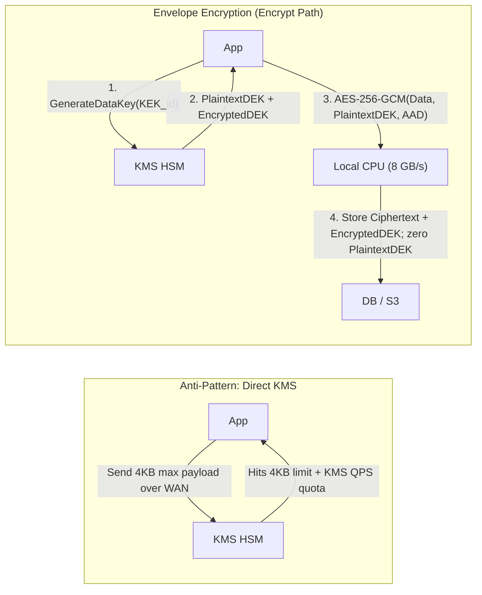
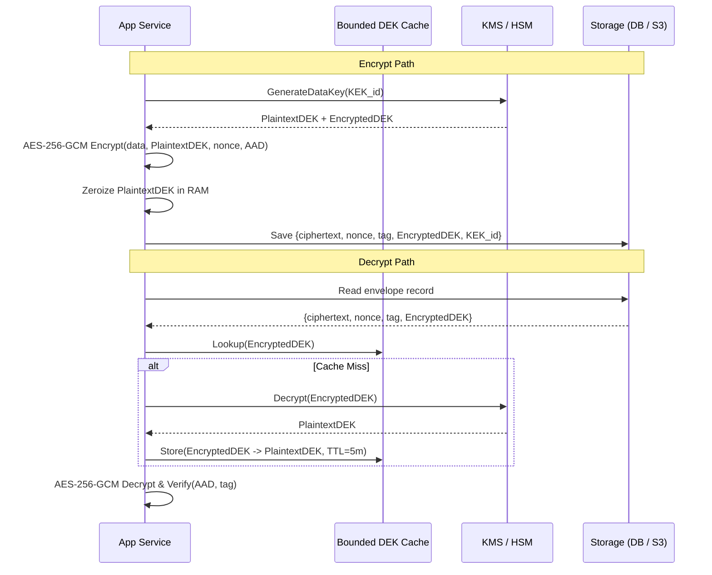
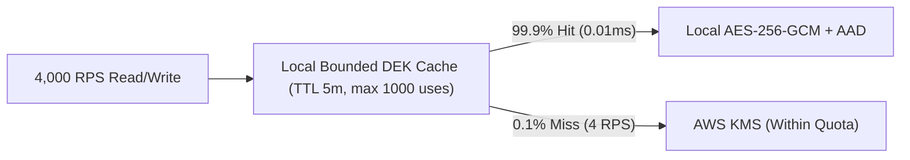

# Envelope Encryption Explained: Encryption at Rest, KMS, DEK & KEK

> **Prerequisites:** [Lesson 08: Encryption in Transit](../08-encryption-in-transit/README.md).  
> **Estimated Reading Time:** 24–28 minutes  
> **Target Audience:** Backend and data engineers designing PII/PCI storage, multi-tenant customer-managed keys (CMK), and high-throughput encryption, and candidates asked "how does envelope encryption work and why not just call KMS directly?"  
> **Free PDF Notes:** [Download SD-M-009.pdf](https://backendroadmap.com/notes/system-design/SD-M-009.pdf)

> [!NOTE]
> **In one line:** **Envelope encryption** encrypts your data locally with a fast **Data Encryption Key (DEK)** (using AES-256-GCM), then encrypts that tiny 32-byte DEK with a **Key Encryption Key (KEK)** inside a Hardware Security Module / KMS, storing the encrypted DEK right alongside the ciphertext. You get **HSM-grade root key isolation**, **fast local encryption**, and **instant key rotation without re-encrypting terabytes of data**.

> [!TIP]
> **The Golden Rule:** Never send application data across the network to KMS, and never store a plaintext DEK on disk. Generate a unique DEK per object or tenant, bind record metadata (`tenant_id`, `record_id`) via **AAD (Additional Authenticated Data)**, and zeroize the plaintext DEK in memory immediately after use.

---

## 1. What Envelope Encryption Is, and What It Isn't

Disk encryption (EBS/LUKS) only protects against physical drive theft—anyone with database read access, SQL injection, or an S3 bucket leak still reads plaintext. **Application-level envelope encryption** encrypts sensitive fields or objects *before* they hit the database or object store, using keys rooted in a centralized **KMS (Key Management Service)**.

| Term | Precise Meaning | Example |
| :--- | :--- | :--- |
| **DEK (Data Encryption Key)** | Symmetric 256-bit key used locally to encrypt actual data | AES-256-GCM key encrypting a 10 MB PDF or PII row |
| **KEK (Key Encryption Key)** | Master key in KMS/HSM that *only* wraps/unwraps DEKs | `arn:aws:kms:us-east-1:123:key/abc` |
| **Envelope Encryption** | Two-tier pattern: DEK encrypts data; KEK encrypts DEK; both stored together | `{ciphertext, nonce, tag, encrypted_dek}` |
| **AAD (Additional Authenticated Data)** | Cleartext context authenticated (not encrypted) by AES-GCM tag | `AAD = "tenant=42|row=991"` (stops ciphertext swapping) |
| **Crypto-shredding** | Erasing data permanently by destroying its tenant KEK/DEK | GDPR "right to be forgotten" across backups |
| **Not** | Sending 100 MB files to `kms:Encrypt` (AWS KMS rejects payloads > 4 KB) | KMS is for wrapping keys, not bulk data |

### Why It Matters
1. **Payload & QPS limits:** Cloud KMS APIs cap direct encryption payloads at **4 KB** and enforce strict QPS quotas (e.g., 1,200–10,000 RPS). Envelope encryption lets you encrypt gigabytes locally at 8 GB/s.
2. **Zero-copy KEK rotation:** Rotating a KEK in KMS only requires re-wrapping tiny 32-byte DEKs (or versioning the KEK), never re-encrypting petabytes of S3 objects or DB rows.
3. **Tenant isolation & compliance:** Each enterprise customer can bring their own KMS KEK (**BYOK / CMK**); revoking their KEK immediately renders all their stored data unreadable.

---

## 2. Anatomy: Direct KMS vs Envelope Encryption



On **Encrypt**:
1. The app calls `KMS.GenerateDataKey(KEK_id)`. KMS generates a random 256-bit `PlaintextDEK` and wraps it under `KEK_id` to produce `EncryptedDEK`.
2. The app encrypts the payload *locally* using `PlaintextDEK`, a fresh 96-bit `nonce`, and `AAD` (`tenant_id + record_id`).
3. The app stores `{ciphertext, nonce, auth_tag, encrypted_dek, kek_id}` in the database/S3 and **wipes `PlaintextDEK` from memory**.

On **Decrypt**:
1. The app reads the envelope `{ciphertext, nonce, auth_tag, encrypted_dek}` from storage.
2. The app sends *only* `encrypted_dek` (a few hundred bytes) to `KMS.Decrypt(encrypted_dek)` to recover `PlaintextDEK`.
3. The app decrypts and verifies the AES-GCM tag + `AAD` locally.

| Dimension | Disk / TDE Encryption | Direct KMS Encryption | Envelope Encryption |
| :--- | :--- | :--- | :--- |
| **Protects against DB/S3 leak?** | No (DB decrypts transparently) | Yes | Yes |
| **Max payload size** | Unlimited | 4 KB (AWS KMS limit) | Unlimited |
| **KMS network calls** | None | Every 4 KB chunk | 1 per DEK (or cached) |
| **Tenant BYOK / Crypto-shred** | No | Yes | Yes |

> [!WARNING]
> **The #1 Trap: Reusing a Nonce (IV) with the same DEK in AES-GCM.** In AES-256-GCM, encrypting two different plaintexts with the *same* `(DEK, 96-bit nonce)` completely breaks confidentiality (XOR of ciphertexts reveals XOR of plaintexts) and leaks the authentication key, allowing attackers to forge arbitrary ciphertexts! Always generate a fresh CSPRNG 96-bit nonce per encryption and enforce the NIST birthday bound when reusing a cached DEK.

---

## 3. Mathematical Model: KMS Call Reduction, Cost & Nonce Birthday Bound

**1. KMS QPS & Cost Reduction via Bounded DEK Caching.**  
Suppose a service handles $Q_{\text{req}} = 20{,}000\text{ RPS}$ of encrypted writes/reads. Calling `KMS.GenerateDataKey` / `KMS.Decrypt` on every request costs $20{,}000\text{ KMS RPS}$ (hitting KMS throttling limits) and:

$$\text{Monthly KMS calls} = 20{,}000 \times 2{,}592{,}000\text{ s} \approx 5.184 \times 10^{10}\text{ calls}$$

At AWS KMS pricing ($\$0.03$ per $10{,}000$ calls), that is **$\$155{,}520\text{/month}$** in KMS fees alone!  
If instead you cache a tenant DEK in memory for $N_{\text{reuse}} = 1{,}000$ operations (or 5 minutes, whichever comes first):

$$Q_{\text{KMS}} = \frac{Q_{\text{req}}}{N_{\text{reuse}}} = \frac{20{,}000}{1{,}000} = 20\text{ KMS RPS}, \qquad \text{Monthly cost} = \frac{\$155{,}520}{1{,}000} = \$155.52\text{/month}$$

**2. AES-GCM 96-bit Random Nonce Birthday Bound (NIST SP 800-38D).**  
With a 96-bit ($b = 96$) random nonce, the collision probability after $q$ encryptions under the *same* DEK is approximated by the birthday paradox:

$$P(\text{collision}) \approx \frac{q^2}{2^{97}}$$

NIST SP 800-38D mandates $P(\text{collision}) \le 2^{-32}$, which caps random-nonce encryptions under a single DEK at:

$$q_{\max} = 2^{32} \approx 4.29 \times 10^9\text{ messages}$$

In practice, rotate/retire a cached DEK far earlier (e.g., after $10^6$ messages or 5–15 minutes, or use a monotonic counter + random prefix for the 96-bit nonce).

---

## 4. Metrics & Percentiles

| Metric | Meaning | Alert when |
| :--- | :--- | :--- |
| **`KMS.Decrypt` / `GenerateDataKey` QPS** | Live KMS API call rate | > 70% of account KMS quota |
| **KMS throttling (`ThrottlingException`)** | KMS rejecting calls due to burst/quota | > 0 (causes immediate read/write failures) |
| **KMS latency $p_{99}$** | Round-trip time to KMS HSM | > 30 ms |
| **DEK cache hit rate** | Fraction of decrypts served from bounded RAM cache | < 90% (for high-QPS services) |
| **AAD / Auth-tag failure rate** | AES-GCM authentication failures | > 0 (tampering, swapped ciphertext, or bug) |

### Worked Example (Multi-Tenant PII Vault)
A fintech stores 50M user SSNs/tax IDs in PostgreSQL. Each tenant has its own KMS KEK (`kek_tenant_42`). When a user uploads their tax ID, the app fetches a DEK from KMS (or a 5-minute bounded tenant DEK cache), encrypts `"123-45-6789"` with `AES-256-GCM`, a fresh 12-byte `os.urandom(12)` nonce, and `AAD = "tenant=42|user=881|col=ssn"`. Even if an attacker SQL-injects and copies the `encrypted_ssn` bytes from `user=881` into `user=999` to try to read it via `user=999`'s profile, `AES-GCM` **rejects the decryption** because the `AAD` (`user=999`) does not match the authenticated `user=881`.

---

## 5. Compounding & Failure Modes

**A. KMS Throttling Cascade.**  
If a service does *not* cache DEKs and receives a 10x traffic spike (e.g., 15,000 RPS), it exceeds the regional KMS `Decrypt` quota (e.g., 1,200–5,500 RPS). Retrying immediately amplifies traffic to 45,000 RPS, locking out *all* services in that AWS account sharing the KMS quota.  
*Mitigation:* Use bounded Data Key Caching (max age + max messages) and exponential backoff with jitter.

**B. Ciphertext Swapping (Missing AAD).**  
Without `AAD` binding the ciphertext to its exact `(tenant_id, table, row_id, column)`, an attacker with write access to a non-sensitive row can copy an admin's encrypted blob into their own row and let the application decrypt it for them (**confused deputy attack**).

**C. Accidental Key Deletion / Orphaned Data.**  
Scheduling a KMS KEK for deletion permanently destroys all data wrapped by it after the waiting period. Never allow automated scripts to delete KEKs without multi-party approval and audit checks.

---

## 6. Numbers Every Engineer Must Know

| Item | Typical | Implication |
| :--- | :---: | :--- |
| **AES-256-GCM key size** | 32 bytes (256 bits) | Post-quantum resistant symmetric strength |
| **AES-GCM nonce size** | 12 bytes (96 bits) | Never reuse with the same DEK |
| **AES-GCM auth tag size** | 16 bytes (128 bits) | Detects any bit-flip or AAD mismatch |
| **AWS KMS payload limit** | 4,096 bytes (4 KB) | Forces envelope encryption for any real payload |
| **AWS KMS default `Decrypt` quota** | 1,200 – 10,000 RPS (region dependent) | Must cache DEKs at high QPS |
| **AWS KMS API cost** | ~$0.03 per 10,000 requests | Uncached high-QPS KMS calls cost tens of thousands $/mo |
| **NIST random-nonce DEK limit** | $2^{32}$ (~4.29B) encryptions | Rotate cached DEK well before this (e.g. $10^6$ msgs) |

---

## 7. Protocol Deep Dive: Envelope Encrypt & Decrypt Sequence



| Question | Answer |
| :--- | :--- |
| **Does KMS ever see my plaintext data?** | No. KMS only sees the 32-byte DEK during `GenerateDataKey` or `Decrypt`. |
| **How do I rotate the KEK without re-encrypting 100 TB?** | Create a new KEK version in KMS; KMS keeps old versions for `Decrypt` and uses the new version for new DEKs, or run a cheap background job that only re-wraps the small `EncryptedDEK` column. |
| **What if I need to search encrypted database columns?** | You cannot `LIKE '%foo%'` on AES-GCM ciphertext. Store a separate **HMAC-SHA256 blind index** (keyed with a separate pepper) for exact-match lookups. |
| **What is the AWS Encryption SDK?** | Official library implementing envelope encryption, data key caching, and framing with AAD out of the box. |

**When NOT to use application-level envelope encryption:**  
If your data is non-sensitive public catalog data or metrics where RDS/S3 default server-side encryption (SSE-S3/SSE-KMS) already satisfies compliance, adding application-level envelope encryption breaks SQL indexing, sorting, and ad-hoc analytics for no security gain. Reserve it for PII, PCI, secrets, and multi-tenant BYOK workloads.

---

## 8. Hierarchical Budgets & Design Rules

| Slice | Rule | Control |
| :--- | :--- | :--- |
| **Cipher** | AES-256-GCM (or XChaCha20-Poly1305) | Never ECB, CBC without HMAC, or unauthenticated CTR |
| **Nonce** | Fresh 96-bit CSPRNG nonce per encryption | Unit test + NIST $2^{32}$ DEK rotation cap |
| **AAD binding** | Include `tenant_id`, `table`, `record_id`, `version` in AAD | Prevents ciphertext-swapping attacks |
| **DEK caching** | Cache in RAM only with strict TTL (<= 5m) & max-uses | Protects KMS quota and cost |
| **Memory hygiene** | Zeroize `PlaintextDEK` slices after use | Minimizes core-dump exposure |
| **KEK lifecycle** | Enable automatic annual KEK rotation; block unapproved deletes | IAM policy + multi-party delete protection |
| **Exact search** | Use keyed HMAC-SHA256 blind index column | Never use deterministic encryption on low-entropy fields |

---

## 9. Top Mitigations

1. **Always use Envelope Encryption** (DEK + KMS KEK) instead of calling `KMS.Encrypt` on raw data.
2. **Bind every ciphertext with AAD** (`tenant_id|record_id|field`) so ciphertexts cannot be transplanted across rows or tenants.
3. **Never reuse a `(DEK, nonce)` pair**—generate a 96-bit CSPRNG nonce on every write and cap DEK reuse well below $2^{32}$ messages.
4. **Use bounded Data Key Caching** (e.g., 5-minute TTL, max 1,000 uses) to prevent KMS throttling cascades and cut KMS bills by 99%+.
5. **Implement Crypto-Shredding** for GDPR deletion by giving each tenant (or user) a dedicated KEK/DEK that can be permanently revoked/destroyed.
6. **Use blind indexes (HMAC-SHA256)** when you need exact-match `WHERE email_hash = ?` queries on encrypted columns.
7. **Alert on `ThrottlingException` and `AAD/Tag` verification failures** immediately.

---

## 10. Production Reference: AWS KMS Envelope Encryption & Throttling Outage

In AWS S3 (`SSE-KMS`), DynamoDB, and RDS, envelope encryption is the backbone of cloud encryption at rest:
- **The Problem (Real-World SEV-1 Pattern):** A payments microservice stored encrypted customer cards in DynamoDB using `AES-256-GCM` with a fresh `KMS.GenerateDataKey` on every write and `KMS.Decrypt` on every read—*with zero DEK caching*. During a Black Friday flash sale (4,000 RPS), KMS `Decrypt` hit the regional 1,200 RPS quota. `ThrottlingException` triggered SDK retries, multiplying load to 12,000 RPS and taking down checkout across all services in the AWS account for 35 minutes.
- **The Fix:**
  1. Enabled **Data Key Caching** (`max_age = 300s`, `max_messages_encrypted = 1000`) per tenant KEK, dropping KMS QPS from 4,000 RPS to **4 RPS**.
  2. Requested a KMS quota increase and isolated checkout into its own AWS account/KMS quota.
  3. Kept AAD binding (`tenant_id|card_id`) per record so cached DEKs never weakened cross-record isolation.



**Lesson:** KMS is a control-plane HSM, not a high-QPS data-plane cache. Bounded DEK caching turns a fragile 1,200 RPS bottleneck into an infinitely scalable local AES-NI operation.

---

## 11. Multi-Language Production Code Tabs

Complete, zero-external-dependency (stdlib) **Envelope Encryption** (`EncryptEnvelope` / `DecryptEnvelope`) using **AES-256-GCM**, 96-bit CSPRNG nonces, **AAD binding**, and a `KMS` KEK wrapper interface.

````carousel
```go
// Go: Envelope Encryption with AES-256-GCM, AAD binding, and KMS wrapper interface.
package main

import (
	"crypto/aes"
	"crypto/cipher"
	"crypto/rand"
	"errors"
	"io"
)

type KMSClient interface {
	GenerateDataKey(kekID string) (plaintextDEK, encryptedDEK []byte, err error)
	Decrypt(encryptedDEK []byte) (plaintextDEK []byte, err error)
}

type Envelope struct {
	KEKID        string
	EncryptedDEK []byte
	Nonce        []byte
	Ciphertext   []byte // includes 16-byte GCM auth tag
}

func EncryptEnvelope(kms KMSClient, kekID string, plaintext, aad []byte) (*Envelope, error) {
	dek, encDEK, err := kms.GenerateDataKey(kekID)
	if err != nil {
		return nil, err
	}
	defer func() { clear(dek) }() // zeroize plaintext DEK in memory

	block, err := aes.NewCipher(dek)
	if err != nil {
		return nil, err
	}
	gcm, err := cipher.NewGCM(block)
	if err != nil {
		return nil, err
	}
	nonce := make([]byte, gcm.NonceSize()) // 12 bytes
	if _, err := io.ReadFull(rand.Reader, nonce); err != nil {
		return nil, err
	}
	ct := gcm.Seal(nil, nonce, plaintext, aad)
	return &Envelope{KEKID: kekID, EncryptedDEK: encDEK, Nonce: nonce, Ciphertext: ct}, nil
}

func DecryptEnvelope(kms KMSClient, env *Envelope, aad []byte) ([]byte, error) {
	dek, err := kms.Decrypt(env.EncryptedDEK)
	if err != nil {
		return nil, err
	}
	defer func() { clear(dek) }()

	block, err := aes.NewCipher(dek)
	if err != nil {
		return nil, err
	}
	gcm, err := cipher.NewGCM(block)
	if err != nil {
		return nil, err
	}
	if len(env.Nonce) != gcm.NonceSize() {
		return nil, errors.New("invalid nonce size")
	}
	return gcm.Open(nil, env.Nonce, env.Ciphertext, aad)
}
```
<!-- slide -->
```typescript
// TypeScript (Node.js): Envelope Encryption using node:crypto AES-256-GCM + AAD.
import crypto from "node:crypto";

export interface KMSClient {
  generateDataKey(kekId: string): Promise<{ plaintextDek: Buffer; encryptedDek: Buffer }>;
  decrypt(encryptedDek: Buffer): Promise<Buffer>;
}

export interface Envelope {
  kekId: string;
  encryptedDek: Buffer;
  nonce: Buffer;
  tag: Buffer;
  ciphertext: Buffer;
}

export async function encryptEnvelope(
  kms: KMSClient,
  kekId: string,
  plaintext: Buffer,
  aad: Buffer
): Promise<Envelope> {
  const { plaintextDek, encryptedDek } = await kms.generateDataKey(kekId);
  try {
    const nonce = crypto.randomBytes(12);
    const cipher = crypto.createCipheriv("aes-256-gcm", plaintextDek, nonce);
    cipher.setAAD(aad);
    const ciphertext = Buffer.concat([cipher.update(plaintext), cipher.final()]);
    return { kekId, encryptedDek, nonce, tag: cipher.getAuthTag(), ciphertext };
  } finally {
    plaintextDek.fill(0); // zeroize plaintext DEK
  }
}

export async function decryptEnvelope(
  kms: KMSClient,
  env: Envelope,
  aad: Buffer
): Promise<Buffer> {
  const plaintextDek = await kms.decrypt(env.encryptedDek);
  try {
    const decipher = crypto.createDecipheriv("aes-256-gcm", plaintextDek, env.nonce);
    decipher.setAAD(aad);
    decipher.setAuthTag(env.tag);
    return Buffer.concat([decipher.update(env.ciphertext), decipher.final()]);
  } finally {
    plaintextDek.fill(0);
  }
}
```
<!-- slide -->
```python
# Python: Envelope Encryption using cryptography AESGCM + AAD binding.
import os
from dataclasses import dataclass
from cryptography.hazmat.primitives.ciphers.aead import AESGCM

@dataclass
class Envelope:
    kek_id: str
    encrypted_dek: bytes
    nonce: bytes
    ciphertext: bytes  # includes 16-byte GCM tag

def encrypt_envelope(kms, kek_id: str, plaintext: bytes, aad: bytes) -> Envelope:
    dek, encrypted_dek = kms.generate_data_key(kek_id)
    try:
        nonce = os.urandom(12)
        ct = AESGCM(dek).encrypt(nonce, plaintext, aad)
        return Envelope(kek_id=kek_id, encrypted_dek=encrypted_dek, nonce=nonce, ciphertext=ct)
    finally:
        if isinstance(dek, bytearray):
            dek[:] = b"\x00" * len(dek)

def decrypt_envelope(kms, env: Envelope, aad: bytes) -> bytes:
    dek = kms.decrypt(env.encrypted_dek)
    try:
        return AESGCM(dek).decrypt(env.nonce, env.ciphertext, aad)
    finally:
        if isinstance(dek, bytearray):
            dek[:] = b"\x00" * len(dek)
```
<!-- slide -->
```csharp
// C#: Envelope Encryption with System.Security.Cryptography.AesGcm + AAD.
using System;
using System.Security.Cryptography;

public interface IKmsClient
{
    (byte[] PlaintextDek, byte[] EncryptedDek) GenerateDataKey(string kekId);
    byte[] Decrypt(byte[] encryptedDek);
}

public record Envelope(string KekId, byte[] EncryptedDek, byte[] Nonce, byte[] Tag, byte[] Ciphertext);

public static class EnvelopeCrypto
{
    public static Envelope Encrypt(IKmsClient kms, string kekId, byte[] plaintext, byte[] aad)
    {
        var (dek, encDek) = kms.GenerateDataKey(kekId);
        try
        {
            var nonce = RandomNumberGenerator.GetBytes(12);
            var tag = new byte[16];
            var ct = new byte[plaintext.Length];
            using var aes = new AesGcm(dek, 16);
            aes.Encrypt(nonce, plaintext, ct, tag, aad);
            return new Envelope(kekId, encDek, nonce, tag, ct);
        }
        finally
        {
            CryptographicOperations.ZeroMemory(dek);
        }
    }

    public static byte[] Decrypt(IKmsClient kms, Envelope env, byte[] aad)
    {
        var dek = kms.Decrypt(env.EncryptedDek);
        try
        {
            var pt = new byte[env.Ciphertext.Length];
            using var aes = new AesGcm(dek, 16);
            aes.Decrypt(env.Nonce, env.Ciphertext, env.Tag, pt, aad);
            return pt;
        }
        finally
        {
            CryptographicOperations.ZeroMemory(dek);
        }
    }
}
```
````

---

## 12. Hands-On CLI Verification Workflows

Generate a data key with AWS KMS, encrypt/decrypt locally, and verify KEK rotation status:

```bash
# 1. Generate a 256-bit DEK wrapped by your KMS KEK
aws kms generate-data-key --key-id alias/prod-pii-kek --key-spec AES_256

# 2. Unwrap an EncryptedDEK (with EncryptionContext / AAD enforced!)
aws kms decrypt --ciphertext-blob fileb://encrypted_dek.bin \
  --encryption-context tenant_id=42,record_id=991 \
  --query Plaintext --output text

# 3. Enable automatic annual KEK rotation in AWS KMS (no data re-encryption needed)
aws kms enable-key-rotation --key-id alias/prod-pii-kek
aws kms get-key-rotation-status --key-id alias/prod-pii-kek
```

---

## 13. Common Mistakes to Avoid

1. **Sending raw application payloads to `KMS.Encrypt`**, hitting the 4 KB limit and network latency bottlenecks.
2. **Reusing a nonce with the same DEK in AES-GCM**, which catastrophically breaks confidentiality and authenticity.
3. **Omitting AAD (Encryption Context)**, allowing attackers to copy-paste ciphertext across rows or tenants.
4. **Calling `KMS.Decrypt` on every single read at high QPS** without bounded DEK caching, triggering KMS throttling outages.
5. **Storing the plaintext DEK on disk** alongside the ciphertext instead of the `EncryptedDEK`.
6. **Using deterministic encryption for low-entropy fields** (e.g., `gender`, `boolean`), leaking frequency distributions; use AES-GCM + HMAC blind index instead.
7. **Forgetting to zeroize plaintext DEKs** from memory after encryption/decryption.

---

## 14. Key Terms Glossary

| Key Term | Definition |
| :--- | :--- |
| **Envelope Encryption** | Encrypting data with a local DEK, then encrypting the DEK with a KMS KEK. |
| **DEK (Data Encryption Key)** | Symmetric key (e.g., 256-bit AES) that encrypts the actual data payload. |
| **KEK (Key Encryption Key)** | Master key inside KMS/HSM used solely to wrap and unwrap DEKs. |
| **HSM (Hardware Security Module)** | Tamper-resistant hardware device where root keys never leave in plaintext. |
| **AAD / Encryption Context** | Authenticated cleartext metadata bound to the AES-GCM tag (prevents swapping). |
| **Nonce (IV)** | Number used once (96 bits for AES-GCM); must never repeat under the same DEK. |
| **Crypto-shredding** | Rendering data permanently unrecoverable by destroying its encryption key. |
| **BYOK / CMK** | Bring Your Own Key / Customer-Managed Key; tenant controls their own KEK. |
| **Blind Index** | Keyed HMAC-SHA256 hash stored alongside ciphertext to allow exact-match queries. |
| **Data Key Caching** | Caching unwrapped DEKs in RAM with strict TTL and message-count bounds. |

---

## 15. System Design Interview Questions & Answers

### Basic Conceptual Questions

<details>
<summary><strong>Q1: What is envelope encryption, and what are DEK and KEK? [BASIC]</strong></summary>

**Answer:**
Envelope encryption is a two-level encryption pattern: a local **DEK (Data Encryption Key)** encrypts the actual data using fast symmetric encryption (AES-256-GCM), and a **KEK (Key Encryption Key)** stored in a KMS/HSM encrypts the 32-byte DEK. The `EncryptedDEK` is stored right alongside the ciphertext.
</details>

<details>
<summary><strong>Q2: Why don't we just send our files or database rows directly to KMS to encrypt? [BASIC]</strong></summary>

**Answer:**
First, KMS APIs have strict payload size limits (4 KB in AWS KMS). Second, sending megabytes over the network to a remote HSM adds huge latency and hits KMS QPS quotas (e.g., 1,200–10,000 RPS) and high per-call API costs.
</details>

<details>
<summary><strong>Q3: How is disk encryption (EBS/LUKS) different from application-level envelope encryption? [BASIC]</strong></summary>

**Answer:**
Disk encryption only protects against physical drive theft; once the OS/DB is running, any SQL injection, compromised DB backup, or S3 read permission returns plaintext. Application-level envelope encryption encrypts data *before* it reaches the DB or object store, so even a DBA or S3 snapshot leak yields only ciphertext.
</details>

<details>
<summary><strong>Q4: What is Crypto-Shredding? [BASIC]</strong></summary>

**Answer:**
Permanently deleting data (e.g., for GDPR "right to be forgotten") by destroying the tenant's or user's KEK/DEK rather than hunting down every immutable backup, log, and replica. Once the key is destroyed, all copies of the ciphertext become cryptographic noise forever.
</details>

### Scenario-Based Architecture Questions

<details>
<summary><strong>Q5: Design encryption at rest for a multi-tenant SaaS where enterprise customers demand BYOK (Bring Your Own Key). [SCENARIO]</strong></summary>

**Answer:**
Use **Envelope Encryption**: each tenant configures their own KMS KEK ARN (`kek_tenant_x`). On write, call `GenerateDataKey(kek_tenant_x)`, encrypt the object locally with AES-256-GCM + `AAD = "tenant=x|obj=y"`, and store `{ciphertext, nonce, tag, encrypted_dek, kek_id}`. If the customer revokes IAM access to their KEK, your app can no longer unwrap their DEKs.
</details>

<details>
<summary><strong>Q6: You need to rotate your master KEK across 500 TB of S3 objects. How do you do it without downtime or huge compute cost? [SCENARIO]</strong></summary>

**Answer:**
With envelope encryption, you **do not** re-encrypt the 500 TB of data. Either enable KMS automatic key rotation (KMS keeps old KEK versions to unwrap existing `EncryptedDEK`s and uses the new version for new writes), or run a lightweight background job that only calls `ReEncrypt(encrypted_dek)` on the tiny metadata headers—zero payload bytes touched.
</details>

<details>
<summary><strong>Q7: Your app encrypts emails in PostgreSQL with AES-256-GCM, and now product asks for `WHERE email = ?` login lookup. How do you support it? [SCENARIO]</strong></summary>

**Answer:**
Because randomized AES-256-GCM produces a different ciphertext every time, you cannot index it directly. Add an `email_blind_index` column storing `HMAC-SHA256(pepper, normalize(email))` (truncated or full) with a B-tree index. Query by `email_blind_index`, then decrypt the matched row's `email` with AES-256-GCM.
</details>

<details>
<summary><strong>Q8: Your service hits `KMS ThrottlingException` during a traffic spike. How do you fix it? [SCENARIO]</strong></summary>

**Answer:**
Implement **bounded Data Key Caching** in memory (e.g., cache a DEK for max 5 minutes and max 1,000 encryptions, with a fresh 96-bit nonce per encryption) plus exponential backoff with jitter. This cuts KMS calls by 99.9% while staying far below the NIST $2^{32}$ nonce-collision bound.
</details>

### Advanced & Tricky Interview Questions

<details>
<summary><strong>Q9: What happens if you reuse the same 96-bit nonce twice with the same DEK in AES-GCM? [TRICKY]</strong></summary>

**Answer:**
It is catastrophic: (1) XORing the two ciphertexts cancels out the keystream and reveals `P1 XOR P2`, breaking confidentiality; (2) An attacker can solve a polynomial over $GF(2^{128})$ to recover the GHASH authentication key `H` and forge valid authentication tags for arbitrary ciphertexts!
</details>

<details>
<summary><strong>Q10: Why is AAD (Additional Authenticated Data) critical in multi-tenant envelope encryption? [TRICKY]</strong></summary>

**Answer:**
Without AAD, an attacker who can tamper with database rows could copy an encrypted `salary` or `api_key` blob from `tenant_A` into `tenant_B`'s row, and the application would happily decrypt it under `tenant_B`'s view (if sharing a DEK/KEK). Passing `tenant_id|row_id|column` as AAD causes `AES-GCM` tag verification to fail if the ciphertext is moved.
</details>

<details>
<summary><strong>Q11: Why is `2^32` encryptions the NIST limit for a single DEK with random 96-bit nonces? [TRICKY]</strong></summary>

**Answer:**
By the birthday paradox, after $q$ encryptions with a 96-bit random nonce, collision probability is $\approx q^2 / 2^{97}$. NIST SP 800-38D limits collision probability to $\le 2^{-32}$, which yields $q \le 2^{32}$ (~4.29 billion). For higher volumes under one DEK, use a deterministic counter nonce or rotate the DEK.
</details>

<details>
<summary><strong>Q12: Should you cache DEKs in Redis so all pods share them? [TRICKY]</strong></summary>

**Answer:**
No! Caching plaintext DEKs in an external Redis cluster defeats the entire purpose of KMS/HSM isolation—anyone with Redis access now has all your plaintext keys. Only cache plaintext DEKs **in-process RAM** (never on disk or in shared caches) with a short TTL.
</details>

---

## 16. One-Page Master Cheat Sheet

```
+---------------------------------------------------------------------------------------------------------+
|                    ENVELOPE ENCRYPTION (KMS, DEK & KEK) — MASTER CHEAT SHEET                            |
+---------------------------------------------------------------------------------------------------------+
| 1. TWO-TIER KEYS: DEK (32B AES-256-GCM) encrypts data locally; KEK (in KMS/HSM) wraps/unwraps DEKs.     |
| 2. NEVER send bulk data to KMS (4 KB limit, QPS quotas, network latency).                               |
| 3. ENVELOPE RECORD: { ciphertext, 96-bit nonce, 128-bit GCM tag, encrypted_dek, kek_id }.               |
+---------------------------------------------------------------------------------------------------------+
| 4. BIND CONTEXT (AAD): Always pass tenant_id|table|row_id as AAD to stop ciphertext-swapping attacks.   |
| 5. NONCE RULE: NEVER reuse (DEK, nonce). Fresh CSPRNG 96-bit nonce every write; cap DEK at << 2^32 uses.|
+---------------------------------------------------------------------------------------------------------+
| 6. SCALE & ROTATION: Cache DEKs in RAM ONLY (TTL <= 5m) to cut KMS QPS/cost by 99.9%.                   |
|    Rotate KEK without re-encrypting TB of data. Destroy KEK/DEK for instant GDPR crypto-shredding.     |
+---------------------------------------------------------------------------------------------------------+
```

---

## Further Reading & Sources

- AWS KMS Documentation, [Envelope Encryption & Data Key Caching](https://docs.aws.amazon.com/kms/latest/developerguide/concepts.html#enveloping).
- NIST SP 800-38D, [Recommendation for Block Cipher Modes of Operation: Galois/Counter Mode (GCM)](https://csrc.nist.gov/publications/detail/sp/800-38d/final).
- Google Cloud, [Envelope Encryption & Cloud KMS Best Practices](https://cloud.google.com/kms/docs/envelope-encryption).
- Jean-Philippe Aumasson, *Serious Cryptography*, Chapter 4 & 8 (Authenticated Encryption & Key Management).

---

## Free PDF Notes

[SD-M-009.pdf](https://backendroadmap.com/notes/system-design/SD-M-009.pdf)

---

## Next

Continue with [Lesson 10: Secrets Management: Vault, Dynamic Secrets & Rotation (Never in Git)](../10-secrets-management/README.md).
