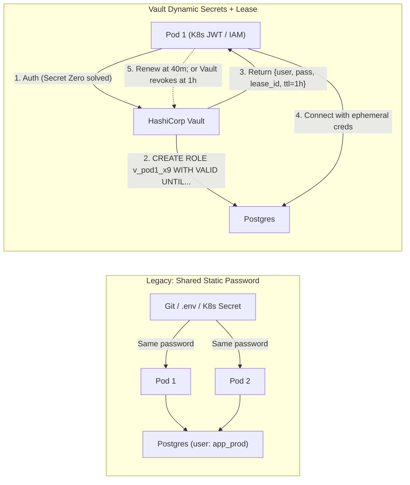
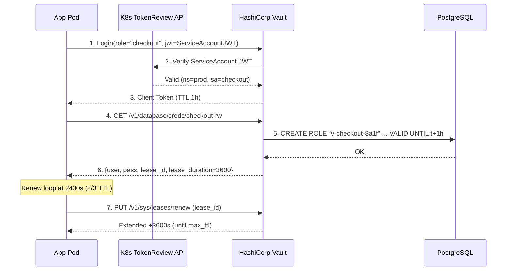
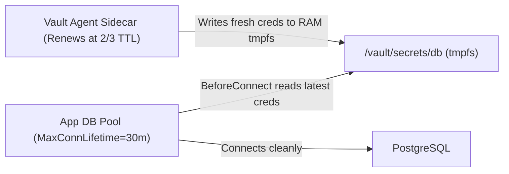

# Secrets Management: Vault, Dynamic Secrets & Rotation (Never in Git)

> **Prerequisites:** [Lesson 09: Envelope Encryption Explained](../09-envelope-encryption-explained/README.md).  
> **Estimated Reading Time:** 24–28 minutes  
> **Target Audience:** Backend, DevOps, and platform engineers eliminating hardcoded credentials, and candidates asked "how do you manage database passwords and API keys safely at scale?"  
> **Free PDF Notes:** [Download SD-M-010.pdf](https://backendroadmap.com/notes/system-design/SD-M-010.pdf)

> [!NOTE]
> **In one line:** Secrets in Git, `.env` files, or plain environment variables leak permanently and cannot be rotated without outages. A centralized **Secrets Manager (HashiCorp Vault / AWS Secrets Manager)** encrypts secrets at rest, enforces fine-grained IAM/audit logs, and issues **Dynamic Secrets**—ephemeral per-pod database credentials with short TTLs that auto-renew and self-revoke.

> [!TIP]
> **The Golden Rule:** Treat every static secret as already half-compromised. Prefer **workload identity** (IAM/SPIFFE, zero secret) first, **Dynamic Secrets** (ephemeral DB/cloud creds with leases) second, and **dual-user staggered rotation** for third-party API keys. Never commit a secret to Git—even a deleted commit lives forever in Git history.

---

## 1. What Secrets Management Is, and What It Isn't

A **secret** is any credential that grants access to a system: database passwords, third-party API keys (`Stripe`, `SendGrid`), signing keys, or TLS private keys. Putting them in `.env` files, CI variables, or Kubernetes `ConfigMaps` turns every developer laptop, build log, and `etcd` snapshot into a credential dump.

| Term | Precise Meaning | Example |
| :--- | :--- | :--- |
| **Secret Sprawl** | Uncontrolled copies of credentials across Git, Slack, CI logs, and laptops | `DB_PASS=hunter2` in a 2022 commit |
| **Static Secret** | Long-lived credential shared across instances; manual rotation | `STRIPE_SECRET_KEY=sk_live_...` |
| **Dynamic Secret** | Ephemeral credential generated *on demand* per pod with a strict **Lease TTL** | Vault creates PG role `v-k8s-pod7-a9f2` (TTL 1h) |
| **Lease & Renewal** | Time-bounded grant; app renews at ~2/3 TTL or Vault revokes the user | `vault lease renew` |
| **Dual-User Rotation** | Alternating two active credentials (`A` and `B`) so rotation has zero downtime | Rotate `B` while `A` serves traffic, then swap |
| **Seal / Unseal** | Vault starts sealed (master key absent from disk); Auto-Unseal uses Cloud KMS | Prevents cold-disk theft of Vault storage |
| **Not** | Base64-encoded Kubernetes `Secrets` without `etcd` KMS encryption | `base64 -d` is encoding, not encryption |

### Why It Matters
1. **Git leaks are exploited in seconds:** Automated bots scan public GitHub pushes and compromised CI runners continuously; an AWS key pushed to a public repo is abused within **< 60 seconds**.
2. **Blast radius & attribution:** With one shared static `db_prod_user` password across 80 pods, you cannot tell *which* pod leaked it, and rotating it risks breaking all 80 pods simultaneously. Dynamic secrets give every pod its own username.
3. **Auditability:** Security teams need an immutable log of *which* workload read *which* secret at *what* timestamp—impossible with `.env` files.

---

## 2. Anatomy: Static Secrets vs Dynamic Secrets (Vault)



In the **Dynamic Secrets** workflow:
1. Pod 1 authenticates to Vault using its **Kubernetes ServiceAccount JWT** or **AWS IAM role** (solving Secret Zero without a static Vault token on disk).
2. Vault connects to PostgreSQL as an admin and executes `CREATE ROLE "v-pod1-9f2a" WITH LOGIN PASSWORD '...' VALID UNTIL '...'`.
3. Pod 1 receives `{username, password, lease_id, lease_duration: 3600s}` in memory.
4. Before `3600s` elapses (typically at $2/3\,\text{TTL} = 2400\text{s}$), Pod 1 renews the lease. If Pod 1 crashes, Vault automatically runs `DROP ROLE` when the lease expires—leaving zero orphaned credentials.

| Dimension | `.env` / Git / K8s Base64 | Static Secret in Vault/KMS | Dynamic Secret (Vault Lease) |
| :--- | :--- | :--- | :--- |
| **Encryption at rest** | None (Base64 is not encryption) | Envelope encrypted (KMS/HSM) | Envelope encrypted + ephemeral |
| **Per-pod attribution** | None | None (shared secret) | Exact (`v-pod1-9f2a`) |
| **Rotation** | Manual redeploy (outage risk) | Dual-user / app reload | Automatic per-lease TTL |
| **Leak blast radius** | Forever until manual revoke | Until next rotation | <= Lease TTL (e.g., 1 hour) |

> [!WARNING]
> **The #1 Trap: Rotating a static database password in-place while apps hold old credentials.** If a rotation lambda simply executes `ALTER USER app_user WITH PASSWORD 'new'`, every running pod's connection pool immediately fails new connections with `28P01: password authentication failed` until restarted! Always use **Dual-User Rotation** (two alternating users `app_a` / `app_b`) or **Dynamic Secrets** so old connections drain gracefully.

---

## 3. Mathematical Model: Renewal Traffic, Shamir Threshold & Blast Radius

**1. Lease Renewal Load ($\lambda_{\text{renew}}$).**  
Suppose a cluster runs $N$ pods, each holding $K$ dynamic secrets with lease duration $T_{\text{TTL}}$ and renewing at fraction $\alpha$ of TTL (e.g., $\alpha = 2/3$):

$$\lambda_{\text{renew}} = \frac{N \cdot K}{\alpha \cdot T_{\text{TTL}}}$$

**Worked Numerical Example:**  
A platform has $N = 3{,}000$ pods, each holding $K = 2$ dynamic leases (Postgres + Redis) with $T_{\text{TTL}} = 3600\text{ s}$ and $\alpha = 2/3$ ($2400\text{ s}$):

$$\lambda_{\text{renew}} = \frac{3{,}000 \times 2}{2400} = 2.5\text{ renewals/sec}$$

If someone misconfigures $T_{\text{TTL}} = 30\text{ s}$ ($\alpha \cdot T_{\text{TTL}} = 20\text{ s}$), renewal load jumps **120x** to $300\text{ RPS}$, and every lease expiry triggers `CREATE ROLE` / `DROP ROLE` lock contention on PostgreSQL!

**2. Shamir's Secret Sharing $(k, n)$ Threshold.**  
When unsealing Vault manually (without Cloud KMS Auto-Unseal), the root key is split into $n$ shares such that any $k$ shares reconstruct the key, while $k - 1$ shares reveal **zero information** (information-theoretic security via polynomial interpolation over a finite field of degree $k - 1$). Typical production setting: $n = 5$ keyholders, $k = 3$ quorum.

**3. Dual-User Zero-Downtime Overlap Window.**  
For static third-party keys or single-user DB rotation, total rotation cycle $T_{\text{cycle}}$ must satisfy:

$$T_{\text{overlap}} > T_{\text{cache\_ttl}} + T_{\text{drain}}$$

where $T_{\text{cache\_ttl}}$ is the longest app secret cache (e.g., 5 min) and $T_{\text{drain}}$ is the longest DB connection pool lifetime (e.g., 30 min). Only after $T_{\text{overlap}}$ expires is the old credential revoked.

---

## 4. Metrics & Percentiles

| Metric | Meaning | Alert when |
| :--- | :--- | :--- |
| **Vault seal status (`vault_core_unsealed`)** | `1` = unsealed & serving; `0` = sealed (down!) | `== 0` (critical PagerDuty alert) |
| **Lease renewal failure rate** | Failed `sys/leases/renew` calls | > 0.5% (pods will lose DB access at TTL!) |
| **Active dynamic leases (`vault_expire_num_leases`)** | Total live leases tracked by Vault | Growing unboundedly (missing revocation / leak) |
| **Secret fetch latency $p_{99}$** | Time for pod to authenticate and read secret | > 200 ms |
| **Git pre-commit / CI secret scan hits** | Secrets caught in PRs/commits | > 0 (revoke immediately—even if PR wasn't merged!) |

### Worked Example (Zero-Downtime Dual-User Rotation)
A service uses AWS Secrets Manager to rotate an RDS password every 7 days using two roles: `svc_a` and `svc_b`.
- **Day 0–7:** Active secret points to `svc_a`.
- **Day 7 (03:00 UTC):** Rotation Lambda generates a new password for `svc_b` in RDS, tests login, and updates the `AWSCURRENT` label to `svc_b`. `svc_a` remains valid!
- **03:00–03:15 UTC:** App pods refresh their secret cache (TTL 5 min) and drain old connections (max lifetime 10 min), smoothly moving to `svc_b` with **zero failed queries**.
- **Day 14:** Lambda rotates `svc_a` and flips `AWSCURRENT` back to `svc_a`.

---

## 5. Compounding & Failure Modes

**A. Dynamic Lease Expiry Mid-Flight (Connection Pool Desync).**  
If an application fetches a dynamic DB credential with `TTL = 1h`, opens a connection pool with `MaxConnLifetime = 2h`, and forgets to renew the lease (or fails to recreate the pool), Vault runs `DROP ROLE` at `1h`. Existing pooled connections may survive briefly, then all new pool connections fail with `role does not exist`—causing a sudden 500 error storm.  
*Mitigation:* Always set `DB_Pool_MaxLifetime < 0.75 * Lease_TTL` and hook Vault renewal/re-fetch directly into the DB driver's `GetConnection` / `BeforeConnect` callback.

**B. PostgreSQL `CREATE ROLE` / Catalog Bloat.**  
Setting `Lease_TTL = 60s` across 5,000 pods generates ~83 `CREATE ROLE` + `DROP ROLE` DDL statements per second on PostgreSQL, bloating `pg_authid` and causing catalog lock contention. Keep dynamic DB lease TTLs between **1 hour and 24 hours** (with `max_ttl = 72h`).

**C. Vault Unseal / Quorum Loss.**  
If Vault restarts without **Auto-Unseal** (Cloud KMS / HSM), it comes up **sealed** and rejects every secret request until $k$ operators manually enter Shamir keys. Always configure KMS Auto-Unseal + Raft/HA storage in production.

---

## 6. Numbers Every Engineer Must Know

| Item | Typical | Implication |
| :--- | :---: | :--- |
| **GitHub leaked key exploit time** | < 60 seconds | Automated bots scrape public pushes; revoke immediately |
| **Dynamic DB lease TTL** | 1–24 hours | Short enough to bound leaks; long enough to avoid DB DDL churn |
| **Lease renewal trigger** | 2/3 (66%) of TTL + jitter | Leaves 33% TTL buffer for retries if Vault is briefly busy |
| **DB `MaxConnLifetime`** | <= 50–75% of Lease TTL | Forces connection pool to pick up fresh credentials before expiry |
| **K8s `etcd` encryption** | KMS envelope (`EncryptionConfiguration`) | Required, otherwise K8s `Secrets` are plaintext Base64 in `etcd` |
| **Shamir unseal quorum** | 3 of 5 shares | Balances availability against collusion risk |

---

## 7. Protocol Deep Dive: Vault Auth, Dynamic Lease & Renewal



| Question | Answer |
| :--- | :--- |
| **How is "Secret Zero" solved in Kubernetes/AWS?** | The pod uses its platform-issued identity (K8s projected ServiceAccount JWT or AWS IAM STS `GetCallerIdentity`) to log into Vault—no static Vault token on disk. |
| **What happens if a lease hits `max_ttl` and cannot be renewed?** | The app's renewal fails or `renewable=false`; the app must fetch a *new* credential from `/database/creds/...` and swap its DB pool. |
| **How do apps get secrets without calling Vault in application code?** | Use **Vault Agent Sidecar** or **External Secrets Operator (ESO)** to inject/refresh secrets into a `tmpfs` (RAM-only) volume. |
| **What if I accidentally committed a secret to Git?** | Removing it in a new commit does **not** fix it. **Revoke and rotate the secret immediately**, then optionally scrub Git history (`git filter-repo`). |

**When NOT to use a full Vault cluster:**  
If your entire stack runs on a single cloud (e.g., AWS ECS/EKS + RDS) and you only need IAM-based DB auth or static API key rotation, **AWS Secrets Manager + IAM Roles for Service Accounts (IRSA)** or **RDS IAM Authentication** gives you 90% of the security with zero Vault cluster operations.

---

## 8. Hierarchical Budgets & Design Rules

| Slice | Rule | Control |
| :--- | :--- | :--- |
| **Git & CI/CD** | Zero secrets in repo, PRs, or CI logs | `gitleaks` / `trufflehog` pre-commit + CI gate |
| **Secret Zero** | Authenticate to Secrets Manager via IAM / K8s SA / SPIFFE | Ban static `VAULT_TOKEN` in env vars |
| **Dynamic DB creds** | Per-pod ephemeral roles with 1–24h TTL | `DB_MaxConnLifetime < 0.75 * Lease_TTL` |
| **Static API keys** | Dual-user / staggered rotation with overlap window | Automated rotation <= 90 days |
| **Storage at rest** | KMS Auto-Unseal + `etcd` KMS `EncryptionConfiguration` | Never unencrypted `etcd` or disk |
| **Memory/Disk** | Inject secrets into RAM/`tmpfs` only; mask in logs | Structured logger redaction filter |
| **Auditability** | Immutable audit log for every secret read/lease | Ship Vault/CloudTrail logs to SIEM |

---

## 9. Top Mitigations

1. **Block secrets before they reach Git** using `gitleaks` / `trufflehog` in pre-commit hooks and CI pipelines—and revoke immediately on any hit.
2. **Use workload identity** (AWS IRSA, GCP Workload Identity, K8s JWT Auth) to eliminate Secret Zero.
3. **Adopt Dynamic Secrets** for databases and cloud IAM so every pod gets unique, short-lived, auto-revoked credentials.
4. **Align DB connection pool lifetimes** (`MaxConnLifetime < 0.75 * Lease_TTL`) and renew leases at 2/3 TTL with jitter.
5. **Use Dual-User staggered rotation** for static credentials that cannot be dynamically generated.
6. **Enable KMS Auto-Unseal** on Vault and **KMS encryption** on Kubernetes `etcd` so no secret sits in plaintext on disk.
7. **Redact secrets in logs and crash dumps** (`Authorization`, `password`, `api_key`) at the logger middleware layer.

---

## 10. Production Reference: Dynamic Lease Expiry & Pool Desync SEV-1

A high-traffic e-commerce platform migrated PostgreSQL credentials to **HashiCorp Vault Dynamic Secrets** (`TTL = 1h`, `max_ttl = 24h`) using an init-container to fetch the username/password at pod startup.
- **The Problem:** The init-container exited after writing the credentials to `/vault/secrets/db.env`—so **nobody was renewing the lease**. Exactly 60 minutes after a deployment, Vault revoked the dynamic Postgres role (`DROP ROLE`). Existing idle connections stayed open briefly, then as traffic scaled and pools opened new connections, checkout failed 100% with `FATAL: role "v-k8s-checkout-91a" does not exist`.
- **The Fix:**
  1. Replaced the one-shot init-container with **Vault Agent** (long-running sidecar renewing at 2/3 TTL and re-fetching at `max_ttl`).
  2. Configured the app's DB pool (`BeforeConnect` hook / `MaxConnLifetime = 30m`) to re-read credentials from `tmpfs` on every new connection.
  3. Added alerts on `vault_lease_renewal_failures > 0`.



**Lesson:** Dynamic secrets are a *lifecycle*, not a one-time startup fetch. If you fetch a leased credential without a renewal loop and pool refresh hook, you have scheduled an outage for `t + TTL`.

---

## 11. Multi-Language Production Code Tabs

Production-shaped **Dynamic Secret Lease Manager** that fetches credentials, caches them in memory, schedules background renewal at $2/3$ TTL (with jitter), and triggers a fresh fetch if the lease hits `max_ttl` or fails.

````carousel
```go
// Go: Dynamic Secret Lease Manager with 2/3-TTL renewal & jitter.
package main

import (
	"context"
	"math/rand"
	"sync"
	"time"
)

type SecretLease struct {
	Username string
	Password string
	LeaseID  string
	TTL      time.Duration
}

type VaultClient interface {
	FetchDBCreds(ctx context.Context, role string) (SecretLease, error)
	RenewLease(ctx context.Context, leaseID string) (time.Duration, error)
}

type LeaseManager struct {
	client VaultClient
	role   string
	mu     sync.RWMutex
	cur    SecretLease
}

func (m *LeaseManager) Current() SecretLease {
	m.mu.RLock()
	defer m.mu.RUnlock()
	return m.cur
}

func (m *LeaseManager) Run(ctx context.Context) error {
	lease, err := m.client.FetchDBCreds(ctx, m.role)
	if err != nil {
		return err
	}
	m.mu.Lock()
	m.cur = lease
	m.mu.Unlock()

	for {
		// Renew at 2/3 TTL with +/-10% jitter to avoid thundering herds
		wait := time.Duration(float64(lease.TTL) * (0.60 + rand.Float64()*0.12))
		select {
		case <-ctx.Done():
			return ctx.Err()
		case <-time.After(wait):
			newTTL, err := m.client.RenewLease(ctx, lease.LeaseID)
			if err != nil || newTTL <= 0 {
				// Reached max_ttl or renewal failed: fetch brand-new dynamic creds
				fresh, ferr := m.client.FetchDBCreds(ctx, m.role)
				if ferr == nil {
					lease = fresh
					m.mu.Lock()
					m.cur = fresh
					m.mu.Unlock()
				}
				continue
			}
			lease.TTL = newTTL
		}
	}
}
```
<!-- slide -->
```typescript
// TypeScript: Dynamic Secret Lease Manager with 2/3-TTL renewal & fallback re-fetch.
export interface SecretLease {
  username: string;
  password: string;
  leaseId: string;
  ttlMs: number;
}

export interface VaultClient {
  fetchDbCreds(role: string): Promise<SecretLease>;
  renewLease(leaseId: string): Promise<number>; // returns new ttlMs or 0 if max_ttl
}

export class LeaseManager {
  private current!: SecretLease;
  private timer?: NodeJS.Timeout;

  constructor(private client: VaultClient, private role: string) {}

  async start(): Promise<void> {
    this.current = await this.client.fetchDbCreds(this.role);
    this.scheduleNext();
  }

  getCredentials(): { username: string; password: string } {
    return { username: this.current.username, password: this.current.password };
  }

  private scheduleNext(): void {
    const jitter = 0.6 + Math.random() * 0.12; // ~2/3 TTL
    this.timer = setTimeout(async () => {
      try {
        const newTtl = await this.client.renewLease(this.current.leaseId);
        if (newTtl > 0) {
          this.current.ttlMs = newTtl;
        } else {
          this.current = await this.client.fetchDbCreds(this.role);
        }
      } catch {
        this.current = await this.client.fetchDbCreds(this.role);
      }
      this.scheduleNext();
    }, this.current.ttlMs * jitter);
  }

  stop(): void {
    if (this.timer) clearTimeout(this.timer);
  }
}
```
<!-- slide -->
```python
# Python: Thread-safe Dynamic Secret Lease Manager with 2/3-TTL renewal.
import random
import threading
from dataclasses import dataclass

@dataclass
class SecretLease:
    username: str
    password: str
    lease_id: str
    ttl_seconds: float

class LeaseManager:
    def __init__(self, vault_client, role: str) -> None:
        self._client = vault_client
        self._role = role
        self._lock = threading.RLock()
        self._stop = threading.Event()
        self._lease: SecretLease = self._client.fetch_db_creds(role)
        self._thread = threading.Thread(target=self._renew_loop, daemon=True)
        self._thread.start()

    def get_credentials(self) -> tuple[str, str]:
        with self._lock:
            return self._lease.username, self._lease.password

    def _renew_loop(self) -> None:
        while not self._stop.is_set():
            with self._lock:
                ttl = self._lease.ttl_seconds
                lease_id = self._lease.lease_id
            wait = ttl * random.uniform(0.60, 0.72)
            if self._stop.wait(wait):
                break
            try:
                new_ttl = self._client.renew_lease(lease_id)
                if new_ttl > 0:
                    with self._lock:
                        self._lease.ttl_seconds = new_ttl
                    continue
            except Exception:
                pass
            fresh = self._client.fetch_db_creds(self._role)
            with self._lock:
                self._lease = fresh

    def close(self) -> None:
        self._stop.set()
```
<!-- slide -->
```csharp
// C#: Dynamic Secret Lease Manager using BackgroundService / PeriodicTimer pattern.
using System;
using System.Threading;
using System.Threading.Tasks;

public record SecretLease(string Username, string Password, string LeaseId, TimeSpan Ttl);

public interface IVaultClient
{
    Task<SecretLease> FetchDbCredsAsync(string role, CancellationToken ct);
    Task<TimeSpan> RenewLeaseAsync(string leaseId, CancellationToken ct);
}

public sealed class LeaseManager
{
    private readonly IVaultClient _client;
    private readonly string _role;
    private volatile SecretLease _current = default!;

    public LeaseManager(IVaultClient client, string role)
    {
        _client = client;
        _role = role;
    }

    public SecretLease Current => _current;

    public async Task RunAsync(CancellationToken ct)
    {
        _current = await _client.FetchDbCredsAsync(_role, ct);
        while (!ct.IsCancellationRequested)
        {
            var factor = 0.60 + Random.Shared.NextDouble() * 0.12;
            await Task.Delay(_current.Ttl * factor, ct);
            try
            {
                var newTtl = await _client.RenewLeaseAsync(_current.LeaseId, ct);
                if (newTtl > TimeSpan.Zero)
                {
                    _current = _current with { Ttl = newTtl };
                    continue;
                }
            }
            catch { /* fallback to fresh lease below */ }
            _current = await _client.FetchDbCredsAsync(_role, ct);
        }
    }
}
```
````

---

## 12. Hands-On CLI Verification Workflows

Scan repositories for leaked secrets, fetch dynamic database credentials, and inspect/renew Vault leases:

```bash
# 1. Scan entire Git history for leaked secrets before pushing
gitleaks detect --source . --verbose
trufflehog git file://. --only-verified

# 2. Fetch a dynamic PostgreSQL credential from Vault
vault read database/creds/checkout-rw
# Output includes: username, password, lease_id, lease_duration (e.g. 1h)

# 3. Renew an active lease and inspect remaining TTL
vault lease renew database/creds/checkout-rw/abcd1234
vault lease lookup database/creds/checkout-rw/abcd1234

# 4. Verify Kubernetes etcd encryption is enabled (should return KMS provider, not identity)
kubectl get secrets -A -o json | head -n 20
```

---

## 13. Common Mistakes to Avoid

1. **Committing `.env` or API keys to Git** and thinking a follow-up "remove secret" commit deletes it from Git history.
2. **Treating Kubernetes `Secrets` as encrypted** when `etcd` KMS encryption is not configured (they are just Base64!).
3. **Fetching a dynamic secret once at pod startup** without a renewal loop or DB pool refresh hook.
4. **Rotating a static DB password in-place** instead of using Dual-User rotation, breaking active connection pools.
5. **Setting dynamic lease TTLs too low (e.g., 30 seconds)**, causing Vault renewal storms and PostgreSQL `CREATE ROLE` lock contention.
6. **Storing a static `VAULT_TOKEN` in environment variables** instead of using K8s/IAM workload authentication.
7. **Logging HTTP headers or DB connection strings** during error handling, leaking secrets into Datadog/ELK.

---

## 14. Key Terms Glossary

| Key Term | Definition |
| :--- | :--- |
| **Secret Sprawl** | Uncontrolled duplication of secrets across repos, laptops, CI logs, and configs. |
| **Dynamic Secret** | Ephemeral credential generated on demand per workload with an automatic expiration TTL. |
| **Lease** | Time-bounded grant attached to a dynamic secret; must be renewed or it auto-revokes. |
| **Dual-User Rotation** | Alternating two active credentials (`A`/`B`) so old connections drain without downtime. |
| **Secret Zero** | The bootstrap problem of authenticating to a secrets manager without a static pre-shared key. |
| **Shamir's Secret Sharing** | Splitting a master key into $n$ shares where any $k$ shares can reconstruct it. |
| **Auto-Unseal** | Using Cloud KMS/HSM to automatically unseal Vault on restart without manual keyholders. |
| **tmpfs** | RAM-backed filesystem used to pass secrets to apps without writing to persistent disk. |
| **Blind / Secret Scanning** | Automated tools (`gitleaks`, `trufflehog`) detecting high-entropy keys in code and CI. |
| **etcd Encryption** | Configuring Kubernetes API server to envelope-encrypt `Secret` objects in `etcd` via KMS. |

---

## 15. System Design Interview Questions & Answers

### Basic Conceptual Questions

<details>
<summary><strong>Q1: Why is Base64-encoded Kubernetes `Secret` not real secret protection? [BASIC]</strong></summary>

**Answer:**
Base64 is an encoding, not encryption—anyone with `kubectl get secret` or access to an `etcd` snapshot can decode it in one command (`base64 -d`). You must enable Kubernetes `EncryptionConfiguration` with a Cloud KMS provider to encrypt secrets at rest in `etcd`, or use Vault/External Secrets Operator.
</details>

<details>
<summary><strong>Q2: What is a Dynamic Secret and why is it better than a static password? [BASIC]</strong></summary>

**Answer:**
A dynamic secret is generated *on demand* for a specific pod/client with a short TTL (e.g., 1 hour) and automatically revoked when the lease expires. Unlike a shared static password, it gives per-pod audit attribution, limits leak blast radius to the TTL, and eliminates manual rotation outages.
</details>

<details>
<summary><strong>Q3: If you accidentally push an API key to GitHub and immediately revert the commit, are you safe? [BASIC]</strong></summary>

**Answer:**
No! Git history preserves the original commit, and bots scrape public GitHub events in under 60 seconds. You must **immediately revoke and rotate** the credential at the provider, and then optionally scrub Git history (`git filter-repo`).
</details>

<details>
<summary><strong>Q4: What does it mean for HashiCorp Vault to be "Sealed" vs "Unsealed"? [BASIC]</strong></summary>

**Answer:**
Vault encrypts all stored secrets with a root key that is **never stored on disk**. When Vault boots, it is **sealed** (it knows where the encrypted storage is, but cannot decrypt it). **Unsealing** reconstructs the root key in memory—either via $k$-of-$n$ Shamir key shares or automatically via Cloud KMS **Auto-Unseal**.
</details>

### Scenario-Based Architecture Questions

<details>
<summary><strong>Q5: How do you rotate a production RDS PostgreSQL password with zero dropped requests? [SCENARIO]</strong></summary>

**Answer:**
Use either **(1) Dynamic Secrets** (Vault creates a new role per pod; pods renew/re-fetch before `MaxConnLifetime` expires) or **(2) Dual-User Rotation** (`svc_a` and `svc_b` both exist in RDS; the rotation job updates `svc_b`'s password, flips `AWSCURRENT` to `svc_b`, waits for app caches + DB connection pools to drain, and only rotates `svc_a` on the next cycle).
</details>

<details>
<summary><strong>Q6: How does a Kubernetes pod authenticate to Vault without putting a static `VAULT_TOKEN` in its manifest? [SCENARIO]</strong></summary>

**Answer:**
Use **Vault Kubernetes Auth** (or AWS IAM Auth). The pod reads its short-lived, K8s-projected ServiceAccount JWT (`/var/run/secrets/kubernetes.io/serviceaccount/token`) and sends it to Vault's `/auth/kubernetes/login`. Vault verifies the JWT with the K8s `TokenReview` API and issues a scoped Vault token in memory.
</details>

<details>
<summary><strong>Q7: Your team wants to use Vault Dynamic Secrets for PostgreSQL, with a 30-second TTL for "maximum security." Push back or approve? [SCENARIO]</strong></summary>

**Answer:**
Push back! At 1,000 pods, a 30-second TTL (renewing every 20s) generates 50 renewals/sec and constant `CREATE ROLE` / `DROP ROLE` DDL operations on PostgreSQL, causing catalog bloat and lock contention. Recommend **1–4 hour TTLs** with renewal at 2/3 TTL and `MaxConnLifetime < 0.75 * TTL`.
</details>

<details>
<summary><strong>Q8: How do you pass secrets to a legacy third-party binary that only reads from a config file on disk? [SCENARIO]</strong></summary>

**Answer:**
Run a **Vault Agent Sidecar** (or CSI Secrets Store Driver) that mounts a memory-backed **`tmpfs`** volume (`/vault/secrets/config.yaml`) into the container. The file exists only in RAM (never hits persistent EBS/disk) and the sidecar atomically updates it on rotation and sends `SIGHUP` to reload.
</details>

### Advanced & Tricky Interview Questions

<details>
<summary><strong>Q9: Explain what happens when a dynamic secret hits `max_ttl` while the app is running. [TRICKY]</strong></summary>

**Answer:**
Even if the app renews its lease every 2/3 TTL, Vault enforces a hard ceiling (`max_ttl`, e.g., 24 hours). Once `max_ttl` is reached, `renew` returns a shorter TTL or fails. The app's `LeaseManager` must detect this, call `FetchDBCreds` to obtain a brand-new `(username, password, lease_id)`, and swap/drain the DB connection pool before the old role is dropped.
</details>

<details>
<summary><strong>Q10: Why is passing secrets via OS environment variables (`env:`) considered weaker than `tmpfs` files or in-memory SDKs? [TRICKY]</strong></summary>

**Answer:**
Environment variables are inherited by all child processes, often dumped in crash reports, `/proc/<pid>/environ`, `docker inspect`, and Kubernetes pod specs (`kubectl describe pod` / `etcd`). Keeping secrets in `tmpfs` or process memory limits exposure significantly.
</details>

<details>
<summary><strong>Q11: How does Shamir's Secret Sharing guarantee zero information leakage for `k - 1` shares? [TRICKY]</strong></summary>

**Answer:**
Shamir's scheme encodes the secret as the y-intercept $f(0)$ of a random polynomial of degree $k - 1$. Any $k$ points uniquely determine the polynomial via Lagrange interpolation, whereas $k - 1$ points leave $f(0)$ uniformly distributed over the entire finite field—providing information-theoretic (not merely computational) secrecy.
</details>

<details>
<summary><strong>Q12: What is the safest way to eliminate secrets management altogether for AWS/GCP internal services? [TRICKY]</strong></summary>

**Answer:**
Replace passwords with **short-lived cryptographic workload identity**: use **AWS IAM Roles for Service Accounts (IRSA)** + **RDS IAM Authentication** (or **SPIFFE/mTLS** between services). There is no static password to store, rotate, or leak.
</details>

---

## 16. One-Page Master Cheat Sheet

```
+---------------------------------------------------------------------------------------------------------+
|                    SECRETS MANAGEMENT (VAULT, DYNAMIC SECRETS & ROTATION) — CHEAT SHEET                 |
+---------------------------------------------------------------------------------------------------------+
| 1. NEVER IN GIT / .ENV / K8S BASE64: Scan with gitleaks/trufflehog; revoke immediately on any leak.     |
| 2. SOLVE SECRET ZERO: Auth to Vault via K8s ServiceAccount JWT or AWS IAM STS (no static VAULT_TOKEN).  |
+---------------------------------------------------------------------------------------------------------+
| 3. DYNAMIC SECRETS: Ephemeral per-pod DB roles with Lease TTL (1-24h).                                  |
|    Renew at 2/3 TTL + jitter; set DB MaxConnLifetime < 0.75 * Lease_TTL; re-fetch at max_ttl.           |
+---------------------------------------------------------------------------------------------------------+
| 4. STATIC KEY ROTATION: Use Dual-User (svc_a / svc_b) staggered rotation so old pools drain cleanly.    |
| 5. VAULT OPS: Enable Cloud KMS Auto-Unseal + Raft HA + Audit Logs; inject secrets via tmpfs/RAM only.   |
+---------------------------------------------------------------------------------------------------------+
```

---

## Further Reading & Sources

- HashiCorp Vault Documentation, [Database Secrets Engine & Dynamic Credentials](https://developer.hashicorp.com/vault/docs/secrets/databases).
- AWS Architecture Blog, [How to Rotate RDS Credentials with Dual-User Secrets Manager](https://docs.aws.amazon.com/secretsmanager/latest/userguide/rotating-secrets.html).
- Kubernetes Documentation, [Encrypting Confidential Data at Rest in etcd](https://kubernetes.io/docs/tasks/administer-cluster/encrypt-data/).
- Adi Shamir, *"How to Share a Secret"* (Communications of the ACM, 1979).

---

## Free PDF Notes

[SD-M-010.pdf](https://backendroadmap.com/notes/system-design/SD-M-010.pdf)

---

## Next

Continue with [Lesson 11: Hashing Passwords: Why Not SHA-256? Argon2, bcrypt, Salt & Pepper](../11-hashing-passwords/README.md).
